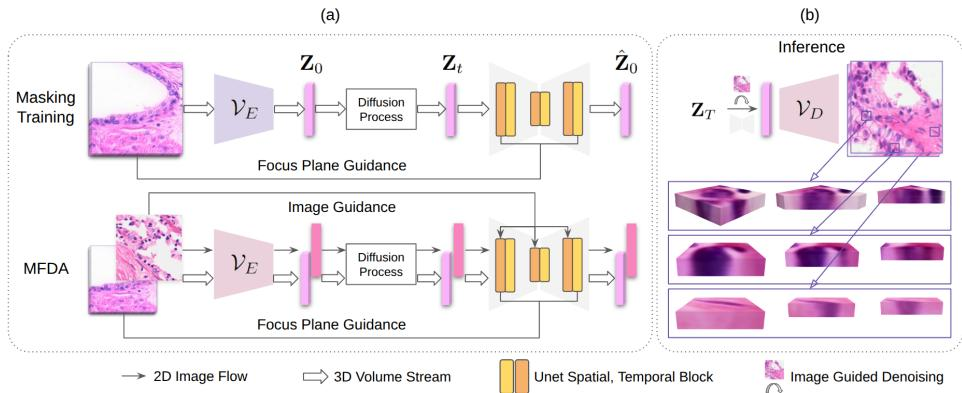
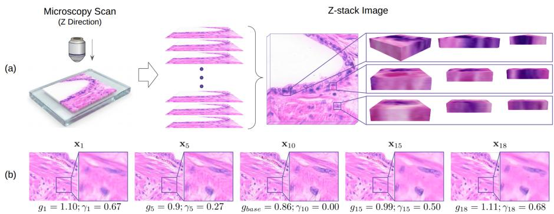
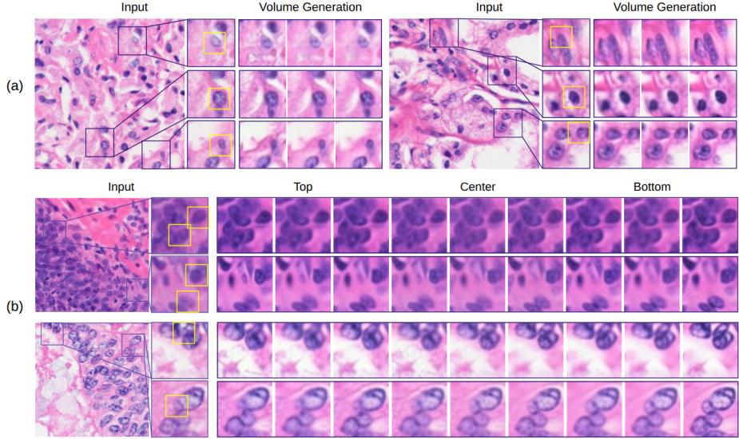

# PathoS2VD: From 2D Histopathology to Pseudo Z-Stack Representations

Jiamu Wang1, Keunho Byeon1, Ji-Uk Kim1, Jin Tae Kwak1, and Heounjeong Go2

1 School of Electrical Engineering, Korea University, Seoul 02841, Korea {taurusmumu, bkh5922, kluki, jkwak}@korea.ac.kr

Department of Pathology, Asan Medical Center, University of Ulsan College of Medicine, Seoul 05505, Korea damul37@amc.seoul.kr

Abstract. For decades, diagnostic pathology has relied on thin twodimensional (2D) tissue sections, despite biological tissues exhibiting inherently three-dimensional (3D) morphological organization. Because a single section captures only one focal plane, important morphological cues along the z-axis are inevitably discarded, limiting tissue representation for both human interpretation and computational analysis. In this work, we propose a generative framework that learns z-axis morphological priors from pathology z-stack data, ofering a cost-efective alternative to dedicated volumetric imaging, and transfers this knowledge to conventional single-plane histopathology. Specifically, an image-tovideo (I2V) latent difusion model (LDM) is trained to synthesize a pseudo z-stack from a single 2D image, capturing plausible morphological variations across adjacent focal planes rather than reconstructing physical tissue volumes. To enable deployment on large-scale clinical datasets without native z-stack acquisition, we further introduce a priorpreserving mixture fine-tuning strategy that adapts the model to new domains while retaining the learned z-axis morphological prior. Extensive experiments demonstrate that the synthesized pseudo z-stacks exhibit realistic cross-plane morphological continuity and consistently improve downstream prostate cancer classification compared with conventional 2D representations. Our results suggest that learning transferable z-axis priors from limited z-stack data provides a practical way to enrich routine pathology images with complementary morphological information. Code: https://github.com/QuIIL/PathoS2VD.

Keywords: Computational Pathology · Generative View Synthesis · Latent Video Difusion · Domain Adaptation · Multiple Instance Learning

## 1 Introduction

Histopathology examination of biopsies and surgical specimens underpins the definitive diagnosis for many diseases. Despite major advances in tissue processing as well as digital and computational pathology, routine clinical practice still relies on thin two-dimensional (2D) tissue sections as the primary substrate for interpretation. As only a small fraction of a three-dimensional (3D) specimen is observed, this workflow is inherently undersampled and can miss morphological information along the tissue depth, potentially leading to biased or uncertain diagnoses [22]. Collapsing complex 3D tissue structures into a 2D single plane can obscure diagnostically relevant morphology and spatial heterogeneity, limiting the reliability of both human assessment and computational models trained on single-plane data.

  
Fig. 1: We aim to synthesize plausible tissue volume along the z-axis surrounding a given image input (right). We first train an I2V difusion model with the masked z-stack dataset to capture the z-axis prior in a sharp range (left top. Next, we finetune the generative model with the z-stack and the cancer image dataset jointly to adapt the z-axis prior onto the target image domain (left bottom).

Recent advances in non-destructive 3D Imaging, such as open-top light-sheet (OTLS) microscopy [8] and micro-computed tomography (microCT) [28], ofer volumetric acquisition and visualization of intact tissues with rich structural context. Such modalities provide complementary morphological information across multiple focal planes that is dificult to infer from a single 2D section. For example, in a 2D single plane, poorly formed glands may appear ambiguous in prostate pathology [21] and infiltrative tumor extensions that may appear only as isolated buds [20]. Deep Learning (DL) approaches have therefore emerged to leverage this volumetric information efectively. Recent pipelines like TriPath [31] utilize 3D feature extractors with attention-based aggregation for patient-level predictions, demonstrating the superior ability of 3D features over 2D analysis. Similarly, CARP3D [6] proposes a computational triage strategy that eficiently sifts through volumetric data using 2D feature extractors and multiple instance learning (MIL) [24] to identify high-risk planes.

However, the clinical adoption of 3D imaging in pathology remains challenging. 3D volumetric datasets are orders of magnitude larger than standard 2D datasets, requiring substantially higher cost for acquisition, storage, and manual volumetric review and annotation. More fundamentally, the vast majority of clinical archives and widely used benchmarks remain 2D only, with billions of slides representing decades of medical history inaccessible to methods that explicitly exploit z-axis morphological information. While recent eforts have attempted to reconstruct volumes through the registration of serial biopsy samples [27] or GAN-based single-cell synthesis [3], these methods either require specialized tissue preparation or lack the capacity to model the complex, multi-cellular architectural changes observed in whole-tissue pathology.

Herein, we propose PathoS2VD (Pathology Slice-to-Volume Difusion), a generative framework for learning transferable z-axis morphological priors from pathology z-stack data. Instead of reconstructing true tissue volumes, PathoS2VD synthesizes plausible pseudo z-stacks that enrich conventional 2D pathology images with complementary cross-plane morphological information. To enable deployment on large-scale clinical datasets without native z-stack acquisition, we further introduce a prior-preserving mixture fine-tuning strategy that transfers the learned z-axis before conventional 2D pathology domains. Experiments on one z-stack dataset and two downstream prostate datasets demonstrate that the generated pseudo z-stacks exhibit realistic cross-plane morphology and consistently improve both patch-level and slide-level cancer classification over 2D baselines.

## 2 Related Method

Computational pathology is often hindered by data scarcity and poor domain generalization. Generative models address these limitations by synthesizing highfidelity training instances. While early approaches relied on VAEs and GANs, Difusion Models (DMs) have emerged as the state-of-the-art, generating images via iterative denoising [37]. Ofering superior semantic fidelity and training stability, DMs are increasingly adopted for complex pathology tasks, including report-guided generation, gigapixel WSI synthesis, and rare-label augmentation.

## 2.1 Video Difusion for Z-axis Morphology Modeling

Compared with a single tissue section, a z-stack captures complementary morphological information across adjacent focal planes. While native 3D imaging techniques such as OTLS and MicroCT provide this information directly, their clinical adoption remains limited, and reconstruction from serial tissue sections requires specialized acquisition protocols that are unavailable in routine pathology [7, 27].

Rather than reconstructing physical tissue volumes, our objective is to learn the gradual morphological variation across ordered focal planes. This setting difers from conventional 3D scene reconstruction, where multiple viewpoints are available, such as NeRF [25] or Gaussian Splatting [15], but naturally resembles video generation, where neighboring frames exhibit strong local correlations. We therefore adopt the Latent Video Difusion Model (LVDM) [1,2] as the backbone and reinterpret the temporal dimension as the z-axis of a pathology z-stack. The spatial-temporal attention mechanism enables the model to capture cross-plane morphological dependencies, which are subsequently transferred to conventional 2D pathology through pseudo z-stack synthesis.

## 3 Preliminaries: Latent Difusion Model

This section reviews latent difusion models (LDMs) [29], which form the basis of LVDMs [2]. LDMs perform DMs in the latent space of a pretrained ${ \mathrm { V A E } } $

Let $\mathbf { x } \in \mathbb { R } ^ { H \times W \times 3 }$ be a RGB image. The VAE encoder $\nu _ { E } ( \cdot )$ encodes x into a latent representation $\mathbf { z } = \mathcal { V } _ { E } ( \mathbf { x } ) \in \mathbb { R } ^ { h \times w \times 4 }$ , where $f = H / h = W / w$ is the downsampling factor. The VAE decoder $\nu _ { D } ( \cdot )$ is trained to reconstruct the input x from the latent representation z such that $\hat { \mathbf { x } } = \mathcal { V } _ { D } ( \mathbf { z } ) \approx \mathbf { x }$

Subsequently, DMs learn the latent data distribution $p _ { d a t a } ( \mathbf { z } )$ by defining the forward and reverse processes. While [10] designs the generative process as a discrete-time random process and score-based models [32] formulates it as stochastic diferential equations (SDEs), EDM [14] provides a common framework that supports customized noisy schedules parameterized by a noise scale $\sigma _ { t }$ . In the forward process $\{ \mathbf { z } _ { t } \} _ { t \in [ 0 , T ] } .$ the clean data $\mathbf { z } _ { 0 }$ is perturbed with Gaussian noise of varying noise scales $\sigma _ { t } \mathbf { : }$

$$
\begin{array} { r } { \mathbf { z } _ { t } = \mathbf { z } _ { 0 } + \sigma _ { t } \epsilon , \quad \mathrm { w h e r e } ~ \epsilon \sim \mathcal { N } ( \mathbf { 0 } , \mathbf { I } ) . } \end{array}\tag{1}
$$

The generation process is modeled as a reverse probability flow ordinary diferential equation (PF-ODE), which establishes a deterministic mapping from the noise distributions to the data distribution. The EDM ODE is given by:

$$
d \mathbf { z } _ { t } = \left[ - \sigma _ { t } \nabla _ { \mathbf { z } _ { t } } \log p ( \mathbf { z } _ { t } ; \sigma _ { t } ) \right] d t\tag{2}
$$

where $\nabla _ { \mathbf { z } _ { t } } \log p ( \mathbf { z } _ { t } ; \boldsymbol { \sigma } _ { t } )$ is the score function, representing the gradient of the log-likelihood with respect to data. To solve this, a time-dependent denoising network $\mathcal { F } _ { \boldsymbol { \theta } } ( \mathbf { z } _ { t } ; \sigma _ { t } )$ is trained to estimate the clean data $\mathbf { z } _ { 0 }$ from a noisy data $\mathbf { z } _ { t }$ The training objective minimizes $L _ { 2 }$ denoising error:

$$
\mathbb { E } _ { \sigma , \mathbf { z } _ { 0 } } \left[ \lambda ( \sigma ) \left. \mathcal { F } _ { \boldsymbol { \theta } } ( \mathbf { z } ; \sigma ) - \mathbf { z } \right. _ { 2 } ^ { 2 } \right]\tag{3}
$$

where $\lambda ( \sigma )$ is a weighting function. [14] shows that representing the denoiser $\mathcal { F } _ { \theta }$ with a noise predictor $\epsilon _ { \theta } ( \cdot )$ yields better performance:

$$
\begin{array} { r } { \mathcal { F } _ { \theta } ( \mathbf { z } , \sigma ) = c _ { \mathrm { s k i p } } ( \sigma ) \mathbf { z } + c _ { \mathrm { o u t } } ( \sigma ) \epsilon _ { \theta } ( c _ { \mathrm { i n } } ( \sigma ) \mathbf { z } ; c _ { \mathrm { n o i s e } } ( \sigma ) ) } \end{array}\tag{4}
$$

where $c _ { \mathrm { s k i p } } , \ c _ { \mathrm { o u t } } , \ c _ { \mathrm { i n } }$ , and $c _ { \mathrm { n o i s e } }$ are EDM scaling functions, for which we use standard EDM hyperparameters. Finally, the score function can be expressed by $\mathcal { F } _ { \theta }$ as $\begin{array} { r } { \nabla _ { \mathbf { z } _ { t } } \log { p ( \mathbf { z } _ { t } ; \sigma _ { t } ) } = \frac { \mathcal { F } _ { \theta } ( \mathbf { z } _ { t } ; \sigma _ { t } ) - \mathbf { z } _ { t } } { \sigma _ { t } ^ { 2 } } } \end{array}$ . Once trained, samples are generated by initializing $\mathbf { z } _ { T }$ from noise and numerically integrating Eq.(2) on $t = T  0$

  
Fig. 2: (a) A z-stack image is a sequence of slices that capture structural details across depths. (b) $\{ x _ { k } \} _ { k = 1 , 5 , 1 0 , 1 5 , 1 8 }$ from a raw z-stack sample with their absolute blur $g _ { k }$ and relative blur $\gamma _ { k } . \ x _ { 1 0 }$ is chosen as the focal plane as $\gamma _ { 1 0 } = 0$ in this example.

## 4 Method

We leverage two types of datasets. The first is a prostate pathology z-stack dataset $\mathcal { D } _ { \mathbf { z s t a c k } }$ (source), used to learn z-axis prior from a 2D observation. The second is a 2D cancer classification dataset $\mathcal { D } _ { \mathbf { c a n c e r } }$ (target), which is used for domain adaptation and downstream clinical evaluation of the generated z-stacks. In this section, we present the curation of the z-stack data, our two-stage training strategy, designed to address the spatial domain shift between the source and target datasets, and inference strategy for volume generation and expansion.

## 4.1 Z-stack Dataset Curation

Z-stack imaging captures a sequence of slices/frames at discrete focal depths, which is often used to overcome the limitations of shallow depth of field in microscopy. By combining multiple focal plane slices, z-stack imaging can retain structural details across diferent depths, as in Fig. 2 (a). In our study, we propose to leverage z-stack imaging to learn z-axis morphological priors and synthesize pseudo z-stack representations from a single 2D image.

Let $\{ \mathbf { X } _ { r a w } ^ { ( i ) } \} _ { i = 1 } ^ { N _ { s } }$ denote a collection of $N _ { s }$ raw z-stack tissue samples. Each volume $\mathbf { X } _ { r a w } ^ { ( i ) } = \{ \mathbf { x } _ { k } ^ { ( i ) } \} _ { k = 1 } ^ { N _ { o } }$ comprises $N _ { o }$ RGB slices $\mathbf { x } _ { r a w , k } ^ { ( i ) } \in \mathbb { R } ^ { H \times W \times 3 }$ , corresponding to diferent focal planes of a tissue section, where $N _ { o } = 1 9$ and slices are acquired at a focal interval of 0.3 µm. While these z-stack volumes provide rich cross-plane morphological information, the individual slices $\mathbf { x } _ { r a w , k } ^ { ( i ) }$ are not uniformly sharp. Slices that are distal from the optimal focal plane exhibit a varying degree of defocus blur $\left( \mathrm { F i g . ~ 2 ~ ( b ) } \right)$ , which is detrimental to the accurate representation of tissue morphology.

To account for defocus blur, we adopt a physical defocus model where a blurred image $\mathcal { T } _ { b }$ is the convolution of a sharp image I with a Gaussian point spread function (PSF) $G ( g _ { k } )$ , where $g _ { k }$ represents the blur magnitude at depth k: ${ \mathcal { T } } _ { b } = { \mathcal { T } } * G ( g _ { k } )$ . Traditional blur estimation methods, such as Laplacian variance [26], are insuficient, as they are content-dependent, in which textured tissue regions yield higher blur scores than smooth regions, regardless of the blur degree.

To address this, we formulate a relative blur metric $\gamma _ { k } ^ { ( i ) }$ under two key assumptions: 1) all slices $\mathbf { x } _ { r a w , k } ^ { ( i ) }$ within the ith volume share the same $" \mathrm { t r u e } "$ content $\boldsymbol { \mathcal { T } ^ { ( i ) } }$ and 2) the sharpest slice in the volume is formulated as $\mathcal { T } ^ { ( i ) } \ast G ( g _ { b a s e } ^ { ( i ) } )$ and other slices result from applying an additional relative blur kernel $\gamma _ { k } ^ { ( i ) }$ , defined as:

$$
\mathbf { x } _ { r a w , k } ^ { ( i ) } \approx \mathcal { T } ^ { ( i ) } * G ( g _ { b a s e } ^ { ( i ) } ) * G ( \gamma _ { k } ^ { ( i ) } )\tag{5}
$$

where $g _ { b a s e } ^ { ( i ) } = \mathrm { m i n } _ { k } ( g _ { k } ^ { ( i ) } )$ is the blur score of the sharpest slice within the volume (Fig. 2 (b)). Following [38], we calculate the absolute blur degree $g _ { k }$ for each slice. Using the additive property of Gaussian variances under convolution, $( g _ { k } ) ^ { 2 } = ( g _ { b a s e } ) ^ { 2 } + ( \gamma _ { k } ) ^ { 2 }$ , we derive the relative blur parameter:

$$
\begin{array} { r } { \gamma _ { k } ^ { ( i ) } = \sqrt { \left( g _ { k } ^ { ( i ) } \right) ^ { 2 } - \left( g _ { b a s e } ^ { ( i ) } \right) ^ { 2 } } . } \end{array}\tag{6}
$$

Accordingly, the sharpest slice with $\gamma _ { k } ^ { ( i ) } = 0$ corresponds to the optimal focal plane, and the higher the value of $\gamma _ { k } ^ { ( i ) }$ , the greater degree of blur it possesses relative to the sharpest slice in the ith volume.

We utilize the relative blur metric $\gamma _ { k } ^ { \left( i \right) } = 0$ to perform focal plane alignment. Specifically, we shift the slice indices in each volume $\mathbf { X } _ { r a w } ^ { ( i ) }$ such that the slice corresponding to the optimal focal plane, where $\gamma _ { k } = 0 ,$ is centered in the middle of the volume. After shifting, the slice at index $k = ( N _ { o } + 1 ) / 2$ has $\gamma _ { k } = 0$ If the focal plane is near the volume boundary, this shift creates empty slots, which we fill with pseudo-slices containing infinite blur $( \gamma _ { k } \to \infty )$ . Trimming and padding all volumes to a fixed depth of $N _ { o } = 1 1$ , corresponding to a ±1.5µm tissue context, we construct a 3D z-stack dataset, designated as:

$$
\mathcal { D } _ { z s t a c k } = \{ \mathbf { X } ^ { ( i ) } \} _ { i = 1 } ^ { N _ { s } } , \quad \mathbf { X } ^ { ( i ) } = \{ \mathbf { x } _ { k } ^ { ( i ) } \} _ { k = 1 } ^ { N _ { o } }\tag{7}
$$

where $\mathbf { X } ^ { ( i ) }$ denotes the refined volume and $\mathbf { x } _ { k } ^ { ( i ) }$ represents refined individual slices within the volume.

## 4.2 Pseudo Z-stack Generation

PathoS2VD is built upon LVDM [2] that augments a standard 2D U-Net backbone, parameterized by θ, with temporal modules that are parameterized by ϕ. The temporal modules include 3D convolutional blocks and temporal attention layers, designed to capture dependencies across the video frames. In our settings, we reinterpret the temporal dimension as the ordered focal-plane dimension of a pathology z-stack. Thus, the image backbone θ processes each slice as an independent image, while the temporal layers ϕ treat them as a sequence with depth structural correlations along the tissue depth.

Given a 2D image $\mathbf { y } ^ { ( i ) } \in \mathbb { R } ^ { H \times W \times 3 }$ , PathoS2VD aims to synthesize a pseudo z-stack tissue $\mathbf { X } ^ { ( i ) } = \{ \mathbf { x } _ { k } ^ { ( i ) } \} _ { k = 1 } ^ { N _ { o } }$ that preserves the tissue morphology while introducing plausible z-axis variations. Given a pretrained sampler $p _ { \theta , \phi } ( \mathbf { Z } _ { t - 1 } | \mathbf { Z } _ { t } )$ and semantic guidance $\mathbf { c } ^ { ( i ) } = C L I P ( \mathbf { y } ^ { ( i ) } )$ $\mathbf { X } ^ { ( i ) }$ is obtained by decoding a latent clean sample $\mathbf { Z } _ { 0 }$ that iteratively denoised from a sampled Gaussian Noise $\mathbf { Z } _ { T } ;$

$$
\mathbf { X } ^ { ( i ) } = \mathcal { V } _ { D } ( \mathbf { Z } _ { 0 } ) , \mathbf { Z } _ { 0 } \sim p _ { \theta , \phi } ( \mathbf { Z } _ { 0 } | \mathbf { Z } _ { 1 \sim T } , \mathbf { c } ^ { ( i ) } )\tag{8}
$$

With $N _ { o } = 1 1$ , our generative model extends an image into a tissue of ±1.5µm thickness, defined as: $\tilde { G _ { 3 \mu m } } : \mathbb { R } ^ { H \times W \times 3 } \to \mathbb { R } ^ { N _ { o } \times H \times W \times 3 } , \mathrm { i . e . , } \mathbf { X } ^ { ( i ) } = G _ { 3 \mu m } ( \mathbf { y } ^ { ( i ) } ) =$ $[ \mathbf { x } _ { 1 } ^ { ( i ) } , \mathbf { x } _ { 2 } ^ { ( i ) } , \ldots , \mathbf { x } _ { N _ { o } } ^ { ( i ) } ]$ ], where input image $\mathbf { y } ^ { ( i ) }$ corresponds to the focal plane of $\mathbf { X } ^ { ( i ) }$

## 4.3 Eficient Pseudo Z-stack Expansion

To generate a thicker tissue context beyond $\pm 1 . 5 \mu m$ , we propose an iterative outpainting strategy that extends PathoS2VD with a volume-expansion generator: $\tilde { G _ { 6 \mu m } } : \mathbb { R } ^ { \tilde { H } \times W \times 3 } \to \mathbb { R } ^ { 2 N _ { o } \times H \times W \times 3 }$ . The key idea is to extrapolate along the depth axis in both directions by reusing the boundary slices of the 3µm-thick pseudo volume as conditioning inputs for subsequent upward and downward generations, respectively. Specifically, given ${ \bf X } ^ { c e n t e r }$ , the top slice ${ \bf x } _ { 1 } ^ { c e n t e r }$ and bottom slice $\mathbf { x } _ { N _ { o } } ^ { c e n t e r }$ serve as the conditioning inputs $\mathbf { c } ^ { u p }$ and $\mathbf { c } ^ { d o w n }$ , respectively.

Sequentially generating up and down volumes introduces substantial computational burden. Using standard classifier-free guidance (CFG) [11], it requires two U-Net evaluations at each timestep t (conditional c and unconditional ∅): $\tilde { \epsilon } _ { t } = w \epsilon _ { \theta , \phi } ( \mathbf { z } _ { t } , \mathbf { c } ) + ( 1 - w ) \epsilon _ { \theta , \phi } ( \mathbf { z } _ { t } , \emptyset )$ , where w is CFG guidance weight. Hence, generating three z-stacks $( { \bf X } ^ { u p } , { \bf X } ^ { c e n t e r } , { \bf X } ^ { d o w n } )$ requires 6 evaluations per timestep.

To mitigate this, we propose a shared Null-space acceleration strategy. Our key assumption is that adjacent tissue blocks share similar structural distributions (stain, cell density, background texture), implying that the unconditional score estimate $\epsilon _ { \theta , \phi } ( \mathbf { z } _ { t } , \emptyset )$ remains stable across locally adjacent volume blocks. Under this assumption, we fix the initial random noise seed $\mathbf { Z } _ { T }$ across all three z-stack generations. During the inference of ${ \bf X } ^ { c e n t e r }$ , we cache the unconditional noise prediction $\mathcal { M } = \{ \epsilon _ { t } ^ { \bar { \theta } } = \epsilon _ { \theta , \phi } ( \mathbf { Z } _ { t } ^ { c e n t e r } , \varnothing ) \} _ { t = 1 } ^ { T }$ . For the peripheral volumes, we bypass the unconditional forward pass and reuse the cached $\bar { \epsilon } _ { t } ^ { \emptyset }$ :

$$
\tilde { \epsilon } _ { t } ^ { k } = w \epsilon _ { \theta , \phi } ( \mathbf { Z } _ { t } ^ { k } , \mathbf { c } ^ { k } ) + ( 1 - w ) \epsilon _ { t } ^ { \emptyset }\tag{9}
$$

where $k \in \{ u p , d o w n \}$ . This reduces the computational cost from 6 to 4 evaluations per step, providing a 33% speedup. The complete procedure is detailed in $\mathrm { A l g . ~ 1 }$

The generated upward and downward pseudo z-stacks overlap with the central pseudo z-stack. One option is to stitch the overlapping regions to construct a continuous expanded z-stack:

$$
\begin{array} { r } { \{ \mathbf { x } _ { k } ^ { u p } \} _ { k = \frac { D } { 2 } } ^ { D } = \{ \mathbf { x } _ { k } ^ { c e n t e r } \} _ { k = 1 } ^ { \frac { D } { 2 } } , \quad \{ \mathbf { x } _ { k } ^ { d o w n } \} _ { k = 1 } ^ { \frac { D } { 2 } } = \{ \mathbf { x } _ { k } ^ { c e n t e r } \} _ { k = \frac { D } { 2 } } ^ { D } . } \end{array}\tag{10}
$$

Algorithm 1 Expansion with Shared Null-space   
1: Input: Image y, Difusion Steps T, CFG Scale w, Model $( \epsilon _ { \theta , \phi } , \mathcal { F } _ { \theta , \phi } )$   
2: Output: Bag of Instances B.   
3: Extract embedding $\mathbf { c } ^ { c e n t e r } = \mathrm { C L I P } ( \mathbf { y } ) .$   
4: Sample initial noise ${ \bf Z } _ { T } ^ { c e n t e r } = { \bf Z } _ { T } \sim \mathcal { N } ( { \bf 0 } , { \bf I } )$   
5: Initialize empty cache $\mathcal { M } = \{ \}$   
6: for $t = T$ to 1 do   
7: $\epsilon _ { t } ^ { \parallel } \gets \epsilon _ { \theta , \phi } ( \mathbf { Z } _ { t } ^ { c e n t e r } , \emptyset , t )$ {Unconditional pass}   
8: $\epsilon _ { t } ^ { c o n d } \gets \epsilon _ { \theta , \phi } ( \mathbf { Z } _ { t } ^ { c e n t e r } , \bar { \mathbf { c } } ^ { c e n t e r } , t )$ {Conditional pass}   
9: $\tilde { \epsilon } _ { t }  \epsilon _ { t } ^ { \emptyset } + w \cdot ( \epsilon _ { t } ^ { c o n d } - \epsilon _ { t } ^ { \emptyset } )$ {CFG}   
10: $\mathbf { Z } _ { t - 1 } ^ { c e n t e r }  \mathrm { O D E }$ sampler $( \mathbf { Z } _ { t } ^ { c e n t e r } , \tilde { \epsilon } _ { t } )$   
11: $\mathcal { M } [ t ]  \epsilon _ { t } ^ { \emptyset }$ {Cache null-conditional noise}   
12: end for   
13: Decode ${ \bf X } ^ { c e n t e r } = [ { \bf x } _ { 1 } , \ldots , { \bf x } _ { D } ]  { \mathcal { D } } ( { \bf Z } _ { 0 } ^ { c e n t e r } )$   
14: $\mathbf { c } ^ { u p } \gets \mathrm { C L I P } ( \mathbf { x } _ { 1 } ) , \mathbf { c } ^ { d o w n } \gets \mathrm { C L I P } ( \mathbf { x } _ { D } ) .$   
15: ${ \bf Z } _ { T } ^ { u p } = { \bf Z } _ { T } ^ { d o w n } = { \bf Z } _ { T }$ . {Reuse initial noise}   
16: for $t = T$ to 1 do   
17: Retrieve $\epsilon _ { t } ^ { 0 } \gets { \mathcal { M } } [ t ] .$ . {Reuse cache}   
18: for $k \in \{ u p ,$ down} do   
19: $\epsilon _ { t } ^ { c o n d } \dot {  } \epsilon _ { \theta , \phi } ( \mathbf { Z } _ { t } ^ { k } , \mathbf { c } ^ { k } , t )$   
20: $\tilde { \epsilon } _ { t } ^ { k } \gets \epsilon _ { t } ^ { \emptyset } + w \cdot ( \epsilon _ { t } ^ { c o n d } - \epsilon _ { t } ^ { \emptyset } )$   
21: $\mathbf { Z } _ { t - 1 } ^ { k }  \mathrm { O D E }$ sampler $( \bar { \mathbf Z } _ { t } ^ { k } , \tilde { \epsilon } _ { t } ^ { k } )$   
22: end for   
23: end for   
24: Decode $\mathbf { X } ^ { u p } \gets \mathcal { D } ( \mathbf { Z } _ { 0 } ^ { u p } ) , \mathbf { X } ^ { d o w n } \gets \mathcal { D } ( \mathbf { Z } _ { 0 } ^ { d o w n } )$   
25: Construct Bag $\boldsymbol { B } = \mathbf { X } ^ { u p } \cup \mathbf { X } ^ { c e n t e r } \cup \mathbf { X } ^ { d o w n }$   
26: return B

Alternatively, all generated slices can be retained, treating the overlapping regions as multiple plausible realizations of the same tissue context. The choice depends on the downstream application, and both strategies are supported by the proposed inference framework.

## 4.4 Blur-aware Masking Z-stack Training

We train PathoS2VD on $\mathcal { D } _ { z s t a c k }$ to learn cross-plane morphological correlations. The VAE is fine-tuned following the standard objective in [29]. Since slices farther from the focal plane sufer from severe defocus efect, directly supervising all the slices may encourage the model to reproduce the defocus efect instead of tissue morphology. To mitigate this issue, we introduce a blur-aware masking strategy, which utilizes the relative blur metric $\gamma _ { k } ^ { ( i ) }$ (Section 4.1). For each z-stack $\mathbf { X } ^ { ( i ) }$ , we define a binary validity mask $M ^ { ( i ) } \in \dot { \{ 0 , 1 \} } ^ { N _ { o } }$ by setting a global blur threshold $\tau _ { b l u r }$ (empirically set to 0.2). The validity mask for slice k in volume $\mathbf { X } ^ { ( i ) }$ is defined as:

$$
M _ { k } ^ { ( i ) } = \mathbb { 1 } ( \gamma _ { k } ^ { ( i ) } < \tau _ { b l u r } ) .\tag{11}
$$

where 1 is the indicator function. Any padding/pseudo slices are naturally excluded by set $\mathrm { i n g } ( \gamma \to \infty )$

To adopt plane-guided volume reconstruction, we use the image embedding $\mathbf { c } ^ { ( i ) }$ of the focal plane in $\mathbf { X } ^ { ( i ) }$ as the condition. The training objective for volume reconstruction in the latent space $\mathbf { Z } ^ { ( i ) } = \mathcal { V } _ { E } ( \mathbf { X } ^ { ( i ) } )$ can be written as:

$$
\mathcal { L } _ { b l u r - a w a r e } = \mathbb { E } _ { i , \sigma } [ \lambda ( \sigma ) M ^ { ( i ) } \left| \left| \mathcal { F } _ { \theta , \phi } ( \mathbf { Z } ^ { ( i ) } ; \sigma , \mathbf { c } ^ { ( i ) } ) - \mathbf { Z } ^ { ( i ) } \right| \right| _ { 2 } ^ { 2 } ]\tag{12}
$$

This ensures the generated z-stack is symmetrically aligned with the input image, and the model focuses on learning 3D tissue morphology from the z-stack data, efectively ignoring optical aberrations.

## 4.5 Mixture Fine-tuning for Domain Adaptation (MFDA)

We denote the z-stack dataset as the source dataset $D _ { z s t a c k }$ and the target image cancer dataset as $\mathcal { D } _ { c a n c e r } = \{ \mathbf { y } ^ { ( j ) } \} _ { j = 1 } ^ { N _ { t } }$ , which contains $N _ { t }$ number of RGB images $\mathbf { y } ^ { ( j ) } \in \mathbb { R } ^ { H \times W \times 3 }$ . Although $D _ { s t a c k }$ provides PathoS2VD with pathology structural priors, its appearance distribution difers from $D _ { c a n c e r }$ . Directly applying the pretrained model often results in domain-shift artifacts $( \mathrm { e . g . }$ , stain mismatch).

Using the static volume constructed by duplicating a target image $N _ { o }$ times collapses the depth-wise structural variations. Another option is to fine-tune the spatial layers in $\theta$ on target images as in [4]; however, we observed that this led to temporal instability, i.e., slice-to-slice inconsistency (flicker), likely because imageonly supervision disrupts temporal dynamics learned during z-stack training (Section 4.4).

Following the joint image-video optimization paradigm adopted in recent video generation models, we adopt a Mixture Fine-tuning strategy for Domain Adaptation (MFDA) that smoothly transfers the model to the target image distribution. Unlike previous methods, our objective is not to improve video generation quality but to preserve the learned z-axis morphological prior while adapting the spatial appearance to conventional pathology datasets.

We construct training batches comprising two streams: 1) Z-stack streams $( \mathbf { X } \in \mathcal { D } _ { z s t a c k } ) ;$ 2) Target image streams $( \mathbf { y } \in \mathcal { D } _ { c a n c e r } )$ . The z-stack stream is optimized using the blur-aware objective in $\mathrm { E q . 1 2 }$ , preserving cross-plane morphological consistency. For the target image stream, only the spatial backbone $\theta$ is updated by bypassing the temporal modules $\phi ,$ allowing the model to adapt to the target appearance without disrupting the learned z-axis correlations. The key insight is to uncouple the updates but optimize the parameters jointly for 2D and 3D modules. Similar to Stage I, the VAE is first fine-tuned on the mixed data before optimizing the difusion model. Then, for the LDM, we use image embedding $\mathbf { c } ^ { ( \bar { j } ) }$ of $\mathbf { y } ^ { ( j ) }$ as an image condition to guide the generation. The training objective is a standard image difusion loss applied to independent images in the latent space $\mathbf { z } ^ { ( j ) } = \mathcal { E } ( \mathbf { y } ^ { ( j ) } )$

$$
\begin{array} { r } { \mathcal { L } _ { s p a t i a l - a d a p t } = \mathbb { E } _ { j , \sigma } [ \lambda ( \sigma ) \left| \left| \mathcal { F } _ { \theta } ( \mathbf { z } ^ { ( j ) } ; \sigma , \mathbf { c } ^ { ( j ) } ) - \mathbf { z } ^ { ( j ) } \right| \right| _ { 2 } ^ { 2 } } \end{array}\tag{13}
$$

The joint objective is $\mathcal { L } = \mathcal { L } _ { b l u r - a w a r e } + \mathcal { L } _ { s p a t i a l - a d a p t }$ . MFDA enables the spatial backbone to adapt to the appearance distribution of conventional pathology datasets while maintaining the z-axis morphological prior learned from the source z-stack data.

## 5 Experiment

## 5.1 Datasets

Our experiments involve one source $\mathcal { D } _ { z s t a c k }$ and two downstream 2D prostate datasets $\mathcal { D } _ { t a r g e t } . \ D _ { z s t a c k }$ consists of 80 whole-slide images (WSIs), each scanned at 19 focal planes with a spacing of 0.3 µm (approximately 5.7 µm total depth) using the VISQUE DPS LH510 system (Vieworks Co., Ltd.), a high-throughput brightfield scanner equipped with a three-camera Realtime Extended Focus module. From these WSIs, we extract 984,252 z-stack patches. Following Section 4.1, the base blur $g _ { b a s e }$ is estimated for every patch, and samples whose $g _ { b a s e }$ deviates by more than two standard deviations from the population mean are discarded. This results in 592,496 high-quality z-stack patches, which serve as the source data for learning transferable z-axis morphological priors.

We evaluate the learned z-axis prior on two 2D prostate datasets. (i) AGGC2022 [12] is a prostate cancer grading dataset with five categories (Background, Benign (BN), Gleason Grade 3 (G3), Gleason Grade 4 (G4), and Gleason Grade 5 (G5)). Following the split in [17], subsets 1 and 2 are used for training (87,720 patches) and validation (48,378 patches), while subset 3, scanned by six diferent scanner vendors, is used for testing (187,595 patches), providing a challenging cross-scanner evaluation. (ii) SICAPv2 [30] is a prostate whole-slide dataset containing 124 training WSIs and 31 testing WSIs. Following the oficial annotations, slide-level classification is performed over four tissue categories: BN, G3, G4, and G5. Unless otherwise specified, all image patches are center-cropped to 256 × 256 pixels and scanned at 20× magnification.

## 5.2 Downstream Cancer Diagnostic Evaluation

To evaluate whether the learned z-axis prior provides complementary information for downstream diagnosis, we perform both patch-level and slide-level classification using frozen pathology foundation model features, and we use UNI [5] in our experiment. Given an input patch $\mathbf { y } ^ { ( i ) } \in \mathcal { D } _ { t a r g e t } ,$ we extract the raw feature $\mathbf { f } _ { 0 } ^ { ( i ) } = \mathcal { E } _ { F M } ( \mathbf { y } ^ { ( i ) } ) \in \mathbb { R } ^ { D _ { F M } }$ . The synthesized pseudo z-stack $\mathbf { X } ^ { ( i ) } = \{ \mathbf { x } _ { k } ^ { ( i ) } \} _ { k = 1 } ^ { N _ { o } }$ is encoded slice-by-slice, producing a set of slice features $B _ { f } ^ { ( i ) } = \{ \mathbf { f } _ { k } ^ { ( i ) } \} _ { k = 1 } ^ { N _ { o } }$ . The slice features are then aggregated into a z-stack representation $\mathbf { f } _ { s t a c k } ^ { ( i ) } = F u s i o n ( \mathcal { B } _ { f } ^ { ( i ) } )$ where F usion(·) denotes a feature aggregation module. We evaluate several commonly used ensemble strategies, including Max Pool [16], DSMIL [18], Self Attention [23,34]. The aggregated feature is finally combined with the raw image feature through residual addition, $\mathbf { f } _ { f i n a l } ^ { ( i ) } = \mathbf { f } _ { 0 } ^ { ( i ) } + \mathbf { \bar { f } } _ { s t a c k } ^ { ( i ) }$

For patch-level classification, the final patch representation $\mathbf { f } _ { f i n a l } ^ { ( i ) }$ is fed into a 2-layer MLP classifier, while the 2D baseline uses only the raw feature $\mathbf { f } _ { 0 } ^ { ( i ) }$ . For slide-level classification, each whole-slide image is represented as a bag of fused patch features, which are further aggregated by ABMIL to obtain a slide-level representation before linear classification. The 2D baseline follows the same pipeline using only the raw patch features.

## 6 Results

Table 1: Quantitative Assessment of Z-stack Generation Fidelity. We evaluate the reconstruction quality of the generated volumes against the ground truth Z-stack dataset.
<table><tr><td>Method</td><td>SSIM ↑</td><td>LPIPS ↓</td><td>FID ↓</td><td>FVD ↓</td><td>Orientation Similarity ↑ Frobenius ↓</td><td>ST</td><td>Anisotropy MAE↓</td><td>Vz Wasserstein ↓ Evolutioncorr ↑</td><td>ST</td></tr><tr><td>PathoS2VD</td><td>0.6794 0.1797 13.34 31.71</td><td></td><td></td><td></td><td>0.9407</td><td>0.7727</td><td>0.0306</td><td>0.0234</td><td>0.8949</td></tr><tr><td>Pix2Pix</td><td>0.6331</td><td>0.2436</td><td>14.20</td><td>140.59</td><td>0.8612</td><td>257.5114</td><td>0.0567</td><td>0.0914</td><td>0.7707</td></tr><tr><td>OpenSoraPlan</td><td>0.5410</td><td>0.3065</td><td>42.96</td><td>87.99</td><td>0.9025</td><td>3.5136</td><td>0.0433</td><td>0.0505</td><td>0.8803</td></tr></table>

## 6.1 Quantitative Fidelity and Qualitative Analysis of Generated Pseudo Z-stacks

We first evaluate the generation fidelity of PathoS2VD on the source z-stack dataset $\mathcal { D } _ { z s t a c k }$ . Besides our SVD-based model, we compare against two representative baselines: the transformer-based video difusion model OpenSoraPlan [19] and the image-to-image GAN Pix2Pix [13]. We report SSIM [35], LPIPS [36], FID [9], and FVD [33] to evaluate image and volume fidelity. To further assess biologically meaningful cross-plane morphology, we additionally adopt 3D structure tensor (ST)-based metrics, including Orientation Similarity, ST Frobenius, Anisotropy MAE, Vz Wasserstein, and ST Evolutioncorr.

To quantify the preservation of cross-plane morphology, we further introduce structure tensor (ST)-based metrics. Specifically, we compute the 3D structure tensor for each z-stack and compare both local orientation and anisotropic tissue organization. Orientation Similarity measures the cosine similarity between the principal eigenvectors of paired structure tensors, while ST Frobenius measures the distance between the corresponding structure tensors. Anisotropy MAE evaluates the consistency of local structural anisotropy. Finally, Vz Wasserstein and ST Evolution $\iota _ { c o r r }$ characterize the statistical evolution of tissue morphology along the z-axis by comparing the distributions of principal orientation components and inter-slice structural changes, respectively.

As shown in Table 1, PathoS2VD consistently outperforms the other two models across all evaluation metrics. Compared with Pix2Pix, PathoS2VD improves SSIM by 7.3% while reducing LPIPS, FID, and FVD by 26.2%, 6.1%, and

Table 2: Quantitative Assessment of Generation Fidelity. We evaluate the reconstruction quality of the central slice in the generated volume against the input AGGC2022 image across diferent cancer grades.
<table><tr><td rowspan="2">Metric</td><td rowspan="2">Stage</td><td colspan="6">Gleason Grade Class</td></tr><tr><td>Background</td><td>Benign</td><td>G3</td><td>G4</td><td>G5</td><td>Total</td></tr><tr><td rowspan="3">SSIM ↑</td><td>Zero-shot SVD</td><td>0.6682</td><td>0.7075</td><td>0.6644</td><td>0.6651</td><td>0.6693</td><td>0.6339</td></tr><tr><td>PathoS2VD</td><td>0.8115</td><td>0.7884</td><td>0.7755</td><td>0.7803</td><td>0.7556</td><td>0.7823</td></tr><tr><td>PathoS2VD w/ MFDA</td><td>0.8249</td><td>0.7940</td><td>0.7879</td><td>0.7902</td><td>0.7607</td><td>0.7915</td></tr><tr><td rowspan="3">LPIPS ↓</td><td>Zero-shot SVD</td><td>0.2498</td><td>0.2228</td><td>0.2598</td><td>0.2488</td><td>0.2466</td><td>0.2712</td></tr><tr><td>PathoS2VD</td><td>0.1358</td><td>0.1475</td><td>0.1548</td><td>0.1530</td><td>0.1606</td><td>0.1504</td></tr><tr><td>PathoS2VD w/ MFDA</td><td>0.1250</td><td>0.1429</td><td>0.1397</td><td>0.1402</td><td>0.1541</td><td>0.1404</td></tr></table>

77.4%, respectively. Compared with OpenSoraPlan, the improvements are even larger, particularly in FVD (-63.9%), indicating substantially better cross-plane consistency.

The ST-based metrics further demonstrate that PathoS2VD preserves biologically meaningful cross-plane morphology. Orientation Similarity reaches 0.9407, indicating that the dominant local structural orientations are well preserved throughout the synthesized z-stack. Meanwhile, the substantially lower ST Frobenius distance (0.77 versus 4.82 and 257.51) suggests that the local spatial organization of tissue closely matches the ground truth. Consistently, the lowest Anisotropy MAE indicates that the generated pseudo z-stacks preserve the directional coherence of tissue microstructures more faithfully than competing methods. Unlike the previous metrics, which compare local structural similarity, Vz Wasserstein and ST Evolutioncorr evaluate the statistical evolution of morphology along the z-axis. PathoS2VD achieves the lowest Vz Wasserstein distance (0.0234) and the highest ST Evolution (0.8949), demonstrating that it more faithfully reproduces the gradual morphological transitions across neighboring focal planes. These observations suggest that the learned z-axis prior captures not only the appearance of individual slices but also their cross-plane morphological progression.

It is worth noting that OpenSoraPlan is originally designed for first-frameconditioned video generation with a temporal compression ratio of 4. In our experiments, we only replaced the first-frame condition with a middle-slice condition while leaving the remaining architecture unchanged. Consequently, its causal design and aggressive temporal compression are not well matched to the symmetric and fine-grained nature of pathology z-stacks. These observations highlight that z-stack synthesis requires task-specific modeling of cross-plane morphology rather than directly transferring generic video generation models.

To evaluate the proposed prior-preserving mixture fine-tuning strategy, we compare the generated central slice with the input target image. As shown in Table 2, MFDA further improves SSIM by 1.18% and reduces LPIPS by 6.65% over the zero-shot model, demonstrating the importance of bridging the appearance gap between the source z-stack data and the target pathology domain.

  
Fig. 3: Qualitative visualization of generated volumes with three representative slices $( x _ { 1 } , x _ { 6 } , x _ { 1 1 } )$ for each volume. (a) Two samples of 3µm generated volumes, with yellow boxes highlighting specific morphological evolutions along the z-axis, including focus shifts (blur to sharp), cellular rotation, and shape stretching, demonstrating the model’s ability to simulate realistic optical sectioning. (b) Top, Center, and Bottom blocks of extended 6µm volume generation from Benign tissue (top) and Gleason Grade 5 (bottom). The sequence demonstrates consistent anatomical continuity over a larger depth, capturing complex volumetric events such as cellular overlapping and significant focal plane transitions (scanner approach efect).

We further observed a class-dependent performance gradient: benign and lowgrade tissue classes (background, Benign, and G3) achieved higher fidelity scores compared to high-grade cancer classes (G4 and G5). We attribute this to the distribution of the source z-stack dataset, which is predominantly composed of benign or healthy tissue structures. Consequently, the model possesses stronger priors for benign morphologies.

To verify that PathoS2VD learns true volumetric morphology rather than simple 2D repetitions, we qualitatively inspect the generated pseudo z-stacks in Fig. 3(a) shows representative 3µm generations by visualizing slices $[ x _ { 1 } , x _ { 6 } , x _ { 1 1 } ]$ The synthesized sequences exhibit the "slow motion" characteristic of microscopic optical sectioning. As highlighted by the yellow boxes, we observed morphological evolution along the depth: 1) Optical sectioning efects: the cell appears smaller and blurrier when distant from the focal plane (left row 1) or progressively becomes larger and sharper as the focal plane intersects the cell body (left row 3; right row 1 and 2) and 2) Non-linear deformations: cellular rotation (left row 2) and shape stretching (right row 3) indicate that the model has learned the complex 3D geometry of tissue structures. Moreover, Fig. 3 (b) demonstrates the capability of our iterative expansion strategy across distinct cancer grades (benign vs G5). We visualized the top, center, and bottom blocks from each to span the full 6µm depth. The extended range revealed more pronounced cellular dynamics. We observed distinct through-focus optical efects where cell contours transition from complete defocus to sharp (row 2 bottom; row 4). Furthermore, the extended depth captured complex spatial relationships, such as cell occlusion (row 1 bottom; row 3) and cross-section variations (row 1 top; row 2 top).

Table 3: Quantitative comparison of feature aggregation methods on patch-level (AGGC2022) and slide-level (SICAPv2) classification tasks. The best result for each dataset and metric is shown in bold.
<table><tr><td rowspan="2">Method</td><td colspan="3">AGGC2022 (Patch-level)</td><td colspan="3">SICAPv2 (Slide-level)</td></tr><tr><td>Acc</td><td>W-F1</td><td>M-F1</td><td>Acc</td><td>W-F1</td><td>M-F1</td></tr><tr><td>2D MLP Baseline</td><td>0.8131±0.0008</td><td>0.8146±0.0024</td><td>0.6780±0.0015</td><td>0.7188±0.0255</td><td>0.6490±0.0267</td><td>0.4501±0.0495</td></tr><tr><td>Max Pool</td><td>0.8234±0.0048 0.8247±0.0042</td><td></td><td>0.6834±0.0013</td><td>0.7812±0.0000 0.7449±0.0139</td><td></td><td>0.6273±0.0199</td></tr><tr><td>Self Attention</td><td>0.8194±0.0044</td><td>0.8209±0.0044</td><td>0.6806±0.0029</td><td>0.7604±0.0390</td><td>0.7191±0.0349</td><td>0.5873±0.0621</td></tr><tr><td>DSMIL</td><td>0.8182±0.0026</td><td>0.8204±0.0015</td><td>0.6798±0.0013</td><td>0.7812±0.0255</td><td>0.7428±0.0679</td><td>0.6030±0.1317</td></tr></table>

## 6.2 Downstream Classification Result Analysis

To investigate whether the generated pseudo z-stacks provide useful information for downstream analysis, we evaluate three representative 3D feature aggregation strategies for both patch- and slide-level classification. As shown in Table 3, all three methods consistently outperform the 2D baseline, demonstrating that the synthetic 3D representations contain complementary morphological information beyond a single tissue section.

For patch-level classification on AGGC2022 (Table 3, left), Max Pool achieves the best overall performance, improving Accuracy from 81.31% to 82.34%, while also obtaining the highest Weighted F1 and Macro F1. Similar observations are made for slide-level classification on SICAPv2 (Table 3, right), where Max Pool yields the strongest overall performance, improving Accuracy from 71.88% to 78.12% together with the highest Weighted F1 and Macro F1.

Although the performance diferences among the three aggregation strategies are relatively small, the consistent improvements over the 2D baseline suggest that the generated pseudo z-stacks provide complementary cross-plane morphological cues for downstream classification. We will design more efective feature aggregation methods to better exploit the synthesized 3D information for future work.

## 7 Conclusion

We presented PathoS2VD, a generative framework that learns transferable z-axis morphological priors from pathology z-stack data and transfers them to conventional 2D histopathology. By repurposing an image-to-video latent difusion model with prior-preserving mixture fine-tuning, PathoS2VD synthesizes plausible pseudo z-stacks that enrich 2D pathology with complementary cross-plane morphological information. Experiments demonstrate realistic z-axis morphology and consistent improvements in downstream cancer classification. Our current study is limited to prostate z-stack data, and the difusion model is trained only on benign tissue, which may restrict its ability to capture more diverse pathological morphology. Future work will investigate larger and more diverse z-stack datasets across multiple organs and disease types to learn more generalizable z-axis morphological priors.

## References

1. Blattmann, A., Dockhorn, T., Kulal, S., Mendelevitch, D., Kilian, M., Lorenz, D., Levi, Y., English, Z., Voleti, V., Letts, A., Jampani, V., Rombach, R.: Stable video difusion: Scaling latent video difusion models to large datasets. arXiv preprint arXiv:2311.15127 (2023)

2. Blattmann, A., Rombach, R., Ling, H., Dockhorn, T., Kim, S.W., Fidler, S., Kreis, K.: Align your latents: High-resolution video synthesis with latent difusion models. In: Proceedings of the IEEE/CVF Conference on Computer Vision and Pattern Recognition (CVPR). pp. 22563–22575. IEEE, New Orleans, LA (2023)

3. Bruch, R., Vitacolonna, M., Nürnberg, E., Sauer, S., Rudolf, R., Reischl, M.: Improving 3d deep learning segmentation with biophysically motivated cell synthesis. arXiv preprint arXiv:2408.16471 (2024)

4. Chen, H., Xia, M., He, Y., Zhang, Y., Wang, X., Shan, Y.: Videocrafter2: Overcoming data limitations for high-quality video difusion models. In: Proceedings of the IEEE/CVF Conference on Computer Vision and Pattern Recognition (CVPR). pp. 7329–7339. IEEE (2024)

5. Chen, R.J., Ding, T., Lu, M.Y., Williamson, D.F.K., Jaume, G., Song, A.H., Chen, B., Zhang, A., Shao, D., Shaban, M., Williams, M., Oldenburg, L., Weikirch, L.L., Wesner, G., Lai, Z., Ellaq, C., Mahmood, F.: Towards a general-purpose foundation model for computational pathology. Nature Medicine 30(3), 850–862 (2024)

6. Gao, G., Song, A.H., Wang, F., Brenes, D., Wang, R., Chow, S.S.L., Bishop, K.W., True, L.D., Mahmood, F., Liu, J.T.C.: Triage of 3d pathology data via 2.5d multiple-instance learning to guide pathologist assessments. In: Proceedings of the IEEE/CVF Conference on Computer Vision and Pattern Recognition (CVPR) Workshops. pp. 6955–6965. IEEE (2024)

7. Gatenbee, C.D., Baker, A.M., Hartley, G.R., Robertson-Tessi, M., Anderson, A.R.A.: Virtual alignment of pathology image series for multi-gigapixel whole slide images. Nature Communications 14(1), 4502 (2023)

8. Glaser, A.K., Reder, N.P., Chen, Y., McCarty, E.F., Yin, C., Wei, L., Wang, Y., True, L.D., Liu, J.T.C.: Light-sheet microscopy for slide-free non-destructive pathology of large clinical specimens. Nature Biomedical Engineering 1(7), 0084 (2017)

9. Heusel, M., Ramsauer, H., Unterthiner, T., Nessler, B., Hochreiter, S.: Gans trained by a two time-scale update rule converge to a local nash equilibrium. In: Advances in Neural Information Processing Systems (NeurIPS). vol. 30, pp. 6626–6637. Curran Associates, Inc. (2017)

10. Ho, J., Jain, A., Abbeel, P.: Denoising difusion probabilistic models. In: Advances in Neural Information Processing Systems (NeurIPS). vol. 33, pp. 6840–6851. Curran Associates, Inc. (2020)

11. Ho, J., Salimans, T.: Classifier-free difusion guidance. arXiv preprint arXiv:2207.12598 (2022)

12. Huo, X., Seeco, R.F., Brenes, D., Gupta, R., Ogle, J., Song, A.H., Luttman, A., Liu, J.T.C., True, L.D.: A comprehensive ai model development framework for consistent gleason grading. Communications Medicine 4(1), 84 (2024)

13. Isola, P., Zhu, J.Y., Zhou, T., Efros, A.A.: Image-to-image translation with condi tional adversarial networks. In: Proceedings of the IEEE Conference on Computer Vision and Pattern Recognition (CVPR). pp. 1125–1134 (2017)

14. Karras, T., Aittala, M., Aila, T., Laine, S.: Elucidating the design space of difusionbased generative models. In: Advances in Neural Information Processing Systems (NeurIPS). vol. 35, pp. 26565–26577. Curran Associates, Inc. (2022)

15. Kerbl, B., Kopanas, G., Leimkühler, T., Drettakis, G.: 3d gaussian splatting for real time radiance field rendering. ACM Transactions on Graphics 42(4), 139:1–139:14 (2023)

16. Krizhevsky, A., Sutskever, I., Hinton, G.E.: Imagenet classification with deep convolutional neural networks. In: Advances in Neural Information Processing Systems. vol. 25, pp. 1097–1105 (2012)

17. Lee, J., Lim, J., Byeon, K., Kwak, J.T.: Benchmarking pathology foundation models: Adaptation strategies and scenarios. Computers in Biology and Medicine 190, 110031 (2025). https://doi.org/10.1016/j.compbiomed.2025.110031

18. Li, B., Li, Y., Eliceiri, K.W.: Dual-stream multiple instance learning network for whole slide image classification with self-supervised contrastive learning. In: Proceedings of the IEEE/CVF Conference on Computer Vision and Pattern Recognition. pp. 14318–14328 (2021)

19. Lin, B., Ge, Y., Cheng, X., Li, Z., Zhu, B., Wang, S., He, X., Ye, Y., Yuan, S., Chen, L., et al.: Open-sora plan: Open-source large video generation model. arXiv preprint arXiv:2412.00131 (2024)

20. Lin, J.R., Wang, S., Coy, S., Chen, Y.A., Yapp, C., Tyler, M., Nariya, M.K., Heiser, C.N., Lau, K.S., Santagata, S., Sorger, P.K.: Multiplexed 3d atlas of state transitions and immune interaction in colorectal cancer. Cell 186(2), 363–381 (2023)

21. Liu, J.T.C., Chow, S.S.L., Colling, R., Downes, M.R., Farré, X., Humphrey, P., Janowczyk, A., Mirtti, T., Verrill, C., Zlobec, I., True, L.D.: Engineering the future of 3d pathology. The Journal of Pathology: Clinical Research 10(1), e347 (2024)

22. Liu, J.T.C., Glaser, A.K., Bera, K., True, L.D., Reder, N.P., Eliceiri, K.W., Madabhushi, A.: Harnessing non-destructive 3d pathology. Nature Biomedical Engineering 5(3), 203–218 (2021)

23. Lu, M.Y., Williamson, D.F.K., Chen, T.Y., Chen, R.J., Barbieri, M., Mahmood, F.: Data-eficient and weakly supervised computational pathology on whole-slide images. Nature Biomedical Engineering 5(6), 555–570 (2021)

24. Maron, O., Lozano-Pérez, T.: A framework for multiple-instance learning. In: Advances in Neural Information Processing Systems 10. pp. 570–576. MIT Press (1997)

25. Mildenhall, B., Srinivasan, P.P., Tancik, M., Barron, J.T., Ramamoorthi, R., Ng, R.: Nerf: Representing scenes as neural radiance fields for view synthesis. Commu nications of the ACM 65(1), 99–106 (2021)

26. Pech-Pacheco, J.L., Cristobal, G., Chamorro-Martinez, J., Fernandez-Valdivia, J.: Diatom autofocusing in brightfield microscopy: A comparative study. In: Proceedings of the 15th International Conference on Pattern Recognition (ICPR). vol. 3, pp. 314–317. IEEE, Barcelona, Spain (2000)

27. Redekop, E., Pleasure, M., Wang, Z., Sisk, A., Zong, Y., Flores, K., Speier, W., Arnold, C.W.: Generating 2.5d pathology for enhanced viewing and ai diagnosis. Journal of Pathology Informatics 18, 100463 (2025)

28. Ritman, E.L.: Micro-computed tomography—current status and developments. Annual Review of Biomedical Engineering 6(1), 185–208 (2004)

29. Rombach, R., Blattmann, A., Lorenz, D., Esser, P., Ommer, B.: High-resolution image synthesis with latent difusion models. In: Proceedings of the IEEE/CVF Conference on Computer Vision and Pattern Recognition (CVPR). pp. 10684–10695. IEEE, New Orleans, LA (2022)

30. Silva-Rodríguez, J., Colomer, A., Sales, M.A., Molina, R., Naranjo, V.: Going deeper through the gleason scoring scale: An automatic end-to-end system for histology prostate grading and cribriform pattern detection. Computer Methods

and Programs in Biomedicine 195, 105637 (2020). https://doi.org/10.1016/j. cmpb.2020.105637

31. Song, A.H., Williams, M., Williamson, D.F.K., Chow, S.S.L., Jaume, G., Gao, G., Zhang, A., Chen, B., Baras, A.S., Serafin, R., Colling, R., Downes, M.R., Farré, X., Humphrey, P., Verrill, C., True, L.D., Parwani, A.V., Mahmood, F.: Analysis of 3d pathology samples using weakly supervised ai. Cell 187(10), 2502–2520 (2024)

32. Song, Y., Sohl-Dickstein, J., Kingma, D.P., Kumar, A., Ermon, S., Poole, B.: Scorebased generative modeling through stochastic diferential equations. In: Proceedings of the 9th International Conference on Learning Representations (ICLR). Virtual Event (2021)

33. Unterthiner, T., van Steenkiste, S., Kurach, K., Marinier, R., Michalski, M., Gelly, S.: Towards accurate generative models of video: A new metric & challenges. arXiv preprint arXiv:1812.01717 (2018)

34. Vaswani, A., Shazeer, N.P., Parmar, N., Uszkoreit, J., Jones, L., Gomez, A.N., Kaiser, Ł., Polosukhin, I.: Attention is all you need. In: Advances in Neural Information Processing Systems. vol. 30 (2017)

35. Wang, Z., Bovik, A.C., Sheikh, H.R., Simoncelli, E.P.: Image quality assessment: From error visibility to structural similarity. IEEE Transactions on Image Processing 13(4), 600–612 (2004)

36. Zhang, R., Isola, P., Efros, A.A., Shechtman, E., Wang, O.: The unreasonable efectiveness of deep features as a perceptual metric. In: Proceedings of the IEEE Conference on Computer Vision and Pattern Recognition (CVPR). pp. 586–595. IEEE, Salt Lake City, UT (2018)

37. Zhang, Y., Zhang, X., Qi, X., Wu, X., Chen, F., Yang, G., Fu, H.: Content generation models in computational pathology: A comprehensive survey on methods, applications, and challenges. IEEE Reviews in Biomedical Engineering (2025). https://doi.org/10.1109/RBME.2025.3619086

38. Zhuo, S., Sim, T.: Defocus map estimation from a single image. Pattern Recognition 44(9), 1852–1858 (2011)