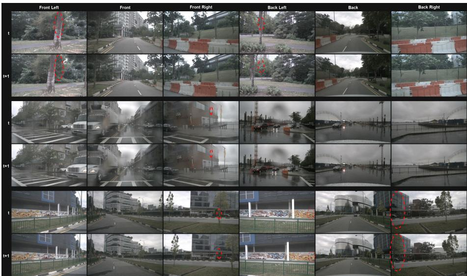
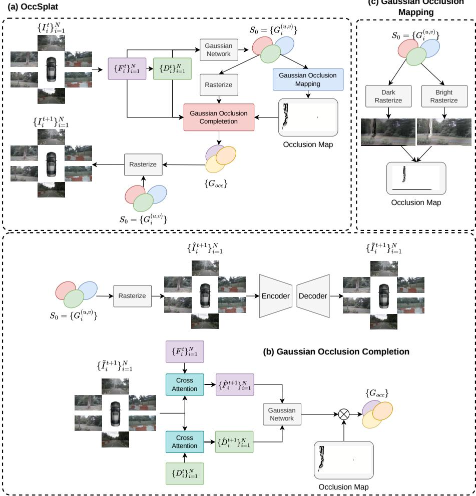
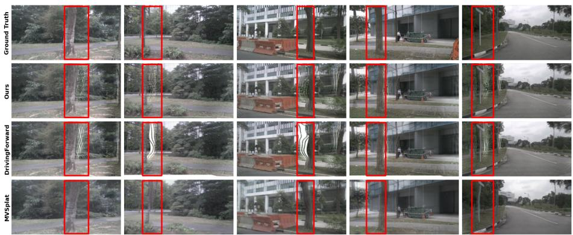
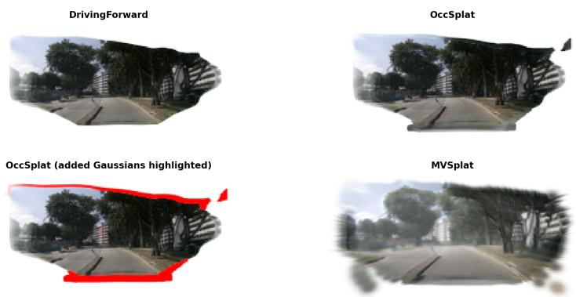

# Quo Vadis, Driving Scene Reconstruction? Occlusion-Aware Gaussian Densification

Dung Do Tien1,2,⋆ , Kien Nguyen Do Trung1,2,⋆ , Kiet Dang Vu1,2 , Trung Thai Tran1,2 , and Duc Dung Nguyen1,2,⋆⋆

1 AITech Lab., Ho Chi Minh City University of Technology (HCMUT) 2 Vietnam National University Ho Chi Minh City (VNUHCM)

Abstract. While recent feed-forward 3D Gaussian Splatting methods enable eficient driving-scene reconstruction from surround-view images, their reliance on a single observation fundamentally hinders novel-view synthesis. Regions occluded in the input can become visible from novel viewpoints, leaving the reconstructed Gaussians under-constrained and incomplete. Moving beyond image-space inpainting for rendered views, we introduce OccSplat, a feed-forward framework whose core contribution is Occlusion-Aware Gaussian Densification, explicitly targeting missing scene geometry rather than missing pixels. By predicting new Gaussian primitives for unsupported regions, OccSplat completes the scene directly in the 3D representation. Specifically, OccSplat first identifies occluded regions that lack Gaussian support through Gaussian Occlusion Mapping. Gaussian Occlusion Completion then generates new primitives for these regions. The predicted primitives are integrated into the original representation to improve novel-view synthesis while retaining feedforward inference without per-scene optimization. Experiments on the nuScenes benchmark demonstrate that OccSplat improves on the compared methods and yields particularly large gains in occluded regions, leading to more accurate and visually coherent driving-scene reconstruction.

Keywords: 3D Gaussian Splatting · Feed-forward Reconstruction · Novel View Synthesis

## 1 Introduction

Photorealistic reconstruction and novel-view synthesis of driving scenes from vehicle-mounted cameras are foundational capabilities for autonomous driving, underpinning closed-loop simulation, safe evaluation of perception and planning stacks, and large-scale data augmentation for rare or safety-critical events. The recent emergence of 3D Gaussian Splatting (3DGS) [13], which represents a scene with an explicit set of anisotropic Gaussians and renders through fast diferentiable rasterization, enables fast, high-fidelity rendering after scene optimization and has become a widely used representation for this setting.

  
Fig. 1: The disocclusion problem in forward-driving single-frame (SF) reconstruction. Six surround-view cameras at a source frame t (top) and target frame t+1 (bottom). As the ego-vehicle advances, content hidden behind foreground structures at t becomes disoccluded at t+1 (red dashed ellipses). A model that only observes frame t has no direct visual evidence for these regions.

Building on 3DGS, a growing body of work specializes the representation to driving scenes [6, 14, 28, 38], modeling the static background, dynamic actors, and unbounded street layout that characterize on-road data. These methods achieve impressive rendering quality, but are fundamentally per-scene optimization approaches: each scene must be fit individually, typically requiring densely overlapping views, accurate camera extrinsics, and minutes to hours of optimization. The need to optimize each new scene limits throughput in large-scale autonomous-driving pipelines.

To lift these constraints, feed-forward (generalizable) Gaussian Splatting predicts pixel-aligned Gaussian primitives directly from images in a single forward pass, enabling training on large corpora and inference without per-scene optimization on unseen scenes [2,3,4,7,11,23,27,33,34]. DrivingForward [24] adapts this paradigm to driving, jointly learning pose, depth, and Gaussian networks in a self-supervised manner so that surround-view scenes can be reconstructed without depth ground truth or camera extrinsics. We focus on its challenging single-frame (SF) setting: the model observes only the surround-view images of the current frame t and must synthesize the surround views of the future frame t+1.

As the ego-vehicle drives forward between t and t+1, the camera rig translates along the direction of travel and the efective viewpoint changes. Consequently, scene regions that are occluded at t, hidden behind trees, poles, fences, or building edges, become disoccluded at t+1 (Fig. 1). Feed-forward pixel-aligned methods place a Gaussian only where there is an observed pixel to lift it from, so surfaces with no visible support at t receive no primitives at all. When these surfaces are exposed at t+1, the renderer has nothing to draw in their place, yielding holes and stretched “rubber-sheet” artifacts. This disocclusion gap is intrinsic to forward-driving SF synthesis: it arises from viewpoint changes that reveal content absent from the source images.

Quo vadis? Where, then, is the scene going? The question is literal as well as rhetorical: the model must reason not only about what it currently sees, but about the content that its forward motion is about to uncover. We therefore recast future-frame driving reconstruction as an Occlusion-Aware Gaussian Densification problem and instantiate it in OccSplat, a feed-forward surround-view framework that anticipates and completes soon-to-be-revealed content before the ego-vehicle uncovers it. Starting from a pixel-aligned Gaussian representation of the current frame, OccSplat first localizes regions that lack Gaussian support and are therefore prone to disocclusion, then densifies them with new 3D Gaussian primitives that plausibly complete the disoccluded geometry and appearance. Because these primitives are fused into the same representation as the observed scene, the completed content can be rendered from a shared 3D representation instead of being patched independently in each image. This densification is a single additional feed-forward pass on top of the backbone, closing the disocclusion gap while retaining feed-forward inference without perscene optimization.

Our contributions are summarized as follows:

– We introduce OccSplat, a feed-forward framework that reframes occlusion handling as Occlusion-Aware Gaussian Densification, targeting missing scene geometry rather than missing pixels by predicting new Gaussian primitives for occluded regions.

– We design two modules realizing this idea: Gaussian Occlusion Mapping, which identifies regions lacking Gaussian support, and Gaussian Occlusion Completion, which generates and integrates new primitives for them.

– Extensive experiments on nuScenes show that OccSplat improves on the compared feed-forward methods, with particularly large gains in occluded regions.

## 2 Related Work

Feed-forward 3D Gaussian Splatting. To eliminate the expensive per-scene optimization of conventional 3DGS, numerous feed-forward approaches have been proposed to directly predict Gaussian representations from sparse input images. Early methods such as PixelSplat [2] and Splatter Image [23] generate Gaussians from image features, while MVSplat [3] and DepthSplat [27] improve geometric reconstruction through explicit cross-view matching and geometryaware representations. Subsequent methods [10,32,33,36], further relax pose requirements and enable reconstruction in pose-free or fully uncalibrated settings.

Despite their impressive eficiency and generalization ability, these methods often struggle in sparse-view scenarios with severe occlusions and limited view overlap, resulting in incomplete geometry and inconsistent scene representations.

Driving Scene Reconstruction. NeRFs [19] and 3DGS [13] have been adapted to driving scene reconstruction [6, 14, 28, 38]. However, most of them focus on high-quality reconstruction of individual scenes, relying on ofline perscene optimization, which limits their applicability to online driving systems. Their reconstruction quality can also degrade under severe occlusions and sparseview observations. A few recent feed-forward and pose-free approaches, such as [10,22,33,36], explore online reconstruction for driving scenes, but they mainly focus on general scene reconstruction and cross-scene generalization, while lacking explicit mechanisms for handling severe occlusions and sparse-view ambiguities. DistillNeRF [25] proposes a generalizable framework for driving scenes and achieves reasonable novel view synthesis, but it requires an expensive ofline NeRF optimization stage per scene and additional LiDAR supervision, while still struggling in highly occluded regions. In contrast, OccSplat targets feed-forward driving scene reconstruction from RGB inputs alone while improving robustness to occlusions and incomplete observations in sparse-view environments.

Occlusion-aware and Structure-aware 3DGS. Recent eforts have sought to improve structural modeling and visibility reasoning in 3DGS. Scafold-GS [18] introduces an anchor-based representation to enhance structural control and reconstruction eficiency, while CityGaussian [17] and Octree-GS [20] improve scalability through hierarchical scene representations. OccluGaussian [16] further enhances reconstruction consistency by leveraging occlusion-aware scene partitioning based on camera co-visibility. In parallel, methods for recovering missing or occluded regions [5, 8, 21, 37] employ depth-guided geometry reasoning, multi-view consistency constraints, and iterative refinement to recover incomplete scene content. However, these methods still rely on scene-specific optimization and therefore cannot operate in a fully feed-forward manner.

## 3 Method

## 3.1 Overview

Given the N surround-view images $\{ I _ { i } ^ { t } \} _ { i = 1 } ^ { N }$ of the current frame t, OccSplat aims to synthesize the surround views of the future frame t+1 while completing the scene content that the ego-vehicle’s forward motion will disocclude. As shown in Fig. 2, our pipeline builds on a feed-forward surround-view backbone and augments it with two occlusion-handling modules that operate directly on the Gaussian representation.

Base Gaussian reconstruction. We first reconstruct a base 3D Gaussian representation following DrivingForward [24]. An encoder extracts multi-scale image features $\{ F _ { i } ^ { t } \} _ { i = 1 } ^ { N }$ , which are fused across views through the Volumetric Fusion Network (VFNet) [15] to estimate dense depth maps $\{ D _ { i } ^ { t } \} _ { i = 1 } ^ { N }$ . Each predicted depth is back-projected into 3D to initialize a Gaussian center,

$$
\mu _ { i } ^ { ( u , v ) } = \mathrm { U n p r o j e c t } \big ( D _ { i } ^ { t } ( u , v ) \big ) ,\tag{1}
$$

  
Fig. 2: Overall architecture of OccSplat. (a) From surround-view images $\{ I _ { i } ^ { t } \}$ , a backbone predicts the pixel-aligned Gaussian set ${ \cal S } _ { 0 } = \{ G _ { i } ^ { ( u , v ) } \}$ , after which Gaussian Occlusion Mapping (c) locates unsupported regions by rasterizing $S _ { 0 }$ against dark and bright backgrounds and using their responses to identify unsupported regions. (b) Guided by this map, Gaussian Occlusion Completion rasterizes $S _ { 0 }$ to the future view, inpaints it with an encoder-decoder, and lifts the result back into new primitives $\{ G _ { o c c } \}$ that densify $S _ { 0 }$ for rendering the future frame $\{ I _ { i } ^ { t + 1 } \}$ }.

where $\mu _ { i } ^ { ( u , v ) } \in \mathbb { R } ^ { 3 }$ . The remaining attributes, including opacity $\alpha ,$ anisotropic scale $s ,$ rotation quaternion $q ,$ and spherical harmonics coeficients sh, are predicted by a lightweight Gaussian head,

$$
\begin{array} { r } { \{ \alpha , s , q , \mathrm { s h } \} _ { i } ^ { ( u , v ) } = \mathcal G _ { \theta } \left( [ F _ { i } ^ { t } , D _ { i } ^ { t } ] \right) . } \end{array}\tag{2}
$$

Aggregating the primitives from all views yields the pixel-aligned Gaussian set

$$
{ \cal S } _ { 0 } = \{ G _ { i } ^ { ( u , v ) } \} ,\tag{3}
$$

which is rendered through diferentiable rasterization.

Because $S _ { 0 }$ is generated only from pixels observed at t, it provides no support for surfaces occluded in the current frame. As the viewpoint advances, these hidden regions become visible, yet the renderer lacks the primitives needed to synthesize them, producing structural holes, stretched surfaces, and appearance inconsistencies. OccSplat closes this gap in two steps that operate directly on $S _ { 0 }$ Gaussian Occlusion Mapping (Sec. 3.2) locates the regions that lack Gaussian support, and Gaussian Occlusion Completion (Sec. 3.3) generates new primitives $\{ G _ { o c c } \}$ for those regions and merges them into $S _ { 0 }$ , so that the future frame is rendered from a densified, more complete representation.

## 3.2 Gaussian Occlusion Mapping

The first step is to identify occluded regions that lack Gaussian support. Rather than introducing a separate segmentation network, we exploit the rendering process itself to detect pixels with insuficient Gaussian coverage or accumulated opacity, constructing a spatial occlusion map directly from the Gaussian density.

Specifically, we render the base representation $S _ { 0 }$ to the target view $\pi _ { t + 1 }$ twice under complementary background colors, producing two sets of surroundview renderings,

$$
\{ I _ { i , \mathrm { d a r k } } ^ { t + 1 } \} _ { i = 1 } ^ { N } = \mathrm { R e n d e r } ( S _ { 0 } , \pi _ { t + 1 } , \mathrm { b g } = [ 0 , 0 , 0 ] ) ,\tag{4}
$$

$$
\{ I _ { i , \mathrm { b r i g h t } } ^ { t + 1 } \} _ { i = 1 } ^ { N } = \mathrm { R e n d e r } ( S _ { 0 } , \pi _ { t + 1 } , \mathrm { b g } = [ 1 , 1 , 1 ] ) .\tag{5}
$$

Pixels supported by suficiently dense, opaque Gaussians (high accumulated opacity) render almost identically under both backgrounds. In contrast, pixels with insuficient Gaussian support—either completely unpopulated or covered only by low-opacity primitives—are dominated by the background colors and thus difer strongly between the two renders. Regions with low accumulated coverage are identified as lacking geometric support:

$$
\{ M _ { i , \mathrm { o c c } } \} _ { i = 1 } ^ { N } = 1 [ \{ I _ { i , \mathrm { b r i g h t } } ^ { t + 1 } \} _ { i = 1 } ^ { N } > \epsilon ] \wedge 1 [ \{ I _ { i , \mathrm { d a r k } } ^ { t + 1 } \} _ { i = 1 } ^ { N } < ( 1 - \epsilon ) ] .\tag{6}
$$

This rendering-based strategy produces an occlusion map without additional learnable parameters and restricts Gaussian generation to unsupported regions.

## 3.3 Gaussian Occlusion Completion

Given the occlusion masks $\{ M _ { i , \mathrm { o c c } } \}$ , the next step is to generate new Gaussian primitives that fill the unsupported regions. Predicting these primitives directly from the raw future-view rendering is unreliable, because disocclusion artifacts corrupt both local appearance and structural continuity and introduce noisy cues for the subsequent geometry inference. We therefore first restore the rendering, then decouple geometry and appearance completion into two linear attention [12] branches, and finally reuse the pretrained Gaussian head to produce the new primitives.

Pixel Refiner. We first rasterize $S _ { 0 }$ to the future viewpoint to obtain a preliminary render $\hat { I } _ { i } ^ { t + 1 }$ that exhibits the characteristic disocclusion holes. A lightweight encoder-decoder (U-Net) then restores plausible image structure in these regions while preserving already well-reconstructed areas, predicting a residual correction to the rendered view,

$$
\begin{array} { r } { \tilde { I } _ { i } ^ { t + 1 } = \mathrm { c l a m p } \Big ( \hat { I } _ { i } ^ { t + 1 } + \mathcal { R } _ { \phi } ( \hat { I } _ { i } ^ { t + 1 } ) , 0 , 1 \Big ) , } \end{array}\tag{7}
$$

where $\hat { I } _ { i } ^ { t + 1 }$ and $\tilde { I } _ { i } ^ { t + 1 }$ are the rendered and refined future-view images and $\mathcal { R } _ { \phi }$ is the residual network. The residual formulation is designed to restore missing structure while preserving regions already reconstructed by $S _ { 0 }$ . The refined image is not the final output, but rather a cleaner intermediate cue that enables more reliable depth and feature inference for the completion below.

Decoupled geometry and appearance inference. Recovering a missing primitive requires estimating both its 3D location and its visual attributes, which rely on diferent cues: geometry completion depends on depth consistency across views, whereas appearance completion aggregates semantic and texture information from the source frame. To reduce potential interference between these tasks, we use separate branches. The refined future view $\tilde { I } _ { i } ^ { t + 1 }$ serves as the query, while the source-frame depth $\{ D _ { i } ^ { t } \}$ and multi-scale features $\{ F _ { i } ^ { t } \}$ provide the key–value representations. We employ a Depth Attention module $\mathcal { A } _ { d }$ for geometry and a Feature Attention module $\ b { \mathcal { A } } _ { f }$ for appearance,

$$
\begin{array} { r } { \hat { D } _ { i } ^ { t + 1 } = \mathcal { A } _ { d } \Big ( \tilde { I } _ { i } ^ { t + 1 } , D _ { i } ^ { t } , D _ { i } ^ { t } \Big ) , } \end{array}\tag{8}
$$

$$
\begin{array} { r } { \hat { F } _ { i } ^ { t + 1 } = \mathcal { A } _ { f } \left( \tilde { I } _ { i } ^ { t + 1 } , F _ { i } ^ { t } , F _ { i } ^ { t } \right) . } \end{array}\tag{9}
$$

Each branch first applies self-attention to aggregate context across source views, then cross-attention to transfer it to the future-view query. Using linear attention [12] reduces complexity from $\mathcal { O } ( n ^ { 2 } )$ to ${ \mathcal { O } } ( n )$ , enabling eficient long-range correspondence at surround-view resolution.

Gaussian generation and fusion. The inferred depth determines the positions of the new primitives. Each pixel inside the occluded region is backprojected using this depth to initialize a Gaussian center,

$$
\mu _ { \mathrm { o c c } } ^ { ( u , v ) } = \mathrm { U n p r o j e c t } \Big ( \hat { D } _ { i } ^ { t + 1 } \Big ) .\tag{10}
$$

Rather than training a second attribute predictor, we reuse the Gaussian head $\mathcal { G } _ { \theta }$ learned during base reconstruction, which already provides a stable mapping from image features to Gaussian attributes,

$$
\{ \alpha , s , q , \mathrm { s h } \} _ { \mathrm { o c c } } ^ { ( u , v ) } = { \mathcal G } _ { \boldsymbol \theta } \Big ( [ \hat { F } _ { i } ^ { t + 1 } , \hat { D } _ { i } ^ { t + 1 } ] \Big ) .\tag{11}
$$

Reusing the pretrained head lets the completion branches focus solely on recovering the missing geometry and appearance instead of relearning attribute estimation. The resulting primitives, masked by $\{ M _ { i , \mathrm { o c c } } \}$ , form the occlusion Gaussians $\{ G _ { o c c } \}$ and are merged with the base representation to render the future frame,

$$
S _ { 1 } = S _ { 0 } \cup \{ G _ { o c c } \} ,\tag{12}
$$

$$
\{ I _ { i } ^ { t + 1 } \} _ { i = 1 } ^ { N } = \operatorname { R e n d e r } ( S _ { 1 } ) ,\tag{13}
$$

providing denser geometric coverage in previously unseen regions for improved novel-view synthesis.

## 3.4 Training Objective

Optimizing the whole framework at once is unstable, since the completion branches depend on reliable geometry and appearance from the base network. During early training, inaccurate depth and unstable Gaussians provide noisy supervision. We therefore adopt a two-stage strategy that first learns a stable Gaussian representation and then introduces occlusion-aware densification.

Stage I: base reconstruction. We optimize the depth network, pose network, Gaussian head, and Pixel Refiner, keeping the completion branches frozen. The objective follows DrivingForward [24] with an additional refinement loss.

$$
\begin{array} { r l } & { \mathcal { L } _ { \mathrm { s t a g e 1 } } = \mathcal { L } _ { \mathrm { r e p r o j } } + \lambda _ { \mathrm { s m } } \mathcal { L } _ { \mathrm { s m o o t h } } + \lambda _ { \mathrm { s p } } \mathcal { L } _ { \mathrm { s p a t i o } } + \lambda _ { \mathrm { s t } } \mathcal { L } _ { \mathrm { s t } } } \\ & { \qquad + \lambda _ { \mathrm { g s } } \mathcal { L } _ { \mathrm { g s } } + \lambda _ { \mathrm { r e f } } \mathcal { L } _ { \mathrm { r e f i n e } } , } \end{array}\tag{14}
$$

$$
\begin{array} { r } { \mathcal { L } _ { \mathrm { r e f i n e } } = \lambda _ { \mathrm { M S E } } \Vert \tilde { I } _ { i } ^ { t + 1 } - I _ { i } ^ { t + 1 } \Vert _ { 2 } ^ { 2 } + \lambda _ { \mathrm { L P I P S } } \mathcal { L } _ { \mathrm { L P I P S } } ( \tilde { I } _ { i } ^ { t + 1 } , I _ { i } ^ { t + 1 } ) . } \end{array}\tag{15}
$$

The MSE term enforces pixel-level fidelity while the perceptual term encourages structurally coherent restoration in disoccluded regions.

Stage II: occlusion-aware densification. Once the base reconstruction converges, all Stage-I modules are frozen and only the Depth Attention and Feature Attention branches are optimized. The Gaussian head is reused without fine-tuning to preserve the learned feature-to-Gaussian mapping. The objective augments the Stage-I loss with supervision on the inferred future-view depth and features,

$$
{ \mathcal { L } } _ { \mathrm { s t a g e 2 } } = { \mathcal { L } } _ { \mathrm { s t a g e 1 } } + \lambda _ { \mathrm { n d } } { \mathcal { L } } _ { \mathrm { n o v e l - d e p t h } } + \lambda _ { \mathrm { n f } } { \mathcal { L } } _ { \mathrm { n o v e l - f e a t u r e } } .\tag{16}
$$

The inferred depth $\hat { D } _ { i } ^ { t + 1 }$ is supervised with target-view pseudo-depth predicted by Depth Anything $\mathrm { V 2 [ 3 1 ] }$ , and the inferred features $\hat { F } _ { i } ^ { t + 1 }$ are supervised with detached encoder features of the corresponding ground-truth image.

Table 1: Quantitative comparison of our method $\mathrm { ( O c c S p l a t ) }$ against prior reconstruction methods on the nuScenes validation set. Best in bold, second best underlined.
<table><tr><td>Method</td><td>Venue</td><td>PSNR↑</td><td>SSIM↑</td><td>LPIPS↓</td></tr><tr><td>SelfOcc [9]</td><td>CVPR 2024</td><td>18.22</td><td>0.464</td><td></td></tr><tr><td>UniPad [29]</td><td>CVPR 2024</td><td>16.45</td><td>0.375</td><td></td></tr><tr><td>EmerNeRF [30]</td><td>ICLR 2024</td><td>20.95</td><td>0.585</td><td></td></tr><tr><td>DistillNeRF [25]</td><td>NeurIPS 2024</td><td>20.78</td><td>0.590</td><td></td></tr><tr><td>MVSplat [3]</td><td>ECCV 2024</td><td>20.23</td><td>0.479</td><td>0.366</td></tr><tr><td>DrivingForward [24]</td><td>AAAI 2025</td><td>21.76</td><td>0.767</td><td>0.194</td></tr><tr><td>OccSplat (Ours)</td><td></td><td>23.50</td><td>0.767</td><td>0.182</td></tr></table>

## 4 Experiments

## 4.1 Experimental Setup

Datasets. We evaluate on the nuScenes dataset [1], comprising 1,000 driving scenes with six surround-view cameras capturing a $3 6 0 ^ { \circ }$ view with ∼10% overlap between adjacent views. Following the oficial split, we use 700 scenes for training and 150 for validation at $1 1 4 \times 2 2 8$ resolution.

Evaluation Metrics. We evaluate novel-view synthesis quality at time step t + 1 given observations at t, reporting standard PSNR (↑), SSIM [26] (↑), and LPIPS [35] (↓).

Implementation Details. Training has two stages. Stage I jointly optimizes the base network and Pixel Refiner with DrivingForward losses and $\mathcal { L } _ { \mathrm { r e f i n e } } \left( \lambda _ { \mathrm { r e f } } = \right.$ $0 . 0 5 , \lambda _ { \mathrm { M S E } } = 1 . 0 , \lambda _ { \mathrm { L P I P S } } = 0 . 0 5 )$ . Stage II freezes Stage I weights and trains $\mathbf { \mathcal { A } } _ { d }$ and $\ b { A _ { f } }$ under novel-view depth $( \lambda _ { \mathrm { n d } } = 1 . 0 )$ and feature supervision $\left( \lambda _ { \mathrm { n f } } = 0 . 5 \right)$ We set $\epsilon = 0 . 7$ , depth range $[ 1 . 5 , 8 0 . 0 ] \mathrm { m }$ , learning rate $1 \times 1 0 ^ { - 4 }$ , and batch size 1. Both stages run for 10 epochs on an NVIDIA RTX 4090.

## 4.2 Quantitative Results on nuScenes

We quantitatively compare our approach with prior novel view synthesis methods on the nuScenes validation set, as summarized in Table 1. Following DrivingForward [24], all methods are evaluated at a resolution of 114×228. OccSplat achieves the best overall performance. Compared with DrivingForward, our approach improves PSNR by 1.74 dB while reducing LPIPS from 0.194 to 0.182, indicating better reconstruction fidelity and perceptual quality.

The comparison includes NeRF- and occupancy-based methods such as Self-Occ [9], UniPad [29], EmerNeRF [30], and DistillNeRF [25], as well as feedforward 3DGS methods such as MVSplat [3] and DrivingForward [24]. These results highlight the efectiveness of occlusion-aware Gaussian densification in recovering missing scene content and improving geometric completeness, leading to more accurate novel-view rendering in challenging surround-view driving scenarios.

Table 2: Ablation study of the proposed components on the nuScenes validation set. We report PSNR (↑), SSIM (↑), and LPIPS (↓). “Densification” denotes Gaussian Occlusion Completion, “Refiner” the Pixel Refiner, and “Occ. Mapping” the dual-background Gaussian Occlusion Mapping.
<table><tr><td>Config.|</td><td>Densification</td><td>Refiner</td><td>Occ. Mapping|</td><td>PSNR↑</td><td>SSIM↑</td><td>LPIPS↓</td></tr><tr><td>(a)</td><td></td><td></td><td></td><td>21.76</td><td>0.767</td><td>0.194</td></tr><tr><td>(b)</td><td>√</td><td></td><td></td><td>19.92</td><td>0.747</td><td>0.182</td></tr><tr><td>(c)</td><td>√</td><td>√</td><td></td><td>20.71</td><td>0.753</td><td>0.175</td></tr><tr><td>(d)</td><td>√</td><td></td><td>√</td><td>22.27</td><td>0.765</td><td>0.187</td></tr><tr><td>(e)</td><td>√</td><td>√</td><td>√</td><td>23.50</td><td>0.767</td><td>0.182</td></tr></table>

## 4.3 Ablation Studies

To validate the efectiveness of each component, we perform ablation experiments on the nuScenes validation set, progressively adding Gaussian Occlusion Completion, the Pixel Refiner, and Gaussian Occlusion Mapping on top of the base reconstruction. Quantitative results are reported in Table 2.

Gaussian Densification. Comparing (a) and (b), applying Gaussian Occlusion Completion across the entire image lowers PSNR from 21.76 dB to 19.92 dB and SSIM from 0.767 to 0.747, while slightly improving LPIPS from 0.194 to 0.182. Predicting new primitives from the raw, artifact-corrupted future-view renders and inserting them everywhere adds redundant Gaussians in already reconstructed areas, degrading pixel-wise fidelity even though the added geometry recovers some perceptual detail. This result motivates using reliable completion cues and restricting densification to unsupported regions.

Pixel Refiner. Adding the Pixel Refiner in (c) improves all three metrics over (b), raising PSNR to 20.71 dB and SSIM to 0.753 while achieving the best LPIPS of 0.175. By restoring plausible appearance in the disoccluded areas before completion, the Refiner provides a cleaner intermediate representation, so the depth and feature attention modules infer more accurate geometry for the missing regions. PSNR and SSIM nonetheless remain below those of the base reconstruction, since densification is still applied over the whole image without localization.

Occlusion Mapping. Gaussian Occlusion Mapping supplies the missing localization. Even without the Refiner, restricting densification to disoccluded regions in (d) already lifts PSNR to 22.27 dB, above the base reconstruction. Combining all components in (e) yields the best overall result, raising PSNR to 23.50 dB and restoring SSIM to 0.767 while retaining strong perceptual quality. By identifying disoccluded regions through dual-background rendering, the mapping confines completion to where the representation truly lacks support, preserving the original reconstruction elsewhere and supporting the complementary roles of densification, the Refiner, and the mapping.

Efect of the Occlusion Threshold ϵ. The occlusion threshold ϵ in Eq. (6) controls the sensitivity of Gaussian Occlusion Mapping when identifying unsupported regions. A larger threshold produces a more conservative occlusion mask, causing fewer pixels to be classified as unsupported and therefore limiting Gaussian generation. As a result, many partially disoccluded areas remain unrecovered, leading to lower reconstruction quality. This behavior is reflected by the inferior performance at $\epsilon = 0 . 9 9$ (22.91 dB PSNR and 0.187 LPIPS).

Table 3: Efect of the occlusion threshold ϵ in Gaussian Occlusion Mapping.
<table><tr><td>€</td><td>PSNR↑</td><td>SSIM↑</td><td>LPIPS↓</td></tr><tr><td>0.99</td><td>22.91</td><td>0.764</td><td>0.187</td></tr><tr><td>0.8</td><td>23.41</td><td>0.767</td><td>0.183</td></tr><tr><td>0.7</td><td>23.50</td><td>0.767</td><td>0.182</td></tr><tr><td>0.6</td><td>23.30</td><td>0.757</td><td>0.192</td></tr><tr><td>0.5</td><td>22.55</td><td>0.741</td><td>0.204</td></tr></table>

Table 4: Performance on disoccluded regions.
<table><tr><td>Method</td><td>PSNR ↑</td><td>SSIM ↑</td><td>LPIPS↓</td></tr><tr><td>DrivingForward [24]</td><td>11.498</td><td>0.759</td><td>1.178</td></tr><tr><td>MVSplat [3]</td><td>18.606</td><td>0.509</td><td>0.620</td></tr><tr><td>OccSplat (Ours)</td><td>18.602</td><td>0.763</td><td>0.465</td></tr></table>

Reducing the threshold allows more missing regions to be recovered, improving reconstruction quality and reaching the best performance at $\epsilon = 0 . 7$ (23.50 dB PSNR and 0.182 LPIPS). However, further decreasing ϵ causes the occlusion mask to become overly permissive, generating redundant Gaussian primitives in regions that are already well reconstructed. This introduces unnecessary geometric redundancy and degrades rendering quality, as evidenced by the performance drop at ϵ = 0.6 and 0.5. These results indicate that ϵ = 0.7 provides the best trade-of between recovering genuinely missing content and avoiding excessive Gaussian generation.

Evaluation on Disoccluded Regions. To isolate the efect of our method, we additionally evaluate only disoccluded regions using identical occlusion masks for all methods, as shown in Tab. 4. DrivingForward achieves only 11.498 dB PSNR due to the lack of Gaussian primitives in disoccluded areas. While MVSplat achieves a comparable PSNR of 18.606 dB (vs. 18.602 dB for OccSplat), its erroneous depth estimation causes severe structural distortion and scattered artifacts, leading to a drastic drop in SSIM (0.509). In contrast, OccSplat preserves structural fidelity while completing missing geometry, achieving the highest SSIM (0.763) and lowest LPIPS (0.465) among the compared methods.

Eficiency Comparison. OccSplat retains the feed-forward advantage over per-scene 3DGS optimization. As reported in Table 5, compared with DrivingForward, OccSplat incurs modest additional costs (+0.14GB VRAM and +1.28M parameters) while achieving substantial reconstruction quality gains at approximately 1.01 FPS. Unlike conventional per-scene 3DGS methods, which require iterative optimization for each scene, OccSplat performs feed-forward reconstruction without scene-specific optimization.

Table 5: Computational costs. Time denotes per-scene optimization for 3DGS and inference for the feed-forward methods.
<table><tr><td>Method</td><td>FPS↑</td><td>Time ↓</td><td>VRAM (GB) ↓</td><td>Params (M) ↓</td></tr><tr><td>3DGS</td><td></td><td>~9 min</td><td></td><td></td></tr><tr><td>DrivingForward</td><td>1.74</td><td>574.7 ms</td><td>2.96</td><td>61.88</td></tr><tr><td>OccSplat</td><td>1.01</td><td>992.9 ms</td><td>3.10</td><td>63.16</td></tr></table>

## 4.4 Qualitative Results

Figure 3 presents qualitative comparisons among MVSplat, DrivingForward, and OccSplat on representative scenes from the nuScenes validation set. MVSplat sufers from inaccurate geometry caused by erroneous depth estimation at the source frame, leading to distorted structures and inconsistent renderings in the future view. DrivingForward reconstructs the visible scene more accurately, but when the viewpoint moves to frame t+1, newly disoccluded regions lack Gaussian support, resulting in holes and stretched artifacts around tree trunks, building boundaries, and roadside structures.

OccSplat explicitly addresses this failure mode by generating Gaussian primitives only in unsupported disoccluded regions while preserving the correctly reconstructed geometry. As highlighted in the red boxes, OccSplat recovers missing content and produces renderings that are visually closer to the ground truth. These observations are consistent with the quantitative improvements reported in Table 1, demonstrating the efectiveness of the proposed occlusionaware Gaussian densification.

3D Gaussian Scene Comparison. Figure 4 compares the reconstructed 3D Gaussian scenes. DrivingForward preserves the main scene structures but exhibits incomplete coverage in occluded regions. In contrast, MVSplat produces less coherent structures, with noticeable blurring and scattered Gaussian artifacts around the reconstructed scene. OccSplat extends the scene coverage while maintaining the overall structural consistency of the base reconstruction. The bottom-left panel highlights the added Gaussian primitives in red, showing their distribution along the upper scene boundary, the road foreground, and other regions with incomplete coverage. These results qualitatively demonstrate how Gaussian Occlusion Completion supplements the existing Gaussian representation to improve scene coverage.

  
Fig. 3: Qualitative comparison on the nuScenes validation set. From top to bottom: Ground Truth, OccSplat (ours), DrivingForward, and MVSplat. The highlighted regions show that OccSplat recovers newly disoccluded content while preserving existing scene structures, whereas DrivingForward leaves holes due to missing Gaussian support and MVSplat exhibits geometric distortions caused by inaccurate depth estimation.

  
Fig. 4: Qualitative comparison of reconstructed 3D Gaussian scenes. Top row: Driving-Forward (left) and OccSplat (right). Bottom row: OccSplat with newly added Gaussian primitives highlighted in red (left) and MVSplat (right). The added primitives are distributed along the upper scene boundary, the road foreground, and other regions with incomplete coverage.

## 5 Conclusion

We presented OccSplat, an occlusion-aware feed-forward framework that addresses disocclusion in single-frame novel-view synthesis for driving scenes. By identifying disoccluded regions and generating complementary primitives to densify the 3D Gaussian representation, OccSplat improves scene coverage while retaining feed-forward inference. Experiments on nuScenes demonstrate improved reconstruction quality relative to the compared methods, particularly in newly exposed areas. Furthermore, the completion strategy ofers a potential extension to other feed-forward 3DGS models.

Limitations and Future Work. Operating in image space, the Pixel Refiner cannot explicitly enforce 3D geometric consistency across viewpoints, leading to potential texture over-smoothing under severe disocclusions or large egomotion that reveals previously unobserved content. Future work will integrate explicit 3D geometric and semantic priors, as well as temporal information from consecutive frames, to improve structural consistency and robustness in dynamic driving environments.

## Acknowledgement

We acknowledge Ho Chi Minh City University of Technology (HCMUT), VNU-HCM for supporting this study.

## References

1. Caesar, H., Bankiti, V., Lang, A.H., Vora, S., Liong, V.E., Xu, Q., Krishnan, A., Pan, Y., Baldan, G., Beijbom, O.: nuscenes: A multimodal dataset for autonomous driving. In: Proceedings of the IEEE/CVF conference on computer vision and pattern recognition. pp. 11621–11631 (2020)

2. Charatan, D., Li, S.L., Tagliasacchi, A., Sitzmann, V.: pixelsplat: 3d gaussian splats from image pairs for scalable generalizable 3d reconstruction. In: Proceedings of the IEEE/CVF conference on computer vision and pattern recognition. pp. 19457– 19467 (2024)

3. Chen, Y., Xu, H., Zheng, C., Zhuang, B., Pollefeys, M., Geiger, A., Cham, T.J., Cai, J.: Mvsplat: Eficient 3d gaussian splatting from sparse multi-view images. In: European conference on computer vision. pp. 370–386. Springer (2024)

4. Chen, Y., Zheng, C., Xu, H., Zhuang, B., Vedaldi, A., Cham, T.J., Cai, J.: Mvsplat360: Feed-forward 360 scene synthesis from sparse views. Advances in Neural Information Processing Systems 37, 107064–107086 (2024)

5. Dahaghin, M., Padalkar, M.G., Toso, M., Del Bue, A.: Splatfill: 3d scene inpainting via depth-guided gaussian splatting. arXiv preprint arXiv:2509.07809 (2025)

6. Huang, N., Wei, X., Zheng, W., An, P., Lu, M., Zhan, W., Tomizuka, M., Keutzer, K., Zhang, S.: S3 Gaussian: Self-Supervised Street Gaussians for Autonomous Driving. arXiv preprint arXiv:2405.20323 (2024)

7. Huang, R., Mikolajczyk, K.: No pose at all: Self-supervised pose-free 3d gaussian splatting from sparse views. In: Proceedings of the IEEE/CVF International Conference on Computer Vision. pp. 27947–27957 (2025)

8. Huang, S.Y., Chou, Z.T., Wang, Y.C.F.: 3d gaussian inpainting with depth-guided cross-view consistency. In: Proceedings of the computer vision and pattern recognition conference. pp. 26704–26713 (2025)

9. Huang, Y., Zheng, W., Zhang, B., Zhou, J., Lu, J.: Selfocc: Self-supervised visionbased 3d occupancy prediction. In: Proceedings of the IEEE/CVF conference on computer vision and pattern recognition. pp. 19946–19956 (2024)

10. Jiang, L., Mao, Y., Xu, L., Lu, T., Ren, K., Jin, Y., Xu, X., Yu, M., Pang, J., Zhao, F., et al.: Anysplat: Feed-forward 3d gaussian splatting from unconstrained views. ACM Transactions on Graphics (TOG) 44(6), 1–16 (2025)

11. Kang, G., Yoo, J., Park, J., Nam, S., Im, H., Shin, S., Kim, S., Park, E.: Selfsplat: Pose-free and 3d prior-free generalizable 3d gaussian splatting. In: Proceedings of the Computer Vision and Pattern Recognition Conference. pp. 22012–22022 (2025)

12. Katharopoulos, A., Vyas, A., Pappas, N., Fleuret, F.: Transformers are rnns: Fast autoregressive transformers with linear attention. In: International conference on machine learning. pp. 5156–5165. PMLR (2020)

13. Kerbl, B., Kopanas, G., Leimkühler, T., Drettakis, G., et al.: 3d gaussian splatting for real-time radiance field rendering. (2023)

14. Khan, M., Fazlali, H., Sharma, D., Cao, T., Bai, D., Ren, Y., Liu, B.: Autosplat: Constrained gaussian splatting for autonomous driving scene reconstruction. In: 2025 IEEE International Conference on Robotics and Automation (ICRA). pp. 8315–8321. IEEE (2025)

15. Kim, J.H., Hur, J., Nguyen, T.P., Jeong, S.G.: Self-supervised surround-view depth estimation with volumetric feature fusion. Advances in Neural Information Processing Systems 35, 4032–4045 (2022)

16. Liu, S., Tang, X., Li, Z., He, Y., Ye, C., Liu, J., Huang, B., Zhou, S., Wu, X.: Occlugaussian: Occlusion-aware gaussian splatting for large scene reconstruction and rendering. In: Proceedings of the IEEE/CVF International Conference on Computer Vision. pp. 26643–26652 (2025)

17. Liu, Y., Luo, C., Fan, L., Wang, N., Peng, J., Zhang, Z.: Citygaussian: Real-time high-quality large-scale scene rendering with gaussians. In: European Conference on Computer Vision. pp. 265–282. Springer (2024)

18. Lu, T., Yu, M., Xu, L., Xiangli, Y., Wang, L., Lin, D., Dai, B.: Scafold-gs: Structured 3d gaussians for view-adaptive rendering. In: Proceedings of the IEEE/CVF conference on computer vision and pattern recognition. pp. 20654–20664 (2024)

19. Mildenhall, B., Srinivasan, P.P., Tancik, M., Barron, J.T., Ramamoorthi, R., Ng, R.: Nerf: Representing scenes as neural radiance fields for view synthesis. Communications of the ACM 65(1), 99–106 (2021)

20. Ren, K., Jiang, L., Lu, T., Yu, M., Xu, L., Ni, Z., Dai, B.: Octree-gs: Towards consistent real-time rendering with lod-structured 3d gaussians. arXiv preprint arXiv:2403.17898 (2024)

21. Shi, Z., Huo, D., Zhou, Y., Min, Y., Lu, J., Zuo, X.: Imfine: 3d inpainting via geometry-guided multi-view refinement. In: Proceedings of the IEEE/CVF Conference on Computer Vision and Pattern Recognition. pp. 26694–26703 (2025)

22. Smart, B., Zheng, C., Laina, I., Prisacariu, V.A.: Splatt3r: Zero-shot gaussian splatting from uncalibrated image pairs. arXiv preprint arXiv:2408.13912 (2024)

23. Szymanowicz, S., Rupprecht, C., Vedaldi, A.: Splatter image: Ultra-fast singleview 3d reconstruction. In: Proceedings of the IEEE/CVF conference on computer vision and pattern recognition. pp. 10208–10217 (2024)

24. Tian, Q., Tan, X., Xie, Y., Ma, L.: Drivingforward: Feed-forward 3d gaussian splatting for driving scene reconstruction from flexible surround-view input. In: Proceedings of the AAAI Conference on Artificial Intelligence. vol. 39, pp. 7374–7382 (2025)

25. Wang, L., Kim, S.W., Yang, J., Yu, C., Ivanovic, B., Waslander, S., Wang, Y., Fidler, S., Pavone, M., Karkus, P.: Distillnerf: Perceiving 3d scenes from singleglance images by distilling neural fields and foundation model features. Advances in Neural Information Processing Systems 37, 62334–62361 (2024)

26. Wang, Z., Bovik, A.C., Sheikh, H.R., Simoncelli, E.P.: Image quality assessment: from error visibility to structural similarity. IEEE transactions on image processing 13(4), 600–612 (2004)

27. Xu, H., Peng, S., Wang, F., Blum, H., Barath, D., Geiger, A., Pollefeys, M.: Depthsplat: Connecting gaussian splatting and depth. In: Proceedings of the Computer Vision and Pattern Recognition Conference. pp. 16453–16463 (2025)

28. Yan, Y., Lin, H., Zhou, C., Wang, W., Sun, H., Zhan, K., Lang, X., Zhou, X., Peng, S.: Street gaussians: Modeling dynamic urban scenes with gaussian splatting. In: European Conference on Computer Vision. pp. 156–173. Springer (2024)

29. Yang, H., Zhang, S., Huang, D., Wu, X., Zhu, H., He, T., Tang, S., Zhao, H., Qiu, Q., Lin, B., et al.: Unipad: A universal pre-training paradigm for autonomous driving. In: Proceedings of the IEEE/CVF conference on computer vision and pattern recognition. pp. 15238–15250 (2024)

30. Yang, J., Ivanovic, B., Litany, O., Weng, X., Kim, S.W., Li, B., Che, T., Xu, D., Fidler, S., Pavone, M., et al.: Emernerf: Emergent spatial-temporal scene decomposition via self-supervision. In: International Conference on Learning Representations. vol. 2024, pp. 16739–16766 (2024)

31. Yang, L., Kang, B., Zheng, Z., Huang, X., Zhao, X., Xu, R., Feng, J., Zhao, H.: Depth anything v2. arXiv preprint arXiv:2406.09414 (2024)

32. Ye, B., Chen, B., Xu, H., Barath, D., Pollefeys, M.: Yonosplat: You only need one model for feedforward 3d gaussian splatting. arXiv preprint arXiv:2511.07321 (2025)

33. Ye, B., Liu, S., Xu, H., Li, X., Pollefeys, M., Yang, M.H., Peng, S.: No pose, no problem: Surprisingly simple 3d gaussian splats from sparse unposed images. In: International Conference on Learning Representations. vol. 2025, pp. 54009–54033 (2025)

34. Zhang, K., Bi, S., Tan, H., Xiangli, Y., Zhao, N., Sunkavalli, K., Xu, Z.: Gs-lrm: Large reconstruction model for 3d gaussian splatting. In: European Conference on Computer Vision. pp. 1–19. Springer (2024)

35. Zhang, R., Isola, P., Efros, A.A., Shechtman, E., Wang, O.: The unreasonable efectiveness of deep features as a perceptual metric. In: Proceedings of the IEEE conference on computer vision and pattern recognition. pp. 586–595 (2018)

36. Zhang, S., Wang, J., Xu, Y., Xue, N., Rupprecht, C., Zhou, X., Shen, Y., Wetzstein, G.: Flare: Feed-forward geometry, appearance and camera estimation from uncalibrated sparse views. In: Proceedings of the Computer Vision and Pattern Recognition Conference. pp. 21936–21947 (2025)

37. Zhou, J., Li, D., Li, N., Wang, M.: High-fidelity 3d gaussian inpainting: Preserving multi-view consistency and photorealistic details. Computers & Graphics p. 104362 (2025)

38. Zhou, X., Lin, Z., Shan, X., Wang, Y., Sun, D., Yang, M.H.: Drivinggaussian: Composite gaussian splatting for surrounding dynamic autonomous driving scenes. In: Proceedings of the IEEE/CVF conference on computer vision and pattern recognition. pp. 21634–21643 (2024)