# RI-Prune: Relation and Information Aware Visual Token Pruning for Multi-Image Vision-Language Models

Dongjin Lee Chung-Ang University Seoul, Republic of Korea dongjinlee30@cau.ac.kr

Eunju Lee Chung-Ang University Seoul, Republic of Korea dmswn5829@cau.ac.kr

Yoonji Lee Chung-Ang University Seoul, Republic of Korea pioneer0305@cau.ac.kr

Jinhee Jang Chung-Ang University Seoul, Republic of Korea jinheejang@cau.ac.kr

Youngbin Kim   
Chung-Ang University   
Seoul, Republic of Korea   
ybkim85@cau.ac.kr

## Abstract

Large vision-language models (LVLMs) have recently been extended to handle multiple input images, but this extension dramatically increases the visual token budget, making visual-token pruning not merely an eficiency option but a practical necessity. Existing visual-token pruning methods, primarily designed for the single-image setting, rely on attention-derived saliency signals to estimate per-token importance. However, this attention-centric design transfers poorly to the multi-image regime: it causes substantial performance degradation on multi-image benchmarks, suffers from strong positional bias, and loses discriminative attention signals as the number of input images increases. To test whether attention-selected tokens are truly important for multi-image reasoning, we conduct two complementary causal probes—Leave-One-In and Leave-One-Deletion—which measure token importance by restoring individual tokens to a zeroed visual sequence or removing them from the full sequence. Attention-based pruners provide only marginal gains over random selection, showing that attention is a weak proxy for visual-token importance in multi-image reasoning. Motivated by this gap, we propose Relation and Information Aware Pruning (RI-Prune), a training-free, attention-free pre-decoder selector for multi-image visual token pruning. RI-Prune scores each visual token using a z-normalized combination of three signals computed from projector outputs: query relevance, cross-image correspondence with compact per-image prototypes, and intraimage representativeness. By integrating these signals, RI-Prune performs balanced per-image Top-� selection to preserve information across input images. Across multiple multi-image benchmarks and three LVLM backbones, RI-Prune achieves a stronger trade-of between token reduction and task performance than prior pruning methods, particularly under aggressive token budgets.

## CCS Concepts

• Computing methodologies → Computer vision.

∗Corresponding author

Large Vision Language Models, Visual Token Pruning, Visual Information Loss

ACM Reference Format:   
Dongjin Lee, Eunju Lee, Jinhee Jang, Yoonji Lee, and Youngbin Kim. 2026. RI-Prune: Relation and Information Aware Visual Token Pruning for Multi-Image Vision-Language Models. In Proceedings ofthe 35th ACM International Conference on Information andKnowledge Management(CIKM’26), November 07–11, 2026, Rome, Italy. ACM, New York, NY, USA, 12 pages. https://doi. org/10.1145/3799682.3841123

## 1 Introduction

The rapid evolution of Large Vision-Language Models (LVLMs) [4, 5, 19, 20] has enabled a significant transition from single-image processing to sophisticated multi-image reasoning [3, 15, 18]. Modern architectures are now capable of performing diverse tasks such as identifying diferences or commonalities across multiple visual inputs and understanding temporal sequences [23, 30]. These advancements allow models to integrate information from various sources to provide comprehensive multimodal responses. However, the increasing number of images leads to a proportional surge in the volume of vision tokens which creates substantial challenges regarding computational cost and inference latency [4, 17, 20, 44]. Since the self-attention mechanism in the Transformer backbone exhibits quadratic complexity [16, 32] relative to the sequence length, the inclusion of multiple high-resolution images often results in an unsustainable burden on hardware resources.

To address eficiency challenges, various pruning methods have been proposed to remove redundant visual information [11, 17, 21, 25, 31, 38, 39]. These methods primarily rely on attention-based importance scores to identify important visual tokens, which broadly fall into two categories: query-driven selection in the LLM decoder, where visual tokens are ranked by the attention they receive from instruction tokens at an intermediate layer [8, 9, 14, 36, 42] and Class token (CLS)-driven selection in the vision encoder, where each patch is scored by its CLS token-to-patch attention [33, 37, 41]. Although these attention-based signals are efective in the singleimage setting, it remains unclear whether they can reliably identify important visual evidence when multiple images must be jointly reasoned over.

To examine this, we analyze their behavior in multi-image LVLMs and identify three concrete failure modes, as shown in Figure 1.

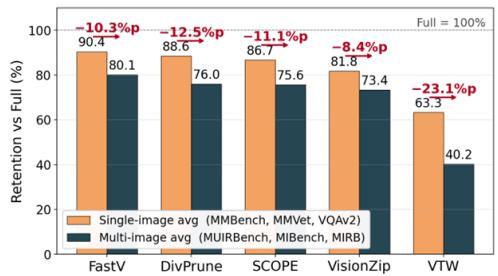  
(a) Performance Drop in Multi-image Pruning

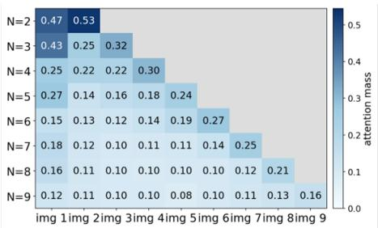  
(b) Query Attention becomes Unreliable

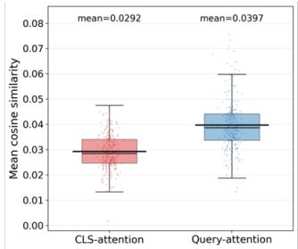  
(c) Weak Query Alignment of CLS Saliency  
Figure 1: Failure modes of attention-based visual token pruning in multi-image LVLMs. (a) Single-image pruning methods retain high performance on single-image benchmarks but degrade sharply on multi-image benchmarks, showing poor transfe to multi-image reasoning. (b) Query attention becomes unreliable across images: it exhibits positional bias and becomes increasingly non-discriminative as the number of input images grows. (c) CLS-based saliency selects tokens with weaker query alignment than query-driven attention, suggesting that CLS attention is less efective at preserving question-relevant visual evidence.

First, existing single-image pruners retain 82.2% accuracy on average on single-image benchmarks [13, 28, 40], but drop to 69.1% on multi-image benchmarks [27, 34, 43], yielding a 13.1%p degradation. This gap indicates that pruning strategies efective for singleimage inputs do not transfer reliably to multi-image scenarios. Second, the instruction-to-image attention exploited by query-driven pruners exhibits a strong positional bias: boundary images receive disproportionately large attention, whereas images in the middle are underrepresented, resembling a lost-in-the-middle efect. As the number of images � grows, the per-image attention mass further collapses toward a nearly uniform distribution. This makes attention signals less reliable as indicators of token importance, especially in multi-image settings. Third, compared with query driven attention, CLS-based saliency selects tokens that have lower cosine similarity to the query embedding. This suggests that CLSbased pruning is less sensitive to the question and is therefore less capable of preserving query-relevant evidence in multi-image reasoning. Consequently, attention magnitudes computed within a single image—whether from the LLM decoder or the vision encoder’s CLS token—fail to provide a reliable basis for multi-image visual token pruning. This motivates the need for an attentionfree pruning strategy that preserves vision tokens essential for both cross-image relationships and question-relevant evidence in multi-image reasoning.

To verify whether the tokens prioritized by existing pruners truly carry the evidence needed for multi-image reasoning, we design two complementary causal token-importance probes: Leave-One-In, which measures each token’s standalone evidence by restoring it into a fully zeroed visual sequence, and Leave-One-Deletion, which measures its marginal contribution by removing it from the full vi sual sequence. Aggregating these per-token information values over each pruner’s retained set, we find that attention-based pruners– including FastV-style query attention [8] and VisionZip-style CLS saliency [37]–achieve only marginal gains over uniformly random selection under the same budget. This indicates that intra-image attention magnitudes are an unreliable proxy for token utility in multi-image reasoning, motivating a new selection criterion beyond attention-based saliency.

Motivated by these findings, we propose Relation and Information Aware Pruning (RI-Prune), a training-free, attention-free visual token pruning method for multi-image LVLMs. RI-Prune avoids unstable attention magnitudes by estimating token importance directly in the projector embedding space before decoding. RI-Prune scores each visual token using three complementary signals: query relevance, cross-image correspondence, and intra-image representativeness. Query relevance captures direct task conditioning by measuring the maximum cosine similarity between each visual token and the question-token embeddings. Cross-image correspondence identifies relational evidence by comparing each token with compact per-image prototypes from the other images. Intra-image representativeness preserves image-specific evidence by favoring tokens that are both strongly aligned with local prototypes and assigned to less frequent visual patterns, thereby retaining distinctive yet coherent regions while reducing repeated background cues. These signals are sample-wise �-normalized and fused into a uni fied importance score, from which RI-Prune performs per-image Top-� selection by evenly allocating the token budget across input images and retaining the highest-scoring tokens within each image, ensuring every image contributes visual evidence under aggressive budgets. Experiments on multiple multi-image benchmarks with Qwen2.5-VL-7B [6], Qwen3-VL-8B [5], and LLaVA-OneVision-7B [19] show that RI-Prune provides a robust trade-of between token reduction and task performance. In particular, it achieves favorable performance compared with prior pruning methods on relation-heavy tasks and maintains strong performance retention under aggressive token budgets. The main contributions of this work are summarized as follows:

• We reveal the limitations of attention-based visual token pruning in multi-image LVLMs. We show that query-driven pruning sufers from positional bias and attention dilution as the number of images increases, while CLS-driven pruning exhibits weak query alignment. Both types of attentionbased pruning fail to reliably identify visual tokens required for correct multi-image reasoning.

• We propose Relation and Information Aware Pruning (RI-Prune), a novel attention-free visual token pruning strategy for multi-image LVLMs. RI-Prune operates directly in the projector embedding space and jointly models query relevance, cross-image correspondence, and intra-image representativeness, which are fused through sample-wise �-score normalization and weighted fusion to preserve tokens that are both question-aligned and relationally informative.

• We integrate RI-Prune into representative multi-image LVLMs, including Qwen2.5-VL-7B [6], Qwen3-VL-8B [5], and LLaVA-OneVision-7B [19], without any additional training. Extensive experiments on multiple multi-image vision-language benchmarks demonstrate that RI-Prune achieves a favorable trade-of between computational eficiency and task performance, particularly under aggressive token budgets.

## 2 Related Work

Large Vision-Language Models. Following the paradigm shift initiated by Mantis-Eval [15], which established a framework for multi-image reasoning through large-scale training on interleaved image–text data, recent LVLMs such as Qwen2.5-VL [6] and LLaVA OneVision [19] have further advanced these capabilities. These models introduce architectures designed to process interleaved visual–text sequences while maintaining spatial and temporal co herence across multiple images. For instance, Qwen2.5-VL employs a dynamic-resolution Vision Transformer with Multimodal Rotary Position Embedding (M-ROPE) to encode spatial layouts and temporal order. Although it adopts a $. 2 \times 2$ spatial merging strategy to reduce token density, the sequence length can still grow sub stantially with multiple high-resolution images. Similarly, LLaVA OneVision uses the AnyRes strategy, which decomposes images into local tiles and a global view, leading to a rapid increase in vision tokens as the number of images grows. While these designs improve structural representation and scalability, they primarily emphasize spatial preservation rather than addressing semantic redundancy or cross-image relationships. Consequently, the quadratic complexity of self-attention over long sequences still imposes significant computational overhead in multi-image LVLMs [24, 26]. Pruning Methods in LVLMs. The increasing complexity ofLVLMs has driven the development of eficient token reduction methods to alleviate computational overhead [22, 32]. Early work such as ToME [7] reduces sequence length by merging similar visual tokens. Later studies focus on pruning redundant tokens within a single im age. FastV [8] removes low-importance tokens by aggregating the attention each token receives from non-visual tokens at a shallow decoder layer, while VisionZip [37] instead performs encoder-side selection, scoring patches by the attention they receive in the last vision-encoder block before the language model. VTW [25] discards visual tokens entirely after a fixed decoding layer so that subse quent reasoning relies only on text tokens, and HiRED [2] allocates token budgets hierarchically across sub-regions of high-resolution inputs via vision-encoder attention. To move beyond pure saliency, coverage-aware methods have also been explored: DivPrune [1] selects a maximally diverse subset of visual tokens via greedy max– min sampling in the embedding space, and SCOPE [9] jointly models saliency and coverage of the retained tokens to preserve their semantic completeness. More recent methods improve adaptivity: PACT [10] estimates token importance without attention scores, enabling compatibility with eficient kernels such as FlashAttention [32], and SwiftVLM [31] introduces cross-layer token bypass to reduce the risk of losing important information. However, these methods are largely designed for single-image settings and mainly target intra-image redundancy, limiting their ability to capture the cross-image relations required for multi-image reasoning.

## 3 Causal Analysis of Visual Token Information 3.1 Preliminaries.

Modern LVLMs such as Qwen2.5-VL [6] and LLaVA-OneVision [19] typically utilize a modular architecture comprising a vision encoder, a connector, and an LLM backbone. Visual features extracted by the encoder are mapped into vision tokens by the connector through MLP or resampling mechanisms to serve as soft prompts for the LLM. In multi-image scenarios, these models process multiple inputs by concatenating their respective vision token sequences in an interleaved or sequential format following the order of system prompts, interleaved images, and the user question [20]. This integrated multimodal input constitutes the sequence �. These models inherit the autoregressive nature of Transformer-based LLMs where the generation of a response sequence $Y = \{ y _ { 1 } , y _ { 2 } , . . . , y _ { L _ { y } } \}$ , representing a set of $L _ { y }$ predicted tokens given the input sequence $S ,$ is factorized as follows:

$$
P ( Y \mid S ) = \prod _ { i = 1 } ^ { L _ { y } } P ( y _ { i } \mid S , y _ { < i } )
$$

Under this formulation, each individual token $y _ { i }$ is generated conditionally based on the initial multimodal context and the set of all preceding output tokens denoted as $y _ { < i }$ . This modeling paradigm is strictly enforced by a causal attention mechanism that ensures each token can only attend to its preceding positions in the sequence.

## 3.2 Analysis Protocol.

To examine whether a pruning method preserves visual tokens that are truly important for multi-image reasoning, we measure the causal contribution of visual tokens to the model’s answer prediction. Given an input sample �, the vision encoder and multimodal projector produce a visual token sequence $V = ( v _ { 1 } , \ldots , v _ { J } )$ , where � denotes the total number of visual tokens across all input images in �. This sequence is concatenated with the text tokens $T$ and fed into the language decoder. We focus on the prefill stage immediately before autoregressive generation and use the logit assigned to the first gold answer token $g _ { 1 }$ as the information signal, where $g _ { 1 }$ is the single token representing the gold answer option of each multiple-choice question [35], thereby measuring each visual token’s contribution to the final answer decision rather than the full reasoning trajectory.

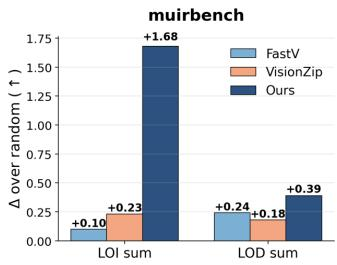

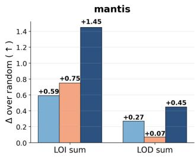  
Figure 2: Method-level information gain over random pruning when retaining 4.6% of visual tokens. Bars report the per-sample average gains $\Delta \mathcal { I } _ { \mathrm { L O I } }$ and $\Delta \bar { J } _ { \mathrm { L O D } }$ over uniformly random pruning under the same token budget. RI-Prune achieves the largest gains across both benchmarks and metrics, indicating that it retains more answer-relevant visual tokens than attention-based pruning strategies.

We intervene on the visual sequence at the input-embedding level. Specifically, masking a visual token means replacing its embedding with a zero vector while keeping its position in the sequence unchanged. Let $\widetilde { V }$ denote a modified visual sequence after masking. We define

$$
\ell ( g _ { 1 } \mid \widetilde { V } , T )
$$

as the logit assigned to $g _ { 1 }$ under the modified visual sequence $\widetilde { V }$ and text input $T .$

We define two reference logits:

$$
\ell _ { \mathrm { f u l l } } = \ell ( g _ { 1 } \mid V , T ) ,
$$

which is the gold-answer logit under the original visual input, and

$$
\ell _ { \mathrm { t e x t } } = \ell ( g _ { 1 } \mid \mathbf { 0 } _ { V } , T ) ,
$$

which is the logit obtained when all visual token embeddings are masked. The latter serves as a visual-ablated reference.

Leave-One-In information. For each visual token $v _ { k } ,$ , we construct $V _ { k } ^ { \mathrm { i n } }$ , where all visual tokens are masked except $\boldsymbol { v } _ { k } .$ . The result ing gold-answer logit is

$$
\ell _ { k } ^ { \mathrm { { L O I } } } = \ell ( g _ { 1 } \mid V _ { k } ^ { \mathrm { { i n } } } , T ) .
$$

We define the Leave-One-In information score as

$$
I _ { \mathrm { L O I } } ( v _ { k } ) = \ell _ { k } ^ { \mathrm { L O I } } - \ell _ { \mathrm { t e x t } } .
$$

A larger LOI score indicates that the token provides stronger standalone evidence for the correct answer beyond the visual-ablated reference.

Leave-One-Deletion information. For each visual token $v _ { k } .$ , we construct $V _ { k } ^ { \mathrm { d e l } }$ , where only $v _ { k }$ is masked and all other visual tokens remain unchanged. The resulting gold-answer logit is

$$
\ell _ { k } ^ { \mathrm { L O D } } = \ell ( g _ { 1 } \mid V _ { k } ^ { \mathrm { d e l } } , T ) .
$$

We define the Leave-One-Deletion information score as

$$
I _ { \mathrm { L O D } } ( v _ { k } ) = \ell _ { \mathrm { f u l l } } - \ell _ { k } ^ { \mathrm { L O D } } .
$$

A larger LOD score indicates that removing the token causes a larger decrease in the gold-answer logit, suggesting a stronger marginal contribution in the full visual context.

Method-level information score. Given a token budget $B ,$ each pruning method M selects a token index set $S _ { M } ( x , B ) \subseteq \{ 1 , . . . , J \}$

for each sample $x ,$ where $\vert { \cal S } _ { M } ( x , B ) \vert = B .$ . We aggregate the pertoken scores over the selected tokens:

$$
\bar { J } _ { * } ( \boldsymbol { M } ; \boldsymbol { x } , \boldsymbol { B } ) = \sum _ { \boldsymbol { k } \in S _ { \boldsymbol { M } } ( \boldsymbol { x } , \boldsymbol { B } ) } I _ { * } ( \boldsymbol { v } _ { \boldsymbol { k } } ) , \qquad * \in \{ \mathrm { L O I , L O D } \} .
$$

Here, $\overline { { J } } _ { \mathrm { L O I } }$ measures the aggregate standalone evidence of the retained tokens, while $\boldsymbol { { \mathcal { I } } _ { \mathrm { L O D } } }$ measures their aggregate marginal contribution score in the full visual context.

To report gains over random pruning, we compare each method against a uniformly random subset of the same budget. Higher gain indicates that the pruning method retains more answer-relevant visual tokens than random selection under the same budget.

## 3.3 Attention Scores Fail to Preserve Informative Visual Tokens.

Figure 2 compares the method-level LOI and LOD gains over random pruning under the same token budget. The results reveal a clear qualitative gap between our method and the existing pruning baselines in terms of how well they preserve answer-relevant visual evidence. While FastV and VisionZip yield only marginal gains over random pruning, often staying close to the random baseline, our method consistently retains visual tokens that carry substantially stronger causal contribution to the gold answer prediction on both benchmarks. This indicates that the baselines, which rely on attention-based or feature-redundancy heuristics, tend to select tokens that are statistically salient inside the model rather than genuinely informative for the multi-image reasoning task. A more important observation arises from the contrast between the two measurements. The improvement in LOI is considerably larger than that in LOD, which suggests that the baselines particularly struggle to identify tokens that carry standalone answer-relevant evidence. They tend to keep tokens whose importance is diluted within the redundant visual context. In contrast, our method preserves tokens that not only contribute marginally in the full context (LOD) but also independently support the correct prediction (LOI). This property is critical in the multi-image setting, where each retained token should ideally encode complementary information rather than reinforce already redundant visual cues.

Taken together, these results suggest that efective visual token pruning for multi-image reasoning requires moving beyond intra-image saliency or feature redundancy, and instead explicitly accounting for the causal contribution of each token to the answer. Our method aligns with this principle, and the larger gain over random pruning reflects that the retained tokens are semantically more faithful to the evidence the model actually relies on when producing the correct answer.

## 4 Method

## 4.1 Overview

Given � input images and a text query, the vision encoder extracts image features, which are then mapped into the language model’s embedding space by a multimodal projector. This yields a visual token sequence $V ~ = ~ \{ v _ { 1 } , v _ { 2 } , \ldots , v _ { J } \}$ , where $\boldsymbol { v } _ { i } \in \mathbb { R } ^ { d } ,$ . The visual tokens are concatenated with the text token embeddings $T$ and subsequently fed into the language decoder.

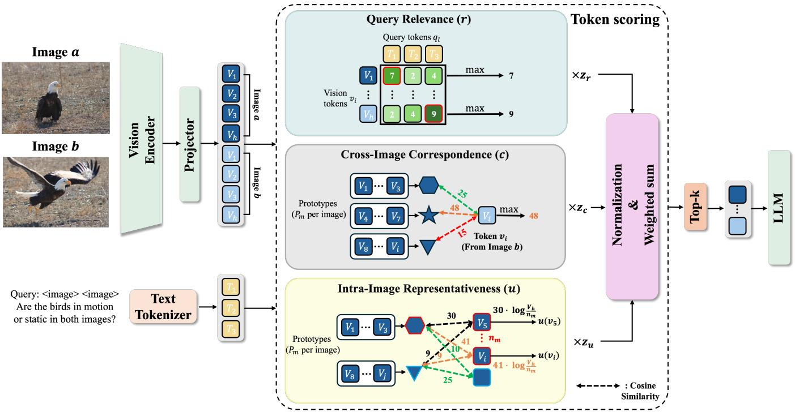  
Figure 3: Overview of the proposed visual token selection framework. Query relevance (�), cross-image correspondence (�), and intra-image representativeness (�) are computed, normalized, and aggregated to select the Top-� vision tokens for the LLM.

RI-Prune operates exactly at this interface: after the projector and before the decoder. Therefore, all downstream decoder compu tation is performed only on the retained visual tokens. The pruning procedure consists of two steps. First, RI-Prune computes three complementary token-level scores from the projected visual tokens and text embeddings. Second, it selects a subset of visual tokens under a fixed budget �. The selected tokens are forwarded to the language decoder in their original order, while the remaining tokens are discarded.

## 4.2 Token Scoring

RI-Prune assigns each visual token $v _ { i }$ a final importance score by combining three training-free signals: query relevance, cross-image correspondence, and intra-image representativeness. These signals capture complementary requirements of multi-image reasoning: task-relevant evidence should be aligned with the question, relational evidence should be connected to content across images, and redundant local patterns should be suppressed while preserving representative content within each image. Rather than relying on a single heuristic signal, RI-Prune combines these three aspects to estimate token utility from the projected multimodal representations.

Let $V ^ { ( a ) }$ denote the set of visual tokens originating from image �, where $a \in \{ 1 , \ldots , N \}$ . All similarity scores are computed using cosine similarity between $\ell _ { 2 } \cdot$ -normalized embeddings.

Query relevance. Let $Q = \{ q _ { 1 } , q _ { 2 } , . . . , q _ { L } \} \subseteq T$ denote the embeddings of the textual query tokens. For each visual token $v _ { i } ,$ , we define its query-relevance score as the maximum cosine similarity

to any query-token embedding:

$$
r ( \boldsymbol { \upsilon } _ { i } ) = \operatorname* { m a x } _ { 1 \leq \ell \leq L } \cos ( \boldsymbol { \upsilon } _ { i } , \boldsymbol { q } _ { \ell } ) .
$$

This score measures direct semantic alignment between visual content and the task instruction. Since the multimodal projector maps visual representations into the language-model embedding space, they can be directly compared with text-token embeddings using cosine similarity, providing a simple training-free measure of crossmodal alignment. By taking the token-wise maximum, the score preserves fine-grained alignments between visual regions and individual query concepts—such as objects, attributes, or relations.

Cross-image correspondence. Multi-image reasoning often requires identifying visual evidence that is shared, contrasted, or related across images. Query relevance alone does not explicitly capture such inter-image structure; therefore, we introduce a crossimage correspondence signal that measures whether a token has semantically related visual evidence in another image. To compute this signal eficiently, we summarize each image using a compact set of prototypes. For each image $^ { a , }$ we partition its visual tokens $V ^ { ( a ) }$ into $P$ contiguous chunks of approximately equal size. We then average the tokens in each chunk to obtain the prototype set $\mathcal { P } ^ { ( a ) } = \{ \ v { p } _ { 1 } ^ { \top ( a ) } , \ v { p } _ { 2 } ^ { ( a ) } , \ v { e } _ { \bot } . . . , \ v { p } _ { P } ^ { ( a ) } \}$ , where ${ \mathcal { P } } ^ { ( a ) }$ denotes the set of prototypes for image �, and $\boldsymbol { p } _ { m } ^ { ( a ) } \in \mathbb { R } ^ { d }$ denotes the �-th prototype vector.

For a token $v _ { i } \in V ^ { ( a ) }$ , its cross-image correspondence score is defined as the maximum cosine similarity to prototypes from the

other images:

$$
c ( v _ { i } ) = \operatorname* { m a x } _ { \stackrel { b \neq a } { 1 \leq m \leq P } } \cos ( v _ { i } , p _ { m } ^ { ( b ) } ) .
$$

A high value of $c ( v _ { i } )$ indicates that the content represented by $v _ { i }$ is semantically consistent with some region in another image, making it a useful candidate for cross-image comparison or aggregation.

Intra-image representativeness. The third signal aims to preserve informative content within each image by emphasizing tokens that are strongly associated with less frequently matched prototypes. This allows RI-Prune to retain representative local evidence while reducing the influence of pervasive patterns that are likely to correspond to repeated background or common context.

For each token $v _ { i } \in V ^ { ( a ) }$ , we first assign it to the closest prototype within the same image:

$$
m _ { i } = \arg \operatorname* { m a x } _ { 1 \leq m \leq P } \cos ( v _ { i } , p _ { m } ^ { ( a ) } ) .
$$

We then compute a non-negative prototype-alignment score:

$$
s _ { i } = \operatorname* { m a x } \left( 0 , \cos ( v _ { i } , p _ { m _ { i } } ^ { ( a ) } ) \right) ,
$$

which measures how strongly �� aligns with its assigned prototype. Next, we count the number of tokens in image � assigned to each prototype:

$$
\begin{array} { r } { n _ { m } ^ { ( a ) } = \left| \left\{ j : v _ { j } \in V ^ { ( a ) } , \ : m _ { j } = m \right\} \right| . } \end{array}
$$

The intra-image representativeness score is defined as

$$
u ( v _ { i } ) = s _ { i } \cdot \log { \frac { | V ^ { ( a ) } | } { n _ { m _ { i } } ^ { ( a ) } } } .
$$

The first factor rewards tokens that are confidently associated with a prototype, while the logarithmic factor upweights tokens assigned to less frequent prototypes within the image. Thus, this score favors tokens that represent distinctive yet coherent local patterns. Since $u ( v _ { i } )$ is combined with query relevance and cross-image correspondence rather than used as a standalone criterion, visually distinctive but query-irrelevant outliers are less likely to dominate the final selection.

Final token score. The three raw scores have diferent scales and distributions. We therefore normalize each score within the current sample using z-score normalization. For each scoring function $x \in$ $\{ r , c , u \}$ , we define

$$
z _ { x } ( v _ { i } ) = \frac { x ( v _ { i } ) - \mu _ { x } } { \sigma _ { x } + \epsilon } ,
$$

where $\mu _ { x }$ and $\sigma _ { x }$ are computed over all visual tokens in the current input, and � is a small constant for numerical stability. The final importance score of token $v _ { i }$ is computed as

$$
S ( v _ { i } ) = \lambda _ { r } z _ { r } ( v _ { i } ) + \lambda _ { c } z _ { c } ( v _ { i } ) + \lambda _ { u } z _ { u } ( v _ { i } ) ,
$$

where $\lambda _ { r } , \lambda _ { c } ,$ and $\lambda _ { u }$ are non-negative weights controlling the contribution of each signal.

## 4.3 Token Selection

Given a global visual token budget �, RI-Prune selects tokens according to the final score $S ( \cdot )$ . To ensure that every input image contributes visual evidence, we distribute the budget nearly evenly across the � images. Let $B ^ { ( a ) }$ denote the quota assigned to image �, where $\begin{array} { r } { \sum _ { a = 1 } ^ { N } B ^ { ( a ) } = B } \end{array}$ and the quotas difer by at most one token.

Within each image, we retain the $B ^ { ( a ) }$ tokens with the highest final importance scores:

$$
R ^ { ( a ) } = \mathrm { T o p K } _ { B ^ { ( a ) } } \left( \{ v _ { i } \in V ^ { ( a ) } \} ; S \right) .
$$

The final retained token set is

$$
R = \bigcup _ { a = 1 } ^ { N } R ^ { ( a ) } .
$$

The retained tokens are then passed to the language decoder in their original sequence order. This per-image allocation preserves evidence from all input images, while the scoring function selects the most query-relevant, cross-image-consistent, and intra-image representative tokens within each image.

## 5 Experiments

## 5.1 Experimental Setup

Baselines and models. To verify the generalizability of RI-Prune as a plug-and-play visual token pruning method, we integrate it into representative LVLMs and evaluate it across diverse multi-image reasoning tasks. Specifically, we adopt Qwen2.5-VL-7B-Instruct [6], Qwen3-VL-8B-Instruct [5] and LLaVA-OneVision-7B [19] as the backbone LVLMs, all of which natively support multi-image inputs. We compare RI-Prune with several plug-and-play, inference-time pruning baselines: FastV [8] and SCOPE [9], which score tokens via decoder attention; VisionZip [37], which selects tokens using encoder-side saliency signals; DivPrune [1], which selects tokens based on visual diversity; and VTW [25], which discards all visual tokens at a layer determined by validation performance.

Benchmarks and evaluation. We conduct extensive experiments on four multi-image benchmarks that collectively cover diverse aspects of multi-image reasoning: MUIRBench [34], which spans a wide range of inter-image relations and task types; MIBench [27], a large-scale benchmark for multi-image instruction following; MIRB [43], which targets fine-grained perception and reasoning across multiple images; and Mantis-Eval [15], which evaluates multi-image understanding across heterogeneous inter-image tasks. For each benchmark, we report the oficial task-specific metric. In addition to accuracy, we evaluate all methods in terms of FLOPs and end-to-end inference latency, which includes visual encoding, token selection, and decoder computation, to assess their eficiency under aggressive token reduction. The visual token reduction ratio is defined as $\scriptstyle 1 - { \bar { B } } / J$ , where � is the original number of visual tokens and �¯ denotes the average number of retained tokens across decoder layers. We conduct the main comparison in a high-reduction regime, where diferences between selection strategies are more clearly observed, and further analyze the robustness ofeach method across diferent token budgets.

Implementation details. All pruning experiments are conducted on a single NVIDIA A100 GPU using the HuggingFace Transformers library. RI-Prune is applied once at the projector output, before the first decoder layer, so that all subsequent decoder computation is performed only on the retained tokens. Unless otherwise noted, we set $P = 1 6$ and use $\lambda _ { r } = \lambda _ { c } = \lambda _ { u } = 1$ for all benchmarks and models. For methods that perform progressive or layer-wise reduction, we follow the protocol of prior work and adjust their hyperparameters so that �¯ matches our single-shot budget �, ensuring that all methods operate under an equivalent token budget. All experiments are conducted with FlashAttention acceleration enabled for both the baselines and RI-Prune to ensure that the reported FLOPs and latency measurements reflect a realistic and consistent inference setting.

Table 1: Performance comparison across multi-image benchmarks under diferent pruning ratios. Each cell reports accuracy on the first line and relative performance on the second line.
<table><tr><td>Method</td><td>Mantis-Eval</td><td>MIBench</td><td>MIRB</td><td>MUIRBench</td><td>Avg.</td></tr><tr><td rowspan="2">Vanilla</td><td>73.3</td><td>54.6</td><td>63.6</td><td>60.9</td><td>63.1</td></tr><tr><td>100.0%</td><td>100.0%</td><td>100.0%</td><td>100.0%</td><td>100.0%</td></tr><tr><td colspan="2"></td><td>Retain 45.3% Tokens</td><td></td><td></td><td></td></tr><tr><td rowspan="2">FastV (ECCV&#x27;24)</td><td>71.9</td><td>54.0</td><td>56.0</td><td>51.5</td><td>58.3</td></tr><tr><td>98.1%</td><td>98.9%</td><td>88.1%</td><td>84.6%</td><td>92.5%</td></tr><tr><td rowspan="2">VisionZip(CVPR&#x27;25)</td><td>71.9</td><td>52.1</td><td>49.5</td><td>55.9</td><td>57.3</td></tr><tr><td>98.1%</td><td>95.4%</td><td>77.8%</td><td>91.8%</td><td>90.9%</td></tr><tr><td rowspan="2">VTW (AAAI&#x27;25)</td><td>55.8</td><td>45.6</td><td>42.1</td><td>44.4</td><td>47.0</td></tr><tr><td>76.1%</td><td>83.5%</td><td>66.3%</td><td>72.9%</td><td>74.4%</td></tr><tr><td rowspan="2">DivPrune (CVPR&#x27;25)</td><td>71.9</td><td>54.4</td><td>60.0</td><td>59.5</td><td>61.4</td></tr><tr><td>98.1%</td><td>99.6%</td><td>94.3%</td><td>97.7%</td><td>97.4%</td></tr><tr><td rowspan="2">SCOPE (NeurIPS*25)</td><td>72.4</td><td>54.4</td><td>58.3</td><td>57.4</td><td>60.6</td></tr><tr><td>98.7%</td><td>99.6%</td><td>91.7%</td><td>94.3%</td><td>96.1%</td></tr><tr><td rowspan="2">RI-Prune (Ours)</td><td>72.8</td><td>54.5</td><td>58.0</td><td>60.9</td><td>61.5</td></tr><tr><td>99.4%</td><td>99.8%</td><td>91.2%</td><td>100.0%</td><td>97.5%</td></tr><tr><td></td><td></td><td>Retain 23.5% Tokens</td><td></td><td></td><td></td></tr><tr><td rowspan="2">FastV (ECCV&#x27;24)</td><td>70.5</td><td>52.3</td><td>55.1</td><td>49.4</td><td>56.8</td></tr><tr><td>96.2%</td><td>95.8%</td><td>86.7%</td><td>81.1%</td><td>90.1%</td></tr><tr><td rowspan="2">VisionZip(CVPR&#x27;25)</td><td>68.7</td><td>48.5</td><td>47.4</td><td>54.2</td><td>54.7</td></tr><tr><td>93.7%</td><td>88.8%</td><td>74.5%</td><td>89.0%</td><td>86.7%</td></tr><tr><td rowspan="2">VTW (AAAI&#x27;25)</td><td>38.3</td><td>26.1</td><td>43.3</td><td>34.1</td><td>35.4</td></tr><tr><td>52.2%</td><td>47.8%</td><td>68.2%</td><td>56.0%</td><td>56.2%</td></tr><tr><td rowspan="2">DivPrune (CVPR*25)</td><td>71.0</td><td>53.2</td><td>57.5</td><td>56.4</td><td>59.5</td></tr><tr><td>96.9%</td><td>97.4%</td><td>90.4%</td><td>92.6%</td><td>94.3%</td></tr><tr><td rowspan="2">SCOPE (NeurIPS&#x27;25)</td><td>71.9</td><td>52.2</td><td>49.4</td><td>55.7</td><td>57.3</td></tr><tr><td>98.1%</td><td>95.6%</td><td>77.6%</td><td>91.5%</td><td>90.8%</td></tr><tr><td rowspan="2">RI-Prune (Ours)</td><td>72.8</td><td>53.2</td><td>57.5</td><td>59.4</td><td>60.7</td></tr><tr><td>99.4%</td><td>97.4%</td><td>90.4%</td><td>97.5%</td><td>96.2%</td></tr><tr><td>Retain 4.6% Tokens</td><td></td><td></td><td></td><td></td><td></td></tr><tr><td rowspan="2">FastV (ECCV*24)</td><td>61.8</td><td>33.5</td><td>44.0</td><td>40.5</td><td>44.9</td></tr><tr><td>84.3%</td><td>61.3%</td><td>69.2%</td><td>66.5%</td><td>71.2%</td></tr><tr><td rowspan="2">VisionZip(CVPR&#x27;25)</td><td>59.5</td><td>39.0</td><td>41.3</td><td>47.4</td><td>46.8</td></tr><tr><td>81.2%</td><td>71.4%</td><td>65.0%</td><td>77.8%</td><td>74.2%</td></tr><tr><td rowspan="2">VTW (AAAI&#x27;25)</td><td>14.3</td><td>22.5</td><td>23.0</td><td>31.8</td><td>22.9</td></tr><tr><td>19.5%</td><td>41.2%</td><td>36.2%</td><td>52.2%</td><td>36.3%</td></tr><tr><td rowspan="2">DivPrune (CVPR*25)</td><td>62.7</td><td>37.5</td><td>44.5</td><td>49.1</td><td>48.4</td></tr><tr><td>85.6%</td><td>68.7%</td><td>70.1%</td><td>80.6%</td><td>76.8%</td></tr><tr><td rowspan="2">SCOPE(NeurIPS&#x27;25)</td><td>64.5</td><td>39.5</td><td>43.2</td><td>47.5</td><td>48.7</td></tr><tr><td>88.0%</td><td>72.3%</td><td>68.0%</td><td>78.0%</td><td>77.1%</td></tr><tr><td rowspan="2">RI-Prune (Ours)</td><td>63.6</td><td>36.7</td><td>50.3</td><td>52.3</td><td>50.7</td></tr><tr><td>86.8%</td><td>67.2%</td><td>79.1%</td><td>85.9%</td><td>80.4%</td></tr></table>

## 5.2 Experimental Results

Results on Qwen2.5-VL. We evaluate all pruning methods on Qwen2.5-VL across four multi-image benchmarks, as shown in Table 1. The vanilla model achieves an average score of 63.1, which serves as the reference for evaluating performance retention. RI-Prune maintains strong performance across all three retained token ratios. At 45.3% retained tokens, it achieves an average score of 61.5, corresponding to 97.5% of the vanilla performance, and slightly outperforms the strongest baseline, DivPrune. It also performs best on Mantis-Eval, MIBench, and MUIRBench. When the retained ratio is reduced to 23.5%, RI-Prune obtains an average score of60.7 (96.2% of vanilla), improving over DivPrune by 1.2 points and achieving the best or tied-best result across all four benchmarks. This suggests that its advantage is maintained as the available visual token budget becomes smaller. Under the most aggressive setting, with only 4.6% of visual tokens retained, RI-Prune achieves an average score of 50.7 and preserves 80.4% of the vanilla performance, outperforming SCOPE and DivPrune. In particular, its stronger results on MIRB and MUIRBench indicate that the selected tokens remain efective for fine-grained and cross-image reasoning even under severe token reduction.

Table 2: Comparison with SOTA methods on LLaVA-OneVision-7B under diferent token budgets. Each cell reports accuracy on the first line and relative performance on the second line. Best results are boldfaced, and second-best results are underlined within each token budget.
<table><tr><td>Method</td><td>Mantis-Eval</td><td>MIBench</td><td>MIRB</td><td>MUIRBench</td><td>Avg.</td></tr><tr><td rowspan="3">Vanilla</td><td>61.29</td><td>51.37</td><td>52.27</td><td>36.10</td><td>50.3</td></tr><tr><td>100.0%</td><td>100.0%</td><td>100.0%</td><td>100.0%</td><td>100.0%</td></tr><tr><td colspan="4">Token Budget 5000</td><td></td></tr><tr><td rowspan="2">FastV(ECCV*24)</td><td>43.9</td><td>42.67 83.1%</td><td>35.7 68.3%</td><td>29.6</td><td>38.0</td></tr><tr><td>71.6%</td><td></td><td></td><td>82.0%</td><td>75.5%</td></tr><tr><td rowspan="2">VisionZip(CVPR&#x27;25)</td><td>59.0</td><td>49.87</td><td>50.0</td><td>34.9</td><td>48.4</td></tr><tr><td>96.3%</td><td>97.1%</td><td>95.7%</td><td>96.7%</td><td>96.4%</td></tr><tr><td rowspan="2">VTW(AAAr&#x27;25)</td><td>33.6</td><td>38.00</td><td>39.9</td><td>26.1</td><td>34.4</td></tr><tr><td>54.8%</td><td>74.0%</td><td>76.3%</td><td>72.3%</td><td>68.5%</td></tr><tr><td rowspan="2">DivPrune (CVPR&#x27;25)</td><td>60.4</td><td>48.57</td><td>48.8</td><td>35.7</td><td>48.4</td></tr><tr><td>98.5%</td><td>94.5%</td><td>93.4%</td><td>98.9%</td><td>96.2%</td></tr><tr><td rowspan="2">SCOPE(NeurIPS&#x27;25)</td><td>60.4</td><td>48.17</td><td>49.9</td><td>35.0</td><td>48.4</td></tr><tr><td>98.5%</td><td>93.8%</td><td>95.5%</td><td>97.0%</td><td>96.2%</td></tr><tr><td rowspan="2">RI-Prune (Ours)</td><td>60.7</td><td>46.77</td><td>51.2</td><td>36.0</td><td>48.7</td></tr><tr><td>99.0%</td><td>91.0%</td><td>98.0%</td><td>99.7%</td><td>96.8%</td></tr><tr><td colspan="4">Token Budget 3300</td><td></td><td></td></tr><tr><td rowspan="2">FastV (ECCV*24)</td><td>42.9</td><td>41.67</td><td>34.7</td><td>26.0</td><td>36.3</td></tr><tr><td>70.0%</td><td>81.1%</td><td>66.4%</td><td>72.0%</td><td>72.3%</td></tr><tr><td rowspan="2">VisionZip(CVPR&#x27;25)</td><td>56.2</td><td>48.57</td><td>48.6</td><td>34.5</td><td>47.0</td></tr><tr><td>91.7%</td><td>94.5%</td><td>93.0%</td><td>95.6%</td><td>93.5%</td></tr><tr><td rowspan="2">VTW(AAAr&#x27;25)</td><td>28.6</td><td>28.27</td><td>36.8</td><td>22.5</td><td>29.0</td></tr><tr><td>46.7%</td><td>55.0%</td><td>70.4%</td><td>62.3%</td><td>57.8%</td></tr><tr><td rowspan="2">DivPrune (CVPR*25)</td><td>56.7</td><td>46.47</td><td>48.7</td><td>33.9</td><td>46.4</td></tr><tr><td>92.5%</td><td>90.5%</td><td>93.2%</td><td>93.9%</td><td>92.4%</td></tr><tr><td rowspan="2">SCOPE(NeurIPS&#x27;25)</td><td>56.7</td><td>47.67</td><td>48.8</td><td>34.7</td><td>47.0</td></tr><tr><td>92.5%</td><td>92.8%</td><td>93.4%</td><td>96.1%</td><td>93.5%</td></tr><tr><td rowspan="2">RI-Prune (Ours)</td><td>56.4</td><td>46.07</td><td>49.9</td><td>34.8</td><td>46.8</td></tr><tr><td>92.0%</td><td>89.7%</td><td>95.5%</td><td>96.4%</td><td>93.1%</td></tr><tr><td colspan="4">Token Budget 1700</td><td></td><td></td></tr><tr><td rowspan="2">FastV(ECCV*24)</td><td>39.9</td><td>40.07</td><td>30.1</td><td>25.1</td><td>33.8</td></tr><tr><td>65.1%</td><td>78.0%</td><td>57.6%</td><td>69.5%</td><td>67.2%</td></tr><tr><td rowspan="2">VisionZip(CVPR&#x27;25)</td><td>53.5</td><td>47.87</td><td>48.3</td><td>33.0</td><td>45.7</td></tr><tr><td>87.3%</td><td>93.2%</td><td>92.4%</td><td>91.4%</td><td>90.9%</td></tr><tr><td rowspan="2">VTW (AAAI&#x27;25)</td><td>21.2</td><td>18.00</td><td>25.0</td><td>15.7</td><td>20.0 39.8%</td></tr><tr><td>34.6%</td><td>35.0%</td><td>47.8%</td><td>43.5%</td><td></td></tr><tr><td rowspan="2">DivPrune (CVPR&#x27;25)</td><td>55.3 90.2%</td><td>46.07 89.7%</td><td>48.1 92.0%</td><td>33.2 92.0%</td><td>45.7 90.9%</td></tr><tr><td></td><td>47.07</td><td>48.5</td><td></td><td></td></tr><tr><td rowspan="2">SCOPE(NeurIPS&#x27;*25)</td><td>52.1 85.0%</td><td>91.6%</td><td>92.8%</td><td>33.1 91.7%</td><td>45.2 89.9%</td></tr><tr><td>54.2</td><td></td><td></td><td></td><td>45.4</td></tr><tr><td rowspan="2">RI-Prune (Ours)</td><td></td><td>44.87</td><td>49.2</td><td>33.5</td><td></td></tr><tr><td>88.4%</td><td>87.3%</td><td>94.1%</td><td>92.8%</td><td>90.4%</td></tr></table>

Table 3: Comparison with SOTA methods on Qwen3-VL under diferent retained token ratios. Each cell reports accuracy on the first line and relative performance on the second line. Best results are boldfaced, and second-best results are underlined within each retained token ratio.
<table><tr><td>Method</td><td>Mantis-Eval</td><td>MIBench</td><td>MIRB</td><td>MUIRBench</td><td>Avg.</td></tr><tr><td rowspan="2">Vanilla</td><td>78.7</td><td>60.85</td><td>68.75</td><td>64.4</td><td>68.2</td></tr><tr><td>100.0%</td><td>100.0%</td><td>100.0%</td><td>100.0%</td><td>100.0%</td></tr><tr><td colspan="6">Retain 23.5% Tokens</td></tr><tr><td rowspan="2">FastV(ECCV*24)</td><td>69.4</td><td>55.1</td><td>59.3</td><td>60.3</td><td>61.0</td></tr><tr><td>88.2%</td><td>90.6%</td><td>86.3%</td><td>93.6%</td><td>89.5%</td></tr><tr><td rowspan="2">VisionZip(CVPR&#x27;25)</td><td>74.6</td><td>53.8</td><td>62.4</td><td>60.9</td><td>62.9</td></tr><tr><td>94.8%</td><td>88.4%</td><td>90.8%</td><td>94.6%</td><td>92.3%</td></tr><tr><td rowspan="2">VTW (AAAI&#x27;25)</td><td>63.7</td><td>48.0</td><td>40.1</td><td>58.5</td><td>52.6</td></tr><tr><td>80.9%</td><td>78.9%</td><td>58.3%</td><td>90.8%</td><td>77.1%</td></tr><tr><td rowspan="2">DivPrune (CVPR&#x27;25)</td><td>64.7</td><td>51.2</td><td>60.1</td><td>61.0</td><td>59.3</td></tr><tr><td>82.2%</td><td>84.1%</td><td>87.4%</td><td>94.7%</td><td>86.9%</td></tr><tr><td rowspan="2">SCOPE(NeurIPS&#x27;25)</td><td>75.1</td><td>58.7</td><td>63.0</td><td>62.7</td><td>64.9</td></tr><tr><td>95.4%</td><td>96.5%</td><td>91.6%</td><td>97.4%</td><td>95.2%</td></tr><tr><td rowspan="2">RI-Prune (Ours)</td><td>75.5</td><td>57.2</td><td>66.0</td><td>64.1</td><td>65.7</td></tr><tr><td>95.9%</td><td>94.0%</td><td>96.0%</td><td>99.5%</td><td>96.4%</td></tr><tr><td colspan="2"></td><td>Retain 4.6% Tokens</td><td></td><td></td><td></td></tr><tr><td rowspan="2">FastV (ECCV&#x27;24)</td><td>60.4 76.7%</td><td>45.5</td><td>52.1</td><td>49.6</td><td>51.9</td></tr><tr><td></td><td>74.8%</td><td>75.8%</td><td>77.0%</td><td>76.1%</td></tr><tr><td rowspan="2">VisionZip(CVPR&#x27;25)</td><td>68.2</td><td>51.2</td><td>52.9</td><td>57.3</td><td>57.4</td></tr><tr><td>86.7%</td><td>84.1%</td><td>76.9%</td><td>89.0%</td><td>84.2%</td></tr><tr><td rowspan="2">VTW (AAAI&#x27;25)</td><td>54.2</td><td>43.5</td><td>62.1</td><td>42.3</td><td>50.5</td></tr><tr><td>68.9%</td><td>71.5%</td><td>90.3%</td><td>65.7%</td><td>74.1%</td></tr><tr><td rowspan="2">DivPrune (CVPR&#x27;25)</td><td>54.2</td><td>47.6</td><td>52.2</td><td>59.9</td><td>53.5</td></tr><tr><td>68.9%</td><td>78.2%</td><td>75.9%</td><td>93.0%</td><td>78.4%</td></tr><tr><td rowspan="2">SCOPE (NeurIPS&#x27;25)</td><td>74.7</td><td>47.5</td><td>52.5</td><td>58.3</td><td>58.3</td></tr><tr><td>94.9%</td><td>78.1%</td><td>76.4%</td><td>90.5%</td><td>85.4%</td></tr><tr><td rowspan="2">RI-Prune (Ours)</td><td>73.2</td><td>53.2</td><td>65.8</td><td>61.6</td><td>63.5</td></tr><tr><td>93.0%</td><td>87.4%</td><td>95.7%</td><td>95.7%</td><td>93.1%</td></tr></table>

Results on LLaVA-OneVision. To evaluate whether RI-Prune generalizes to a diferent multi-image LVLM architecture, we further conduct experiments on LLaVA-OneVision-7B under token budgets of 5000, 3300, and 1700, as reported in Table 2. With a budget of 5000, RI-Prune achieves the highest average score of 48.7, preserving 96.8% of the vanilla performance, while obtaining the best results on Mantis-Eval, MIRB, and MUIRBench. When the budget is reduced to 3300, it remains competitive with an average score of 46.8 (93.1% of vanilla), ranking second overall while still performing best on MIRB and MUIRBench. At the most constrained budget of 1700, RI-Prune achieves an average score of 45.4 and retains 90.4% of the vanilla performance, again showing the strongest results on MIRB and MUIRBench. Overall, these results indicate that RI-Prune transfers efectively to LLaVA-OneVision and remains robust as the visual token budget is progressively reduced.

Results on Qwen3-VL. We further evaluate RI-Prune on Qwen3- VL to examine whether its efectiveness extends to a more recent and stronger LVLM backbone. Experiments are conducted at retained token ratios of 23.5% and 4.6%, with results reported in Table 3. We focus on these higher-reduction settings to evaluate generalization under more challenging visual-token constraints. At 23.5%, RI-Prune achieves the highest average score of 65.7, preserving 96.4% of the vanilla performance and improving over SCOPE, the strongest baseline, by 0.8 points. It also obtains the best results on Mantis-Eval, MIRB, and MUIRBench. The diference becomes larger under the more aggressive 4.6% setting, where RI-Prune reaches an average score of 63.5 and retains 93.1% of the vanilla performance. This is 5.2 points higher than SCOPE, while RI-Prune also performs best on MIBench, MIRB, and MUIRBench. These results suggest that the proposed token selection strategy remains efective on a stronger backbone, particularly when the visual token budget is highly constrained.

Table 4: Ablation study of each component and its corresponding weighting coeficient in RI-Prune. Best result is boldfaced.
<table><tr><td>Variant</td><td> $\lambda _ { r }$ </td><td> $\lambda _ { c }$ </td><td> $\lambda _ { u }$ </td><td>r</td><td>c</td><td>u</td><td>Acc.</td><td>∆ vs Full</td></tr><tr><td>Random</td><td>0</td><td>0</td><td>0</td><td></td><td></td><td></td><td>40.1</td><td>-10.6</td></tr><tr><td>r only</td><td>1</td><td>0</td><td>0</td><td>√</td><td></td><td></td><td>44.6</td><td>-6.1</td></tr><tr><td>c only</td><td>0</td><td>1</td><td>0</td><td></td><td>√</td><td></td><td>43.1</td><td>-7.6</td></tr><tr><td>u only</td><td>0</td><td>0</td><td>1</td><td></td><td></td><td>√</td><td>42.4</td><td>-8.3</td></tr><tr><td> $r + c$ </td><td>1</td><td>1</td><td>0</td><td>√</td><td>√</td><td></td><td>48.6</td><td>-2.1</td></tr><tr><td> $r + u$ </td><td>1</td><td>0</td><td>1</td><td>√</td><td></td><td>√</td><td>41.8</td><td>-8.9</td></tr><tr><td> $c + u$ </td><td>0</td><td>1</td><td>1</td><td></td><td>√</td><td>√</td><td>45.5</td><td>-5.2</td></tr><tr><td> $\lambda _ { r } = 0 . 5$ </td><td>0.5</td><td>1</td><td>1</td><td>√</td><td>√</td><td>√</td><td>49.5</td><td>-1.2</td></tr><tr><td> $\lambda _ { c } = 0 . 5$ </td><td>1</td><td>0.5</td><td>1</td><td>√</td><td>√</td><td>√</td><td>49.8</td><td>-0.9</td></tr><tr><td> $\lambda _ { u } = 0 . 5$ </td><td>1</td><td>1</td><td>0.5</td><td>√</td><td>√</td><td>√</td><td>50.2</td><td>-0.5</td></tr><tr><td>Full  $( r + c + u )$ </td><td>1</td><td>1</td><td>1</td><td>√</td><td>√</td><td>√</td><td>50.7</td><td>一</td></tr></table>

## 5.3 Ablation analysis

Ablation Studies. Table 4 analyzes the contribution and weighting of each RI-Prune component on Qwen2.5-VL at the 4.6% retainedtoken setting, reporting the average accuracy across the four multiimage benchmarks. The random baseline achieves 40.1, while all single-component variants improve over it, with �-only performing best at 44.6, followed by �-only and �-only. Among partial combinations, � + � achieves the strongest result (48.6), reducing the gap to the full model to 2.1 points, while �+� also improves over its individual components. We further vary each weighting coeficient from 1 to 0.5 while keeping the others fixed. The resulting accuracies remain high (49.5–50.2) but consistently below the equal-weight setting. The full configuration with $\lambda _ { r } = \lambda _ { c } = \lambda _ { u } = 1$ achieves the best accuracy of 50.7, outperforming the strongest partial variant by 2.1 points and random selection by 10.6 points. These results indicate that the three signals are complementary and that equal weighting provides a simple and robust configuration.

Eficiency Analysis. Table 5 compares the eficiency and accuracy ofdiferent pruning methods on Qwen2.5-VL under two retained token ratios. The full model achieves an average accuracy of 63.1 with 57.8 TFLOPs and 8.135s latency. When retaining 23.5% of visual tokens, RI-Prune reduces computation to 10.35 TFLOPs, corresponding to a 5.6× reduction over the full model, while maintaining an average accuracy of 60.7 and preserving 96.2% of the full-model performance. It outperforms DivPrune by 1.2 accuracy points while requiring lower inference latency and matching the lowest TFLOPs among the compared methods. This indicates that substantial visual token reduction can be achieved without a large degradation in task performance. Under the more aggressive 4.6% retention ratio, RI-Prune achieves the best average accuracy of 50.7 while using 7.9 TFLOPs and 5.124s latency. This corresponds to a 7.3× reduction in TFLOPs and a 1.59× speedup over the full model. The relative performance advantage becomes clearer in this high-compression setting, suggesting that RI-Prune is particularly efective when only a small visual token budget is available. Overall, these results show that RI-Prune provides a favorable balance between computational eficiency and task performance under aggressive token reduction. Selection Mode Analysis. Table 6 compares diferent token selection modes under the same token budget. Since all modes use the same number of retained tokens and have identical TFLOPs with only minor selection overhead latency diferences, the performance diference mainly comes from how the token budget is distributed across images. The global Top-� strategy achieves the lowest latency but the lowest accuracy, suggesting that selecting tokens from a flat global pool can cause visually dominant images to monopolize the budget while leaving other images underrepresented. This is undesirable for multi-image reasoning, where the answer often depends on evidence distributed across multiple images. Introducing a minimum per-image quota alleviates this issue by ensuring basic coverage for each image, leading to a clear improvement over pure global selection. However, because the remaining budget is still allocated globally, the method can still be biased toward a subset of images. In contrast, the per-image Top-� strategy performs best while maintaining comparable latency and the same TFLOPs. By preserving the most informative tokens within each image, it better respects the multi-image structure of the input and retains complementary cross-image evidence. These results suggest that balanced per-image allocation is a more suitable inductive bias for multi-image LVLM pruning than treating all visual tokens as a single global candidate pool.

Table 5: Eficiency and accuracy comparison under diferent retained token ratios. Results are reported on Qwen2.5-VL.
<table><tr><td>Method</td><td>Retain Ratio</td><td>TFLOPs</td><td>Latency</td><td>Avg. Acc.</td></tr><tr><td>Qwen2.5-VL</td><td>100.0%</td><td>57.8</td><td>8.135s</td><td>63.1</td></tr><tr><td>FastV</td><td>4.6%</td><td>11.4</td><td>7.728s</td><td>44.9</td></tr><tr><td>DivPrune</td><td>4.6%</td><td>8.8</td><td>8.074s</td><td>48.4</td></tr><tr><td>SCOPE</td><td>4.6%</td><td>8.9</td><td>7.953s</td><td>48.7</td></tr><tr><td>VisionZip</td><td>4.6%</td><td>8.4</td><td>5.217s</td><td>46.8</td></tr><tr><td>VTW</td><td>4.6%</td><td>8.5</td><td>5.125s</td><td>22.9</td></tr><tr><td>RI-Prune</td><td>4.6%</td><td>7.9</td><td>5.124s</td><td>50.7</td></tr><tr><td>FastV</td><td>23.5%</td><td>13.4</td><td>8.128s</td><td>56.8</td></tr><tr><td>DivPrune</td><td>23.5%</td><td>10.79</td><td>8.774s</td><td>59.5</td></tr><tr><td>SCOPE</td><td>23.5%</td><td>10.79</td><td>8.153s</td><td>57.3</td></tr><tr><td>VisionZip</td><td>23.5%</td><td>10.35</td><td>5.557s</td><td>54.7</td></tr><tr><td>VTW</td><td>23.5%</td><td>10.64</td><td>5.636s</td><td>35.4</td></tr><tr><td>RI-Prune</td><td>23.5%</td><td>10.35</td><td>5.554s</td><td>60.7</td></tr></table>

Table 6: Comparison of token selection modes on Qwen2.5- VL at the 4.6% retained-token setting. Selection overhead is measured in seconds, excluding decoder forward computation.
<table><tr><td>Selection Mode</td><td>Accuracy</td><td>Selection Overhead (s)</td><td>TFLOPs</td></tr><tr><td>Global Top-K</td><td>48.8</td><td>0.909</td><td>7.9</td></tr><tr><td>Global + min quota</td><td>50.3</td><td>0.922</td><td>7.9</td></tr><tr><td>Per-image Top-K</td><td>50.7</td><td>0.920</td><td>7.9</td></tr></table>

Table 7: Performance comparison according to the number of prototypes � on Qwen2.5-VL at a 4.6% retained token budget.
<table><tr><td>P</td><td>2</td><td>4</td><td>8</td><td>16</td><td>64</td><td>128</td></tr><tr><td>Accuracy</td><td>45.6</td><td>46.9</td><td>47.7</td><td>50.7</td><td>51.0</td><td>48.7</td></tr><tr><td>Compute (s)</td><td>0.0034</td><td>0.0035</td><td>0.0038</td><td>0.0044</td><td>0.0082</td><td>0.0116</td></tr></table>

Table 8: Accuracy comparison on video benchmarks. Acc. denotes accuracy (%). Among pruning methods, the best results are boldfaced and the second-best results are underlined.
<table><tr><td>Benchmark</td><td>Vanilla</td><td>FastV</td><td>DivPrune</td><td>SCOPE</td><td>VisionZip</td><td>VTW</td><td>RI-Prune</td></tr><tr><td>Video-MME</td><td>63.0</td><td>49.3</td><td>52.2</td><td>47.8</td><td>44.9</td><td>23.2</td><td>52.9</td></tr><tr><td>TempCompass</td><td>67.0</td><td>59.8</td><td>63.0</td><td>59.0</td><td>55.0</td><td>33.0</td><td>61.0</td></tr></table>

Efect of the number of prototypes �. Table 7 reports the accuracy and per-sample compute time as we vary the number of prototypes �. Accuracy improves consistently as � grows from 2 to 16, indicating that a suficient number of prototypes is required to cover the diverse visual semantics that appear across multiple images. The peak accuracy is reached at �=64, but the improvement over �=16 is marginal while the compute cost nearly doubles. Further increasing � to 128 degrades accuracy to 48.7, which suggests that an excessive number of prototypes fragments semantically coherent regions and weakens the representativeness of each prototype. Considering the trade-of between accuracy and computational overhead, we adopt �=16 as the default setting, which achieves competitive accuracy with the lowest compute among the top-performing configurations.

Results on Video Benchmarks. To examine whether RI-Prune generalizes beyond static multi-image inputs, we evaluate all pruning methods on Video-MME [12] and TempCompass [29], which require reasoning over temporally ordered frames and are structurally analogous to the multi-image regime. All pruners operate under the same matched token budget as the 23.5% retained setting. As shown in Table 8, RI-Prune achieves the best Video-MME accuracy, surpassing DivPrune and clearly outperforming attention-based pruners such as FastV, SCOPE, and VisionZip. On TempCompass, RI-Prune ranks second with 61.0, trailing DivPrune but still outperforming the attention-driven baselines. In contrast, the layer-truncation baseline VTW performs poorly on both benchmarks, achieving only 23.2 on Video-MME and 33.0 on TempCompass. These results suggest that RI-Prune can extend to video inputs without modification. Since video frames can be viewed as temporally ordered visual inputs, the query-relevance signal helps prioritize frame tokens that are more aligned with the question, while the crossimage-correspondence signal can capture recurring or related visual content across frames. This may explain the strong performance on Video-MME. On TempCompass, where fine-grained temporal attribute discrimination can require broader frame coverage, DivPrune performs slightly better, but RI-Prune remains competitive. Overall, the consistent gap between RI-Prune and attention-based pruners suggests that attention-free, relation-aware token selection is also beneficial for video-style multi-visual inputs.

Question. What does this comic strip describe? <image 1> <image 2> Gold Answer: C   
Choice list: (A) The princess wanted to eat the toad, but because the toad was poisonous, she not only didn't eat it, but also was poisoned. (B) The toad fell in love with the princess. (C) None of the choices provided. (D) The princess fell in love with the toad.

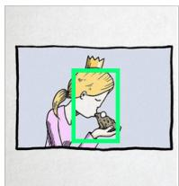  
Image 1

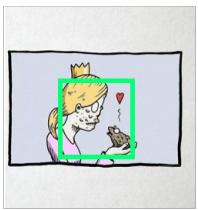  
Image 2

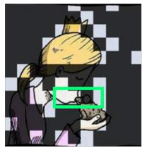  
FastV: D

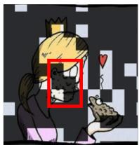

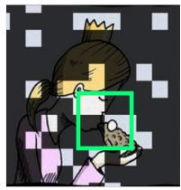  
SCOPE: A

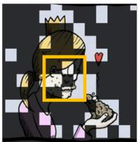

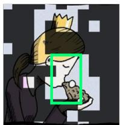

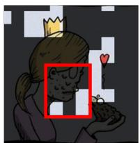  
VisionZip: B

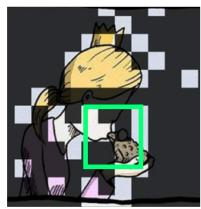

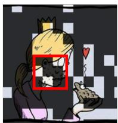  
DivPrune: B

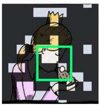

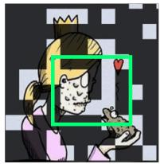  
RI-Prune(Ours): C

Figure 4: Qualitative visualization of visual token pruning on MUIRBench [34]. Bright regions indicate retained visual tokens. Colored boxes denote question-relevant regions: green indicates successful preservation, red indicates pruning of critical information, and orange indicates ambiguous preservation that ultimately leads to an incorrect prediction. RI-Prune preserves more relevant visual evidence under aggressive token reduction.

Qualitative visualization. Figure 4 visualizes pruning results on MUIRBench with only 128 retained visual tokens. While most baselines preserve the salient evidence in the first image, they often miss the important evidence in the second image, where the poisoned state of the princess is required for reasoning. This suggests that conventional pruning methods tend to focus on locally salient or visually dominant regions, but may fail to preserve evidence that is less salient yet crucial for cross-image comparison. In contrast, RI-Prune retains relevant regions in both images. This is because its scoring combines query relevance with cross-image correspondence, allowing tokens related to the question and shared reasoning context to be preserved across images. The visualization supports our quantitative results, showing that RI-Prune better maintains distributed visual evidence under aggressive pruning.

## 6 Conclusion

In this paper, we revisit visual token pruning for multi-image visionlanguage models and show that attention-based saliency transfers poorly from single-image to multi-image reasoning. Analyses across multiple LVLMs reveal positional bias in query-driven attention and weak query alignment of CLS-based saliency, while causal probes show that attention-based pruners retain only marginally more informative tokens than random selection. Motivated by these findings, we propose RI-Prune, a training-free and attention free method operating in the projector embedding space. RI-Prune combines query relevance, cross-image correspondence, and intraimage representativeness with per-image Top-� selection. Experiments across multiple benchmarks and backbones demonstrate that RI-Prune consistently preserves task performance under aggressive token reduction, while ablations validate the complementary scoring signals and the efectiveness of per-image allocation.

Limitations and Future Work. RI-Prune has several limitations. First, its near-uniform per-image budgets may be suboptimal when relevant evidence is concentrated in only a few images, motivating adaptive content-aware allocation. Second, it operates only at the projector–decoder interface and does not exploit layer-wise redundancy within the decoder. Third, its cross-image correspondence signal may become costly for long interleaved video or document inputs. Finally, our evaluation is limited to 7–8B models and multiple-choice multi-image benchmarks; extending RI-Prune to larger models, long-video understanding, and generation-heavy tasks remains future work.

## Acknowledgments

This work was supported by the Institute of Information & Communications Technology Planning & Evaluation (IITP) grant funded by the Korea government (MSIT) [RS-2021-II211341, Artificial Intelligence Graduate School Program (Chung-Ang University)] and by the National Research Foundation of Korea (NRF) grant funded by the Korea government (MSIT) (RS-2025-00556246).

## GenAI Usage Disclosure

The authors used generative AI tools, including ChatGPT, to assist with language polishing, grammar correction, wording refinement, and LaTeX formatting during the preparation of this manuscript. These tools were also used to help revise captions, tables, and result descriptions based on author-provided experimental results.

Generative AI tools were not used to generate benchmark data, modify evaluation datasets, fabricate experimental results, or make scientific conclusions. They were also not used as an autonomous agent for conducting experiments. All GenAI-assisted content was carefully reviewed, verified, and edited by the authors. The authors take full responsibility for the accuracy, integrity, and originality of the submitted work.

## References

[1] Saeed Ranjbar Alvar, Gursimran Singh, Mohammad Akbari, and Yong Zhang. 2025. Divprune: Diversity-based visual token pruning for large multimodal models. In CVPR. 9392–9401.

[2] Kazi Hasan Ibn Arif, JinYi Yoon, Dimitrios S Nikolopoulos, Hans Vandierendonck, Deepu John, and Bo Ji. 2025. Hired: Attention-guided token dropping for eficient inference of high-resolution vision-language models. In AAAI. 1773–1781.

[3] Anas Awadalla, Irena Gao, Josh Gardner, Jack Hessel, Yusuf Hanafy, Wanrong Zhu, Kalyani Marathe, Yonatan Bitton, Samir Gadre, Shiori Sagawa, et al. 2023. Openflamingo: An open-source framework for training large autoregressive vision-language models. arXiv preprint arXiv:2308.01390 (2023).

[4] Jinze Bai, Shuai Bai, Shusheng Yang, Shijie Wang, Sinan Tan, Peng Wang, Junyang Lin, Chang Zhou, andJingren Zhou. 2024. Qwen-VL: A Versatile Vision-Language Model for Understanding, Localization, Text Reading, and Beyond. In ICLR.

[5] Shuai Bai, Yuxuan Cai, Ruizhe Chen, Keqin Chen, Xionghui Chen, Zesen Cheng, Lianghao Deng, Wei Ding, Chang Gao, Chunjiang Ge, et al. 2025. Qwen3-VL Technical Report. arXiv preprint arXiv:2511.21631 (2025).

[6] Shuai Bai, Keqin Chen, Xuejing Liu, Jialin Wang, Wenbin Ge, Sibo Song, Kai Dang, Peng Wang, Shijie Wang, Jun Tang, Humen Zhong, Yuanzhi Zhu, Mingkun Yang, Zhaohai Li, Jianqiang Wan, Pengfei Wang, Wei Ding, Zheren Fu, Yiheng Xu, Jiabo Ye, Xi Zhang, Tianbao Xie, et al. 2025. Qwen2.5-VL Technical Report. arXiv preprint arXiv:2502.13923 (2025).

[7] Daniel Bolya, Cheng-Yang Fu, Xiaoliang Dai, Peizhao Zhang, Christoph Feicht enhofer, and Judy Hofman. 2023. Token merging: Your vit but faster. In ICLR.

[8] Liang Chen, Haozhe Zhao, Tianyu Liu, Shuai Bai, Junyang Lin, Chang Zhou, and Baobao Chang. 2024. An image is worth 1/2 tokens after layer 2: Plug-and-play inference acceleration for large vision-language models. In ECCV. 19–35.

[9] Jinhong Deng, Wen Li, Joey Tianyi Zhou, and Yang He. 2025. SCOPE: Saliency-Coverage Oriented Token Pruning for Eficient Multimodel LLMs. In NeurIPS. 161527–161552.

[10] Mohamed Dhouib, Davide Buscaldi, Sonia Vanier, and Aymen Shabou. 2025. Pact: Pruning and clustering-based token reduction for faster visual language models. In CVPR. 14582–14592.

[11] Yingqi Fan, Anhao Zhao, Jinlan Fu, Junlong Tong, Hui Su, Yijie Pan, Wei Zhang, and Xiaoyu Shen. 2025. VisiPruner: Decoding Discontinuous Cross-Modal Dy namics for Eficient Multimodal LLMs. In EMNLP. 18896–18913.

[12] Chaoyou Fu, Yuhan Dai, Yongdong Luo, Lei Li, Shuhuai Ren, Renrui Zhang, Zihan Wang, Chenyu Zhou, Yunhang Shen, Mengdan Zhang, Peixian Chen, Yanwei Li, Shaohui Lin, Sirui Zhao, Ke Li, Tong Xu, Xiawu Zheng, Enhong Chen, Caifeng Shan, Ran He, and Xing Sun. 2025. Video-MME: The First-Ever Comprehensive Evaluation Benchmark of Multi-modal LLMs in Video Analysis. In CVPR. 24108– 24118.

[13] Yash Goyal, Tejas Khot, Douglas Summers-Stay, Dhruv Batra, and Devi Parikh. 2017. Making the V in VQA Matter: Elevating the Role of Image Understanding in Visual Question Answering. In CVPR. 6904–6913.

[14] Kai Huang, Hao Zou, Ye Xi, BoChen Wang, Zhen Xie, and Liang Yu. 2024. IVTP: Instruction-Guided Visual Token Pruning for Large Vision-Language Models. In ECCV. 214–230.

[15] Dongfu Jiang, Xuan He, Huaye Zeng, Cong Wei, Max Ku, Qian Liu, and Wenhu Chen. 2024. Mantis: Interleaved multi-image instruction tuning. TMLR (2024).

[16] Feyza Duman Keles, Pruthuvi Mahesakya Wijewardena, and Chinmay Hegde. 2023. On the computational complexity of self-attention. In ALT. 597–619.

[17] Minchul Kim, Shangqian Gao, Yen-Chang Hsu, Yilin Shen, and Hongxia Jin. 2024. Token fusion: Bridging the gap between token pruning and token merging. In WACV. 1383–1392.

[18] Hugo Laurençon, Léo Tronchon, Matthieu Cord, and Victor Sanh. 2024. What matters when building vision-language models?. In NeurIPS.

[19] Bo Li, Yuanhan Zhang, Dong Guo, Renrui Zhang, Feng Li, Hao Zhang, Kaichen Zhang, Peiyuan Zhang, Yanwei Li, Ziwei Liu, and Chunyuan Li. 2024. LLaVA-OneVision: Easy Visual Task Transfer. arXiv preprint arXiv:2408.03326 (2024).

[20] Feng Li, Renrui Zhang, Hao Zhang, Yuanhan Zhang, Bo Li, Wei Li, Zejun Ma, and Chunyuan Li. 2025. LLaVA-NeXT-Interleave: Tackling Multi-image, Video, and 3D in Large Multimodal Models. In ICLR.

[21] Youwei Liang, Chongjian Ge, Zhan Tong, Yibing Song, Jue Wang, and Pengtao Xie. 2022. Not all patches are what you need: Expediting vision transformers via token reorganizations. In ICLR.

[22] Opher Lieber, Barak Lenz, Hofit Bata, Gal Cohen, Jhonathan Osin, Itay Dalmedigos, Erez Safahi, Shaked Meirom, Yonatan Belinkov, Shai Shalev-Shwartz, et al. 2025. Jamba: A hybrid transformer-mamba language model. In ICLR.

[23] Bin Lin, Yang Ye, Bin Zhu, Jiaxi Cui, Munan Ning, Peng Jin, and Li Yuan. 2024. Video-LLaVA: Learning United Visual Representation by Alignment Before Pro jection. In EMNLP. 5971–5984.

[24] Ji Lin, Hongxu Yin, Wei Ping, Pavlo Molchanov, Mohammad Shoeybi, and Song Han. 2024. Vila: On pre-training for visual language models. In CVPR. 26689– 26699.

[25] Zhihang Lin, Mingbao Lin, Luxi Lin, and Rongrong Ji. 2025. Boosting multimodal large language models with visual tokens withdrawal for rapid inference. In AAAI. 5334–5342.

[26] Hao Liu, Matei Zaharia, and Pieter Abbeel. 2024. Ring attention with blockwise transformers for near-infinite context. In ICLR.

[27] Haowei Liu, Xi Zhang, Haiyang Xu, Yaya Shi, Chaoya Jiang, Ming Yan, Ji Zhang, Fei Huang, Chunfeng Yuan, Bing Li, and Weiming Hu. 2024. MIBench: Evaluating Multimodal Large Language Models over Multiple Images. In EMNLP. 22417– 22428.

[28] Yuan Liu, Haodong Duan, Yuanhan Zhang, Bo Li, Songyang Zhang, Wangbo Zhao, Yike Yuan, Jiaqi Wang, Conghui He, Ziwei Liu, Kai Chen, and Dahua Lin. 2024. MMBench: Is Your Multi-modal Model an All-around Player?. In ECCV. 216–233.

[29] Yuanxin Liu, Shicheng Li, Yi Liu, Yuxiang Wang, Shuhuai Ren, Lei Li, Sishuo Chen, Xu Sun, and Lu Hou. 2024. TempCompass: Do Video LLMs Really Understand Videos?. In ACL. 8731–8772.

[30] Muhammad Maaz, Hanoona Rasheed, Salman Khan, and Fahad Shahbaz Khan. 2024. Video-ChatGPT: Towards Detailed Video Understanding via Large Vision and Language Models. In ACL. 12585–12602.

[31] Chen Qian, Xinran Yu, Danyang Li, Guoxuan Chi, Zheng Yang, Qiang Ma, and Xin Miao. 2026. SwiftVLM: Eficient Vision-Language Model Inference via Cross-Layer Token Bypass. arXiv preprint arXiv:2602.03134 (2026).

[32] Jay Shah, Ganesh Bikshandi, Ying Zhang, Vijay Thakkar, Pradeep Ramani, and Tri Dao. 2024. FlashAttention-3: Fast and accurate attention with asynchrony and low-precision. In NeurIPS. 68658–68685.

[33] Yuzhang Shang, Mu Cai, Bingxin Xu, Yong Jae Lee, and Yan Yan. 2025. LLaVA-PruMerge: Adaptive Token Reduction for Eficient Large Multimodal Models. In ICCV.

[34] Fei Wang, Xingyu Fu, James Y. Huang, Zekun Li, Qin Liu, Xiaogeng Liu, Mingyu Derek Ma, Nan Xu, Wenxuan Zhou, Kai Zhang, Tianyi Lorena Yan, Wenjie Jacky Mo, Hsiang-Hui Liu, Pan Lu, Chunyuan Li, Chaowei Xiao, Kai-Wei Chang, Dan Roth, Sheng Zhang, Hoifung Poon, and Muhao Chen. 2025. Muir-Bench: A Comprehensive Benchmark for Robust Multi-image Understanding. In ICLR.

[35] Yahong Wang, Juncheng Wu, Zhangkai Ni, Longzhen Yang, Yihang Liu, Cheng mei Yang, Ying Wen, Lianghua He, Xianfeng Tang, Hui Liu, and Yuyin Zhou. 2026. When Token Pruning is Worse than Random: Understanding Visual Token Information in VLLMs. In CVPR.

[36] Long Xing, Qidong Huang, Xiaoyi Dong, Jiajie Lu, Pan Zhang, Yuhang Zang, Yuhang Cao, Conghui He, Jiaqi Wang, Feng Wu, and Dahua Lin. 2025. Conical Visual Concentration for Eficient Large Vision-Language Models. In CVPR. 14593–14603.

[37] Senqiao Yang, Yukang Chen, Zhuotao Tian, Chengyao Wang, Jingyao Li, Bei Yu, and Jiaya Jia. 2025. VisionZip: Longer is Better but Not Necessary in Vision Language Models. In CVPR. 19792–19802.

[38] Weihao Ye, Qiong Wu, Wenhao Lin, and Yiyi Zhou. 2025. Fit and prune: Fast and training-free visual token pruning for multi-modal large language models. In AAAI. 22128–22136.

[39] Hongxu Yin, Arash Vahdat, Jose M Alvarez, Arun Mallya, Jan Kautz, and Pavlo Molchanov. 2022. A-ViT: Adaptive tokens for eficient vision transformer. In CVPR. 10809–10818.

[40] Weihao Yu, Zhengyuan Yang, Linjie Li, Jianfeng Wang, Kevin Lin, Zicheng Liu, Xinchao Wang, and Lijuan Wang. 2024. MM-Vet: Evaluating Large Multimodal Models for Integrated Capabilities. In ICML. 57730–57754.

[41] Qizhe Zhang, Aosong Cheng, Ming Lu, Renrui Zhang, Zhiyong Zhuo, Jiajun Cao, Shaobo Guo, Qi She, and Shanghang Zhang. 2025. Beyond Text-Visual Attention: Exploiting Visual Cues for Efective Token Pruning in VLMs. In ICCV. 20857–20867.

[42] Yuan Zhang, Chun-Kai Fan, Junpeng Ma, Wenzhao Zheng, Tao Huang, Kuan Cheng, Denis Gudovskiy, Tomoyuki Okuno, Yohei Nakata, Kurt Keutzer, and

Shanghang Zhang. 2025. SparseVLM: Visual Token Sparsification for Eficient Vision-Language Model Inference. In ICML.

[43] Bingchen Zhao, Yongshuo Zong, Letian Zhang, and Timothy Hospedales. 2024. Benchmarking Multi-Image Understanding in Vision and Language Models: Perception, Knowledge, Reasoning, and Multi-Hop Reasoning. arXiv preprint

[44] Lianghui Zhu, Bencheng Liao, Qian Zhang, Xinlong Wang, Wenyu Liu, and Xinggang Wang. 2024. Vision Mamba: Eficient visual representation learning with bidirectional state space model. In ICML. 62429–62442.

arXiv:2406.12742 (2024).