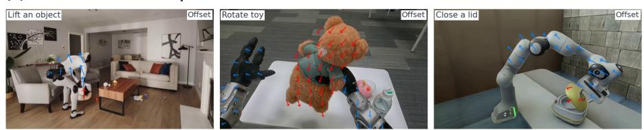

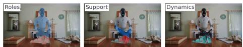  
(a) One interaction, structured responses

# ReactWorld: Structuring Interaction Responses for Embodied Video Generation

Hanwei Liu1 Huijia Zhang1 Hanzhang Wang1 Guangyu Liu2 Hanbei Zhan3 Linjie Hu1 Bin Xiao1 Xuan Zhou1 Dong Zhang1

1Huawei Technologies Co., Ltd. 2Tongji University 3Zhejiang University

https://metaengine-world.github.io/ReactWorld/

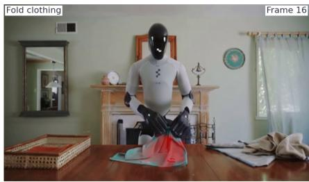  
(b) Diverse tasks and viewpoints

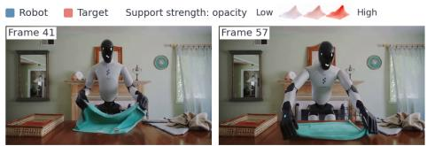  
(c) Benchmark comparison

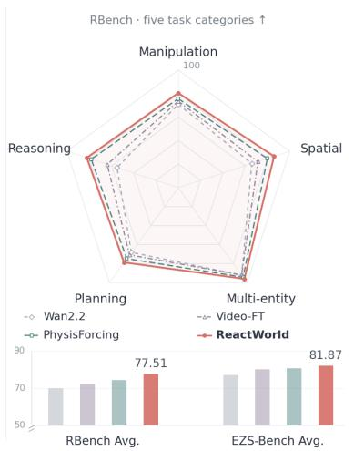  
Figure 1. Structured interaction responses and generation performance. (a) Roles, local motion support, interval dynamics, and subsequent states in garment folding. Overlay opacity encodes support strength, and arrows denote 2D displacement. (b) Robot and target displacements across tasks and viewpoints. (c) RBench scores on five task categories, and average scores on RBench and EZS-Bench.

## Abstract

Embodied video world models predict scene changes caused by robot actions, yet generated object responses may remain inconsistent with task intent and contact dynamics. Critical responses in embodied scenes often concentrate in local regions and specific time intervals. Inspired by chainof-thought reasoning, we introduce ReactWorld, an embodied video generation model guided by structured interaction anticipation. In the generation backbone’sfeature space, an interaction response field predictor anticipates how the interaction will unfold, explicitly describing participant roles, future motion response intensity, and local motion changes. A responsefeedback adapterforms increments to objectfeatures from the difference between the object branch’s outputs with predicted and zeroed local dynamics inputs. It also converts predicted displacements into positional biases

for temporal attention. These two mechanisms guide object feature updates and information retrieval across frames, respectively. Through interaction anticipation and generative feedback, ReactWorld achieves an average score of 77.51 on RBench, outperforming PhysisForcing by 3.29 points with improvements in all nine categories. On EZS-Bench, it achieves a Domain score of 86.98 and an average score of 81.87.

## 1. Introduction

Embodied video world models represent the consequences of robot actions as future visual sequences, allowing interactions to be previewed [34, 35]. Unlike general video generation, embodied interactions require object changes to agree with task intent, contact relations, and motion dynamics [21, 31]. Image-to-video models can generate realistic appearance and coherent motion, and exhibit the ability to capture some physical regularities. However, visually plausible motion does not ensure that objects respond reliably to interaction conditions [8, 24]. A target may move before contact, a grasped object may detach from the gripper, or nearby objects may respond unnecessarily. Even when the overall video is smooth, such local errors can alter the outcome of grasping, placement, or tool use.

The dynamics that determine an interaction’s success often occur at a few locations and critical moments; their importance is not proportional to their visual extent [21, 31]. When folding a garment, for example, the entire garment is the target, but the initial response may be confined to the corner being lifted. VideoJAM [7] identifies an imbalance between appearance fitting and motion learning, while IM-PACT [21] shows that globally averaged denoising supervision can underweight sparse regions containing dynamic objects. These findings suggest that embodied video generation must learn not only motion, but also which objects participate, where local responses occur, and when they unfold.

Existing methods strengthen dynamics modeling at different stages. PhysisForcing [31] aligns intermediate features with trajectories and relations between regions; Motion-I2V [20] and VideoJAM [7] use predicted motion for temporal feature propagation or generation guidance. VPT [23] introduces entity roles and uses modalitydecoupled denoising and auxiliary loss annealing to reduce optimization conflicts and error propagation in joint modeling. Meanwhile, RecCAR [18] finds that bidirectional connections do not guarantee that auxiliary modalities constrain video generation equally effectively when jointly generating video with human motion and audio. These advances provide a foundation for motion modeling and generation guidance, but coherent motion alone does not ensure that object responses follow task intent and contact dynamics. For embodied interactions, the key is to specify where, when, and how objects should respond, and to make these task-relevant local dynamics effective conditions for generation.

Inspired by chain-of-thought’s use of explicit intermediate steps to structure complex reasoning [26], we propose ReactWorld, an embodied video generation model guided by structured interaction anticipation. Response prediction and generative feedback are performed within the same denoising forward pass, as shown in Fig. 2.

Given an initial image and a task instruction, the interaction response field predictor uses intermediate backbone features to anticipate how the interaction will unfold: which roles objects play, which local regions will respond and how strongly, and how those regions will subsequently move.

The response feedback adapter pools interaction context using roles and future motion response intensity. Holding the features and context fixed, it takes the difference between the object branch’s outputs with predicted and zeroed local dynamics inputs to form an increment to object features. It then converts predicted displacement into a temporal attention bias within a fixed local window in the next state. The former guides object feature updates; the latter guides where information is retrieved across frames. Inference requires only a task instruction and an initial image, without external role maps or trajectories.

ReactWorld achieves an average RBench score of 77.51, compared with 71.94 for Video-FT trained on the same data, and improves on PhysisForcing by 3.29 points. On EZS-Bench, its Domain and average scores reach 86.98 and 81.87. These results indicate that ReactWorld better captures the relationship between task requirements and object dynamics in embodied scenes, improving task completion and physical plausibility.

Our main contributions are:

• We propose ReactWorld, an embodied video generation model guided by structured interaction anticipation, explicitly predicting participant roles, future motion response intensity, and interval dynamics in the backbone feature space.

• We develop an interaction response field predictor and a response feedback adapter, using output differences relative to a zero-dynamics reference to update object features and displacement-based attention biases to guide crossframe aggregation.

• Improved overall scores on RBench and EZS-Bench, with more reliable interaction generation in terms of task completion, participant stability, and physical plausibility.

## 2. Related Work

Embodied video world models. Video generation models [6, 15, 16, 29, 34, 35] offer new approaches to predicting the outcomes of robot actions and synthesizing experience. Gen2Act [4] combines task-relevant human video generation with video-conditioned policies, while DreamGen [12] uses video world models to synthesize robot trajectories for downstream policy learning. These methods extend video generation to robot learning. ReactWorld focuses on object responses in generated videos, using task-relevant interaction anticipation to guide local dynamics.

Interaction and physical supervision. Prior work [19, 21, 28, 31, 32] strengthens interaction modeling through motion, geometry, and regional relations. PhysisForcing [31] aligns video features with point trajectories and regional relations. PhysAlign [28] combines simulated geometric labels with relational feature alignment, while IM-PACT [21] reweights denoising supervision using object interaction information. ReactWorld also constructs interaction dynamics supervision from training videos, and uses its predictions as internal denoising conditions for object feature updates and temporal aggregation.

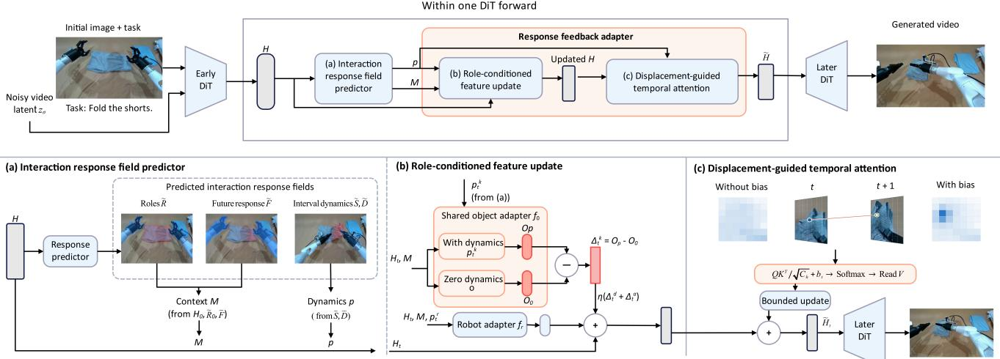  
Figure 2. Overview of ReactWorld. Top: response prediction and generative feedback within each denoising forward pass. Bottom: (a) predicting roles, future responses, and interval dynamics to construct interaction context and local dynamic conditions; (b) extracting objectresponse increments relative to a zero-dynamics reference and updating features by role; and (c) converting gated, clipped displacements into positional biases within a fixed candidate window. Biases are added to query–key logits before softmax and feature aggregation, followed by bounded residual feedback. Scene and response visualizations illustrate the mechanism.

Motion modeling and generation guidance. MotionCtrl, DragNUWA, DragAnything, Tora, and Motion Prompting control video motion through poses, trajectories, or entity conditions [11, 25, 27, 30, 33]. Motion-I2V, VideoJAM, and Track4Gen use predicted motion or features learned with motion supervision for generation guidance and feedback [7, 13, 20]. VPT introduces entity roles and addresses optimization challenges in multimodal joint modeling [23]. Building on motion guidance and feature feedback, React-World organizes interaction roles, future motion response intensity, and interval motion as internal conditions. It updates object features using output differences relative to a zero-dynamics reference and guides cross-frame information retrieval with displacement-based attention biases in a fixed local window.

## 3. Method

ReactWorld anticipates task-relevant interaction dynamics in the feature space of the generation backbone and feeds them back into video generation. It represents interaction requirements through participant roles, future local responses, and interval motion, then uses these predictions to guide object feature updates and information retrieval across frames. Fig. 2 provides an overview.

## 3.1. Preliminaries

Given an initial image $I _ { 0 }$ and a task instruction c, the model progressively generates future video in latent space. Let z denote the latent representation of a training video, ϵ Gaussian noise, and σ the noise level. The noisy input is $z _ { \sigma } = ( 1 - \sigma ) z + \sigma \epsilon$

Let $u _ { \theta }$ denote the backbone’s velocity prediction network. Its output $\widehat { u } _ { \sigma } = u _ { \theta } ( z _ { \sigma } , I _ { 0 } , c , \sigma )$ describes the rate bof change of the video latent along the noise path. We train with the flow-matching objective:

$$
\mathcal { L } _ { \mathrm { v i d e o } } = \mathbb { E } \left[ \| \widehat { u } _ { \sigma } - ( \epsilon - z ) \| _ { 2 } ^ { 2 } \right]\tag{1}
$$

At each denoising step, we read intermediate features H from the generation backbone, where Ht(x) denotes the feature at temporal position t and spatial position x in the latent video sequence. The interaction response field predictor estimates interaction dynamics from these features. The response feedback adapter updates the features, and the remaining backbone layers continue video prediction.

## 3.2. Interaction Response Field Predictor

The task instruction specifies the interaction goal, while video generation must further characterize the participants, local responses, and motion over time. As shown in Fig. 2(a), we organize this information into an interaction response field $\mathcal { V } = ( R , F , S , D )$ , enabling explicit anticipation of the spatial distribution and evolution of interaction responses.

Participant roles R. Conditioned on the task instruction, the role map assigns each location to the robot r, direct manipulation target d, affected object a, or background b. In Fig. 3(a), the manipulated cloth is the direct target, while the ball on it is the affected object. These roles distinguish directly manipulated objects from those affected indirectly within the interaction context. We use $\mathcal { K } = \{ r , d , a \}$ for the three interaction roles.

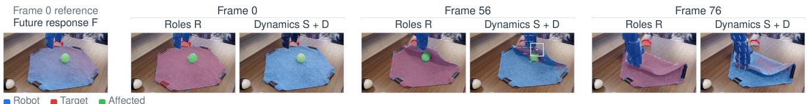  
(a) Interaction response fields

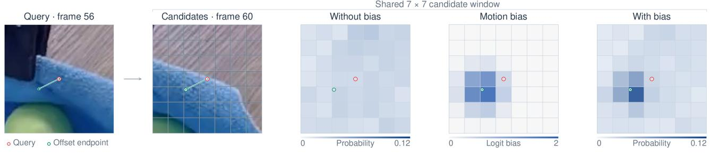  
(b) Motion-guided attention  
Figure 3. Structured response predictions and displacement biases. (a) The future response field referenced to the first frame, together with object roles, motion support, and displacement at frames 0, 56, and 76, overlaid on the corresponding RGB frames. (b) The same query and a shared $7 \times 7$ candidate window for the interval from frame 56 to 60, showing attention without displacement bias, the displacement bias, and attention with bias. Red and green circles indicate the query and displacement endpoint, respectively.

Future motion response intensity F. The role map describes the extent of participating objects, but different parts of an object need not respond equally. For example, when manipulating a garment, a lifted corner and a part still resting on the support surface may exhibit different response intensities. F represents future motion response intensity for each role at each location in first-frame coordinates, where $F ^ { k } ( x ) \in [ 0 , 1 ]$ is the continuous response value for role k at location x. This links local differences in subsequent motion to the initial scene, allowing the feedback module to emphasize features relevant to future responses within participating objects.

Interval motion (S, D). While F summarizes local responses over the full prediction horizon for each role, $S , D$ further characterize their motion regions and displacements at successive stages. Here, $S _ { t } ^ { k } ( x ) \in [ 0 , 1 ]$ is a continuous weight indicating the motion region of role k over interval $t \to t + 1$ , which we call motion support; $D _ { t } ^ { k } ( x )$ describes the motion direction and distance at that location. Both use coordinates at the start of the interval, with displacement measured in feature grid units, providing time-varying conditions for local dynamics feedback.

Four lightweight prediction heads read these response

fields from intermediate video features:

$$
\begin{array} { r l } & { \widehat { R } _ { t } = \mathrm { s o f t m a x } \big ( P _ { R } ( \mathbf { H } _ { t } ) \big ) , } \\ & { \widehat { F } = \mathrm { s i g m o i d } \big ( P _ { F } ( \mathbf { H } _ { 0 } ) \big ) , } \\ & { \widehat { S } _ { t } = \mathrm { s i g m o i d } \big ( P _ { S } ( \mathbf { H } _ { t } ) \big ) , } \\ & { \widehat { D } _ { t } = P _ { D } ( \mathbf { H } _ { t } ) } \end{array}\tag{2}
$$

Here, P denotes a learnable prediction head. The future response prediction uses contextual features at the initial state, which already incorporate the task instruction and spatiotemporal information from the current noisy video.

## 3.3. Response Feedback Adapter

The predicted interaction dynamics are then used to guide object changes during generation. As shown in Fig. 2(b) and (c), the response feedback adapter uses two complementary paths: dynamic conditions guide object feature updates, while predicted displacement guides where to read information across frames.

Constructing interaction conditions. We pool initialstate features using role and future response intensity weights:

$$
m _ { j } = \frac { \sum _ { x } w _ { j } ( x ) \mathbf { H } _ { 0 } ( x ) } { \sum _ { x } w _ { j } ( x ) + \varepsilon }\tag{3}
$$

Here, $j ~ \in ~ \{ r , d , a , F \}$ . The role weights are $w _ { k } ( x ) \ =$ $\widehat { R } _ { 0 } ^ { k } ( x )$ , and the future response weight is $\begin{array} { r l } { w _ { F } ( x ) } & { { } = } \end{array}$ $\mathrm { m a x } _ { k \in \mathcal { K } } \widehat { F } ^ { k } ( x )$ , with ε for numerical stability. This gives bthe interaction context ${ \cal M } = [ m _ { r } , m _ { d } , m _ { a } , m _ { F } ] ;$ the first three vectors summarize the participants, while the fourth emphasizes local regions with stronger future responses.

For each temporal interval, we further convert predicted motion support into a continuous gate $g _ { t } ^ { k } ( x ) \ \in \ [ 0 , 1 ]$ and combine it with predicted displacement:

$$
p _ { t } ^ { k } ( x ) = \left[ g _ { t } ^ { k } ( x ) , g _ { t } ^ { k } ( x ) \bar { D } _ { t } ^ { k } ( x ) \right]\tag{4}
$$

Here, $\bar { D }$ is the clipped displacement prediction. The gate controls the strength of the local dynamics condition, while displacement specifies motion direction and distance. M supplies interaction context, and p carries local motion into the feature update.

Updating object features with a zero-dynamics reference. The object branch can produce an output from video features and interaction context even without dynamic input. To make the added object update explicitly depend on predicted dynamics, we hold the features and context fixed and use the zero-dynamics output as a reference:

$$
\begin{array} { r } { \Delta _ { t } ^ { k } = f _ { o } ( \mathbf { H } _ { t } , M , p _ { t } ^ { k } ) - f _ { o } ( \mathbf { H } _ { t } , M , 0 ) } \end{array}\tag{5}
$$

Here, $k \in \{ d , a \}$ . Both evaluations share the parameters of $f _ { o }$ and differ only in their dynamic conditions. Thus, $\Delta _ { t } ^ { k }$ represents the feature change relative to a common reference after introducing predicted dynamics; it is zero when the local dynamics condition is zero. We then update the video features together with the residual from the robot branch $f _ { r } .$

$$
\begin{array} { c } { \mathbf { H } _ { t } ^ { \mathrm { r f } } = \mathbf { H } _ { t } + f _ { r } ( \mathbf { H } _ { t } , M , p _ { t } ^ { r } ) } \\ { + \eta ( \Delta _ { t } ^ { d } + \Delta _ { t } ^ { a } ) } \end{array}\tag{6}
$$

Here, $\eta > 0$ is a learnable scale. The updated ${ \bf { H } } _ { t } ^ { \mathrm { { r f } } }$ is then used for cross-frame information aggregation.

Displacement-guided temporal attention. After updating features, the model must determine where to read information from the next state to account for object motion. We obtain queries from ${ \bf { H } } _ { t } ^ { \mathrm { { r f } } }$ and keys/values from ${ \bf H } _ { t + 1 } ^ { \mathrm { r f } }$ , and apply temporal attention within a fixed local window. Predicted displacement specifies a spatial preference within the window, and the motion gate modulates its strength:

$$
b _ { t } ( \boldsymbol { x } , \delta ) = \beta \operatorname* { m a x } _ { k \in \{ r , o \} } \left[ g _ { t } ^ { k } ( \boldsymbol { x } ) \exp \left( - \frac { \lVert \delta - \bar { D } _ { t } ^ { k } ( \boldsymbol { x } ) \rVert _ { 2 } ^ { 2 } } { 2 \tau ^ { 2 } } \right) \right]\tag{7}
$$

Here, δ denotes a candidate offset from x. At each location, o selects the direct target or affected object with the larger gate, keeping that role’s gate and displacement together. $\beta \ge 0 , \tau > 0$ control the bias strength and width, respectively. The bias favors candidate offsets close to the predicted displacement, while the candidate window remains fixed.

For a single attention head, we add the bias to content similarity to obtain cross-frame attention weights:

$$
\begin{array} { r l } & { a _ { t } ( x , \delta ) = \operatorname { s o f t m a x } _ { \delta } \bigg [ } \\ & { \qquad \frac { q _ { t } ( x ) ^ { \top } k _ { t + 1 } ( x + \delta ) } { \sqrt { C _ { h } } } + b _ { t } ( x , \delta ) \bigg ] } \end{array}\tag{8}
$$

Here, $C _ { h }$ is the head dimension, and softmax normalizes over the fixed candidate window ${ \mathcal { N } } ( x )$ . We then aggregate features from the next state using these weights:

$$
y _ { t } ( x ) = \sum _ { \delta \in \mathcal { N } ( x ) } a _ { t } ( x , \delta ) v _ { t + 1 } ( x + \delta )\tag{9}
$$

Concatenating the head outputs gives $Z _ { t }$ , which updates the features through a residual with controlled magnitude:

$$
\widetilde { \mathbf { H } } _ { t } = \mathbf { H } _ { t } ^ { \mathrm { r f } } + \rho _ { t } \operatorname { t a n h } \left( W _ { \mathrm { u p } } Z _ { t } \right)\tag{10}
$$

Here, $W _ { \mathrm { u p } }$ is the output projection, and $\rho _ { t }$ is set according to the current feature magnitude to control the relative strength of the added feedback. The updated features are passed to the remaining backbone layers. As shown in Fig. 3(b), content similarity and predicted motion jointly determine the cross-frame attention weights.

## 3.4. Training and Generation

Response supervision grounds structured interaction anticipation in labeled targets, while the video loss optimizes how these predictions are used in generation through the feedback paths. The joint objective is:

$$
\mathcal { L } = \mathcal { L } _ { \mathrm { v i d e o } } + \lambda _ { R } \mathcal { L } _ { R } + \lambda _ { F } \mathcal { L } _ { F } + \lambda _ { U } \mathcal { L } _ { U }\tag{11}
$$

Here, $\mathcal { L } _ { R }$ supervises task-related roles with cross-entropy, $\mathcal { L } _ { F }$ regresses future response intensity with Smooth L1, and $\mathcal { L } _ { U }$ combines binary cross-entropy for motion support with Smooth L1 for displacement. Response labels are constructed offline from training videos, and response losses are computed only where valid labels are available.

Inference requires only the initial image and task instruction. At each denoising step, the model predicts interaction responses from the current features and feeds them back into the generation backbone through object feature updates and displacement-guided temporal attention. The response conditions are continually updated as the video is refined.

## 4. Experiments

We evaluate ReactWorld on RBench and EZS-Bench in terms of task completion, interaction plausibility, and visual quality. Component ablations and displacement interventions examine the roles of structured dynamics prediction and its feedback into generation.

Table 1. RBench category scores. denotes results from the official Qwen leaderboard.
<table><tr><td rowspan="3">Method</td><td rowspan="3">Avg.↑</td><td colspan="5">Task category ↑</td><td colspan="4">Robot morphology ↑</td></tr><tr><td>Manipulation</td><td>Spatial</td><td>Multi- entity</td><td>Long- horizon</td><td>Reasoning</td><td>Single arm</td><td>Dual arm</td><td>Quadruped</td><td>Humanoid</td></tr><tr><td></td><td></td><td></td><td></td><td></td><td></td><td></td><td></td><td></td><td></td></tr><tr><td>Wan2.2-A14B* [22]</td><td>69.80</td><td>70.90</td><td>66.00</td><td>92.10</td><td>68.10</td><td>55.00</td><td>68.80</td><td>67.80</td><td>67.00</td><td>72.80</td></tr><tr><td>Cosmos3-Nano [17]</td><td>66.33</td><td>69.55</td><td>78.00</td><td>73.40</td><td>56.98</td><td>63.25</td><td>61.65</td><td>66.95</td><td>60.80</td><td>66.35</td></tr><tr><td>ABot-PhysWorld [9]</td><td>57.68</td><td>64.40</td><td>59.50</td><td>67.00</td><td>42.93</td><td>38.00</td><td>61.25</td><td>63.60</td><td>59.55</td><td>62.85</td></tr><tr><td>PhysisForcing [31]</td><td>74.21</td><td>75.65</td><td>80.00</td><td>94.20</td><td>74.73</td><td>78.13</td><td>67.75</td><td>67.60</td><td>60.85</td><td>69.00</td></tr><tr><td>Video-FT</td><td>71.94</td><td>73.50</td><td>71.50</td><td>91.90</td><td>70.80</td><td>63.80</td><td>68.20</td><td>68.40</td><td>66.90</td><td>72.50</td></tr><tr><td>ReactWorld</td><td>77.51</td><td>80.45</td><td>86.00</td><td>96.00</td><td>78.73</td><td>82.13</td><td>70.60</td><td>69.80</td><td>63.35</td><td>70.50</td></tr></table>

## 4.1. Experimental Setup

Training data and annotations. We curate approximately 500K clips from AgiBot [1], RoVid-X [10], and robot videos collected from the Internet. For samples with reliable annotations, we construct interaction dynamics supervision offline, including participant roles, future motion response intensity referenced to the first frame, and motion regions and 2D displacements between adjacent states. We use Qwen3-VL [2] to assist task-related role assignment, SAM3 [5] to obtain object masks, and CoWTracker [14] to extract point trajectories. Role and motion observations are combined to construct the supervision. Training and validation sets are split by original episode or source video.

Implementation details. Videos contain 81 frames at 480 × 832 and 16 FPS. We initialize from Wan2.2-I2V-A14B [22] and freeze the backbone. We train rank-32 video LoRA, response prediction heads, residual adapters, and the temporal attention branch in BF16 on 8 H100 GPUs. Response prediction and feedback are both applied at the 12th DiT block. We use AdamW with a learning rate of 10−5 and an effective batch size of 32. The first 64 steps warm up LoRA and the prediction heads, followed by joint training with the feedback modules. The output projection $W _ { \mathrm { u p } }$ of temporal attention is initialized to zero. Further implementation details are provided in the supplementary material.

Evaluation setup. RBench [10] covers five task categories and four robot morphologies. We report all nine category scores and their average, and analyze robot and object stability (RSS), physical–semantic plausibility (PSS), and task-adherence consistency (TAC) on the 400 examples spanning the four morphologies. EZS-Bench [9] reports embodied domain performance (Domain), perceptual quality (Quality), and their average. RBench results are evaluated with Qwen3-VL-235B-A22B-Instruct [2]. For EZS-Bench, Domain is evaluated with Qwen2.5-VL-72B-Instruct [3], while Quality is computed using the benchmark’s eight video quality metrics.

Baselines. We compare with Wan2.2-A14B [22], Cosmos3-Nano [17], ABot-PhysWorld [9], and Physis-Forcing [31]. We also include Video-FT, a standard video fine-tuning baseline using the same initialization, data, and training budget as ReactWorld.

## 4.2. Embodied Video Generation Results

RBench evaluation. In Tab. 1, ReactWorld achieves an average score of 77.51, outperforming Video-FT (71.94) and improving over PhysisForcing by 3.29 points. It leads all five task categories, with gains over PhysisForcing of 6.00, 4.80, 4.00, and 4.00 points in spatial relations, manipulation, long-horizon planning, and visual reasoning, respectively, indicating better adherence to spatial constraints and task requirements.

ReactWorld outperforms PhysisForcing in all nine categories and Video-FT in seven. Its gains over Video-FT reach 14.50 points in spatial relations and 18.33 points in visual reasoning, supporting the effectiveness of structured interaction modeling for spatial reasoning and task understanding.

Interaction quality. Compared with PhysisForcing, ReactWorld improves RSS from 11.24 to 11.51 and PSS from 4.52 to 4.62. Both metrics improve across all four morphologies, indicating gains in participant stability and the plausibility of object responses. Averaged across the four morphologies, task completion (TC) increases from 83.58 to 85.18, visual quality (VQ) from 49.03 to 51.95, and taskadherence consistency (TAC) from 4.17 to 4.20.

EZS-Bench evaluation. ReactWorld achieves a Domain score of 86.98, exceeding Video-FT and PhysisForcing by 3.53 and 2.49 points, respectively, and an average score of 81.87 (Tab. 2). Its Quality score of 76.75 is also slightly higher than both baselines, indicating improved embodied domain performance while maintaining perceptual quality.

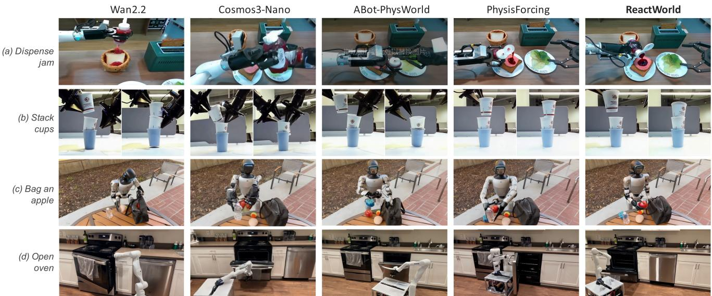  
Figure 4. Embodied task generation across methods. Columns show Wan2.2, Cosmos3-Nano, ABot-PhysWorld, PhysisForcing, and ReactWorld. Rows show stacking cups, dispensing jam, bagging apples, and opening an oven.

Table 2. EZS-Bench196 results.
<table><tr><td>Method</td><td>Domain↑</td><td>Quality↑</td><td>Avg.↑</td></tr><tr><td>Wan2.2-A14B [22]</td><td>77.42</td><td>76.89</td><td>77.16</td></tr><tr><td>Cosmos3-Nano [17]</td><td>84.32</td><td>75.60</td><td>79.96</td></tr><tr><td>ABot-PhysWorld [9]</td><td>83.66</td><td>76.94</td><td>80.30</td></tr><tr><td>PhysisForcing [31]</td><td>84.49</td><td>76.58</td><td>80.54</td></tr><tr><td>Video-FT</td><td>83.45</td><td>76.64</td><td>80.05</td></tr><tr><td>ReactWorld</td><td>86.98</td><td>76.75</td><td>81.87</td></tr></table>

Table 3. Human evaluation. We report mean ratings on a fivepoint scale. Parentheses give Holm-adjusted p-values from paired t-tests against ReactWorld.
<table><tr><td>Method</td><td>Task progress↑</td><td>Contact plausibility↑</td><td>Visual quality↑</td></tr><tr><td>Video-FT</td><td>3.74 (p=0.063) 3.24 (p&lt;0.001) 3.92 (p=0.211)</td><td></td><td></td></tr><tr><td></td><td>PhysisForcing 3.70 (p=0.006) 3.78 (p=0.140) 4.16 (p=0.749)</td><td></td><td></td></tr><tr><td>ReactWorld</td><td>4.08</td><td>4.06</td><td>4.12</td></tr></table>

Human evaluation. We invite 50 evaluators to rate task progress, contact plausibility, and visual quality on a fivepoint scale. As shown in Tab. 3, ReactWorld achieves the highest scores for task progress and contact plausibility, at 4.08 and 4.06, respectively. Its contact plausibility is significantly higher than Video-FT $( p < 0 . 0 0 1 )$ ), while its visual quality score of 4.12 indicates that it combines high visual quality with more plausible interactions.

Qualitative results. Fig. 4 presents results for stacking cups, dispensing jam, bagging apples, and opening an oven. For jam dispensing, some baselines do not clearly establish the relationship between the container opening, the source of the jam, and its destination. ReactWorld more clearly depicts the correspondence between the bottle opening and the receiving target. Its oven-opening result shows the open door and interior structure, while its cup-stacking result is more physically plausible. These differences in action– response correspondence and task states are consistent with the gains in task completion and physical plausibility.

## 4.3. Ablations and Feedback Analysis

Structured supervision and generative feedback. Tab. 4 compares response supervision alone with feedback from predicted dynamics. Heads-only adds only response supervision, and Heads+Adapter adds dynamicsconditioned feature updates. Full w/o bias further introduces content-based temporal aggregation, while Full additionally uses displacement bias. All variants use the same initialization, data, and training budget; all except Video-FT use the same response supervision.

Full improves PSS and Domain by 0.49 and 2.87 points over Heads-only, supporting the benefit of dynamics feedback. It also exceeds Full w/o bias by 0.25 and 1.60 points, supporting displacement-based guidance beyond response updates and content attention.

Local responses and the zero-dynamics reference. Tab. 5 shows that pooling context by future response intensity, rather than over whole role regions, improves PSS and Domain by 0.31 and 2.13 points, respectively. This indicates that emphasizing regions with stronger responses helps generate more plausible interactions. Without the zero-dynamics reference, the two scores remain 0.11 and 1.03 points below the full model even after matching the object update magnitude, supporting the benefit of the reference at comparable update magnitudes.

Table 4. Ablation of response supervision and generative feedback.
<table><tr><td rowspan="2">Variant</td><td colspan="2">RBench</td><td colspan="2">EZS-Bench</td></tr><tr><td>PSS↑</td><td>TAC↑</td><td>Domain↑</td><td>Quality↑</td></tr><tr><td>Video-FT</td><td>4.01</td><td>3.81</td><td>83.45</td><td>76.64</td></tr><tr><td>Heads-only</td><td>4.13</td><td>3.90</td><td>84.11</td><td>76.66</td></tr><tr><td>Heads+Adapter</td><td>4.24</td><td>4.12</td><td>84.73</td><td>76.69</td></tr><tr><td>Full w/o bias</td><td>4.37</td><td>4.15</td><td>85.38</td><td>76.71</td></tr><tr><td>Full (ReactWorld)</td><td>4.62</td><td>4.20</td><td>86.98</td><td>76.75</td></tr></table>

Table 5. Ablation of local responses and the zero-dynamics reference.
<table><tr><td rowspan="2">Variant</td><td colspan="2">RBench</td><td colspan="2">EZS-Bench</td></tr><tr><td>PSS↑</td><td>TAC↑</td><td>Domain↑</td><td>Quality↑</td></tr><tr><td>Full Whole-entity</td><td>4.62</td><td>4.20</td><td>86.98</td><td>76.75</td></tr><tr><td>context</td><td>4.31</td><td>4.14</td><td>84.85</td><td>76.71</td></tr><tr><td>No zero reference</td><td>4.43</td><td>4.12</td><td>85.12</td><td>76.68</td></tr><tr><td>Amplitude-matched</td><td>4.51</td><td>4.16</td><td>85.95</td><td>76.72</td></tr></table>

Directional interventions on feedback displacement. The preceding ablations assess the contribution of the feedback design to generation quality. We further examine the correspondence between feedback displacement and generated motion. With short task descriptions, we apply leftward or rightward offsets to the displacement conditions entering the feedback module. As shown in Fig. 5, the robot arm’s motion and approach position shift in the corresponding directions under different displacement conditions. These examples show a qualitative correspondence between feedback displacement and generated motion, suggesting the potential to guide local interactions through internal feedback conditions.

Displacement bias strength. With the full model fixed, we scale displacement bias strength by 0, 0.5, 1, 1.5, and 2 (Fig. 6). The default strength improves PSS and TAC by 0.25 and 0.05 points over disabling the bias. Scores remain close from 0.5 to 1.5 times the default and decrease at 2 times, supporting moderate positional guidance for embodied video generation.

(a) Normal feedback  
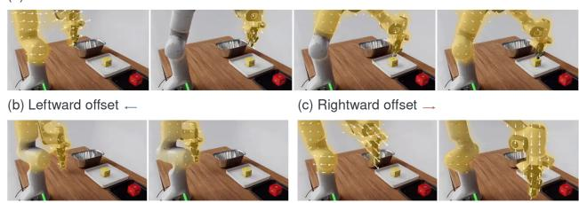  
Figure 5. Directional interventions on feedback displacement. (a) Normal feedback. (b,c) Leftward and rightward offsets applied to the feedback displacement input shift the robot arm’s motion in the corresponding directions.

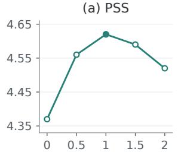

(b) TAC  
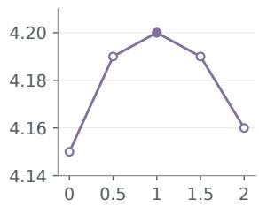  
Bias strength multiplier (×)

Figure 6. Displacement bias strength. Filled markers denote the default setting. A multiplier of zero disables positional bias while retaining object feature updates and content-based temporal attention.  
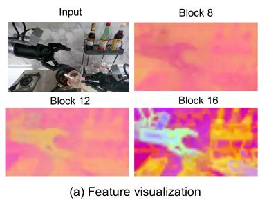

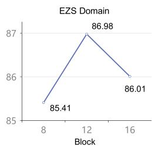  
(b) Insertion depth  
Figure 7. Insertion depth. (a) Input image and PCA visualizations of backbone features at the same forward call and time position. (b) EZS-Bench Domain scores for different insertion blocks.

Insertion depth. Fig. 7(a) compares scene representations at different backbone depths. Inserting response prediction and feedback at block 12 achieves a Domain score of 86.98, compared with 85.41 and 86.01 at blocks 8 and 16, respectively (Fig. 7(b)). This suggests that an intermediate insertion point provides useful scene cues while allowing subsequent layers to integrate the predicted dynamics.

## 5. Conclusion

We presented ReactWorld, which anticipates participant roles, future motion response intensity, and interval motion in the generation backbone’s feature space, and feeds the predicted dynamics back into video generation. Differences relative to a zero-dynamics reference guide object feature updates, while displacement biases guide cross-frame information retrieval. Experiments on RBench and EZS-Bench show that this design improves task completion and the physical plausibility of interactions.

Limitations and future work. ReactWorld currently anticipates interactions using a 2D response representation, leaving room for explicit modeling of 3D interaction relations. We will explore temporally consistent 3D motion representations and rehearsal to improve spatial consistency.

## LLM Usage Statement

ChatGPT (OpenAI) assisted manuscript drafting, English translation and editing, literature organization, figure and LaTeX preparation. Qwen3-VL assisted task-related role annotation. Qwen3-VL-235B-A22B-Instruct served as the RBench evaluator, and Qwen2.5-VL-72B-Instruct was used for Domain evaluation on EZS-Bench, as described in the experimental setup. The authors reviewed and revised the assisted material and take full responsibility for the final manuscript and its scientific claims.

## References

[1] AgiBot-World-Contributors, Qingwen Bu, Jisong Cai, Li Chen, Xiuqi Cui, et al. AgiBot World Colosseo: A Largescale Manipulation Platform for Scalable and Intelligent Embodied Systems. arXiv preprint arXiv:2503.06669, 2025. 6

[2] Shuai Bai, Yuxuan Cai, Ruizhe Chen, Keqin Chen, Xionghui Chen, et al. Qwen3-VL Technical Report. arXiv preprint arXiv:2511.21631, 2025. 6

[3] Shuai Bai, Keqin Chen, Xuejing Liu, et al. Qwen2.5-VL Technical Report. arXiv preprint arXiv:2502.13923, 2025. 6

[4] Homanga Bharadhwaj, Debidatta Dwibedi, Abhinav Gupta, Shubham Tulsiani, Carl Doersch, Ted Xiao, Dhruv Shah, Fei Xia, Dorsa Sadigh, and Sean Kirmani. Gen2Act: Human Video Generation in Novel Scenarios enables Generalizable Robot Manipulation. In Proceedings of the 9th Conference on Robot Learning, pages 3936–3951, 2025. 2

[5] Nicolas Carion, Laura Gustafson, Yuan-Ting Hu, Shoubhik Debnath, Ronghang Hu, et al. SAM 3: Segment Anything with Concepts. arXiv preprint arXiv:2511.16719, 2025. 6

[6] Chi-Lam Cheang, Guangzeng Chen, Ya Jing, Tao Kong, Hang Li, Yifeng Li, Yuxiao Liu, Hongtao Wu, Jiafeng Xu, Yichu Yang, Hanbo Zhang, and Minzhao Zhu. GR-2: A Generative Video-Language-Action Model with Web-Scale Knowledge for Robot Manipulation. arXiv preprint arXiv:2410.06158, 2024. 2

[7] Hila Chefer, Uriel Singer, Amit Zohar, Yuval Kirstain, Adam Polyak, Yaniv Taigman, Lior Wolf, and Shelly Sheynin. VideoJAM: Joint Appearance-Motion Representations for Enhanced Motion Generation in Video Models. In Proceedings of the 42nd International Conference on Machine Learning, pages 7595–7616, 2025. 2, 3

[8] Tianxiao Chen, Hanmo Chen, Huajin Chen, Bo Li, Qi Ye, and Peng-Tao Jiang. VIPER: Visual In-Context Physics Reasoning for Physically Plausible Video Generation. arXiv preprint arXiv:2607.23472, 2026. 2

[9] Yuzhi Chen, Ronghan Chen, Dongjie Huo, Yandan Yang, Dekang Qi, Haoyun Liu, Tong Lin, Shuang Zeng, Junjin Xiao, Xinyuan Chang, Feng Xiong, Xing Wei, Zhiheng Ma, and Mu Xu. ABot-PhysWorld: Interactive World Foundation Model for Robotic Manipulation with Physics Alignment, 2026. 6, 7

[10] Yufan Deng, Zilin Pan, Hongyu Zhang, Xiaojie Li, Ruoqing Hu, Yufei Ding, Yiming Zou, Yan Zeng, and Daquan Zhou. Rethinking video generation model for the embodied world, 2026. 6

[11] Daniel Geng, Charles Herrmann, Junhwa Hur, Forrester Cole, Serena Zhang, Tobias Pfaff, Tatiana Lopez-Guevara, Carl Doersch, Yusuf Aytar, Michael Rubinstein, Chen Sun, Oliver Wang, Andrew Owens, and Deqing Sun. Motion Prompting: Controlling Video Generation with Motion Trajectories. In Proceedings of the IEEE/CVF Conference on Computer Vision and Pattern Recognition, 2025. 3

[12] Joel Jang, Seonghyeon Ye, Zongyu Lin, Jiannan Xiang, Johan Bjorck, Yu Fang, Fengyuan Hu, Spencer Huang, Kaushil Kundalia, Yen-Chen Lin, Loïc Magne, Ajay Mandlekar, Avnish Narayan, You Liang Tan, Guanzhi Wang, Jing Wang, Qi Wang, Yinzhen Xu, Xiaohui Zeng, Kaiyuan Zheng, Ruijie Zheng, Ming-Yu Liu, Luke Zettlemoyer, Dieter Fox, Jan Kautz, Scott Reed, Yuke Zhu, and Linxi Fan. DreamGen: Unlocking Generalization in Robot Learning through Video World Models. In Proceedings of the 9th Conference on Robot Learning, pages 5170–5194, 2025. 2

[13] Hyeonho Jeong, Chun-Hao Paul Huang, Jong Chul Ye, Niloy Mitra, and Duygu Ceylan. Track4Gen: Teaching Video Diffusion Models to Track Points Improves Video Generation. In Proceedings of the IEEE/CVF Conference on Computer Vision and Pattern Recognition, 2025. 3

[14] Zihang Lai, Eldar Insafutdinov, Edgar Sucar, and Andrea Vedaldi. CoWTracker: Tracking by Warping instead of Correlation. In Proceedings of the IEEE/CVF Conference on Computer Vision and Pattern Recognition, 2026. 6

[15] Yue Liao, Pengfei Zhou, Siyuan Huang, Donglin Yang, Shengcong Chen, Yuxin Jiang, Yue Hu, Jingbin Cai, Si Liu, Jianlan Luo, Liliang Chen, Shuicheng Yan, Maoqing Yao, and Guanghui Ren. Genie Envisioner: A Unified World Foundation Platform for Robotic Manipulation. arXiv preprint arXiv:2508.05635, 2025. 2

[16] NVIDIA. Cosmos World Foundation Model Platform for Physical AI. arXiv preprint arXiv:2501.03575, 2025. 2

[17] NVIDIA. Cosmos 3: Omnimodal World Models for Physica AI. arXiv preprint arXiv:2606.02800, 2026. 6, 7

[18] RECCAR. RecCAR: Closing the Cross-Attention Gap in Joint Video Generation. arXiv preprint arXiv:2609.27901, 2026. 2

[19] Yu Shang, Xin Zhang, Yinzhou Tang, Lei Jin, Chen Gao, Wei Wu, and Yong Li. RoboScape: Physics-informed Embodied World Model. In Advances in Neural Information Processing Systems, 2025. 2

[20] Xiaoyu Shi, Zhaoyang Huang, Fu-Yun Wang, Weikang Bian, Dasong Li, Yi Zhang, Manyuan Zhang, Ka Chun Cheung, Simon See, Hongwei Qin, Jifeng Dai, and Hongsheng Li. Motion-I2V: Consistent and Controllable Image-to-Video Generation with Explicit Motion Modeling. Research publication, 2024. 2, 3

[21] Rongze Tang, Jianjie Fang, Zhaolu Wang, Ziyou Wang, Xvyuan Liu, Haisheng Su, Xin Zhang, Wei Wu, Chen Gao, Yong Li, and Zhibo Chen. IMPACT: Attention Is the Interaction Map for Scalable Interaction-Aware World Model Training. arXiv preprint arXiv:2609.00161, 2026. 1, 2

[22] Team Wan, Ang Wang, Baole Ai, et al. Wan: Open and Advanced Large-Scale Video Generative Models. arXiv preprint arXiv:2503.20314, 2025. 6, 7

[23] VPT. Enhancing Video Physical Consistency via Role-aware Joint Training and Modality-decoupled Denoising. arXiv preprint arXiv:2607.04653, 2026. 2, 3

[24] Shuai Wang, Yaxin Feng, Xuekun Jiang, Shihan Tian, Ningyu Yan, Xing Shen, Chaoyang Lyu, Hui Wang, Yunsong Zhou, Hanqing Wang, Jiangmiao Pang, Yang Xiang, Xing Gao, Chunhua Shen, and Weinan Zhang. GAUGE: A Measurement-Grounded Benchmark for Physical Fidelity in Simulation Engines and Video World Models. arXiv preprint arXiv:2608.05948, 2026. 2

[25] Zhouxia Wang, Ziyang Yuan, Xintao Wang, Tianshui Chen, Menghan Xia, Ping Luo, and Ying Shan. MotionCtrl: A Unified and Flexible Motion Controller for Video Generation. In ACM SIGGRAPH 2024 Conference Papers, 2024. 3

[26] Jason Wei, Xuezhi Wang, Dale Schuurmans, Maarten Bosma, Brian Ichter, Fei Xia, Ed Chi, Quoc V. Le, and Denny Zhou. Chain-of-thought prompting elicits reasoning in large language models. In Advances in Neural Information Processing Systems, 2022. 2

[27] Weijia Wu, Zhuang Li, Yuchao Gu, Rui Zhao, Yefei He, David Junhao Zhang, Mike Zheng Shou, Yan Li, Tingting Gao, and Di Zhang. DragAnything: Motion Control for Anything Using Entity Representation. In Computer Vision – ECCV 2024, pages 331–348, 2024. 3

[28] Zhexiao Xiong, Yizhi Song, Liu He, Wei Xiong, Yu Yuan, Feng Qiao, and Nathan Jacobs. PhysAlign: Physics-Coherent Image-to-Video Generation through Feature and 3D Representation Alignment. arXiv preprint arXiv:2603.13770, 2026. 2

[29] Sherry Yang, Yilun Du, Seyed Ghasemipour, Jonathan Tompson, Leslie Kaelbling, Dale Schuurmans, and Pieter Abbeel. Learning Interactive Real-World Simulators. In International Conference on Learning Representations, 2024. 2

[30] Shengming Yin, Chenfei Wu, Jian Liang, Jie Shi, Houqiang Li, Gong Ming, and Nan Duan. DragNUWA: Fine-grained Control in Video Generation by Integrating Text, Image, and Trajectory. arXiv preprint arXiv:2308.08089, 2023. 3

[31] Peiwen Zhang, Yufan Deng, Shangkun Sun, Juncheng Ma, Duomin Wang, Jonas Du, Zilin Pan, Ye Huang, Hao Liang, Songyan Huang, Ruihua Zhang, Enze Xie, Ming-Yu Liu, and Daquan Zhou. PhysisForcing: Physics Reinforced World Simulator for Robotic Manipulation. arXiv preprint arXiv:2606.28128, 2026. 1, 2, 6, 7

[32] Xiangdong Zhang, Jiaqi Liao, Shaofeng Zhang, Fanqing Meng, Xiangpeng Wan, Junchi Yan, and Yu Cheng. VideoREPA: Learning Physics for Video Generation through Relational Alignment with Foundation Models. In Advances in Neural Information Processing Systems, 2025. 2

[33] Zhenghao Zhang, Junchao Liao, Menghao Li, Zuozhuo Dai, Bingxue Qiu, Siyu Zhu, Long Qin, and Weizhi Wang. Tora: Trajectory-oriented Diffusion Transformer for Video Generation. In Proceedings of the IEEE/CVF Conference on Computer Vision and Pattern Recognition, 2025. 3

[34] Siyuan Zhou, Yilun Du, Jiaben Chen, Yandong Li, Dit-Yan Yeung, and Chuang Gan. RoboDreamer: Learning Compositional World Models for Robot Imagination. In Proceedings of the 41st International Conference on Machine Learning, pages 61885–61896, 2024. 1, 2

[35] Fangqi Zhu, Hongtao Wu, Song Guo, Yuxiao Liu, Chilam Cheang, and Tao Kong. IRASim: A Fine-Grained World Model for Robot Manipulation. arXiv preprint arXiv:2406.14540, 2024. 1, 2