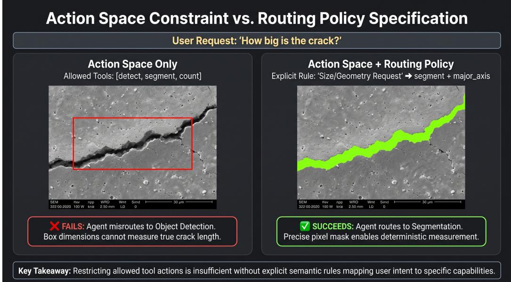
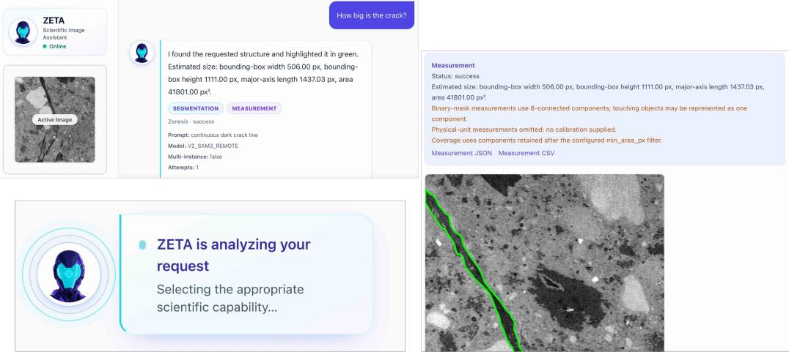
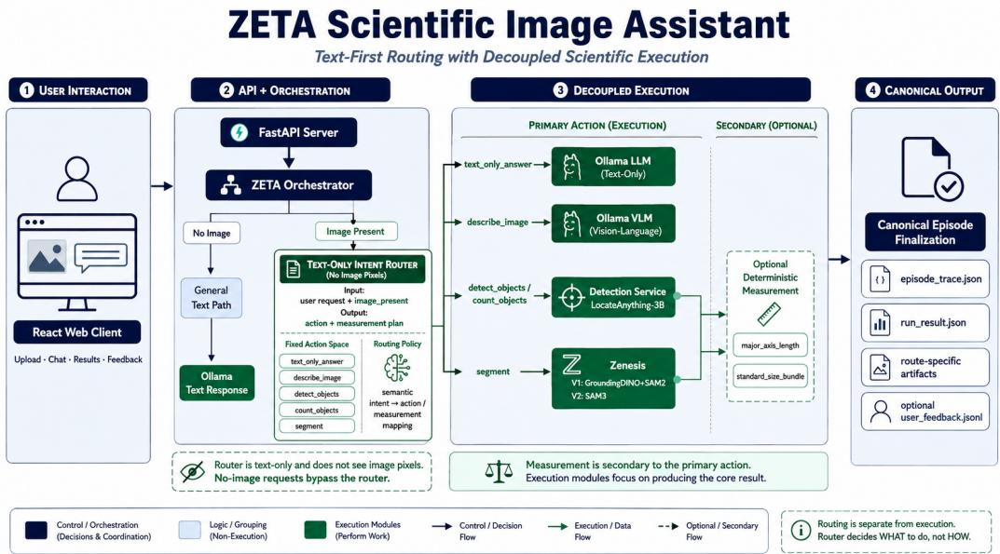
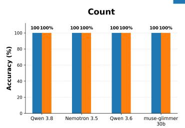
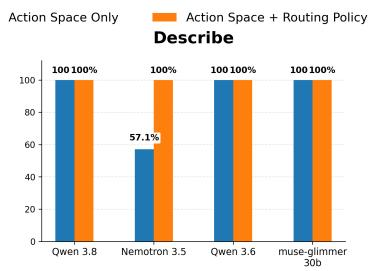
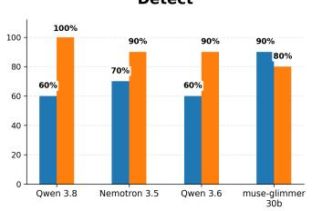
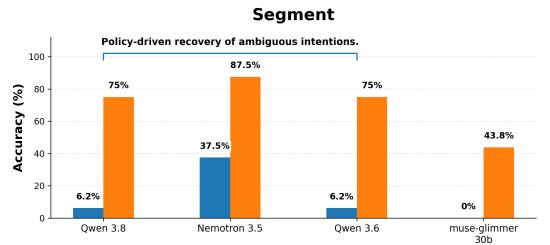
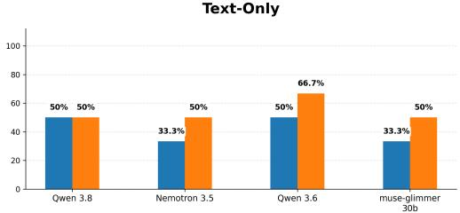

# Route First, See Later: Enabling Vision Agents to Reason Scientifically by Separating Routing Policy from Action Spaces

Shubhabrata Mukherjeea, Jefrey Donatellia, Daniela Ushizimaa,b,c

aLawrence Berkeley National Laboratory, , Berkeley, 94720, CA, United States bUniversity of California, San Francisco, , San Francisco, 94143, CA, United States cUniversity of California, Berkeley, , Berkeley, 94720, CA, United States

## Abstract

Scientific image-analysis workflows require agents to select among diverse capabilities like description, detection, counting, and segmentation. Current multi-tool architectures conflate intent interpretation with visual execution, masking whether a failure arises from flawed reasoning (misrouting) or failed perception (invalid tool execution). This lack of auditability renders agents unreliable for high-stakes scientific automation. We introduce ZETA, an extensible architecture that operationalizes the decoupling of routing policy from action execution. ZETA resolves scientific intent before invoking specialized visual tools, treating measurement as a deterministic operation grounded in explicit geometry rather than generative output. This architecture exposes the "black box" of agent decision-making, allowing routing correctness and downstream execution to be evaluated as independent failure modes.

To our knowledge, we provide the first controlled study in scientific visionagent routing that isolates explicit routing-policy specification while holding the legal action interface fixed. Evaluation on a zero-shot benchmark of 51 scientific-intent queries shows that explicit routing semantics can substantially improve routing accuracy, particularly at semantically adjacent action boundaries, although improvements vary across models. For Qwen 3.8, explicit routing-policy specification improves segmentation routing accuracy from 6.2% to 75.0% and detection routing accuracy from 60.0% to 100%. ZETA’s execution traces make routing decisions and downstream artifacts separately observable, providing a basis for distinguishing intent-selection errors from visual execution failures. ZETA establishes the necessary infras-

tructure to isolate execution errors from interpretive ones, a critical requirement for deploying reliable scientific vision agents.

Keywords: scientific vision agents, tool routing, action spaces, routing policy, scientific image analysis, agent evaluation

## 1. Introduction

Scientific image analysis is rarely a single visual task. A researcher examining the same structure may ask what is visible, where it is located, how many instances are present, what its boundary is, or how large it is. Although these questions can refer to the same scientific object, they require diferent computational operations: description, detection, counting, segmentation, or quantitative measurement. As language and vision models are increasingly connected to specialized scientific tools, an emerging challenge is therefore not only whether an individual tool can perform its task, but whether an agent can determine which task the scientist actually requested before execution begins.

Scientific vision agents are beginning to appear across several domains. Agentic-J integrates agentic workflows for reproducible biological microscopy image analysis [1]; TEM Agent connects language-based interaction with tools for transmission electron microscopy [2]; RS-Agent orchestrates specialized capabilities for remote-sensing analysis [3]; and CPathAgent develops agent-based reasoning for high-resolution pathology images [4]. Related work is also moving toward explicit evaluation of vision-centric tool-using agents, as illustrated by Agent-X [5], while recent work on schema-bound scientific instrumentation demonstrates how language agents can interact with scientific capabilities through typed tool interfaces [6]. Together, these developments indicate a transition from monolithic visual inference toward agents that coordinate heterogeneous scientific capabilities. However, the resulting systems introduce a decision boundary that is easy to overlook: providing an agent with a set of permissible actions does not itself determine how scientific intent should map to those actions.

Figure 1 illustrates the scientific intent-routing example.

Consider three requests concerning the same crack in a scientific image: “Where is the crack?”, “Segment the crack”, and “How large is the crack?” The first requests localization, the second requests a region boundary, and the third requires a visual representation suitable for subsequent geometric measurement. An interface may expose detection and segmentation as legal actions, but the existence of those actions does not constitute the semantic rule that selects between them. We therefore distinguish the action space, which defines the operations available to an agent, from the routing policy, which specifies how user intent should map to those operations. Formally, exposing a legal action inventory A does not by itself specify the intent-conditioned selection policy π(a | x, A). Our central hypothesis is that this distinction has measurable consequences for zero-shot scientific routing, particularly where multiple actions are semantically adjacent.

  
Figure 1: Efect of constrained action space v routing policy specification

A second distinction becomes critical once a route has been selected. In unified or end-to-end multimodal workflows, intent interpretation, visual processing, and answer generation may contribute jointly to the final outcome. Consequently, an incorrect result does not necessarily reveal where the system failed. An agent may correctly determine that segmentation is required while the downstream segmenter fails to recover the target; conversely, a detector or segmenter may execute successfully even though it was invoked for the wrong scientific intent. End-to-end outcome accuracy therefore conflates at least two failure modes: routing failure, in which the requested operation is incorrectly identified, and execution failure, in which the intended operation is selected but its downstream implementation fails. This distinction is particularly consequential in scientific analysis, where a visually plausible output or numerical answer can conceal an incorrect computational pathway.

To make these boundaries explicit, we introduce ZETA, an extensible multi-tool scientific vision-agent architecture organized around a “Route First, See Later” principle. ZETA first resolves the requested scientific operation and only then invokes the corresponding visual capability. Its current action space includes text-based explanation, image description, detection, counting, and segmentation, but the routing interface is designed to accommodate additional scientific capabilities as they are introduced. Importantly, the router is separated from downstream visual execution, making the selected route, invoked tool, intermediate artifacts, and execution outcome independently traceable.

We use ZETA to investigate the relationship between routing-policy specification and action-space constraint through a controlled zero-shot intervention. This matched design isolates a narrow question: how much routing behavior changes when the permissible actions remain identical but their semantic selection policy is made explicit.

Our evaluation on 51 scientific-intent queries indicates that this intervention can substantially alter routing behavior, particularly at semantically adjacent action boundaries. For example, with Qwen 3.8, adding explicit routing semantics increases detection routing accuracy from 60.0% to 100% and segmentation routing accuracy from 6.2% to 75.0%, despite an unchanged legal action space. These results are summarized in Figure 4 and Table 1. In parallel, ZETA execution traces are used to distinguish route-selection errors from failures occurring after the correct route has already been chosen.

The resulting contribution is therefore hierarchical rather than a collection of independent architectural claims. First, we test the empirical hypothesis that a constrained action inventory can under-specify reliable scientific intent routing and introduce a controlled policy–space intervention that isolates the efect of explicit routing semantics. Second, we treat routing correctness and downstream execution correctness as independently observable evaluation dimensions, enabling failure attribution that end-to-end outcomes alone cannot provide. Third, we present ZETA as an extensible and auditable scientific vision-agent architecture that operationalizes these distinctions while grounding quantitative measurement in deterministic operations over explicit visual artifacts. Although motivated by scientific image analysis, the underlying distinction between available actions, the semantic policy for selecting among them, and the success of their execution may apply more broadly to tool-using vision agents.

## 2. Related Work

Tool-augmented language models have established several approaches to organizing high-level reasoning and external execution. ReAct combines reasoning with iterative tool use [7], while Toolformer investigates how language models learn to invoke external capabilities [8]. More structured approaches, such as LLMCompiler, distinguish planning from function execution [9], and ViperGPT generates executable programs to coordinate specialized visual tools [10]. These studies demonstrate that reasoning, action selection, and execution can be organized as distinct stages rather than a single monolithic process. The distinction between an action space and a policy for selecting from it is also well established in decision theory and reinforcement learning. Our work does not introduce these conceptual separations; instead, it examines a specific consequence for scientific vision agents: whether defining the set of permissible actions suficiently specifies how scientific intent should be mapped to them.

Existing research on language-model tool use has investigated action selection, tool descriptions, and invocation correctness. ToolLLM addresses the selection and utilization of large API inventories [11], while the Berkeley Function Calling Leaderboard evaluates function-calling capabilities across diverse settings [12]. EasyTool further examines how tool-instruction representations afect agent behavior [13]. Recent work on compositional metarouting and vision-tool orchestration also emphasizes routing and tool coordination as explicit components of agentic workflows [14, 15]. Collectively, these studies establish that providing access to tools does not automatically ensure their appropriate selection or use. However, these broader tool-use settings leave open the narrower question of how explicit intent-to-action semantics afect scientific routing when the legal action inventory remains unchanged. This distinction is particularly consequential when multiple admissible actions correspond to closely related scientific requests but produce fundamentally diferent outputs, such as object localization through detection versus boundary recovery through segmentation.

Scientific agentic systems further motivate this distinction. Coscientist demonstrates language-model-driven coordination of scientific tools [16], while emerging scientific vision agents, including Agentic-J, TEM Agent, RS

  
Figure 2: Illustrative example of scientific intent routing in ZETA.

Agent, and CPathAgent, integrate heterogeneous capabilities into domainspecific image-analysis workflows [1, 2, 3, 4]. These developments highlight the growing importance of reliable tool orchestration in scientific settings, where selecting an inappropriate operation can compromise the provenance and interpretation of downstream results. Although routing and execution can be separated architecturally, their correctness is not necessarily evaluated independently. ZETA addresses this evaluation boundary by distinguishing route-selection correctness from downstream execution correctness. More centrally, we investigate the specification gap between an admissible action space and the semantic policy used to select from it through a controlled intervention that holds the legal action interface fixed while varying explicit routing guidance. This enables the efect of routing-policy specification to be examined independently of downstream vision-model performance.

## 3. Problem Formulation

To analyze the reliability of a scientific vision agent, we first formalize the decision process that precedes visual execution, illustrated in Figure 2. Let a user request be defined as $x = ( q , c )$ , where q is the natural-language scientific query and c is the non-pixel contextual state, such as metadata or domain constraints, available to the agent. The agent’s objective is to map this request to a computationally appropriate operation.

We define the action space $\mathcal { A } = \{ a _ { 1 } , . . . , a _ { K } \}$ as the set of admissible operations available to the agent—for example, describe, detect, count, or segment. While A defines the boundaries of what the agent may do, it does not specify what the agent should do for a particular scientific request. The logic governing this selection is the routing policy $\pi ( a \mid x , A )$ , which maps the user’s intent x to an action $a \in { \mathcal { A } }$ . The selected route is therefore

$$
{ \hat { a } } = \arg \operatorname* { m a x } _ { a \in { \mathcal { A } } } \pi ( a \mid x , { \mathcal { A } } ) .\tag{1}
$$

A critical failure mode arises when an agent produces a valid-but-wrong route. Because the agent is constrained to $\mathcal { A } .$ an output $\hat { a } \in \mathcal A$ may be syntactically legal while remaining scientifically incorrect if $\hat { a } \neq a ^ { * }$ , where $a ^ { * }$ denotes the human-defined target route for intent x. This exposes a specification gap: a legal action inventory A constrains the set of admissible decisions, but does not uniquely specify the intent-conditioned policy used to select among them. Whether a model can reliably infer that policy from implicit knowledge is therefore an empirical question. The distinction becomes especially consequential when scientific intents are semantically adjacent, such as locating an object through detection versus outlining it through segmentation.

Once a route is selected, the agent invokes a downstream executor $E _ { \hat { a } }$ on the image I, producing an artifact

$$
y = E _ { \hat { a } } ( I ) .\tag{2}
$$

This allows total system success to be decomposed into two distinct stages: routing correctness R and execution correctness X. Let R denote the event $\hat { a } = a ^ { * }$ , and let X denote the event that $E _ { a } ,$ ∗ successfully performs the intended operation. For tasks requiring downstream visual execution, a scientifically correct outcome therefore requires both:

$$
P ( S ) = P ( R ) P ( X \mid R ) .\tag{3}
$$

In many end-to-end evaluations, only the final task outcome is scored, which can obscure whether failure occurred during route selection or downstream execution. If $R ~ = ~ 0$ , the agent failed to interpret the requested scientific operation, regardless of how capable the downstream executor may be. If $R = 1$ but $X = 0$ , the intended operation was correctly identified but its visual execution failed. ZETA makes these stages separately observable, transforming an opaque end-to-end outcome into an auditable chain of intent interpretation, action selection, and execution. This decomposition is central to scientific accountability because it distinguishes whether an incorrect result arose from selecting the wrong computation or from failure of the correct computation itself.

  
Figure 3: ZETA architecture with text-first routing, specialized visual execution, and optional deterministic measurement.

## 4. ZETA Architecture and Experimental Design

The ZETA execution architecture is shown in Figure 3. Its downstream capabilities include the Zenesis framework for zero-shot segmentation of scientific images without requiring AI-ready training data [17]. ZETA further treats quantitative measurement diferently from generative interpretation. Measurements are computed deterministically from compatible visual artifacts, such as explicit segmented regions or validated geometric representations, rather than generated directly as free-form model predictions. This design does not eliminate errors originating from incorrect upstream visual artifacts, but it constrains the measurement stage to reproducible operations over explicit geometry. For scientific workflows, this separation provides a clearer provenance chain from intent, to visual operation, to artifact, to quantitative result.

Routing Accuracy Under Action-Space and Policy Specification

  
Figure 4: Routing accuracy under action-space and routing-policy specification on 51 scientific-intent queries. The plot displays four of the five evaluated models.

In the Action Space Only condition, a language model receives the legal routes, measurement options, and output contract but no explicit semantic rules mapping scientific intents to those routes. In the Action Space + Routing Policy condition, the legal interface remains unchanged while explicit intent-to-route semantics are added. The model, queries, action and measurement spaces, route interface, output contract, and inference configuration are otherwise held fixed. Our initial controlled evaluation comprises 51 distinct scientific-intent queries; this is the number of queries, not the number of unique images.

## 5. Results and Analysis

Figure 4 compares routing accuracy by action for four models, while Table 1 gives the results for all five evaluated models. Adding explicit routing guidance improves detection and segmentation routing accuracy for several models, but the efect is not uniform: Qwen3 1.7B loses accuracy in several categories, and muse-glimmer 30b declines on detection. These results describe route selection rather than downstream visual-tool or segmentation accuracy.

Table 1: Routing accuracy under action-space and routing-policy specification on 51 scientific-intent queries across five models.
<table><tr><td>Model</td><td>Routing Specification</td><td>Count</td><td>Describe</td><td>Detect</td><td>Segment</td><td>Text-Only</td></tr><tr><td rowspan="2">Qwen 3.8</td><td>Action Space Only</td><td>100%</td><td>100%</td><td>60.0%</td><td>6.2%</td><td>50%</td></tr><tr><td>Action Space + Routing Policy</td><td>100%</td><td>100%</td><td>100%</td><td>75.0%</td><td>50%</td></tr><tr><td rowspan="2">Nemotron 3.5</td><td>Action Space Only</td><td>100%</td><td>57.1%</td><td>70.0%</td><td>37.5%</td><td>33.3%</td></tr><tr><td>Action Space + Routing Policy</td><td>100%</td><td>100%</td><td>90.0%</td><td>87.5%</td><td>50.0%</td></tr><tr><td rowspan="2">Qwen 3.6</td><td>Action Space Only</td><td>100%</td><td>100%</td><td>60.0%</td><td>6.2%</td><td>50%</td></tr><tr><td>Action Space + Routing Policy</td><td>100%</td><td>100%</td><td>90.0%</td><td>75.0%</td><td>66.7%</td></tr><tr><td rowspan="2">Qwen3 1.7B</td><td>Action Space Only</td><td>100%</td><td>100.0%</td><td>30%</td><td>18%</td><td>50%</td></tr><tr><td>Action Space + Routing Policy</td><td>100%</td><td>0.0%</td><td>10%</td><td>0.0%</td><td>0.0%</td></tr><tr><td rowspan="2">muse-glimmer 30b</td><td>Action Space Only</td><td>100.0%</td><td>100.0%</td><td>90.0%</td><td>0.0%</td><td>33.3%</td></tr><tr><td>Action Space + Routing Policy</td><td>100.0%</td><td>100.0%</td><td>80.0%</td><td>43.8%</td><td>50.0%</td></tr></table>

## 6. Discussion and Conclusion

The central finding of this study is that constraining what a scientific vision agent may do does not suficiently specify how it should act. An action space A defines the set of permissible operations, but it does not uniquely determine the semantic routing policy π that selects among them. This distinction, established in decision theory, has a practical consequence for scientific automation: an agent may produce a legally valid action while selecting the wrong computational operation for the user’s scientific intent. We refer to this as the specification gap. Our results show that this gap is not merely conceptual; it can have substantial measurable consequences for routing accuracy even when the available tools remain unchanged.

In our controlled evaluation of 51 scientific-intent queries, explicitly specifying intent-to-action semantics produced substantial improvements for several models, particularly at the boundary between detection and segmentation. For Qwen 3.8, segmentation routing accuracy increased from 6.2% to 75.0%, while detection routing accuracy increased from 60.0% to 100%. These improvements occurred without changing the legal action inventory or downstream visual capabilities. The observed diferences therefore support treating routing-policy specification as a first-class component of agent design, rather than assuming that a suficiently constrained tool interface will automatically induce appropriate scientific behavior.

The intervention was not uniformly beneficial. In particular, Qwen3 1.7B exhibited substantial degradation on several routing categories despite receiving explicit semantic guidance, while other models showed smaller categoryspecific declines. This demonstrates that specifying a policy and successfully interpreting that specification are distinct challenges. The efectiveness of explicit routing guidance may depend on model capabilities, instructionfollowing behavior, and the complexity of the specified semantic rules. Consequently, our findings do not establish that a more explicit policy universally improves routing; instead, they show that the policy specification itself is a consequential and independently testable variable.

Beyond route-selection accuracy, the separation of semantic routing from visual execution has important implications for scientific provenance. A visually plausible result does not establish that the appropriate computational operation was selected. ZETA’s “Route First, See Later” architecture makes the selected action, downstream executor, and resulting artifacts separately traceable, allowing incorrect intent interpretation to be distinguished from failure of the intended visual operation. Quantitative measurement is further grounded in explicit geometric artifacts rather than generated as an unconstrained numerical prediction. These properties support more transparent failure attribution, although traceability alone does not guarantee the correctness of the underlying visual artifacts or measurements.

The present evaluation remains preliminary. It comprises 51 scientificintent queries and measures routing correctness rather than downstream visual accuracy or end-to-end scientific task success. The model-dependent results also limit claims of general applicability. Nevertheless, the controlled intervention establishes a focused empirical result: the specification of admissible actions and the specification of their semantic selection policy should not be treated as interchangeable. For scientific vision agents, reliable automation requires attention not only to which capabilities are available, but also to how scientific intent is translated into their use. ZETA operationalizes this principle through an auditable separation of routing, execution, and artifact-grounded measurement, providing a foundation for more systematic evaluation of scientific agent reliability.

## References

[1] Lukas Johanns, Matthias Moor, Daniele Panzeri, Yihang Zhou, Xi Chen, et al. Agentic-j: An ai agent for biological microscopy image analysis. arXiv preprint arXiv:2606.02080, 2026. URL https://arxiv.org/abs/ 2606.02080.

[2] Michael K. Wall, Andrew J. Pattison, Edward S. Barnard, Steven M. Ribet, et al. TEM Agent: Enhancing transmission electron microscopy with modern AI tools. npj Computational Materials, 2026. URL https: //www.nature.com/articles/s41524-026-02103-z.

[3] Wenqi Xu, Zhaoyang Yu, Bing Mu, Jun Wang, Zhen Wei, and Ming Peng. RS-Agent: Automating remote sensing tasks through intelligent agent. Science China Information Sciences, 2026. doi: 10.1007/s11432-026-5026-5. URL https://doi.org/10.1007/ s11432-026-5026-5.

[4] Yuxuan Sun, Yutong Si, Chao Zhu, Kai Zhang, Zhen Shui, et al. CPathAgent: An agent-based foundation model for interpretable highresolution pathology image analysis mimicking pathologists’ diagnostic logic. In Advances in Neural Information Processing Systems, 2025. URL https://proceedings.neurips.cc/paper\_files/paper/2025/hash/ 933b5d002cf251b3e854d586e55ac58c-Abstract-Conference.html.

[5] Tayyaba Ashraf, Ahsan Saqib, Hamza Gani, Mohammed AlMahri, et al. Agent-X: Evaluating deep multimodal reasoning in vision-centric agentic tasks. In International Conference on Learning Representations, 2026. URL https://proceedings.iclr.cc/paper\_files/paper/2026/ hash/51e8b7b635204ca57f3252b7450c6cec-Abstract-Conference. html.

[6] Rafael Reis and Vinayak P. Dravid. Schema-bound LLM control of scientific instrumentation through model context protocol skills. arXiv preprint arXiv:2607.17012, 2026. URL https://arxiv.org/abs/2607. 17012.

[7] Shunyu Yao, Jefrey Zhao, Dian Yu, Nan Du, Izhak Shafran, Karthik Narasimhan, and Yuan Cao. ReAct: Synergizing reasoning and acting in language models. In International Conference on Learning Representations, 2023. URL https://arxiv.org/abs/2210.03629.

[8] Timo Schick, Jane Dwivedi-Yu, Roberto Dessì, Roberta Raileanu, Maria Lomeli, Luke Zettlemoyer, Nicola Cancedda, and Thomas Scialom. Toolformer: Language models can teach themselves to use tools. In Advances in Neural Information Processing Systems, 2023. URL https: //arxiv.org/abs/2302.04761.

[9] Sehoon Kim et al. An LLM compiler for parallel function calling, 2024. URL https://arxiv.org/abs/2312.04511.

[10] Dídac Surís, Sachit Menon, and Carl Vondrick. ViperGPT: Visual inference via Python execution. In Proceedings of the IEEE/CVF International Conference on Computer Vision, 2023. URL https: //arxiv.org/abs/2303.08128.

[11] Yujia Qin et al. ToolLLM: Facilitating large language models to master 16000+ real-world APIs. In International Conference on Learning Representations, 2024. URL https://arxiv.org/abs/2307.16789.

[12] Shishir G. Patil, Huanzhi Mao, Fanjia Yan, Charlie C. J. Ji, Vishnu Suresh, et al. The berkeley function calling leaderboard (BFCL): From tool use to agentic evaluation of large language models. In International Conference on Machine Learning, 2025. URL https://openreview. net/forum?id=2GmDdhBdDk.

[13] Siyu Yuan, Kaitao Song, Jiang Chen, Xu Tan, Yongliang Shen, et al. EasyTool: Enhancing LLM-based agents with concise tool instruction. In Proceedings of the 2025 Conference of the North American Chapter of the Association for Computational Linguistics: Human Language Technologies, 2025. URL https://aclanthology.org/2025.naacl-long. 44/.

[14] N. Vidra, A. Kapanova, A. Kanhai, and S. Setty. Learning compositional meta-routing for agentic workflows: An executable benchmark, 2026. URL https://arxiv.org/abs/2608.00106.

[15] J. Ge, L. Liu, S. Zhao, and L. Wang. VTOS: Learning to orchestrate vision tools by co-searching solutions and observers, 2026. URL https: //arxiv.org/abs/2606.20728.

[16] Daniil A. Boiko, Robert MacKnight, Ben Kline, and Gabe Gomes. Autonomous chemical research with large language models. Nature, 2023. doi: 10.1038/s41586-023-06792-0. URL https://doi.org/10.1038/ s41586-023-06792-0.

[17] Shubhabrata Mukherjee, Jack Lang, Obeen Kwon, Iryna Zenyuk, Valerie Brogden, Adam Weber, and Daniela Ushizima. Foundation models for

zero-shot segmentation of scientific images without AI-ready data. In ICPP, pages 25–32. Association for Computing Machinery, 2025. ISBN 9798400721090. doi: 10.1145/3750720.3757283.