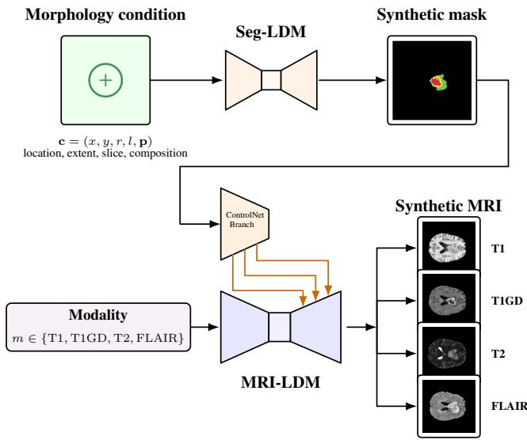
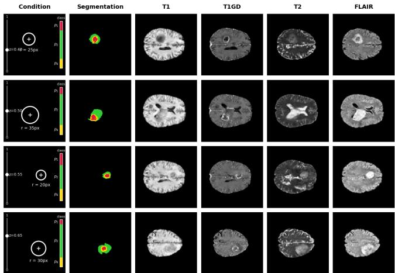

# SPATIALLY AND COMPOSITIONALLY CONTROLLED MULTIMODAL GLIOBLASTOMA MRI SYNTHESIS WITH LATENT DIFFUSION

Steven Glass⋆ Max Van Puyvelde† Marija Pizurica† Mia Meyer⋆ Olivier Gevaert† Willie Brink⋆

⋆Department of Mathematical Sciences, Stellenbosch University †Department of Computational Medicine, Stanford University

## ABSTRACT

Glioblastoma exhibits substantial heterogeneity in tumour morphology and composition across MRI modalities, often making available clinical datasets highly unbalanced in terms of patient pathologies. We propose a two-stage latent diffusion model (LDM) framework for the generation of explicitly controllable 2D glioblastoma MRI scans. First, a segmentation LDM generates tumour maps conditioned on location, spatial extent, axial position, and subregion composition. Second, a modality-conditioned LDM with ControlNet generates T1, T1Gd, T2, and FLAIR images adhering to the requested segmentation. On a held-out test set, generated segmentations achieved a mean centroid error of 0.842 pixels and a subregion proportion error of 0.795 percentage points. ControlNet improved Frechet inception distance (FID) across´ all four modalities, reducing pooled FID from 42.59 to 36.12. An expert reader study yielded mean quality ratings of 6.60 for real images, 6.83 for ControlNet-generated images, and 6.77 for fully synthetic images.

Index Terms— Glioblastoma, multi-modal MRI, latent diffusion models, image generation.

## 1. INTRODUCTION

Glioblastoma is an aggressive form of brain cancer with a high degree of heterogeneity across T1, T1Gd, T2 and FLAIR MRI. The diversity observed in finite clinical glioblastoma datasets is only partially representative of the true variability of real-world patients, limiting the robustness of datadriven models. Recent advances in diffusion models have demonstrated that generative models are able to produce high-fidelity images while capturing useful variation [1],[2]. However, unconditional generation alone cannot deliberately oversample rare tumour locations, sizes, or subregion compositions.

We address this with a two-stage framework that separates pathology generation from MRI synthesis. Our main contributions are: (i) a conditional generative model (Seg-LDM) for explicit spatial and compositional control of synthetic tumour segmentation maps; (ii) a two-stage generative frame-

work that propagates a requested pathology into the synthesis of multi-modal brain MRI scans; (iii) quantitative evaluation of condition adherence and image fidelity, complemented by an expert reader study.

## 2. RELATED WORK

Denoising diffusion models [1] have emerged as a powerful generative modelling approach. In medical imaging, Pinaya et al. [3] demonstrated that latent diffusion models (LDMs) are capable of generating high-resolution 3D brain MRI scans, while Khader et al. [4] demonstrated the utility of synthetic biomedical images on downstream tasks via data augmentation.

Recent work has addressed the challenge of introducing spatially conditioned generation. Med-DDPM [5] conditions brain MRI generation using semantic masks, Kebaili et al. [6] jointly generate multimodal brain MRI and tumour masks, and Zhang et al. [7] demonstrated controllable pathology generation with LeFusion, which conditions lesion synthesis on spatial location, size, and boundary.

ControlNet [8] provides an architecture for introducing spatial guidance while preserving a pretrained diffusion backbone. Most similar to our overall pipeline, Kim et al. [9] introduced 3D-LLDM which first generates tumour segmentation maps which subsequently guide MRI generation using ControlNet.

## 3. METHOD

## 3.1. Preliminaries

First introduced by Rombach et al. [10], LDMs are a variant of diffusion models that perform the diffusion process in a learned, lower-dimensional latent space instead of in image space, which reduces the computational complexity of both training and inference. Consider image data $\mathbf { \dot { x } } \in \mathbb { R } ^ { \mathbf { \dot { C } } \times H \times W }$ where C, H and W represent the number of channels, height and width respectively. The encoder $\mathcal { E } _ { \phi }$ of a variational autoencoder (VAE) maps x to a latent representation $\mathbf { z } _ { 0 } .$ , which is later decoded by the decoder $\mathcal { D } _ { \psi }$ . The forward diffusion process corrupts $\mathbf { z } _ { 0 }$ according to

  
Fig. 1. The complete generative pipeline of our approach.

$$
\mathbf { z } _ { t } = \sqrt { \bar { \alpha } _ { t } } \mathbf { z } _ { 0 } + \sqrt { 1 - \bar { \alpha } _ { t } } \epsilon , \qquad \epsilon \sim \mathcal { N } ( \mathbf { 0 } , \mathbf { I } ) ,\tag{1}
$$

and a conditional denoising network $\epsilon _ { \theta } ( \mathbf { z } _ { t } , t , \mathbf { c } )$ is trained to reverse the added noise at each timestep by minimising the loss

$$
\begin{array} { r } { \mathcal { L } _ { \mathrm { d i f f } } = \mathbb { E } _ { \mathbf { z } _ { 0 } , \epsilon , t , \mathbf { c } } \left[ \left| \left| \epsilon - \epsilon _ { \theta } ( \mathbf { z } _ { t } , t , \mathbf { c } ) \right| \right| _ { 2 } ^ { 2 } \right] . } \end{array}\tag{2}
$$

Here c denotes the conditioning variables. At inference, the learned reverse process transforms Gaussian noise into a latent sample ${ \bf z } _ { 0 } ,$ which gets decoded back into an image $\mathbf { x } _ { \mathrm { 0 } }$

## 3.2. Data and preprocessing

We combine the UCSF-PDGM MRI $( n = 4 9 4 ) [ 1 1 ]$ and the UPenn-GBM $( n \ : = \ : 6 1 1 )$ [12] datasets, yielding $n = 1 1 0 5$ subjects with T1, T1Gd, T2, and FLAIR scans and corresponding tumour segmentations. Both cohorts were skullstripped, and preprocessed using the BrainLes preprocessing package [13]: negative intensities were clipped, N4 bias-field correction was applied, modalities were co-registered to T1, and volumes were affinely transformed to the SRI24 atlas. Resulting volumes have 1mm isotropic resolution and size $2 4 0 \times 2 4 0 \times 1 5 5$

Tumour segmentation maps were transformed into the same space using nearest-neighbour interpolation. Subjects were partitioned at the patient level before axial slice extraction, and all slices were resized to $2 5 6 \times 2 5 6$ . For MRI synthesis, subjects were randomly assigned to disjoint backbone (75%) and ControlNet (25%) partitions, each being split into 80/10/10 training, validation, and testing sets stratified by cohort. Both VAEs and the Seg-LDM used the unions of the corresponding training, validation and testing subsets. The

MRI backbone used only the backbone subsets, while ControlNet used only the ControlNet subsets with the backbone frozen.

## 3.3. Controllable tumour segmentation map generation

A 2D VAE adapted from Van Puyvelde et al. [14] is trained to encode a segmentation map $\mathbf { y } \in \{ 0 , 1 \}$ 4×256×256 onto a latent representation $\mathbf { z } _ { 0 } \in \mathbb { R } ^ { 4 \times 3 2 \times 3 2 }$ . After training, the VAE is frozen and a conditional LDM (Seg-LDM) with a U-Net architecture [15] learns the distribution of the latent representations of the segmentation maps, conditioned on coarse spatial instruction and global composition. Let $s$ denote the set of tumour foreground pixels. Its centroid $\pmb { \mu }$ and radius r are

$$
\mu = \frac { 1 } { | \mathcal { S } | } \sum _ { \mathbf { v } \in \mathcal { S } } \mathbf { v } , \qquad r = \operatorname* { m a x } _ { \mathbf { v } \in \mathcal { S } } | | \mathbf { v } - \pmb { \mu } | | _ { 2 } .\tag{3}
$$

These define the binary spatial disk S, which specifies a coarse spatial region for the tumour, while allowing the model to synthesize the tumour morphology. This disk is downsampled and concatenated channel-wise with the noised latent $\mathbf { z } _ { t } .$ . Global conditioning is represented by the vector

$$
\mathbf { g } = [ l , p _ { 1 } , p _ { 2 } , p _ { 3 } ] ^ { T } ,\tag{4}
$$

where $l ~ \in ~ [ 0 , 1 ]$ is the normalised axial slice index, and $p _ { k }$ is the proportion of tumour region $k \in \{ 1 , 2 , 3 \}$ , which represent necrotic, edema, and enhancing regions respectively. Separate multilayer perceptrons embed g and diffusion timestep t into a common embedding space, where they are added and supplied to the residual blocks of the denoising U-Net. Classifier-free guidance [16] is used during sampling to control adherence to the requested conditions. During training, all conditioning is randomly removed with $p _ { \mathrm { u n c o n d } } = 0 . 1$ The Seg-LDM is trained using Eq. 2 with conditioning (S, g).

## 3.4. Segmentation-guided MRI generation

A separately trained VAE encodes the MRI slice x $\in \mathbb { R } ^ { 2 5 6 \times 2 5 6 }$ onto the latent representation $\mathbf { z } _ { 0 } ~ \in ~ \mathbb { R } ^ { 1 6 \times 3 2 \times 3 2 }$ The MRI-LDM is a U-Net LDM backbone trained on the latent representations of slices across all four modalities. A requested modality $m \ \in \ \{ \mathrm { T 1 , T 1 G d , T 2 , F L A I R } \}$ is embedded and added to the timestep embedding in the same manner as the Seg-LDM. During training, modality conditioning is randomly removed with $p _ { \mathrm { u n c o n d } } = 0 . 1$ , allowing for classifierfree guidance. The MRI-LDM is trained using Eq. 2 with conditioning m.

Once training of the backbone model is complete, the parameters are frozen, and spatial control is introduced via a ControlNet branch. MRI synthesis is guided according to a requested tumour segmentation map $\mathbf { y } ,$ which is first projected onto the same spatial resolution as the MRI latents. A trainable copy of the MRI-LDM’s encoder processes y, $\mathbf { z } _ { t }$ and t. Multi-scale ControlNet features are then processed by zero-initialised 1×1 convolutional layers, and additively combined with the backbone skip features. As a result, the ControlNet branch learns how the requested tumour segmentation map should alter the denoising trajectory, producing MRI scans with a matching tumour pathology.

  
Fig. 2. Example synthetic segmentation-MRI pairs. Each row shows a different requested tumour condition, the synthetic tumour segmentation map, and the generated T1, T1Gd, T2 and FLAIR MRI scans corresponding to this map.

Table 1. Adherence to requested tumour morphology across classifier-free guidance scales. Guidance scale 2.0 was selected on the validation set and evaluated on the held-out test set.
<table><tr><td>Guid.</td><td>Centroid (px)</td><td>Radius (px)</td><td>Outside (%)</td><td>Prop. MAE (pp)</td></tr><tr><td>Validation</td><td></td><td></td><td></td><td></td></tr><tr><td>1.0</td><td>1.232</td><td>1.120</td><td>2.047</td><td>1.239</td></tr><tr><td>1.5</td><td>0.585</td><td>0.841</td><td>1.739</td><td>0.966</td></tr><tr><td>2.0</td><td>0.633</td><td>0.683</td><td>1.574</td><td>0.820</td></tr><tr><td>2.5</td><td>0.587</td><td>0.758</td><td>1.596</td><td>0.770</td></tr><tr><td>2.0 0.842</td><td>Held-out test (s = 2.0)</td><td>0.738</td><td>1.789</td><td>0.795</td></tr></table>

## 4. RESULTS AND DISCUSSION

Figure 2 demonstrates the end-to-end controllability of the pipeline. Generated segmentation maps remain consistent with the requested spatial and compositional conditions, and the corresponding MRI scans preserve modality-specific appearance and consistency with the segmentation maps.

Table 1 evaluates the ability of Seg-LDM to generate tumours that adhere to the requested features. At the selected guidance scale of s = 2.0, performance remained consistent between the validation and held-out test sets. On the test set, generated tumours achieved a mean centroid error of 0.842 pixels and a tumour-subregion proportion MAE of 0.795 percentage points, while only 1.789% of tumour pixels fell outside the requested spatial region on average.

Table 2. FID comparison between the MRI backbone and ControlNet. Per-modality scores use 6,918 samples; the pooled score uses 27,672 samples.
<table><tr><td>Evaluation</td><td>Backbone</td><td>ControlNet</td><td>∆FID</td></tr><tr><td>T16918</td><td>54.53</td><td>46.52</td><td>-8.01</td></tr><tr><td>T1Gd6918</td><td>57.19</td><td>46.99</td><td>-10.20</td></tr><tr><td>T26918</td><td>41.89</td><td>31.14</td><td>-10.75</td></tr><tr><td> $\mathrm { F L A I R } _ { 6 9 1 8 }$ </td><td>56.18</td><td>50.41</td><td>-5.77</td></tr><tr><td> $\mathrm { P o o l e d _ { 2 7 6 7 2 } }$ </td><td>42.59</td><td>36.12</td><td>-6.47</td></tr></table>

Table 3. Mean reader quality ratings (1–10) across MRI modalities and image groups.
<table><tr><td>Modality</td><td>Real</td><td>ControlNet</td><td>Fully Synthetic</td></tr><tr><td>T1</td><td>6.33</td><td>6.33</td><td>5.58</td></tr><tr><td>T1Gd</td><td>7.08</td><td>7.50</td><td>7.17</td></tr><tr><td>T2</td><td>6.25</td><td>6.33</td><td>7.33</td></tr><tr><td>FLAIR</td><td>6.75</td><td>7.17</td><td>7.00</td></tr><tr><td>Overall</td><td>6.60</td><td>6.83</td><td>6.77</td></tr></table>

Image fidelity was evaluated by comparing the same MRI diffusion backbone with the ControlNet branch enabled or disabled. ControlNet used real held-out segmentations. Table 2 demonstrates that ControlNet reduced Frechet inception dis-´ tance (FID) across all four modalities, with the largest improvements for T2 and T1Gd. Pooled FID decreased from 42.59 to 36.12. These results assess MRI synthesis conditioned on real tumour masks; they do not quantify the fidelity of the complete pipeline using Seg-LDM-generated masks.

Cross-study FID comparison is limited by differences in datasets, dimensionality, and feature extractors. Akbar et al. [17] reported FIDs of roughly 16 to 85 across 2D GAN and diffusion models on BraTS, while the recent label-guided 3D-LLDM [9] reported 28.31 on hepatic MRI. We treat these values as contextual rather than direct baselines, and use the identically evaluated MRI-LDM backbone as our primary comparison.

Four readers each rated 36 segmentation–MRI pairs on a 1–10 scale from three groups: real segmentation with real MRI, real segmentation with synthetic MRI (ControlNet), and fully synthetic segmentation–MRI pairs. Mean ratings were 6.60, 6.83, and 6.77 for the real, ControlNet-generated, and fully synthetic groups, respectively. These descriptive results provide an exploratory assessment of perceived quality; the small reader panel and limited image sample do not establish equivalence between real and synthetic images.

## 5. CONCLUSION

We introduced a two-stage conditional latent diffusion framework for controllable glioblastoma brain MRI synthesis. The conditional Seg-LDM enables explicit control over the spatial location, extent, and composition of brain tumour, which can be supplied to a ControlNet architecture that generates a corresponding multi-modal 2D brain MRI slice consistent with the requested pathology. The promise of this approach is verified by qualitative analysis of the synthetic images, with expert evaluation providing complementary assessment of image realism. Future work will extend this framework into native volumetric generation. All the code used in this work is available at: https://github.com/SteveG365/GBM -Diff.

## 6. COMPLIANCE WITH ETHICAL STANDARDS

The imaging data used in this study were obtained from publicly available, de-identified datasets. The expert reader study involved voluntary assessment of de-identified and synthetic images. In accordance with institutional requirements, formal ethical approval and waiver were not required.

## 7. ACKNOWLEDGEMENTS

The authors thank Dr. Qinmei Xu, Dr. Henriette Burger, Dr. Armin Gretschel, and Dr. Derek Jackson for their participation in the expert reader study. No funding was received for conducting this study. The authors have no relevant financial or non-financial interests to disclose.

## 8. REFERENCES

[1] J. Ho, A. Jain, and P. Abbeel, “Denoising diffusion probabilistic models,” in Advances in Neural Information Processing Systems, 2020, vol. 33, pp. 6840–6851.

[2] P. Dhariwal and A. Nichol, “Diffusion models beat GANs on image synthesis,” in Advances in Neural Information Processing Systems, 2021, vol. 34, pp. 8780– 8794.

[3] W. Pinaya et al., “Brain imaging generation with latent diffusion models,” in Deep Generative Models, 2022, vol. 13609, pp. 117–126.

[4] F. Khader et al., “Denoising diffusion probabilistic models for 3D medical image generation,” Scientific Reports, vol. 13, no. 1, pp. 7303, 2023.

[5] Z. Dorjsembe, H. Pao, S. Odonchimed, and F. Xiao, “Conditional diffusion models for semantic 3D brain MRI synthesis,” IEEE Journal of Biomedical and Health Informatics, vol. 28, no. 7, pp. 4084–4093, 2024.

[6] A. Kebaili, J. Lapuyade-Lahorgue, P. Vera, and S. Ruan, “Multi-modal MRI synthesis with conditional latent diffusion models for data augmentation in tumor segmentation,” Computerized Medical Imaging and Graphics, vol. 123, pp. 102532, 2025.

[7] H. Zhang et al., “LeFusion: Controllable pathology synthesis via lesion-focused diffusion models,” in International Conference on Learning Representations, 2025.

[8] L. Zhang, A. Rao, and M. Agrawala, “Adding conditional control to text-to-image diffusion models,” in IEEE/CVF International Conference on Computer Vision, 2023, pp. 3813–3824.

[9] K. Kim et al., “3D-LLDM: Label-guided 3D latent diffusion model for improving high-resolution synthetic MR imaging in hepatic structure segmentation,” in IEEE International Symposium on Biomedical Imaging, 2026.

[10] R. Rombach, A. Blattmann, D. Lorenz, P. Esser, and B. Ommer, “High-resolution image synthesis with latent diffusion models,” in IEEE/CVF Conference on Computer Vision and Pattern Recognition, 2022, pp. 10674– 10685.

[11] E. Calabrese et al., “The University of California San Francisco Preoperative Diffuse Glioma MRI Dataset,” Radiology: Artificial Intelligence, vol. 4, no. 6, pp. e220058, 2022.

[12] S. Bakas et al., “The University of Pennsylvania glioblastoma (UPenn-GBM) cohort: Advanced MRI, clinical, genomics, & radiomics,” Scientific Data, vol. 9, no. 1, pp. 453, 2022.

[13] F. Kofler et al., “Brainlesion suite: A flexible and userfriendly framework for modular brain lesion image analysis,” arXiv preprint arXiv:2507.09036, 2025.

[14] M. Van Puyvelde, H. Gulluk, W. Van Criekinge, and O. Gevaert, “CONFLUX: A latent diffusion model for 3D chest-CT synthesis with RL post-training,” in Medical Image Computing and Computer Assisted Intervention Workshops and Challenges, 2026, vol. 17258.

[15] O. Ronneberger, P. Fischer, and T. Brox, “U-Net: Convolutional networks for biomedical image segmentation,” in Medical Image Computing and Computer-Assisted Intervention, 2015, vol. 9351, pp. 234–241.

[16] J. Ho and T. Salimans, “Classifier-free diffusion guidance,” in NeurIPS Workshop on Deep Generative Models and Downstream Applications, 2021.

[17] M. U. Akbar, M. Larsson, I. Blystad, and A. Eklund, “Brain tumor segmentation using synthetic MR images – a comparison of GANs and diffusion models,” Scientific Data, vol. 11, no. 1, pp. 259, 2024.