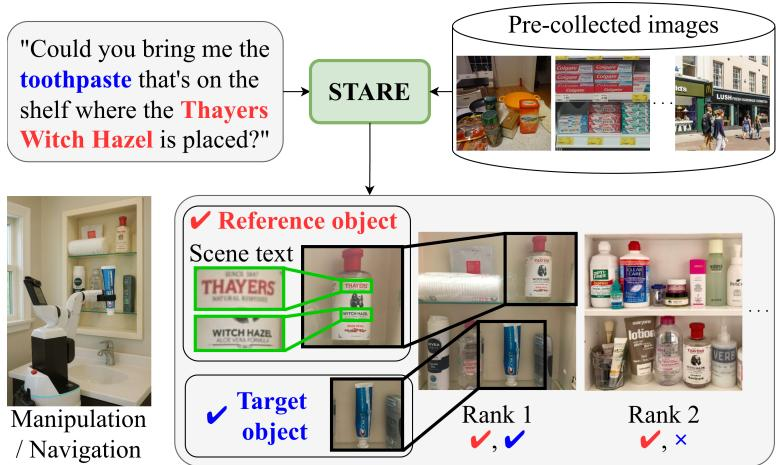
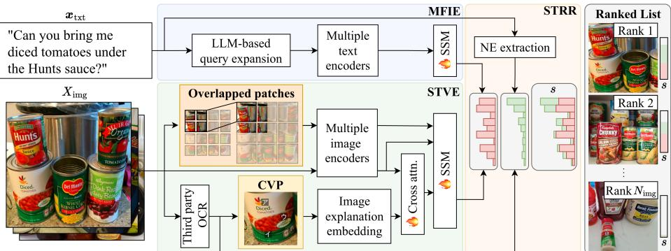
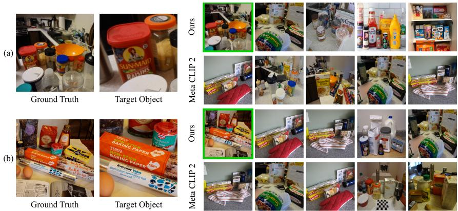
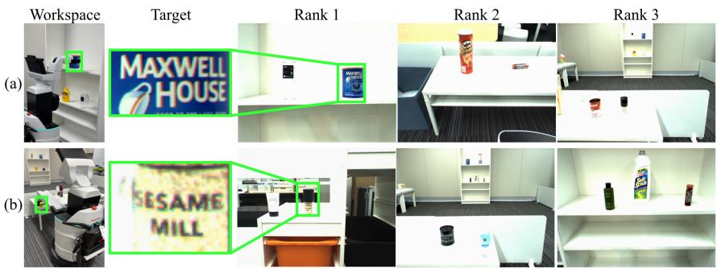

# STARE: Scene Text-Aware multimodal Retrieval for Everyday objects

Kento Tokura , Ryosuke Korekata , Daichi Yashima , Kei Katsumata , Kanon Amemiya , Miyu Goko , and Komei Sugiura

Keio University, Japan

{tkento1985, rkorekata, ydaichi1207, ke59ka77, kanon-amemiya, miyu.goko, komei.sugiura}@keio.jp

Abstract. In this study, we focus on service robots that retrieve and transport everyday objects based on free-form instructions that may refer to visual features and scene text. This is challenging because it requires a multimodal understanding of the visual features and spatial relationships of objects, as well as scene text embedded in the environment. To address this, we propose Scene Text-Aware multimodal Retrieval for Everyday objects (STARE), which leverages visual and textual cues in response to free-form instructions. STARE introduces Crosslingual Visual Prompt to enhance scene text interpretation, and models the complex relationships between named entities in the instructions and their corresponding objects. We evaluate STARE using two novel benchmarks, GoGetIt and TextCaps-test, both of which consist of real-world indoor/outdoor images and instructions involving object manipulation and navigation. The results show that STARE outperforms all baseline methods on standard multimodal retrieval metrics. Furthermore, in physical experiments conducted under a zero-shot transfer setting, STARE achieves an overall success rate of 80%. Our project page is available at https://stare-projectpage.pages.dev/.

Keywords: Scene text · Multimodal retrieval · Service robots

## 1 Introduction

Service robots in indoor and outdoor environments such as households, retail stores, and urban streets are becoming increasingly important due to labor shortages and aging populations. When interacting with service robots, it is natural for users to refer to objects using scene text (e.g., labels, signage, packaging), which provides a clearer and more direct way of specifying objects than relying solely on visual features. Therefore, in real-world applications, it is crucial that robots can retrieve target objects based on user instructions by leveraging scene text and visual information.

In this study, we formulate this problem as Scene Text-Aware Multimodal Retrieval (STMR). Given a free-form natural language instruction for object manipulation or navigation and a set of images collected during pre-exploration,

  
Fig. 1: Typical scene of our task. First, environmental images are collected in a pre-exploration phase. Next, STARE performs multimodal retrieval in response to a free-form instruction. Finally, the robot navigates to and grasps the specified object.

STMR retrieves and ranks images containing the target object. The task considers both images with and without scene text.

Fig. 1 shows a typical scene of the task. In the example, a user gives the instruction: “Could you bring me the toothpaste that’s on the shelf where the Thayers Witch Hazel is placed?” The robot then searches through previously collected images for a toothpaste tube located on the same shelf as a bottle labeled “Thayers Witch Hazel” and performs the specified manipulation.

This task is challenging because it requires an understanding of not only the visual features and spatial relationships among objects but also scene text. While existing methods [29, 35] have been successfully applied to multimodal retrieval, their integration of scene text with other multimodal information is not always suficient. Linking named entities in instructions to scene text associated with the corresponding objects remains challenging, limiting performance on this task. Furthermore, because multimodal retrieval requires large-scale and fast inference, relying solely on multimodal large language models (MLLMs) is not practical.

To address these limitations, we propose Scene Text-Aware multimodal Retrieval for Everyday objects (STARE) for the STMR task. STARE consists of three modules: a Multi-Form Instruction Encoder (MFIE) for encoding free-form instructions, a Scene Text-aware Visual Encoder (STVE) for encoding candidate images, and a Scene Text ReRanker (STRR) for reranking candidates based on scene-text cues. Within STVE, we introduce Crosslingual Visual Prompt (CVP), which visually associates scene text detected by optical character recognition (OCR) with its image location while reducing confusion between the prompt marks and the original scene text. The pre-exploration can be performed up until query time to dynamically update the collected images.

Our contributions can be stated as follows.

– STVE, which combines image features from encoders, fine-grained image features using overlapped patchification, and narrative representations that consider scene text.

– We introduce the STRR module, which eficiently models the highly complex relationships between named entities and their corresponding objects.

– We construct the GoGetIt and TextCaps-test benchmarks, which contain navigation/manipulation instructions as well as images containing scene text.

– In real-world hardware experiments with zero-shot transfer, STARE achieves an overall success rate of 80%.

## 2 Related Work

Vision-language models (VLMs) for robotics and multimodal retrieval are extensively studied [4, 14] and systematically reviewed [34, 36]. Furthermore, integrating scene text is efective for disambiguating visual representations [13, 21].

Foundation Models for Robotics. Recent studies show that remarkable generalization across manipulation and navigation tasks can be achieved by leveraging large-scale foundation models, such as large language models (LLMs) and VLMs [12, 14]. Vision-language-action models [4, 33] trained on large-scale real robot trajectories enable scalable policy learning across diverse manipulation tasks. However, these approaches are not well suited for scenarios involving thousands of input images, as such large-scale processing incurs substantial inference latency and often exceeds API token limits.

Multimodal retrieval. Numerous studies [23, 39] have assessed the performance of domestic service robots in mobile manipulation tasks based on natural language instructions. Several existing methods [8,16,32,38] perform multimodal retrieval to identify target objects in the environment, and output ranked lists of relevant images based on natural language instructions. Other methods retrieve target objects and output text-based answers or waypoints [37]. Recent benchmarks also evaluate multimodal retrieval in terms of reasoning and knowledge [20]. Despite rapid advances, few methods leverage scene text (e.g., labels, signage), although it often disambiguates the target. We address this gap through scene text-aware multimodal retrieval.

Scene Text. Research on images containing scene text includes recognition and detection [18], retrieval [9,40], and VQA/synthesis [2,11]. In particular, scene text retrieval methods often integrate OCR-extracted textual and positional information with visual features to improve alignment with query texts and achieve higher retrieval accuracy. Mishra et al. [24] study visual question answering by reading text in images. ViSTA [9] embeds OCR-extracted text and positions and fuses them with visual features via a fusion token in a transformer. In contrast to these approaches, STARE integrates text and position into a narrative representation of object-level associations and introduces an auxiliary similarity function for eficient matching.

  
Fig. 2: Architecture of STARE. STARE includes a narrative representation that integrates Crosslingual Visual Prompt (CVP) and scene text, and reranks based on lexical matches between named entities in the instruction and scene texts. SSM represents a Mamba encoder.

## 3 Methodology

## 3.1 Problem Statement

In this paper, we define the Scene Text-Aware Multimodal Retrieval (STMR) task as follows: a mobile robot collects images, which may include scene texts, from a wide range of indoor or outdoor environments through pre-exploration. Given a free-form natural language instruction to manipulate an object or navigate, the model retrieves the target images from the pre-collected images. STARE does not assume the presence of scene text and is applicable whether or not scene text is present, as demonstrated by its performance on the LTRRIE benchmark. The model is expected to rank images that correspond to the instruction highly in the output list. Additional task details are provided in Section ?? of the supplementary material.

The terminology used in this paper is defined as follows. An “instruction” refers to a free-form natural language instruction for object manipulation or navigation that includes referring expressions. A “target object” is the object referred to by an instruction, and a “target image” is an image containing that object. An instruction may have multiple target images. “Scene text” refers to text that exists within an image. We assume that the target images contain either objects that serve as navigation targets (e.g., buildings, signs) or everyday objects that can be manipulated (e.g., kitchen utensils, bottles).

## 3.2 Overview of STARE

We propose STARE, which consists of three modules: the Multi-Form Instruction Encoder (MFIE), Scene Text-aware Visual Encoder (STVE), and Scene Text ReRanker (STRR). Fig. 2 shows the architecture of STARE. STARE separates image-side processing during pre-exploration from instruction-side processing at query time. During pre-exploration, OCR and CVP are first applied to each candidate image, and STVE generates and stores its image embedding. At query time, query expansion and named-entity extraction are applied to the instruction, after which MFIE generates the instruction embedding. The instruction embedding is compared with the precomputed image embeddings, and STRR further reranks the candidates using lexical matches between named entities in the instruction and scene text in each image. Finally, the images are sorted according to the resulting similarity scores to produce the ranked list. The input x to STARE is defined as follows:

$$
\pmb { x } = \{ \pmb { x } _ { \mathrm { t x t } } , X _ { \mathrm { i m g } } \} , \quad X _ { \mathrm { i m g } } = \{ \pmb { x } _ { \mathrm { i m g } } ^ { ( i ) } \} _ { i = 1 } ^ { N _ { \mathrm { i m g } } } ,\tag{1}
$$

where $\pmb { x } _ { \mathrm { i m g } } ^ { ( i ) } \in \mathbb { R } ^ { 3 \times W \times H } , \pmb { x } _ { \mathrm { t x t } }$ , and $N _ { \mathrm { i m g } }$ represent an image, an instruction, and the number of candidate images for retrieval, respectively. Here, W and H denote the common image width and height, respectively.

## 3.3 Multi-Form Instruction Encoder

At query time, STARE first performs query-side preprocessing on ${ \bf { \mathcal { x } } } _ { \mathrm { { t x t } } }$ . Query expansion and named-entity extraction are generated jointly in a single LLM call. The expanded query is used by MFIE, whereas the extracted named entities are subsequently used by STRR. MFIE models complex expressions within ${ \bf { \mathcal { x } } } _ { \mathrm { { t x t } } }$ by incorporating text embeddings and LLM-based query expansion. Query expansion, a technique for expanding a query with semantically related terms, has been less explored in closely related studies. We do not use ${ \mathbf { \mathcal { x } } } _ { \mathrm { t x t } }$ directly, because named entities in ${ \bf { \mathcal { x } } } _ { \mathrm { { t x t } } }$ (e.g., “Thayers Witch Hazel”) are often underrepresented in the training data of VLMs, which can result in inadequate multimodal embeddings. Instead, we apply query expansion to generate descriptions capturing the visual characteristics of named entities $( \mathrm { e . g . , \tilde { \Omega } A }$ transparent glass bottle with a red lid and $\cdots ^ { \dag } )$ . Query expansion thus aligns named entities with familiar visual attributes. It uses the LLM’s world knowledge to describe the target’s appearance, complementing lexical matching when product names are incomplete, paraphrased, or translated.

Based on ${ \pmb x } _ { \mathrm { t x t } }$ , MFIE leverages a language encoder and an image-aligned text encoder to extract various features associated with ${ \bf { \mathcal { x } } } _ { \mathrm { { t x t } } }$ at multiple semantic levels. The unified representation $h _ { \mathrm { t x t } } \in \mathbb { R } ^ { d _ { \mathrm { t x t } } }$ is obtained as follows:

$$
h _ { \mathrm { t x t } } = \mathrm { S S M } \left( [ f (  { \mathbf { x } } _ { \mathrm { t x t } } ) ; f ( \mathrm { Q E } (  { \mathbf { x } } _ { \mathrm { t x t } } ) ) ] \right) ,\tag{2}
$$

where $d _ { \mathrm { t x t } }$ denotes the output dimension of the MFIE module, and $f ( \cdot )$ represents multiple text encoders, such as Stella [42] and the CLIP text encoder [29]. $\mathrm { Q E } ( { \boldsymbol { x } } _ { \mathrm { t x t } } )$ is the LLM-based query expansion of ${ \bf { \mathcal { x } } } _ { \mathrm { { t x t } } }$ . Stella extracts pure linguistic features, whereas the CLIP text encoder produces image-aligned textual representations. We use an SSM to model relationships among multi-granularity features and to improve inference eficiency.

## 3.4 Scene Text-aware Visual Encoder

STVE combines image features extracted using image encoders, fine-grained image features using overlapped patchification, and narrative representations that consider scene text. The overlapped patchified features allow the module to capture finer details of the image. Overlapped patchification is used because standard patchification cannot accurately capture visual features of objects or scene texts located at patch boundaries. Specifically, $\pmb { x } _ { \mathrm { i m g } } ^ { ( i ) }$ is divided into overlapping cells, which are encoded by multiple image encoders (e.g., CLIP, DINOv2 [27]) to produce multimodal features $h _ { \mathrm { f i n e } } ^ { ( i ) }$ . Using multiple image encoders allows the model to capture information across both semantic and spatial levels, as shown in [30].

Next, we introduce the narrative representations, which are generated using Crosslingual Visual Prompt (CVP). Many everyday objects contain scene texts, making it essential to extract image features that efectively incorporate scene texts. However, existing methods [8,16,35,38] do not suficiently integrate scene texts with image features, limiting their efectiveness in multimodal retrieval tasks. To fully leverage scene texts, simply extracting scene texts and their positions using OCR is insuficient. In environments where multiple scene texts are present, OCR results are not enough to accurately associate each text with the correct object. Occlusions or unfavorable orientations can also result in inaccurate OCR-detected scene texts. To address these challenges, we use an MLLM to extract linguistic features from images that capture complex referring expressions, spatial relationships, and relationships between objects and scene text.

However, relying solely on MLLMs can cause hallucinations, where incorrect or nonexistent text is generated. We mitigate this issue by providing the MLLM with OCR-detected scene texts and visually marking their locations within the image. We do not use conventional visual prompting because inserted prompts may be misinterpreted as scene text by downstream multimodal models. Unlike typical visual prompting, CVP employs non-alphanumeric visual marks to distinguish the marks from scene texts present in the image. These marks are chosen for their suitability for enumerated list-style descriptions.

This representation is generated by first performing third-party OCR on $\pmb { x } _ { \mathrm { i m g } } ^ { ( i ) }$ to extract scene texts along with their corresponding locations within the image. Using the OCR results, each scene text in the image is enclosed within a bounding box, and a crosslingual mark is overlaid at the top of the bounding box to create CVP. The language used for the CVP marks is described in Section 4.3. The CVP and scene texts are then passed to a multimodal large language model (MLLM) to generate a description of the image that considers the scene text. Here, the MLLM is used only to generate image captions from the provided CVP and is not instructed to inject external knowledge. The detailed motivation and the prompt used by the “Image explanation embedding” in Fig. 2 are provided in Section ?? of the supplementary material.

The description is then passed to a language encoder to create the narrative representation $l _ { \mathrm { N } } ^ { ( i ) }$ . We integrate $l _ { \mathrm { N } } ^ { ( i ) }$ with pure visual representations to obtain multimodal features, which can be used in parallel with other multimodal representations. $l _ { \mathrm { N } } ^ { ( i ) }$ encodes information ranging from low-level attributes (e.g., color, texture) to high-level concepts (e.g., product names). To match this range, we use visual features from multiple intermediate layers of DINOv2.

The final output of the STVE module $h _ { \mathrm { i m g } } ^ { ( i ) } \in \mathbb { R } ^ { d _ { \mathrm { i m g } } }$ can be calculated as follows:

$$
\begin{array} { r } { \pmb { h } _ { \mathrm { i m g } } ^ { ( i ) } = \mathrm { S S M } ( [ \pmb { h } _ { \mathrm { c o a r s e } } ^ { ( i ) } ; \pmb { h } _ { \mathrm { f i n e } } ^ { ( i ) } ; \mathrm { C r o s s A t t n } ( l _ { \mathrm { N } } ^ { ( i ) } , \pmb { v } _ { \mathrm { c o a r s e } } ^ { ( i ) } ) ] ) , } \end{array}\tag{3}
$$

where $h _ { \mathrm { c o a r s e } } ^ { ( i ) } , v _ { \mathrm { c o a r s e } } ^ { ( i ) }$ , and $d _ { \mathrm { i m g } }$ denote the coarse multimodal features extracted from $\pmb { x } _ { \mathrm { i m g } } ^ { ( i ) }$ using multiple image encoders, the coarse visual features derived from the intermediate layers of DINOv2 for $\pmb { x } _ { \mathrm { i m g } } ^ { ( i ) } ,$ , and the output dimension of the STVE module, respectively.

## 3.5 Scene Text ReRanker

We introduce STRR to model the relationships between named entities in the instruction and scene text associated with candidate objects. This is particularly important in the STMR task, where product names, store names, and other named entities can provide strong cues for identifying the corresponding objects. Existing methods typically score the $h _ { \mathrm { t x t } }$ and $h _ { \mathrm { i m g } } ^ { ( i ) }$ pairs using cosine similarity [29], which does not directly capture lexical matches between named entities and scene text. Moreover, retrieval settings require fast similarity calculations using pre-extracted features.

Thus, we introduce a similarity score $s ( \cdot , \cdot )$ that combines cosine similarity with an additional term for matching named entities against scene text:

$$
\begin{array} { r l } { s ( \pmb { x } _ { \mathrm { t x t } } , \pmb { x } _ { \mathrm { i m g } } ^ { ( i ) } ) = \frac { \displaystyle h _ { \mathrm { t x t } } \cdot \pmb { h } _ { \mathrm { i m g } } ^ { ( i ) } } { \| \pmb { h } _ { \mathrm { t x t } } \| \| \pmb { h } _ { \mathrm { i m g } } ^ { ( i ) } \| } + \lambda \rho _ { i } , } & { } \\ { \rho _ { i } = \left\{ \begin{array} { l l } { \displaystyle \frac { | T _ { \mathrm { N E } } \cap T _ { \mathrm { S T } } ^ { ( i ) } | } { \operatorname* { m a x } _ { j } | T _ { \mathrm { N E } } \cap T _ { \mathrm { S T } } ^ { ( j ) } | } , } & { \mathrm { i f } \operatorname* { m a x } _ { j } | T _ { \mathrm { N E } } \cap T _ { \mathrm { S T } } ^ { ( j ) } | > 0 , } \\ { 0 , } & { \mathrm { o t h e r w i s e } . } \end{array} \right. } \end{array}\tag{4}
$$

where λ is a learnable weight that controls the influence of OCR-based reranking. When an image has no matching named-entity and scene-text tokens, the reranking term is zero and the score reduces to cosine similarity. Here, TNE and $T _ { \mathrm { S T } } ^ { ( i ) }$ denote the token sets of named entities and scene texts, respectively, generated using a tokenizer (e.g., tiktoken). The named entities are extracted from ${ \pmb x } _ { \mathrm { t x t } }$ using an LLM (denoted as NE extractor in $\mathrm { F i g . ~ 2 ) }$ . To address the significant amount of noise in scene texts, we enhance the robustness of our method by applying preprocessing techniques such as normalization (e.g., case normalization, symbol removal) in addition to simple string matching. The incentive term in the similarity score evaluates lexical matches between named entities and scene texts, while retaining fast matching capabilities. The usage of $T _ { \mathrm { N E } }$ enables reranking that prioritizes semantically relevant matches. The final ranked image list $\hat { Y }$ is obtained by sorting $X _ { \mathrm { i m g } }$ based on $s ( \pmb { x } _ { \mathrm { t x t } } , \pmb { x } _ { \mathrm { i m g } } ^ { ( i ) } )$

## 4 Experiments

## 4.1 Experimental Setup

Benchmarks. We constructed the GoGetIt and TextCaps-test benchmarks for the STMR task. The GoGetIt benchmark was constructed because existing multimodal retrieval datasets [22,31] are not always suitable for robotic manipulation or navigation tasks. Although the RefText dataset [5] uses scene texts to identify the target object, some instructions are overly simple, with several consisting of only a single word. To address this, we annotated samples with longer and more practical instructions that describe robotic actions suitable for execution in real-robot experiments.

However, evaluating multimodal foundation models on RefText raises potential data-leakage concerns because some RefText images originate from public datasets such as COCO [19], which may also be used during pretraining. Ref-Text’s random train/validation/test split [5] adds to these concerns. This concern is substantial: since 61.9% of RefText samples are from public datasets, approximately 50% may overlap with the pretraining corpora of baselines like Long-CLIP and BLIP-2. Thus, we required a diferent benchmark to enable a fair comparison with foundation-model baselines. The original TextCaps captions are not robot instructions, so we created TextCaps-test from TextCaps [31] with newly annotated instructions.

We also evaluated the performance of our method in settings without scene text using the LTRRIE dataset [15], a multimodal retrieval dataset featuring indoor environments. The instructions and images in the LTRRIE dataset were collected from the REVERIE dataset [28] and the Matterport3D simulator, respectively.

Statistics. The GoGetIt benchmark consists of 27,280 samples and 3,657 images containing scene text, collected from diverse indoor and outdoor environments. The GoGetIt-RefText subset contains 23,323 samples with instructions sourced from the RefText [5] dataset, while the GoGetIt-Instruction subset contains 3,957 referring-expression instructions newly collected from 129 annotators. The TextCaps-test benchmark consists of 400 instructions provided by 10 annotators and 105 images containing scene text. The LTRRIE [15] dataset consists of 5,108 English instructions and 3,569 images, collected from 67 indoor environments. For LTRRIE, we use the original train/validation/test split and image counts.

In the GoGetIt benchmark, the RefText and Instruction subsets were partitioned following the same split as the RefText dataset. The training set contains 17,352 samples from the RefText subset and 3,126 from the Instruction subset. The validation set contains 1,433 RefText samples and 266 Instruction samples. The test set includes 4,538 RefText samples, 565 Instruction samples, and 400

TextCaps-test samples. Including LTRRIE, the training set consists of 31,071 samples, the validation set contains 2,096 samples, and the test set includes 6,004 samples. There is no overlap of samples across the training, validation, and test sets. We used the training set to train the model, the validation set to tune hyperparameters, and the test set to evaluate model performance.

Annotation. For the GoGetIt-Instruction subset and TextCaps-test benchmark, annotators were shown each image with the target object enclosed in a bounding box, together with scene text extracted from the image. They were asked to provide full-sentence instructions describing object manipulation or navigation actions, optionally including scene text. Multiple experts manually reviewed all test samples against predefined criteria. Each instruction had to be a full-sentence manipulation or navigation command consistent with the target object and its scene text.

Training Setup. Table 1 summarizes the optimizer, learning rate, batch size, number of epochs, and encoder settings used to train STARE. Here, $L _ { \mathrm { s t } } , \ H _ { \mathrm { s t } }$ , and $A _ { \mathrm { s t } }$ denote the layer count, hidden dimension, and attention-head count of the Scene Textaware Visual Encoder module, while $L _ { \mathrm { n p } } ,$ $H _ { \mathrm { n p } } .$ and $A _ { \mathrm { n p } }$ denote the corresponding quantities for the Multi-Form Instruction Encoder module. Details of the loss function and evaluation metric are provided in Sections ?? and ?? of the supplementary material, respectively.

Table 1: Experimental settings for our method.
<table><tr><td>Optimizer</td><td>AdamW</td></tr><tr><td> $\beta _ { 1 } , \beta _ { 2 }$ </td><td>0.9, 0.98</td></tr><tr><td>Learning rate</td><td> $1 \times 1 0 ^ { - 4 }$ </td></tr><tr><td>Batch size</td><td>128</td></tr><tr><td>Number of epochs  $L _ { \mathrm { s t } } , H _ { \mathrm { s t } } , A _ { \mathrm { s t } }$ </td><td>20 5, 2,048, 1</td></tr><tr><td> $L _ { \mathrm { n p } } , H _ { \mathrm { n p } } , A _ { \mathrm { n p } }$ </td><td></td></tr><tr><td></td><td>4, 2,304, 8</td></tr><tr><td> $d _ { \mathrm { t x t } } , d _ { \mathrm { i m g } }$ </td><td>1024, 1024</td></tr></table>

## 4.2 Implementation Details

We used GPT-4o [26] for MFIE and STVE, and Google Cloud Vision API for OCR. During pre-exploration, OCR, backbone feature extraction, and STVE are executed once for the candidate images, and the resulting image embeddings are stored. At query time, only instruction-side processing and STRR are executed. STARE had approximately 40 million trainable parameters and 5 billion multiply–add operations. We trained our model on a GeForce RTX 4090 with 24 GB of VRAM and an Intel Core i9-13900KF with 64 GB of CPU memory. Training took approximately 1.2 hours. The similarity calculation between a single instruction and 100 precomputed image embeddings took approximately 39.8 ms. We measured recall@10 on the validation set for each epoch. The evaluation on the test set was performed using the model that had the highest recall@10 score on the validation set. We used the Double Relaxed Contrastive loss [38] with the STRR score s, including the lexical matching term.

Baselines. Our zero-shot multimodal retrieval baselines were CLIP (ViT-$\mathrm { L } / 1 4 )$ , Long-CLIP (ViT-L/14), BLIP-2 (ViT-g), BEiT-3 (large), and Meta CLIP 2 [10,17,29,35,41]. We also included ReMEmbR, NLMap, and RelaX-Former due to their demonstrated efectiveness in image retrieval and retrieval-based fetchand-carry tasks [1,8,38]. In addition, we fine-tuned the text and image encoders of CLIP and Long-CLIP as extra baselines. Additional recall@20 results are reported in Section ?? of the supplementary material.

Table 2: Quantitative comparison on GoGetIt-RefText, GoGetIt-Instruction, TextCaps-test, and LTRRIE. Bold, underline, ‘\*’, and ‘FT’ denote the best score, second-best score, reproduced results, and fine-tuning, respectively. BLIP-2, Long-CLIP, and RelaX-Former scores on GoGetIt are omitted because of training–test data leakage (Section 4.1).
<table><tr><td rowspan="2">[%] Method</td><td rowspan="2">FT</td><td colspan="2">GoGetIt (RefText)</td><td colspan="2">GoGetIt (Instruction)</td><td colspan="2"> $\mathrm { T e x t C a p s  – t e s t }$ </td><td colspan="2">LTRRIE</td></tr><tr><td>R@5↑</td><td>R@10 ↑</td><td>R@5↑</td><td>R@10 ↑</td><td>R@5↑</td><td>R@10 ↑</td><td>R@5↑</td><td>R@10 ↑</td></tr><tr><td>CLIP [29]</td><td>来</td><td>63.2</td><td>72.8</td><td>74.3</td><td>83.3</td><td>79.8</td><td>86.3</td><td>56.1</td><td>71.0</td></tr><tr><td>CLIP [29]</td><td>S</td><td></td><td></td><td></td><td></td><td></td><td>63.5 ± 0.3 74.1 ± 0.3 73.9 ± 0.7 83.9 ± 0.3 82.0 ± 0.6 90.1 ± 0.4 56.8 ± 0.7 72.3 ± 0.4</td><td></td><td></td></tr><tr><td>NLMap* [8]</td><td>米</td><td>50.9</td><td>60.1</td><td>61.0</td><td>73.5</td><td>70.0</td><td>78.8</td><td>50.9</td><td>66.4</td></tr><tr><td>BEiT-3 [35]</td><td>来</td><td>54.4</td><td>65.3</td><td>63.7</td><td>79.5</td><td>76.5</td><td>84.8</td><td>59.9</td><td>76.6</td></tr><tr><td>BLIP-2 [17]</td><td>来</td><td></td><td></td><td></td><td></td><td>76.5</td><td>86.3</td><td>66.6</td><td>81.9</td></tr><tr><td>Long-CLIP [41]</td><td>来</td><td></td><td></td><td></td><td></td><td>86.0</td><td>90.3</td><td>61.6</td><td>79.3</td></tr><tr><td>Long-CLIP [41]</td><td></td><td></td><td></td><td></td><td></td><td></td><td>87.2 ± 0.1 91.8 ± 0.3</td><td>69.9 ± 0.3</td><td>84.3 ± 0.1</td></tr><tr><td>RelaX-Former [38]</td><td></td><td></td><td></td><td></td><td></td><td>62.3 ± 1.2</td><td>73.7 ± 0.7</td><td>66.6 ± 0.9</td><td>81.7 ± 0.7</td></tr><tr><td>ReMEmbR* [1]</td><td>米</td><td>40.8</td><td>48.7</td><td>50.3</td><td>58.7</td><td>71.0</td><td>78.3</td><td>27.1</td><td>39.0</td></tr><tr><td>Meta CLIP 2 [10]</td><td>来</td><td>70.4</td><td>78.1</td><td>77.5</td><td>84.6</td><td>87.5</td><td>91.5</td><td>61.5</td><td>78.5</td></tr><tr><td>ViSTA* [9] STARE (ours)</td><td></td><td>72.4 ± 0.5 81.2 ± 0.4 72.7 ± 0.6 82.5 ± 0.5 78.2 ± 0.7 86.5 ± 0.4 62.6 ± 0.8 80.3 ± 0.6 90.2 ± 0.4 94.4 ± 0.4 89.8 ± 0.6 92.8 ± 0.6 92.4 ± 1.3 95.4 ± 0.6 72.5 ± 0.8 86.6 ± 0.9</td><td></td><td></td><td></td><td></td><td></td><td></td><td></td></tr></table>

## 4.3 Quantitative Results

Table 2 presents a quantitative comparison of STARE and the baseline methods. We used recall@K (K=5,10), a standard metric for multimodal retrieval, and treated recall@10 as the primary measure [7]. Scores for the frozen baselines are reported from a single trial because their scores were consistent across repeated runs. For the other methods, we report the mean and standard deviation obtained from five trials. The highest score for each metric is in bold. The scores for Long-CLIP, BLIP-2, and RelaX-Former are not reported on the GoGetIt benchmark due to data leakage between their training data and the test set of the GoGetIt benchmark. We used Katakana characters as the non-alphanumeric characters for CVP, which are visually distinguishable from the scene texts (see Table 3).

Table 2 shows that STARE achieved the highest recall@10 scores of 94.4%, 92.8%, 95.4%, and 86.6% on the RefText subset of the GoGetIt benchmark, the Instruction subset of the GoGetIt benchmark, the TextCaps-test benchmark, and the LTRRIE dataset, respectively. Our method outperformed the best baseline scores of 81.2%, 84.6%, 91.8%, and 84.3% by 13.2, 8.2, 3.6, and 2.3 points, respectively. Moreover, STARE outperformed all baseline methods across all other evaluation metrics. These diferences in recall@10 were statistically significant (p < 0.01).

  
Fig. 3: Qualitative results for STARE and Meta CLIP 2 [10] on (a) GoGetIt-Instruction and (b) GoGetIt-RefText. The instructions are (a) “Pass me the red container of Sun-Maid raisins on the kitchen counter.” and (b) “A long box of non-stick baking paper.” Green borders mark target images in the retrieval lists.

## 4.4 Qualitative Results

Fig. 3 shows qualitative results of STARE and Meta CLIP 2, where (a) and (b) present samples from the Instruction subset and RefText subset of the GoGetIt benchmark, respectively. For each sample, the target image and the top-5 images retrieved by STARE and the baseline method are shown. The target image is highlighted with a green border.

Fig. 3 (a) presents an example for which ${ \bf { \mathcal { x } } } _ { \mathrm { { t x t } } }$ was “Pass me the red container of Sun-Maid raisins on the kitchen counter,” and the target object was the red container with the scene text “Sun-Maid raisins”. While the baseline method ranked images unrelated to Sun-Maid raisins in the top-5, STARE correctly placed the target image as rank 1.

In Fig. 3 (b), ${ \pmb x } _ { \mathrm { t x t } }$ was “a long box of non-stick baking paper.” The baseline method ranked images that did not include baking paper in the top-5. In contrast, the proposed method ranked the target image, which includes a box labeled “non-stick baking paper,” as the top result.

These examples exhibit STARE’s ability to retrieve images based on instructions containing scene texts, spatial relations between objects, and referring expressions. A failure case and error analysis are provided in Sections ?? and ?? of the supplementary material, respectively.

## 4.5 Ablation Studies

Table 3 presents ablation results for STRR, CVP, OCR-derived features, and patchification. The average and standard deviation from five trials are reported. Bold indicates the highest value.

STRR Ablation. We evaluated the efectiveness of the STRR module by comparing Model (a), our proposed model, with Model (b), which omits the

Table 3: Ablation results. Mean and standard deviation over five trials are reported; bold indicates the highest value. Models (a)–(i), (k), and (l) are shown. K, AN, E, G, and BB denote Katakana, Arabic numerals, English, Greek, and bounding box, respectively.
<table><tr><td rowspan="2">[%]</td><td rowspan="2"></td><td rowspan="2">STRR CVP Patchification</td><td rowspan="2"></td><td colspan="2">GoGetIt(RefText)</td><td colspan="2">GoGetIt(Instruction)</td><td colspan="2">TextCaps-test</td><td colspan="2">LTRRIE</td></tr><tr><td>R@5↑</td><td>R@10↑</td><td>R@5↑</td><td>R@10↑</td><td></td><td>R@5↑ R@10 ↑</td><td>R@5↑</td><td>R@10 ↑</td></tr><tr><td>(a)</td><td> ${ \bf { T } } _ { \mathrm { { N E } } }$ </td><td>K</td><td>overlap</td><td></td><td></td><td></td><td></td><td></td><td>90.2 ± 0.4 94.4 ± 0.4 89.8 ± 0.6 92.8 ± 0.6 92.4 ± 1.3 95.4 ± 0.6 72.5 ± 0.8 86.6 ± 0.9</td><td></td><td></td></tr><tr><td>(b)</td><td></td><td>K</td><td>overlap</td><td></td><td></td><td></td><td></td><td></td><td>76.4 ± 0.8 85.0 ± 0.7 78.2 ± 1.2 85.9 ± 0.5 83.6 ± 1.1 89.5 ± 1.9 71.1 ± 1.0 85.1 ± 0.6</td><td></td><td></td></tr><tr><td>(c)</td><td> $\mathbf { \mathcal { T } } _ { \mathrm { t x t } }$ </td><td>K</td><td>overlap</td><td></td><td></td><td></td><td></td><td></td><td>81.4 ± 0.8 89.2 ± 0.6 79.7 ± 1.1 87.7 ± 1.1 82.1 ± 0.6 89.4 ± 1.0 70.6 ± 1.3 85.1 ± 0.8</td><td></td><td></td></tr><tr><td>(d)</td><td> ${ \bf { T } } _ { \mathrm { { N E } } }$ </td><td>AN</td><td>overlap</td><td></td><td></td><td></td><td></td><td></td><td>90.2 ± 0.6 94.3 ± 0.2 88.4 ± 0.5 92.3 ± 0.8 92.3 ± 1.0 95.3 ± 0.4 71.3 ± 1.0 85.9 ± 0.3</td><td></td><td></td></tr><tr><td>(e)</td><td> ${ \bf { T } } _ { \mathrm { { N E } } }$ </td><td>E</td><td>overlap</td><td>90.1 ± 0.9 94.3 ± 0.4 89.3 ± 0.5 92.2 ± 0.6 91.3 ± 0.6 95.3 ± 0.6 71.6 ± 0.9 85.7 ± 1.3</td><td></td><td></td><td></td><td></td><td></td><td></td><td></td></tr><tr><td>(f)</td><td> ${ \bf { T } } _ { \mathrm { { N E } } }$ </td><td>G</td><td>overlap</td><td></td><td></td><td></td><td></td><td></td><td>90.1 ± 0.8 94.3 ± 0.3 88.9 ± 0.4 92.1 ± 0.5 91.9 ± 0.9 95.3 ± 0.5 71.2 ± 1.0 86.0 ± 0.5</td><td></td><td></td></tr><tr><td>(g)</td><td> ${ \bf T } _ { \mathrm { N E } }$ </td><td>BB</td><td>overlap</td><td></td><td></td><td></td><td></td><td></td><td>90.0 ± 0.2 94.2 ± 0.2 89.1 ± 0.8 92.6 ± 0.5 91.9 ± 1.1 95.2 ± 0.1 70.9 ± 2.0 85.5 ± 1.4</td><td></td><td></td></tr><tr><td>(h)</td><td> ${ \bf { T } } _ { \mathrm { { N E } } }$ </td><td>-</td><td>overlap</td><td></td><td></td><td></td><td></td><td></td><td>87.0 ± 0.4 92.1 ± 0.5 87.3 ± 0.6 91.9 ± 0.5 89.5 ± 1.0 93.7 ± 0.5 67.2 ± 1.5 82.3 ± 0.7</td><td></td><td></td></tr><tr><td>(i)</td><td></td><td>-</td><td>overlap</td><td></td><td></td><td></td><td></td><td></td><td>69.3 ± 1.1 79.7 ± 0.5 73.6 ± 0.8 82.3 ± 1.2 77.6 ± 0.9 84.8 ± 1.3 67.4 ± 0.4 81.9 ± 0.6</td><td></td><td></td></tr><tr><td>(k)</td><td>TNE</td><td>K</td><td>-</td><td></td><td></td><td></td><td></td><td></td><td> $8 9 . 9 \pm 0 . 7 \ 9 4 . 2 \pm 0 . 6 \ 8 9 . 5 \pm 0 . 7 \ 9 2 . 2 \pm 0 . 5 \ 9 2 . 5 \pm 0 . 5 \ 9 5 . 3 \pm 0 . 1 \ 7 1 . 3 \pm 1 . 0 8 \ 8 4 . 8 \pm 0 . 6 0 9 .$ </td><td></td><td></td></tr><tr><td>(1)</td><td> ${ \bf { T } } _ { \mathrm { { N E } } }$ </td><td>K</td><td></td><td></td><td></td><td></td><td></td><td></td><td> $\mathrm { s t a n d a r d } \quad \& 8 . 4 \pm 1 . 2 \ 9 3 . 4 \pm 0 . 7 \ 8 8 . 8 \pm 0 . 6 \ 9 2 . 4 \pm 0 . 4 \ 9 0 . 7 \pm 0 . 5 \ 9 4 . 9 \pm 0 . 6 \ 6 8 . 3 \pm 0 . 7 \ 8 3 . 7 \pm 0 . 6 \ 4 . 2 \ 0 . 3 9 2 .$ </td><td></td><td></td></tr></table>

STRR module by replacing it with cosine similarity. Within models incorporating the STRR module, we further compared Model (a) with Model (c), which uses the entire instruction instead of named entities for reranking. From the results in Table 3, the recall@10 scores on the Instruction subset of the GoGetIt benchmark were 85.9% for Model (b) and 87.7% for Model (c). These scores were 6.9 and 5.1 points lower than the recall@10 score achieved by Model (a), respectively. The results of this experiment indicate that named entity-based reranking efectively improves retrieval performance by enhancing the consistency between the instructions and the scene texts.

CVP Ablation. To investigate the efects of the character type on the retrieval performance, we replaced the language used for CVP with Arabic numerals, English, and Greek for Models (d), (e), and (f), respectively. Model (g) ablates scene texts, using images with only bounding boxes. From the results in Table 3, the recall@10 scores on the Instruction subset of the GoGetIt benchmark were 92.3%, 92.2%, 92.1%, and 92.6% for Models (d), (e), (f), and (g), respectively, which were 0.5, 0.6, 0.7, and 0.2 points lower than the recall@10 score achieved by Model (a). These results suggest that using Katakana for CVP efectively aligns other visual features with scene texts while reducing interference with existing scene texts, resulting in improved retrieval performance.

OCR Ablation. To assess the impact of OCR-derived features, we removed OCR-derived features in Models (h) and (i). Model (h) removes CVP, while (i) removes all OCR-derived features, including third-party OCR, CVP, and STRR. Results in Table 3 show that the recall@10 scores on the Instruction subset of the GoGetIt benchmark for Models (h) and (i) were 91.9% and 82.3%, respectively, which were 0.9 and 10.5 points lower than that of Model (a). These results indicate that OCR-derived features improve retrieval performance by explicitly handling scene text.

Patchification Ablation. To determine the contribution of patchification, we removed this functionality in Model (k). Within models using patchification, the efects of overlapping patches were examined by replacing overlapped patchification with standard patchification in Model (l). Table 3 indicates that the recall@10 scores on the Instruction subset of the GoGetIt benchmark were 92.2% for Model (k) and 92.4% for Model (l). These values were 0.6 and 0.4 points lower, respectively, than the score achieved by Model (a). These results demonstrate that overlapped patchification improves the model’s ability to capture detailed visual features, particularly those located at patch boundaries. The MFIE ablation is provided in Section ?? of the supplementary material.

## 4.6 Hardware Experiments

Implementation. We validated STARE in real-world zero-shot experiments using a domestic service robot (DSR). We used everyday objects from the YCB object set [6], together with household items bearing printed labels. The latter allowed us to evaluate performance on objects with scene text. The objects and the environment used in these experiments were unseen during the training phase. More detailed setup information is provided in Section ?? of the supplementary material.

In total, 100 episodes were conducted across 12 diferent environmental setups, with 5-10 episodes per setup. During pre-exploration, the DSR navigated along 15 waypoints and captured RGB images using the Point Grey Chameleon camera mounted on its head. The waypoints can be designed using existing viewpoint planning methods [3, 25]. The DSR was provided with free-form English instructions, which typically referenced scene texts and involved tasks such as fetching or navigation.

Table 4: Quantitative hardware results. FT: fine-tuned; scores are percentages.
<table><tr><td>Method FT R@5↑ SR ↑</td></tr><tr><td>CLIP [29] 米 71</td></tr><tr><td>64 CLIP [29] 74 65</td></tr><tr><td>NLMap* [8] 米 71 65</td></tr><tr><td>BEiT-3 [35] 米 66 62</td></tr><tr><td>BLIP-2 [17] 米 72 66</td></tr><tr><td>Long-CLIP [41] 米 70 66</td></tr><tr><td>Long-CLIP [41] 76 70</td></tr><tr><td>RelaX-Former [38] 60 54</td></tr><tr><td>ReMEmbR* [1] 米 41 38</td></tr><tr><td>Meta CLIP 2 [10] 米 80 72</td></tr><tr><td>ViSTA* [9] 81 73</td></tr><tr><td>STARE (ours) 88 80</td></tr></table>

We divided the task into two subtasks: multimodal retrieval and object fetching. In the multimodal retrieval phase, the baseline methods and STARE were evaluated using the

images pre-collected by the robot, and recall@5 was calculated based on the retrieval results. Object fetching was attempted only when a target image appeared in the top-5 retrieval results. Grasping points were computed from the depth image and the segmentation mask of the target object. An episode was considered a success only if the target image was ranked within the top-5 and the robot successfully grasped the corresponding object.

Quantitative Results. STARE was evaluated using recall@5 and success rate (SR), standard evaluation metrics for multimodal retrieval and robotic manipulation tasks, respectively. SR is defined as $\mathrm { S R } = N _ { \mathrm { s } } / N _ { \mathrm { e } }$ , where $N _ { \mathrm { s } }$ and $N _ { \mathrm { e } }$ denote the numbers of successful and evaluated episodes, respectively.

  
Fig. 4: Qualitative results for hardware experiments. For the samples, ${ \pmb x } _ { \mathrm { t x t } }$ values were as follows: (a) “Pass me the Maxwell can.”; (b) “Hand me the SESAME MILL.” Each example shows the target object and the top-3 retrieved images. The green box indicates the target object.

Table 4 presents quantitative results of the hardware experiments. STARE achieved an overall recall@5 of 88% and an SR of 80%, outperforming the best baseline by 7 percentage points in both metrics.

The average query-time inference latency, including the shared LLM call, was 2.0 s, compared with 21.3 s for end-to-end inference using GPT-4o. The VRAM usage was 7.23 GB during querying and up to 7.40 GB during image embedding.

Qualitative Results. Fig. 4 depicts successful examples from the hardware experiments. In Fig. 4 (a), ${ \bf { \mathcal { x } } } _ { \mathrm { { t x t } } }$ given to the robot was “Pass me the Maxwell can.” STARE correctly retrieved the target image at rank 1 using the partial product name “Maxwell.” Although the other retrieved images did not contain the scene text “Maxwell,” they still depicted a can, which aligned with the instruction. In Fig. 4 (b), where ${ \bf { \mathcal { x } } } _ { \mathrm { { t x t } } }$ was “Hand me the SESAME MILL,” the model successfully retrieved the correct image, which included the scene text “SESAME,” at rank 1. These results indicate that the proposed method efectively captures the intended target objects. Following the retrieval of the target image, the DSR successfully grasped the target object.

## 5 Conclusion

We study STMR, the task of retrieving images with or without scene text from free-form instructions for robot manipulation or navigation. STARE combines scene text-aware narrative representations with named-entity matching. We constructed GoGetIt and TextCaps-test to evaluate this task. STARE outperformed the evaluated baselines and achieved 80% task success in zero-shot hardware experiments.

Acknowledgements. This work was partially supported by JST CREST and JSPS Fellows Grant Number JP25KJ2068.

## References

1. Anwar, A., et al.: ReMEmbR: Building and Reasoning Over Long-Horizon Spatio-Temporal Memory for Robot Navigation. In: ICRA. pp. 2838–2845 (2025)

2. Biten, A.F., Litman, R., Xie, Y., Appalaraju, S., Manmatha, R.: LaTr: Layout-Aware Transformer for Scene-Text VQA. In: CVPR. pp. 16548–16558 (2022)

3. Blaer, P., Allen, P.: View planning for automated site modeling. In: ICRA. pp. 2621–2626 (2006)

4. Brohan, A., Brown, N., Carbajal, J., et al.: RT-1: Robotics Transformer for Real-World Control at Scale. RSS (2023)

5. Bu, Y., et al.: Scene-Text Oriented Referring Expression Comprehension. IEEE TMM 25, 7208–7221 (2023)

6. Calli, B., Walsman, A., et al.: Benchmarking in Manipulation Research: Using the Yale-CMU-Berkeley Object and Model Set. IEEE RAM 22(3), 36–52 (2015)

7. Cao, M., et al.: Image-text Retrieval: A Survey on Recent Research and Development. In: IJCAI. pp. 5376–5383 (2022)

8. Chen, B., Xia, F., Ichter, B., et al.: Open-vocabulary Queryable Scene Representations for Real World Planning. In: ICRA. pp. 11509–11522 (2023)

9. Cheng, M., et al.: ViSTA: Vision and Scene Text Aggregation for Cross-Modal Retrieval. In: CVPR. pp. 5174–5183 (2022)

10. Chuang, Y.S., et al.: Meta CLIP 2: A Worldwide Scaling Recipe. arXiv preprint arXiv:2507.22062 (2025)

11. Cui, J., et al.: TextNeRF: A Novel Scene-Text Image Synthesis Method based on Neural Radiance Fields. In: CVPR. pp. 22272–22281 (2024)

12. Driess, D., et al.: PaLM-E: An Embodied Multimodal Language Model. In: ICML. pp. 8469–8488 (2023)

13. Gupta, N., Jalal, A.: Traditional to transfer learning progression on scene text detection and recognition: a survey. Artificial Intelligence Review 55(4), 3457– 3502 (2022)

14. Ichter, B., et al.: Do As I Can, Not As I Say: Grounding Language in Robotic Afordances. In: CoRL. pp. 287–318 (2023)

15. Kaneda, K., et al.: Learning-To-Rank Approach for Identifying Everyday Objects Using a Physical-World Search Engine. IEEE RA-L 9(3), 2088–2095 (2024)

16. Korekata, R., Kaneda, K., Nagashima, S., Imai, Y., Sugiura, K.: DM2RM: Dual-Mode Multimodal Ranking for Target Objects and Receptacles Based on Open-Vocabulary Instructions. AR 39(5), 243–258 (2025)

17. Li, J., et al.: BLIP-2: Bootstrapping Language-Image Pre-training with Frozen Image Encoders and Large Language Models. In: ICML. pp. 19730–19742 (2023)

18. Liang, M., et al.: Layoutformer: Hierarchical text detection towards scene text understanding. In: CVPR. pp. 15665–15674 (2024)

19. Lin, T.Y., et al.: Microsoft COCO: Common Objects in Context. In: ECCV. pp. 740–755 (2014)

20. Lin, Y., Ding, G., Zhou, H., Li, H., Yang, M., Peng, X.: ARK: A Dual-Axis Multimodal Retrieval Benchmark along Reasoning and Knowledge. arXiv preprint arXiv:2602.09839 (2026)

21. Long, S., He, X., Yao, C.: Scene Text Detection and Recognition: The Deep Learning Era. IJCV 129, 161–184 (2021)

22. Mafla, A., et al.: StacMR: Scene-Text Aware Cross-Modal Retrieval. In: WACV. pp. 2219–2229 (2021)

23. Matamoros, M., et al.: RoboCup@Home: Summarizing achievements in over eleven years of competition. In: ICARSC. pp. 186–191 (2018)

24. Mishra, A., et al.: OCR-VQA: Visual Question Answering by Reading Text in Images. In: ICDAR. pp. 947–952 (2019)

25. Nilsson, U., Ogren, P., Thunberg, J.: Optimal positioning of surveillance UGVs. In: IROS. pp. 2539–2544 (2008)

26. OpenAI: Hello GPT-4o. https://openai.com/index/hello-gpt-4o/ (2024), accessed: Feb. 2026

27. Oquab, M., Darcet, T., et al.: DINOv2: Learning Robust Visual Features without Supervision. arXiv preprint arXiv:2304.07193 (2023)

28. Qi, Y., et al.: REVERIE: Remote Embodied Visual Referring Expression in Real Indoor Environments. In: CVPR. pp. 9979–9988 (2020)

29. Radford, A., Kim, J., et al.: Learning Transferable Visual Models From Natural Language Supervision. In: ICML. pp. 8748–8763 (2021)

30. Shi, M., et al.: Eagle: Exploring The Design Space for Multimodal LLMs with Mixture of Encoders. In: ICLR (2025)

31. Sidorov, O., et al.: TextCaps: A Dataset for Image Captioning with Reading Comprehension. In: ECCV. pp. 742–758 (2020)

32. Sigurdsson, G., et al.: RREx-BoT: Remote Referring Expressions with a Bag of Tricks. In: IROS. pp. 5203–5210 (2023)

33. Team, G.R., et al.: Gemini Robotics: Bringing AI into the Physical World. arXiv preprint arXiv:2503.20020 (2025)

34. Wang, T., et al.: Cross-Modal Retrieval: A Systematic Review of Methods and Future Directions. Proceedings of the IEEE pp. 1–39 (2025)

35. Wang, W., et al.: Image as a Foreign Language: BEIT Pretraining for Vision and Vision-Language Tasks. In: CVPR. pp. 19175–19186 (2023)

36. Xiao, X., et al.: Robot Learning in the Era of Foundation Models: A Survey. Neurocomputing 638, 129963 (2025)

37. Xie, Q., et al.: Embodied-RAG: General Non-parametric Embodied Memory for Retrieval and Generation. arXiv preprint arXiv:2409.18313 (2025)

38. Yashima, D., Korekata, R., Sugiura, K.: Open-Vocabulary Mobile Manipulation Based on Double Relaxed Contrastive Learning With Dense Labeling. IEEE RA-L 10(2), 1728–1735 (2025)

39. Yenamandra, S., Ramachandran, A., Yadav, K., Wang, A., Khanna, M., Gervet, T., Yang, T., Jain, V., Clegg, A., Turner, J., Kira, Z., Savva, M., Chang, A., Chaplot, D., et al.: HomeRobot: Open-Vocabulary Mobile Manipulation. In: CoRL. pp. 1975–2011 (2023)

40. Zeng, G., et al.: Focus, Distinguish, and Prompt: Unleashing CLIP for Eficient and Flexible Scene Text Retrieval. In: MM. pp. 2525–2534 (2024)

41. Zhang, B., et al.: Long-CLIP: Unlocking the Long-Text Capability of CLIP. In: ECCV. pp. 310–325 (2024)

42. Zhang, D., et al.: Jasper and Stella: distillation of SOTA embedding models. arXiv preprint arXiv:2412.19048 (2024)