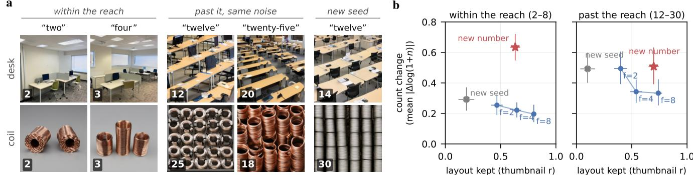

# Same Layout, Different Count: What Number Words Do Past Ten in Text-to-Image Models

Liang Yue University of Colorado Boulder Boulder, Colorado, USA liyu2195@colorado.edu

Eric A. Vance University of Colorado Boulder Boulder, Colorado, USA Eric.Vance@colorado.edu

a  
b  
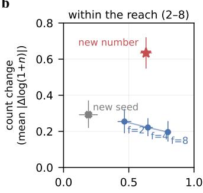

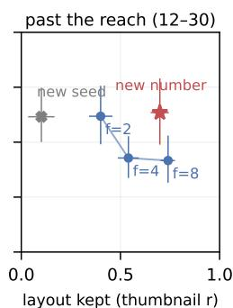  
Figure 1. Same layout, different count (SD3.5-M). (a) From one starting noise per row (people’s counts): within the reach, asking for four instead of two adds objects to the same layout; past it, asking for twenty-five instead of twelve keeps the composition of the picture and changes the count, up for the desks and down for the coils; a new seed redraws the picture. Two of the 16 people-counted types, chosen to show both directions. (b) Over 64 object types, how far the count moves against how much of the layout is kept (Tab. 1), for a new number from the same noise, a new seed, and a redraw of only the noise finer than f cycles per image. Within the reach (requests 2–8) a new number moves the count far more than any redraw; past it (12–30), a redraw above eight cycles keeps the layout as well as a new number does and moves the count two-thirds as far (0.69 times as far by people’s counts of 16 types). Counts by SAM 3, 95% intervals over types.

## Abstract

Ask SD3.5-Medium for twelve of an object and then, from the same starting noise, for twenty-five. The picture keeps its layout, but the count changes about as much as it would under a new random seed, and in no consistent direction. We study what number words do once a request passes about ten objects, in five open text-to-image models. Holding the object and the starting noise fixed, we change one thing at a time, and people who never see the request count 3,088 of the images. Every model follows the number for small crowds, but only up to a point, its reach: SD3.5- M and FLUX.1-dev stop following it soon after ten, while FLUX.2 [klein] and Qwen-Image follow it loosely up to twenty-five. Beyond SD3.5-M’s reach, the coarse part of the starting noise fixes the composition of the picture but

not how many objects it holds: redrawing only the noise finer than an eighth ofthe image keeps the layout as well as a new number does, and already moves the count two-thirds asfar. The number word still reaches the denoiser and acts in its first steps, but nothing we tried gives it a clear direction. Shown instead as a noised grid in the starting latent, the count is drawn: people find it in 59% of images, against 4% when it is only told. Past ten, an exact-match score barely separates a model that follows the number loosely from one that ignores it, and a relative-error score can even prefer a constant guess of sixteen. A same-noise test with a few requests per object tells them apart.

## 1. Introduction

Ask a text-to-image model for twenty cream pitchers and you will rarely get twenty. Counting is one of the most persistent failures of these models [18, 24, 55], and it worsens with the number: past ten objects, open and closed models are rarely exact [18, 45, 56]. That much is known. What is not known is whether the number word still does anything there. A model that follows the number loosely and a model that ignores it are both rarely exact, so an exact-match rate cannot tell them apart (Fig. 2). Recent work points to the starting noise, which fixes much of a picture’s layout early in sampling [17, 68]. Zhao et al. [68] find that in a model fine-tuned on synthetic counts, a fixed noise tends to give the same count whatever the prompt asks. If the noise sets the count, what is left for the number word?

We answer with same-noise interventions. Sampling is deterministic, so an object and a starting noise define a picture, and we can change one thing at a time: the number, the seed, the spelling of the number, an unrelated word, or only the fine-scale part of the noise. The test is simple. If the number still steers the crowd, the larger request should give more objects from the same noise, and a new number should move the count further than changes that do not touch it. We run it in five open models, from SDXL [50] to FLUX.2 [klein] [7] and Qwen-Image [60], count every image with three detectors, and have 3,088 of the images counted by people who never see the request.

The answer turns on a split between layout and count (Fig. 1). Past the range of requests that SD3.5-M follows, a new number from the same noise keeps the picture’s layout, much as Zhao et al. observed, but not its count: the count changes about as much as under a new random seed, and in no consistent direction. Redrawing only the noise finer than an eighth of the image keeps the layout just as well and already moves a large crowd’s count two-thirds as far. Past the reach, the coarse part of the starting noise fixes the composition of the picture, but not how many objects it holds. Four findings build this picture.

Each model follows the number only so far (Sec. 4). Every model follows small numbers: from two to eight objects, a larger request gives more objects in 80–99% of the same-noise pairs whose counts differ. Past ten the models part ways. SD3.5-M and FLUX.1-dev stop following the number soon after ten, while FLUX.2 [klein] and Qwen-Image follow it up to twenty-five about as loosely as a noisy estimator would. We call the range a model follows its reach.

Past the reach, the count changes beneath a kept layout (Sec. 5). In SD3.5-M, fine-scale noise moves crowds of every size. Within the reach, a new number moves the count further than a redraw of the fine noise, and toward the request. Past it, the redraw moves the count two-thirds as far as the number, by detectors and by people alike, and the

number has no direction.

The number arrives, without a direction (Sec. 6). The large number can be read off SD3.5-M’s conditioning in order, and in all three models we timed, number words act in the first denoising steps. Nothing we tried gives the large number a clear direction, from amplifying it to fine-tuning on counted crowds.

A large count can be shown instead (Sec. 7). Started from a noised grid of its own object, SD3.5-M draws the requested count in 59% of images by people’s counts, against 4% from the prompt. A planted count survives a conflicting number word, while a different object word repaints the grid. A layout written into the noise can carry the count, as Zhao et al.’s count-aware noise prior does; the random noise’s own layout does not.

These results also bear on measurement: past ten, exactmatch and relative-error scores barely tell following from ignoring, and a same-noise order can.

Contributions. (1) A same-noise protocol, with a finescale redraw of the noise and a reference read through people’s own counting noise, and people’s counts of 3,088 generated images, which we will release. (2) The reach of five open models. (3) The finding that past SD3.5-M’s reach the layout and the count come apart: a large crowd’s count changes with noise finer than the layout, the number word changes it about as much as a new seed and without a direction, and a count supplied as a layout is drawn far more often. Unlike Zhao et al. [68], who fine-tune a model on synthetic counts, we test off-the-shelf models, separate the noise’s layout from its fine detail, and compare the number with controls that leave its value alone.

## 2. Related Work

Counting past ten. Counting is a standard category of compositional benchmarks [14, 22, 25], and dedicated benchmarks show scores falling with the number for open, closed and recent large models [18, 24, 56]. Prompt refinement does not help [18], and a benchmark that grades counts by relative error finds grid layouts best [56]. Generated counts up to ten behave like estimates whose errors grow with the number [55], and numeral features in FLUX.1 [schnell] order more against fewer objects without sharp values [41]. We add a test that tells following from ignoring.

The noise and the layout. The starting noise fixes much of the layout early in sampling [3, 11, 40, 58], its low frequencies carry coarse structure [13, 61], and a seed tends to keep where objects go and how large they are across prompts for the same object [63]. Zhao et al. [68] find that in FLUX.1-dev fine-tuned on synthetic counts a fixed noise tends to give the same count whatever the prompt asks, that a diffusion classifier built from the model separates counts only coarsely, and that fine-tuning on counted images helps mainly below ten; their count-aware noise prior raises exact counts from 20% to 85% on a synthetic set of up to fifty objects. Gu et al. [17] adjust the noise and the early crossattention at test time. We hold the noise fixed in off-theshelf models and measure what the word does on top of it, with a new seed, a respelling, an unrelated edit and a finescale redraw as controls, since swapping one word under a fixed noise can reshuffle a picture [20]. Our results qualify theirs for these models: the fixed noise keeps the layout, but past the reach it does not keep the count.

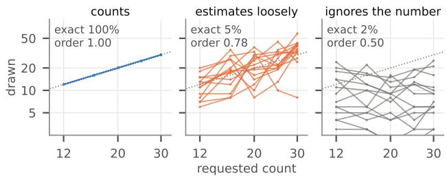  
Figure 2. Why exact rates are not enough (simulated; one line per starting noise, asked for 12–30 objects). A model that counts is always exact. One that estimates the request loosely (log-normal scatter of 0.4) and one that ignores it are both rarely exact, but only the first orders its crowds (Eq. (1)).

When the word acts. Text conditioning acts mostly early in sampling [2, 36, 48, 65], where coarse decisions are made [5, 31, 51], and the number of instances is largely fixed early [29]. Steering early along the difference from a prompt without the count improves counts up to ten [52], and attention steering [8] and counting guidance [26] use signals of whether a count is right. Prompt switching at chosen steps traces when a concept forms [16]; we time the number word against a respelling. Text encoders represent numbers in order [57], though CLIP counts poorly [47].

Supplying the count. Past ten, the methods that help hand the model a layout: planned boxes [33, 34, 62], corrected layouts [4, 45], composite or noise starts [17, 27, 42, 68] or dense-layout training [46]. Count tokens can be optimized [54, 66, 67] and models fine-tuned on verified counts or rewards [23, 32, 37, 69].

## 3. Same-Noise Tests

Every comparison within a model keeps the object and the starting noise and changes exactly one thing.

Models and prompts. We test SD3.5-M [12, 53] (a rectified-flow transformer [35, 39] with CLIP and T5 encoders, at 7682), SDXL [50] (CLIP only, 10242), FLUX.1-dev [6] (T5 and a pooled CLIP vector, 7682), FLUX.2 [klein] base 4B [7] (the language model Qwen3- 4B [64] as encoder, 10242) and Qwen-Image [60] (20B, with the vision-language model Qwen2.5-VL-7B [1] as encoder, 10242, transformer in 4-bit), each with its own sampler and guidance [21] at 28 to 50 steps (supp. Sec. A.1). The prompt is “a photo of c Xs” with the number c in words, and X is one of 64 everyday object types drawn from the LVIS names [19] without looking at any image. A type and a seed fix the starting noise, so the images of all requests for a type share it. People counted requests from 2 to 30; SD3.5-M’s tests on 64 types ask for 2, 3, 4, 6 and 8 and for nine requests from 12 to 30.

<table><tr><td>measure</td><td>what it is, and how it reads</td></tr><tr><td>order</td><td>share of differing same-noise pairs in which the larger request gives more objects: 1 always, .5 no direction; a loose estimator .72–.80 at 12–25</td></tr><tr><td>change</td><td>mean |∆ log(1+n)| between two images from the same noise; a picture counted twice by people: .12</td></tr><tr><td>layout kept</td><td>correlation of 24×24 thumbnails; past SD3.5-M&#x27;s reach, a new seed .10, a new number .70</td></tr><tr><td>effective</td><td>the loose estimator&#x27;s s that orders a range as the model does; the reach: at most 0.45</td></tr></table>

Table 1. The measures at a glance.

Counting. People on CloudResearch Connect counted 3,088 generated images in eight studies, clicking on each object without seeing the request or the model (supp. Sec. B). Two people count each image in separate rounds, and a third decides where they differ. Composites of known count, mixed into the tasks, were counted exactly in 83–100% of cases. Generated crowds are harder: the first two counts agree on 50–82% of pictures. Yet two final counts of the same crowd of 12 to 30, made in different studies, differ by a mean |∆ log(1+n)| of only 0.12 (SD3.5-M, 48 pictures; supp. Sec. B.4), so changes much larger than that are changes in the crowd, not in the counting. The annotators were paid crowdworkers (\$0.10 per image, about \$12–38 per hour) who counted objects in generated images. The tasks recorded counts of objects, not information about the workers, so we treated them as annotation rather than research on human subjects and did not submit them for IRB review; for the same reason, no consent was sought beyond each worker’s acceptance of the task on the platform. Every image is also counted by SAM 3 [9], Grounding DINO [38] and OWLv2 [44]. Detectors miss many objects in dense crowds, so we compare models by people’s counts and run the tests within a model on SAM 3, checked against the other two detectors and against people. Unless we say otherwise, a test within SD3.5-M is counted by SAM 3 on all 64 types. Brackets give 95% bootstrap intervals over object types.

Does the crowd follow the request? Let $n _ { j s } ( c )$ be the count drawn from the noise of type j and seed s when the prompt asks for c. Over pairs of requests $c < c ^ { \prime }$ in a range,

$$
\mathrm { o r d e r } = \mathrm { P r } \left[ n _ { j s } ( c ^ { \prime } ) > n _ { j s } ( c ) \ | \ n _ { j s } ( c ^ { \prime } ) \neq n _ { j s } ( c ) \right] ,\tag{1}
$$

the share of same-noise pairs whose counts differ in which the larger request gives more objects $( ( 1 + \gamma ) / 2$ for Goodman and Kruskal’s γ [15]). Because both images share the noise, the order ignores whatever the noise does to every request alike, such as a type that is always drawn large. Figure 2 shows why it is needed: a loose estimator and a model that ignores the number are both rarely exact, and the order tells them apart.

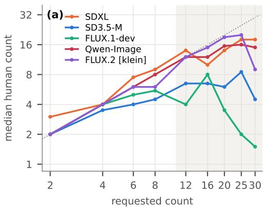

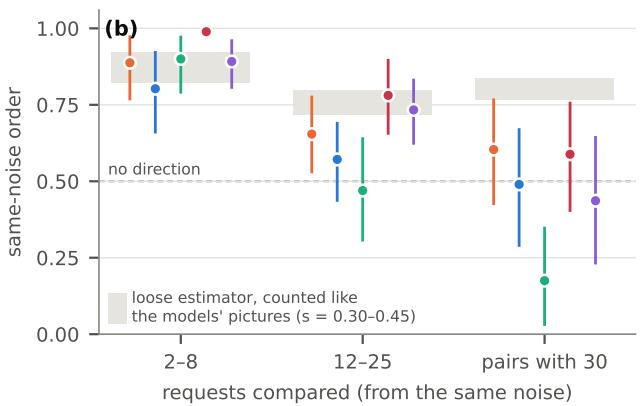  
Figure 3. How far each model follows the number (people’s counts; the same 16 object types for every model, and within a model the same starting noise for every request). (a) Median count by request; dotted: count = request; shaded: past ten. (b) Same-noise order (Eq. (1)) for requests of 2–8, for 12–25, and for the pairs that include thirty, with 95% intervals over types; grey: a loose estimator read through people’s counting noise (s = 0.30–0.45); dashed: no direction.

A loose estimator as reference. How well should a model that follows the number only loosely order its crowds? We simulate a loose estimator, whose count is the request times a log-normal factor with a log standard deviation s of 0.30 to 0.45. It is exact in only 5–7% of images at 12–30, as rarely as most of the models (Tab. 2). We read its counts through a model of people’s counting noise, fitted to 5,360 single counts of 2,240 pictures, so that it is judged exactly as the models are. The noise model lets a picture be easy or hard to count, more often hard when the crowd is large, and a single count of a hard picture be off by a few objects or, rarely, zero; it reproduces where a third count falls when the first two differ, and how often recounts agree (supp. Secs. A.5 and B.4). So read, it orders crowds of 12 to 25 at 0.72–0.80. A model’s effective scatter on a range of requests is the s at which the estimator would order that range as well as the model does; once the order falls to one half, it has no finite value. Past ten, a model’s reach covers a range when its effective scatter there is at most 0.45: the model then orders the range at least as well as an estimator that is exact as rarely as the models are.

How far does a change move the crowd? For two images from the same noise that differ in one thing, we take the mean $| \Delta \log ( 1 { + } n )$ | over types. We compare a new number with four changes that leave the number’s value alone: a new seed, the same number in digits (“12” for “twelve”), an unrelated edit (“a photograph of” for “a photo of”), and afine-scale redraw, which keeps the coarse part of the starting noise and takes only its fine part from the type’s second seed. With $F _ { 1 }$ and $F _ { 2 }$ the 2D Fourier transforms of the two noises over the spatial axes and r the spatial frequency in cycles per image,

<table><tr><td rowspan="2">model (text encoder)</td><td colspan="3">same-noise order</td><td rowspan="2">effective</td><td rowspan="2">exact 12-30</td></tr><tr><td>2-8</td><td>12-25</td><td>with 30</td></tr><tr><td>FLUX.1-dev (T5, CLIP)</td><td>.90</td><td>.47 [.30, .64]</td><td>.17</td><td>&gt;3 [0.74, &gt;3]</td><td>0%</td></tr><tr><td>SD3.5-M (CLIP, T5)</td><td>.80</td><td>.57 [.43, .69]</td><td>.49</td><td>1.55 [0.53, &gt;3]</td><td>4%</td></tr><tr><td>SDXL (CLIP)</td><td>.89</td><td>.65 [.53, .78]</td><td>.60</td><td>0.69 [0.32, &gt;3]</td><td>3%</td></tr><tr><td>FLUX.2 [klein] (Qwen3)</td><td>.89</td><td>.73 [.62, .84]</td><td>.44</td><td>0.42 [0.24, 0.89]</td><td>13%</td></tr><tr><td>Qwen-Image (Qwen2.5-VL)</td><td>.99</td><td>.78 [.65, .90]</td><td>.59</td><td>0.33 [0.17,0.68]</td><td>21%</td></tr><tr><td>SDXL, screened types</td><td>.91</td><td>.78 [.68, .87]</td><td>.75</td><td>0.32 [0.18,0.58]</td><td>4%</td></tr><tr><td>loose estimator, s = .45 / .30 .85 / .92</td><td></td><td>.72 / .80</td><td></td><td>.45 / .30</td><td>5-7%</td></tr></table>

Table 2. Within and past ten (people’s counts of 16 types, one seed; “with $3 0 ^ { \circ } \colon$ the four pairs that include thirty). aThe loose estimator’s scatter at which it would order crowds of 12–25 as the model does, with a 95% interval; the reach covers 12–25 when it is at most 0.45 (Sec. 3).

$$
z _ { f } = \mathcal { F } ^ { - 1 } \big [ \mathbf { 1 } [ r \leq f ] F _ { 1 } + \mathbf { 1 } [ r > f ] F _ { 2 } \big ]\tag{2}
$$

is again white Gaussian noise, equal to the first seed’s noise in all structure coarser than about $1 / f$ of the image (supp. Sec. D.8). Above eight cycles, the redraw replaces 98% of the variance of SD3.5-M’s starting noise, yet keeps its coarse structure. How much of the layout a change keeps is the correlation of 24×24 grayscale thumbnails of the two images: it measures where the large light and dark regions fall, the picture’s coarse composition. The order of the number change says whether it moves the crowd toward the request.

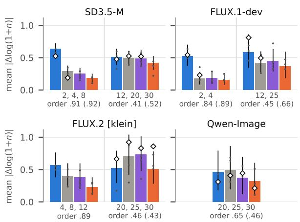  
new number new seed digits “photograph” other counters people

## 4. Each Model Follows the Number Only So Far

Every model follows small numbers. From two to eight objects, the larger request gives more objects in 80–99% of the same-noise pairs whose counts differ (Tab. 2), and the median crowd grows with the request (Fig. 3a).

Past ten, two groups. From twelve to twenty-five (Fig. 3b), SD3.5-M and FLUX.1-dev stop following the number and order their crowds worse than either reference estimator would (0.57 and 0.47). SD3.5-M’s median crowd stays between 4.5 and 8.5 objects whatever the request, and FLUX.1-dev’s even shrinks, to one or two objects at thirty. FLUX.2 [klein] and Qwen-Image keep following the number up to twenty-five about as loosely as the reference does (0.73 and 0.78), and their crowds grow to 16–20 objects. Paired on the same types, each of these two orders its crowds better than SD3.5-M and FLUX.1-dev do (supp. Sec. C.9). SDXL lies in between on our unscreened objects (0.65), but on types screened for isolated objects its crowd keeps growing up to thirty as a loose estimator’s would. How far a number reaches depends on the objects as well as on the model.

The trouble with thirty. The pairs that include thirty are ordered clearly worse than those up to twenty-five in FLUX.1-dev, FLUX.2 [klein] and Qwen-Image, and in five of the seven tests that asked for both, the median crowd at thirty is smaller than at twenty-five (supp. Sec. C.9). We can place the end of FLUX.2 [klein]’s and Qwen-Image’s reach only somewhere past twenty-five.

What the usual scores miss. Past ten, the usual scores cannot say whether a model follows the number. Exact rates of 0–21% (Tab. 2) rank the two groups, but a model that misses may still follow the number loosely. SD3.5- M, which does not follow it past ten, is exact in 4% of images, about as often as a loose estimator that does (5–7%); their orders, 0.57 against 0.72–0.80, tell them apart. From twenty to thirty, a loose estimator draws the requested count only 1–3 percentage points more often than a neighbouring count, and on 16 types a lift that small cannot be told from that of a model that ignores the number. A graded score is no better: a model that always draws sixteen objects has a mean relative error past ten of 0.27, lower than the looser of our two reference estimators (0.38) and close to the tighter one (0.25). Detectors add a bias of their own, since they undercount dense crowds and can reverse a model’s direction: Grounding DINO reads fewer objects in FLUX.2 [klein]’s images when twenty-five are asked for than when twelve are, while people find the crowd growing (supp. Secs. A.5, B.4, C.1, D.8 and E.4). Past ten, a model can miss nearly every count and still follow the number; its order against a reference counted the same way shows whether it does.

Figure 4. Four changes from the same noise, within each model’s reach and past it (for FLUX.2 [klein] and Qwen-Image, at its edge, 20–30): mean change of log(1+n) when the number changes, when the seed changes, when the same number is written in digits, and when “a photo of” becomes “a photograph of” (bars: SAM 3 on 64, 32, 32 and 16 types, 95% intervals; dots: Grounding DINO, OWLv2 and their consensus; diamonds: people, 16 types). Below each group: the number change’s order by SAM 3 (by people).
<table><tr><td></td><td></td><td>layout SAM 3, 64 types</td><td></td><td>people, 16 types</td><td></td></tr><tr><td>change from the same noise</td><td>kept</td><td>2,4,812,20,30</td><td></td><td>4,8</td><td>12,20,30</td></tr><tr><td>a new number</td><td>.70</td><td>.63</td><td>.51</td><td>.37</td><td>.43</td></tr><tr><td>a new seed</td><td>.10</td><td>.29</td><td>.49</td><td>.25</td><td>.53</td></tr><tr><td>the number in digits</td><td>.76</td><td>.25</td><td>.48</td><td></td><td>.52</td></tr><tr><td>&quot;photograph” for “photo&quot;</td><td></td><td>.18</td><td>.42</td><td></td><td></td></tr><tr><td>redraw above 2 cycles</td><td>.40</td><td>.25</td><td>.49</td><td></td><td></td></tr><tr><td>redraw above 4 cycles</td><td>.54</td><td>.22</td><td>.34</td><td>.29</td><td>.32</td></tr><tr><td>redraw above 8 cycles</td><td>.74</td><td>.20</td><td>.33</td><td>.19</td><td>.30</td></tr><tr><td>redraw above 16 cycles, 16 typesa</td><td>.86</td><td>.25</td><td>.42</td><td></td><td></td></tr><tr><td>the same picture, counted again</td><td></td><td></td><td></td><td>.12</td><td>.12</td></tr></table>

Table 3. How far each change moves SD3.5-M’s count, within the reach and past it (mean change of log(1+n) over object types), and how much of the layout it keeps past the reach (correlation of 24×24 thumbnails with the original image). A new number: pairs of requests on seed 1; its order is 0.91 within the reach and 0.41 past it (SAM 3). Last row: the same picture counted by people in two different studies. aSAM 3, 16 people-counted types; past the reach a new number moves the count by .59, a new seed by .69. Intervals and sources: supp. Secs. B.4, D.2, D.4, D.5 and D.8.

## 5. The Count Changes Beneath a Kept Layout

If the starting noise fixed a large crowd’s count, a new number from the same noise would leave the count where it was. In SD3.5-M it does not, but it does not steer the count either. The layout stays. A new number keeps most of the picture (Fig. 1a, Tab. 3). Past the reach, maps of the objects’ boxes correlate at 0.58 between two images from the same noise under a new number, against 0.32 under a new seed (supp. Sec. D.4). The noise decides where things go, as

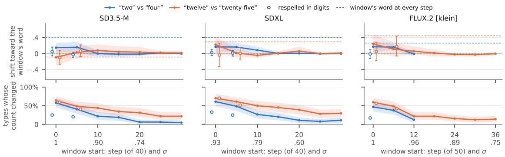  
Figure 5. When the number word acts, in three models (64 types, SAM 3). From the noise of the base request’s image, the prompt asks for the other count of the pair during one window of steps (five of 40; six of 50 in FLUX.2 [klein]); half of the types go up, half down. Top: shift of the count toward the window’s word (95% intervals); open circles: the base number respelled in digits. Bottom: share of types whose count changed. Dashed: the window’s word at every step. Ticks give each window’s first step and noise level σ. Other counters, people’s counts and longer windows: supp. Secs. E.3 and E.4.

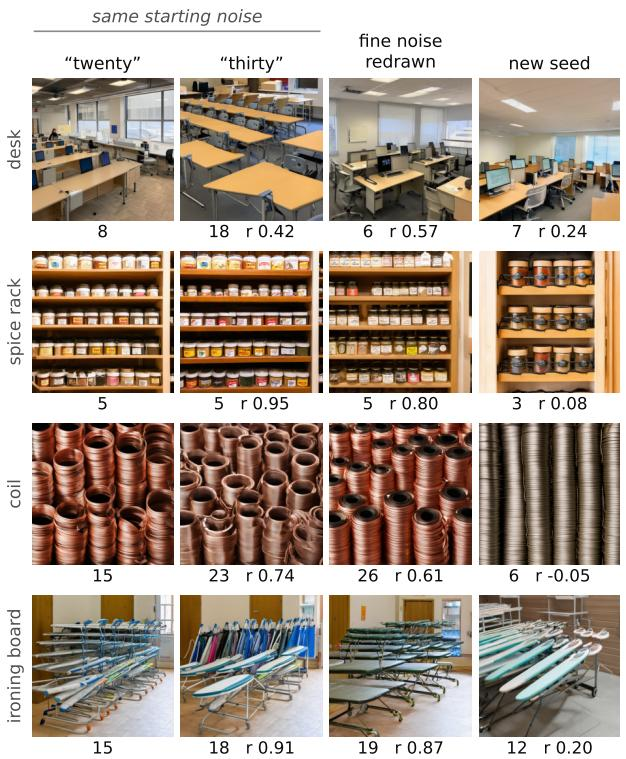  
Figure 6. Fine-scale redraws next to a new number and a new seed (SD3.5-M; four of the 16 people-counted types, drawn at random). From the noise of the image asked for twenty: thirty asked from the same noise; the noise above eight cycles per image redrawn from the type’s second seed, still asked for twenty; twenty from the second seed. People’s counts, and r, the correlation of 24×24 thumbnails with the first image. In these four, thirty gives as many objects as twenty or more; across all types, the larger request gives more objects in only about half of the pairs (Sec. 5).

Zhao et al. found [68].

The count moves as under a new seed. Past the reach, a new number moves SD3.5-M’s count about as far as a new seed or the same number written in digits, and only 1.2– 1.5 times as far as an unrelated edit (Tab. 3 and Fig. 4). It does not push the count toward the request: over all nine requests past ten and both seeds, the larger request gives more objects in only half of the pairs whose counts differ, and the number moves the crowd 0.89 times as far as a seed. People’s counts of 16 types agree. A loose estimator counted the same way would move its crowd 1.4–1.7 times as far as a seed and order it at 0.80–0.88; the model’s order is below 0.54 with 95% confidence, one-sided (supp. Secs. B.4, C.9 and D). Within the reach, by contrast, a new number moves the count further than a new seed, and toward the request. Past it, the number moves the crowd but no longer steers it.

A seed that keeps the layout. The count of a large crowd depends on details finer than the layout. A new seed redraws the whole picture, so it is a generous yardstick; a stricter one keeps the coarse noise and redraws only the noise finer than f cycles per image (Eq. (2)). Redrawn above eight cycles, the picture keeps its layout as well as under a new number (Tab. 3 and Fig. 6). Yet past the reach its count moves twothirds as far as under a new number. By people’s counts of 16 types the ratio is 0.69 [0.38, 1.20], and the change is two and a half times the difference between two countings of the same picture. Even redrawn above sixteen cycles, where the thumbnails correlate at 0.86, a large crowd’s count moves 0.71 times as far as under a new number (16 types; supp. Sec. D.8).

What changes at the reach is the number. It is not that noise starts to matter: fine-scale noise moves small crowds too, two-thirds to nine-tenths as far as a new seed does. Within the reach, a new number moves the count 2.5 to 3.2 times as far as a redraw above two to eight cycles, and toward the request. Past it, only 1.0 to 1.5 times as far, and in no direction. The number loses its direction and most of its margin over noise.

Other models. The redraws behave the same way in the two models that follow the number furthest. By people’s counts of 16 types (SAM 3 reads many of FLUX.2 [klein]’s crowds as empty), a redraw above four or eight cycles moves FLUX.2 [klein]’s count about half as far as a new number within its reach and about four-fifths as far at its edge. In Qwen-Image, by SAM 3, the redraw moves the count less than half as far as a new number at four and twelve, and four-fifths as far at twenty and thirty (supp. Sec. D.8). In both models, the number’s margin over fine-scale noise shrinks toward the edge of the reach. In FLUX.1-dev, past its reach, a new number moves the crowd further than a new seed, without a reliable direction (supp. Sec. D.7).

## 6. The Number Arrives, Without a Direction

Past the reach, is the large number lost before the denoiser, too weak, too late, or simply without a direction? We follow it through SD3.5-M, timing it also in SDXL and FLUX.2 [klein].

It is encoded. From SD3.5-M’s pooled CLIP vector, a ridge regression trained on the other number words puts a held-out large number in the right order in 0.89 of same-object pairs, nearly as often as a small one (0.98; supp. Sec. E.1).

It acts early, where small numbers act. Swapping the other request of a pair into the prompt for a window of five or six steps shows when a number word acts (Fig. 5). In all three models we timed, small number words move the count toward themselves only in the first windows, while the same number respelled in digits changes fewer counts and in no direction. The large word acts in the first window too, but without a clear direction in SD3.5-M: it changes 64% of the counts there, about as many as its respelling does, and only 46% of those changes go its way. Later windows and people’s counts of the swaps are in supp. Secs. E.3 and E.4. Nothing we tried gives it a clear direction. We pushed on the word, the text streams, the weights and the prompt, all in SD3.5-M (Tab. 4). Amplifying the difference between the two requests’ velocities in the first ten steps [52, 59] keeps small pairs ordered and leaves large pairs unordered. Adding the velocity difference between “four” and “two” to a request for twelve shrinks the crowd instead of growing it. Given different numbers in its CLIP and T5 streams, SD3.5-M follows either stream’s small number and neither stream’s large one, and checkpoints rewarded on small counts do not order large crowds either. A LoRA trained on 1,653 of SD3.5-M’s own counted crowds of 12 to 30 learns counts up to about twelve, its most common training count. Past that, it orders crowds somewhat better than

<table><tr><td>SD3.5-M, same noise (SAM 3 order)</td><td>2-8</td><td>12-30</td></tr><tr><td>plain prompt (two seeds)</td><td>.86</td><td>.50 [.45, .55]</td></tr><tr><td>word amplified, L=10</td><td>.88</td><td>.41 [.28, .54] (.15)</td></tr><tr><td>number in CLIP only / in T5 only</td><td>.85 / .85</td><td>.47 / .55</td></tr><tr><td>reward-tuned: Flow-GRPO / DiffusionNFTa</td><td>.95 / .92</td><td>.38 / .32</td></tr><tr><td>count LoRA / shuffled-count LoRA</td><td>.92 / .91</td><td>.58 / .44</td></tr><tr><td>count LoRA, people&#x27;s counts</td><td>.98</td><td>.43 [.26, .61]</td></tr><tr><td>“tiny&quot;</td><td>.85</td><td>.65 [.57, .72] (.46)</td></tr><tr><td>add eu(four) e,(twua) I −8</td><td></td><td></td></tr></table>

Table 4. What we tried, to make SD3.5-M follow a large number. Same-noise order at 2–8 and at 12–30 (in parentheses: by Grounding DINO); for the amplified word and the streams, two against four and twelve against twenty-five. Baselines: the amplified word’s own unsteered pairs order .94 and .52; for the Lo-RAs and the cue, seed 1’s plain prompt orders .89 and .46. By people’s counts the count LoRA orders large crowds no better than the shuffled one (+0.08 [−0.12, 0.27]; by SAM 3 +0.14 [0.01, 0.27]). a5122, screened types, base model .88 and .49. Details: supp. Secs. C.4, C.7, E.6 to E.8 and E.10.

the same LoRA trained on shuffled counts by SAM 3, but not by people’s counts. The shuffled LoRA draws 33 to 36 objects at every request from twelve to twenty-five by people’s counts, so the model can draw large crowds; what it lacks is a mapping from a large number to one. The one cue that moves the order partway is the word “tiny”, under SAM 3 and OWLv2 but not under Grounding DINO. The large number reaches the denoiser in time, but nothing we tried ties it to a change of count.

## 7. A Large Count Can Be Shown Instead

If the number word has no direction past the reach, can the model draw a large crowd at all? We give it the count in another form: as a layout in the starting latent.

Saying against showing, from the same noise. In SD3.5- M, from the noise of each type’s image, we either say the count (as a word, in digits, or in a sentence naming the rows and columns of a grid, “twelve Xs arranged in three rows of four”) or show it. To show it, we start from a grid of the requested count, noised to σ=0.909, and let the unchanged model run its last 31 of 40 steps with the plain prompt (supp. Sec. F.2). Every way of saying the count is exact in at most 6.9% of images (SAM 3, on the 58 types with a cut-out). Even a grid of plain ellipses in the object’s mean colour is exact in 24%. A grid of the object itself, cut out of the model’s own image of two to four objects, is exact in 52%, and a grid of another object lies in between (Fig. 7a): the more the grid looks like the object, the more it helps.

By people’s counts. People find the asked count in 4% of SD3.5-M’s images from the prompt and in 59% from a grid of its own object (Fig. 7b). Layout models given the grid as boxes, GLIGEN [33] and InstanceAssemble [62], reach 46% and 68%.

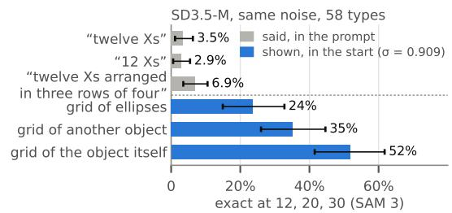

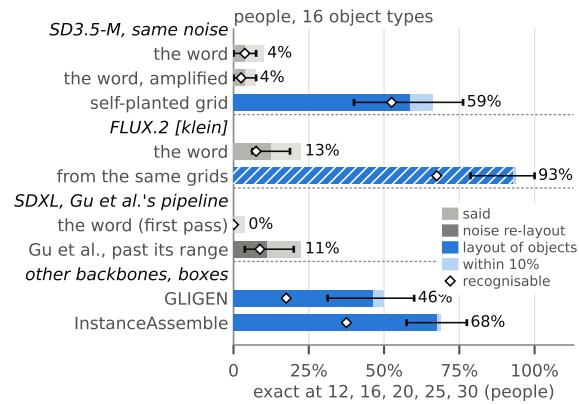  
Figure 7. Saying against showing. (a) SD3.5-M, same noise, 58 types, exact at 12, 20 and 30 by SAM 3: three ways of saying the count, and three contents of a noised grid in the starting latent (σ=0.909), which the sentence describes. (b) People’s counts, 16 types, at 12, 16, 20, 25 and 30: exact (bars, 95% intervals), within 10% (light) and exact with a recognisable object (diamonds), for prompts, SDXL with Gu et al.’s noise re-layout, the self-planted start, FLUX.2 [klein] from the same grids (hatched: its render keeps much of the supplied composite), and two layout models given the grid as boxes.

A planted count holds against the number word, not the object word. Started from a noised grid of N objects and asked for a different count M, SD3.5-M, SDXL and FLUX.1-dev draw M in only 0.7–3.5% of images and keep N in 50–64% net of chance (screened types; supp. Sec. F.3). In SD3.5-M these starts come at the end of the steps in which number words act, so the planted count survives the rest of sampling rather than beating the word head on; started earlier, from a crowd between the two requests, a large word still barely pulls the count (supp. Sec. E.9). Asked instead for twenty of another object of similar shape, SD3.5-M repaints most of the planted grid as the named object in 75% of images (screened types). The layout carries the count; the word decides what is drawn.

Relation to count-aware noise. The planted start is SDEdit [42] from a tiled composite of the model’s own object [27], close to the count-aware noise prior of Zhao et al. [68], who showed that such a prior raises exact counts. We use it as a probe of where a large count can enter the model, not as a method: it costs image quality (PickScore [28] 0.57–0.85 lower) and is no more accurate than InstanceAssemble (supp. Secs. F.1, F.4 and F.5). Together with the redraws of Sec. 5, it shows where a large count can come from: a grid written into the noise carries it, while the random noise’s own layout does not.

<table><tr><td></td><td>1. For a few dozen object types, draw four or five widely spaced</td></tr><tr><td></td><td>requests past ten from one seed per type. 2. Count the images with people, or with a counter checked against</td></tr><tr><td></td><td>people. 3. Report the same-noise order next to a loose estimator read through</td></tr><tr><td>4.</td><td>the same counting noise. From the same noise, add a new seed and an unrelated edit: a number that steers moves the crowd further than they do, and toward the request.</td></tr></table>

Table 5. A same-noise test for counting past ten.

## 8. Discussion

Layout and count. In SD3.5-M the layout of a picture is set early, by the coarse part of the noise, while the count of a large crowd depends on finer details. The number word acts while the layout forms, and within the reach it points the count toward the request. Past the reach it still arrives in time, but we found nothing that ties its value to a count, and the count is left to the finer details of the noise.

For benchmarks. Past ten, we suggest a same-noise test instead of an exact rate (Tab. 5). It needs no access to a model’s internals, only to its starting noise. We will release the code, the images, people’s counts and their answers.

For control. Past the reach, digits, a sentence naming the grid, the native resolution, other guidance scales and the best of four samples are each exact in at most 6.2% of SD3.5-M’s images (64 types), and steering the word and small-count rewards do not order its large crowds (supp. Secs. C.3, C.4 and E.6), while a layout in the latent or as boxes draws the count far more often. For these models, a large count is better given as a layout than as a word, at some cost in image quality.

## Limitations

Scope. Five open models, single-object prompts asking for up to thirty objects (up to forty in two side tests), and one prompt template. Qwen-Image ran with a 4-bit transformer at 10242, below its model card’s 13282, and SD3.5-M and FLUX.1-dev at 7682, below their native size; closed models were not tested, though benchmarks find them failing past ten as well [18, 56]. Evidence. The equivalence of a new number and a new seed is clean in SD3.5-M; in FLUX.1- dev the number moves the crowd further than a seed, and in FLUX.2 [klein] and Qwen-Image we could test it only at the edge of their reach, where it separates little. People counted the redraws of 16 types; on these types the number’s margin over the redraws within the reach is smaller than on all 64, and some of FLUX.2 [klein]’s large crowds are ambiguous to people. The analysis inside the model is in SD3.5-M (timing also in SDXL and FLUX.2 [klein]). People counted 16 types per model and agree only moderately on dense crowds, so most rankings between models remain unresolved, and requests stop at thirty, before the two longest reaches end. The count LoRA is only one training recipe.

## LLM Usage Statement

We used Claude (Anthropic), an LLM-based assistant, as a coding and writing assistant. It helped write and run code for image generation, counting, analysis and figures; helped plan and run experiments, including the crowdsourced counting studies; helped search related work and check numbers and references; and helped draft and revise the text. The images we analyse are outputs of the models under study, and every count attributed to people comes from human annotators. The authors directed the work, made all research decisions and take full responsibility for the paper.

## References

[1] Shuai Bai et al. Qwen2.5-VL technical report. arXiv preprint arXiv:2502.13923, 2025. 3, 21

[2] Yogesh Balaji, Seungjun Nah, Xun Huang, Arash Vahdat, Jiaming Song, Qinsheng Zhang, Karsten Kreis, Miika Aittala, et al. eDiff-I: Text-to-image diffusion models with an ensemble of expert denoisers. arXiv preprint arXiv:2211.01324, 2022. 3

[3] Yuanhao Ban, Ruochen Wang, Tianyi Zhou, Boqing Gong, Cho-Jui Hsieh, and Minhao Cheng. The Crystal Ball hypothesis in diffusion models: Anticipating object positions from initial noise. In International Conference on Learning Representations (ICLR), 2025. 2

[4] Lital Binyamin, Yoad Tewel, Hilit Segev, Eran Hirsch, Royi Rassin, and Gal Chechik. Make It Count: Text-to-image generation with an accurate number of objects. In Proceedings of the IEEE/CVF Conference on Computer Vision and Pattern Recognition (CVPR), pages 13242–13251, 2025. 3

[5] Giulio Biroli, Tony Bonnaire, Valentin de Bortoli, and Marc Mezard. Dynamical regimes of diffusion models. ´ Nature Communications, 15:9957, 2024. 3

[6] Black Forest Labs. FLUX.1 [dev]. https : / / huggingface.co/black- forest- labs/FLUX. 1-dev, 2024. 3

[7] Black Forest Labs. FLUX.2 [klein]. https : / / huggingface.co/black- forest- labs/FLUX. 2-klein-base-4B, 2026. 2, 3, 20

[8] Hyemin Boo, Hyoryung Kim, Myungjin Lee, Seunghyeon Lee, Jiyoung Lee, Jang-Hwan Choi, and Hyunsoo Cho. CountSteer: Steering attention for object counting in diffusion models. arXiv preprint arXiv:2511.11253, 2025. 3

[9] Nicolas Carion, Laura Gustafson, Yuan-Ting Hu, Shoubhik Debnath, Ronghang Hu, Didac Suris Coll-Vinent, Chaitanya

Ryali, Kalyan Vasudev Alwala, et al. SAM 3: Segment anything with concepts. In International Conference on Learn ing Representations (ICLR), 2026. 3

[10] Kevin Clark and Priyank Jaini. Text-to-image diffusion models are zero-shot classifiers. In Advances in Neural Informa tion Processing Systems (NeurIPS), 2023. 36

[11] Omer Dahary, Yehonathan Cohen, Or Patashnik, Kfir Aberman, and Daniel Cohen-Or. Be decisive: Noise-induced layouts for multi-subject generation. In Proceedings of the Special Interest Group on Computer Graphics and Interactive Techniques Conference Conference Papers (SIGGRAPH Conference Papers ’25), 2025. 2

[12] Patrick Esser, Sumith Kulal, Andreas Blattmann, Rahim Entezari, Jonas Muller, Harry Saini, Yam Levi, Dominik¨ Lorenz, et al. Scaling rectified flow transformers for high resolution image synthesis. In Proceedings of the 41st International Conference on Machine Learning (ICML), pages 12606–12633, 2024. 3

[13] Martin Nicolas Everaert, Athanasios Fitsios, Marco Bocchio, Sami Arpa, Sabine Susstrunk, and Radhakrishna Achanta.¨ Exploiting the signal-leak bias in diffusion models. In Proceedings of the IEEE/CVF Winter Conference on Applica tions of Computer Vision (WACV), pages 4025–4034, 2024. 2

[14] Dhruba Ghosh, Hannaneh Hajishirzi, and Ludwig Schmidt. GenEval: An object-focused framework for evaluating textto-image alignment. In Advances in Neural Information Pro cessing Systems (NeurIPS), Datasets and Benchmarks Track, pages 52132–52152, 2023. 2

[15] Leo A. Goodman and William H. Kruskal. Measures of as sociation for cross classifications. Journal of the American Statistical Association, 49(268):732–764, 1954. 4

[16] Ada Gorgun, Fawaz Sammani, Nikos Deligiannis, Bernt Schiele, and Jonas Fischer. Temporal concept dynamics in diffusion models via prompt-conditioned interventions. arXiv preprint arXiv:2512.08486, 2025. 3

[17] Xiaoling Gu, Xuelong Li, Shengqi Wu, Yongkang Wong, Zizhao Wu, Huan Li, Zhou Yu, and Mohan Kankanhalli. Mitigating noise-induced layout priors for object counting in diffusion models. In Proceedings of the 43rd International Conference on Machine Learning (ICML), pages 37047– 37072, 2026. 2, 3, 37, 42

[18] Xuyang Guo, Jiayan Huo, Yingyu Liang, Zhenmei Shi, Zhao Song, Jiahao Zhang, and Zhen Zhuang. Text-to-image diffusion models cannot count, and prompt refinement cannot help. arXiv preprint arXiv:2503.06884, 2025. 2, 8

[19] Agrim Gupta, Piotr Dollar, and Ross Girshick. LVIS: A´ dataset for large vocabulary instance segmentation. In Proceedings of the IEEE/CVF Conference on Computer Vision and Pattern Recognition (CVPR), pages 5356–5364, 2019. 3, 43

[20] Amir Hertz, Ron Mokady, Jay Tenenbaum, Kfir Aberman, Yael Pritch, and Daniel Cohen-Or. Prompt-to-prompt image editing with cross-attention control. In International Confer ence on Learning Representations (ICLR), 2023. 3, 38

[21] Jonathan Ho and Tim Salimans. Classifier-free diffusion guidance. arXiv preprint arXiv:2207.12598, 2022. 3

[22] Kaiyi Huang, Chengqi Duan, Kaiyue Sun, Enze Xie, Zhenguo Li, and Xihui Liu. T2I-CompBench++: An enhanced and comprehensive benchmark for compositional text-toimage generation. IEEE Transactions on Pattern Analysis and Machine Intelligence, 47(5):3563–3579, 2025. 2

[23] Yujin Jeong, Arnas Uselis, Iro Laina, Seong Joon Oh, and Anna Rohrbach. When do diffusion models learn to generate multiple objects? In Proceedings of the 43rd International Conference on Machine Learning (ICML), pages 51250–51282, 2026. 3

[24] Ivana Kajic, Olivia Wiles, Isabela Albuquerque, Matthias´ Bauer, Su Wang, Jordi Pont-Tuset, and Aida Nematzadeh. Evaluating numerical reasoning in text-to-image models. In Advances in Neural Information Processing Systems (NeurIPS), Datasets and Benchmarks Track, pages 42211– 42224, 2024. 2

[25] Amita Kamath, Kai-Wei Chang, Ranjay Krishna, Luke Zettlemoyer, Yushi Hu, and Marjan Ghazvininejad. GenEval 2: Addressing benchmark drift in text-to-image evaluation. arXiv preprint arXiv:2512.16853, 2025. 2, 20

[26] Wonjun Kang, Kevin Galim, Hyung Il Koo, and Nam Ik Cho. Counting guidance for high fidelity text-to-image synthesis. In Proceedings of the Winter Conference on Applications of Computer Vision (WACV), pages 899–908, 2025. 3

[27] Zeeshan Khan, Shizhe Chen, and Cordelia Schmid. ComposeAnything: Composite object priors for text-to-image generation. arXiv preprint arXiv:2505.24086, 2025. 3, 8

[28] Yuval Kirstain, Adam Polyak, Uriel Singer, Shahbuland Matiana, Joe Penna, and Omer Levy. Pick-a-Pic: An open dataset of user preferences for text-to-image generation. In Advances in Neural Information Processing Systems (NeurIPS), pages 36652–36663, 2023. 8, 41

[29] Joohyeon Lee, Jin-Seop Lee, and Jee-Hyong Lee. Count-Cluster: Training-free object quantity guidance with crossattention map clustering for text-to-image generation. arXiv preprint arXiv:2508.10710, 2025. 3

[30] Alexander C. Li, Mihir Prabhudesai, Shivam Duggal, Ellis Brown, and Deepak Pathak. Your diffusion model is secretly a zero-shot classifier. In Proceedings of the IEEE/CVF International Conference on Computer Vision (ICCV), 2023. 36

[31] Marvin Li and Sitan Chen. Critical windows: Nonasymptotic theory for feature emergence in diffusion models. In Proceedings of the 41st International Conference on Machine Learning (ICML), pages 27474–27498, 2024. 3

[32] Shuangqi Li, Hieu Le, Jingyi Xu, and Mathieu Salzmann. Enhancing compositional text-to-image generation with reliable random seeds. In International Conference on Learning Representations (ICLR), 2025. 3

[33] Yuheng Li, Haotian Liu, Qingyang Wu, Fangzhou Mu, Jianwei Yang, Jianfeng Gao, Chunyuan Li, and Yong Jae Lee. GLIGEN: Open-set grounded text-to-image generation. In Proceedings of the IEEE/CVF Conference on Computer Vision and Pattern Recognition (CVPR), pages 22511–22521, 2023. 3, 7, 41

[34] Long Lian, Boyi Li, Adam Yala, and Trevor Darrell. LLMgrounded diffusion: Enhancing prompt understanding of

text-to-image diffusion models with large language models. Transactions on Machine Learning Research, 2024. 3

[35] Yaron Lipman, Ricky T. Q. Chen, Heli Ben-Hamu, Maximilian Nickel, and Matthew Le. Flow matching for generative modeling. In International Conference on Learning Repre sentations (ICLR), 2023. 3

[36] Haozhe Liu, Wentian Zhang, Jinheng Xie, Francesco Faccio, Mengmeng Xu, Tao Xiang, Mike Zheng Shou, Juan-Manuel Perez-Rua, and Jurgen Schmidhuber. Faster diffu-¨ sion via temporal attention decomposition. arXiv preprint arXiv:2404.02747, 2024. First version titled “Cross-Attention Makes Inference Cumbersome in Text-to-Image Diffusion Models”. 3

[37] Jie Liu, Gongye Liu, Jiajun Liang, Yangguang Li, Jiaheng Liu, Xintao Wang, Pengfei Wan, Di Zhang, and Wanli Ouyang. Flow-GRPO: Training flow matching models via online RL. In Advances in Neural Information Processing Systems (NeurIPS), pages 40783–40818, 2025. 3, 20

[38] Shilong Liu, Zhaoyang Zeng, Tianhe Ren, Feng Li, Hao Zhang, Jie Yang, Qing Jiang, Chunyuan Li, et al. Grounding DINO: Marrying DINO with grounded pre-training for open-set object detection. In Proceedings of the European Conference on Computer Vision (ECCV), 2024. 3

[39] Xingchao Liu, Chengyue Gong, and Qiang Liu. Flow straight and fast: Learning to generate and transfer data with rectified flow. In International Conference on Learning Representations (ICLR), 2023. 3

[40] Jiafeng Mao, Xueting Wang, and Kiyoharu Aizawa. The lottery ticket hypothesis in denoising: Towards semantic-driven initialization. In Proceedings ofthe European Conference on Computer Vision (ECCV), pages 93–109, 2024. 2

[41] Artyom Mazur, Nina Konovalova, and Aibek Alanov. DifFRACT: Diffusion feature reconstruction and attribution for circuit tracing. arXiv preprint arXiv:2606.15796, 2026. 2

[42] Chenlin Meng, Yutong He, Yang Song, Jiaming Song, Jiajun Wu, Jun-Yan Zhu, and Stefano Ermon. SDEdit: Guided image synthesis and editing with stochastic differential equations. In International Conference on Learning Representa tions (ICLR), 2022. 3, 8, 38

[43] George A. Miller. WordNet: A lexical database for English. Communications ofthe ACM, 38(11):39–41, 1995. 43

[44] Matthias Minderer, Alexey Gritsenko, and Neil Houlsby. Scaling open-vocabulary object detection. In Advances in Neural Information Processing Systems (NeurIPS), pages 72983–73007, 2023. 3

[45] Anindya Mondal, Sauradip Nag, Ayan Banerjee, Josep Llados, Xiatian Zhu, and Anjan Dutta. CountLoop:´ Training-free high-instance image generation via iterative agent guidance. Transactions on Machine Learning Re search, 2026. arXiv:2508.16644v5. 2, 3

[46] Bach-Hoang Ngo, Si-Tri Ngo, Hieu Le, and Trung-Nghia Le. Learning to generate multiple objects from dense and occluded layouts. arXiv preprint arXiv:2607.03488, 2026. 3

[47] Roni Paiss, Ariel Ephrat, Omer Tov, Shiran Zada, Inbar Mosseri, Michal Irani, and Tali Dekel. Teaching CLIP to count to ten. In Proceedings ofthe IEEE/CVF International

Conference on Computer Vision (ICCV), pages 3170–3180, 2023. 3

[48] Or Patashnik, Daniel Garibi, Idan Azuri, Hadar Averbuch-Elor, and Daniel Cohen-Or. Localizing object-level shape variations with text-to-image diffusion models. In Proceedings of the IEEE/CVF International Conference on Computer Vision (ICCV), pages 23051–23061, 2023. 3

[49] Bowen Ping, Xiangxin Zhou, Penghui Qi, Minnan Luo, Liefeng Bo, and Tianyu Pang. Flow-DPPO: Divergence proximal policy optimization for flow matching models. arXiv preprint arXiv:2606.11025, 2026. 20

[50] Dustin Podell, Zion English, Kyle Lacey, Andreas Blattmann, Tim Dockhorn, Jonas Muller, Joe Penna, and¨ Robin Rombach. SDXL: Improving latent diffusion models for high-resolution image synthesis. In International Conference on Learning Representations (ICLR), 2024. 2, 3

[51] Antonio Sclocchi, Alessandro Favero, and Matthieu Wyart. A phase transition in diffusion models reveals the hierarchical nature of data. Proceedings of the National Academy of Sciences, 122(1):e2408799121, 2025. 3

[52] Mohammad Shahab Sepehri, Asal Mehradfar, Berk Tinaz, Salman Avestimehr, and Mahdi Soltanolkotabi. ATHENA: Adaptive test-time steering for improving count fidelity in diffusion models. arXiv preprint arXiv:2603.19676, 2026. 3, 7, 33

[53] Stability AI. Stable Diffusion 3.5 Medium. https: / / huggingface . co / stabilityai / stable - diffusion-3.5-medium, 2024. 3

[54] Wenfang Sun, Yingjun Du, Gaowen Liu, Yefeng Zheng, and Cees G. M. Snoek. QUOTA: Quantifying objects with textto-image models for any domain. In Proceedings of the IEEE/CVF Winter Conference on Applications of Computer Vision (WACV), 2026. 3

[55] Alberto Testolin, Kuinan Hou, and Marco Zorzi. Visual enumeration remains challenging for multimodal generative AI. PLOS ONE, 20(9):e0331566, 2025. 2

[56] Sandeep Wadhwa, Mayank Vatsa, Richa Singh, Parrva Chirag Shah, and Prakhar Galriya. NumBench: Diagnosing counting failures in text-to-image models. arXiv preprint arXiv:2608.28206, 2026. 2, 8

[57] Eric Wallace, Yizhong Wang, Sujian Li, Sameer Singh, and Matt Gardner. Do NLP models know numbers? Probing numeracy in embeddings. In Conference on Empirical Methods in Natural Language Processing (EMNLP), 2019. 3

[58] Qingsong Wang, Zhengchao Wan, Misha Belkin, and Yusu Wang. Seeds of structure: Patch PCA reveals universal compositional cues in diffusion models. In Advances in Neural Information Processing Systems (NeurIPS), pages 116960– 116993, 2025. 2

[59] Chen Wu and Fernando De la Torre. Contrastive prompts improve disentanglement in text-to-image diffusion models. arXiv preprint arXiv:2402.13490, 2024. 7, 33

[60] Chenfei Wu et al. Qwen-image technical report. arXiv preprint arXiv:2508.02324, 2025. 2, 3, 21

[61] Tianxing Wu, Chenyang Si, Yuming Jiang, Ziqi Huang, and Ziwei Liu. FreeInit: Bridging initialization gap in video diffusion models. In Proceedings of the European Conference on Computer Vision (ECCV), 2024. 2

[62] Qiang Xiang, Shuang Sun, Binglei Li, Dejia Song, Huaxia Li, Nemo Chen, Xu Tang, Yao Hu, and Junping Zhang. InstanceAssemble: Layout-aware image generation via in stance assembling attention. In Advances in Neural Informa tion Processing Systems (NeurIPS), 2025. 3, 7, 41

[63] Katherine Xu, Lingzhi Zhang, and Jianbo Shi. Good seed makes a good crop: Discovering secret seeds in text-toimage diffusion models. In Proceedings of the IEEE/CVF Winter Conference on Applications of Computer Vision (WACV), 2025. 2

[64] An Yang et al. Qwen3 technical report. arXiv preprint arXiv:2505.09388, 2025. 3, 20

[65] Mingyang Yi, Aoxue Li, Yi Xin, and Zhenguo Li. Towards understanding the working mechanism of text-to-image diffusion model. In Advances in Neural Information Processing Systems (NeurIPS), 2024. 3

[66] Oz Zafar, Yuval Cohen, Lior Wolf, and Idan Schwartz. Detection-driven object count optimization for text-to-image diffusion models. In Proceedings of the IEEE/CVF Win ter Conference on Applications of Computer Vision (WACV), pages 1885–1894, 2026. 3

[67] Guanning Zeng, Xiang Zhang, Zirui Wang, Haiyang Xu, Zeyuan Chen, Bingnan Li, and Zhuowen Tu. YOLO-Count: Differentiable object counting for text-to-image generation. In Proceedings of the IEEE/CVF International Conference on Computer Vision (ICCV), pages 16765–16775, 2025. 3

[68] Yaqi Zhao, Xiaochen Wang, Li Dong, Wentao Zhang, and Yuhui Yuan. Demystifying numerosity in diffusion models – limitations and remedies. arXiv preprint arXiv:2510.11117, 2025. 2, 3, 6, 8, 36

[69] Kaiwen Zheng, Huayu Chen, Haotian Ye, Haoxiang Wang, Qinsheng Zhang, Kai Jiang, Hang Su, Stefano Ermon, Jun Zhu, and Ming-Yu Liu. DiffusionNFT: Online diffusion re inforcement with forward process. In International Confer ence on Learning Representations (ICLR), 2026. 3, 20

# Same Layout, Different Count: What Number Words Do Past Ten in Text-to-Image Models

Supplementary Material

## A. Design and measures

## A.1. The tests

Starts. Instead of pure noise, a rectified-flow sampler can start at noise level σ from

$$
z _ { \sigma } = ( 1 - \sigma ) E ( y ) + \sigma \epsilon _ { j s } ,\tag{3}
$$

with $E$ the model’s encoder, y an image and $\epsilon _ { j s }$ the type and seed’s own noise; the remaining steps run unchanged. Planted starts of SD3.5-M use σ=0.909 (step 9 of 40) unless stated.

Same noise. A type and a seed fix the starting noise, and sampling is deterministic: runs that repeat cells of earlier runs (the sweep’s agreeing cells, the content test’s own cutouts, the probes’ trajectories) reproduce those images exactly. Table 6 lists the tests.

Models and settings. SD3.5-M: 40 steps, guidance 4.5, 7682 unless stated; SDXL base 1.0: 40 Euler steps, guidance 5, 10242; FLUX.1-dev: 28 steps, distilled guidance 3.5, 7682; FLUX.2 [klein] base 4B: 50 steps, guidance 4.0, 10242 (Sec. C.5); Qwen-Image: the pipeline’s defaults, 50 steps, guidance 4.0, 10242, with the transformer in 4-bit NF4 (Sec. C.6). Prompts give the number in words (“a photo of twelve cribs”).

## A.2. Object sets

The object types form five sets of LVIS category names, with no type in two sets (Sec. G.1). Three are unscreened, with 64 types each: U1, U2 and U3. Two are screened so that SAM 3 sees the object, with 48 types each: S1 and S2. U2 is the set of the main text.

## A.3. Counters

SAM 3, Grounding DINO and OWLv2 count every evaluation image; the consensus is their two-of-three majority and leaves images without a majority uncounted. Nearblank images (at most 2.1% of a run) are counted like any other image. Against people, SAM 3 undercounts generated crowds (Tab. 8), so models are compared by people’s counts.

Clean composites. On S2’s clean grids, SAM 3 is exact in 0.90, 0.83 and 0.83 of composites at 12, 20 and 30 objects, Grounding DINO in 0.85, 0.75 and 0.40, and OWLv2 in 0.69, 0.60 and 0.40; on S1’s, in 0.83, 0.83 and 0.81, 0.73, 0.58 and 0.44, and 0.65, 0.46 and 0.27. On the clean grids at 12–30, the ranges are 0.79–0.88, 0.47–0.77 and 0.35– 0.58 on U1, 0.76–0.79, 0.45–0.78 and 0.36–0.59 on U2, and 0.66–0.77, 0.39–0.71 and 0.34–0.59 on U3. Most of SAM 3’s misses are empty readings: it counts zero on 16%, 20% and 23% of the unscreened sets’ composites (no box at all on 11%, 16% and 16%), concentrated in a few object types. OWLv2, which counts only 36–59% of U2’s clean composites exactly, gives the grid a smaller advantage over the scatter at 12, 20 and 30 (0.10) and the word a larger exact lift at native resolution (0.13 of its small-count value).

## A.4. Measures

Order: over all pairs of requests $c < c ^ { \prime }$ in the range from the same noise, the share in which $n ( c ^ { \prime } ) > n ( c )$ , ties excluded (Eq. (1)); an order below one half is a reversal. Slope: for each object type and seed, the least-squares slope of log(1+n) on log c over the requests in the range, averaged over cells with at least three requests. Exact lift over a range A:

$$
\begin{array} { r } { L ( \mathcal { A } ) = \underset { j , s , c \in \mathcal { A } } { \mathbb { E } } \left[ \mathbf { 1 } [ n _ { j s } ( c ) = c ] - \frac { 1 } { | \mathcal { A } | - 1 } \underset { r \in \mathcal { A } \backslash \{ c \} } { \sum } \mathbf { 1 } [ n _ { j s } ( r ) = c ] \right] , } \end{array}
$$

how much more often the model draws exactly c when asked for c than when asked for another count of the range, from the same noise; it is bounded by the exact rate. Intervals: 95% bootstrap over object types (20,000 resamples, the same resampled indices for all quantities of a test) unless stated.

## A.5. Reference models

The loose estimator. The reference model draws counts as round(c esz) with $z \sim \mathcal { N } ( 0 , 1 )$ , independently for each request, type and seed, and $s \in \{ 0 . 3 , 0 . 4 5 \}$ : a model that follows the request as a loose estimate, which the main text calls a loose estimator. Simulated for 48 object types and three seeds and summarized with the same estimators, it gives the last row of Tab. 10. For the comparison of a new number with a new seed (Sec. D; 400 simulations of 64 types, s = 0.30 or 0.45) it has ratios of 2.78 and 1.96 and orders of 0.98 and 0.93 at 2, 4, 8; 2.19 and 1.62 (0.93, 0.86) at 2, 3, 4, 6, 8; 1.94 and 1.47 (0.91, 0.82) at 12, 20, 30; and 1.45 and 1.22 (0.79, 0.71) over the nine requests from 12 to 30. A model whose count does not depend on the request has a ratio of 1 and an order of 0.5.

Within-type scatter. Because a type’s shared offset cancels in same-noise pairs, the order of an estimate depends only on its scatter within a type; the loose estimator’s band therefore describes within-type scatter, and an estimator with errors correlated across requests reaches the same order with a larger total scatter, and lower exact and within-10% rates.

<table><tr><td>test</td><td></td><td>types S1</td><td>seeds</td><td>what changes, from the same noise</td><td>start σ</td></tr><tr><td>word (Sec. C)</td><td>SD3.5-M 5122 / 10242 SD3.5-M 7682 / 10242</td><td></td><td>3/1 2</td><td>the request, 2–30 the request, 2–30</td><td></td></tr><tr><td></td><td>SDXL, FLUX.1-dev</td><td>52</td><td></td><td>the request, 2–30</td><td></td></tr><tr><td></td><td>FLUX.2 [klein] 10242</td><td></td><td></td><td>the request, 2–30</td><td></td></tr><tr><td></td><td>Qwen-Image 10242</td><td>U2 16 of U2</td><td></td><td>the request, 2–30</td><td></td></tr><tr><td>asking differently (Sec. C.3)</td><td>SD3.5-M</td><td>U2 U2</td><td>1-4</td><td>digits, layout sentence, guidance, best of four</td><td></td></tr><tr><td>room (Sec. C.7) small-count rewards (Sec. C.4)</td><td>SD3.5-M four SD3.5-M checkpoints</td><td></td><td>1-3</td><td>a size cue in the prompt (&quot;seen from far away&quot; or &quot;tiny&quot;), the request 2–30 the request, 2–30</td><td></td></tr><tr><td>four changes (Sec. D.5)</td><td>SD3.5-M/ FLUX.1-dev</td><td>U2 / 32 of U2</td><td>1-2</td><td>a new number, a new seed, the number in digits, or &quot;photo&quot; to &quot;photograph&quot;</td><td></td></tr><tr><td>four changes, two more models (Sec. D.6)</td><td>) FLUX.2 [klein]/ Qwen-Image</td><td>32 / 16 of U2</td><td>1-2</td><td>as above, at 4, 8, 12 and 20, 25, 30 / at 20, 25, 30</td><td></td></tr><tr><td>fine-scale redraw (Sec. D.8)</td><td>SD3.5-M/ FLUX.2 [klein]/ Qwen-Image</td><td>U2 / 16 of U2 / 16 of U2</td><td>1-2</td><td>the starting noise above f cycles per image taken from seed 2 (f = 2, 4, 8; SD3.5-M also 16 on 16 types; Qwen-Image 4 only)</td><td></td></tr><tr><td>text streams (Sec. E.8) dropped encoder (Sec. E.8)</td><td>SD3.5-M/ FLUX.1-dev SD3.5-M</td><td>U2 / 32 of U2</td><td></td><td>the number given to each text stream, 2 vs. 4 or 12 vs. 25 one text encoder left empty; the request, 2–30</td><td></td></tr><tr><td>borrowed direction (Sec. E.7)</td><td>SD3.5-M</td><td>U2 U2</td><td></td><td></td><td></td></tr><tr><td>earlier starts (Sec. E.9)</td><td>SD3.5-M</td><td>U2</td><td></td><td>2 vs. 4, 12 vs. 25 against a plant of the other</td><td>.991-.909</td></tr><tr><td>own images (Sec. E.9)</td><td>SD3.5-M</td><td>U2</td><td></td><td>2 vs. 4, 12 vs. 25, from the model&#x27;s own image</td><td>.991-.813</td></tr><tr><td>between (Sec. E.9)</td><td>SD3.5-M</td><td>U2</td><td>1-2</td><td>2 vs. 4 from 3 objects, 12 vs. 25 from 16–20</td><td>.991-.813</td></tr><tr><td>amplified word (Sec. E.6)</td><td>SD3.5-M</td><td>U2</td><td></td><td>the difference between two prompts, amplified while σ ≥ 0.909</td><td></td></tr><tr><td>timing (Sec. E.3)</td><td>SD3.5-M</td><td>U2 U2</td><td></td><td>the other request of the pair during one window of five steps (0–34); amplified arm: the asked word&#x27;s contrast inside one window (10–24); the base number respelled in digits (0–9)</td><td></td></tr><tr><td>timing, two more models (Sec. E.4)</td><td>SDXL/ FLUX.2 [klein]</td><td>U2</td><td></td><td>the other request of the pair during one window of five of 40 / six of 50 steps; the base number respelled in digits; the other request from the first step to step 10 or 20 (12 or 24)</td><td></td></tr><tr><td>word, SDXL on U2 (Sec. C) word, FLUX.1-dev on U2 (Sec. C)</td><td>SDXL</td><td></td><td></td><td>the request, 2–30 (the timing test&#x27;s baselines)</td><td></td></tr><tr><td></td><td>FLUX.1-dev</td><td>16 of U2</td><td></td><td>the request, 2–30</td><td></td></tr><tr><td>training (Sec. E.10)</td><td>SD3.5-M + LoRA</td><td></td><td>2 /1 /1</td><td>the weights: a LoRA trained on counted crowds or on shuffled counts; the request, 2–30</td><td></td></tr><tr><td>conflict (Sec. F.3) object (Sec. F.3)</td><td>SD3.5-M/ SDXL/ FLUX.1-dev</td><td>S1, S2 / S2 / S2</td><td></td><td>request M vs. a plant of N∈{12, 20, 30}</td><td>.909 / .881 / .933</td></tr><tr><td>self-planting (Sec. F.4)</td><td>SD3.5-M</td><td>S1</td><td></td><td></td><td></td></tr><tr><td>layout models (Sec. F.5)</td><td>SD3.5-M</td><td>U1-U3</td><td></td><td>the start: a grid of the model&#x27;s own cut-out</td><td></td></tr><tr><td></td><td>GLIGEN, InstanceAssemble</td><td>U2</td><td></td><td>the model, given the grid as boxes</td><td></td></tr><tr><td>content (Sec. F.2) planted start (Sec. F.6)</td><td>SD3.5-M FLUX.2 [klein]</td><td>U2</td><td></td><td>the start: the content test&#x27;s own-cut-out grid the grid&#x27;s content: own cut-out, another&#x27;s, ellipses</td><td>.909, .943</td></tr></table>

Table 6. The tests in detail. Every comparison within a model shares object type and starting noise, and only the listed factor changes. SD3.5-M runs at $7 6 8 ^ { 2 }$ unless stated (reward checkpoints: $5 1 2 ^ { 2 } ,$ one at $1 0 2 4 ^ { 2 } ) ;$ plants and layouts hold 12–30 objects unless stated. Object sets: Sec. A.2. Every evaluation image is counted by SAM 3, Grounding DINO and OWLv2. People counted 16 types of the word test for SD3.5-M at $5 1 2 ^ { 2 }$ (S1) and $7 6 8 ^ { \bar { 2 } }$ (U2), SDXL and FLUX.1-dev (S2 and U2), FLUX.2 [klein] and Qwen-Image (U2), and of self-planting, the layout models, FLUX.2 [klein]’s planted start, the noise re-layout, the amplified word, the timing test, both trained words, the comparison of a new number with a new seed in SD3.5-M and FLUX.1-dev (U2), the four changes in FLUX.2 [klein] and Qwen-Image at the edge of their reach (16 types of U2; seventh count), and the fine-scale redraws above four and eight cycles in SD3.5-M and FLUX.2 [klein] (16 types of U2; eighth count).

The loose estimator as the counters read it. People counted all 32 composites of 12–30 known objects exactly, so on clean images they would read a loose estimator as it is (their disagreement on dense generated crowds lowers its order a little, Sec. B.4); on 16 types, as in the people-counted sets, its order by people ranges over 0.77–0.89 (scatter 0.30) and 0.68–0.83 (0.45) in 95% of 4,000 simulated sets. Read through SAM 3’s errors on the people-counted pictures (each simulated type takes one real type’s SAM 3 errors, log(1+n ) − log(1+h), at the five requests, so that a type SAM 3 misses is missed at every request), its order falls to 0.74 [0.63, 0.83] and 0.69 [0.59, 0.79], and its slope spreads from 0.2 to 1.6. SAM 3’s orders thus understate an estimate’s by about 0.06–0.10, which is why models are ranked by people’s counts.

## B. People’s counts

## B.1. Protocol

Task. CloudResearch Connect, one picture per task (\$0.10; under a minute), desktop only, at most 40 pictures per person and round. A task shows the picture (10242, re-encoded, under a random file name), the object’s plural, name and LVIS definition, and short instructions with a worked example. People click once on each object of the named kind (numbered dots; a click on a dot removes it) or press “There are none”, may zoom up to three times and may tick “Unsure”. After the first dot they answer “Do the things you marked look like $X \mathrm { s } ? ^ { \mathrm { * } }$ (yes, clearly; partly, or hard to tell; no, they look like something else). They never see the request, the model, the method or the stratum. A pilot of 40 pictures from outside the sample confirmed the pay and led to the look-alike question and to harder checks, because people counted some GLIGEN box fills as the named object although they did not look like it. A picture is recognisable when its human count equals the request and the majority look-alike answer is “yes, clearly”.

Rounds and checks. R1: every picture once, in random order, mixed with checks (clean composites of known count from types outside the sample, indistinguishable from the rest). R2: the same tasks in another order, with every R1 participant excluded. R3: every picture whose R1 and R2 counts differ, with further checks, and every R1 and R2 participant excluded. The human count is the R1 count where R1 and R2 agree, and otherwise the median of the three; the look-alike judgement is the majority of the answers behind the human count (no majority: “partly”). All of a person’s answers in a round are set aside if more than half of at least two checks are off by more than two, or if their median time is under 3 s; set-aside pictures are counted again in a top-up of the same round, open only to new people. The eight studies collected no personal data; they were run as paid annotation of generated images (\$0.10 per picture, about \$12–38 per hour) and were not submitted for IRB review.

## B.2. The eight studies

First count. A1: SD3.5-M 5122 plain images, 16 of S1’s 48 types, requests 2, 4, 6, 8, 12, 16, 20, 25 and 30, seed 1 (144 images); A2: SDXL, 16 of S2’s types, the same requests (144); A3: FLUX.1-dev, the same 16 types, the same requests without 25 (128); A4: SD3.5-M 7682 plain images of 16 of the 58 types of U2 that have a cut-out, requests as A1 (144); B: self-planted images of the same 16 types at the set’s nine counts (144); C: GLIGEN (grounded at every step) at 12, 16, 20, 25 and 30 (80); D: InstanceAssemble at the nine counts (144); E: 32 self-planted images of U1 and U3 that SAM 3 counted below half the asked count; F: 32 clean composites of known count from other types. 992 pictures; A1–A4 hold every request of each type and seed, so the summaries of Sec. 3 can be computed from human counts, and A4, B, C and D share their types and counts. R1 held the 992 pictures and 80 checks (clean composites of known count 12–25), R3 20 further checks. One R1 participant was set aside (three of five checks off by more than two); their 27 pictures were counted again. Nobody took part in two rounds.

Second count. N, FLUX.2 [klein]’s plain images of the same 16 U2 types at all nine requests (144); P, FLUX.2 [klein] from the planted grids at 12, 16, 20, 25 and 30 (80); G and O, the noise re-layout’s output and its own first pass at the same counts (80 each); T, SD3.5-M with the word amplified at L=10 (80). With them came 30 checks drawn from the first study’s. That makes 464 pictures besides the checks, with 65 people in R1, 49 in R2 and 29 in R3 (180 pictures). Nobody took part in two rounds or was set aside, and 90–97% of single answers on the checks were exact in each round. T shares types, counts and noise with the first study’s A4 and B, and P shares types, counts and grids with B, so both are compared with them cell by cell.

Third count. The timing test’s swap images of the 16 people-counted types at windows 0–4, 10–14 and 20–24, both pairs (96 pictures), with 20 checks drawn from the first study’s. 41 people in R1, 39 in R2 and 17 in R3 (the 38 pictures whose first two counts differ, with the 20 checks); nobody took part in two rounds or was set aside, no picture failed to load, and 90–95% of single answers on the checks were exact in each round. Its baselines are the first study’s human counts of the same plain images (stratum A4). Participants of earlier studies were not excluded, as the analysed pictures were new (the 20 checks came from the first study).

Fourth count. Qwen-Image’s plain images of the same 16 U2 types at all nine requests (stratum Q, 144 pictures), with 20 checks drawn from the first study’s; its baselines are the first study’s A4 (SD3.5-M) and the second’s N (FLUX.2 [klein]), of the same types and requests. 37 people took part in R1, 34 in R2 and 7 in R3 (the 26 pictures whose first two counts differ, with the 20 checks); one R2 participant was set aside by the check criterion, and their 16 pictures were counted again in a top-up of R2 open only to new people (with one check at each known count). Nobody took part in two rounds, no picture failed to load, and 83–

100% of single answers on the checks were exact in each round (83% in R2, counting the participant set aside). The first two counts agree on 82% of the pictures (89% at 2–8, 66% at 25–30), against 57% in the first three studies.

Fifth count. X, SDXL’s plain images of the same 16 U2 types at all nine requests (the timing test’s baselines; 144 pictures); LC and LS, SD3.5-M with the count and the shuffled LoRA of Sec. E.10 (144 each); FD, FLUX.1-dev’s plain images of the same types and requests, drawn with the sampler of its word test (144). Two batches (X, LC, LS; FD), each with 20 checks drawn from the first study’s. 91, 72 and 31 people took part in the three rounds of the first batch and 43, 35 and 9 in the second; nobody took part in two rounds of a batch or was set aside, no picture failed to load, and 95– 100% of single answers on the checks were exact in each round. The first two counts agree on 65% of the pictures (24% of SDXL’s at 12–30). Its baselines are the first study’s A4 (SD3.5-M), the second’s N (FLUX.2 [klein]) and the fourth’s Q (Qwen-Image), of the same types and requests.

Sixth count. On the 16 people-counted U2 types: SD3.5- M’s plain images of seeds 1 and 2 at 2, 4, 8, 12, 20 and 30, and the number in digits (seed 1) at 12, 20 and 30 (240 pictures; the 96 of seed 1 are those of stratum A4 of the first count, counted again), with 20 checks per round. 31, 30 and 12 people took part in R1, R2 and R3 (the 84 pictures whose first two counts differ); nobody took part in two rounds or was set aside, no picture failed to load, and 95–100% of the checks were exact. The first two counts agree on 65% of the pictures (seeds 1 and 2: 83% and 77% at 2–8, 52% and 60% at 12–30; digits 52%), and the human count of a seed-1 picture equals the first study’s count of the same picture in 71% [59, 82]. A second batch, under the same protocol, counted FLUX.1-dev’s plain images of the same 16 types at seeds 1 and 2, at requests 2, 4, 12 and 25 (the plain cells of the stream test; Sec. D.7).

Seventh count. The four changes past the reach in FLUX.2 [klein] (batch K) and Qwen-Image (batch Q) on the 16 people-counted U2 types at 20, 25 and 30: the plain image of seed 1 (the word test’s, counted again; strata N and Q of the second and fourth counts), the plain image of seed 2, the number in digits and the edit “a photograph of” (192 pictures per model, 288 of them new), each batch with 20 checks drawn from the first study’s. Batch K: 74, 45 and 24 people took part in R1, R2 and R3 (the 96 pictures whose first two counts differ); 90–95% of the checks were exact in each round, and the first two counts agree on 50% of the pictures. Batch Q: 54, 42 and 10 people took part in R1, R2 and R3 (the 39 pictures whose first two counts differ, and two whose R2 answer was still outstanding); 90–100% of the checks were exact in each round, and the first two counts agree on 80% of the pictures. Nobody took part in two rounds of a batch or was set aside, and no picture failed to load (Sec. D.6).

Eighth count. The fine-scale redraws above four and eight cycles on the 16 people-counted U2 types: SD3.5- M’s at 4, 8, 12, 20 and 30 (batch S, 160 pictures) and FLUX.2 [klein]’s at 4, 8, 12, 20, 25 and 30 (batch K, 192), each batch with 20 checks drawn from the first study’s. Batch S: 84, 72 and 38 people took part in R1, R2 and R3 (the 72 pictures whose first two counts differ). One picture failed to load in R2 and was counted again in a top-up of R2, where one person answered only checks, all three off by more than two, and was set aside; in R3 one person was set aside by the same rule, and their four pictures were counted again in a top-up of R3. The first two counts agree on 55% of the pictures. Batch K: 106, 86 and 34 people took part in R1, R2 and R3 (the 63 pictures whose first two counts differ, and one whose R2 answer was still outstanding); nobody was set aside and no picture failed to load, and the first two counts agree on 67% of the pictures. In the main rounds of both batches 85–100% of the checks were exact, and nobody took part in two rounds of a batch, top-ups included (Sec. D.8).

## B.3. Agreement

Single answers disagree most on dense crowds and on occasional misreadings of the object; the third count settles every picture where the first two differ (Tabs. 7 and 8).

<table><tr><td>study</td><td></td><td></td><td></td><td>requests pictures exact within 10%</td><td>Spearman</td><td>ICC</td></tr><tr><td>first</td><td>all</td><td>960</td><td>.55</td><td>.61</td><td>.59</td><td>.52 [.45, .59]</td></tr><tr><td rowspan="4">second</td><td>2-8</td><td>256</td><td>.72</td><td>.73</td><td>.74</td><td>.60 [.43, .75]</td></tr><tr><td>12-30</td><td>704</td><td>.49</td><td>.56</td><td>.54</td><td>.47 [.39, .55]</td></tr><tr><td>all</td><td>464</td><td>.61</td><td>.68</td><td>.77</td><td>.73 [.65, .81]</td></tr><tr><td>2-8</td><td>64</td><td>.86</td><td>.86</td><td>.72</td><td>.67 [.32, .92]</td></tr><tr><td rowspan="3">third</td><td>12-30</td><td>400</td><td>.57</td><td>.65</td><td>.76</td><td>.72 [.64, .80]</td></tr><tr><td>all</td><td>96</td><td>.60</td><td>.66</td><td>.63</td><td>.60 [.35, .80]</td></tr><tr><td>2-8</td><td>48</td><td>.73</td><td>.73</td><td>.63</td><td>.44 [.08, .82]</td></tr><tr><td rowspan="3">all three all</td><td>12-30</td><td>48</td><td>.48</td><td>.58</td><td>.53</td><td>.54 [.23, .82]</td></tr><tr><td></td><td>1520</td><td>.57</td><td>.63</td><td>.65</td><td>.60 [.55, .65]</td></tr><tr><td>2-8</td><td>368</td><td>.74</td><td>.75</td><td>.74</td><td>.62 [.48, .74]</td></tr><tr><td></td><td>12-30</td><td>1152</td><td>.52</td><td>.59</td><td>.62</td><td>.56 [.50, .62]</td></tr></table>

Table 7. Agreement of the two first counts (single answers of R1 and R2, different people; generated pictures only, without the first study’s 32 clean composites). Exact: equal counts; within 10%: differ by at most 10% of the larger; ICC(A,1) on log(1+n) with a bootstrap interval over pictures. Third study: requests 2 and 4 (“2–8”) and 12 and 25. Single answers disagree most on dense crowds and on occasional misreadings of the object (a 0 against a 20), which lower the ICC; the analysed count is settled by a third count wherever the first two differ.

## B.4. People’s counting noise and a noise-matched reference

A model of the noise. A picture has a true count T, what careful counting finds, and is easy or hard to count: hard with probability logistic $( g + 0 . 7 6 x + u )$ , where $x =$

<table><tr><td colspan="2"></td><td colspan="2"> $\mathbf { R } 1 = \mathbf { R } 2$ </td><td colspan="2"> $\mathbf { S A M } 3 = \mathbf { p e o p l e }$ </td></tr><tr><td>stratum</td><td>pictures</td><td>all</td><td>12-30</td><td>exact</td><td>bias</td></tr><tr><td>SD3.5-M 5122 plain</td><td>144</td><td>.67</td><td>.55</td><td>.67</td><td>-.8</td></tr><tr><td>SDXL plain</td><td>144</td><td>.32</td><td>.13</td><td>.31</td><td>-1.7</td></tr><tr><td>FLUX.1-dev plain</td><td>128</td><td>.66</td><td>.53</td><td>.55</td><td>-2.0</td></tr><tr><td>SD3.5-M 7682 plain*</td><td>144</td><td>.55</td><td>.44</td><td>.54</td><td>-.9</td></tr><tr><td>self-planting*</td><td>144</td><td>.63</td><td>.63</td><td>.51</td><td>-2.7</td></tr><tr><td>GLIGEN*</td><td>80</td><td>.46</td><td>.46</td><td>.48</td><td>-8.1</td></tr><tr><td>InstanceAssemble*</td><td>144</td><td>.55</td><td>.55</td><td>.57</td><td>-4.8</td></tr><tr><td>apparent collapses</td><td>32</td><td>.47</td><td>.47</td><td>.19</td><td>-10.5</td></tr><tr><td>clean composites</td><td>32</td><td>.94</td><td>.94</td><td>一</td><td>一</td></tr><tr><td>second count</td><td></td><td></td><td></td><td></td><td></td></tr><tr><td>FLUX.2 [klein] plain*</td><td>144</td><td>.69</td><td>.55</td><td>.56</td><td>-3.2</td></tr><tr><td>FLUX.2 [klein] planted*</td><td>80</td><td>.84</td><td>.84</td><td>.75</td><td>-3.2</td></tr><tr><td>SDXL first pass (Gu et al.)*</td><td>80</td><td>.48</td><td>.48</td><td>.51</td><td>-6.3</td></tr><tr><td>noise re-layout*</td><td>80</td><td>.44</td><td>.44</td><td>.46</td><td>-1.2</td></tr><tr><td>SD3.5-M, word amplified*</td><td>80</td><td>.56</td><td>.56</td><td>.51</td><td>-2.9</td></tr><tr><td colspan="8">fifth count</td></tr><tr><td>SDXL plain*</td><td>144</td><td>.33</td><td>.24</td><td>.35</td><td>-.8</td></tr><tr><td>FLUX.1-dev plain*</td><td>144</td><td>.75</td><td>.66</td><td>.65</td><td>-1.0</td></tr><tr><td>SD3.5-M, count LoRA*</td><td>144</td><td>.78</td><td>.74</td><td>.73</td><td>-1.3</td></tr><tr><td>SD3.5-M, shuffled LoRA*</td><td>144</td><td>.72</td><td>.65</td><td>.64</td><td>-4.9</td></tr></table>

Table 8. Agreement. ∗U2. R1 = R2: the two first counts agree exactly (all requests; 12–30 only). SAM 3 = people: SAM 3’s count equals the human count; bias: mean SAM 3 minus human count. People: R1 77, R2 78, R3 55 (top-ups included), and in the second count 65, 49 and 29; single answers on clean composites .969 exact, final human count 1.00 (32 pictures). Of 32 self-planted im ages that SAM 3 counted below half of the request, people count 15 below half. At the five counts whose grids have complete rows (12, 16, 20, 25, 30), the two first counts agree on 59% of the selfplanted pictures (47 of 80) and on 44% of the plain ones of the same types (35 of 80).

log(1+T) − log 11, g is the stratum’s difficulty and $u \sim$ $\mathcal { N } ( 0 , 1 . 2 8 ^ { 2 } )$ the object type’s, shared across strata. Each single count r, by a different person, is independently exact, zero (the object misread), off by one, or further off, with $\log ( 1 { + } r ) - \log ( 1 { + } T )$ a Student-t with 0.60 degrees of freedom (a sharp centre and very heavy tails). At $T { = } 1 2$ , an easy picture’s single count is exact with probability 0.85 and zero with 0.06; a hard picture’s is exact with 0.21, off by one with 0.33 and further off with 0.43. For a type of median difficulty, a picture of twelve objects is hard with probability 0.86 in SDXL, 0.60 in SD3.5-M, 0.40 in FLUX.1-dev, 0.11 in FLUX.2 [klein] and 0.02 in Qwen-Image. The final count is the median of three single counts, as in the protocol (where the first two agree, they fix the median). The 34 parameters and a nonparametric prior on T (0–180) are fitted by maximum likelihood to the 5,360 single counts of the 2,240 generated pictures of the first five counts (19 strata); simpler versions fit worse (AIC +575 with one class, +316 with one difficulty for all strata, +81 without the type effect).

Checks. Where the first two counts differ (880 pictures), the model predicts where the third falls: on one of them in 0.497 of pictures (observed 0.507), between them in 0.167 (0.160), below both in 0.157 (0.152), above both in 0.180 (0.181). Recounted by new people in the sixth count, SD3.5-M’s 96 pictures of A4 keep their final count in 0.71 [0.59, 0.82] of cases (predicted 0.69), and the two final counts differ by a mean |∆ log(1+n)| of 0.10 [0.05, 0.17], 0.12 [0.05, 0.21] on the 48 crowds of 12–30 (0.65 of them unchanged) and 0.12 [0.05, 0.20] on the 32 pictures of four and eight objects; FLUX.1-dev’s 64 recounted pictures keep theirs in 0.875 [0.80, 0.95] of cases (predicted 0.870). The model reproduces how often the first two counts agree to within 0.04 in eleven strata, A1–A4, N and X among them; it is noisier than the data for Qwen-Image and FLUX.1-dev (agreement 0.73 and 0.66, against 0.82 and 0.75 observed) and has too few large disagreements on SDXL’s crowds at 12–30 (first two counts apart by a factor of 1.5 or more, zeros excluded: 0.24 of pictures, against 0.32 observed), which the single-count bound below covers. On the 32 clean composites of 12–30 objects, 64 of 66 single answers and all 32 final counts are exact: the noise belongs to generated crowds, not to counting itself. On pictures of 12–30 objects the final count is exact in 42–94% and within 10% in 78–96% of pictures, depending on the model’s crowds (a single count is exact in 30–82%), with a mean |∆ log(1+n)| of 0.04–0.11: its errors are mostly a few objects.

The loose estimator, counted by people. We simulate the loose estimator of Sec. A.5 on the people-counted design (16 types, one seed, the nine requests; 4,000 sets), take each of its counts as a picture’s true count and replace it by a final count drawn from this model, with the counting difficulty of the compared model’s own pictures (matched; a type’s difficulty is shared by its requests and seeds), and summarize each set with the models’ estimators; a reference’s brackets give the 2.5th and 97.5th percentiles of its sets. So counted, with the difficulty of the word test’s pictures pooled, its order at 12–30 falls only from 0.835 to 0.810 at s=0.30 and from 0.755 to 0.739 at s=0.45 ([0.73, 0.87] and [0.65, 0.82]); with each model’s own difficulty it is the same within 0.01, and so under every fitted variant of the noise model (0.806–0.816 and 0.736–0.744). Its slope falls from 0.945 to 0.91, and its exact rate at 12–30 from 7.2% to 6.8% and from 4.7% to 4.6%. Its exact lift is 4.0 and 1.8 points at 12–30, and 2.7 [−3.1, 9.9] and 1.2 [−3.6, 7.3] points at 20–30. On 16 types and two seeds, a new number moves its count 1.70 [1.32, 2.19] and 1.39 [1.11, 1.77] times as far as a new seed among 12, 20 and 30 (1.96 and 1.48 without the noise; SD3.5-M’s difficulty), with an order of the number change of 0.88 and 0.80, and 1.93 and 1.51 times between 12 and 25 (FLUX.1-dev’s difficulty). Counted once by one person instead, a deliberately generous bound far noisier than the final counts, it orders at

0.750 and 0.696 with a slope of 0.83, and its ratio among 12, 20 and 30 is 1.32 and 1.21. Read through SAM 3’s errors (a model of SAM 3’s misses and errors fitted against people’s final counts, or each simulated type borrowing one real type’s errors as in Sec. A.5), its order at 12–30 is 0.64– 0.73 and its number/seed ratio among 12, 20 and 30 1.05– 1.20: SAM 3’s ratio for SD3.5-M over the nine requests still lies below it (0.89 [0.80, 0.99], against 1.05 [0.98, 1.12]), the ratios of the four changes in SD3.5-M and FLUX.1- dev do not (1.03–1.59, Sec. D.5), and their SAM 3 orders of the number change past ten (0.41–0.53) do. At 20–30 (FLUX.2 [klein] and Qwen-Image, Sec. D.6) the estimator read by SAM 3 orders at 0.59–0.60 with a ratio of 1.03– 1.04; FLUX.2 [klein]’s SAM 3 order lies below it, Qwen-Image’s (0.65) inside it.

Each model against it. Table 9 sets each model’s people’s values beside the reference matched to its own pictures. FLUX.1-dev and SD3.5-M lie below it on order and slope at 12–30 at both scatters and under the single-count bound, and SD3.5-M also on the number/seed ratio past its reach (0.90) and on the order of the number change (0.52). SDXL and FLUX.2 [klein] lie below on order and slope at both scatters, but only FLUX.2 [klein]’s slope stays below the single-count bound; Qwen-Image lies below on slope, and on order only at s=0.30. Between 12 and 25, FLUX.1- dev’s ratio (1.64) lies inside the reference’s range, and only the order of that change (0.66) lies below it, though not below the single-count bound. No model’s exact lift lies below the reference. At 20–30 the reference’s own lift is 1.1–2.8 points, with a 95% range of about −3.6 to +10 points on 16 types, so lifts of −1.0 to +4.7 points cannot separate a model from a loose estimator; at 12–30, FLUX.2 [klein] and Qwen-Image lie above the s=0.45 reference (9.1 and 12.2 points, mostly at twelve), and Qwen-Image above the s=0.30 one too.

Adjacent requests and an operational reach. Taking the requests in adjacent pairs (one pair per type; a pair passes when the 2.5% quantile of its order’s type bootstrap, computed exactly, is above 0.5), the largest request whose pair with the next request passes is 6 for FLUX.1-dev, 4 for SD3.5-M, 6 for SDXL, 16 for Qwen-Image and 8 for FLUX.2 [klein], the same in only 28–68% of type resamples, while a loose estimator counted by people stops by this rule at a median of 8 at s=0.45 and of 16 at s=0.30: with 16 types, this operational reach separates no model from a loose estimator at s=0.45 (at s=0.30 only SD3.5-M’s reach of 4 is unusual: 2% of the reference’s sets stop as early). The adjacent orders separate more: from 25 to 30, four models order their crowds below the matched s=0.45 reference’s 2.5th percentile (FLUX.1-dev 0.12, SD3.5-M 0.27, FLUX.2 [klein] 0.33 and Qwen-Image 0.36, against 0.38), and FLUX.1-dev also from 8 to 12 (0.42 against 0.50), five of 40 pair tests where one is expected by chance.

<table><tr><td rowspan="2">model</td><td rowspan="2">measure</td><td rowspan="2">people</td><td colspan="3">loose estimator, counted like the model</td></tr><tr><td>s=0.45, matched</td><td>s=0.30, matched</td><td>s=0.45, one single count</td></tr><tr><td rowspan="4">FLUX.1-dev</td><td>order 12–30</td><td>.36 [.23, .49]</td><td>.74 [.65, .82]*</td><td>.81 [.74, .88]*</td><td>.70 [.60, .78]*</td></tr><tr><td>slope 12–30</td><td>-.36[−.75, −.02]</td><td>.91 [.52, 1.27]*</td><td>.91 [.60, 1.19]*</td><td>.83 [.22, 1.38]*</td></tr><tr><td>lift 12–30</td><td>−1.2 [−2.5, −0.3]</td><td>1.8 [−2.8,7.2]</td><td>4.0 [−1.2, 10.3]</td><td>1.6 [−2.8, 6.6]</td></tr><tr><td>lift 20–30</td><td>0.0 [0.0, 0.0]</td><td>1.2 [-3.6, 7.3]</td><td>2.7 [–3.1, 10.4]</td><td>1.0 [−3.1, 7.3]</td></tr><tr><td rowspan="4">SD3.5-M</td><td>order 12–30</td><td>.54 [.41, .65]</td><td>.74 [.65, .82]*</td><td>.81 [.73, .87]*</td><td>.70 [.60, .79]*</td></tr><tr><td>slope 12–30</td><td>.01 [−.51, .47]</td><td>.92 [.57, 1.27]*</td><td>.91 [.60, 1.19]*</td><td>.84 [.26, 1.41]*</td></tr><tr><td>lift 12–30</td><td>1.9 [–0.9, 5.3]</td><td>1.9 [–2.8, 7.5]</td><td>3.9 [–1.6, 10.3]</td><td>1.6[–2.5, 6.9]</td></tr><tr><td>lift 20–30</td><td>-1.0 [-2.6, 0.0]</td><td>1.2 [-3.6, 7.3]</td><td>2.7 [−3.1,9.9]</td><td>1.0 [−3.6, 7.3]</td></tr><tr><td rowspan="4">SDXL</td><td>order 12–30</td><td>.63 [.52, .74]</td><td>.74 [.66, .82]*</td><td>.81 [.74, .87]*</td><td>.69 [.60, .78]</td></tr><tr><td>slope 12–30</td><td>.42 [.09, .76]</td><td>.92 [.57, 1.26]*</td><td>.92 [.63, 1.20]*</td><td>.85 [.27, 1.39]</td></tr><tr><td>lift 12–30</td><td>0.3 [−2.5, 3.4]</td><td>1.7 [−2.8, 7.2]</td><td>3.8 [−1.2, 10.3]</td><td>1.4 [−2.8, 6.6]</td></tr><tr><td>lift 20–30</td><td>2.6 [−1.0,7.3]</td><td>1.1 [−3.6,7.3]</td><td>2.6[-3.1,9.9]</td><td>0.9 [-3.1, 6.8]</td></tr><tr><td rowspan="4">Qwen-Image</td><td>order 12–30</td><td>.70 [.57, .82]</td><td>.74 [.66, .82]</td><td>.81 [.74, .88]*</td><td>.70 [.60, .78]</td></tr><tr><td>slope 12–30</td><td>.23 [−.01, .43]</td><td>.88 [.47, 1.27]*</td><td>.89 [.52, 1.20]*</td><td>.78 [.13, 1.39]</td></tr><tr><td>lift 12–30 lift 20–30</td><td>12.2 [3.8, 20.9]</td><td>1.9 [–2.5,7.5]</td><td>4.2 [−1.2, 10.6]</td><td>1.7 [-2.5, 6.9]</td></tr><tr><td></td><td>4.2 [-2.6, 14.1]</td><td>1.2 [-3.6, 7.3]</td><td>2.8 [-3.1, 10.4]</td><td>1.1 [-3.6, 7.3]</td></tr><tr><td rowspan="4">FLUX.2 [klein]</td><td>order 12–30</td><td>.62 [.53, .72]</td><td>.74 [.65, .82]*</td><td>.81 [.74, .88]*</td><td>.70 [.61, .78]</td></tr><tr><td>slope 12–30</td><td>.12 [−.34, .54]</td><td>.89 [.48, 1.25]*</td><td>.89 [.54, 1.20]*</td><td>.80 [.18, 1.40]*</td></tr><tr><td>lift 12–30</td><td>9.1 [3.4, 15.0]</td><td>1.8 [-2.5,7.5]</td><td>4.1 [−1.2, 10.3]</td><td>1.6 [-2.5, 6.9]</td></tr><tr><td>lift 20–30</td><td>4.7 [−0.5, 10.9]</td><td>1.2 [−3.6, 7.8]</td><td>2.7 [−3.1, 10.4]</td><td>1.0[-3.6, 7.3]</td></tr><tr><td colspan="8">a new number against a new seed (two seeds, sixth count)</td></tr><tr><td rowspan="4">SD3.5-M</td><td>ratio 2, 4, 8</td><td>2.77 [1.87, 4.09]</td><td>1.71 [1.33, 2.20]</td><td>2.14 [1.62, 2.81]</td><td>1.41 [1.12, 1.81]</td></tr><tr><td>ratio 12, 20, 30</td><td>0.90 [0.60, 1.29]</td><td>1.39 [1.11, 1.77]*</td><td>1.70 [1.32, 2.19]*</td><td>1.21 [0.99, 1.52]*</td></tr><tr><td>order 12, 20, 30</td><td>.52 [.35, .69]</td><td>.80 [.72, .88]*</td><td>.88 [.81, .94]*</td><td>.75 [.65, .84]*</td></tr><tr><td>ratio 2, 4</td><td>2.35 [1.51,4.84]</td><td>1.43 [1.04, 2.00]</td><td>1.73 [1.22, 2.47]</td><td>1.26 [0.93, 1.73]</td></tr><tr><td rowspan="3"></td><td>ratio 12, 25</td><td>1.64 [1.13, 2.52]</td><td>1.51 [1.09, 2.08]</td><td>1.93 [1.37, 2.72]</td><td>1.29 [0.94, 1.74]</td></tr><tr><td>order 12, 25</td><td>.66 [.43, .86]</td><td>.86 [.73, .97]*</td><td>.94 [.84, 1.00]*</td><td>.80 [.65, .94]</td></tr><tr><td></td><td></td><td></td><td></td><td></td></tr></table>

Table 9. Each model against a loose estimator counted like it (people’s counts of the 16 people-counted U2 types; above, one seed and the nine requests; below, two seeds, Secs. D.2 and D.7). People: the model’s value and its 95% interval over types. Loose estimator: mean and 2.5th–97.5th percentiles of 4,000 simulated sets of the same design, its counts read as people’s final counts with the counting difficulty of the model’s own pictures (matched), or as one person’s single count (a generous bound); ∗: the model’s value lies below the 2.5th percentile. Lift: exact lift in percentage points; at 20–30, requests 20, 25 and 30, each against the other requests of 12–30. Ratio: number change over seed change; order: of the number change.

## B.5. Single counts, ties and zeros

Orders from single counts. People’s orders at 12–30 do not hinge on the third count: computed from the first count alone and from the second alone, they are 0.72 and 0.70 for SDXL (final 0.77), 0.68 and 0.67 for Qwen-Image (0.70), 0.66 and 0.63 for FLUX.2 [klein] (0.62), 0.54 and 0.49, 0.48 and 0.55 for SD3.5-M at 5122 and 7682 (0.49, 0.54), and 0.41 and 0.53 for FLUX.1-dev (0.52). Single counts of crowds are noisy: the two first counts’ log difference has an SD of 0.94–1.13 at 12–30 in SDXL, FLUX.2 [klein] and Qwen-Image and 0.66–0.77 in the others, so a single count’s own scatter in log(1+n) is about 0.47–0.80; the final counts, medians of three where the first two differ, are steadier, which is why the main text uses them.

Ties and zeros. Among same-type request pairs at 12– 30, people’s final counts tie in 17% (SD3.5-M 5122), 21% (SD3.5-M 7682), 4% (SDXL), 30% (FLUX.1-dev; 96 pairs, no request of 25) and 9% (FLUX.2 [klein]) of pairs, which the order leaves out; at 2–8 in 16%, 21%, 4%, 5% and 14%. People counted no object in 1–9% of these pictures at 12–30 (SD3.5-M 7682: 9%). Qwen-Image’s final counts tie in 23% of pairs at 12–30 and 4% at 2–8. Counting a tie as half a pair that follows the request instead of setting it aside, people’s orders at 12–30 become 0.49 and 0.53 (SD3.5-M 5122, 7682), 0.52 (FLUX.1-dev), 0.76 (SDXL), 0.61 (FLUX.2 [klein]) and 0.66 (Qwen-Image), within 0.05 of those in Tabs. 12 and 15. (SDXL and FLUX.1-dev here are the first count’s, on S2.)

## C. The reach

## C.1. The number word, by counter and by people

Under every counter the word orders the crowd from two to eight and much less from twelve to thirty (Tab. 10).

Direction among the largest requests. On request pairs that are both at least twenty, the larger request gives more objects in 44% of the pairs whose counts differ for SD3.5-M at $5 1 2 ^ { 2 } .$ , 25% for Flow-GRPO and 31% for DiffusionNFT, reversals in all three; over all requests from 12 to 30 the order lies 0.39, 0.58 and 0.61 below its value from two to eight. Both hold under every counter.

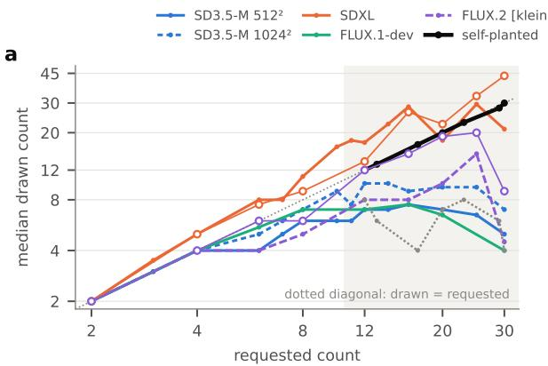

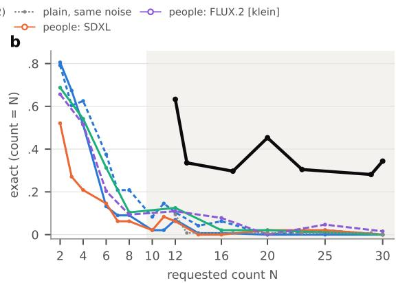  
Figure 8. Drawn and exact counts by requested count, by SAM 3 (open circles: people). (a) Median drawn count, log scales (dotted: drawn = requested); (b) exact rate. Shaded: requests past ten. Plain prompts in three models on the screened sets (48 types) and in FLUX.2 [klein] on U2 (64); self-planting (Sec. F.4) on U1, with the plain prompt from the same noise (SD3.5-M at $7 6 8 ^ { 2 } )$ . SAM 3 counts dense crowds lower than people (open circles: SDXL and FLUX.2 [klein], 16 types each). Qwen-Image’s SAM 3 counts are in Tab. 15.

<table><tr><td rowspan="2">Model</td><td rowspan="2">counter</td><td colspan="2">slope</td><td colspan="2">order</td></tr><tr><td>2-8</td><td>12-30</td><td>2-8</td><td>12-30</td></tr><tr><td rowspan="3">SD3.5-M 5122 (S1, three seeds)</td><td>SAM3</td><td>.53 [.46, .59]</td><td>-.19[-.40,.03]</td><td>.88</td><td>.49 [.42, .55]</td></tr><tr><td>Grounding DINO</td><td>.43 [.36, .49]</td><td>-.68 [−.84, -.53]</td><td>.84</td><td>.31 [.27, .35]</td></tr><tr><td>OWLv2</td><td>.44 [.37, .50]</td><td>-.17[-.38, .02]</td><td>.82</td><td>.48 [.42, .54]</td></tr><tr><td rowspan="3">SD3.5-M 10242 (S1)</td><td>SAM3</td><td>.61 [.52, .69]</td><td>−.38 [−.75, −.02]</td><td>.90</td><td>.53 [.44, .61]</td></tr><tr><td>Grounding DINO</td><td>.59 [.52, .66]</td><td>-.67 [−.96, −.38]</td><td>.90</td><td>.39 [.31, .48]</td></tr><tr><td>OWLv2</td><td>.57 [.46, .69]</td><td>.02[−.28, .32]</td><td>.85</td><td>.57 [.49, .66]</td></tr><tr><td rowspan="3">SDXL (S2)</td><td>SAM3</td><td>.80 [.66, .94]</td><td>-.35[−.83,.12]</td><td>.87</td><td>.56 [.48, .63]</td></tr><tr><td>Grounding DINO</td><td>.44 [.28, .61]</td><td>-.32 [-.70, .05]</td><td>.73</td><td>.42 [.33, .50]</td></tr><tr><td>OWLv2</td><td>.68 [.52, .83]</td><td>.08 [-.33, .47]</td><td>.78</td><td>.58 [.49, .66]</td></tr><tr><td rowspan="3">FLUX.1-dev (S2)</td><td>SAM3</td><td>.59 [.40, .76]</td><td>−.17 [−.46, .14]</td><td>.86</td><td>.43 [.34, .53]</td></tr><tr><td>Grounding DINO</td><td>.54 [.41, .66]</td><td>-.44 [−.64, −.24]</td><td>.84</td><td>.31 [.23, .39]</td></tr><tr><td>OWLv2</td><td>.63 [.50, .76]</td><td>-.20[-.48, .07]</td><td>.86</td><td>.45 [.37, .54]</td></tr><tr><td>SD3.5-M 7682 (U2, two seeds)</td><td>SAM3</td><td>.45 [.35, .55]</td><td>−.04[−.21,.13]</td><td>.86</td><td>.50 [.45, .55]</td></tr><tr><td> $\mathrm { S D 3 . 5 { - M 1 0 2 4 } ^ { 2 } \left( U 2 , 2 , 4 , 8 / 1 2 , 2 0 , 3 0 \right) }$ </td><td>SAM3</td><td>.49 [.39, .57]</td><td>-.31 [-.49, −.13]</td><td>.87</td><td>.38 [.31, .46]</td></tr><tr><td> $\mathrm { S D 3 . 5 \mathrm { \overline { { - } } M + F l o w - G R P O ~ 5 1 2 ^ { 2 } ~ ( S 1 } }$  , three seeds)</td><td>SAM3</td><td>.65</td><td>-.43</td><td>.95</td><td>.38 [.32, .43]</td></tr><tr><td> $\mathrm { S D 3 . 5 \mathrm { - } M + D i f f u s i o n N F T ~ 5 1 2 ^ { 2 } ~ ( S 1 }$  , three seeds)</td><td>SAM3</td><td>.64</td><td>-.57 .95</td><td>.92</td><td>.32 [.25, .39]</td></tr><tr><td colspan="4">reference model, log-normal scatter .3 / .45</td><td colspan="2">.83 / .76</td></tr></table>

Table 10. The number word under three counters (same noise, Sec. 3; one seed unless stated; FLUX.1-dev’s large requests are 12, 16, 20 and 30). Every order interval at 12–30 lies below the reference model’s (Sec. A.5). Orders below one half are reversals: as counted, the larger request more often gives fewer objects. They occur mostly under Grounding DINO, which undercounts dense images most (Sec. A.3), and for the two post-trained checkpoints (Sec. C.4).

People’s orders. By people (Tab. 12), every model orders the crowd from two to eight. On U2 (fifth count), people’s order at 12–30 is 0.63 for SDXL and 0.36 for FLUX.1-dev, a reversal; their caps are in Tab. 13. On the screened types of S2, FLUX.1-dev’s order at 12–30 is 0.52, not a reversal.

Medians. Median human count (and SAM 3) at requests 12, 16, 20, 25, 30 (with an even number of pictures a median can be a half): SD3.5-M 5122 8.5 (8), 8.5 (6.5), 8 (8), 9.5 (9), 7.5 (5.5); SD3.5-M 7682 6.5 (5), 6.5 (6), 6 (4), 8.5 (2.5), 4.5 (3.5); FLUX.1-dev (S2) at 12, 16, 20, 30: 9 (5), 9 (7), 8 (6), 7 (4.5); SDXL (S2) 13.5 (15.5), 26.5 (27.5), 22.5 (21), 33 (31), 43.5 (26); FLUX.2 [klein] 12 (7), 15 (7), 19 (8.5), 20 (10), 9 (3.5). People’s medians of all five models on U2 are in Tab. 13.

<table><tr><td>requested N</td><td>2</td><td>3</td><td>4</td><td>6</td><td>7</td><td>8</td><td>10</td><td>11</td><td>12</td><td>13</td><td>14</td><td>16</td><td>17</td><td>20</td><td>23 25</td><td></td><td>29 30</td></tr><tr><td>SD3.5-M 512²</td><td></td><td>.81.67</td><td>.51</td><td>.13</td><td>.09</td><td>.09</td><td>.02</td><td>.02</td><td>.07</td><td></td><td>.01.01</td><td></td><td></td><td>.00</td><td>.00</td><td></td><td>.00</td></tr><tr><td>SD3.5-M  $1 0 2 4 ^ { 2 }$ </td><td></td><td>.79.60</td><td>.62</td><td>.38</td><td>.21</td><td>.21</td><td>.08</td><td>.15</td><td>.10</td><td></td><td>.04.06</td><td></td><td></td><td>.00</td><td>.02</td><td></td><td>.00</td></tr><tr><td>SDXL</td><td></td><td>.52.27</td><td>.21</td><td>.15</td><td>.06</td><td>.06</td><td>.02</td><td>.08</td><td>.06</td><td></td><td>.00.00</td><td></td><td></td><td>.02</td><td>.02</td><td></td><td>.00</td></tr><tr><td>FLUX.1-dev</td><td>.69</td><td></td><td></td><td>.54.31</td><td></td><td>.10</td><td></td><td></td><td>.13</td><td></td><td></td><td>.02</td><td></td><td>.02</td><td></td><td></td><td>.00</td></tr><tr><td>FLUX.2 [klein], U2</td><td>.66</td><td></td><td>.52 .20</td><td></td><td></td><td>.09</td><td></td><td></td><td>.11</td><td></td><td></td><td>.08</td><td>.00</td><td></td><td>.05</td><td></td><td>.02</td></tr><tr><td>SD3.5-M 7682 plain, U1</td><td></td><td></td><td></td><td></td><td></td><td></td><td></td><td></td><td>.09.01</td><td></td><td></td><td></td><td></td><td>.01 .01 .01</td><td></td><td>.01.00</td><td></td></tr><tr><td>self-planting, U1</td><td></td><td></td><td></td><td></td><td></td><td></td><td></td><td></td><td>.63.34</td><td></td><td></td><td></td><td></td><td>.30.45 .30</td><td></td><td>.28.34</td><td></td></tr></table>

Table 11. Exact rate by requested count (SAM 3), the data of Fig. 8. Empty cells were not requested.

<table><tr><td></td><td></td><td>order</td><td>slope</td><td>exact</td></tr><tr><td>SD3.5-M 5122</td><td>people 2–8</td><td>.95 [.89, 1.00]</td><td>.57 [.47, .69]</td><td>.33 [.25, .39]</td></tr><tr><td></td><td>people 12–30</td><td>.49 [.34, .64]</td><td>–.12[-.55, .28]</td><td>.04 [.00, .10]</td></tr><tr><td></td><td>SAM 3 2-8</td><td>.88 [.75, .97]</td><td>.46 [.23, .63]</td><td>.33 [.25, .39]</td></tr><tr><td></td><td>SAM 3 12–30</td><td>.64 [.47, .81]</td><td>.10 [−.28,.47]</td><td>.00 [.00, .00]</td></tr><tr><td>SD3.5-M 7682</td><td>people 2–8</td><td>.80 [.66, .93]</td><td>.37 [.16, .53]</td><td>.36 [.28, .45]</td></tr><tr><td></td><td>people 12–30</td><td>.54 [.41, .65]</td><td>.01 [−.51, .47]</td><td>.04 [.00, .08]</td></tr><tr><td></td><td>SAM 3 2–8</td><td>.82 [.65, .96]</td><td>.35 [.03, .62]</td><td>.31 [.22, .42]</td></tr><tr><td></td><td>SAM 3 12–30</td><td>.56 [.41, .70]</td><td>.00 [−.55, .52]</td><td>.04 [.00, .08]</td></tr><tr><td>FLUX.1-dev</td><td>people 2–8</td><td>.93 [.85, 1.00]</td><td>.67 [.55, .76]</td><td>.53 [.41, .66]</td></tr><tr><td></td><td>people 12–30</td><td>.52 [.33, 71]</td><td>-.09 [-.48, .28]</td><td>.08 [.02, .16]</td></tr><tr><td></td><td>SAM 3 2–8</td><td>.81 [.64, .95]</td><td>.30 [−.02, .59]</td><td>.42 [.31, .55]</td></tr><tr><td></td><td>SAM 3 12–30</td><td>.44 [.26, .63]</td><td>.02[−.46, .63]</td><td>.03 [.00, .09]</td></tr><tr><td>SDXL</td><td>people 2–8</td><td>.91 [.85, .97]</td><td>.81 [.62, 1.01]</td><td>.30 [.19, .41]</td></tr><tr><td></td><td>people 12–30</td><td>.77 [.68, .85]</td><td>1.10 [.63, 1.62]</td><td>.04[.00, .08]</td></tr><tr><td></td><td>SAM 3 2–8</td><td>.89 [.82, .96]</td><td>.79 [.53, 1.01]</td><td>.27 [.16, .38]</td></tr><tr><td></td><td>SAM 3 12–30</td><td>.62 [.49, .74]</td><td>.34 [−.54, 1.25]</td><td>.03 [.00, .06]</td></tr><tr><td>FLUX.2 [klein] people 2–8</td><td></td><td></td><td></td><td></td></tr><tr><td></td><td></td><td>.89 [.80, .96] .62[.53, .72]</td><td>.58 [.40, .72] .12[−.34, .54]</td><td>.59 [.50, .70] .13 [.06, .19]</td></tr><tr><td></td><td>people 12–30 SAM 3 2–8</td><td>.71 [.53, .87]</td><td>.16[−.11,.42]</td><td>.39 [.27, .53]</td></tr><tr><td></td><td>SAM 3 12–30</td><td>.56 [.42, .69]</td><td>.10[−.54, .90]</td><td>.05 [.01, .10]</td></tr><tr><td></td><td></td><td></td><td></td><td></td></tr></table>

Table 12. The word, by human count (16 types per model, one seed; order, slope and exact rate as in Sec. A.4, 95% noun-cluster intervals). SD3.5-M 5122: S1; SD3.5-M 7682: U2; FLUX.1-dev and SDXL: S2 (first count); FLUX.2 [klein]: U2, second count. Without pictures marked unsure the picture is the same (SDXL at 12–30: order 0.77, slope 1.08; FLUX.2 [klein] 0.66, 0.17).

Models compared on the same object types. Orders of different models are compared within a set, on the same 16 people-counted types (paired type bootstrap, 4,000 resamples; requests 12, 16, 20, 25 and 30, or 12, 16, 20 and 30 on S2, where FLUX.1-dev has no 25):

<table><tr><td>set</td><td>difference of order at 12–30</td><td>people</td><td>SAM3</td></tr><tr><td>U2</td><td>Qwen-Image – SD3.5-M</td><td> $+ . 1 6 [ + . 0 1 , + . 3 1 ]$ </td><td>+.22 [+.06, +.38]</td></tr><tr><td>U2</td><td>FLUX.2 [klein] − SD3.5-M</td><td> $+ . 0 8 \ [ - . 0 7 , + . 2 4 ]$ </td><td> $. 0 0 [ - . 2 3 , + . 2 3 ]$ </td></tr><tr><td>U2</td><td>Qwen-Image – FLUX.2 [klein]</td><td> $+ . 0 8 \ [ - . 0 9 , + . 2 4 ]$ </td><td>+.22 [+.02, +.42]</td></tr><tr><td>S2</td><td>SDXL – FLUX.1-dev</td><td> $+ . 2 6 [ . 0 0 , + . 5 1 ] ^ { a }$ </td><td> $+ . 1 6 [ - . 0 5 , + . 3 6 ]$ </td></tr></table>

At 2–8, SDXL and FLUX.1-dev do not differ (people: −.02 [−.12, +.07]); Qwen-Image orders above SD3.5-M (+.19

[+.07, +.33]). aThe lower bound is 0.003. With 16 types and one seed, FLUX.2 [klein] cannot be ranked against SD3.5-M or Qwen-Image by order; the fifth count’s comparisons of SDXL and FLUX.1-dev with the U2 models are in Sec. C.2.

SDXL on U2. By SAM 3 the order is 0.76 [0.68, 0.84] at 2–8 and 0.61 [0.53, 0.69] at 12–30 (ties 26%), the slope at 12–30 0.28 [−0.05, 0.61], exact rate at 12–30 0.9%, and the median count 9.5–10 at every request from 12 to 30 except 25 (16); OWLv2: order 0.63 [0.56, 0.69]; Grounding DINO: 0.52 [0.45, 0.60].

## C.2. Where the crowd stops growing

Model. With $y = \log ( 1 { + } n )$ and a type intercept $a _ { j }$ , the cap model is $y = a _ { j } + \log ( 1 + \operatorname* { m i n } ( c , K ) ) + \varepsilon \colon$ the crowd follows the request up to the request K and stays flat above it. K is fitted by least squares on 500 log-spaced values from 2 to 60; $K ~ \geq ~ 3 0$ means no ceiling within the requests. Intervals: 95% bootstrap over object types (2,000 resamples), with K refitted in every resample; paired ratios use the same resampled types for both models. As alternatives we fit a power law $y = a _ { j } + \log ( 1 { + } c ^ { \beta } )$ and a broken stick with a profiled knee. Fitted again with other resamples, SD3.5-M, FLUX.2 [klein] and Qwen-Image keep their point estimates, and their intervals differ by at most 0.7 (Tab. 13 gives one fit for all U2 models).

<table><tr><td></td><td>K, people</td><td>K, SAM3</td><td></td><td>AICpow−AICcap people&#x27;s medians at 12, 16, 20, 25, 30</td></tr><tr><td colspan="5">U2, 16 types (fifth count)</td></tr><tr><td>FLUX.1-dev</td><td>4.2 [2.8, 6.8]</td><td>2.8 [2.0, 4.4]</td><td>+10.5</td><td>4, 8, 3.5, 2, 1.5</td></tr><tr><td>SD3.5-M</td><td>6.5 [3.0, 11.2]</td><td>4.3 [2.5, 9.5]</td><td>-3.7</td><td>6.5, 6.5, 6, 8.5, 4.5</td></tr><tr><td>SDXL</td><td>10.9 [7.4, 17.8]</td><td>5.1 [2.5, 10.8]</td><td>-3.8</td><td>14, 10, 14, 18, 18</td></tr><tr><td>Qwen-Image</td><td>13.5 [10.0, 15.1]</td><td>10.3 [2.3, 17.2]</td><td>+20.7</td><td>12, 12, 15.5, 16, 15</td></tr><tr><td>FLUX.2 [klein]</td><td>15.2 [10.3, 20.7]</td><td>5.4 [2.7, 19.4]</td><td>+6.4</td><td>12, 15, 19, 20, 9</td></tr><tr><td>SD3.5-M, count LoRA</td><td>9.8 [7.6, 12.3]</td><td>8.5 [5.0, 13.4]</td><td>+32.7</td><td>12, 12, 12, 12, 9.5</td></tr><tr><td>SD3.5-M, shuffled LoRA 12.0 [9.5, 14.0]</td><td></td><td>6.9 [5.2, 11.4]</td><td>+38.5</td><td>36, 35, 33, 34.5, 17.5</td></tr><tr><td colspan="5">screened sets, 16 types (first count)</td></tr><tr><td>SD3.5-M 5122 (S1)</td><td>10.5 [7.3, 13.7]</td><td>6.9 [3.6, 13.2]</td><td>+11.1</td><td>8.5, 8.5, 8, 9.5, 7.5</td></tr><tr><td>FLUX.1-dev (S2)</td><td>7.7 [5.3, 10.6]</td><td>4.5 [2.3, 7.5]</td><td>+13.1</td><td>9, 9, 8, −, 7</td></tr><tr><td>SDXL (S2)</td><td>≥30 [21.3,]</td><td>13.7 [6.7, 27.6]</td><td>-0.1</td><td>13.5, 26.5, 22.5, 33, 43.5</td></tr></table>

Table 13. Ceilings (cap model; 95% intervals over types). $\mathrm { A I C } _ { \mathrm { p o w } } { - } \mathrm { A I C } _ { \mathrm { c a p } } \mathrm { : }$ positive when the capped crowd fits better than an uncapped power law. SDXL on U2 fits a power law (exponent 0.66) slightly better, and SD3.5-M on U2, whose crowd already falls below the request from four, about as well, though its slope at 12–30 is 0.01. SDXL’s K on S2 is at least 30 in 57% of resamples (power 1.01 [0.88, 1.14]). FLUX.1-dev on S2 was not asked for 25.

Paired ratios of K. Fifth count (same resampled types): SDXL over FLUX.1-dev 2.58 [1.88, 3.94], SDXL over SD3.5-M 1.68 [1.22, 2.96], over Qwen-Image 0.81 [0.56, 1.32] and over FLUX.2 [klein] 0.72 [0.45, 1.20]; FLUX.1-dev over SD3.5-M 0.65 [0.37, 1.24], over Qwen-Image 0.31 [0.21, 0.49] and over FLUX.2 [klein] 0.28 [0.17, 0.42]; the count over the shuffled LoRA 0.82 [0.68, 0.99] and over the untrained model 1.51 [0.90, 2.80]. Screened over unscreened types, unpaired (each set’s types resampled independently): SDXL 2.75 [1.47, 4.02], FLUX.1-dev 1.82 [1.09, 3.14]. First counts: Qwen-Image over SD3.5-M 2.07 [1.25, 4.33], FLUX.2 [klein] over SD3.5-M 2.34 [1.24, 5.69], Qwen-Image over FLUX.2 [klein] 0.88 [0.65, 1.24], SDXL over FLUX.1- dev on S2 at least 3.89 [2.54, 5.17]. Paired orders at 12–30 on U2 (fifth count): SDXL minus FLUX.1-dev +0.28 [0.11, 0.43], minus SD3.5-M +0.09 [−0.04, 0.23], minus FLUX.2 [klein] +0.01 [−0.14, 0.17], minus Qwen-Image −0.07 [−0.21, 0.08]; FLUX.1-dev minus SD3.5-M −0.18 [−0.28, −0.08], minus FLUX.2 [klein] −0.26 [−0.41, −0.12] and minus Qwen-Image −0.34 [−0.51, −0.18].

Scatter net of counting noise. For each picture of the first four counts the two first-round counts are independent, so the covariance of their residuals from the cap fit estimates the variance of the picture’s own deviation from the fitted crowd. In log units: SD3.5-M 0.51 [0.34, 0.66] (5122) and 0.46 [0.20, 0.61] (7682), FLUX.1-dev 0.38 [0.26, 0.50], SDXL 0.40 [0.21, 0.55], FLUX.2 [klein] 0.50 [0.32, 0.62], Qwen-Image 0.00 [0.00, 0.25] (its crowds sit on the fit). One person’s counting noise is 0.38–0.66 over all requests and 0.47–0.80 at 12–30. Without pictures marked unsure, K changes by at most 1.4 (SDXL’s on S2 falls from at least 30 to 28.3); without the request of 30, FLUX.2 [klein]’s rises to 21.1 [13.0, 25.1], SDXL’s on S2 is 25.1, the top of the reduced range, and the others move by at most 0.4.

On the same 16 U2 types, FLUX.1-dev’s crowd stops growing first and FLUX.2 [klein]’s last; on the screened types, SDXL’s keeps growing up to thirty.

## C.3. Ways of asking and guidance

SD3.5-M, U2. Digits (“12 Xs”), the rows-and-columns sentence and native resolution use the requests 12, 20 and 30; guidance w ∈ {1.5, 3, 4.5, 7, 10} uses 12, 16, 20, 25 and 30, with 2, 4 and 6 for the small-count lift; the best of four plain samples, chosen by SAM 3 among four seeds, uses all nine counts and costs about as much as one self-planted image of a new object type, including its cut-out.

Exact at 12–30 by SAM 3: plain prompt 0.014 (nine requests, two seeds), digits 0.026, the rows-and-columns sentence 0.062 and native resolution 0.034 (12, 20 and 30; two seeds for native resolution), best of four 0.050 (nine requests), against 0.406 for self-planting on the same cells.

Exact at 12–30 by guidance scale: 0.006, 0.019, 0.025, 0.028 and 0.034; exact lift at 12–30: 0.000, 0.004, 0.005, 0.009 and 0.023 [0.005, 0.043]; at 2–6: 0.229, 0.341, 0.391, 0.409 and 0.424. At every scale the slope at 12–30 is −0.31 to −0.18 and the order 0.39–0.46, while the slope over 2, 4 and 6 is 0.40–0.53. On S1, digits give an exact lift of 0.001 [−0.015, 0.019] at 10–30. No wording and no guidance scale makes exact counts past ten common, while selfplanting on the same cells does.

## C.4. Reward-tuned checkpoints

Flow-GRPO [37] (GenEval reward, counts of two to four) and DiffusionNFT [69] (a multi-reward checkpoint) are run like the base model on S1. Relative to the base model on the same cells, Flow-GRPO raises the exact lift by 0.323 [0.255, 0.388] at 2–4 objects and by 0.017 [−0.002, 0.035] at 10–16 (+0.012 at 10–30). Two further checkpoints, Flow-GRPO without its KL term (rewarded at two to four) and a GenEval2-rewarded LoRA [25, 49] (rewarded at two to seven, at 10242 against a 10242 base), raise the exact lift by +0.16 and +0.11 where they are rewarded and move it by −0.005 [−0.018, 0.007] and +0.009 [−0.029, 0.045] at 10–30; under Grounding DINO the second moves it by +0.044 [0.016, 0.070]. The second checkpoint’s own lift at 10–30 is +0.034 [0.007, 0.061] under SAM 3, the largest we measured above ten: it draws the exact count in 11.2% of images at 10–30 against 5.7% for its base, most of them at requests of ten and eleven (31% and 38%), and in 3.5% at 12–30. Two Flow-GRPO checkpoints tuned for other rewards (PickScore and text rendering) move it by +0.22 and +0.05 at two to four and by +0.012 [−0.012, 0.040] and −0.003 [−0.016, 0.009] at 10–30. Rewards on small counts raise the exact lift where they reward it and barely above ten, and the largest lift above ten comes mostly from requests of ten and eleven.

## C.5. A newer model: FLUX.2 [klein]

Design. FLUX.2 [klein] base 4B [7], the undistilled fourbillion-parameter model whose text encoder is the language model Qwen3-4B [64], in diffusers 0.41 at 10242 with 50 steps and guidance 4.0, on U2’s 64 types with U2’s prompts, requests 2, 4, 6, 8, 12, 16, 20, 25 and 30, seed 1 (576 images). One starting latent per type is shared by the nine requests. SD3.5-M’s U2 images of the same cells and seed are the comparison under the same counters. One of the 576 images is flat.

The counters fail on FLUX.2 [klein]’s dense images. SAM 3 finds none of the object in 39% of them at 12–30 (21% for SD3.5-M), and the detectors’ medians fall to 1– 6 objects at 20–30, where people’s medians on 16 of the types are 19, 20 and 9. SAM 3’s median count is 2, 4, 4 and 5 for requests 2–8 and 8, 8, 10, 15 and 4.5 for 12–30; its exact rate .66, .52, .20, .09 and .11, .08, 0, .05, .02. People’s counts of 16 types (Sec. B) place the order at 12–30 between one half and a loose estimator: 0.62 [0.53, 0.72], 0.66 [0.55, 0.76] without pictures marked unsure, with a slope of 0.12 [−0.34, 0.54]. Their median count is 12, 15, 19, 20 and 9 for requests 12, 16, 20, 25 and 30. Over 12–25 alone the order is 0.73 [0.62, 0.84] and the slope 0.84 [0.29, 1.40], where the reference model with these requests gives 0.74– 0.82 and 0.94: up to twenty-five FLUX.2 [klein] follows the request about as loosely as the looser reference, and at thirty it collapses. People find the asked number in 13% of these images (10 of 80), against 4% for SD3.5-M on the same types and requests (difference 0.09 [0.03, 0.15]).

<table><tr><td rowspan="2">model</td><td rowspan="2">counter</td><td colspan="2">order</td><td rowspan="2">slope 12-30</td><td rowspan="2">exact 12-30</td><td rowspan="2">lift 12-30</td><td rowspan="2">none 12-30</td></tr><tr><td>2-8</td><td>12-30</td></tr><tr><td rowspan="5">FLUX.2 [klein]</td><td>SAM3</td><td>.81</td><td>.67 [.60, .74]</td><td>.29 [.05, .54]</td><td>.050</td><td>.030</td><td>.39</td></tr><tr><td>Grounding DINO</td><td>.89</td><td>.45 [.39, .51]</td><td>-.55</td><td>.028</td><td>.009</td><td></td></tr><tr><td>OWLv2</td><td>.79</td><td>.51 [.44, .58]</td><td>-.13</td><td>.025</td><td>.009</td><td></td></tr><tr><td>consensus</td><td>.87</td><td>.59 [.44, .74]</td><td>-.37</td><td>.025</td><td>.012</td><td></td></tr><tr><td>people (16 types)</td><td>.89</td><td>.62 [.53, .72]</td><td>.12</td><td>.125</td><td></td><td></td></tr><tr><td rowspan="4">SD3.5-M 7682</td><td>SAM3</td><td>.89</td><td>.46 [.38, .53]</td><td>-.20</td><td>.025</td><td>.005</td><td>.21</td></tr><tr><td>Grounding DINO</td><td>.78</td><td>.39 [.31, .47]</td><td>-.35</td><td>.009</td><td>.001</td><td></td></tr><tr><td>OWLv2</td><td>.85</td><td>.45 [.38, .53]</td><td>-.24</td><td>.034</td><td>.016</td><td></td></tr><tr><td>consensus</td><td></td><td>.89 .33 [.22, .46]</td><td>-.43</td><td>.016</td><td>.006</td><td></td></tr></table>

Table 14. FLUX.2 [klein] and SD3.5-M on the same cells (U2, 64 types, seed 1; none: SAM 3 finds none of the object). FLUX.2 [klein] minus SD3.5-M, order at 12–30: +.22 [.11, .32] under SAM 3, +.06 under Grounding DINO and OWLv2 (intervals include 0), +.26 [.05, .45] under the consensus (74 and 120 differing pairs). Reference model with this design’s types and seed: 0.84 (scatter 0.3) and 0.76 (0.45).

## C.6. A current large model: Qwen-Image

Design. Qwen-Image [60], a 20B transformer whose text encoder is the vision-language model Qwen2.5-VL-7B [1], from the official weights (revision 75e0b4b) in diffusers 0.41 with the pipeline’s defaults: 10242, 50 steps, true classifier-free guidance 4.0 with the negative prompt “ ”. To fit a 24 GB L4 GPU, the transformer is quantized to 4-bit NF4 with bitsandbytes (compute in bf16); the text encoder, VAE and scheduler are unchanged, and the sampler passes the text encoder’s padding mask as the pipeline returns it. Prompts are U2’s (“a photo of twelve cribs”), requests 2, 4, 6, 8, 12, 16, 20, 25 and 30, seed 1; one starting latent per type, drawn on the CPU from the type’s seed, is shared by the nine requests. Qwen-Image was run on the 16 peoplecounted types of U2 (144 images), which people counted in the fourth study (Sec. B). An image takes about 173 s.

Results. By people, Qwen-Image is exact in 100%, 94%, 94% and 50% of images at 2, 4, 6 and 8, and in 63%, 25%, 13%, 6% and 0% at 12, 16, 20, 25 and 30 (within 10%: 75%, 31%, 25%, 6% and 0%); its median count is 12, 12, 15.5, 16 and 15. People’s order at 12–30 is 0.70 [0.57, 0.82] (0.70 without pictures marked unsure) and their exact rate 0.21: Qwen-Image’s word orders large crowds partly and rarely gives their exact count. People tie on 23% of sametype pairs at 12–30, and judge the marked objects to look like the named one in 75% of the 142 pictures with marked objects (“partly” in the rest). Counters miss the larger grids: against people, SAM 3 is exact on 55% of Qwen-Image’s pictures and undercounts by 2.5 objects on average (by 3.0 at 25–30); it finds no object in 24% of Qwen-Image’s images, most often at requests of 4 to 12.

<table><tr><td></td><td></td><td colspan="2">order</td><td>slope</td><td></td><td>exact within 10%</td></tr><tr><td>model</td><td>counter</td><td>2-8</td><td>12-30</td><td></td><td>12-3012-30</td><td>12-30</td></tr><tr><td>Qwen-Image</td><td>SAM3</td><td></td><td>.70 .78 [.67, .88]</td><td>.49</td><td>.138</td><td>.20</td></tr><tr><td></td><td>Grounding DINO</td><td>.92</td><td>.47 [.29, .64]</td><td>-.44</td><td>.138</td><td></td></tr><tr><td></td><td>OWLv2</td><td></td><td>.71 .56 [.39,.73]</td><td>-.01</td><td>.088</td><td></td></tr><tr><td></td><td>consensus</td><td></td><td>.78 .72 [.51, .90]</td><td>.12</td><td>.125</td><td></td></tr><tr><td></td><td>people</td><td></td><td>.99 .70 [.57, .82]</td><td>.23</td><td>.213</td><td>.28</td></tr><tr><td>SD3.5-M 7682</td><td>SAM3</td><td></td><td>.82 .56 [.41,.70]</td><td>.00</td><td>.038</td><td></td></tr><tr><td></td><td>people (A4)</td><td></td><td>.80.54 [.41,.65]</td><td>.01</td><td>.038</td><td>.10</td></tr><tr><td>FLUX.2 [klein] SAM 3</td><td></td><td></td><td>.71 .56 [.42, .69]</td><td>.10</td><td>.050</td><td></td></tr><tr><td></td><td>people (N)</td><td></td><td>.89 .62 [.53, .72]</td><td>.12</td><td>.125</td><td>.23</td></tr></table>

Table 15. Qwen-Image, SD3.5-M and FLUX.2 [klein] on the same cells (the 16 people-counted types of U2, seed 1). Qwen-Image minus SD3.5-M by people: order at 12–30 +.16 [.02, .31], exact +.18 [.11, .24], within 10% +.18 [.08, .28], recognisable +.15 [.09, .21]; minus FLUX.2 [klein]: +.08 [−.09, .24], +.09 [−.01, .19], +.05 [−.05, .15], +.11 [.01, .21]. Under SAM 3, Qwen-Image minus SD3.5-M: order +.22 [.06, .39], exact +.10 [.04, .16].

Grids and object scale. SAM 3’s boxes form a complete grid (at least two rows and two columns, every row holding the same number of objects, the count equal to rows times columns; rows and columns found from gaps of half the median box size) in 34% of Qwen-Image’s images at 12– 30, against 9%, 14% and 0% for SD3.5-M, FLUX.2 [klein] and SDXL on the same types; people find the requested count in 37% of Qwen-Image’s complete grids and in 13% of its other images (SD3.5-M: 29% of its 7 complete grids against 1%; FLUX.2 [klein]: 18% of 11 against 12%), and 10 of Qwen-Image’s 17 exact images at 12–30 are complete grids. Qwen-Image’s objects shrink with the request at 2–8 (scale slope −1.03 [−1.41, −0.77]) and not at 12–30 (−0.12 [−0.33, 0.09]).

## C.7. The room test

Design. SD3.5-M at 7682, 40 steps, guidance 4.5, U2’s 64 types, seed 1, the plain sampler; every image copies the task of U2’s plain image of its type and request (same noise) and changes only the prompt: “a photo of twelve cribs, seen from far away” (far) or “a photo of twelve tiny cribs” (tiny), at 2, 4, 6, 8, 12, 16, 20, 25 and 30 (1,152 images), counted by SAM 3, Grounding DINO and OWLv2. If the frame’s room limited the count, a cue that makes the objects smaller should let the crowd follow the request; how much a cue shrinks the objects is measured by the area ratio of Tab. 16.

Results. far shrinks the objects to 0.47 times the plain area [0.35, 0.61]; they cover 29–36% of the median image at 12–30, against 50–64% without the cue. Its order at 12– 30 is 0.54 [0.46, 0.61], against 0.46 [0.38, 0.53] for the plain prompt from the same noise (difference 0.08 [−0.02, 0.19]); the median count rises to 9–10 but stays flat across requests. tiny shrinks the objects less (0.72 [0.60, 0.87]), yet raises the order to 0.648 [0.57, 0.72] (difference 0.19 [0.11, 0.28]); under OWLv2 it raises it too (0.62, difference 0.16 [0.07, 0.25]), but not under Grounding DINO (0.46, difference 0.07 [−0.04, 0.18]). Neither cue changes the exact rate at 12–30 (2.2% and 2.5%, against 2.5%) or the order at 2–8 (0.88 and 0.85, against 0.89). Halving the objects area does not make the crowd follow the request, so room does not limit the count; “tiny” moves the order partway under SAM 3 and OWLv2 but not under Grounding DINO.

<table><tr><td></td><td>area</td><td>box %</td><td colspan="2">order</td><td>slope</td><td>exact</td><td>median</td></tr><tr><td>prompt</td><td>ratio</td><td>12 / 30</td><td>2-8</td><td>12-30</td><td>12-30</td><td>12–30 (%)</td><td>12 / 20 / 30</td></tr><tr><td>SAM 3</td><td></td><td></td><td></td><td></td><td></td><td></td><td></td></tr><tr><td>plain</td><td>1</td><td>6.8 / 10.8</td><td>.89</td><td>.46 [.38, .53]</td><td>-.20</td><td>2.5</td><td>8 / 6 / 4.5</td></tr><tr><td>“seen from far away&quot;</td><td>.47</td><td>4.2 / 3.3</td><td>.88</td><td>.54 [.46, .61]</td><td>-.04</td><td>2.2</td><td>10/9 /9</td></tr><tr><td>“tiny”</td><td>.72</td><td>4.2 / 4.8</td><td>.85</td><td>.65 [.57, .72]</td><td>.27</td><td>2.5</td><td>7/7/7.5</td></tr><tr><td>Grounding DINO</td><td></td><td></td><td></td><td></td><td></td><td></td><td></td></tr><tr><td>plain</td><td></td><td></td><td></td><td>.78 .39 [.31, .47]</td><td>-.35</td><td>.9</td><td>4/1/1</td></tr><tr><td>“seen from far away&quot;</td><td></td><td></td><td></td><td>.81 .39 [.33, .46]</td><td>-.55</td><td>1.6</td><td>6 / 2 / 1.5</td></tr><tr><td>“tiny”</td><td></td><td></td><td></td><td>.82.46 [.38, .55]</td><td>-.43</td><td>1.9</td><td>8 / 4.5 / 2</td></tr><tr><td>OWLv2</td><td></td><td></td><td></td><td></td><td></td><td></td><td></td></tr><tr><td>plain</td><td></td><td></td><td></td><td>.85.45 [.38, .53]</td><td>-.24</td><td>3.4</td><td>8/7/5</td></tr><tr><td>“seen from far away&quot;</td><td></td><td></td><td></td><td>.86.55 [.48, .61]</td><td>-.02</td><td>1.9</td><td>9/9/8</td></tr><tr><td>“tiny&quot;</td><td></td><td></td><td></td><td>.83 .62 [.55, .68]</td><td>.27</td><td>2.2</td><td>8 / 10 / 9</td></tr><tr><td>consensus</td><td></td><td></td><td></td><td></td><td></td><td></td><td></td></tr><tr><td>plain</td><td></td><td></td><td></td><td>.89 .33 [.22, .46]</td><td>-.43</td><td>1.6</td><td>6.5 / 1 / 1.5</td></tr><tr><td>“seen from far away&quot;</td><td></td><td></td><td></td><td>.94 .54[.40, .68]</td><td>-.13</td><td>.9</td><td>8 / 1 /1</td></tr><tr><td>“tiny”</td><td></td><td></td><td></td><td>.89 .57 [.39, .72] −.48</td><td></td><td>1.3</td><td>8/2/2</td></tr></table>

Table 16. The room test (SD3.5-M, U2, seed 1, same noise as the plain prompt). Area ratio: geometric mean, over the type–request pairs at 12–30 with an object in both images, of the cue image’s median SAM 3 box area over the plain image’s; box %: median box area at 12 and 30 (images with an object).

## C.8. Object size

With the word swapped in for the whole trajectory (the timing test’s full-swap cells, SAM 3; Fig. 9), wherever the word moves the count toward itself it also moves the objects’ size: for “two” against “four” in all three models of the timing test, and for “twelve” against “twenty-five” in SDXL and FLUX.2 [klein], a larger number gives more and smaller objects, with a shift of the log median box area 0.9– 1.5 times the shift of log(1+n) (Fig. 9). Past SD3.5-M’s reach the same swap shifts neither on average (size +0.01 [−0.32, 0.35], count 0.00), although it changes the crowd nearly as much as a new seed: the model makes room for more objects by shrinking them, as long as the word points it there. How a model fits a larger crowd into the same frame shows in its object sizes (Tab. 17; SAM 3 boxes of the plain images with at least one object found). SD3.5-M’s objects shrink with the request up to about ten and then stop: past ten its median box covers 6–11% of the image whatever the request, and the boxes together cover a similar share of the image (54–62% in the median image at 12–30; two seeds). FLUX.2 [klein]’s objects keep shrinking past ten, to about 2% of the image at 25 and 30. SDXL’s objects keep shrinking past ten on U2 (to 2.0% of the image at thirty); on its screened set they are already small at twelve and shrink less by SAM 3, which misses the smallest objects of its densest crowds (Tab. 8) and finds none of the object in 23–27% of SDXL’s U2 images at 12–30 (left out of the box medians). Qwen-Image’s objects (16 types of U2) shrink with the request up to about twelve and then stop, as its crowd does.

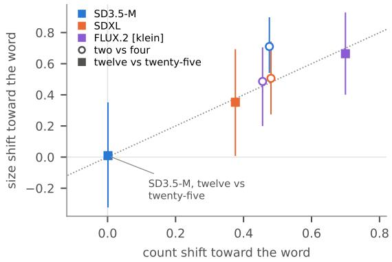  
Figure 9. A word that moves the count also shrinks the objects (the word asked at every step against the base request’s image, SAM 3, 64 types). Shift in object size toward the word (log median box area, smaller for the larger number) against shift in count, per model and pair, with 95% intervals; dotted: equal shifts. Past SD3.5-M’s reach, “twelve” against “twenty-five” does neither.

<table><tr><td rowspan="2">model</td><td colspan="8">median box area (% of image), by request</td><td colspan="2">slope of log area</td></tr><tr><td>2</td><td>4</td><td>8</td><td>12</td><td>16</td><td>20 25</td><td>30</td><td></td><td>2-8</td><td>12-30</td></tr><tr><td>SD3.5-M, U2 (two seeds)</td><td>27.2</td><td>16.2</td><td>10.7</td><td>7.2 8.0</td><td>7.7</td><td>6.0</td><td>9.2</td><td></td><td></td><td>−0.70 [−0.82, −0.58] +0.18 [−0.05, +0.41]</td></tr><tr><td>FLUX.2 [klein], U2</td><td>26.5</td><td>14.7</td><td>7.4</td><td>5.0 4.5</td><td>2.7</td><td>2.2</td><td>2.0</td><td></td><td></td><td>-0.75 [−0.95, −0.54] −0.73 [−1.15, −0.34]</td></tr><tr><td>SDXL, U2</td><td>15.9</td><td>10.7</td><td>4.6</td><td>3.8 3.1</td><td>3.1</td><td>2.5</td><td>2.0</td><td></td><td></td><td>−0.75 [−0.98, −0.52] −0.55 [−0.85, −0.26]</td></tr><tr><td>SDXL, screened set</td><td>16.0</td><td>10.9</td><td>5.0</td><td>2.9 2.7</td><td>2.2</td><td>2.0</td><td>2.0</td><td></td><td>-0.81 [−1.00, −0.61] −0.20 [−0.65, +0.32]</td><td></td></tr><tr><td>Qwen-Image, U2 (16 types)</td><td>29.4</td><td>15.3</td><td>9.1</td><td>6.4 6.7 5.4</td><td></td><td>6.4</td><td>4.5</td><td></td><td>−1.03 [−1.41, −0.77] −0.12 [−0.33, +0.09]</td><td></td></tr></table>

Table 17. Object size against the request (SAM 3, plain images). Slope: per type, the least-squares slope of the log median box area on the log request (images with at least one object; types with at least three such requests), averaged over types with a 95% bootstrap interval (Qwen-Image: 9 types at 2–8 and 13 at 12–30); −1 means objects shrink just enough for the requested number to fit, 0 that their size ignores the request.

## C.9. Orders by window, effective scatter and an operational reach

Design. A descriptive re-analysis of existing counts (no new images): the annotators’ final counts of the word tests, 16 types per set and seed 1, and SAM 3’s counts of all types of each set. The order is that of Eq. (1), pooled over types as a ratio of sums with ties dropped; intervals use the fixed type-bootstrap indices of the other tests (20,000 resamples, all seeds of a type resampled together). Windows: 2–8; 12– 30; 12–25, exactly the pairs of 12–30 without thirty; the four pairs with thirty; adjacent requests; and sliding windows of three consecutive requests. Effective scatter: the loose estimator of Sec. $\mathrm { A } . 5 , n = \mathrm { r o u n d } ( c e ^ { s z } )$ , is simulated for $s = 0 . 0 5 , 0 . 1 0 , \ldots , 3 . 0 0$ and read through the annotators’ noise model (Sec. B.4) with the counting difficulty of the model’s own pictures; its expected order on the window (100,000 simulated types per s, made non-increasing in s) is inverted at the model’s order, and the order’s interval is mapped through the same curve. Matched to the models pictures, the estimator orders 12–25 at 0.79–0.80 (s=0.30) and 0.72 (s=0.45), and 2–8 at about 0.92 and 0.85. Reach (sliding): the middle request of the first window of three consecutive requests whose effective scatter exceeds $s ^ { * } ,$ , or 30 if none; we use $s ^ { * } { = } 1$ , a typical factor of 2.7, about twice the loosest reference scatter (Tab. 20). Alternatives: $s ^ { * } { = } 0 . 7 5$ , and the first adjacent pair whose order lies below the 2.5th percentile of the s=0.45 estimator.

The pairs with thirty. FLUX.2 [klein] and Qwen-Image order 12–25 as a loose estimator would (effective scatters 0.42 and 0.33) and lose order on the pairs with thirty (differences −0.30 [−0.54, −0.04] and −0.19 [−0.37, −0.02]; Tab. 18). SAM 3 on all 64 of FLUX.2 [klein]’s types agrees (12–25: 0.75 [0.67, 0.83]; pairs with 30: 0.55 [0.44, 0.65]); on Qwen-Image’s 16 types it shows no thirty effect (+0.01 [−0.20, +0.24]). FLUX.1-dev’s reversal at 12–30 (0.36) comes from its largest requests: at 12–25 its order is 0.47, on the pairs with thirty 0.17. SD3.5-M at $7 6 8 ^ { 2 }$ and SDXL show no thirty effect, SD3.5-M at $5 1 2 ^ { 2 }$ (S1) does. SD3.5- M’s word test on all 64 U2 types, which also asked 14, 19, 22 and 27, gives by SAM 3: pairs (c, 25) with c from 12 to 22, 0.54 [0.45, 0.63]; (c, 27) 0.54; (c, 30) 0.48; 25/27 0.47 and 27/30 0.43; its median for “nineteen” (4) is as low as for “thirty”. Annotators’ median at thirty lies below that at twenty-five in five of the seven sets that asked both (SD3.5- M on U2 8.5 to 4.5 and on S1 9.5 to 7.5, FLUX.1-dev 2 to 1.5, FLUX.2 [klein] 20 to 9, Qwen-Image 16 to 15; SDXL 18 to 18 on U2 and 33 to 43.5 on S2). Single number words past the reach carry their own crowd sizes, so a verdict over 12–30 can hinge on one word.

Between 20 and 30 in FLUX.2 [klein] and Qwen-Image. The seventh count’s per-pair orders cannot be computed from its stored pooled values; its seed-2 order follows exactly from them (Qwen-Image 28 of 38 differing pairs, 0.74; FLUX.2 [klein] 15 of 41, 0.37). On the same seed-1 pictures, the earlier annotators’ count gives 20/25, 20/30 and 25/30 orders of 0.50 (8/8/0), 0.25 and 0.33 for FLUX.2 [klein] and 0.45, 0.45 and 0.36 for Qwen-Image; SAM 3 on both seeds gives 0.52 [0.32, 0.72], 0.20 [0.00, 0.44] and 0.27 [0.09, 0.47] for FLUX.2 [klein] and

0.74 [0.53, 0.91], 0.78 [0.62, 0.92] and 0.57 [0.33, 0.80] for Qwen-Image. FLUX.2 [klein]’s missing direction between 20 and 30 is thus no direction between twenty and twentyfive and a reversal for thirty; taken alone, its 20/25 order (0.50 over 16 pairs) is above the 2.5th percentile of the matched s=0.45 estimator for that pair (0.38). Qwen-Image’s two seeds disagree (0.46 and 0.74), which 16 types per seed cannot resolve.

Models compared. Paired on the 16 shared U2 types at 12–25, FLUX.2 [klein] and Qwen-Image order their crowds more than SD3.5-M (+0.16 [+0.02, +0.32] and +0.21 [+0.03, +0.40]) and than FLUX.1-dev (+0.26 [+0.04, +0.48] and +0.31 [+0.09, +0.52]); SDXL cannot be separated from either group, nor SD3.5-M from FLUX.1-dev (+0.10 [−0.03, +0.22]). By the sliding reach $( s ^ { * } { = } 1 )$ the models rank FLUX.1-dev 8, SDXL 12, SD3.5- M 16, FLUX.2 [klein] and Qwen-Image 25, but only FLUX.1-dev and Qwen-Image are separated (difference −4 request steps [−4, −1]); the adjacent-pair reach separates none. A loose estimator itself is assigned a sliding reach below 30 in 34–41% of 16-type sets at $s { = } 0 . 4 5$ and in 3–7% at s=0.30, so with 16 types the reach is located coarsely. The cap K separates FLUX.1-dev and SD3.5- M from SDXL, FLUX.2 [klein] and Qwen-Image (all six paired ratios across the two groups exclude 1, none within them).

Does a number’s change repeat across seeds? In SD3.5- M on U2 (64 types, two seeds, nine requests; SAM 3), the change of log(1+n) from one request to another on seed 1 correlates with the same change on seed 2 at +0.16 [0.03, 0.27] past ten (Spearman +0.23 [0.11, 0.34]; 33 of the 36 pairs of requests above zero), and +0.21 [0.03, 0.39] without the types SAM 3 ever reads as empty. In a variance split of log(1+n) at 12–30, the object type takes 66%, the noise 8%, the request 0.2% [0, 1.3], type by request 4.4% [0.9, 8.2] and the residual 22%: 16% [4, 27] of a samenoise change repeats on the other seed (39% [16, 57] at 12, 20 and 30; 30% within 2–8). The repeated part differs in sign between types and has no common direction. Errors of SAM 3 that depend on the type and the request together could mimic part of it.

How much direction is ruled out? Over the nine requests from 12 to 30 and two seeds (SAM 3, 64 types), SD3.5-M’s order is 0.502 with a 90% interval of [0.461, 0.543], so an order above 0.54 is ruled out at the 5% level; a loose estimator with a scatter up to 2.47 as drawn (2.14 read by SAM 3) would order these crowds above it. The number/seed ratio is 0.888 with a 90% interval of [0.814, 0.975]. Paired and unpaired orders (requests compared across the two seeds) agree within 0.04; past ten the unpaired interval is even slightly narrower, since same-noise pairs tie more often.

<table><tr><td>model, set</td><td>2-8</td><td>12-30</td><td>12–25</td><td>pairs with 30</td><td>with 30 一 12-25</td><td>20/25</td></tr><tr><td>FLUX.1-dev</td><td>.90 [.79, .98]</td><td>.36 [.23, .49]</td><td>.47 [.30, .64]</td><td>.17 [.03, .35]</td><td>-.29 [−.51, −.08]</td><td>.38 (3/5/8)</td></tr><tr><td>SD3.5-M</td><td>.80 [.66, .93]</td><td>.54 [.41, .65]</td><td>.57 [.43, .69]</td><td>.49 [.29, .67]</td><td>−.08 [−.29, +.14]</td><td>.67 (8/4/4)</td></tr><tr><td>SDXL</td><td>.89 [.76, .98]</td><td>.63 [.52, .74]</td><td>.65 [.53, .78]</td><td>.60 [.42, .77]</td><td>−.05 [−.27,+.14]</td><td>.57 (8/6/2)</td></tr><tr><td>Qwen-Image</td><td>.99 [.97, 1.00]</td><td>.70 [.57, .82]</td><td>.78 [.65, .90]</td><td>.59 [.40, .76]</td><td>−-.19 [−.37, −.02]</td><td>.45 (5/6/5)</td></tr><tr><td>FLUX.2 [klein]</td><td>.89 [.80, .96]</td><td>.62 [.53, .72]</td><td>.73 [.62, .84]</td><td>.44 [.23, .65]</td><td>-.30[−.54, −.04]</td><td>.50 (8/8/0)</td></tr><tr><td>SD3.5-M 5122, S1</td><td>.95 [.89, 1.00]</td><td>.49 [.34, .64]</td><td>.57 [.41, .72]</td><td>.36 [.16, .56]</td><td>-.21 [−.38, −.05]</td><td>.82 (9/2/5)</td></tr><tr><td>SDXL, S2</td><td>.91 [.85, .97]</td><td>.77 [.68, .85]</td><td>.78 [.68, .87]</td><td>.75 [.61, .88]</td><td>−.03 [−.18, +.12]</td><td>.81 (13/3/0)</td></tr><tr><td> $\mathrm { F L U X } . 1 – \mathrm { d e v } , \mathrm { S } 2 ^ { a }$ </td><td>.93 [.85, 1.00]</td><td>.52 [.33, .71]</td><td>.65 [.44, .82]</td><td>.42 [.18, .66]</td><td>-.23 [−.46, −.01]</td><td></td></tr></table>

Table 18. Same-noise order by window (annotators’ final counts, 16 types per set, seed 1; 95% type-bootstrap intervals with the fixed resampled indices used throughout). Pairs with 30: 12/30, 16/30, 20/30 and 25/30; “12–25” is exactly the set of pairs of 12–30 without thirty, and the difference uses the same resamples. 20/25: order (up/down/tie of the 16 types). The first five rows share the 16 U2 types aNot asked for 25: its 12–25 is 12, 16, 20.
<table><tr><td>model, set</td><td>2/4</td><td>4/6</td><td>6/8</td><td>8/12</td><td>12/16</td><td>16/20</td><td>20/25</td><td>25/30</td></tr><tr><td>FLUX.1-dev</td><td>1.00 (14/0/2)</td><td>.69 (9/4/3)</td><td>.92 (11/1/4)</td><td>.42 (5/7/4)</td><td>.67 (8/4/4)</td><td>.45 (5/6/5)</td><td>.38 (3/5/8)</td><td>.12 (1/7/8)</td></tr><tr><td>SD3.5-M</td><td>.87 (13/2/1)</td><td>.88 (7/1/8)</td><td>.56 (5/4/7)</td><td>.71 (10/4/2)</td><td>.58 (7/5/4)</td><td>.50 (7/7/2)</td><td>.67 (8/4/4)</td><td>.27 (3/8/5)</td></tr><tr><td>SDXL</td><td>.77 (10/3/3)</td><td>.92 (12/1/3)</td><td>1.00 (8/0/8)</td><td>.71 (10/4/2)</td><td>.58 (7/5/4)</td><td>.71 (10/4/2)</td><td>.57 (8/6/2)</td><td>.50 (6/6/4)</td></tr><tr><td>Qwen-Image</td><td>.94 (15/1/0)</td><td>1.00 (15/0/1)</td><td>1.00 (14/0/2)</td><td>.87 (13/2/1)</td><td>.86 (6/1/9)</td><td>.77 (10/3/3)</td><td>.45 (5/6/5)</td><td>.36 (5/9/2)</td></tr><tr><td>FLUX.2 [klein]</td><td>.93 (13/1/2)</td><td>.93 (14/1/1)</td><td>.60 (6/4/6)</td><td>1.00 (12/0/4)</td><td>.75 (9/3/4)</td><td>.75 (12/4/0)</td><td>.50 (8/8/0)</td><td>.33 (5/10/1)</td></tr><tr><td>SD3.5-M 5122, S1</td><td>1.00 (12/0/4)</td><td>.75 (9/3/4)</td><td>1.00 (12/0/4)</td><td>1.00 (13/0/3)</td><td>.46 (6/7/3)</td><td>.54 (7/6/3)</td><td>.82 (9/2/5)</td><td>.17 (2/10/4)</td></tr><tr><td>SDXL, S2</td><td>.93 (14/1/1)</td><td>.94 (15/1/0)</td><td>.71 (10/4/2)</td><td>.80 (12/3/1)</td><td>.69 (11/5/0)</td><td>.64 (9/5/2)</td><td>.81 (13/3/0)</td><td>.44 (7/9/0)</td></tr><tr><td> $\mathrm { F L U X . 1 - d e v , S 2 } ^ { a }$ </td><td>.94 (15/1/0)</td><td>.86 (12/2/2)</td><td>.93 (14/1/1)</td><td>.64 (7/4/5)</td><td>.60 (6/4/6)</td><td>.67 (8/4/4)</td><td></td><td></td></tr></table>

Table 19. Adjacent requests (annotators, 16 types, seed 1): order (up/down/tie). aFLUX.1-dev on S2 was not asked for 25 (its 20/30 pair: .55, 6/5/5).
<table><tr><td rowspan="2">model, set</td><td colspan="3">effective scatter (annotators, matched)</td><td colspan="3">reach</td><td rowspan="2">cap K</td></tr><tr><td>2-8</td><td>12-25</td><td>12-30</td><td>sliding,  $s ^ { * } { = } 1$ </td><td>sliding,  $s ^ { * } { = } 0 . 7 5$ </td><td>adjacent pairs</td></tr><tr><td>FLUX.1-dev</td><td>0.30 [&lt;0.05, 0.63]</td><td>&gt;3 [0.74, &gt;3]</td><td>&gt;3[&gt;3,&gt;3]</td><td>8 [8,20]</td><td>8 [4,20]</td><td>8 [4, 25]</td><td>4.2 [2.8, 6.8]</td></tr><tr><td>SD3.5-M</td><td>0.55 [0.20, 1.31]</td><td>1.55 [0.53, &gt;3]</td><td>&gt;3 [0.78, &gt;3]</td><td>16 [6, 25]</td><td>16 [4, 16]</td><td>25 [6, 30]</td><td>6.5 [3.0, 11.2]</td></tr><tr><td>SDXL</td><td>0.25 [&lt;0.05, 0.64]</td><td>0.69 [0.32, &gt;3]</td><td>0.90 [0.45, &gt;3]</td><td>12 [8, 30]</td><td>12 [4, 25]</td><td>30 [2,30]</td><td>10.9 [7.4, 17.8]</td></tr><tr><td>Qwen-Image</td><td>&lt;0.05 [&lt;0.05, 0.18]</td><td>0.33 [0.17,0.68]</td><td>0.55 [0.29, 1.71]</td><td>25 [20, 30]</td><td>25 [20, 25]</td><td>25 [20, 30]</td><td>13.5 [10.0, 15.1]</td></tr><tr><td>FLUX.2 [klein]</td><td>0.36 [0.17, 0.60]</td><td>0.42 [0.24, 0.89]</td><td>0.99 [0.52, &gt;3]</td><td>25 [16, 25]</td><td>25 [6, 25]</td><td>25 [6, 30]</td><td>15.2 [10.3, 20.7]</td></tr><tr><td>SD3.5-M 5122, S1</td><td>0.18 [&lt;0.05, 0.35]</td><td>1.65 [0.46, &gt;3]</td><td>&gt;3 [0.87, &gt;3]</td><td>16 [12, 30]</td><td>16 [12,25]</td><td>25 [12,25]</td><td>10.5 [7.3, 14.1]</td></tr><tr><td>SDXL, S2</td><td>0.21 [&lt;0.05, 0.39]</td><td>0.32 [0.18, 0.58]</td><td>0.38 [0.23, 0.66]</td><td>30 [12,30]</td><td>30 [8, 30]</td><td>30 [16, 30]</td><td>≥30 [20.9, ≥30]</td></tr><tr><td> $\mathrm { F L U X . 1 - d e v , } \mathrm { S } 2 ^ { a }$ </td><td>0.23 [&lt;0.05, 0.45]</td><td>0.64 [0.23, &gt;3]</td><td>&gt;3 [0.58, &gt;3]</td><td>20 [12, 30]</td><td>12 [12, 30]</td><td>30 [8, 30]</td><td>7.7 [5.3, 10.6]</td></tr></table>

Table 20. Effective scatter and reach (annotators, 16 types, seed 1). Effective scatter: the s at which a loose estimator, counted with the annotators’ noise at the model’s own counting difficulty, has the model’s expected order; interval: the order’s interval mapped through the same curve; >3: the order lies below the curve at s=3 (an order at or below 0.5 has no finite s). Reach, sliding: the middle request o the first window of three consecutive requests whose effective scatter exceeds s∗ (30 if none); adjacent pairs: the lower request of the firs adjacent pair whose order lies below the 2.5th percentile of the s=0.45 estimator; intervals: 2.5th–97.5th percentiles over type resamples. Cap K: the cap model of Sec. C.2.

## D. A new number against a new seed

## D.1. SD3.5-M, by SAM 3

The test reuses the word test’s plain U2 images of SD3.5-M (64 types, seeds 1 and 2) at $7 6 8 ^ { 2 }$ (requests 2, 3, 4, 6, 8 and the nine requests 12, 14, 16, 19, 20, 22, 25, 27, 30) and at 10242 (2, 4, 8 and 12, 20, 30). For a range of requests, the number change is the mean $| \Delta \log ( 1 { + } n )$ | over all pairs of the range’s requests from the same noise (both seeds), the seed change the mean between seeds 1 and 2 at the same request, the order the share of differing pairs in which the larger request gives more objects, and the signed shift the mean $\Delta \log ( 1 { + } n )$ from the smaller to the larger request. Intervals: type-cluster bootstrap; the ratio’s replicates divide the two means of the same resample. The loose estimator’s ratios and orders on the same requests are in Sec. A.5.

Number, seed and object type. Over the nine requests at $7 6 8 ^ { 2 }$ the number change is 0.46 against a seed change

of 0.52; over 12, 20 and 30 at $1 0 2 4 ^ { 2 }$ , 0.49 against 0.57. Across 12–30 the request explains 0.004 of the variance of $\log ( 1 + n )$ at $7 6 8 ^ { 2 }$ and 0.012 at $1 0 2 4 ^ { 2 }$ (between-request variance over total), the object type 0.71 and 0.72.
<table><tr><td></td><td>requests</td><td>counter</td><td>number / seed</td><td>order</td><td>signed shift</td></tr><tr><td>7682</td><td>2,4,8</td><td>SAM3</td><td>2.01 [1.59, 2.63]</td><td>.89 [.83, .94]</td><td>+.42</td></tr><tr><td></td><td></td><td>Grounding DINO, OWLv2, cons. 2.04, 1.85, 2.94</td><td></td><td>.82, .86, .89</td><td> $^ { + . 3 4 , + . 4 4 , + . 3 8 } _ { + . 3 1 }$ </td></tr><tr><td></td><td>2,3,4, 6,8 SAM3</td><td></td><td>1.73 [1.42, 2.17] .86 [.81, .91]</td><td></td><td></td></tr><tr><td></td><td>12,20,30</td><td>SAM3</td><td>0.96 [0.76, 1.19] .46 [.37, .55]</td><td></td><td>−.10 [−.22, .01]</td></tr><tr><td></td><td></td><td>Grounding DINO, OWLv2, cons. 1.00, 0.92, 0.85 .36, .42, .29</td><td></td><td></td><td>−.26, −.18, −.21</td></tr><tr><td></td><td>nine, 12–30 SAM 3</td><td></td><td>0.89 [0.80, 0.99] .50 [.45, .55]</td><td></td><td>−.01[−.07, .05]</td></tr><tr><td></td><td></td><td>Grounding DINO, OWLv2, cons. 0.85, 0.86, 0.89 .42, .48, .40</td><td></td><td></td><td>−.15, −.06, −.13</td></tr><tr><td>10242 2, 4, 8</td><td></td><td>SAM3</td><td>1.76 [1.46, 2.19] .87 [.81, .92]</td><td></td><td>+.45</td></tr><tr><td></td><td></td><td>Grounding DINO, OWLv2, cons. 1.97, 1.49, 2.45 .81, .87, .90 +.34, +.44, +.42</td><td></td><td></td><td></td></tr><tr><td></td><td>12,20,30</td><td>SAM3</td><td>0.85 [0.69, 1.05] .38 [.31, .46] −.19 [−.30, −.08]</td><td></td><td></td></tr><tr><td></td><td></td><td>Grounding DINO, OWLv2, cons. 0.99, 0.88, 1.05 .30, .40, .20 −.27, −.17, −.36</td><td></td><td></td><td></td></tr></table>

Table 21. Number change against seed change (SD3.5-M, U2, 64 types, two seeds). 384 number and 192 seed comparisons per row of three requests, 1,280 and 320 for five, 4,608 and 576 for nine; fewer under the consensus (cons.), which leaves images without a majority uncounted. The spelling control at 12, 20 and 30 is in Tab. 23.

Within the reach a new number moves the crowd about twice as far as a new seed, toward the number; past it, about as far as a new seed and not toward the number: at $1 0 2 4 ^ { 2 }$ and under the other counters the orders past ten are reversals (Tab. 21).

## D.2. People’s check

People counted the plain images of the 16 people-counted U2 types at both seeds, at 2, 4, 8, 12, 20 and 30, and the number in digits (seed 1) at 12, 20 and 30 (sixth count, Sec. B.2). The noise-free ratio uses the two independent first counts: with $d _ { 1 }$ and $d _ { 2 }$ the same difference of log(1+n) computed from R1’s and from R2’s counts, $E [ d _ { 1 } d _ { 2 } ]$ is the squared difference of the pictures’ true counts, and the ratio is $\sqrt { d _ { 1 } d _ { 2 \mathrm { n u m b e r } } } / \overline { { d _ { 1 } d _ { 2 \mathrm { s e e d } } } } .$ People agree with SAM 3 (Tab. 22): within the reach the ratio’s interval lies above 1, toward the number; past it, the intervals of both the ratio and the noise-free ratio lie below the loose estimator’s ratio at these requests (1.47 at the larger scatter, Sec. A.5), and the order is near one half.

<table><tr><td></td><td>requests</td><td>number seed</td><td></td><td>number / seed</td><td>noise-free</td><td>order</td></tr><tr><td></td><td>people 2,4, 8</td><td>.52</td><td>.19</td><td></td><td>2.77 [1.87,4.09] 2.04 [0.96, 4.10]</td><td>].92 [.80,1.00]</td></tr><tr><td></td><td>12,20,30</td><td>.48</td><td>.53</td><td>0.90 [0.60, 1.29] 0.93 [0.41, 1.28]</td><td></td><td>.52[.35, .69]</td></tr><tr><td>SAM32,4,8</td><td></td><td>.57</td><td>.35</td><td>1.63 [1.16, 2.59]</td><td></td><td>.82 [.67, .95]</td></tr><tr><td></td><td>12,20,30</td><td>.50</td><td>.69</td><td>0.72 [0.42, 1.06]</td><td></td><td>.51 [.34, .69]</td></tr></table>

Table 22. People’s check of the number against the seed (SD3.5-M, 16 types, seeds 1 and 2). Mean |∆ log(1+n)| when the number changes and when the seed changes; small over large ratio: people 3.07 [1.80, 5.10], SAM 3 2.25 [1.29, 4.71]. Digits against words at 12, 20 and 30 (seed 1): people .52, SAM 3.50.

## D.3. Value, spelling and seed

From the same noise (seed 1) at requests 12, 20 and 30, the mean $| \Delta \log ( 1 { + } n ) |$ when the number word changes (the three pairs of “twelve”, “twenty”, “thirty”), when only its spelling changes (“twelve” against “12”, and likewise for twenty and thirty), and when the seed changes (seeds 1 and $^ { 2 , }$ same request); value order: among value changes that alter the count, the share in which the larger request gives more objects. Past the reach, a new number, a new spelling and a new seed move SD3.5-M’s crowd about equally far under every counter, and every value order is below one half, a reversal (Tab. 23).

<table><tr><td>SD3.5-M, U2</td><td>value</td><td>spelling</td><td>seed</td><td>value order</td></tr><tr><td>SAM3</td><td></td><td></td><td></td><td>.51 [.39, .63].48 [.38, .62].49 [.40, .60].41 [.32, .51]</td></tr><tr><td>Grounding DINO</td><td>.53</td><td>.44</td><td>.54</td><td>.40</td></tr><tr><td>OWLv2</td><td>.60</td><td>.57</td><td>.59</td><td>.43</td></tr><tr><td>consensus</td><td>.33</td><td>.37</td><td>.39</td><td>.25</td></tr></table>

Table 23. Value, spelling and seed (mean change of log(1+n); 192 comparisons per entry, 74–81 under the consensus, which leaves images without a majority uncounted; value order over 133, 131, 149 and 32 differing pairs).

## D.4. Layout from the same noise

The layout comparison uses the plain images of Sec. D.1 at $7 6 8 ^ { 2 }$ (64 types; requests 2, 4, 8, 12, 20 and 30; seeds 1 and 2) and the number in digits of Sec. D.3 (12, 20 and 30; seed 1), 960 images in all. Each image is reduced to two 24×24 maps: a grayscale thumbnail, each cell the mean gray level of a $3 2 \times 3 2$ block of pixels, and a map of the objects’ boxes, each cell the share of it covered by SAM 3’s boxes (score $\ge ~ 0 . 6 )$ Two images are compared by the Pearson correlation of their thumbnails, or of their box maps, over the 576 cells. The pairs are: a new number, every pair of requests within 2, 4, 8 and within 12, 20, 30 from the same noise (both seeds; 384 pairs per range); a new seed, seeds 1 and 2 at the same request (192); digits, the number in words against the same number in digits from the same noise (seed 1; 192); and, as a floor, each type against the next type of the list at the same request and seed (seed 1; 192). Box-map pairs in which either map is constant are left out (at 12, 20, 30, 270 of the 384 number pairs and 133 of the 192 seed pairs remain). Each entry is the mean correlation over its pairs, with a 95% interval from the type bootstrap (20,000 resamples of the 64 types, the same indices for every entry); the paired difference takes, for each type, the mean over its number pairs minus the mean over its seed pairs.

From the same noise, a new number keeps the picture’s layout and much of the objects’ placement (Tab. 24): past the reach the thumbnails correlate at 0.71 [0.68, 0.75] for a new number and 0.76 for digits, against 0.10 [0.04, 0.17] for a new seed and 0.02 between types, and the box maps at

0.58 for a new number against 0.32 for a new seed. Yet past the reach a new number changes the count about as much as a new seed does (Tab. 21).

<table><tr><td></td><td colspan="2">thumbnails</td><td colspan="2">box maps</td></tr><tr><td>pair</td><td>12,20,30</td><td>2,4,8</td><td>12,20,30</td><td>2,4,8</td></tr><tr><td>a new number</td><td>.71 [.68, .75]</td><td>.62[.59, .66]</td><td>.58 [.52, .64]</td><td>.55 [.49, .60]</td></tr><tr><td>digits</td><td>.76 [.73, .79]</td><td></td><td>.64 [.58, .70]</td><td></td></tr><tr><td>a new seed</td><td>.10 [.04, .17]</td><td>.19 [.12, .26]</td><td>.32 [.26, .39]</td><td>.48 [.43, .53]</td></tr><tr><td>another type</td><td>.02 [−.02, .07]</td><td>.06 [.00, .12]</td><td>.20 [.15, .25]</td><td>.30 [.25, .35]</td></tr></table>

Table 24. Layout from the same noise (SD3.5-M, $7 6 8 ^ { 2 }$ , U2, 64 types; Pearson correlation of two images’ 24×24 grayscale thumbnails or SAM 3 box maps, mean over pairs with 95% intervals over types). A new number: two requests from the same noise; digits: the same noise and number, in words and in digits (seed 1); a new seed: the same request at seeds 1 and 2; another type: the next type of the list, same request and seed (a floor). Number − seed: per type, the mean over its number pairs minus the mean over its seed pairs (box maps: the 50 and 54 types with both kinds of pairs).

## D.5. A new number against a new seed, digits and an edit

Design. From the noise of each type’s plain image (seed 1), four changes are compared: a new number (pairs of different requests of the range, plain prompts), a new seed (seed 1 against seed 2, same request), the same number in digits (“a photo of 12 $X \mathrm { s } ^ { \prime \prime } )$ and an edit elsewhere in the prompt (“a photograph of twelve $X { \mathrm { s } } ^ { , , } ) ;$ each change is the mean $\left| \Delta \log ( 1 { + } n ) \right|$ against the plain image of the same type and request. SD3.5-M: 64 types at $7 6 8 ^ { 2 }$ (40 steps, guidance 4.5), within the reach 2, 4, 8 and past it 12, 20, 30 (the digits at 12, 20, 30 are those of Tab. 23); FLUX.1-dev: the stream test’s 32 types and settings, within 2, 4 and past 12, 25 (832 new images). The main quantity is the ratio of a new number’s change to the edit’s (SAM 3), within and past the reach.

Results. Within the reach, a new number moves the crowd 1.80–3.54 times as far as a new seed and 2.56–5.53 times as far as the edit under the four counters, toward the number (orders 0.75–0.91). Past the reach, in SD3.5-M a new number moves it about as far as a new seed (0.84–1.03 under the four counters) and 1.22–1.49 times as far as the edit, without direction (order .41 [.32, .51] by SAM 3; the larger request gives slightly fewer objects on average, signed shift $- 0 . 1 6 \ [ - 0 . 3 0 , - 0 . 0 2 ] )$ . In FLUX.1-dev, on 32 types, it moves it 1.40 [0.87, 2.09] times as far as a new seed and 1.59 [0.81, 3.22] times as far as the edit, also without direction (order .45 [.23, .67]; .26 by Grounding DINO). The edit alone moves a crowd past the reach 0.57–0.85 times as far as a new seed in SD3.5-M and 0.74–1.23 times in FLUX.1- dev. Shares of counts left unchanged by a new number, a new seed, digits and the edit (SAM 3): SD3.5-M within the reach 17%, 49%, 56%, 66%, past it 31%, 26%, 35%, 36%; FLUX.1-dev within 22%, 73%, 77%, 75%, past 38%, 45%, 52%, 61%. Signed shifts past the reach (SAM 3): digits $- 0 . 2 0 \left[ - 0 . 3 3 , - 0 . 0 4 \right]$ and the edit $+ 0 . 1 0 \left[ - 0 . 0 2 , + 0 . 2 2 \right]$ in SD3.5-M; digits $+ 0 . 1 0 \ [ - 0 . 1 1 , + 0 . 3 2 ]$ and the edit +0.20 [+0.00, +0.45] in FLUX.1-dev.

## D.6. The four changes in FLUX.2 [klein] and Qwen-Image, counted by people

Design. The four changes of Sec. D.5, from the noise of each type’s plain image of the word test (seed 1), with each model’s word-test sampler: FLUX.2 [klein] base 4B at $1 0 2 4 ^ { 2 }$ (50 steps, guidance 4.0) on the 32 types of FLUX.1- dev’s four-change set (the 16 people-counted U2 types and 16 drawn from the other 48), within its reach at 4, 8 and 12 and at its edge at 20, 25 and 30 (576 new images); Qwen-Image (transformer in NF4, $1 0 2 4 ^ { 2 }$ , 50 steps, true guidance 4.0) on the 16 people-counted types at the edge of its reach, at 20, 25 and 30 (144 new images). Both models’ crowds stop growing at about 13–15 objects (cap K, Tab. 13), while their orders follow the request up to twenty-five (Sec. 4), so twelve lies inside their reach and 20–30 at its edge. Every new seed-1 image starts from the plain image’s own latent (checked on its logged start: 384 of 384 for FLUX.2 [klein]; Qwen-Image’s 144 noise seeds as logged), and each host first reproduced two stored word-test images pixel for pixel. People counted the 16 people-counted types at 20–30, all four images per cell (seventh count, Sec. B.2).

FLUX.2 [klein]. Within its reach, a new number moves the crowd 1.08–2.11 times as far as a new seed and 1.90– 3.90 times as far as the edit under the four counters, toward the number (orders 0.75–0.93); it leaves 36% of the counts unchanged, the edit 70% (SAM 3). At the edge of its reach (20–30), a new number moves the crowd 0.58–1.14 times as far as a new seed and 0.34–1.16 times as far as the edit, and not toward the number (orders 0.45–0.47 by SAM 3, Grounding DINO and OWLv2; 0.71 by the consensus, which counts few of these crowds); the signed shift of a new number is $- 0 . 0 0 3 \ [ - 0 . 1 9 , 0 . 2 1 ]$ . Written in digits, the number gives fewer objects at 20–30 (signed shift $- 0 . 2 7 \ [ - 0 . 5 3 , - 0 . 0 1 ] ;$ people’s medians 5.5–7.5 objects against 12.5–20 for the words). On the 16 people-counted types, people find a new number moving the crowd 0.72 [0.37, 1.21] times as far as a new seed and 0.77 [0.52, 1.08] times as far as the edit, with an order of 0.43 [0.28, 0.58] (0.40 [0.27, 0.53] over both seeds, where the number change compares the requests of either seed), and SAM 3 on the same pictures 0.86, 1.13 and 0.38 [0.26, 0.49]. The first two people’s counts agree on 48–52% of these pictures, so the ratio with the raters’ disagreement removed is too imprecise to report (0.52 [0.00, 3.25]).

Qwen-Image. At the edge of its reach (20–30), a new number moves the crowd 0.52–1.08 times as far as a new seed and 0.84–3.07 times as far as the edit under the four counters, which disagree on its direction: by SAM 3 the larger request gives more objects in 0.65 [0.48, 0.81] of the differing pairs (signed shift +0.30 [0.03, 0.61]), by Grounding DINO in 0.31 and by OWLv2 in 0.45. By people (16 types), a new number moves the crowd 0.76 [0.30, 1.54] times as far as a new seed and 1.46 [0.54, 4.32] times as far as the edit (0.67 [0.28, 1.04] and 1.20 with the raters’ disagreement removed), with an order of 0.46 [0.27, 0.64] on seed 1 and 0.60 [0.48, 0.72] over both seeds, and a signed shift of −0.01 [−0.08, 0.06]; the first two people’s counts agree on 75–83% of these pictures.

<table><tr><td rowspan="2">model, requests</td><td rowspan="2">counter</td><td colspan="4">mean |∆log(1+n)|</td><td rowspan="2">number / seed</td><td rowspan="2">number / edit</td><td rowspan="2">edit / seed</td><td rowspan="2">order of number</td></tr><tr><td>number</td><td>seed</td><td>digits</td><td>edit</td></tr><tr><td>SD3.5-M, 2, 4, 8</td><td>SAM3</td><td>0.63</td><td>0.29</td><td>0.25</td><td>0.18</td><td>2.17 [1.72, 2.81]</td><td>3.50 [2.69, 4.84]</td><td>0.62 [0.44, 0.82]</td><td>.91 [.85, .96]</td></tr><tr><td></td><td>Grounding DINO</td><td>0.53</td><td>0.25</td><td>0.24</td><td>0.20</td><td>2.08</td><td>2.66</td><td>0.78</td><td>.80</td></tr><tr><td></td><td>OWLv2</td><td>0.64</td><td>0.34</td><td>0.29</td><td>0.18</td><td>1.85</td><td>3.52</td><td>0.53</td><td>.87</td></tr><tr><td></td><td>consensus</td><td>0.58</td><td>0.18</td><td>0.15</td><td>0.10</td><td>3.25</td><td>5.53</td><td>0.59</td><td>.89</td></tr><tr><td>SD3.5-M, 12, 20, 30</td><td>SAM3</td><td>0.51</td><td>0.49</td><td>0.48</td><td>0.42</td><td>1.03 [0.79, 1.30]</td><td>1.22 [0.97, 1.56]</td><td>0.84 [0.63, 1.12]</td><td>.41 [.32, .51]</td></tr><tr><td></td><td>Grounding DINO</td><td>0.52</td><td>0.54</td><td>0.44</td><td>0.38</td><td>0.96</td><td>1.40 [1.10, 1.81]</td><td>0.69</td><td>.40 [.29, .51]</td></tr><tr><td></td><td>OWLv2</td><td>0.60</td><td>0.59</td><td>0.57</td><td>0.44</td><td>1.01</td><td>1.36 [1.07, 1.71]</td><td>0.74</td><td>.43 [.33, .53]</td></tr><tr><td></td><td>consensus</td><td>0.33</td><td>0.39</td><td>0.37</td><td>0.22</td><td>0.84</td><td>1.49 [0.93, 2.54]</td><td>0.57</td><td>.25 [.07, .43]</td></tr><tr><td>FLUX.1-dev, 2, 4</td><td>SAM3</td><td>0.53</td><td>0.17</td><td>0.18</td><td>0.15</td><td>3.03 [2.19, 4.83]</td><td>3.44 [2.34, 5.67] 0.88 [0.53, 1.48]</td><td></td><td>.84 [.68, .96]</td></tr><tr><td></td><td>Grounding DINO</td><td>0.49</td><td>0.22</td><td>0.17</td><td>0.16</td><td>2.20</td><td>3.19</td><td>0.69</td><td>.87</td></tr><tr><td></td><td>OWLv2</td><td>0.64</td><td>0.35</td><td>0.29</td><td>0.25</td><td>1.80</td><td>2.56</td><td>0.70</td><td>.75</td></tr><tr><td></td><td>consensus</td><td>0.56</td><td>0.16</td><td>0.14</td><td>0.15</td><td>3.54</td><td>3.64</td><td>0.97</td><td>.86</td></tr><tr><td>FLUX.1-dev, 12, 25</td><td>SAM3</td><td>0.58</td><td>0.42</td><td>0.45</td><td>0.37</td><td>1.40 [0.87, 2.09]</td><td>1.59 [0.81, 3.22]</td><td>0.88 [0.44, 1.66]</td><td>.45 [.23, .67]</td></tr><tr><td></td><td>Grounding DINO</td><td>0.60</td><td>0.54</td><td>0.43</td><td>0.40</td><td>1.13</td><td>1.51 [0.85, 2.62]</td><td>0.74</td><td>.26 [.09, .45]</td></tr><tr><td></td><td>OWLv2</td><td>0.69</td><td>0.55</td><td>0.72</td><td>0.47</td><td>1.26</td><td>1.45 [0.87, 2.56]</td><td>0.87</td><td>.46 [.27, .65]</td></tr><tr><td></td><td>consensus</td><td>0.45</td><td>0.26</td><td>0.32</td><td>0.32</td><td>1.74</td><td>1.41 [0.51, 4.89]</td><td>1.23</td><td>.20 [.00, .50]</td></tr></table>

Table 25. Four changes from the same noise (seed 1; the seed change compares seeds 1 and 2; 95% intervals over types). Number: a new request of the range; digits: “a photo of 12 Xs”; edit: “a photograph of twelve Xs”. Order: share of differing pairs in which the large request gives more objects.
<table><tr><td></td><td></td><td colspan="4">mean |∆log(1+n)|</td><td></td><td></td><td></td><td></td></tr><tr><td>model, requests</td><td>counter</td><td>number</td><td>seed</td><td>digits</td><td>edit</td><td>number / seed</td><td>number / edit</td><td>edit / seed</td><td>order of number</td></tr><tr><td>FLUX.2 [klein], 4, 8, 12</td><td>SAM3</td><td>0.57</td><td>0.40</td><td>0.38</td><td>0.23</td><td>1.41 [0.88, 2.28]</td><td>2.43 [1.57,4.52]</td><td>0.58 [0.30, 0.96]</td><td>.89 [.78, .97]</td></tr><tr><td></td><td>Grounding DINO</td><td>0.56</td><td>0.39</td><td>0.30</td><td>0.30</td><td>1.45</td><td>1.90</td><td>0.76</td><td>.75</td></tr><tr><td></td><td>OWLv2</td><td>0.55</td><td>0.51</td><td>0.49</td><td>0.28</td><td>1.08</td><td>1.93</td><td>0.56</td><td>.83</td></tr><tr><td></td><td>consensus</td><td>0.50</td><td>0.24</td><td>0.23</td><td>0.13</td><td>2.11</td><td>3.90</td><td>0.54</td><td>.93</td></tr><tr><td>FLUX.2 [klein], 20, 25, 30</td><td>SAM3</td><td>0.52</td><td>0.70</td><td>0.74</td><td>0.50</td><td>0.74 [0.45, 1.17]</td><td>1.04 [0.61, 1.67]</td><td>0.72 [0.51, 0.94]</td><td>.46 [.36, .55]</td></tr><tr><td></td><td>Grounding DINO</td><td>0.65</td><td>0.57</td><td>0.65</td><td>0.56</td><td>1.14 [0.84, 1.51]</td><td>1.16 [0.79, 1.67]</td><td>0.98 [0.73, 1.32]</td><td>.47 [.34, .60]</td></tr><tr><td></td><td>OWLv2</td><td>0.69</td><td>0.87</td><td>0.71</td><td>0.73</td><td>0.80 [0.60, 1.04]</td><td>0.95 [0.68, 1.31]</td><td>0.84 [0.61, 1.10]</td><td>.45 [.33, .57]</td></tr><tr><td></td><td>consensus</td><td>0.17</td><td>0.30</td><td>0.35</td><td>0.51</td><td>0.58</td><td>0.34</td><td>1.70</td><td>.71</td></tr><tr><td></td><td>peopleb</td><td>0.66</td><td>0.92</td><td>0.83</td><td>0.86</td><td>0.72 [0.37, 1.21]</td><td>0.77 [0.52, 1.08]</td><td>0.93 [0.64, 1.34]</td><td>.43 [.28, .58]</td></tr><tr><td>Qwen-Image, 20, 25, 30</td><td>SAM3</td><td>0.46</td><td>0.49</td><td>0.37</td><td>0.32</td><td>0.93 [0.66, 1.38]</td><td>1.44 [0.85,3.31]</td><td>0.65 [0.34, 1.05]</td><td>.65 [.48, .81]</td></tr><tr><td></td><td>Grounding DINO</td><td>0.33</td><td>0.64</td><td>0.43</td><td>0.28</td><td>0.52 [0.21, 1.07]</td><td>1.17 [0.50, 2.32]</td><td>0.44 [0.28,0.62]</td><td>.31 [.10, .54]</td></tr><tr><td></td><td>OWLv2</td><td>0.43</td><td>0.68</td><td>0.55</td><td>0.51</td><td>0.63 [0.29, 1.10]</td><td>0.84 [0.42, 1.71]</td><td>0.75 [0.33, 1.36]</td><td>.45 [.29, .63]</td></tr><tr><td></td><td>consensus</td><td>0.33</td><td>0.31</td><td>0.39</td><td>0.11</td><td>1.08</td><td>3.07</td><td>0.35</td><td>.57</td></tr><tr><td></td><td>peopleb</td><td>0.31</td><td>0.41</td><td>0.44</td><td>0.21</td><td>0.76 [0.30, 1.54] 1.46 [0.54, 4.32]</td><td></td><td>0.52 [0.20, 1.17]</td><td>.46 [.27, .64]</td></tr></table>

Table 26. Four changes in FLUX.2 [klein] and Qwen-Image (as Tab. 25; FLUX.2 [klein] 32 types, Qwen-Image 16; 95% intervals over types). bPeople’s final counts of the 16 people-counted types (the seventh count), on the same pictures as SAM 3’s 16-type values in the text.

A loose estimator at 20, 25 and 30. Between requests that differ by at most 1.5 times, the number/seed ratio cannot separate estimating from ignoring: the loose estimator of Sec. A.5, simulated on this design (16 types; seed-1 number pairs, a new seed, and an edit that redraws the estimate at the same request; 4,000 sets, Sec. B.4), moves its count 1.10– 1.22 times as far as a new seed as drawn, 1.08–1.16 times counted by people with the difficulty of FLUX.2 [klein]’s or Qwen-Image’s pictures (2.5th percentiles 0.74–0.76), 1.05– 1.08 counted once by one person, and 1.03–1.04 read by SAM 3. Its order separates it: 0.66–0.74 as drawn, 0.65–

0.72 counted by people (2.5th percentiles 0.50 and 0.58 at s=0.45 and 0.30), 0.63–0.68 counted once (0.47–0.48 and 0.53), and 0.59–0.60 read by SAM 3 (0.43; on 32 types 0.47–0.48). FLUX.2 [klein]’s people’s order (0.43) lies below the 2.5th percentile of every people-counted reference, the single-count bound included, and its SAM 3 order on 32 types (0.46) below the SAM 3 reference’s; its people’s ratio (0.72) lies below the people-counted references’ 2.5th percentiles but not below the single-count bound. Over both seeds, the people-counted estimator orders these crowds at 0.65 [0.54, 0.76] and 0.72 [0.62, 0.82] (s=0.45 and 0.30): FLUX.2 [klein]’s 0.40 lies below both, Qwen-Image’s 0.60 inside the first (with FLUX.2 [klein]’s counting difficulty: 0.66 [0.55, 0.76] and 0.72 [0.62, 0.81]). Qwen-Image’s seed-1 order (0.46) lies below the people-counted references’ 2.5th percentiles and its SAM 3 order (0.65) inside the SAM 3 reference’s range; its ratio with the raters’ disagreement removed (0.67) lies below the estimator’s ratio as drawn (2.5th percentiles 0.82 and 0.91).

## D.7. FLUX.1-dev

By SAM 3. On the plain cells of the stream test (Sec. E.8; the plain images of the smaller and the larger request from the same noise, and seed 1 against seed 2 in the same cell; 32 types), a new number moves FLUX.1-dev’s crowd 2.51 [1.78, 4.27] times as far as a new seed between two and four (order 0.83 [0.69, 0.94]) and 1.25 [0.87, 1.81] times between twelve and twenty-five (order 0.53 [0.33, 0.71], mean shift −0.17 [−0.41, 0.07]); by Grounding DINO, OWLv2 and the consensus the ratios past ten are 0.99, 1.22 and 1.87 and the orders 0.25 [0.11, 0.41], 0.51 and 0.35, under Grounding DINO and the consensus a reversal. On the same cells, SD3.5-M’s ratios are 1.70 [1.27, 2.44] (order 0.91) and 1.07 [0.85, 1.33] (order 0.53).

By people. People counted the same plain cells of the 16 people-counted types at both seeds (sixth count, Sec. B.2): a new number moves FLUX.1-dev’s crowd 1.64 [1.13, 2.52] times as far as a new seed between twelve and twenty-five (2.35 [1.51, 4.84] between two and four), but not consistently toward the number (people’s order 0.66 [0.43, 0.86]).

Past its reach, a new number moves FLUX.1-dev’s crowd further than a new seed does by people’s counts (by SAM 3, about as far or further), with no reliable direction.

## D.8. Redrawing only the fine-scale noise

Design. From the starting noise of a type’s seed-1 image, $z _ { 1 }$ , and of its seed-2 image, $z _ { 2 } ,$ , we form a start that keeps $z _ { 1 }$ below $f$ cycles per image and takes $z _ { 2 }$ above it: with $F _ { 1 } , F _ { 2 }$ the 2D Fourier transforms of the two noises over the spatial axes, $r = \sqrt { k _ { x } ^ { 2 } + k _ { y } ^ { 2 } }$ the radial frequency in cycles per image, and $M \overset { \cdot } { = } \mathbf { 1 } [ r \leq f ]$

$$
z _ { f } = \mathcal { F } ^ { - 1 } \big [ M F _ { 1 } + ( 1 - M ) F _ { 2 } \big ] ,\tag{4}
$$

computed in double precision and cast back to the sampler’s type. The two masks are complementary, so $z _ { f }$ is again white Gaussian noise. With $f$ above the highest frequency the start equals $z _ { 1 }$ bit for bit, and with $f \ < \ 0$ it equals z2; on every host and model, both settings reproduced the stored seed-1 and seed-2 images pixel for pixel before any new image was drawn. Everything else is the word test’s unchanged sampler and plain prompt. Cells: SD3.5-M (U2, $7 6 8 ^ { 2 } )$ at requests 2, 4, 8, 12, 20 and 30 with $f = 2 .$ , 4 and 8 on all 64 types and $f = 1 6$ on the 16 annotated types (1,248 images); FLUX.2 [klein] at 4, 8, 12, 20, 25 and 30 with $f = 2 ,$ 4 and 8 on the 16 annotated types (288); Qwen-Image at 4, 12, 20 and 30 with f = 4 on the 16 annotated types (64); and FLUX.2 [klein]’s plain prompt from the word test’s noise at “twenty-two”, “twenty-seven”, “thirty-five” and “forty” (64). Every image is counted by SAM 3, Grounding DINO and OWLv2. Measures, over types: the count change of the redraw against the seed-1 image at the same request, of a new seed (seed 2 against seed 1), and of a new number (seed 1; over the neighbouring requests for a single request, and over all pairs of a range’s requests for a range), each as the mean $\left| \Delta \log ( 1 { + } n ) \right|$ , their ratios, and the correlation of 24×24 grayscale thumbnails with the seed-1 image.

SD3.5-M. Past the reach (12, 20, 30) a new number moves the count by 0.51 and a new seed by 0.49 (SAM 3). Redrawing above $f = 2 ,$ 4 and 8 cycles moves it 0.97 [0.79, 1.21], 0.67 [0.51, 0.89] and 0.66 [0.51, 0.83] times as far as a new number, while keeping the layout at a thumbnail correlation of 0.40, 0.54 and 0.74 (new number 0.70 [0.65, 0.74], new seed 0.10). Grounding DINO and OWLv2 agree (0.69 and 0.74 at $f = 8 )$ . Within the reach (2, 4, 8) the redraws move the count only 0.31–0.40 times as far as a new number, though 0.67–0.87 times as far as a new seed, which moves small crowds little. On the 16 annotated types, a redraw above 16 cycles still moves a large crowd 0.71 [0.49, 0.98] times as far as a new number and 0.60 [0.35, 0.95] times as far as a new seed, with a thumbnail correlation of 0.86 (Fig. 10). Without the 26 types that SAM 3 ever reads as empty, the ratios past the reach are 0.98, 0.79 and 0.68. The ratio to a new number rises with the request, as the number’s own effect fades; the ratio to a new seed does not.

FLUX.2 [klein] and Qwen-Image. SAM 3 reads many of FLUX.2 [klein]’s crowds as empty (10 of the 16 types, up to half of the images of a cell), which blurs its readings. By Grounding DINO and OWLv2, the redraws move FLUX.2 [klein]’s count 0.43–0.75 times as far as a new number within its reach (4, 8, 12) and 0.74–1.10 times at its edge (20, 25, 30), the pattern of SD3.5-M. In Qwen-Image, a redraw above 4 cycles moves the count 0.44 [0.20, 0.63] times as far as a new number at 4 and 12 and 0.82 [0.59, 1.38] times at 20 and 30 (SAM 3), keeping the layout at 0.59 against 0.70 for a new number. FLUX.2 [klein]’s plain prompt at the new number words:

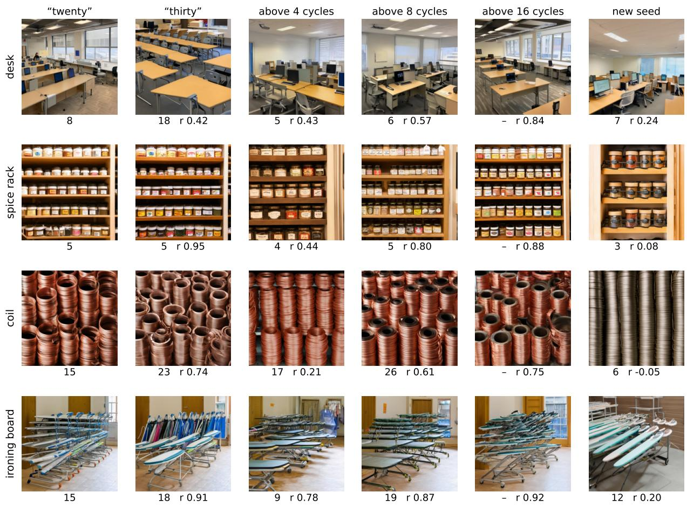  
Figure 10. Fine-scale redraws next to a new number and a new seed (SD3.5-M, 7682; four of the 16 people-counted types, drawn at random). From the noise of the image asked for twenty (first column): thirty asked from the same noise; the noise above 4, 8 and 16 cycles per image redrawn from the type’s second seed, still asked for twenty; and twenty from the second seed. Below each image: people’s final count (people did not count the 16-cycle redraws) and the correlation of its 24×24 grayscale thumbnail with the first column’s.

by SAM 3 and OWLv2, “thirty” draws fewer objects than the mean of “twenty-seven” and “thirty-five” (differences in log(1+n) −0.29 [−0.86, 0.22] and −0.34 [−0.76, 0.03]; by OWLv2, twenty-seven and thirty-five draw about as many as twenty-five), and “forty” draws fewer than “twentyfive” (−0.74 [−1.41, −0.15] and −0.40 [−0.86, −0.02]); Grounding DINO shows no drop at thirty. Part of the drop at thirty may thus belong to the word itself, and these 16 types cannot settle how much; SAM 3 reads half of the “forty” crowds as empty.

People’s counts. People counted the redraws above four and eight cycles on the 16 people-counted types: SD3.5- M’s at 4, 8, 12, 20 and 30 and FLUX.2 [klein]’s at 4, 8, 12, 20, 25 and 30 (352 pictures; eighth count, Sec. B.2). The plain images they are compared with were counted earlier under the same protocol: SD3.5-M’s seeds 1 and 2 in the sixth count, FLUX.2 [klein]’s seed 1 in the second count and its seed 2 (at 20, 25 and 30) in the seventh. The measures are those above, over the requests people counted (for SD3.5-M within the reach, four and eight only). In SD3.5- M the mean changes of log(1+n) are, within the reach and past it, 0.37 and 0.43 for a new number, 0.25 and 0.53 for a new seed, 0.29 and 0.32 for a redraw above four cycles, and 0.19 and 0.30 above eight cycles; two final counts of the same picture from different studies differ by 0.12 at both (Sec. B.4). In SD3.5-M, past the reach, a redraw above eight cycles moves the count 0.69 [0.38, 1.20] times as far as a new number and 0.57 [0.35, 0.91] times as far as a new seed, and a redraw above four cycles 0.73 [0.42, 1.31] and 0.60 [0.41, 0.87] times; SAM 3 on the same pictures gives 0.51 and 0.66 times a new number. At four and eight objects the redraws move the count 0.52 [0.27, 0.99] (f = 8) and 0.81 [0.50, 1.37] (f = 4) times as far as a new number, against 0.48 and 0.51 by SAM 3, 0.54 and 0.85 by Grounding DINO, and 0.44 and 0.82 by OWLv2 on the same pictures; request by request, the ratio for f = 8 rises from 0.34 at four objects to 0.96–0.97 at twenty and thirty. In FLUX.2 [klein], the redraws move the count 0.41 [0.19, 0.70] (f = 8) and 0.52 [0.29, 0.89] (f = 4) times as far as a new number within its reach (4, 8, 12), and 0.74 [0.44, 1.14] and 0.85 [0.63, 1.19] times at its edge (20, 25, 30), where they move it about as far as a new seed (0.99 and 1.12 times). People disagree on whether some of FLUX.2 [klein]’s large crowds show the object at all: of the 48 seed-1 pictures at 20–30 that both the second and the seventh count include, 29 get the same count and 6 get zero in one count and five or more in the other. With the seventh count’s seed-1 counts, the ratios at 20–30 become 1.15 and 1.47. Without the eight types that have any count of zero (a check we added after seeing the counts), they are 0.18 and 0.21 within the reach and 0.71 and 0.96 at its edge; in SD3.5-M, which loses two types, the ratios change by at most 0.08. The first two counts agree on 55% of SD3.5- M’s redraws and 67% of FLUX.2 [klein]’s. Noise-free ratios from the two independent first counts (Sec. D) are too uncertain here to add anything: half of their intervals reach zero, and the others are wide.

Relative error. For requests of 12, 16, 20, 25 and 30, a model that always draws sixteen objects has a mean relative error $| n - c | / c$ of 0.27, and the loose estimator of Sec. $\mathrm { A . 5 , }$ round $. ( c e ^ { s z } )$ , has 0.38 at $s = 0 . 4 5$ and 0.25 at $s = 0 . 3 0$ (simulated).

## E. The number at the denoiser, and what fails to give it a direction

## E.1. Probes of the conditioning and of the velocity

SD3.5-M, U2, seed 1. For U2’s 64 types and 23 number words, a ridge regression trained on the other words orders a held-out word in 0.89 of same-object pairs at 12–30 and 0.98 at 2–8 from SD3.5-M’s pooled CLIP vector, and in 0.85–0.97 from every text stream: the number word is decodable, in order, from the conditioning. Along U2’s plain trajectories, from σ=1 to 0.909, changing the object word moves the conditional velocity 1.18–1.57 times as far as the guidance direction of the trajectory’s own prompt, “two” to “four” 0.37–0.70 times, “twelve” to “twenty-five” 0.37– 0.42 times and “twenty” to “thirty” 0.21–0.26 times. These probes are descriptive.

## E.2. Value and spelling at the denoiser

Design. Along SD3.5-M’s own trajectories (the plain images’ noise of all 64 types, asked for four and for twenty, seed 1, guidance 4.5, 40 steps; 128 trajectories, each of which reproduces its stored image exactly), at each probe step the conditional velocity $v ( c )$ is evaluated at the same state for the prompts “a photo of $c \ X \mathbf { s } ^ { \prime \prime }$ with $c = \mathrm { t w } 0 ,$ four, twelve, twenty, twenty-five, thirty, the digits “2”, $^ { 6 6 } 1 2 ^ { , 5 }$ and “20”, twenty of the next type, and the empty prompt. A change of word is the difference of two such velocities; its size is given relative to the guidance direction v(own prompt) − v(empty). Quantities are averaged over the first ten steps $( \sigma ~ \ge ~ 0 . 9 0 9 )$ per trajectory; 95% intervals over types. The question: does the large number’s value move the velocity more than its spelling, $\| v ( 2 5 ) - v ( 1 2 ) \| / \| v ( ^ { \ast } 1 2 ^ { \ast } ) - v ( 1 2 ) \| ?$

early steps (σ ≥ 0.909), 128 trajectories estimate   
value / spelling: twelve → twenty-five over twelve → “12” 1.34 [1.25, 1.44]   
two → four over two $\to ^ { 6 6 } 2 ^ { 5 }$ 2.79 [2.54, 3.03]   
twenty → thirty over twenty $ ^ { 6 6 } 2 0 ^ { 5 }$ 0.78 [0.72, 0.84]   
size relative to guidance: $1 2 {  } 2 5 , 1 2 {  } ^ { \ast } 1 2 ^ { , }$ 0.40, 0.33   
$2 \right. 4 , 2 \right. ^ { \left. } 2 ^ { \left. } ;$ another object 0.60, 0.25; 1.45  
Table 27. Value and spelling at the denoiser (SD3.5-M). By step, the large pair’s value / spelling ratio is 1.79 and 1.76 at the first two steps and 1.17–1.38 at later steps; the small pair’s 2.3–3.4. Trajectories asked for four and for twenty give the same picture (1.30 and 1.38).

Results. The large number’s value moves the velocity only 1.34 times as far as its spelling, where a small number’s value moves it 2.8 times as far. The velocity norms shared with the probe of Sec. E.1 agree with it (median relative difference 0.7%). The denoiser receives a large number mostly as a different word, not as a larger value.

## E.3. The timing test

Design. SD3.5-M at $7 6 8 ^ { 2 }$ , 40 steps, guidance 4.5, U2’s 64 types, seed 1. Every image shares prompt, noise and size with U2’s plain image of its base request, which is its baseline. Pairs: 2 vs. 4 (control) and 12 vs. 25. Direction alternates over the sorted 16 people-counted types and over the sorted other 48, starting with “up” (32 types each): up, the base request is the lower count and the window’s word the higher; down, the reverse. Swap: the prompt asks the base request at every step except one window of five steps, where it asks the window’s word; windows start at steps 0, 5, 10, 15, 20, 25 and 30 (σ 1.000–0.963, 0.953–0.909, 0.897– 0.843, 0.828–0.760, 0.741–0.653, 0.628–0.509, 0.475– 0.308); 896 images. Amplified (large pair): the prompt asks the window word’s side throughout and receives the amplification contrast $+ L \left( c ( \mathrm { a s k e d } ) - c ( \mathrm { p a r t n e r } ) \right)$ L=5, only inside a window starting at step 10, 15 or 20; baseline, the plain image of the asked request; 192 images. Floor: the amplified arm’s tasks for the 16 people-counted types at $L { = } 1 0 ^ { - 6 }$ (48 images). The sampler is the amplification test’s (Sec. E.6). Per pair and window, over types (s=+1 up, −1 down): shift, the mean of s $[ \log ( 1 + n _ { W } ) -$ log(1+n0)]; toward, among types whose count changed, the share that moved toward the window’s word; changed, the share of types whose count changed. Counters and bootstrap as elsewhere. Images swapped in the first window differ from both the base request’s and the window word’s plain image (median pixel distance 26–46 and 16–20; none identical); images swapped in the last window are near their base (median about 1).

Results (Tab. 28). The small word acts early: its shift intervals lie above zero at windows 0 and 5, with most changes toward the word, and its shift is near zero from window 15 on. At window 0 the word changes the count of 0.58 (small pair) and 0.64 (large pair) of the types, but no large-pair window has a shift interval above zero, at window 0 only 0.46 of the large word’s changes go its way, and the amplified windows have no effect either. People’s share toward the word is within 0.15 of SAM 3’s on the same pictures at three of the six windows (the small pair at steps 0–4 and 10–14, the large pair at 0–4), but not at the small pair’s steps 20–24 (one changed type) or the large pair’s 10–14 and 20–24 (Tab. 29). People’s counts show one later shift toward the large word, at steps 20–24 (+0.20 [0.01, 0.53]; four changed types, all toward the word), which no automatic counter shows (SAM 3 on the same pictures: +0.02 [−0.02, 0.08]); it rests on pictures that people count inconsistently (below). The large word thus changes many counts in the first window, without a direction, and does not act later under any automatic counter.

The large pair’s later windows, picture by picture. People’s later changes on the large pair come mostly from pictures they count inconsistently: the first two counts agree on 5 of the 16 pictures at window 10–14 and 6 of 16 at window 20–24 (small pair 10–13 of 16 at every window; large pair at window 0–4, 12 of 16). The four changes at window 20– 24: jewels (plain image 24 by people; the window picture’s three counts 26, 1 and 1, so 1; SAM 3 1 on both), ironing boards (27; 0, 20 and 29, so 20; SAM 3 0 on both), candy bars (21; 18, 8 and 17, so 17; SAM 3 24 and 25) and spice racks (4; 5, 20 and 5, so 5; SAM 3 1 on both). The jewels change from 24 to 1 is also one of the six changes toward the word at window 10–14 (counts 27, 1 and 1).

## E.4. The timing test in two more models

Design. U2’s 64 types, seed 1, the pairs and the direction per type of the timing test (Sec. E.3). SDXL: the sampler of the word test (40 Euler steps, guidance 5, 10242) with a prompt switch that replaces the text embeddings and the pooled embedding inside the window; plain images at 2, 4, 6, 8, 12, 16, 20, 25 and 30 (576; the baselines, and SDXL’s word test on U2); windows of five steps starting at steps 0, 5, . . . , 30 (896); the base number respelled in digits (“a photo of 12 cribs” inside “a photo of twelve cribs”) at windows 0 and 5 (256); the window’s word from step 0 up to step 10 or 20 (256). FLUX.2 [klein]: the word test’s sampler (50 steps, guidance 4, 10242), every prompt encoded once by the pipeline and switched by its step callback; baselines are the word test’s images; windows of six steps (12% of sampling, as five of 40) starting at steps 0, 6, . . . , 36 for the large pair and 0, 6, 12 for the small one (640); respelled at windows 0 and 6 (large) and 0 (small; 192); the window’s word up to step 12 or 24 (large; 128). SD3.5-M: the base number respelled in digits inside the timing test’s windows 0–4 and 5–9, both pairs (256), with its sampler. In every model the unconditional branch is unchanged. 3,200 images, counted by SAM 3, Grounding DINO and OWLv2. A window acts when its shift interval lies above 0 and toward is at least 0.75 (small pair) or 0.65 (large pair); full: the window’s word asked at every step (its plain image); prefix share: prefix shift over full shift. In every model the first window’s images differ from both plain images, while the last window’s lie near the base request’s plain image (Tabs. 30 and 31).

Results (SAM 3). In SDXL the large word moves the count over the whole trajectory (+0.30) and its first ten steps carry all of it (share 1.03); at its first window the small word changes more types than the respelling (+0.28 [0.14, 0.42]), and all four SDXL respelling intervals contain 0. The small word’s first window shifts the count (0.17 [0.02, 0.31]) with 74% of the changes toward the word, and its windows at steps 5–9 and 10–14 act; no single large window acts. In FLUX.2 [klein] the large word moves the count over the whole trajectory (+0.45); the small word acts at steps 0–5 and 6–11, the large word’s first window acts, and its first twelve steps carry the whole effect (share 1.00); in that first window the large word changes no more types than its respelling (+0.03 [−0.08, 0.14]), although only the word’s changes have a direction (82% against 58% toward). In SD3.5-M the large word’s first window changes about as many types as its respelling (+0.05), while the small word’s changes 0.33 more. Late windows stay small: every window from step 15 (SDXL) or 18 (FLUX.2 [klein]) has its interval within ±0.10 except one in each model (SDXL steps 20–24: [−0.004, 0.18]; FLUX.2 [klein] steps 18–23: [−0.07, 0.10], upper end 0.101). SDXL’s order on U2 is 0.76 at 2–8 and 0.61 at 12–30 (Sec. C.1).

What it shows. In FLUX.2 [klein] the earliest acting large window is the first, no later one acts and the prefix carries the whole effect: where its large number word moves the count, it acts early. In SDXL no single window passes the direction criterion, but the first ten steps act and carry about all of the effect (share 1.03 [0.53, 2.33]): an effect spread over the early windows, below single-window detection; under OWLv2 the first window acts (0.30 [0.15, 0.46], 69% toward). No window from step 10 acts in either model, so large numbers do not act late. In SD3.5-M the large word’s early change equals the respelling’s and has no direction.

Counters. For SDXL, OWLv2 gives the clearest large-pair effect (whole trajectory 0.45 [0.25, 0.65], prefix share 0.86) and Grounding DINO the weakest (0.15 [−0.07, 0.40]; its steps 5–9 window acts, and its respelling at steps 0–4 also leans toward the word, 0.25 [0.06, 0.43]). For FLUX.2 [klein] the detectors disagree with SAM 3 on direction: Grounding DINO reads fewer objects for twenty-five over the whole trajectory (−0.38 [−0.61, −0.16], set within the first twelve steps, share 1.01) and OWLv2 no change (−0.04 [−0.30, 0.22]); both miss many of FLUX.2 [klein]’s objects, which shrink to about 2% of the image at 25–30 (Tab. 17), while people’s counts in the word test grow from 12 for twelve to 20 for twentyfive. In both models and under every counter, every window from step 15 or 18 on stays within −0.07 to 0.18.

<table><tr><td rowspan="2">steps</td><td rowspan="2">σ</td><td colspan="3">2 vs. 4, SAM 3</td><td colspan="4">12 vs. 25, SAM 3</td><td colspan="2"> $2 \mathrm { v s } . 4$ </td></tr><tr><td>shift</td><td>toward (n)</td><td>changed</td><td>shift</td><td></td><td>toward (n) changed</td><td>shift: Grounding DINO/ OWLv2/ cons.</td><td></td><td>shift: Grounding DINO/ OWLv2/ cons.</td></tr><tr><td>0-4</td><td>1.000</td><td> $+ . 1 5 [ . 0 3 , . 2 7 ]$ </td><td>.76 (37)</td><td>.58</td><td></td><td> $- . 0 9 \left[ - . 3 0 , . 1 2 \right]$ </td><td>.46 (41)</td><td>.64</td><td> $+ . 1 4 / + . 1 0 / + . 1 1$ </td><td> $- . 1 7 / - . 1 1 / - . 3 0$ </td></tr><tr><td>5-9</td><td>.953</td><td>+.16 [.03, .29]</td><td>.85 (26)</td><td>.41</td><td></td><td> $+ . 0 3 \left[ - . 1 2 , . 1 9 \right]$ </td><td>.68 (31)</td><td>.48</td><td> $+ . 0 9 / + . 0 6 / + . 0 7$ </td><td> $- . 0 9 / - . 0 1 / - . 0 2$ </td></tr><tr><td>10-14</td><td>.897</td><td>+.00 [−.09, .08]</td><td>.50 (14)</td><td>.22</td><td></td><td> $+ . 0 8 \left[ - . 0 3 , . 2 3 \right]$ </td><td>.64 (28)</td><td>.44</td><td> $+ . 0 3 / + . 0 7 / - . 0 1$ </td><td> $- . 1 1 / - . 0 3 / + . 0 1$ </td></tr><tr><td>15-19</td><td>.828</td><td>-.02 [−.09, .05]</td><td>.42 (12)</td><td>.19</td><td></td><td> $+ . 0 5 [ - . 0 5 , . 1 8 ]$ </td><td>.59 (22)</td><td>.34</td><td> $+ . 0 1 / + . 0 3 / + . 0 0$ </td><td> $- . 0 4 / - . 0 1 / - . 0 1$ </td></tr><tr><td>20-24</td><td>.741</td><td>−.02 [−.05, .01]</td><td>.25 (4)</td><td>.06</td><td></td><td> $+ . 0 4 \ \bar { [ - . 0 4 , . 1 7 ] }$ </td><td>.40 (20)</td><td>.31</td><td> $+ . 0 0 / - . 0 1 / - . 0 1$ </td><td> $- . 0 4 / + . 0 1 / + . 0 0$ </td></tr><tr><td>25-29</td><td>.628</td><td>+.02 [−.01, .06]</td><td>.75 (4)</td><td>.06</td><td></td><td> $+ . 0 2 \left[ - . 0 3 , . 0 7 \right]$ </td><td>.50 (14)</td><td>.22</td><td> $+ . 0 0 / + . 0 0 / + . 0 0$ </td><td> $- . 0 3 / + . 0 0 / + . 0 0$ </td></tr><tr><td>30-34</td><td>.475</td><td>+.00 [−.02, .01]</td><td>.33 (3)</td><td>.05</td><td></td><td>+.02 [−.02, .08]</td><td>.43 (14)</td><td>.22</td><td> $+ . 0 0 / - . 0 2 / + . 0 0$ </td><td> $- . 0 1 / + . 0 0 / + . 0 0$ </td></tr></table>

Table 28. The timing test (SD3.5-M, U2, 64 types, seed 1). Shift with 95% noun-cluster intervals; toward: share of the changed types that moved toward the window’s word (n: changed types). Under Grounding DINO the large pair’s shift is negative at every window (window 10–14: −0.11 [−0.19, −0.03]) and its toward at most 0.42; under OWLv2 the large pair’s toward lies between 0.40 and 0.61; the consensus changes few large-pair counts after window 0–4. Amplified arm (SAM 3): window 10–14: shift −.02 [−.08, .05], toward .50 (20); window 15–19: shift +.00 [−.03, .02], toward .46 (13); window 20–24: shift +.02 [−.01, .05], toward .58 (12). Floor: 87.5% of counts equa the plain image’s (Grounding DINO 95.8%, OWLv2 66.7%, consensus 95.8%). The consensus counts only images with a two-of-three majority, so its large-pair summaries rest on 23–36 of the 64 types (small pair 43–51). By direction: the large pair’s small positive shifts at windows 5–19 come from “down” (base 25, window “twelve”; +0.13, +0.15, +0.09); “up” gives −0.07, 0.00 and +0.01.

<table><tr><td></td><td></td><td colspan="3">people</td><td colspan="2">SAM 3, same pictures</td><td>toward</td></tr><tr><td>pair</td><td>steps</td><td>shift</td><td>toward (n) changed</td><td></td><td>shift</td><td>toward (n)</td><td>diff.</td></tr><tr><td>2 vs.4</td><td>0-4</td><td>+.13 [−.09, .31]</td><td>.77 (13)</td><td>.81</td><td> $+ . 3 9 [ . 1 3 , . 6 8 ]$ </td><td>.85 (13)</td><td>-.08</td></tr><tr><td></td><td></td><td>10–14 +.02 [−.04, .07]</td><td>.67 (3)</td><td>.19</td><td> $+ . 1 1 \ [ - . 0 1 , . 2 6 ]$ </td><td>.75 (4)</td><td>-.08</td></tr><tr><td></td><td></td><td>20–24 +.03 [.00, .08]</td><td>1.00 (1)</td><td>.06</td><td> $- . 0 5 \left[ - . 1 6 , . 0 5 \right]$ </td><td>.33 (3)</td><td>+.67</td></tr><tr><td></td><td></td><td> $1 2 \mathrm { v s . } 2 5 0 \mathrm { - } 4 - . 0 3 [ \bar { - } . 4 3 , . 3 \bar { 3 } ]$ </td><td>.46 (13)</td><td>.81</td><td> $- . 1 8 [ - . 6 0 , . 1 8 ]$ </td><td>.44 (9)</td><td>+.02</td></tr><tr><td></td><td></td><td> $1 0 { - } 1 4 \ + . 2 0 \ [ - . 0 6 , . 5 8 ]$ </td><td>.60 (10)</td><td>.63</td><td> $+ . 0 3 [ - . 0 4 , . 1 1 ]$ </td><td>.80 (5)</td><td> $- . 2 0$ </td></tr><tr><td></td><td></td><td> $2 0 { - } 2 4 + . 2 \bar { 0 } \left[ . 0 1 , . 5 3 \right] ^ { - }$ </td><td>1.00 (4)</td><td>.25</td><td> $+ . 0 2 [ - . 0 2 , . 0 8 ]$ </td><td>.50 (4)</td><td> $+ . 5 0$ </td></tr></table>

Table 29. People and the timing test (16 types; people: the window picture’s human count against the first study’s human count of the same plain image; SAM 3: the same pictures against SAM 3 on the plain image). The two first counts agree exactly on 60% of the 96 pictures; checks .95, .95 and .90 exact per round.

Up and down. At the first window, the large word moves the count toward itself in both directions by the point estimates: in SDXL by +0.16 for the 32 types asked to go up and +0.29 for the 32 asked to go down, in FLUX.2 [klein] by +0.16 and +0.33; each direction’s interval, on 32 types, contains 0.

Noise levels. The three schedules reach a given noise level at different steps. From each sampler’s own settings, the noise level σ at the first step of the five-step windows 0, 5, 10, . . . , 30 is 1.00, 0.95, 0.90, 0.83, 0.74, 0.63 and 0.48 in SD3.5-M (FlowMatch, shift 3) and, as the rectified-flow equivalent $\sigma _ { \mathrm { E u l e r } } / ( 1 + \sigma _ { \mathrm { E u l e r } } )$ , 0.93, 0.87, 0.79, 0.70, 0.60, 0.50 and 0.39 in SDXL (scaled-linear betas, leading spacing; its first step is not pure noise); at the six-step windows

0, 6, 12, . . . , 36 of FLUX.2 [klein] (dynamic shift for $1 0 2 4 ^ { 2 } )$ it is 1.00, 0.98, 0.96, 0.93, 0.89, 0.83 and 0.75. The small word’s acting windows therefore end at σ 0.91 in SD3.5-M, 0.96 in FLUX.2 [klein] and 0.72 in SDXL; the numbers are not strictly comparable across models, whose latent spaces differ.

Object sizes in the windows. Against the base request’s plain image, the change in log median SAM 3 box area, signed so that positive means the objects changed size the way the window’s word asks (smaller for the larger request): FLUX.2 [klein], large pair, +0.66 [0.41, 0.92] with the word at every step, +0.35 [0.15, 0.55] at steps 0–5, +0.33 [0.18, 0.48] at 6–11, +0.09 at 12–17, at most +0.04 later, +0.69 for the twelve-step prefix; SDXL, large pair, +0.35 [0.01, 0.69] at every step, +0.21 [−0.09, 0.52] at steps 0–4, at most +0.03 later, +0.35 for the ten-step prefix; SD3.5-M, large pair, +0.01 [−0.32, 0.35] at every step. The small pairs rescale by +0.49 to +0.71 at every step and by +0.28 to +0.36 in the first window; respelling rescales by at most +0.17 (intervals containing 0 except SDXL’s small pair at steps 5–9, +0.15 [0.02, 0.32]).

## E.5. When the model’s own crowd is fixed

A commitment probe follows SD3.5-M’s own plain trajectories asked for 4, 12 and 25 objects (64 U2 types, seed 1; every final image equals U2’s, mean absolute difference 0). At each step the guided velocity gives an estimate $\scriptstyle { \hat { x } } _ { 0 }$ of the clean latent; we correlate it, after an ideal low-pass at 2, 4 or 8 cycles per image width, with the final latent, and SAM 3 counts the decoded $\scriptstyle { \hat { x } } _ { 0 }$ at twelve steps. The coarse layout is fixed at once: the correlation at 4 cycles reaches 0.9 by step 2 (σ=0.98) in the median trajectory at every request (mean 0.84–0.86 at step 0, 0.99 at step 9), so its share fixed by step 9 is 1.00 at 4, 12 and 25. The count, as SAM 3 reads the estimated image, settles later: within max(1, 10%) of the final count from step 9 on (σ=0.91) in

<table><tr><td></td><td colspan="3">SAM3</td><td rowspan="2"></td></tr><tr><td>window (steps)</td><td>shift</td><td>toward (types)</td><td>changed</td></tr><tr><td>SDXL, two vs. four</td><td></td><td></td><td></td><td></td><td></td></tr><tr><td>2 vs. 4: every step</td><td>+.41 [.27, .55]</td><td>.85 (54)</td><td>.84</td><td> $+ . 3 8 / + . 4 3 / + . 3 5$ </td><td></td></tr><tr><td>swap 0-4</td><td>+.17 [.02, .31]</td><td>.74 (39)</td><td>.61</td><td> $+ . 1 9 / + . 1 9 / + . 2 3$ </td><td></td></tr><tr><td>swap 5–9</td><td>+.16 [.06, .27]</td><td>.77 (31)</td><td>.48</td><td> $+ . 0 9 / + . 1 4 / + . 1 8$ </td><td>acts</td></tr><tr><td>swap 10–14</td><td>+.09 [.00, .17]</td><td>.76 (17)</td><td>.27</td><td> $+ . 0 2 / + . 0 3 / + . 0 6$ </td><td>acts</td></tr><tr><td>swap 15–19</td><td>+.01 [−.02, .03]</td><td>.54 (13)</td><td>.20</td><td> $+ . 0 0 / - . 0 1 / + . 0 0$ </td><td> $\pm . 1 0$ </td></tr><tr><td>swap 20–24</td><td>+.01[−.01,.03]</td><td>.57 (7)</td><td>.11</td><td> $+ . 0 1 / + . 0 0 / + . 0 2$ </td><td> $\pm . 1 0$ </td></tr><tr><td>swap 25–29</td><td>+.00 [−.03, .01]</td><td>.60 (5)</td><td>.08</td><td> $+ . 0 0 / + . 0 0 / + . 0 1$ </td><td> $\pm . 1 0$ </td></tr><tr><td>swap 30–34</td><td>+.00 [−.02, .01]</td><td>.57 (7)</td><td>.11</td><td> $- . 0 1 / - . 0 3 / + . 0 1$ </td><td> $\pm . 1 0$ </td></tr><tr><td>respelled 0–4</td><td>+.03 [−.05,.10]</td><td>.57 (21)</td><td>.33</td><td> $+ . 0 4 / + . 0 4 / + . 0 2$ </td><td></td></tr><tr><td>respelled 5–9</td><td> $+ . 0 1 [ - . 0 6 , . 0 8 ]$ </td><td>.56 (16)</td><td>.25</td><td> $- . 0 2 / + . 0 1 / - . 0 3$ </td><td></td></tr><tr><td>prefix 0–9</td><td> $+ . 2 9 \left[ . 1 5 , . 4 4 \right]$ </td><td>.85 (47)</td><td>.73</td><td> $+ . 3 4 / + . 3 2 / + . 3 7$ </td><td>acts (share .72 [.45, .94])</td></tr><tr><td>prefix 0–19</td><td> $+ . 4 0 \left[ . 2 6 , . 5 3 \right]$ </td><td>.91 (53)</td><td>.83</td><td> $+ . 4 1 / + . 4 1 / + . 4 0$ </td><td>acts (share .98 [.90, 1.07])</td></tr><tr><td colspan="6">SDXL, twelve vs. twenty-five</td></tr><tr><td>12 vs. 25: every step</td><td>+.30 [.04, .56]</td><td>.60 (50)</td><td>.78</td><td> $+ . 1 5 / + . 4 5 / + . 5 9$ </td><td></td></tr><tr><td>swap 0-4</td><td>+.22 [.02, .43]</td><td>.62 (45)</td><td>.70</td><td> $+ . 1 4 / + . 3 0 / + . 2 0$ </td><td></td></tr><tr><td>swap 5–9</td><td>+.02 [−.10,.12]</td><td>.54 (39)</td><td>.61</td><td> $+ . 1 4 / + . 1 0 / + . 0 0$ </td><td></td></tr><tr><td>swap 10–14</td><td>-.04 [−.10,.00]</td><td>.44 (32)</td><td>.50</td><td> $+ . 0 4 / + . 0 0 / + . 0 1$ </td><td></td></tr><tr><td>swap 15–19</td><td> $+ . 0 1 \left[ - . 0 3 , . 0 5 \right]$ </td><td>.52 (29)</td><td>.45</td><td> $- . 0 1 / - . 0 2 / + . 0 0$ </td><td> $\pm . 1 0$ </td></tr><tr><td>swap 20–24</td><td>+.06 [.00, .18]</td><td>.56 (25)</td><td>.39</td><td> $+ . 0 2 / + . 0 0 / + . 0 1$ </td><td></td></tr><tr><td>swap 25–29</td><td> $+ . 0 0 [ - . 0 2 , . 0 2 ]$ </td><td>.50 (18)</td><td>.28</td><td> $+ . 0 1 / + . 0 1 / + . 0 0$ </td><td> $\pm . 1 0$ </td></tr><tr><td>swap 30–34</td><td>+.01 [−.01, .04]</td><td>.63 (19)</td><td>.30</td><td> $+ . 0 1 / + . 0 0 / + . 0 0$ </td><td> $\pm . 1 0$ </td></tr><tr><td>respelled 0–4</td><td> $- . 0 3 [ - . 3 2 , . 2 6 ]$ </td><td>.53 (45)</td><td>.70</td><td> $+ . 2 5 / + . 0 8 / + . 0 7$ </td><td></td></tr><tr><td>respelled 5–9</td><td> $+ . 0 1 [ - . 1 4 , . 1 6 ]$ </td><td>.55 (33)</td><td>.52</td><td> $+ . 0 7 / + . 0 2 / + . 0 2$ </td><td></td></tr><tr><td>prefix 0–9</td><td> $+ . 3 0 \ [ . 0 8 , . 5 2 ]$ </td><td>.70 (47)</td><td>.73</td><td> $+ . 1 7 / + . 3 8 / + . 0 9$ </td><td>acts (share 1.03 [.53, 2.33])</td></tr><tr><td>prefix 0–19</td><td> $+ . 3 2 [ . 0 4 , . 6 1 ]$ </td><td>.62 (50)</td><td>.78</td><td> $+ . 1 6 / + . 4 4 / + . 4 6$ </td><td>(share 1.07 [.61, 1.85])</td></tr></table>

Table 30. The timing test in SDXL (U2, 64 types, seed 1; 95% intervals over types). Shift: mean change in log(1+n) toward the window’s word against the plain image of the base request; toward: share of the types whose count changed that moved toward the word (number of such types); changed: share of types whose count changed. “acts”: shift interval above 0 and toward at least 0.75 (small pair) or 0.65 (large pair); ±.10: interval within ±0.10 (windows from step 15); share: prefix shift over the shift with the word at every step.

47% [35, 60] of trajectories asked for four, 40% [27, 53] for twelve and 28% [16, 41] for twenty-five (25 minus 4: −0.19 $[ - 0 . 3 6 , - 0 . 0 2 ] )$ , with median settling steps 12, 12 and 15 (σ 0.87–0.83); blurred early estimates may be read late, so these bound the count’s commitment from above. The final counts stay small whatever the request (medians 4, 8 and 6). By step 9 the layout is set at every request, while the count is set in fewer than half of the trajectories at any request.

## E.6. Amplifying the number word

SD3.5-M, U2, seed 1, SAM 3 unless stated. During the first ten steps $( \sigma \geq 0 . 9 0 9 ) , L ( v ( c ) - v ( c ^ { \prime } ) )$ was added to the guided velocity, $c ^ { \prime }$ being the prompt with the pair’s other request, a contrastive guidance [59] used to improve counts up to ten [52] (L=2, 5, 10; 768 images), or the prompt without its number (L=5, 10; 896 images). The small pair stays ordered (0.86–0.92; 0.94 unsteered); the large pair does not become ordered (0.52 unsteered, 0.41 [0.28, 0.54] at L=10). Against the number-free prompt the exact rate at 12–30 moves from 2.5% to 4.1% and 3.1% (L=5 minus $L { = } 0 \colon + 0 . 0 1 6 [ - 0 . 0 0 6 , 0 . 0 4 1 ] )$ , and people find 4% exact at L=10, the plain prompt’s rate; their medians at 12, 16,

20, 25 and 30 are 8, 6, 8.5, 10.5 and 4.5 (SAM 3: 6.5, 2, 6, 4.5 and 5). In the timing test’s amplified arm (Sec. E.3) the large word was amplified inside windows from step 10 to step 24 without effect. Amplified, the large number word gains no direction.

## E.7. A direction borrowed from small numbers

Design. SD3.5-M, 64 types, seed 1, the plain images’ noise (7682, 40 steps, guidance 4.5). The prompt asks for twelve (the main case) or twenty-five; during the first ten steps $( \sigma \ge 0 . 9 0 9 )$ the guided velocity gets $+ L ( v \mathrm { ( f o u r ) - }$ v(two)) $( ^ { 6 6 } \mathrm { u p } ^ { , 9 } )$ or the reverse $( ^ { 6 4 } \mathrm { d o w n } ^ { 7 9 } ) .$ , where v(c) is the conditional velocity for “a photo of c $X \mathrm { s } ^ { , \mathrm { s } }$ at the same state, with $L = 1 , 2 , 4 , 8 ,$ , and $L = 0$ is the plain image (1,152 images); every cell differs from every other cell of its noise. The L-order is the share of same-noise pairs of strengths whose counts differ in which the stronger push moves the count the borrowed way (more objects up, fewer down).

Results. The up push moves the crowd the other way: its L-order is a reversal, with its interval below 0.5, and at $L { = } 8$ it shrinks the crowd. The down push shrinks it, the way it pushes (0.73). Both pushes bring the crowd toward the small pair’s own counts (medians about four and two at L=8), and the exact rate at twelve falls from 9% to 5%. The small numbers’ difference points toward small counts, not toward “more”.

<table><tr><td rowspan="2">window (steps)</td><td colspan="3">SAM3</td><td rowspan="2" colspan="3">shift: Grounding DINO/ OWLv2/ consensus</td></tr><tr><td>shift</td><td>toward (types)</td><td>changed</td></tr><tr><td colspan="6">FLUX.2 [klein], two vs. four</td></tr><tr><td>2 vs. 4: every step</td><td>+.26 [.10, .41]</td><td>.82 (50)</td><td>.78</td><td> $+ . 4 3 / + . 2 7 / + . 2 5$ </td><td></td></tr><tr><td>swap 0-5</td><td>+.17 [.03, .31]</td><td>.83 (30)</td><td>.47</td><td> $+ . 2 1 / + . 2 1 / + . 1 7$ </td><td>acts</td></tr><tr><td>swap 6-11</td><td>+.16 [.10, .23]</td><td>.96 (24)</td><td>.38</td><td> $+ . 1 6 / + . 1 1 / + . 1 2$ </td><td>acts</td></tr><tr><td>swap 12–17</td><td> $- . 0 1 \left[ - . 0 7 , . 0 4 \right]$ </td><td>.63 (8)</td><td>.13</td><td> $+ . 0 3 / - . 0 1 / + . 0 1$ </td><td></td></tr><tr><td>respelled 0–5</td><td> $- . 0 1 [ - . 1 2 , . 1 0 ]$ </td><td>.55 (11)</td><td>.17</td><td> $+ . 0 4 / + . 0 1 / + . 0 4$ </td><td></td></tr><tr><td colspan="6">FLUX.2 [klein], twelve vs. twenty-five</td></tr><tr><td>12 vs. 25: every step</td><td>+.45 [.20, .69]</td><td>.83 (42)</td><td>.66</td><td> $- . 3 8 / - . 0 4 / - . 1 6$ </td><td></td></tr><tr><td>swap 0–5</td><td>+.24 [.01, .48]</td><td>.82 (38)</td><td>.59</td><td> $- . 1 7 / - . 1 1 / + . 1 6$ </td><td>acts</td></tr><tr><td>swap 6–11</td><td>+.11 [−.06, .29]</td><td>.84 (31)</td><td>.48</td><td> $- . 1 7 / - . 0 5 / - . 1 3$ </td><td></td></tr><tr><td>swap 12–17</td><td>+.06 [−.03,.18]</td><td>.86 (14)</td><td>.22</td><td> $- . 0 2 / - . 0 5 / - . 0 2$ </td><td></td></tr><tr><td>swap 18–23</td><td> $+ . 0 2 \bar { [ - . 0 7 , . 1 0 ] }$ </td><td>.64 (14)</td><td>.22</td><td> $+ . 0 1 / + . 0 0 / + . 0 0$ </td><td></td></tr><tr><td>swap 24–29</td><td> $- . 0 2 [ - . 0 7 , . 0 1 ]$ </td><td>.50 (10)</td><td>.16</td><td> $+ . 0 0 / + . 0 0 / + . 0 0$ </td><td>±.10</td></tr><tr><td>swap 30–35</td><td> $- . 0 3 \left[ - . 0 7 , . 0 0 \right]$ </td><td>.25 (8)</td><td>.13</td><td> $+ . 0 1 / + . 0 0 / + . 0 0$ </td><td>±.10</td></tr><tr><td>swap 36-41</td><td> $+ . 0 0 [ - . 0 5 , . 0 4 ]$ </td><td>.56 (9)</td><td>.14</td><td> $+ . 0 1 / + . 0 0 / + . 0 0$ </td><td>±.10</td></tr><tr><td>respelled 0–5</td><td> $+ . 0 5 [ - . 1 7 , . 2 9 ]$ </td><td>.58 (36)</td><td>.56</td><td> $- . 0 5 / + . 0 4 / - . 0 8$ </td><td></td></tr><tr><td>respelled 6–11</td><td> $+ . 1 8 [ - . 0 6 , . 4 4 ]$ </td><td>.63 (27)</td><td>.42</td><td> $+ . 0 5 / + . 0 4 / - . 0 2$ </td><td></td></tr><tr><td>prefix 0–11</td><td> $+ . 4 5 [ . 1 9 , . 7 1 ]$ </td><td>.83 (41)</td><td>.64</td><td> $- . 3 8 / - . 0 4 / - . 1 6$ </td><td>acts (share 1.00 [.83, 1.18])</td></tr><tr><td>prefix 0–23</td><td> $+ . 4 7 \ [ . 2 2 , . 7 3 ]$ </td><td>.83 (42)</td><td>.66</td><td> $- . 3 8 / - . 0 5 / - . 0 9$ </td><td>acts (share 1.06 [.99, 1.18])</td></tr><tr><td colspan="6">SD3.5-M, the base number respelled inside the timing test&#x27;s windows</td></tr><tr><td>SD3.5-M small respelled 0–4</td><td> $+ . 0 5 \left[ - . 0 5 , . 1 6 \right]$ </td><td>.50 (16)</td><td>.25</td><td> $+ . 0 4 / - . 0 8 / + . 0 5$ </td><td></td></tr><tr><td>SD3.5-M small respelled 5–9</td><td> $- . 0 3 \left[ - . 0 9 , . 0 2 \right]$ </td><td>.38 (13)</td><td>.20</td><td> $+ . 0 2 / - . 0 6 / + . 0 1$ </td><td></td></tr><tr><td>SD3.5-M large respelled 0–4</td><td> $- . 1 0 [ - . 2 7 , . 0 8 ]$ </td><td>.34 (38)</td><td>.59</td><td> $- . 0 7 / - . 0 2 / - . 1 0$ </td><td></td></tr><tr><td>SD3.5-M large respelled 5–9</td><td> $+ . 0 6 [ - . 0 7 , . 2 2 ]$ </td><td>.54 (26)</td><td>.41</td><td> $\cdot . 0 1 / + . 0 0 / - . 0 6$ </td><td></td></tr></table>

Table 31. The timing test in FLUX.2 [klein], and the respelling control in SD3.5-M (as Tab. 30; FLUX.2 [klein] windows of six of 50 steps, ±.10 from step 18). SD3.5-M’s value swaps in the same windows are in Sec. E.3.

<table><tr><td>request, push</td><td>counter</td><td>L-order</td><td>shift at L=8</td><td> $\overline { { \mathrm { m e d i a n s ~ a t } L = 0 , 1 , 2 , 4 , 8 } }$ </td></tr><tr><td>twelve, up</td><td>SAM3</td><td>.36 [.27, .46]</td><td> $- 0 . 2 3 \ [ - 0 . 4 4 , - 0 . 0 3 ]$ </td><td>8,8, 8, 6, 4</td></tr><tr><td>twelve, down</td><td>Grounding DINO, OWLv2, cons. SAM3</td><td>.50, .35, .32 .73 [.66, .79]</td><td> $+ 0 . 0 9 , - 0 . 2 1 , - 0 . 1 2$  -0.59 [−0.78, -0.40]</td><td> $8 , 9 , 8 , 5 , 2$ </td></tr><tr><td></td><td>Grounding DINO, OWLv2, cons. .66, .66, .77</td><td></td><td>-0.36, −0.59, -0.64</td><td></td></tr><tr><td>twenty-five, up</td><td>SAM3</td><td>.43 [.35, .52]</td><td>-0.10[-0.34,0.14]</td><td> $6 , 7 , 6 , 6 , 4$ </td></tr><tr><td></td><td></td><td></td><td></td><td></td></tr><tr><td>twenty-five, down SAM 3</td><td></td><td></td><td>.68 [.60, .75] -0.60 [−0.84, -0.35]</td><td> $6 , 7 , 3 , 2 , 2$ </td></tr></table>

Table 32. The small pair’s difference added to a crowd prompt (SD3.5-M, 64 types, seed 1). Shift: mean $\log ( 1 + n _ { L } ) ~ -$ log(1+n0); 95% intervals over types. Images in which SAM 3 finds no object: 17% at L=0 and 16–20% at L=8.

## E.8. Text streams and dropped encoders

Design. From the noise of each type’s plain image (seeds 1 and 2), each text stream is given one number of a pair, two against four or twelve against twenty-five, in the prompt “a photo of $c X \mathbf { s } ^ { \mathbf { \prime } \mathbf { \prime } }$ . Cells are named by the number given to CLIP and to T5: LL and HH are the plain images of the smaller and the larger request; HL gives CLIP the larger and T5 the smaller, LH the reverse. In SD3.5-M, CLIP means both CLIP token sequences and the pooled CLIP vector; two more cells change the pooled vector alone. In FLUX.1- dev, CLIP is its only CLIP input, a pooled vector. The contrast for a stream compares two cells that differ only in that stream’s number (CLIP: HL against LL and HH against LH; T5: LH against LL and HH against HL; both: HH against LL); its order is the share of contrasts whose counts differ in which the cell with that stream’s larger number has more objects. SD3.5-M: 64 types, 1,536 images; FLUX.1-dev: 32 types (the 16 counted by people and 16 drawn at random from the other 48), 512 images, at the settings of its word test.

<table><tr><td rowspan="2"></td><td rowspan="2">counter</td><td colspan="3">two vs four</td><td colspan="3">twelve vs twenty-five</td></tr><tr><td>CLIP</td><td>T5</td><td>both</td><td>CLIP</td><td>T5</td><td>both</td></tr><tr><td>SD3.5-M</td><td>SAM3</td><td></td><td></td><td></td><td></td><td>.85 [.79, 92] .85 [.78, .91] .91 [.84, .97] .47 [.38, .56] .55 [.47, .64] .53 [.41, .65]</td><td></td></tr><tr><td></td><td>Grounding DINO</td><td>.88</td><td>.80</td><td>.88</td><td>.30 [.22, .38]</td><td>.42</td><td>.31</td></tr><tr><td></td><td>OWLv2</td><td>.80</td><td>.74</td><td>.89</td><td>.45</td><td>.55</td><td>.46</td></tr><tr><td></td><td>consensus</td><td>.91</td><td>.90</td><td>.94</td><td>.26 [.13, .42]</td><td>.61</td><td>.34</td></tr><tr><td>FLUX.1-dev SAM 3</td><td></td><td></td><td></td><td></td><td>.63 [.38, .83] .84 [.73, .93] .83 [.69, .94] .64 [.48, .78] .36 [.15, .56] .53 [.33, .71]</td><td></td><td></td></tr><tr><td></td><td>Grounding DINO</td><td>.56</td><td>.85</td><td>.88</td><td>.49</td><td>.28 [.16, .40] .25 [.11, .41]</td><td></td></tr><tr><td></td><td>OWLv2</td><td>.51</td><td>.81</td><td>.77</td><td>.57</td><td>.39</td><td>.51</td></tr><tr><td></td><td>consensus</td><td>.57</td><td>.89</td><td>.88</td><td>.43</td><td> $. 2 8 \ [ . 0 7 , . 5 2 ]$ </td><td>.35</td></tr></table>

Table 33. Stream test, every counter (order of each stream’s contrast; 95% intervals over types). SD3.5-M’s pooled vector alone: 0.56 [0.44, 0.66] at two vs four and 0.54 [0.45, 0.63] at twelve vs twenty-five (SAM 3). Interaction (both minus the sum of the two streams’ effects, in log(1+n)): SD3.5-M −0.02 [−0.11, 0.08] and +0.08 [−0.10, 0.25]; FLUX.1-dev +0.04 [−0.06, 0.15] and −0.08 [−0.27, 0.08].

Results. In both models at least one stream carries two against four to the crowd in order, and no stream carries twelve against twenty-five (Tab. 33). SD3.5-M’s CLIP and T5 streams each order the small pair and neither the large one; under Grounding DINO and the consensus its CLIP stream reverses the large pair. FLUX.1-dev’s T5 stream orders the small pair and moves the large one the wrong way if anything, a reversal under every counter.

One stream removed. SD3.5-M was trained with each encoder dropped at random, so it can draw with one of them empty (T5 as 77 zero tokens; CLIP as zero tokens and a zero pooled vector). With T5 dropped (CLIP only), the order at 2–8 stays at 0.88 [0.83, 0.93] and at 12–30 is 0.41 [0.34, 0.49] (plain images: 0.89 and 0.46; 64 types, seed 1, SAM 3); with CLIP dropped (T5 only), the order is 0.75 [0.67, 0.83] at 2–8 and 0.36 [0.28, 0.44] at 12–30, and the crowds past ten nearly vanish (medians 2, 1 and 1 objects at 12, 20 and 30, against 8, 6 and 4.5). Neither arm extends the reach: relative to the plain images, the order at 12–30 changes by −0.05 [−0.13, 0.04] and −0.10 [−0.20, 0.01], and both orders past ten are reversals. The large number is not lost in one encoder: in SD3.5-M each stream carries a small number to the crowd and none a large one, and in FLUX.1-dev the T5 stream carries a small number and not a large one.

## E.9. Starts against a planted count

SD3.5-M, U2, seed 1, SAM 3 unless stated.

Earlier starts against a plant of the other count. A grid of 2, 4, 12 or 25 cut-outs (58 types) was planted at σ from 0.991 to 0.909 and asked for the other count of its pair (116 conflicting and 116 agreeing cells per level). The small word pulls the count toward itself at every level (pull in log(1+n) from +0.40 at 0.991 to +0.18 at 0.909; all intervals exclude zero) and raises the share drawn with the asked count by 0.53 to 0.20 over the agreeing cells; the large word raises it by −0.01 to +0.03, and its pull lies between −0.20 and +0.14 with intervals that include zero except at 0.982 (−0.40 to −0.02). Under Grounding DINO, OWLv2 and their consensus the small-pair lift lies between 0.13 and 0.53 and the large-pair lift between −0.01 and +0.03. A planted 2 or 4 leaves free canvas while a planted 12 or 25 fills it; the re-noise test below removes this difference.

The model’s own images, re-noised. U2’s plain images asked for six and twenty objects (64 types; median SAM 3 count 5 and 6) were re-noised with their own noise to σ 0.991–0.813 and finished asking for 2 or 4, or for 12 or 25 (2,560 renders). The small pair stays ordered at 0.991 (order 0.93, pull +0.41) and loses order as the start sharpens (0.59 at 0.813); the large pair’s order is 0.45–0.56 down to σ=0.872 (pulls −0.08 to 0.00) and 0.80 at 0.813 (pull +0.07 [0.02, 0.16]), where most starts keep their count (0.69). Under Grounding DINO, OWLv2 and the consensus the large-pair pull never exceeds +0.02.

Starts between the two requests. Here the planted crowd lies between the pair’s two requests, so that either word must add or remove objects. For the large pair it is the model’s own image of the type with 16–20 objects by SAM 3, closest to 18 (51 types: 49 self-planted images, Sec. F.4, and 2 plain ones; mean SAM 3 count 17.9); for the small pair, a plain image with exactly three objects (32 types); seed 1, or seed 2 for a type without such an image. Each start is re-noised with its own noise (Eq. (3)) to σ 0.991, 0.963, 0.909, 0.872 or 0.813 and finished asking for 12 or 25, or for 2 or 4: 51 types × 2 requests × 5 levels and 32 × 2 × 5, 830 renders. At 0.991 the small pair is ordered (0.96) and the large pair is not (0.51 [0.36, 0.66]; small minus large 0.45 [0.28, 0.61]): asking for twelve thins the crowd in 98% of renders, and asking for twenty-five adds objects in only 18% (mean counts 8.3 and 10.6 from about 18). From the later starts the large pair’s order reaches 0.66 [0.51, 0.80] at σ=0.963 and 0.80 [0.60, 0.96] at 0.909, over the types whose two counts differ (41 and 20 of the 51), but the two words’ mean counts differ there by less than one object: 11.9 for twelve against 12.6 for twenty-five at 0.963, and 16.8 against 17.1 at 0.909 (differences 0.65 and 0.35). From 0.909 on, both words mostly keep the start’s count (0.55 of renders at 0.909, 0.74 at 0.813).

From a planted crowd, a small word moves the count toward itself at every start level; a large word hardly moves it toward its own count.

## E.10. Training the number word

Design. Two LoRAs of SD3.5-M (rank 32, α=64, the attention projections of every joint block; learning rate 10−4, batch 2, 1,500 steps, about 1.5 passes; seed 2027) were trained with the model’s own flow-matching loss on 2,037 of its own images of U1 and U3, none of a U2 type, whose SAM 3 count equals the request: 1,653 self-planted crowds of 12–30 objects (99 types; every arrangement of Sec. F.4; 7682) and 384 plain images of two to four objects (111 types; 5122). The count LoRA sees each image with its own prompt; the shuffled LoRA sees the same images in the same order with the same noise, but each crowd with the number word of another crowd (a seeded permutation; 162 of 1,653 keep their own). Each was tested at its training scale from U2’s plain prompts and noise (64 types, nine requests, seed 1, 7682, 40 steps, guidance 4.5; 576 images per arm). Twelve is the most common crowd count among the training images (306 of 1,653; 216 at twenty, 172 at thirty). Results (SAM 3, 64 types). Both arms learned crowds (count ×1.52 [1.29, 1.78] at 12–30, shuffled ×2.40). The count arm’s order at 12–30 is 0.58 [0.49, 0.67], against 0.44 [0.36, 0.52] shuffled and 0.46 plain: by SAM 3 the count LoRA orders large crowds somewhat better than the shuffled one (+0.14 [0.01, 0.27]). Its order at 2–8 is 0.92 (shuffled 0.91, plain 0.89). Exact by request (count arm): 0.86, 0.70, 0.53, 0.36, 0.41, 0.02, 0.12, 0.02 and 0.02 at 2–30, against 0.72, 0.44, 0.16, 0.12, 0.09, 0.03, 0, 0 and 0 plain and 0.70, 0.11, 0, 0, 0, 0, 0.02, 0.05 and 0.08 shuffled; at 12–

30, 11.6% against 2.5% plain and 2.8% shuffled. Medians at 12, 16, 20, 25 and 30: 12, 12, 14, 12, 10 (count), 28, 28, 28, 26, 24 (shuffled), 8, 8, 6, 6, 4 (plain). Ceiling (cap model): 5.4 [4.5, 7.5] plain, 9.3 [7.4, 10.8] count, 9.2 [7.1, 11.6] shuffled (count over shuffled 1.01 [0.83, 1.24]). Under Grounding DINO, OWLv2 and the consensus, count minus shuffled order at $1 2 \mathrm { - } 3 0 ~ \mathrm { i s ~ + } 0 . 0 8 ~ [ \mathrm { - } 0 . 0 4 , 0 . 2 0 ] , \mathrm { + } 0 . 1 0$ [0.00, 0.19] and +0.22 [0.03, 0.41], the count arm’s order 0.52, 0.53 and 0.61, and its exact rate at $1 2 { - } 3 0 8 . 7 { - } 1 1 . 6 \%$ People (fifth count). People counted 16 U2 types of both arms at every request (288 images; Sec. B.2). The count arm’s order at 2–8 is 0.98 and its mean log(1+n) at 12– 30 exceeds the untrained model’s by 0.46 [0.13, 0.80], but its order at 12–30, 0.43 [0.26, 0.61], is no higher than the shuffled arm’s (count minus shuffled 0.08 [−0.12, 0.27]): by people the count LoRA does not beat the shuffled one. Exact by request (count arm): 1.00, 0.81, 0.38, 0.44, 0.38, 0.06, 0.06, 0 and 0.06 at 2–30 (untrained 0.94, 0.38, 0, 0.13, 0.13, 0.06, 0, 0, 0; shuffled 0.81, 0.13 and then 0); at 12– 30, 11% against 4% untrained and 0% shuffled. Medians at 12–30: 12, 12, 12, 12, 9.5 (count), 36, 35, 33, 34.5, 17.5 (shuffled); on the same pictures SAM 3’s medians of the count arm at 16–30 are 12, 12, 12 and 7.5.

Trained on its own counted crowds, SD3.5-M learns counts up to about twelve, the most common crowd count among the training images, but not an order past it; trained on the same crowds with shuffled counts, it draws crowds of about 35 objects, so drawing capacity is not the limit.

## E.11. The conditional read as a classifier

Method. A diffusion classifier [10, 30], as Zhao et al. use to probe numerosity [68], compares, on an image y of known count, the conditional denoising loss under two prompts. The image is encoded to $x _ { 0 }$ (latent mode), noised to $x _ { k } = ( 1 - \sigma _ { k } ) x _ { 0 } + \sigma _ { k } \epsilon$ at ten steps k of the model’s own schedule (six draws of ϵ per image and step, shared by the prompts), and the conditional branch alone gives the velocity. An image prefers the true count when the loss under the other count’s prompt, averaged over the draws, is higher; the next type’s noun at the true count checks that the classifier reads the image at all. Win rate: share of images that prefer the true prompt, with 95% intervals over object types. The separation of a pair is the probability that an image with the larger count favours the larger word more than an image with the smaller count does (an AUC of the loss difference; 0.5: no separation), which, unlike the win rate, ignores a shift of both counts toward one word. Early steps $( \sigma \ge 0 . 9 1 $ in SD3.5-M) are those of the small word’s acting windows in the timing test. A version on composites of known count (cut-outs pasted on a flat ground) did not pass its own validity check, as the conditional named the object there less reliably than on the model’s own images, so we do not use it.

The model’s own images. The probe uses 259 of SD3.5- M’s own U2 images whose SAM 3 count equals the request: plain images asked for two (84 images of 52 types) or four (50 of 37), self-planted images asked for twelve (59 of 36) or twenty-five (56 of 37), and plain images asked for twelve (10). Here the classifier reads the object name: 0.97 at $\sigma { = } 0 . 9 4$ and 1.00 from 0.91 on. Two against four: 0.83, 0.88, 0.93 and 0.90 at σ 0.98, 0.96, 0.94 and 0.91 (two objects $0 . 8 1 { - } 0 . 9 2 ,$ four 0.86–0.96); at σ=1 both small counts lean toward “four” (two objects 0.49, four 0.86). Twelve against twenty-five: images of twelve prefer “twelve” throughout the high-noise steps (0.81–0.88), but images of twenty-five prefer “twenty-five” in only 0.14 [0.05, 0.25] and 0.32 [0.18, 0.46] at σ 1 and 0.98, in 0.54 [0.39, 0.68] and 0.48 [0.33, 0.64] at 0.96 and 0.94, and in 0.71 [0.61, 0.82] at 0.91, 0.64–0.89 below. Pooled over both directions, the large pair reaches 0.78 [0.72, 0.85] at $\sigma { = } 0 . 9 1$ , the last step of the word’s acting windows; above it, the pooled rate is at most 0.69, the later steps prefer the true large count more often than the early ones (difference 0.10 [0.04, 0.15]), and at the noisiest steps both large counts lean toward “twelve”. Separation: two from four 0.90, 0.98, 0.99 and 0.98 at σ 0.98–0.91; twelve from twenty-five 0.68 [0.58, 0.77], 0.76 [0.67, 0.83], 0.76 [0.68, 0.84] and 0.83 [0.76, 0.90]. The ten plain images of twelve objects prefer “twelve” in 0.80–1.00 at high noise. At the noise levels where SD3.5-M’s layout forms, its conditional thus carries the large count, but separates it far less than the small one and leans toward the smaller word.

An observer baseline. A small convolutional network trained on noised latents of the same images (fresh noise at each level; five folds over object types, the large pair’s training folds adding 356 self-planted grids of U1 and U3) and tested on the classifier’s own six noise draws per image and level gives a reference for what the noisy latent itself carries. Ranking images by the loss difference, SD3.5-M’s conditional separates two objects from four almost fully from $\sigma { = } 0 . 9 8$ on (area under the curve 0.90–0.99) and twelve from twenty-five partly (0.68–0.83); with the counts written in digits it separates the large pair less (0.55–0.63; digits minus words −0.14 [−0.19, −0.09]). The observer separates the twelve- and twenty-five-object grids almost fully from σ=0.96 on (0.97–1.00; 0.87 at 0.98) but the plain twoand four-object images poorly (0.65–0.68): averaged over σ 0.98–0.94, it separates the small pair worse than the conditional does, by −0.29 [−0.36, −0.22]. The grids’ count is thus present in the noisy latent where the conditional reads it only partly, but the observer may read the grid’s periodic layout rather than its count, so the comparison is descriptive only.

## F. Showing the count

## F.1. Saying against showing

The main text’s Fig. 7 shows both comparisons; this section gives every counter and the people’s counts in full.

Same noise, 12, 20 and 30 objects (main text, Fig. 7a). SD3.5-M at 7682 on U2, seed 1, so every arm shares its prompt’s noise with the plain image of the same cell. Saying: the number word, digits and the sentence “N Xs arranged in R rows of C” that names the planted grid’s rows and columns; showing: the content test’s three starts at σ=0.909 on the 58 types with a cut-out. The said arms are given on those 58 types (as in main text, Fig. 7a) and on all 64. Native resolution with the same seed gives 0.046 on the 58 types and 0.042 on all 64 (0.034 over both seeds; Sec. C.3).

<table><tr><td>exact at 12, 20, 30</td><td>SAM3</td><td>Grounding DINO</td><td>OWLv2</td><td>consensus</td></tr><tr><td colspan="5">said, 58 types (all 64)</td></tr><tr><td>number word</td><td>.035 [.011, .063] (.031)</td><td>.011 (.016)</td><td></td><td>.029 (.026) .023 (.021)</td></tr><tr><td>digits</td><td>.029 [.006, .055] (.026)</td><td>.006 (.005)</td><td></td><td>.006 (.005) .006 (.005)</td></tr><tr><td>rows-and-columns sentence</td><td>.069 [.035, .105] (.062)</td><td>.069 (.062)</td><td></td><td>.035 (.031) .046 (.042)</td></tr><tr><td>native resolution</td><td>.046 [.017, .083] (.042)</td><td>.035 (.031)</td><td></td><td>.052 (.047) .029 (.026)</td></tr><tr><td colspan="5">shown, 58 types, start at σ=0.909</td></tr><tr><td>grid of ellipses</td><td>.236 [.149, .328]</td><td>.241</td><td>.144</td><td>.207</td></tr><tr><td>grid of another type</td><td>.351 [.260, .446]</td><td>.305</td><td>.172</td><td>.264</td></tr><tr><td>grid of the type itself</td><td>.517 [.415, .618]</td><td>.448</td><td>.322</td><td>.448</td></tr><tr><td colspan="5">shown, 58 types, start at σ=0.943</td></tr><tr><td>grid of ellipses</td><td>.264</td><td>.213</td><td>.178</td><td>.230</td></tr><tr><td>grid of another type</td><td>.230</td><td>.230</td><td>.161</td><td>.195</td></tr><tr><td>grid of the type itself</td><td>.362</td><td>.328</td><td>.218</td><td>.339</td></tr></table>

Table 34. Saying and showing the same grid (SD3.5-M, U2, same noise). At σ=0.909 every counter puts each shown arm above each said arm and the type’s own cut-out above the other two. Ratio of ellipses to the best said arm: 3.4 (SAM 3), 3.5 (Grounding DINO), 2.8 (OWLv2, against native resolution) and 4.5 (consensus). SAM 3 finds no requested object in 46% of the ellipse images at σ=0.909.

People’s counts by route (main text, Fig. 7b). Final human counts of both studies at the five complete-row counts (FLUX.1-dev: 12, 16, 20, 30), 16 types each. Within 10%: |n − N| ≤ 0.1N, that is within one object at 12 and 16, two at 20 and 25, three at 30.
<table><tr><td>people, 12–30</td><td>exact</td><td></td><td>within one within 10% recognisable median n/N</td><td></td><td></td></tr><tr><td>SD3.5-M 5122, word (S1)</td><td>.04 [.00, .10]</td><td>.05</td><td>.06</td><td>.03</td><td>.49</td></tr><tr><td>SD3.5-M 7682, word</td><td>.04 [.00, .08]</td><td>.09</td><td>.10</td><td>.04</td><td>.33</td></tr><tr><td>SD3.5-M, amplified word (L=10)</td><td>.04 [.00, .08]</td><td>.08</td><td>.08</td><td>.03</td><td>.46</td></tr><tr><td>FLUX.1-dev, word (S2)</td><td>.08 [.02,.16]</td><td>.14</td><td>.14</td><td>.06</td><td>.49</td></tr><tr><td>SDXL, word (S2)</td><td>.04 [.00, .08]</td><td>.06</td><td>.10</td><td>.00</td><td>1.32</td></tr><tr><td>SDXL, Gu et al.&#x27;s first pass</td><td>.00</td><td>.04</td><td>.04</td><td>.00</td><td>.33</td></tr><tr><td>FLUX.2 [klein], word</td><td>.13 [.06, .19]</td><td>.21</td><td>.23</td><td>.08</td><td>.89</td></tr><tr><td>SDXL, Gu et al.&#x27;s re-layout</td><td>.11 [.04, .20]</td><td>.18</td><td>.23</td><td>.09</td><td>.43</td></tr><tr><td>GLIGEN, boxes</td><td>.46 [.31, .60]</td><td>.50</td><td>.50</td><td>.18</td><td>.92</td></tr><tr><td>SD3.5-M, self-planted</td><td>.59 [.40, .76]</td><td>.65</td><td>.66</td><td>.53</td><td>1.00</td></tr><tr><td>InstanceAssemble, boxes</td><td>.68 [.58, .78]</td><td>.68</td><td>.69</td><td>.38</td><td>1.00</td></tr><tr><td>FLUX.2 [klein], planted</td><td>.93 [.79, 1.00]</td><td>.94</td><td>.94</td><td>.68</td><td>1.00</td></tr></table>

Table 35. People’s counts by route. U2 unless stated; 80 pictures per row (64 for FLUX.1-dev). Intervals: 95% bootstrap over object types.

<table><tr><td></td><td>SAM3</td><td colspan="2">people, 16 types</td></tr><tr><td>exact at 12, 16, 20, 25, 30 (U2)</td><td>64 types</td><td>exact</td><td>recognisable</td></tr><tr><td>SD3.5-M, same cells and noise plain prompt</td><td>.022</td><td>.04 [.00, .08]</td><td>.04[.00, .08]</td></tr><tr><td>self-planting, grid</td><td>.470</td><td></td><td>.59 [.40, .76] .53 [.35, .70]</td></tr><tr><td>self-planting, scatter</td><td>.312</td><td></td><td></td></tr><tr><td>given the grid&#x27;s boxes, from pure noise</td><td></td><td></td><td></td></tr><tr><td>GLIGEN (SD1.4, 5122)</td><td>.234</td><td>.46[.31, .60]</td><td>.18[.09, .28]</td></tr><tr><td>InstanceAssemble (SD3-M, 10242)</td><td>.372</td><td></td><td>.38 [.24, .51]</td></tr><tr><td></td><td></td><td>.68 [.58, .78]</td><td></td></tr><tr><td>FLUX.2 [klein], same cells and noise</td><td></td><td></td><td></td></tr><tr><td>plain prompt</td><td>.050</td><td>.13 [.06, .19] .08 [.03, .13]</td><td></td></tr><tr><td>planted grid (σ=0.941)</td><td>.748a</td><td>.93 [.79, 1.00] .68 [.50, .84]</td><td></td></tr><tr><td>SDXL, Gu et al.&#x27;s pipeline [17], same cells and noise</td><td></td><td></td><td></td></tr><tr><td>first pass</td><td>.009</td><td>.00</td><td>.00</td></tr><tr><td>noise re-layout</td><td>.075</td><td>.11 [.04, .20] .09 [.03, .16]</td><td></td></tr></table>

Table 36. Supplying a layout (a58 types with a cut-out). Recognisable: exact, and the objects clearly the requested one. On U2’s clean grids SAM 3 is exact on 76–79% at each count. SAM 3 picks self-planting’s cut-outs and undercounts the layout models’ im ages by 5–8 objects on average (self-planting: 3), so routes are compared by people’s counts. People counted GLIGEN grounded at every step; by SAM 3 the two schedules’ exact rates differ by at most 0.02 overall.

Medians. On GLIGEN’s images SAM 3’s median is 0 at every request while people’s is 10, 16, 9.5, 25 and 27 (at 12, 16, 20, 25 and 30); on InstanceAssemble’s, people’s median equals the request at every count but 27 (26.5). People’s medians (and SAM 3’s) at 12, 16, 20, 25 and 30: FLUX.2 [klein] from the planted grids 12, 16, 20, 25, 30 (the same under SAM 3); SDXL’s first pass in Gu et al.’s pipeline 5 (1), 3.5 (1), 6.5 (2.5), 9 (2), 14.5 (3) and its relayout 11 (8), 15 (15.5), 7.5 (1.5), 5 (1), 7 (9.5).

Every route that plants the grid or gives its boxes draws the asked count far more often than any way of saying it (Tabs. 35 and 37), and FLUX.2 [klein] from a planted grid most often of all.

## F.2. What the start must show

For each of U2’s 58 types with a cut-out and each count 12, 16, 20, 25 and 30 (seed 1), the self-planted grid (same centres, object size, jitter and canvas) is filled in three ways: the type’s own cut-out (the set’s composite, unchanged); the cut-out of a partner type, the other type with a cut-out whose crop has the closest aspect ratio, on the partner’s own ground; or soft ellipses of the own cut-out’s size, filled with its mean colour under the SAM 3 mask, on the own ground. The prompt always names the type and the noise is the set’s. Starts at step 9 (σ=0.909, self-planting’s level) and step 6 (0.943); 1,740 images.

By count (own / another / ellipses, σ=0.909): 0.55 / 0.48 / 0.31 at 12, 0.52 / 0.38 / 0.31 at 16, 0.53 / 0.36 / 0.21 at 20, 0.59 / 0.29 / 0.21 at 25 and 0.47 / 0.21 / 0.19 at 30: the own cut-out holds across counts while the others fall. By class: objects on a plain ground 0.68 / 0.54 / 0.39, scenelike 0.47 / 0.27 / 0.13, thin 0.47 / 0.24 / 0.33. On the eight types whose mean colour barely differs from the ground, every start does poorly (0.15 / 0.10 / 0.08). At the noisier σ=0.943 the ellipses are redrawn as the object more often (object drawn in 79% of images) and the three starts move closer together. A start sets the count best when it shows the asked object itself.

<table><tr><td>16 types</td><td>count only</td><td>yes or partly</td><td>recognisable</td></tr><tr><td>plain prompt*</td><td>.04 [.00, .08]</td><td>.04 [.00, .08]</td><td>.04 [.00, .08]</td></tr><tr><td>self-planting</td><td>.50 [.33, .67]</td><td>.50 [.33, .67]</td><td>.44 [.28, .60]</td></tr><tr><td>GLIGEN*</td><td>.46 [.31, .60]</td><td>.45 [.30, .60]</td><td>.18 [.09, .28]</td></tr><tr><td>InstanceAssemble</td><td>.65 [.56, .74]</td><td>.64 [.54, .73]</td><td>.38 [.26, .50]</td></tr><tr><td>self-planting, complete counts</td><td>.59 [.40, .76]</td><td>.59 [.40, .76]</td><td>.53 [.35, .70]</td></tr><tr><td>self-planting, partial counts</td><td>.39 [.19, .61]</td><td>.39 [.19, .61]</td><td>.33 [.16, .52]</td></tr><tr><td>InstanceAssemble, complete</td><td>.68 [.58, .78]</td><td>.66 [.55, .76]</td><td>.38 [.24, .51]</td></tr><tr><td>InstanceAssemble, partial</td><td>.63 [.50, .73]</td><td>.61 [.47, .73]</td><td>.38 [.23, .53]</td></tr><tr><td>self-planting - plain*</td><td>.55 [.36, .74]</td><td>.55 [.36, .74]</td><td>.49 [.30, .66]</td></tr><tr><td>self-planting – GLIGEN*</td><td>.13 [−.06, .31]</td><td>.14 [−.06, .33]</td><td>.35 [.16, .54]</td></tr><tr><td>self-planting — InstanceAssemble</td><td> $- . 1 \bar { 5 } [ - . 3 4 , . 0 \bar { 3 } ]$ </td><td> $- . 1 \dot { 4 } [ - . 3 2 , . 0 \dot { 4 } ]$ </td><td> $. 0 6 [ - . 0 9 , . 2 3 ]$ </td></tr><tr><td>second count*</td><td></td><td></td><td></td></tr><tr><td>FLUX.2 [klein] plain</td><td>.13 [.06, .19]</td><td>.13 [.06, .19]</td><td>.08 [.03, .13]</td></tr><tr><td>FLUX.2 [klein] planted</td><td>.93 [.79, 1.00]</td><td>.91 [.76, 1.00]</td><td>.68 [.50, .84]</td></tr><tr><td>SDXL first pass (Gu et al.)</td><td>.00</td><td>.00</td><td>.00</td></tr><tr><td>noise re-layout</td><td>.11 [.04, .20]</td><td>.11 [.04, .20]</td><td>.09 [.03, .16]</td></tr><tr><td>SD3.5-M, word amplified</td><td>.04 [.00, .08]</td><td>.04 [.00, .08]</td><td>.03 [.00, .06]</td></tr><tr><td>FLUX.2 [klein] planted − plain</td><td>.80 [.66, .90]</td><td>.79 [.65, .90]</td><td>.60 [.41, .76]</td></tr><tr><td>FLUX.2 [klein] planted — self-planting</td><td>.34 [.19, .50]</td><td>.33 [.18, .49]</td><td>.15 [−.01, .30]</td></tr><tr><td>re-layout — first pass</td><td>.11 [.04, .20]</td><td>.11 [.04, .20]</td><td>.09 [.03, .16]</td></tr><tr><td>amplified – plain SD3.5-M</td><td>.00 [−.04, .04]</td><td>.00 [−.04, .04]</td><td>−.01 [−.04, .00]</td></tr><tr><td>amplified — self-planting</td><td></td><td>−.55 [−.73, −.38] −.55 [−.73, −.38] −.50 [−.68, −.33]</td><td></td></tr></table>

Table 37. The methods, by human count (16 types of U2). Exact at 12–30; ∗12, 16, 20, 25, 30 only, differences on the same cells. Count only: the human count equals the request; yes or partly / recognisable: and the majority look-alike answer is “yes, clearly” or “partly” / “yes, clearly”. SAM 3 on the same pictures: .04, .38, .18, .40. Look-alike shares where objects were marked (yes / partly / no): self-planting .72 / .27 / .01, InstanceAssemble .58 / .40 / .02, GLIGEN .41 / .57 / .02, plain .72 / .28 / .00. Second count, in the order listed: SAM 3.05, .71, .03, .06, .01; look-alike .84 / .16 / .00, .72 / .27 / .01, .68 / .32 / .00, .75 / .25 / .00, .64 / .36 / .00.

<table><tr><td>start shows</td><td>σ=0.909</td><td></td><td>σ=0.943 object drawn</td></tr><tr><td>own cut-out</td><td>.531 [.43, .63]</td><td>.393</td><td>.81</td></tr><tr><td>another type&#x27;s cut-out</td><td>.345 [.26, .44]</td><td>.234</td><td>.63</td></tr><tr><td>mean-colour ellipses</td><td>.245 [.16, .33]</td><td>.276</td><td>.54</td></tr><tr><td>own — another</td><td>+.186 [.08, .29]</td><td>+.159</td><td></td></tr><tr><td>own — ellipses</td><td>+.286 [.19, .38]</td><td>+.117</td><td></td></tr><tr><td>another — ellipses</td><td>+.100[−.01,.21]</td><td>-.041</td><td></td></tr></table>

Table 38. What the start must show (SAM 3, 290 cells per row; exact: exactly N of the asked type). Object drawn: SAM 3 finds the asked type at least once (σ=0.909). Under Grounding DINO, OWLv2 and the consensus, own minus another is +0.14, +0.16 and +0.21 and own minus ellipses +0.23, +0.22 and +0.26 at σ=0.909; the order own > another > ellipses holds under every counter.

## F.3. The conflict test and the object test

In the conflict test (Fig. 11, middle) a planted grid meets a different number word; in the object test (Fig. 11, right) it meets a different object word. The object test’s change can keep the layout, so SDEdit [42] and Prompt-to-Prompt [20] lead one to expect it to succeed.

<table><tr><td colspan="3"></td><td colspan="2">planted N kept word</td><td></td><td>shift</td></tr><tr><td>Model</td><td>set</td><td>σ</td><td>conflict</td><td>agree</td><td>wins</td><td>to word</td></tr><tr><td>SD3.5-M</td><td></td><td>S1 .909</td><td>.52</td><td>.52</td><td>.021</td><td>-.03</td></tr><tr><td>SD3.5-M</td><td>S2</td><td>2.909</td><td>.65</td><td>.66</td><td>.010</td><td>-.02</td></tr><tr><td>SDXL</td><td></td><td>S2 .881</td><td>.59</td><td>.57</td><td>.007</td><td>-.08</td></tr><tr><td>FLUX.1-dev</td><td>S2</td><td>.933</td><td>.58</td><td>.65</td><td>.035</td><td>-.02</td></tr></table>

Table 39. Conflict test (screened sets). A grid of $N \in$ {12, 20, 30} objects is planted and the prompt asks for a different count M (conflict) or for N (agree). Word wins: the asked M is drawn. Shift: paired change in log count toward M, conflict minus agree (95% upper bounds ≤ 0.11). Plain prompts from the same noise draw N in 1–2% of these cells, so net of chance the plant is kept in 0.50 [.39, .60], 0.64 [.52, .74], 0.58 [.46, .69] and 0.57 [.45, .69]. 288 conflict cells per SD3.5-M row, 144 for SDXL and FLUX.1-dev; SAM 3.

The word wins at a request of twelve in 3.1%, 1.6%, 1.0% and 5.2% of conflict cells (rows of Tab. 39 in order), below the rate at which the same request hits twelve from pure noise on the same sets (7.3%, 5.2%, 6.2% and 12.5%); at a request of thirty both are zero. Kept rates by planted count in the conflict cells are 0.52, 0.55 and 0.48 (SD3.5- M, S1), 0.70, 0.70 and 0.56 (SD3.5-M, S2), 0.60, 0.63 and 0.54 (SDXL) and 0.63, 0.58 and 0.52 (FLUX.1-dev) at 12, 20 and 30.

There is no pull toward the word either: the paired change in log(1+n) between a conflicting request and the agreeing request on the same plant and noise (12 asked for 30, 20 or 30 asked for 12) lies between −0.19 and +0.18 in every model and set, with every interval including zero.

Start levels in SDXL and FLUX.1-dev. Start levels were calibrated on object types outside the sets, as the largest level at which a planted grid is kept in at least half of the cells, applied to nominal levels; on the families’ own step grids they start at σ=0.881 for SDXL (nominal 0.89, step 4 of 40) and 0.933 for FLUX.1-dev (nominal 0.95, step 4 of 28). For SDXL the calibration decided between neighbouring levels; for FLUX.1-dev the earliest level tried already met it, so its start may be later than needed. SDXL’s noise scale is matched to these levels by signal-to-noise ratio, and both families receive SD3.5-M’s composites. SDXL and FLUX.1-dev were tested at this one start level each, and at large counts only.

Other requests and other counters. With a planted 20 and requests of 6, 9, 16, 25, 30 or 36 instead, the requested number is drawn in 0.7% of images; across these requests and a prompt with no number, the count equals that of the agreeing render in 58% [47, 69] of images. Grounding DINO and OWLv2 undercount large grids even on clean composites; on S2’s cells whose clean composite all three counters count exactly, the net kept rate is 0.66, 0.62 and 0.43 under SAM 3, Grounding DINO and OWLv2.

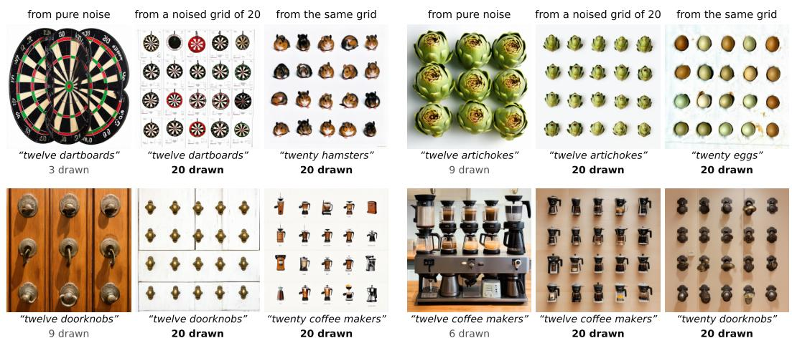  
Figure 11. A planted count holds against the number word; a planted object does not hold against the object word. Each triple shares one starting noise (SD3.5-M, S1). Left: asked for twelve objects from pure noise. Middle: started from a noised grid of twenty o the same objects (σ=0.909) and asked for twelve. Right: started from the same grid and asked for twenty of another object. Over all 48 types, the asked number is drawn in 2% of conflict images (4% for a grid of twenty asked for twelve), and exactly twenty of the newly named object in 27%. Cells chosen by inspection among those that SAM 3 counts at twenty in both right-hand images; counts by SAM 3.

Irregular arrangements. Planted irregular arrangements in the conflict design on S1 are kept net of chance in 0.24 of cells for a hole-free scatter (0.45 for objects on a plain ground, 0.20–0.26 under the other counters; 0.12 and 0.08 for scene-like and thin ones) and 0.23 for a jittered grid, under SAM 3.

The object test. On S1, each type’s grid of twenty is paired with a partner type by a greedy matching, improved by pairwise swaps, that keeps the median aspect ratio and size of their detected boxes close (|∆ log aspect|+0.5 |∆ log side|), and the grid is asked for twenty of the partner (“a photo of twenty hamsters” on a grid of dartboards; σ=0.909, two seeds, 96 images). SAM 3 is prompted with both names, and each detected object goes to the name with the higher score where the two names’ boxes overlap (IoU ≥ 0.5). The prompt’s object takes most of the detected objects in 75% [65, 84] of images, and in 77% without two nearwhite images of one cell (a spoon grid asked for meatballs); this readout uses SAM 3 alone. The count suffers: exactly twenty of the prompt’s object appear in 27.1% [17.7, 37.5] of these images, against 56.2% when the same grids are asked for their own object (paired difference 0.29 [0.18, 0.41]). From pure noise, asked for twenty red or blue objects of the same set, the model makes the asked colour dominant in 95% [90, 99] of images, draws the object in 74% and the count exactly in 1%.

A planted count holds against the number word, while the object word repaints the planted grid as its own object.

## F.4. Self-planting details

Settings. The start level (step 9 of 40), the grid’s spacing and object size and the cut-out rule were set on object types outside all sets. The canvas takes the source image’s border colour, the ground on which the object was drawn. The six small drawings per type cost less than three plain 7682 images, and each self-planted image costs 31 of the 40 steps of one.

Grid. N copies on a 7682 canvas filled with the source image’s border colour, in R = round( N) rows of C = ⌈N/R⌉ (with R reduced while C(R−1) ≥ N) and a centred partial last row; margins of 4% of the canvas, cells of (W − 2m)/C by (W − 2m)/R; the object’s long side is the cell width divided by 1.45 (capped by the object’s natural size), and centres are jittered by N (0, (0.04d)2) for object size d.

Cut-out rule. Among the six small-count draws (“two”, “three” and “four”, two seeds, 5122), SAM 3 detections are ranked in three tiers. Tier 1: score ≥ 0.8, overlap (IoU) ≤ 0.05 with every other detection of score ≥ 0.3, both box sides ≥ 40 px, not touching the border. Tier 2: score ≥ 0.6, IoU ≤ 0.20, sides ≥ 32 px, not touching the border. Tier 3: as tier 2, touching allowed. The best tier wins, then the highest score; the box is clamped to the image. On U1, 45, 6 and 6 types received tier 1, 2 and 3 cut-outs (exact 48%, 27% and 19%), and 7 received none; on U2 45, 8 and 5 (none for 6), on U3 61 in all. Types without a cut-out count with their plain image in every rate.

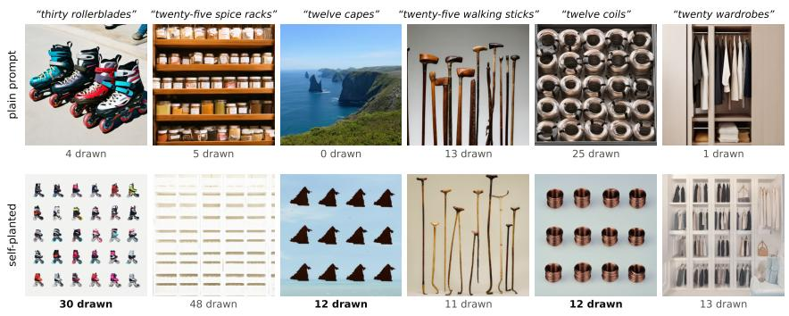

Figure 12. Self-planting on six images drawn at random from the 80 people-counted images of U2 at the counts whose grids have only complete rows (16 types × 5 counts). Top: plain prompt; bottom: the same prompt and noise from a self-planted start. Counts by people; bold: exact. Three of the six are exact (59% over all 80 cells). The failures show how a planted grid goes wrong: scene-like objects turn into a scene (shelving for spice racks, a closet for wardrobes), and thin objects lose their rows.  
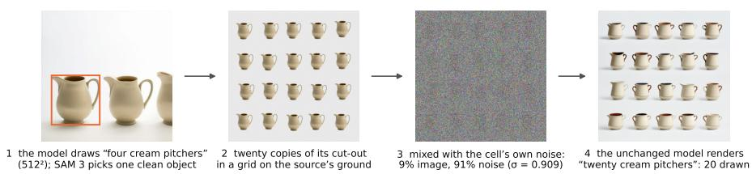  
Figure 13. Self-planting. The model’s own small-count drawing supplies the object, a grid supplies the count, and the unchanged model, started at σ=0.909 from the cell’s own noise, supplies everything else. The plain prompt from the same noise draws 10 cream pitchers. One clean instance suffices; the canvas takes the source image’s border colour. Cell from U1, chosen to illustrate the steps.

Arrangements. All arrangements of a cell share the cutout and its size d. Hole-free scatter: Lloyd relaxation of random points with jitter, best of four starts by hole statistics, centres ≥ 1.2d apart. Random placement: random sequential addition with centres ≥ 1.3d apart, d shrinking by 3% after each failed attempt. Grid with random scale and offset: the grid scaled about the canvas centre by a factor in [0.55, 1] and shifted.

Counters. SAM 3 also selects the cut-out, so its judgement of self-planted images is not independent of the method; the other counters and people are. Under the other counters self-planting reaches 0.27–0.36 on U2 (Tab. 41).

Rows and the object type. Reading rows from the SAM 3 boxes on U1, a complete last row of a planted grid comes out right in 99–100% of the cells whose upper rows are intact, a partial one in 64–81%; the grid beats a hole-free scatter of the same cut-outs by 0.22 [0.15, 0.29] at counts with complete rows and by 0.04 [0.00, 0.09] at the others (U2: 0.19 [0.13, 0.26] at 12, 20 and 30). Types that would have passed the screened sets’ visibility check reach 0.46–0.50 on the three unscreened sets, the others 0.19–0.33; in a variance decomposition of U1’s grids the object type accounts for 52% of the variance of the per-image exact outcome and the count for 7%.

<table><tr><td>U1</td><td>SAM3</td><td>consensus</td><td>∆ vs. grid</td></tr><tr><td>plain prompt</td><td>.019</td><td>.009</td><td>-.359</td></tr><tr><td>best of two plain samples</td><td>.036</td><td></td><td>-.343</td></tr><tr><td colspan="4">self-planted start, same cut-out and object size</td></tr><tr><td>random placement</td><td>.199</td><td></td><td>-.180</td></tr><tr><td>hole-free scatter</td><td>.273</td><td></td><td>-.105</td></tr><tr><td>grid, random scale and offset</td><td>.343</td><td></td><td>-.036</td></tr><tr><td>grid (self-planting)</td><td>.378</td><td>.371</td><td></td></tr></table>

Table 40. Self-planting on U1. Exact rate at 12–30 objects (12, 13, 17, 20, 23, 29, 30; two seeds; 896 cells per row). ∆: paired difference to the grid; 95% intervals for the grid [.291, .468], and for ∆ [−.445, −.275], [−.429, −.260], [−.233, −.129], [−.146, −.066], [−.065, −.008].

The third unscreened set. On U3 (64 types, mostly furniture, appliances and animals; 61 with a cut-out; two seeds) self-planting is exact in 21–54% of images at each count from 12 to 30, against 0–10% for the plain prompt from the same noise; by class, in 69% of images of objects drawn on a plain ground, 36% of thin objects and 27% of scene-like

Look. PickScore [28] of the self-planted image minus the plain image of the same cell: −0.65 [−0.80, −0.51], −0.57 [−0.72, −0.43] and −0.85 [−1.03, −0.68] on the three unscreened sets. On U2, exact renders lose less (−0.45) than failed ones (−0.67), and the grid scores above the hole-free scatter (+0.07 [0.03, 0.12]).

A complete grid of the model’s own object sets the count best; the object type matters more than the count, and scenelike and thin objects fail most.

## F.5. Two layout models given the same grid

GLIGEN [33] with the public text-box checkpoint (gligen-1-4-generation-text-box, revision d2820dc, a SD 1.4 backbone) in diffusers, at 5122 with 50 steps and guidance 7.5. For every cell of U2 it receives the boxes of the self-planted grid: each grid centre as a square box of the grid’s object size, one phrase per box (“a cream pitcher”), and the prompt “a photo of twenty cream pitchers”. We use two grounding schedules from the same noise: the authors’ scheduled sampling, which grounds the first 30% of steps (β=0.3), and grounding at every step (β=1). The checkpoint’s NSFW filter, which blanks an image when it fires, is off, as SD3.5-M has none. Two seeds per cell, 2,304 images, counted like every other image. Where SAM 3 finds the object, GLIGEN turns partial grids into rectangles: given the 14 boxes of a 4×4 grid with two missing, it draws 16 objects in 76% of those images (82% with β=0.3) and 14 in none.

InstanceAssemble [62], SD3-Medium version, with the authors’ released code (commit 39f98cd, run unchanged) and weights, their pinned library versions and their default settings: 50 steps, guidance 7.0, grounding for the first 30% of steps, layout scale 1.0, bf16, at its native $1 0 2 4 ^ { 2 }$ . It receives the same boxes (scaled to $1 0 2 4 ^ { 2 } )$ , one phrase per box and the same prompt as GLIGEN; the generator is seeded on the GPU as in the authors’ script. All layout weights load as in the authors’ own loader. 1,152 images, two seeds per cell. Where SAM 3 finds the object, InstanceAssemble is exact in 80–90% of images at complete counts and 57– 60% at partial ones; at 14 boxes it draws 16 objects in 23% of those images and 14 in 58%, and it never drops a partial row.

By people, InstanceAssemble given the grid’s boxes is exact as often as self-planting within the intervals, while GLIGEN fills the boxes but often with something else (Tab. 37).

## F.6. FLUX.2 [klein] from a planted start

Design. The composites are U2’s own-cut-out grids of the content test (Sec. F.2), that is, SD3.5-M’s cut-outs on their $7 6 8 ^ { 2 }$ canvas, for the 58 types with a cut-out at 12, 16, 20, 25 and 30 objects (290 starts). Each is resized to $1 0 2 4 ^ { 2 } .$ , encoded as the pipeline encodes reference images (the VAE’s mode, 2×2 patches, the VAE’s normalisation statistics) and mixed with the cell’s own noise at the level of step k of the model’s 50-step schedule (Eq. (3)); the unchanged pipeline then runs the remaining 50 − k steps of that schedule with the plain prompt. Each render therefore shares prompt and noise with the plain image of the same cell in Sec. C.5.

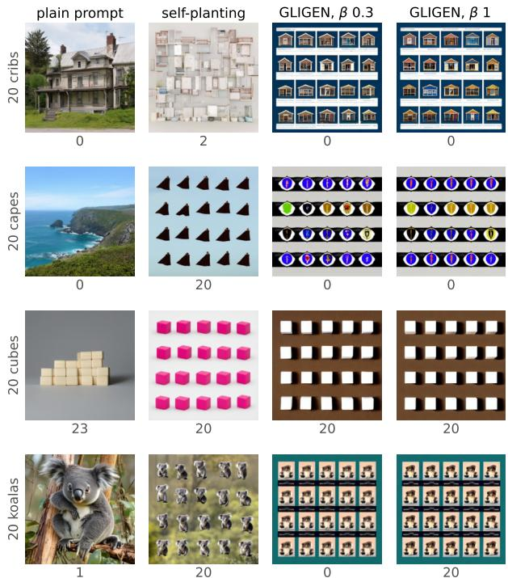

Figure 14. The same cells drawn three ways (the first four types with a cut-out of U2, asked for 20, seed 1; SAM 3 count under each image). GLIGEN fills each box of the grid, but often with an icon of something else: houses for cribs, ovals for capes. The koala tiles are counted in one schedule and not in the other.
<table><tr><td>64 types, 12–30</td><td>GLIGEN β=0.3 GLIGEN β=1 InstanceAssemble</td><td></td><td></td><td>self-planting</td></tr><tr><td>SAM3</td><td>.158</td><td>.152</td><td>.324</td><td>.406</td></tr><tr><td>Grounding DINO</td><td>.188</td><td>.212</td><td>.457</td><td>.351</td></tr><tr><td>OWLv2</td><td>.122</td><td>.118</td><td>.139</td><td>.273</td></tr><tr><td>consensus</td><td>.134</td><td>.135</td><td>.300</td><td>.360</td></tr><tr><td>complete counts (12, 16, 20, 25, 30)</td><td>.253</td><td>.234</td><td>.372</td><td>.470</td></tr><tr><td>partial counts (14, 19, 22, 27)</td><td>.039</td><td>.049</td><td>.264</td><td>.326</td></tr><tr><td>studio / thin / scene types</td><td></td><td>.26 / .11 /.14</td><td>.45 / .21 / .35</td><td>.63 / .43 / .35</td></tr><tr><td>within one of the request</td><td>.178</td><td>.166</td><td>.343</td><td>.464</td></tr><tr><td>none of the asked object</td><td>.683</td><td>.708</td><td>.550</td><td>.248</td></tr></table>

Table 41. Two layout models given the self-planted grid (U2; exact rates unless stated; SAM 3 below the first block; none of the asked object: SAM 3 finds none). For GLIGEN the difference to self-planting, paired on type, count and seed, is 0.25 under SAM 3 for either schedule ([0.17, 0.33] and [0.17, 0.34]) and 0.14–0.23 under the other counters, with every interval above zero. For InstanceAssemble it is 0.08 [−0.00, 0.17] under SAM 3, 0.06 [−0.02, 0.15] under the consensus, 0.13 [0.07, 0.21] under OWLv2 and −0.11 [−0.20, −0.01] under Grounding DINO; the counters disagree on InstanceAssemble’s images more than on any other method’s, and we compare the methods by people’s counts (Tab. 37).

Start level. The level was set on 24 development grids of twenty objects (U1 types, none in U2): the smallest $k \in$ {16, 20, 24, 28} at which SAM 3 counts exactly twenty in at least half of the renders. SAM 3 kept 0.79, 0.83, 0.83 and 0.88, so k=16 (σ=0.941). As checks, k=0 reproduces the word test’s sampler and k=46 returns the composite.

Flat renders. A check for flat images (grey standard deviation below 0.03, or mean outside [0.03, 0.97]) flags 26 of the 290 U2 renders, which are kept. The 14 among the 16 people-counted types are low-contrast grids (pale bath mats, spice racks, white ironing boards, and desks whose cut-outs look like stools). People find the asked count in 9 of them, none of them desks (they count twice the request or none), and judge the ironing boards at 30 not to look like ironing boards.

<table><tr><td>counter</td><td>planted</td><td>plain</td><td>planted – plain</td><td>order, planted</td><td>none, planted</td></tr><tr><td>SAM3</td><td>.748 [.65, .84]</td><td>.055</td><td>+.69 [.59, .79]</td><td>.92 [.87, .96]</td><td>.23</td></tr><tr><td>Grounding DINO</td><td>.672 [.58, .76]</td><td>.031</td><td>+.64 [.55, .73]</td><td>.80 [.72, .88]</td><td>.17</td></tr><tr><td>OWLv2</td><td>.434 [.33, .53]</td><td>.028</td><td>+.41 [.31, .51]</td><td>.84 [.77, .90]</td><td>.31</td></tr><tr><td>consensus</td><td>.638 [.53, .74]</td><td>.028</td><td>+.61 [.50, .71]</td><td>.93 [.87, .97]</td><td>.21</td></tr><tr><td>people (16 types)</td><td>.93 [.79, 1.00]</td><td>.13</td><td>+.80 [.66, .90]</td><td></td><td></td></tr></table>

Table 42. FLUX.2 [klein] from the planted grids (U2, 58 types with a cut-out × 12, 16, 20, 25, 30, seed 1; exact rates unless stated; plain: the word test’s image of the same cell). By count under SAM 3: .74, .78, .72, .78, .72, each with the request as median. People: recognisable .68 [.50, .84]; planted minus SD3.5-M’s selfplanting on the same cells and grids +.34 [.19, .50] (recognisable +.15 [−.01, .30]).

SAM 3’s zeros (68 of 290 renders) concentrate in a few types: it reads every count of ironing boards, visors, cappuccinos, hairnets, coffee tables, blankets and futons as empty. Where it finds the object at all, it nearly always finds the asked number. People’s median equals the request at every count, and they are exact in 88–94% of renders at each count. The renders keep the composite’s look, cut-outs on a flat ground. From a planted grid, FLUX.2 [klein] draws the asked count in nearly every image by people’s counts.

## F.7. Noise re-layout past ten

Method and settings. Gu et al. [17] with the released code (commit d5d49ba, single-object pipeline, the README’s library versions), SDXL base 1.0 in fp16 with its DDPM scheduler, 50 steps, guidance $5 . 0 , 1 0 2 \bar { 4 } ^ { 2 }$ and every released hyperparameter. A first pass from the cell’s noise is counted by Grounding DINO, the method’s gate, and an image already at the asked count is kept. Otherwise the object token’s cross-attention, averaged over the first 20 steps, is clustered into the requested number of high-attention regions, the noise is re-laid around them, and a second pass guided by an attention loss over its first 20 steps renders the result. Documented differences from the release: (1) the gate runs the Hugging Face port of the same Grounding DINO weights, because the released call passes undefined names; (2) the object token is the noun’s first token after the number word, which is what the released script’s fixed index selects for its own prompts; (3) with fewer high-attention cells than requested, the released fallback of one cluster per cell is kept and the re-layout runs over those clusters, where the released loop indexes past its end and stops; (4) one seed per type, shared by its requests, instead of 42 for every prompt; (5) no attention-map figures; (6) self-attention runs PyTorch’s fused attention, the same function, which fits the guided pass into an L4’s memory at $1 0 2 4 ^ { 2 }$ . A method error other than running out of memory leaves the first pass as the output. Settings were set after a probe on two types outside the sets.

Cells. U2’s 64 types at the method’s own range, 4 and 8, and at 12, 16, 20, 25 and 30, seed 1: 448 cells, each with the first pass and the method’s output from the same noise, counted like every other image. People counted both at 12– 30 for 16 types (Sec. B).

Results.
<table><tr><td>counter</td><td>exact, 4 and 8 first / output</td><td>exact, 12–30 first / output</td><td>output — first at 12–30</td><td>order, 12–30 first / output</td></tr><tr><td>SAM3</td><td>.164 / .422</td><td>.009 / .075</td><td>.07 [.03, .10]</td><td>.63 / .58</td></tr><tr><td>Grounding DINO</td><td>.156 / .422</td><td>.003 / .059</td><td>.06 [.03, .08]</td><td>.48 / .47</td></tr><tr><td>OWLv2</td><td>.125 / .258</td><td>.016 /.037</td><td>.02 [−.01, .05]</td><td>.58 / .55</td></tr><tr><td>consensus</td><td>.109 / .383</td><td>.000 / .056</td><td>.06 [.03, .08]</td><td>.53 / .54</td></tr></table>

Table 43. Noise re-layout on SDXL (U2, 64 types, seed 1; first: the method’s first pass from the cell’s noise; output: the method’s image from the same noise). 12–30: the requests 12, 16, 20, 25 and 30. Output minus first at 4 and 8: .26 [.16, .36] / .27 [.18, .35] / .13 [.06, .20] / .27 [.19, .36] (counters in the table’s order).

Of the 448 cells, the gate kept the first pass in 22 and 0 ended in a method error. The attention offered fewer clusters than requested in 0 cells, so the released fallback (difference 3) never applied. Median time per cell (first pass and re-layout) 117 s; peak memory 16.5 GB. People counted both images at 12–30 for 16 types (Tab. 37): the re-layout is exact in 11% [4, 20] of them and the first pass in none. Their median counts are 11, 15, 7.5, 5 and 7 for the outputs and 5, 3.5, 6.5, 9 and 14.5 for the first passes at 12, 16, 20, 25 and 30, and their order at 12–30 is 0.50 [0.36, 0.64] for the outputs and 0.63 [0.48, 0.74] for the first passes. Relaying the noise helps a little past ten, far less than planting a grid of the object.

## F.8. Exact or within one

A layout misses differently from a word. Of the images whose SAM 3 count lands within one of the request, 80– 94% are exact for grids planted at σ=0.909 or given as boxes, against 66–77% for irregular arrangements of the same cut-outs and 37–48% for the plain prompt; a count that followed the request with log-normal scatter of 5% or more would give at most 0.48 (Tab. 44). When a grid fails, it mostly fails by more than one object.

<table><tr><td>SAM 3, 12–30</td><td>exact</td><td>within one</td><td>ratio</td></tr><tr><td colspan="4">grids, planted at σ=0.909 or given as boxes</td></tr><tr><td>self-planting, U1 / U2 / U3 grid, random scale and offset (U1)</td><td>.343</td><td>.378 / .406 / .366 .443 / .464 / .433 .85 / .88 / .85</td><td>.80</td></tr><tr><td>content: own / another / ellipses (U2)</td><td>.531 / .345 / .245 .583 / .407 / .297</td><td>.429</td><td>.91 / .85 / .83</td></tr><tr><td></td><td>.158 / .152</td><td>.178 / .166</td><td>.89 / .92</td></tr><tr><td>GLIGEN β=0.3 / 1 (U2)</td><td>.324</td><td>.343</td><td></td></tr><tr><td>InstanceAssemble (U2)</td><td></td><td></td><td>.94</td></tr><tr><td colspan="4">other layouts</td></tr><tr><td>hole-free scatter, U1 / U2</td><td>.273 / .315</td><td>.384 / .411</td><td>.71 / .77</td></tr><tr><td>random placement (U1)</td><td>.199</td><td>.301</td><td>.66</td></tr><tr><td>content at σ=0.943: own / another / ellipses .393 / .234 / .276</td><td></td><td>.452 / .303 / .317</td><td>.87 / .77 / .87</td></tr><tr><td>asking</td><td></td><td></td><td></td></tr><tr><td colspan="4"></td></tr><tr><td>plain prompt, U1 / U2 / U3</td><td>.019 / .014 / .021 .051 / .030 / .043 .37 / .47 / .48</td><td></td><td></td></tr><tr><td>reference, log-normal scatter .05 / .3</td><td>.40 / .07</td><td>.85 / .21</td><td>.47 / .34</td></tr></table>

Table 44. Exact or within one. Ratio: exact rate over the rate within one of the asked count. A count that follows the request with log-normal scatter of SD 0.05 or more gives a ratio of at most 0.48 at these counts.

## G. Notes

Reproducibility. The code, analysis scripts, object lists, generated images, automatic and human counts and the people’s answers will be released. The people’s studies collected no personal data (Sec. B.1).

## G.1. Object types

Each object set is drawn in a seeded order from LVIS category names [19], kept to countable everyday objects from the names alone; a candidate that collides by name, Word-Net relation [43] or string overlap with any earlier type is dropped, so no type name repeats across sets or comes from development (“walking cane” in S1 and “walking stick” in U2 share an LVIS definition). S1. dartboard, tea bag, figurine, laptop computer, binder, sled, globe, hamster, barrette, walking cane, pickle, snowboard, doorknob, remote control, blender, grater, spoon, microphone, kettle, toaster, scrubbing brush, ashtray, flowerpot, rubber band, notepad, bobby pin, handbag, egg, saucer, pizza, artichoke, mop, clothespin, computer keyboard, meatball, videotape, ski, wrench, skateboard, marker, zucchini, colander, coffee maker, dog collar, earring, canister, mask, bobbin. S2. beachball, amplifier, saucepan, tennis racket, pouch, soccer ball, compass, cymbal, gravy boat, ice pack, joystick, nest, poster, mirror, bolt, business card, egg roll, shot glass, corkboard, persimmon, apricot, microscope, sewing machine, poker chip, almond, saxophone, measuring cup, gemstone, thimble, hockey stick, prune, fan, hook, radio receiver, piggy bank, thermostat, nailfile, bouquet, food processor, squirrel, green bean, painting, taco, softball, papaya, flag, milk can, projector.

U1. tobacco pipe, clasp, robe, crucifix, turban, lab coat, beanie, vest, pitchfork, dropper, cream pitcher, knee pad, skirt, crouton, duffel bag, raft, birthday card, dragonfly, tricycle, shopping bag, hair curler, swimsuit, latch, spider, lanyard, seahorse, weathervane, beanbag, stirrup, sleeping bag, scraper, wagon wheel, pendulum, wristlet, armband, diary, stool, carnation, ping-pong ball, shawl, water gun, wristband, raincoat, poncho, hinge, neckerchief, eyepatch, life jacket, boiled egg, curling iron, checkbook, propeller, tiara, safety pin, quilt, cornet, puncher, hornet, grocery bag, first-aid kit, milkshake, atomizer, ottoman, sweatband.

U2. crib, cape, cube, hatbox, koala, nightshirt, vat, apron, hammock, roller skate, candy bar, perfume, chandelier, martini, futon, heater, polo shirt, dress, dolphin, bath mat, eclair, trampoline, saddlebag, walking stick, radiator, television set, shower head, jewel, blanket, desk, coffee table, rollerblade, hairnet, cappuccino, wig, omelet, coatrack, visor, camel, spice rack, piano, blouse, microwave oven, jumpsuit, beeper, ice skate, dining table, casserole, veil, wardrobe, clip, wet suit, quesadilla, sofa, fire alarm, cigarette case, coil, cardigan, christmas tree, tapestry, brass plaque, parachute, satchel, ironing board.

U3. sink, tarp, cabinet, cougar, kitchen table, water cooler, curtain, bedpan, bathtub, alligator, stove, garden hose, polar bear, vacuum cleaner, rat, bench, air conditioner, blackboard, blazer, lawn mower, cupboard, sweatshirt, telephoto lens, bread-bin, lamb-chop, kennel, table-tennis table, ice maker, shark, bunk bed, dishwasher, manatee, shower cap, dishrag, beret, cockroach, parka, hotplate, headboard, snake, gravestone, gargoyle, bulletin board, manger, corset, tablecloth, halter top, unicycle, generator, bass horn, scarecrow, gorilla, grill, giant panda, gazelle, pool table, grizzly, water faucet, bedspread, refrigerator, subwoofer, vending machine, egg yolk, harmonium.