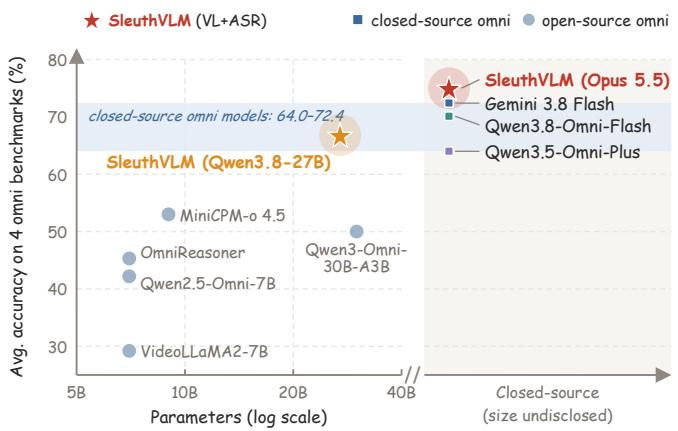
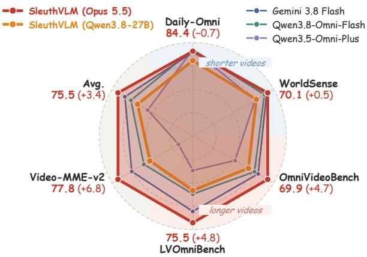
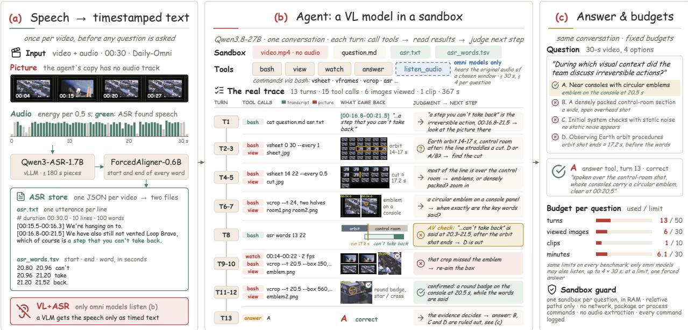
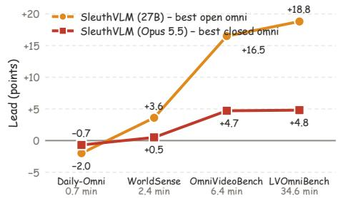
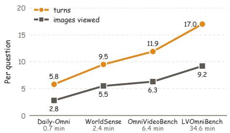
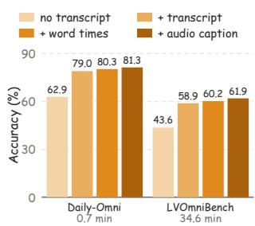
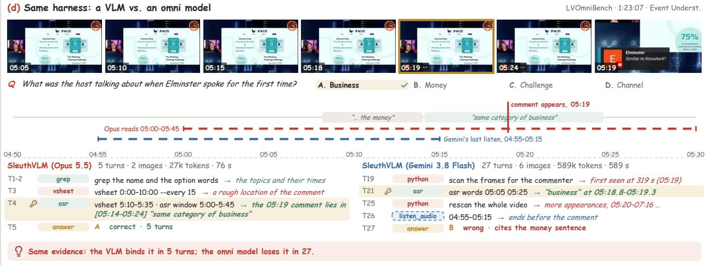
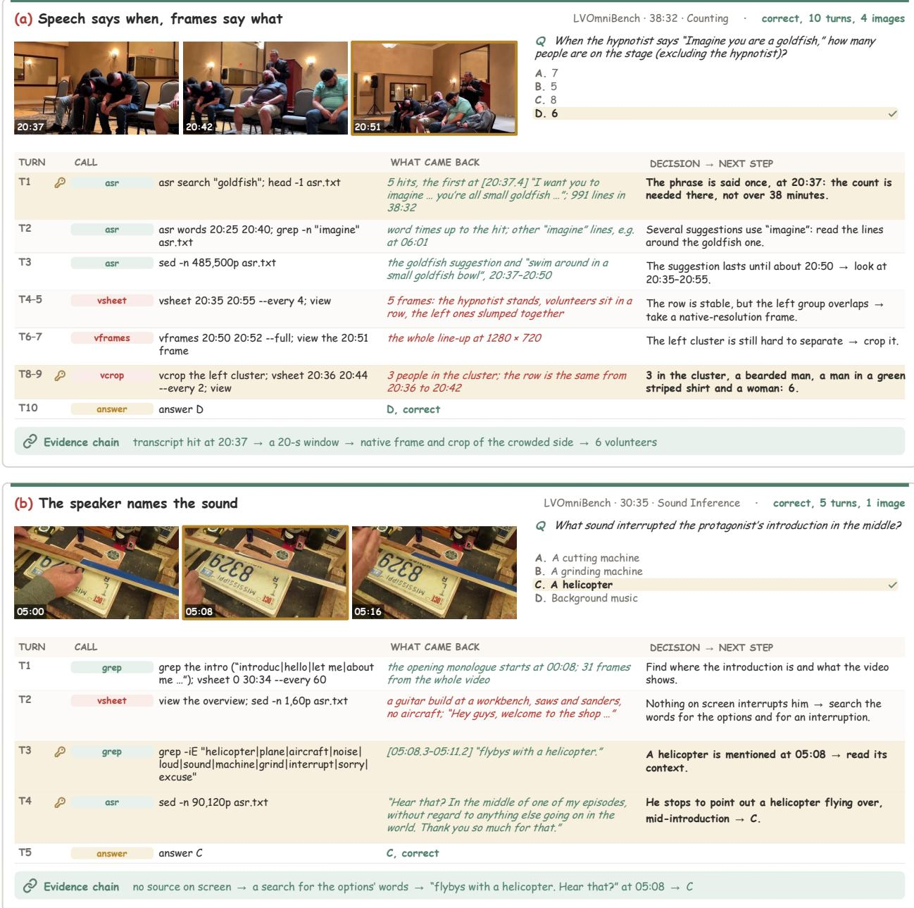
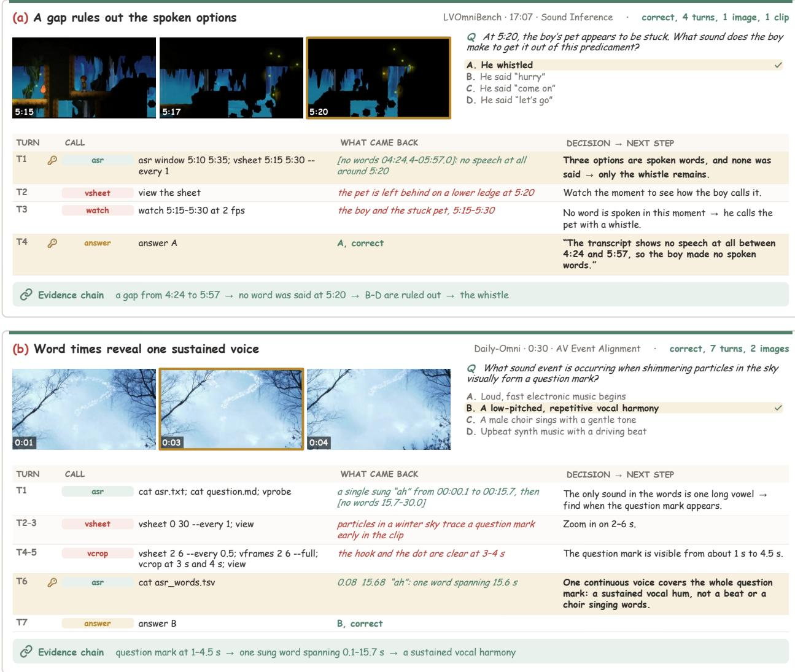
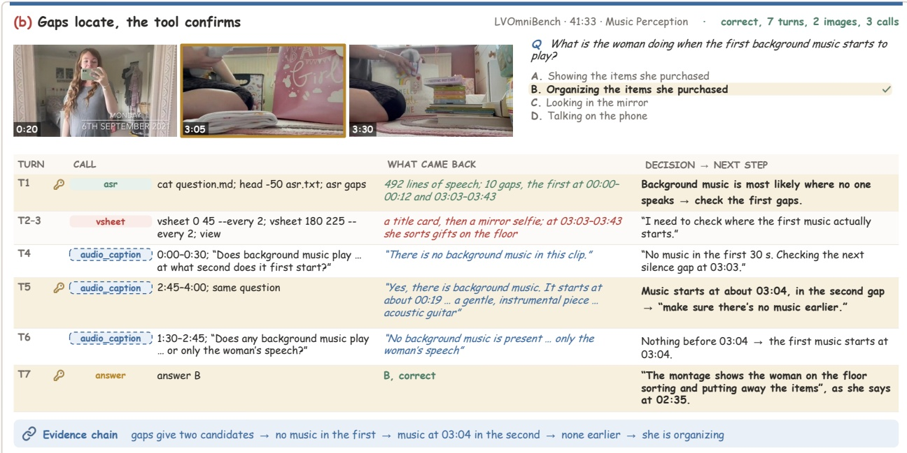

# SleuthVLM: Do We Really Need Audio-in-Video for Omni Video Understanding?

Peiran Wu1,2, Fangfei Gou2,3, Zhaoxi Mu2, Changhao Zhang2, Yuntao Wang3, Yuanchun Shi3, Weiqiang Wang2, Jian Liu2,†, Junxiao Shen1

1University of Bristol, 2Ant Group, 3Tsinghua University

†Corresponding author

Omni models answer questions about videos by jointly processing sampled frames and audio in one turn, with progress driven largely by scaling model size and omni training data. We ask whether a model needs to hear the audio directly at all, and present SleuthVLM, an agent harness built on a VLM that never hears the audio directly: speech will be transcribed into text, and the VLM will sleuth the video on its own without any predefined workflow. On four omni benchmarks with videos up to 90 minutes, SleuthVLM achieves the best average accuracy: 75.0%, 2.6 points above Gemini 3.8 Flash, and it also tops the Video-MME-v2 leaderboard with 77.8%; with an open-source 27B VLM, it beats all open-source omni models. We draw three findings: SleuthVLM beats a model that glances; hearing is not the bottleneck, agentic ability is; omni understanding needs better agentic ability, not just more omni data for modality alignment. So we provide a simple but effective starting point for doing omni video understanding.

Project: https://wpr001.github.io/sleuthVLM/

Code: https://github.com/WPR001/OpenOmniHarness(coming soon)

  
(a) Accuracy vs. model size

  
(b) Accuracy on each benchmark  
Figure 1 SleuthVLM never hears the audio directly, yet beats the omni models that do. (a) Average accuracy on four omni benchmarks against model size; closed-source models are on the right, and the blue band spans the closed-source omni models (b) Accuracy on the four omni benchmarks, Video-MME-v2 and their average, with every axis spanning 40 points; numbers give SleuthVLM (Opus 5.5) and, in parentheses, its difference from the best closed-source omni model.

## 1 Introduction

Many questions about videos require understanding both visual and audio content. Omni models address this task by combining a vision-language model (VLM) with an audio encoder and training on paired omni data, enabling them to answer questions from sampled frames and the audio track in one turn. Closed-source models such as Gemini 3.8 Flash, Qwen3.8-Omni-Flash (Team, 2026a) and many open-source models follow this recipe, and the field improves them mainly by making model size bigger and using more data (Cui et al., 2026; Tang et al., 2025; Wang et al., 2025; Wu et al., 2025; Zhang et al., 2024).

We think this recipe gets two things wrong. First, it assumes that the model must hear the audio directly (Cui et al., 2026; Tang et al., 2025; Xu et al., 2025b). In practice, most of the audio that questions depend on is speech (75.2% of the questions of LVOmniBench (Tao et al., 2026)), and speech is easily turned into text with time stamps. Teaching a model to hear makes every new skill depend on costly joint training (Chowdhury et al., 2024; Jiang et al., 2025), and it weakens the reasoning and tool use that strong VLMs already have. Second, it assumes that one turn is enough. A fixed sampling rate covers the whole video thinly, while the answer often sits in a few seconds (Bai et al., 2023; Liu et al., 2023; Wu et al., 2026); in a long video those seconds are easily missed, but this kind of model cannot go back (Chen et al., 2025; Fu et al., 2025; Wu et al., 2024; Yang et al., 2025).

Many works in video understanding have recognized this problem (Fan et al., 2024; Ren et al., 2026; Tao et al., 2025; Xing et al., 2026; Zhang et al., 2026). The Qwen team runs Qwen3.8-Omni-Flash and Gemini 3.8 Flash as agents in the Qwen Code harness and gains up to 10.3 points on long videos, and Video-Index (Song et al., 2026) finds that agent tools add about 20 points over a fixed input. We agree: a model should sleuth a video for the evidence it needs rather than take in everything at once. The community should therefore rethink how omni models are built: omni models such as Qwen3-Omni, MiniCPM-o and video-SALMONN have the most to gain by moving from one turn to agentic understanding.

Following this question, we propose SleuthVLM, which answers audio-visual questions with a VLM that never hears the audio directly (Figure 2). The audio is transcribed once with word-level timestamps, and the VLM uses a small set of tools to search the video and transcript. We specify only its accessible resources, a brief agentic guide, and a budget; the VLM decides where to look, how closely to inspect, and when to stop, using the transcript as an index to locate relevant moments in long videos.

SleuthVLM establishes a new state of the art (Figure 1), achieving an average accuracy of 75.0% across four omni benchmarks, 2.6 points above the strongest closed-source omni model, Gemini 3.8 Flash. It also leads every metric on the Video-MME-v2 leaderboard, reaching 77.8% accuracy, 6.8 points above Gemini 3.8 Flash. With Qwen3.8-27B, SleuthVLM outperforms every open-source omni model by 13.8 points. Our experiments reveal three findings:

• Searching outperforms passive observation. Agentic inference improves accuracy by up to 10.3 points, and our simple harness outperforms agents equipped with specialized tools.

• Agentic ability matters more than direct audio access. Even with access to audio, omni models in our harness perform below SleuthVLM with Opus 5.5, which relies on transcripts; omni models also need strong agentic capabilities.

• Small agentic models are highly competitive. An open 27B VLM running on a single GPU

matches the performance of closed-source omni models.

Taken together, SleuthVLM provides a simple yet effective starting point for agentic omni video understanding.

## 2 Related Work

Omnimodal Large Language Models. Omnimodal large language models aim to understand video, audio, and text within a single model (Cui et al., 2026; Tang et al., 2025; Xie and Wu, 2024; Xu et al., 2025b). They typically extend a vision-language model (VLM) with an audio encoder and train on large amounts of paired audio-visual data, enabling them to answer from sampled frames and audio in a single pass. Open-source models following this approach include Qwen2.5-Omni (Xu et al., 2025a), Qwen3-Omni (Xu et al., 2025b), MiniCPM-o (Cui et al., 2026), the video-SALMONN series (Tang et al., 2025), LongCat-Flash-Omni (Team et al., 2025), and Nemotron-Nano-Omni (Deshmukh et al., 2026). Closed-source models such as Gemini, Qwen3.8- Omni-Flash (Team, 2026a), and Qwen3.5-Omni-Plus (Team, 2026b) lead audio-visual benchmarks. Progress in this direction relies heavily on scaling data and models, while acquiring new capabilities requires costly multimodal training. Such training also costs part of the reasoning and tool-use abilities of strong VLMs, and a single pass over fixed frame samples cannot revisit moments relevant to a question. SleuthVLM instead uses a VLM that accesses audio information through timestamped text and tools.

Video Understanding Agent. Agents offer a promising approach to understanding long and complex videos (Fan et al., 2024; Ren et al., 2026; Tao et al., 2025; Xing et al., 2026; Zhang et al., 2026). Early methods reason over clip captions or decompose questions into steps handled by specialized tools, while recent agents actively decide where to look. Audio-visual agents follow a similar progression: OmniAgent (Tao et al., 2025) equips o3 with tools backed by separate models; OmniReasoner (Chen et al., 2026b) and OmniAgent-7B (Xing et al., 2026) train omni models to use tools; and the Qwen3.8-Omni report evaluates agents in the Qwen Code harness. TFO (Deria et al., 2026) provides a frozen VLM with frames and a speech transcript but answers in a single pass. In contrast, SleuthVLM equips a single VLM with general-purpose tools over video frames and a timestamped transcript, allowing it to decide where to look, how closely to inspect, and when to stop. Concurrent methods also trail SleuthVLM: Omni-Decision (Ma et al., 2026) combines a GPT-5.2 planner with Gemini-3.1-Pro perception, while sandboxed coding agents (Chen et al., 2026a) process videos using scripts and transcripts; both underperform Gemini-3.1-Pro in a single pass. SleuthVLM exceeds Omni-Decision by 11.8 points on WorldSense and the best coding agent by 15.5 points on LVOmniBench (Section A).

## 3 Method

SleuthVLM answers audio-visual questions using a vision-language model (VLM) without direct access to audio. Instead, the audio is transcribed once per video with timestamps, and the VLM uses tools in a sandbox to gather evidence until it can answer (Figure 2).

  
Figure 2 Overview of SleuthVLM. (a) Once per video, an ASR model transcribes the speech and a forced aligner assigns timestamps to each word, preserving non-speech intervals as gaps. (b) A VLM gathers evidence by calling tools over the muted video and transcript in a sandbox; only omni reasoning models also have access to listen\_audio. (c) The model answers once it has sufficient evidence, subject to fixed budgets. The illustrated trajectory is a real example from Daily-Omni, answered correctly in 13 turns.

## 3.1 Problem formulation

Each example consists of a video of duration $D ,$ with frames V and an audio track A, a question q, and a set of answer options O. An omni model processes both streams in a single turn:

$$
{ \hat { y } } = \operatorname * { a r g m a x } _ { o \in { \mathcal { O } } } p ( o \mid V , A , q ) .\tag{1}
$$

SleuthVLM instead transcribes the audio once per video, independently of the question, to obtain $T = \mathrm { A S R } ( A )$ . It then uses an agent built on a VLM $\pi$ to read $T$ , inspect frames from $V ,$ , and decide what evidence to gather next:

$$
\hat { y } = \mathrm { A g e n t } _ { \pi } ( V , T , q , \mathcal { O } ) .\tag{2}
$$

The VLM receives no direct audio input and selects the evidence for each question autonomously.

## 3.2 Audio as timed text

An ASR model transcribes the speech, and a forced aligner gives every word $w _ { j }$ its start time $s _ { j }$ and end time $e _ { j }$ (Figure 2a):

$$
W = \{ ( w _ { j } , s _ { j } , e _ { j } ) \} _ { j = 1 } ^ { M } .\tag{3}
$$

Stretches of at least $\gamma$ seconds without a word are kept as gaps,

$$
G = \{ ( e _ { j } , s _ { j + 1 } ) : s _ { j + 1 } - e _ { j } \geq \gamma \} ,\tag{4}
$$

with $e _ { 0 } = 0$ and $s _ { M + 1 } = D$ . The sandbox holds the transcript as two files: asr.txt lists the sentences and the gaps in time order, one line [s-e] sentence or [no words s-e] each, and asr\_words.tsv lists the words of W with their times. The transcript carries what was said and when, lyrics included, and its gaps mark the stretches where no one speaks, which often hold music or other sounds.

## 3.3 Agentic harness

The harness consists of a scope definition, which fixes what the model can access and do, and an operating guide, which suggests how to gather evidence; both are part of the system prompt and are the same on every benchmark.

Scope definition. The files are the muted video, the question with its options, asr.txt and asr\_- words.tsv. The tools are bash, view (show images), watch (show a short clip) and answer. Inside bash, vsheet renders a contact sheet of time-stamped frames over $[ t _ { 0 } , t _ { 1 } ]$ , vframes extracts frames at a chosen rate, optionally at native resolution, vcrop crops a native-resolution frame, asr searches the transcript or lists word times and gaps, and standard tools such as grep and python3 are available. The rules keep the model inside its sandbox (relative paths, no network, no package or process commands, no audio extraction), and the budget $\beta = \left( N _ { \mathrm { t u r n } } , N _ { \mathrm { i m g } } , N _ { \mathrm { c l i p } } , T _ { \mathrm { m a x } } \right)$ limits the turns, viewed images, clips and time per question.

Operating guide. The guide suggests a sequence that usually works: read the question and the transcript, get an overview from one contact sheet, localize a window from transcript hits, sheet cells and gaps, zoom in, check the detail asked about, and answer once the evidence decides the question. The model decides which steps a question needs.

Interaction. At turn t, the VLM reads its history $h _ { t }$ , which starts from the system prompt and the question, writes its reasoning and tool calls $a _ { t }$ , and receives their results $x _ { t }$ (text, images or a clip):

$$
a _ { t } \sim \pi ( \cdot \mid h _ { t } ) , \qquad h _ { t + 1 } = h _ { t } \oplus ( a _ { t } , x _ { t } ) .\tag{5}
$$

The trajectory ends when the model calls answer $( o )$ , giving $\hat { y } = o ;$ when the budget is used $\boldsymbol { \mathrm { u p } } .$ the model answers with its most likely option. Any VLM can serve as π without other changes (Table 3).

## 3.4 The transcript as a temporal index

The time stamps of the transcript tell the model where to look. Looking through a video every $\Delta$ seconds costs $D / \Delta$ frames, 2100 for a 35-minute video at one frame per second. Instead, the model searches the transcript for the words of the question, and a hit spoken over [s, e] gives the window

$$
\Omega = [ s - \delta , e + \delta ]\tag{6}
$$

with a margin δ of its choosing; for a sound that is not speech, the gaps and scene changes give the candidates. It then zooms in from coarse to fine, on windows $\Omega _ { 1 } \supset \Omega _ { 2 } \supset \cdots$ at intervals $\Delta _ { 1 } > \Delta _ { 2 } > \cdots$ , and views

$$
n = \sum _ { k } | \Omega _ { k } | / \Delta _ { k } \ll D / \Delta _ { K }\tag{7}
$$

frames in total. The word times also tell whether a phrase and a visual event happen together: a phrase spoken over [s, e] and an event seen over $[ \alpha , \beta ]$ coincide when

$$
[ s , e ] \cap [ \alpha , \beta ] \neq \emptyset ,\tag{8}
$$

which is how the trajectory in Figure 2b rules out option D at turn 8. The model takes these steps on its own; the harness prescribes no window or interval.

## 3.5 Listening on demand (omni models only)

When the reasoning model is an omni model, the harness adds one tool, listen\_audio $( t _ { 0 } , t _ { 1 } )$ , which returns the audio $A [ t _ { 0 } , t _ { 1 } ]$ as input, with $t _ { 1 } - t _ { 0 } \le L _ { \mathrm { a } }$ and at most $N _ { \mathrm { l i s t e n } }$ calls per question. A VLM, such as the Qwen3.8-27B model of our main results, does not get this tool.

## 4 Experiments

## 4.1 Setup

Benchmarks. We evaluate on four omni video question-answering benchmarks, spanning videos from 30 seconds to 90 minutes: Daily-Omni (1,197 questions on 684 clips of 30 or 60 s), WorldSense (3,172 questions on 1,662 videos, averaging 2.4 min), OmniVideoBench (1,000 questions on 628 videos, averaging 6.4 min), and LVOmniBench (1,014 questions on 275 videos of 10–90 min, averaging 34.6 min). We also evaluate on Video-MME-v2 (3,200 questions on 800 videos, averaging 10.4 min, with questions grouped in sets of four), which reports average accuracy and a grouped nonlinear score across three difficulty levels. All questions are multiple choice.

Compared methods. Table 1 compares SleuthVLM with closed-source and open-source omni models, as well as omni and VL + ASR agents. The agent baselines include OmniAgent, OmniReasoner, Qwen Code agents, and TFO. We use scores reported in the corresponding papers or technical reports; all closed-source results are from the Qwen3.8-Omni technical report.

Implementation details. The reasoning model is Qwen3.8-27B, served with vLLM on H200/A100 GPUs; SleuthVLM (Opus 5.5) uses Claude Opus 5.5 instead and changes nothing else. All reasoning models run with high reasoning effort; the ablations in Section 4.3 and the results marked medium use Qwen3.8-27B with medium effort. The transcript is produced by Qwen3-ASR-1.7B and Qwen3- ForcedAligner-0.6B, with gaps of γ = 3 s. On every benchmark, the budget B is 50 turns, 30 images, 10 clips and 30 minutes per question. Omni reasoning models may also call listen\_audio, up to 4 times on windows of at most 30 s. More details are in Section C.

## 4.2 Main results

Table 1 compares SleuthVLM with frontier omni models and agents on the four benchmarks;   
SleuthVLM sets a new state of the art both with a closed-source and with an open reasoning model.

Comparison with omni models. Without direct access to audio, SleuthVLM with Opus 5.5 achieves the highest average accuracy of 75.0%, outperforming all closed-source omni models. Its lead grows on longer-video benchmarks, reaching 4.7 points on OmniVideoBench and 4.8 points on LVOmniBench (Figure 3a), suggesting that agents benefit from revisiting evidence missed by fixed frame sampling. With an open 27B model, SleuthVLM outperforms the strongest open-source omni model by 13.8 points on average and 18.8 points on LVOmniBench; it also exceeds the similarly sized Qwen3-Omni-30B-A3B by 16.8 points.

Comparison with agents. SleuthVLM (Opus 5.5) outperforms OmniAgent, which coordinates o3 with three audio and video models, by up to 10.8 points, and SleuthVLM (Qwen3.8-27B) surpasses the trained 7B agents by 15.6 to 26.3 points without any training. The Qwen team has also moved towards agentic omni understanding with its Qwen Code harness; without hearing the audio directly,

Table 1 Comparison with omni models and agents on four omni benchmarks (accuracy, %). A+V: audio as input; V+ASR: speech as a timed transcript, no direct audio. Bold: best; underline: second best; –: not reported; Avg.: mean over the four benchmarks. In parentheses: difference from the best open-source omni model (green) or the best closed-source omni model or Qwen-code agent (red).
<table><tr><td>Model</td><td>Input</td><td></td><td></td><td>Daily-Omni WorldSense OmniVideoBench LVOmniBench</td><td></td><td>Avg.</td></tr><tr><td>Closed-Source Omni Models</td><td></td><td></td><td></td><td></td><td></td><td></td></tr><tr><td>Gemini 3.8 Flash</td><td>A+V</td><td>84.0</td><td>69.6</td><td>65.2</td><td>70.7</td><td>72.4</td></tr><tr><td>Qwen3.8-Omni-Flash (Team, 2026a)</td><td>A+V</td><td>85.1</td><td>68.5</td><td>63.4</td><td>63.3</td><td>70.1</td></tr><tr><td>Qwen3.5-Omni-Plus (Team, 2026b)</td><td>A+V</td><td>85.1</td><td>63.9</td><td>53.8</td><td>53.2</td><td>64.0</td></tr><tr><td>Seed 2.0 Lite</td><td>A+V</td><td>81.4</td><td>67.3</td><td>58.5</td><td></td><td></td></tr><tr><td>Muse Spark 1.2</td><td>A+V</td><td>79.6</td><td>65.0</td><td>62.2</td><td></td><td></td></tr><tr><td>Open-Source Omni Models</td><td></td><td></td><td></td><td></td><td></td><td></td></tr><tr><td>MiniCPM-o 4.5 (Cui et al., 2026)</td><td>A+V</td><td>80.2</td><td>55.7</td><td>41.1</td><td>34.8</td><td>53.0</td></tr><tr><td>Qwen3-Omni-30B-A3B (Xu et al., 2025b)</td><td>A+V</td><td>71.9</td><td>54.0</td><td>38.4</td><td>35.8</td><td>50.0</td></tr><tr><td>video-SALMONN-R3 (Li et al., 2026)</td><td>A+V</td><td>78.7</td><td></td><td>43.9</td><td>42.9</td><td></td></tr><tr><td>LongCat-Flash-Omni (Team et al., 2025)</td><td>A+V</td><td>82.4</td><td>60.9</td><td></td><td></td><td></td></tr><tr><td>video-SALMONN 2+ (72B) (Tang et al., 2025)</td><td>A+V</td><td>79.4</td><td>56.5</td><td></td><td></td><td></td></tr><tr><td>Nemotron 3 Nano Omni (Deshmukh et al., 2026)</td><td>A+V</td><td>74.5</td><td>55.2</td><td></td><td></td><td></td></tr><tr><td>Omni Agents</td><td></td><td></td><td></td><td></td><td></td><td></td></tr><tr><td>OmniReasoner (Chen et al., 2026b)</td><td>A+V</td><td>64.2</td><td>46.7</td><td>34.8</td><td>35.4</td><td>45.3</td></tr><tr><td>OmniAgent (o3 + Gemini + Qwen) (Tao et al., 2025) A+V</td><td></td><td>82.7</td><td>61.2</td><td>59.1</td><td></td><td></td></tr><tr><td>OmniAgent (7B) (Xing et al., 2026)</td><td>A+V</td><td>64.8</td><td>47.2</td><td>37.1</td><td></td><td></td></tr><tr><td>Qwen3.8-Omni-Flash(Qwen-code)</td><td>A+V</td><td></td><td></td><td>67.8</td><td>73.6</td><td></td></tr><tr><td>Gemini 3.8 Flash(Qwen-code)</td><td>A+V</td><td></td><td></td><td>70.1</td><td>70.7</td><td></td></tr><tr><td>VL + ASR Agents</td><td></td><td></td><td></td><td></td><td></td><td></td></tr><tr><td>Qwen3-VL-30B-A3B + TFO (Deria et al., 2026)</td><td>V+ASR</td><td>68.9</td><td>51.9</td><td></td><td></td><td></td></tr><tr><td>SleuthVLM (Qwen3.8-27B, medium)</td><td>V+ASR</td><td>80.3(−2.1)</td><td>62.8(+1.9)</td><td>58.3 (+14.4)</td><td>60.2(+17.3)</td><td>65.4(+12.4)</td></tr><tr><td>SleuthVLM (Qwen3.8-27B)</td><td>V+ASR</td><td>80.4(−2.0)</td><td>64.5 (+3.6)</td><td> $6 0 . 4 ( + 1 6 . 5 )$ </td><td> $6 1 . 7 \left( + 1 8 . 8 \right)$ </td><td>66.8(+13.8)</td></tr><tr><td>SleuthVLM (Opus 5.5)</td><td>V+ASR</td><td>84.4(-0.7)</td><td>70.1 (+0.5)</td><td> ${ \underline { { 6 9 . 9 } } } ( - 0 . 2 ) $ </td><td> $7 5 . 5 ( + 1 . 9 ) $ </td><td> $7 5 . 0 ( + 2 . 6 )$ </td></tr></table>

SleuthVLM (Opus 5.5) is 2.1 points above its Qwen3.8-Omni-Flash agent and on par with its Gemini 3.8 Flash agent on OmniVideoBench, and ahead of both on LVOmniBench. TFO, which also gives a VLM a transcript but answers in a single pass, trails SleuthVLM (Qwen3.8-27B) by about 12 points: the transcript makes the audio accessible, and the agent turns it into accuracy.

Video-MME-v2. SleuthVLM (Opus 5.5) also sets a new state of the art on Video-MME-v2: with 77.8% average accuracy and a non-linear score of 63.5, it is the best model on every metric of the leaderboard, and over the five benchmarks it achieves the best average, 75.5% (Table 2). It is 6.8 points above Gemini 3.8 Flash and 11.7 above Gemini-3-Pro in accuracy, 14.1 points above Gemini-3-Pro in non-linear score, and ahead of the Qwen Code agents of Gemini 3.8 Flash and Qwen3.8-Omni-Flash as well. With Qwen3.8-27B, SleuthVLM reaches 62.0% accuracy and a non-linear score of 44.4, ahead of Gemini-3-Flash, GPT-5 and every open-source model on the leaderboard. The full leaderboard is given in Section E.

Finding 1: Searching outperforms passive observation. Fixed sampling limits performance: when used as agents, the same omni models gain up to 10.3 points (Tables 1 and 3). SleuthVLM also adapts its search to each video: with medium effort, it uses an average of 5.8 turns per question on Daily-Omni and 17.0 on LVOmniBench (Figure 3b). The design of the agent matters. Earlier agents delegate perception to task-specific tools backed by other models; OmniAgent, for example, uses seven such tools. In contrast, the SleuthVLM harness specifies the resources and budget available to the VLM while leaving perception decisions to the model itself (Section 3.3). With this harness, a single VLM without direct audio access outperforms both OmniAgent and the Qwen Code agent based on Qwen3.8-Omni-Flash.

Table 2 SleuthVLM (Opus 5.5) achieves the best average over the four omni benchmarks and Video-MME-v2 (accuracy, %). DO: Daily-Omni; WS: WorldSense; OVB: OmniVideoBench; LV: LVOmniBench; VM2: Video-MME-v2; Avg.: mean over the five benchmarks. QC: the model run as an agent in the Qwen Code harness. Bold: best; underline: second best; –: not reported.
<table><tr><td>Model DO WS</td><td>OVB LV</td><td>VM2</td><td>Avg.</td></tr><tr><td>SleuthVLM (Opus 5.5)</td><td>84.4 70.1 69.9</td><td>75.5 77.8</td><td>75.5</td></tr><tr><td>Gemini 3.8 Flash</td><td>84.0 69.6 65.2</td><td>70.7</td><td>71.0 72.1</td></tr><tr><td>Qwen3.8-Omni-Flash</td><td>85.1 68.5 63.4</td><td>63.3 65.0</td><td>69.1</td></tr><tr><td>SleuthVLM (Qwen3.8-27B)</td><td>80.4 64.5 60.4</td><td>61.7</td><td>62.0 65.8</td></tr><tr><td>Qwen3.5-Omni-Plus</td><td>85.1 63.9 53.8</td><td>53.2 47.9</td><td>60.8</td></tr><tr><td>Gemini 3.8 Flash (QC)</td><td>70.1 1</td><td>70.7</td><td>72.7</td></tr><tr><td>Qwen3.8-Omni-Flash (QC)</td><td>67.8</td><td>73.6</td><td>71.3</td></tr></table>

Table 3 LVOmniBench accuracy (%) by difficulty and ability for reasoning models in our harness. V+ASR+Audio denotes omni models with access to listen\_audio; A+V denotes closed-source omni models without our harness. Ability groupings and per-type results appear in Sections A and B, respectively. Bold and underline mark the best and second-best results; question counts are in parentheses.
<table><tr><td></td><td></td><td colspan="3">Difficulty</td><td colspan="4">Ability</td><td></td></tr><tr><td>Model</td><td>Input</td><td>Low (314)</td><td>Medium (441)</td><td>High (259)</td><td>Underst. (230)</td><td>Percept. (386)</td><td>Infer. (289)</td><td>Logical (109)</td><td>Overall (1014)</td></tr><tr><td>SleuthVLM (Opus 5.5)</td><td>V+ASR</td><td>82.5</td><td>76.0</td><td>66.4</td><td>80.4</td><td>74.4</td><td>70.6</td><td>82.6</td><td>75.5</td></tr><tr><td>SleuthVLM (Qwen3.8-Omni-Flash)</td><td>V+ASR+Audio</td><td>80.6</td><td>71.4</td><td>57.1</td><td>73.9</td><td>68.7</td><td>71.6</td><td>67.9</td><td>70.6</td></tr><tr><td>SleuthVLM (Gemini 3.8 Flash)</td><td>V+ASR+Audio</td><td>82.8</td><td>72.6</td><td>67.2</td><td>77.4</td><td>74.6</td><td>70.6</td><td>77.1</td><td>74.4</td></tr><tr><td>Qwen3.8-Omni-Flash</td><td>A+V</td><td></td><td></td><td></td><td></td><td></td><td></td><td></td><td>63.3</td></tr><tr><td>Gemini 3.8 Flash</td><td>A+V</td><td></td><td></td><td></td><td></td><td></td><td></td><td></td><td>70.7</td></tr><tr><td>Qwen3.5-Omni-Plus</td><td>A+V</td><td></td><td></td><td></td><td></td><td></td><td></td><td></td><td>53.2</td></tr></table>

  
(a) The lead grows with video length

  
(b) The search deepens with video length

  
(c) Each part of the audio input helps  
Figure 3 (a) Lead of SleuthVLM over the best omni model (closed-source for Opus 5.5, open-source for Qwen3.8-27B), with benchmarks ordered by average video length. (b) Turns and images viewed per question by SleuthVLM (Qwen3.8-27B, medium). (c) Accuracy of SleuthVLM (Qwen3.8-27B, medium) as each part of the audio input is added.

Finding 2: Agentic ability matters more than direct audio access. The advantage of SleuthVLM comes from the agentic ability of its reasoning model. Even when omni models use the same harness and can listen to audio, SleuthVLM with Opus 5.5 remains the strongest, with its largest lead on logical reasoning (Table 3). Trained on large amounts of audio-visual data to hear, omni models lose part of the reasoning and tool-use ability that a VLM keeps (Section 5.3). Much of the relevant audio information is accessible through the transcript: 75.2% of LVOmniBench questions involve speech (Table 4), which is captured as timestamped text, while an external audio tool handles other audio information (Section 4.3). A VLM equipped with audio tools therefore performs strongly on omni understanding, exceeding Qwen3-Omni-30B-A3B by 16.8 points. Omni models also benefit from agentic inference: run as agents in our harness, they gain up to 7.3 points.

Table 4 LVOmniBench questions by question type and audio type, with the accuracy (%) of SleuthVLM (Qwen3.8-27B, medium) in parentheses. Non-speech: share of Music and Sound questions in the type.
<table><tr><td>Type</td><td>Speech</td><td>Music</td><td>Sound</td><td>Non-speech</td></tr><tr><td>Attribute Perception</td><td>145 (63)</td><td>3 (67)</td><td>6 (67)</td><td>5.8%</td></tr><tr><td>Counting</td><td>120 (60)</td><td>11 (55)</td><td>12 (42)</td><td>16.1%</td></tr><tr><td>Spatial Inference</td><td>122 (66)</td><td>5 (60)</td><td>2 (50)</td><td>5.4%</td></tr><tr><td>Event Understanding</td><td>115 (68)</td><td>7 (43)</td><td>5 (80)</td><td>9.4%</td></tr><tr><td>Logical Reasoning</td><td>94 (61)</td><td>10 (70)</td><td>5 (60)</td><td>13.8%</td></tr><tr><td>Human-Centric Underst.</td><td>87 (60)</td><td>2 (50)</td><td>14 (43)</td><td>15.5%</td></tr><tr><td>Temporal Inference</td><td>67 (60)</td><td>4 (25)</td><td>8 (50)</td><td>15.2%</td></tr><tr><td>Music Perception</td><td></td><td>89 (51)</td><td></td><td>100%</td></tr><tr><td>Sound Inference</td><td>13 (54)</td><td>6 (83)</td><td>62 (52)</td><td>84.0%</td></tr><tr><td>Total</td><td>763 (63)</td><td>137 (53)</td><td>114 (52)</td><td>24.8%</td></tr></table>

Finding 3: Small agentic models are highly competitive. SleuthVLM with Qwen3.8-27B runs on a single GPU, yet outperforms the closed-source Qwen3.5-Omni-Plus on average and performs within the range of closed-source omni models (Figure 1a). The same harness also scales with the reasoning model: Opus 5.5 adds another 8.2 points. A small model with strong agentic capabilities already matches closed-source omni models, highlighting the value of developing agentic ability alongside scaling.

## 4.3 Ablations

Timed transcript and word times. All ablations use SleuthVLM (Qwen3.8-27B) at medium effort (A0: the medium row of Table 1). Table 5 removes the transcript (A1: only the muted video and the question remain) or only its word times (A2), and Figure 3c adds the parts back one at a time. Each part adds accuracy on both benchmarks. Without the transcript, accuracy falls by 17.4 and 16.6 points, although on LVOmniBench the model takes 24.6 turns and views 15.1 images per question instead of 17.0 and 9.2; even its sound questions lose 10.5 points, as the transcript also tells the model where to look (Section 3.4). The word times add 1.3 points on both benchmarks at no extra turns, mostly on the music and sound questions of LVOmniBench (6.6 and 6.1 points), whose timing is read from the boundaries of the words around them.

An external audio tool. For the music itself, SleuthVLM can also call audio\_caption $( t _ { 0 } , t _ { 1 } , p )$ which has Ming-3.0-audio-tiny (9.3B parameters, 2.7B active) answer a question p of the VLM’s own about the window $[ t _ { 0 } , t _ { 1 } ]$ of the original audio. The tool adds 9.8 points on the 448 questions about music and raises all four benchmarks when offered on every question, while the reasoning model remains a VLM; the results are given in Sections A and F.

Cl The source is off screen; the speaker names it,and the transcript keeps it.

Q What sound interrupted the protagonist's introduction in the middle?

Q When the hypnotist says "Imagine you are a goldfish," how many people are on the stage (excluding the hypnotist)?

Q How does the rhythm of the music change in the first half of the video?

<table><tr><td>T1 è</td><td>asr</td><td>asr search &quot;goldfish&quot; → [20:37.4] &quot;.. all small goldfish count only around 20:37, not over 38 min</td></tr><tr><td>T2-3</td><td>asr</td><td>asr words · sed -n 485,500p → the suggestion runs 20:37-20:50 view20:35-20:55</td></tr><tr><td>T4-5</td><td>vsheet</td><td>vsheet 20:35 20:55 --every 4 → a row of volunteers; the left ones overlap check the left group at full</td></tr><tr><td>T6-9 P</td><td>vcrop</td><td>resolution vframes 20:51 --full · vcrop the left group → 3 in the cluster + 3 more = 6</td></tr><tr><td>T10</td><td>answer D</td><td>correct · 10 turns</td></tr><tr><td>!</td><td>seconds of frames.</td><td>One transcript search turns 38 minutes into 20</td></tr></table>

<table><tr><td colspan="4"></td></tr><tr><td>T1-2</td><td>vsheet</td><td></td><td>grep the intro · vsheet every 60 s→ a workbench, no aircraft search the words for the interruption</td></tr><tr><td>T3</td><td>è</td><td>grep</td><td>grep -iE &quot;helicopter|noise|interrupt| → [05:08.3] &quot;flybys with a helicopter. read the lines around 05:08</td></tr><tr><td>T4 P</td><td>asr</td><td></td><td>sed -n 90,120p asr.txt → &quot;Hear that? In the middle of one of my episodes ... he reacts to a flyby during his</td></tr><tr><td></td><td></td><td>C</td><td>talk → C</td></tr><tr><td>T5</td><td></td><td>answer</td><td>correct · 5 turns</td></tr></table>

<table><tr><td colspan="2">A. From heavy to joyful B. From passionate to soothing</td></tr><tr><td colspan="2">V C. From joyful to heavy</td></tr><tr><td colspan="2">D. From soothing to passionate asr</td></tr><tr><td>T1 T2-3</td><td>cat asr.txt → a single word, &quot;hey&quot; no clue in the words vsheet vsheet 0 60 --every 2 → a guzheng</td></tr><tr><td></td><td>player by a lake the frames cannot tell the mood → listen</td></tr><tr><td colspan="2">T4 (audio_caption) 0-30 s · &quot;how do tempo and mood develop?&quot; → &quot;fast, energetic . around 0:08 ... slow, gentle passionate → soothing, as the</td></tr><tr><td colspan="2">strumming slows answer B correct · 5 turns</td></tr><tr><td colspan="2">The model listens only when words and frames cannot decide.</td></tr></table>

  
Figure 4 Four trajectories of SleuthVLM: (a, b) answered from the transcript and the picture, (c) with the audio\_caption tool, (d) one question with Claude Opus 5.5, a VLM, and Gemini 3.8 Flash, an omni model, as the reasoning model. Highlighted rows hold the decisive evidence, and the line under a call is the model’s decision; green: transcript, red: picture, blue: audio. Every step of (a–d) is detailed in Section D

Table 5 Ablations of SleuthVLM (Qwen3.8-27B, medium) on a short-video (Daily-Omni, 30–60 s) and a long-video benchmark (LVOmniBench, 10–90 min), accuracy (%) with the change from the full system A0 in parentheses.
<table><tr><td>Setting</td><td colspan="2">Daily-Omni LVOmniBench</td></tr><tr><td>A0 Full system</td><td>80.3</td><td>60.2</td></tr><tr><td>A1 w/o ASR transcript</td><td>62.9 (-17.4)</td><td>43.6 (-16.6)</td></tr><tr><td>A2 w/o word-level times</td><td>79.0 (−1.3)</td><td>58.9 (−1.3)</td></tr></table>

## 5 Case Studies

Figure 4 shows four trajectories with the decisive steps highlighted; Section D walks through each of them turn by turn.

## 5.1 Answering from the timed transcript

In Figure 4a, one search of the transcript lands at 20:37 of a 38-minute show, and the model counts six people after viewing only the 20 seconds around it. In Figure 4b, the helicopter never appears on screen, but the transcript holds the speaker naming it: “flybys with a helicopter. Hear that?”. The transcript gives the decisive clue, a moment in (a) and the sound itself in (b), and the frames confirm it.

## 5.2 Hearing the music through a tool

In Figure 4c, neither the transcript, a single word, nor the frames tell how the music changes. One call to audio\_caption on the first 30 s returns a fast opening that turns slow and gentle near 0:08, and the model checks it against the strumming in the frames.

## 5.3 Agentic ability: a VLM against an omni model

In Figure 4d, Claude Opus 5.5, a VLM, and Gemini 3.8 Flash, an omni model that may also see, answer the same question in the same harness: what was the host saying when a viewer first commented, at 05:19 of an 83-minute stream? The key step is to bind the comment to the sentence spoken at that moment, “same category of business”. Opus 5.5 reads the frames and the transcript of the same window and binds them in five turns. Gemini 3.8 Flash finds the comment at 05:19 and the word “business” at 05:18.8, then rescans the whole video, listens to a window that ends before the comment, and answers Money after 27 turns and 21 times the tokens. This is the agentic gap of Finding 2: trained on large amounts of audio-visual data to hear, the omni model loses the planning and evidence binding that a VLM keeps.

## 6 Conclusion

We investigated whether omni video understanding requires direct audio access and introduced SleuthVLM, an agent harness that enables a VLM to read a word-timestamped transcript and autonomously search the video. SleuthVLM establishes a new state of the art across four omni benchmarks and on Video-MME-v2. With Opus 5.5, it achieves an average accuracy of 75.0% across the four benchmarks, outperforming all closed-source omni model, and leads the Video-MME-v2 leaderboard with 77.8%. With an open 27B VLM, it outperforms all open-source omni models by 13.8 points. Our results highlight three findings:1.Searching outperforms passive observation, 2. Agentic ability matters more than direct audio access, and 3. Small agentic models are highly competitive. SleuthVLM provides a simple but effective starting point for doing omni video understanding.

## References

Jinze Bai, Shuai Bai, Yunfei Chu, Zeyu Cui, Kai Dang, Xiaodong Deng, Yang Fan, Wenbin Ge, Yu Han, Fei Huang, et al. Qwen technical report. arXiv preprint arXiv:2309.16609, 2023.

Dongping Chen, Xuanao Huang, Zhihan Hu, Qingyuan Shi, Dianqi Li, and Tianyi Zhou. Sandboxed coding agents are competitive omni-modal task solvers. arXiv preprint arXiv:2606.00579, 2026a.

Yu Chen, Qiufeng Wang, Caorui Li, Ziyu Xiong, Yi-Dong Wang, Mingqi Gao, Shuman Liu, Biao Liu, Chunfeng Yang, Anxiang Zeng, et al. Omnireasoner: Thinking with long audio-video via native tool use. In Proceedings ofthe 2026 Conference on Empirical Methods in Natural Language Processing, pages 49078–49096, 2026b.

Yukang Chen, Fuzhao Xue, Dacheng Li, Qinghao Hu, Ligeng Zhu, Xiuyu Li, Yunhao Fang, Haotian Tang, Shang Yang, Zhijian Liu, et al. Longvila: Scaling long-context visual language models for long videos. In International Conference on Learning Representations, volume 2025, pages 18227–18246, 2025.

Sanjoy Chowdhury, Sayan Nag, Subhrajyoti Dasgupta, Jun Chen, Mohamed Elhoseiny, Ruohan Gao, and Dinesh Manocha. Meerkat: Audio-visual large language model for grounding in space and time. In European Conference on Computer Vision, pages 52–70. Springer, 2024.

Junbo Cui, Bokai Xu, Chongyi Wang, Tianyu Yu, Weiyue Sun, Yingjing Xu, Tianran Wang, Zhihui He, Wenshuo Ma, Tianchi Cai, et al. Minicpm-o 4.5: Towards real-time full-duplex omni-modal interaction. arXiv preprint arXiv:2604.27393, 2026.

Ankan Deria, Hanoona Rasheed, Xilin He, Fahad Shahbaz Khan, and Salman Khan. Training-free speech-centric omni understanding with frozen vlms. arXiv preprint arXiv:2609.04242, 2026.

Amala Sanjay Deshmukh, Kateryna Chumachenko, Tuomas Rintamaki, Matthieu Le, Tyler Poon, Danial Mohseni Taheri, Ilia Karmanov, Guilin Liu, Jarno Seppanen, Arushi Goel, et al. Nemotron 3 nano omni: efficient and open multimodal intelligence. arXiv preprint arXiv:2604.24954, 2026.

Yue Fan, Xiaojian Ma, Rujie Wu, Yuntao Du, Jiaqi Li, Zhi Gao, and Qing Li. Videoagent: A memory-augmented multimodal agent for video understanding. In European Conference on Computer Vision, pages 75–92. Springer, 2024.

Chaoyou Fu, Yuhan Dai, Yongdong Luo, Lei Li, Shuhuai Ren, Renrui Zhang, Zihan Wang, Chenyu Zhou, Yunhang Shen, Mengdan Zhang, et al. Video-mme: The first-ever comprehensive evaluation benchmark of multi-modal llms in video analysis. In 2025 IEEE/CVF Conference on Computer Vision and Pattern Recognition (CVPR), pages 24108–24118. IEEE, 2025.

Shixin Jiang, Jiafeng Liang, Jiyuan Wang, Xuan Dong, Heng Chang, Weijiang Yu, Jinhua Du, Ming Liu, and Bing Qin. From specific-mllms to omni-mllms: a survey on mllms aligned with multi-modalities. In Findings of the Association for Computational Linguistics: ACL 2025, pages 8617–8652, 2025.

Yixuan Li, Guangzhi Sun, Yudong Yang, Wei Li, Zejun Ma, and Chao Zhang. video-salmonn-r3: Learning to rewatch, reask, and reanswer for efficient video understanding. arXiv preprint arXiv:2606.24477, 2026.

Haotian Liu, Chunyuan Li, Qingyang Wu, and Yong Jae Lee. Visual instruction tuning. Advances in neural information processing systems, 36:34892–34916, 2023.

Ming Ma, Yi Zhu, Yiran Zhong, Feida Zhu, Weigao Sun, Junhan Shi, Lingrui Mei, Tianming Yang, and Steven Hoi. Omni-decision: A progressive evidence-state agent system for omni-modal qa. arXiv preprint arXiv:2607.11433, 2026.

Xubin Ren, Lingrui Xu, Long Xia, Shuaiqiang Wang, Dawei Yin, and Chao Huang. Videorag: Retrieval-augmented generation with extreme long-context videos. In Proceedings of the 32nd ACM SIGKDD Conference on Knowledge Discovery and Data Mining V. 1, pages 2390–2401, 2026.

Enxin Song, Yinuo Xu, Shusheng Yang, Wenhao Chai, and Jiatao Gu. Video-index: A curated meta-benchmark for video understanding. arXiv preprint arXiv:2610.00960, 2026.

Changli Tang, Yixuan Li, Yudong Yang, Jimin Zhuang, Guangzhi Sun, Wei Li, Zejun Ma, and Chao Zhang. video-salmonn 2: Caption-enhanced audio-visual large language models. arXiv preprint arXiv:2506.15220, 2025.

Keda Tao, Wenjie Du, Bohan Yu, Weiqiang Wang, Jian Liu, and Huan Wang. Active perception agent for omnimodal audio-video understanding. arXiv preprint arXiv:2512.23646, 2025.

Keda Tao, Yuhua Zheng, Jia Xu, Wenjie Du, Kele Shao, Hesong Wang, Xueyi Chen, Xin Jin, Junhan Zhu, Bohan Yu, et al. Lvomnibench: Pioneering long audio-video understanding evaluation for omnimodal llms. arXiv preprint arXiv:2603.19217, 2026.

Meituan LongCat Team, Bairui Wang, Bin Xiao, Bo Zhang, Bolin Rong, Borun Chen, Chang Wan, Chao Zhang, Chen Huang, Chen Chen, et al. Longcat-flash-omni technical report. arXiv preprint arXiv:2511.00279, 2025.

Qwen Team. Qwen3. 8-omni: Towards native omni-modal agents. arXiv preprint arXiv:2609.25611, 2026a.

Qwen Team. Qwen3. 5-omni technical report. arXiv preprint arXiv:2604.15804, 2026b.

Weiyun Wang, Zhangwei Gao, Lixin Gu, Hengjun Pu, Long Cui, Xingguang Wei, Zhaoyang Liu, Linglin Jing, Shenglong Ye, Jie Shao, et al. Internvl3. 5: Advancing open-source multimodal models in versatility, reasoning, and efficiency. arXiv preprint arXiv:2508.18265, 2025.

Haoning Wu, Dongxu Li, Bei Chen, and Junnan Li. Longvideobench: A benchmark for long-context interleaved video-language understanding. Advances in Neural Information Processing Systems, 37:28828–28857, 2024.

Peiran Wu, Yunze Liu, Zhengdong Zhu, Enmin Zhou, and Junxiao Shen. Ugc-videocaptioner: An omni ugc video detail caption model and new benchmarks. arXiv preprint arXiv:2507.11336, 2025.

Peiran Wu, Yunze Liu, Miao Liu, and Junxiao Shen. St-think: How multimodal large language models reason about 4d worlds from ego-centric videos. In 2026 IEEE/CVF Winter Conference on Applications of Computer Vision (WACV), pages 5174–5183. IEEE, 2026.

Zhifei Xie and Changqiao Wu. Mini-omni2: Towards open-source gpt-4o with vision, speech and duplex capabilities. arXiv preprint arXiv:2410.11190, 2024.

Zhenghao Xing, Ruiyang Xu, Yuxuan Wang, Jinzheng He, Ziyang Ma, Qize Yang, Yunfei Chu, Jin Xu, Junyang Lin, Chi-Wing Fu, et al. Native active perception as reasoning for omni-modal understanding. arXiv preprint arXiv:2606.19341, 2026.

Jin Xu, Zhifang Guo, Jinzheng He, Hangrui Hu, Ting He, Shuai Bai, Keqin Chen, Jialin Wang, Yang Fan, Kai Dang, Bin Zhang, Xiong Wang, Yunfei Chu, and Junyang Lin. Qwen2.5-omni technical report, 2025a. URL https://arxiv.org/abs/2503.20215.

Jin Xu, Zhifang Guo, Hangrui Hu, Yunfei Chu, Xiong Wang, Jinzheng He, Yuxuan Wang, Xian Shi, Ting He, Xinfa Zhu, et al. Qwen3-omni technical report. arXiv preprint arXiv:2509.17765, 2025b.

Jingkang Yang, Shuai Liu, Hongming Guo, Yuhao Dong, Xiamengwei Zhang, Sicheng Zhang, Pengyun Wang, Zitang Zhou, Binzhu Xie, Ziyue Wang, et al. Egolife: Towards egocentric life assistant. In 2025 IEEE/CVF Conference on Computer Vision and Pattern Recognition (CVPR), pages 28885–28900. IEEE, 2025.

Xiaoyi Zhang, Zhaoyang Jia, Zongyu Guo, Jiahao Li, Bin Li, Houqiang Li, and Yan Lu. Deep video discovery: Agentic search with tool use for long-form video understanding. Advances in Neural Information Processing Systems, 38:89863–89895, 2026.

Yuanhan Zhang, Jinming Wu, Wei Li, Bo Li, Zejun Ma, Ziwei Liu, and Chunyuan Li. Llava-video: Video instruction tuning with synthetic data. arXiv preprint arXiv:2410.02713, 2024.

## Appendix

## A Per-benchmark comparisons

Tables 6 to 9 give the full leaderboards of the four benchmarks with every category each benchmark reports. Rows are sorted by the overall score; our rows are shaded. Bold: best; underline: second best; –: not reported. Scores of other methods are as reported by their authors.

## B Other reasoning models by question type

Table 10 breaks the runs of Table 3 down by the nine question types of LVOmniBench.

## C Implementation details

This section complements Section 4.1.

Reasoning model and serving. Qwen3.8-27B runs in thinking mode with high reasoning effort (medium for the ablations and the results marked medium), sampled at temperature 1.0, top-p 0.95 and top-k 20, with at most 8192 generated tokens per turn (reasoning included) and up to four tool calls per turn. It is served with vLLM on one H200 GPU per shard, with sixteen questions in flight per GPU; a finished question is replaced by the next one at once. Earlier reasoning stays in the history, so prompts only grow and the prefix cache is reused; when a prompt exceeds 110k tokens, the oldest images are dropped from it. Claude Opus 5.5, Qwen3.8-Omni-Flash and Gemini 3.8 Flash are called through APIs with the same harness, prompts and budget; time spent waiting on rate limits does not count towards $T _ { \mathrm { m a x } }$

Commands. view shows up to four images per call, and a contact sheet counts as one image; watch shows a segment of at most 30 s at 1 to 8 fps and at most 32 frames; vsheet tiles up to 64 time-stamped frames, vframes extracts up to 32 frames, and vcrop takes its box on a 0–1000 scale of a native-resolution frame. listen\_audio returns a mono 16 kHz clip of the original audio. Each command may run for 120 s, and at most 8000 characters of its output are kept in the conversation. Each question gets its own sandbox in memory, with a muted copy of the video, and every command is logged.

Transcription. Long recordings are cut at quiet points into pieces of at most 180 s, transcribed and aligned piecewise, and merged back on the video’s time axis. When alignment fails, for example for a language the aligner does not cover, the video is transcribed in 30 s chunks and the transcript carries chunk-level times, with no word file. Transcribing the 3249 videos of the four benchmarks, about 302 hours of audio, takes about 113 minutes on a single H200.

## D Case studies in detail

Figures 5 to 9 give ten trajectories of SleuthVLM (Qwen3.8-27B, medium) step by step, with every call, what came back and the decision it led to. Decisions in quotation marks are the notes the model wrote between its calls; the others state what its next call shows it concluded. Highlighted rows supplied the decisive evidence. The first six cases are answered from the timed transcript and the picture (Figures 5 to 7); the last four use the audio\_caption tool of Section 4.3 (Figures 8

Table 6 Full comparison on Daily-Omni (1197 questions) by question type and video duration (accuracy, %). Baselines are the “With Visual and Audio” rows of the Daily-Omni paper; both the Instruct and Thinking versions of Qwen3-Omni are listed. Overall scores only: † from the video-SALMONN 2 paper, § from the TFO paper, ¶ from the video-SALMONN-R3 paper.
<table><tr><td>Model</td><td>Input</td><td>AV Align</td><td>Comp.</td><td>Ctx. Und.</td><td>Evt. Seq.</td><td>Infer.</td><td>Reas.</td><td>30s</td><td>60s</td><td>Avg.</td></tr><tr><td>SleuthVLM (Opus 5.5)</td><td>V+ASR</td><td>81.51</td><td>86.26</td><td>84.97</td><td>82.35</td><td>86.36</td><td>88.00</td><td>83.15</td><td>85.82</td><td>84.38</td></tr><tr><td>SleuthVLM (Qwen3.8-27B, medium)</td><td>V+ASR+Audio Caption</td><td>79.83</td><td>85.50</td><td>80.31</td><td>77.78</td><td>84.42</td><td>84.57</td><td>80.06</td><td>82.73</td><td>81.29</td></tr><tr><td>SleuthVLM (Qwen3.8-27B)</td><td>V+ASR</td><td>76.89</td><td>81.68</td><td>78.76</td><td>79.08</td><td>83.77</td><td>85.14</td><td>77.28</td><td>84.00</td><td>80.37</td></tr><tr><td>SleuthVLM (Qwen3.8-27B, medium)</td><td>V+ASR</td><td>77.31</td><td>80.92</td><td>76.68</td><td>80.39</td><td>84.42</td><td>84.00</td><td>78.05</td><td>82.91</td><td>80.28</td></tr><tr><td>video-SALMONN 2+ (72B)</td><td>Open, A+V</td><td></td><td></td><td>一</td><td></td><td></td><td>=</td><td></td><td></td><td>79.4†</td></tr><tr><td>video-SALMONN-R3 (8B)</td><td>Open, A+V</td><td></td><td></td><td></td><td></td><td></td><td></td><td></td><td></td><td>78.7¶</td></tr><tr><td>Qwen3-Omni-Flash</td><td>Closed, A+V</td><td></td><td></td><td></td><td></td><td></td><td></td><td></td><td></td><td>76.2†</td></tr><tr><td>Qwen3-Omni-30B-A3B-Thinking</td><td>Open, A+V</td><td>65.97</td><td>80.92</td><td>65.80</td><td>71.57</td><td>85.06</td><td>80.57</td><td></td><td>76.04 70.73</td><td>73.60</td></tr><tr><td>Gemini 2.5 Flash</td><td>Closed, A+V</td><td>73.82</td><td>66.41</td><td>72.04</td><td>68.03</td><td>78.67</td><td>81.87</td><td>69.86</td><td>77.09</td><td>73.06</td></tr><tr><td>Qwen3-Omni-30B-A3B-Instruct</td><td>Open, A+V</td><td>66.81</td><td>80.92</td><td>64.77</td><td>66.34</td><td>81.17</td><td>81.14</td><td>71.87</td><td>71.82</td><td>71.85</td></tr><tr><td>video-SALMONN 2+ (7B)</td><td>Open, A+V</td><td></td><td></td><td></td><td></td><td></td><td></td><td></td><td></td><td>71.8†</td></tr><tr><td>Qwen3-VL-30B-A3B + TFO</td><td>V+ASR</td><td></td><td></td><td></td><td></td><td></td><td></td><td></td><td></td><td>68.9§</td></tr><tr><td>Gemini 2.0 Flash</td><td>Closed, A+V</td><td>62.18</td><td>73.28</td><td>63.73</td><td>63.72</td><td>76.62</td><td>75.43</td><td>67.23</td><td>68.55</td><td>67.84</td></tr><tr><td>video-SALMONN 2+ (3B)</td><td>Open, A+V</td><td></td><td></td><td></td><td></td><td></td><td></td><td></td><td></td><td>67.7†</td></tr><tr><td>video-SALMONN 2 F-16 (7B)</td><td>Open, A+V</td><td></td><td></td><td></td><td></td><td></td><td></td><td></td><td></td><td>66.8†</td></tr><tr><td>video-SALMONN 2 (7B)</td><td>Open, A+V</td><td></td><td></td><td></td><td></td><td></td><td></td><td></td><td></td><td>66.3†</td></tr><tr><td>Qwen2.5-Omni-7B</td><td>Open, A+V</td><td>48.32</td><td>69.47</td><td>58.55</td><td>58.17</td><td>76.62</td><td>73.14</td><td>64.61</td><td>59.09</td><td>62.07</td></tr><tr><td>Gemini 2.5 Flash Lite</td><td>Closed, A+V</td><td>57.56</td><td>68.70</td><td>56.48</td><td>52.61</td><td>79.22</td><td>69.71</td><td>63.52</td><td>60.00</td><td>61.90</td></tr><tr><td>Daily-Omni-Baseline-Qwen2.5</td><td>Open, A+V</td><td>51.68</td><td>68.70</td><td>60.10</td><td>53.92</td><td>78.57</td><td>71.43</td><td>63.99</td><td>59.27</td><td>61.82</td></tr><tr><td>Gemini 2.0 Flash Lite</td><td>Closed, A+V</td><td>55.04</td><td>64.89</td><td>58.03</td><td>54.25</td><td>74.03</td><td>72.00</td><td>62.44</td><td>60.00</td><td>61.32</td></tr><tr><td>Qwen2.5-Omni-3B</td><td>Open, A+V</td><td>50.84</td><td>69.47</td><td>53.89</td><td>53.92</td><td>75.97</td><td>70.29</td><td>62.60</td><td>57.45</td><td>60.23</td></tr><tr><td>Ola (7B)</td><td>Open, A+V</td><td>40.34</td><td>61.07</td><td>40.41</td><td>43.46</td><td>63.64</td><td>69.71</td><td>51.47</td><td>49.82</td><td>50.71</td></tr><tr><td>VideoLLaMA2 (7B)</td><td>Open, A+V</td><td>35.71</td><td>35.88</td><td>35.75</td><td>31.70</td><td>40.91</td><td>34.29</td><td>38.02</td><td>31.82</td><td>35.17</td></tr><tr><td>Unified-IO-2 XL (3B)</td><td>Open, A+V</td><td>30.25</td><td>30.53</td><td>25.39</td><td>29.08</td><td>33.12</td><td>21.71</td><td>28.13</td><td>28.55</td><td>28.32</td></tr><tr><td>Unified-IO-2 XXL (8B)</td><td>Open, A+V</td><td>25.63</td><td>31.30</td><td>26.42</td><td>25.82</td><td>35.06</td><td>29.71</td><td>26.74</td><td>30.00</td><td>28.24</td></tr><tr><td>Unified-IO-2 L (1B)</td><td>Open, A+V</td><td>27.31</td><td>22.90</td><td>26.42</td><td>27.78</td><td>29.87</td><td>29.14</td><td>27.67</td><td>27.09</td><td>27.40</td></tr></table>

and 9). Figure 10 gives the comparison of Figure 4d turn by turn, with SleuthVLM (Opus 5.5) and SleuthVLM (Gemini 3.8 Flash) on the same question.

The transcript as a temporal index (Figure 5a). The model starts from the words of the question rather than from the picture. At T1, one search for “goldfish” returns the suggestion at 20:37 in a transcript of 991 lines, so the count is needed only there. At T2–T3, since other suggestions also begin with “imagine”, it reads the word times and the surrounding lines, which bound this one to 20:37–20:50. At T4–T5, a contact sheet of 20:35–20:55 shows the volunteers seated in a row, unchanged over the window, with those on the left slumped against each other. At T6–T9, it extracts a native-resolution frame at 20:51, crops the left cluster and checks with a denser sheet that the row stays the same: three people in the cluster and three more. It answers six after viewing four images, all within 20 seconds of a 38-minute video.

A sound named in speech (Figure 5b). At T1–T2, the model locates the introduction and takes an overview of the 30-minute video: a guitar build at a workbench, with saws and sanders but no aircraft in view, so the picture does not show what interrupted the speaker. At T3, it searches the transcript for the words of all four options and for signs of an interruption, and the one matching option word is “flybys with a helicopter” at 05:08. At T4, the next lines, “Hear that? In the middle of one of my episodes . . . Thank you so much for that”, show the speaker stopping to point out a helicopter flying over, and the model answers after five turns and a single image.

A gap that times the music (Figure 6a). At T1, “just in case” is found at 05:33.6, so the music ends right after it and began earlier. At T2, the lines before it show the car dialogue ending at 04:46.8 and a 34-second gap before speech resumes at 05:20.8; the model reads this stretch without words as the music. At T3–T4, a sheet of 4:00–5:33 shows that the scenes of all four options occur within two minutes, so the order of the shots decides. At T5–T6, the gap list confirms the stretch, and a dense sheet finds a key in a box at 04:48–04:50, right after the dialogue ends. At T7, a clip of 4:44–4:56 fixes the order of the cuts, the car, then the key from 04:47.9, then the red tunnel at 04:51, and the

Table 7 Full comparison on WorldSense (3172 questions) by domain (accuracy, %): Tech & Science, Culture & Politics, Daily Life, Film & TV, Performance, Games, Sports, Music. Baselines are the audio-visual models of the WorldSense paper; Omni-Decision, a GPT-5.2 planner over Gemini-3.1-Pro perception, is from its paper. Overall scores only: † from the video-SALMONN 2 paper, § from the TFO paper.
<table><tr><td>Model</td><td>Input</td><td>Tech.</td><td>Culture</td><td>Daily</td><td>Film &amp; TV</td><td>Perf.</td><td>Games</td><td>Sports</td><td>Music</td><td>Avg.</td></tr><tr><td>SleuthVLM (Opus 5.5)</td><td>V+ASR</td><td>71.2</td><td>72.2</td><td>69.9</td><td>74.9</td><td>72.7</td><td>71.2</td><td>66.0</td><td>64.8</td><td>70.1</td></tr><tr><td>Gemini 2.5 Pro</td><td>Closed, A+V</td><td>64.9</td><td>66.0</td><td>65.8</td><td>68.1</td><td>69.7</td><td>65.7</td><td>63.5</td><td>61.3</td><td>65.1</td></tr><tr><td>SleuthVLM (Qwen3.8-27B)</td><td>V+ASR</td><td>69.6</td><td>69.9</td><td>66.6</td><td>67.8</td><td>66.7</td><td>65.7</td><td>56.5</td><td>53.9</td><td>64.5</td></tr><tr><td>SleuthVLM (Qwen3.8-27B, medium)</td><td>V+ASR+Audio Caption</td><td>70.2</td><td>68.6</td><td>61.9</td><td>66.0</td><td>65.9</td><td>63.9</td><td>57.9</td><td>63.1</td><td>64.4</td></tr><tr><td>SleuthVLM (Qwen3.8-27B, medium)</td><td>V+ASR</td><td>69.6</td><td>67.6</td><td>60.8</td><td>67.0</td><td>65.9</td><td>62.7</td><td>59.3</td><td>52.2</td><td>62.8</td></tr><tr><td>Omni-Decision</td><td>Agent, A+V</td><td>63.7</td><td>60.5</td><td>53.3</td><td>66.8</td><td>52.4</td><td>56.7</td><td>50.0</td><td>64.0</td><td>58.3</td></tr><tr><td>video-SALMONN 2+ (72B)</td><td>Open, A+V</td><td>59.0</td><td>63.1</td><td>54.0</td><td>59.9</td><td>58.1</td><td>54.1</td><td>51.9</td><td>54.4</td><td>56.5</td></tr><tr><td>Qwen3-Omni-Flash</td><td>Closed, A+V</td><td></td><td></td><td></td><td></td><td></td><td></td><td></td><td></td><td>54.1†</td></tr><tr><td>Qwen3-Omni</td><td>Open, A+V</td><td>58.7</td><td>60.5</td><td>54.5</td><td>53.8</td><td>55.4</td><td>46.8</td><td>48.8</td><td>52.2</td><td>54.0</td></tr><tr><td>Gemini 2.5 Flash</td><td>Closed, A+V</td><td>51.8</td><td>50.2</td><td>54.1</td><td>51.2</td><td>59.6</td><td>50.6</td><td>51.6</td><td>51.5</td><td>52.3</td></tr><tr><td>Qwen3-VL-30B-A3B + TFO</td><td>V+ASR</td><td></td><td></td><td></td><td></td><td></td><td></td><td></td><td></td><td>51.98</td></tr><tr><td>video-SALMONN 2+ (7B)</td><td>Open, A+V</td><td>57.1</td><td>54.4</td><td>48.9</td><td>50.9</td><td>49.1</td><td>51.1</td><td>44.9</td><td>51.0</td><td>50.9</td></tr><tr><td>video-SALMONN 2 F-16 (7B)</td><td>Open, A+V</td><td></td><td></td><td></td><td></td><td></td><td></td><td></td><td></td><td>49.6†</td></tr><tr><td>video-SALMONN 2 (7B)</td><td>Open, A+V</td><td></td><td></td><td></td><td></td><td></td><td></td><td></td><td></td><td>48.6†</td></tr><tr><td>video-SALMONN 2+ (3B)</td><td>Open, A+V</td><td></td><td></td><td></td><td></td><td></td><td></td><td></td><td></td><td>48.3†</td></tr><tr><td>Gemini 1.5 Pro</td><td>Closed, A+V</td><td>53.7</td><td>47.2</td><td>50.3</td><td>50.4</td><td>52.4</td><td>46.8</td><td>40.2</td><td>42.0</td><td>48.0</td></tr><tr><td>Qwen2.5-Omni (7B)</td><td>Open, A+V</td><td>47.8</td><td>49.8</td><td>43.6</td><td>43.8</td><td>48.3</td><td>39.1</td><td>43.5</td><td>47.3</td><td>45.4</td></tr><tr><td>VITA-1.5 (7B)</td><td>Open, A+V</td><td>38.2</td><td>35.9</td><td>34.3</td><td>39.8</td><td>41.2</td><td>32.6</td><td>34.7</td><td>39.9</td><td>36.9</td></tr><tr><td>Unified-IO-2 XXL (7B)</td><td>Open, A+V</td><td>27.1</td><td>31.7</td><td>23.9</td><td>23.7</td><td>25.5</td><td>23.7</td><td>25.7</td><td>27.3</td><td>25.9</td></tr><tr><td>VideoLLaMA2 (7B)</td><td>Open, A+V</td><td>29.4</td><td>25.4</td><td>21.8</td><td>24.5</td><td>26.2</td><td>24.6</td><td>25.5</td><td>27.1</td><td>25.4</td></tr><tr><td>Unified-IO-2 XL (3B)</td><td>Open, A+V</td><td>26.5</td><td>24.4</td><td>22.5</td><td>23.5</td><td>24.7</td><td>28.0</td><td>25.7</td><td>24.2</td><td>24.7</td></tr><tr><td>Unified-IO-2 L (1B)</td><td>Open, A+V</td><td>19.3</td><td>22.8</td><td>23.1</td><td>25.6</td><td>25.8</td><td>24.1</td><td>22.9</td><td>25.3</td><td>23.3</td></tr><tr><td>OneLLM (7B)</td><td>Open, A+V</td><td>26.7</td><td>25.1</td><td>19.0</td><td>22.7</td><td>27.0</td><td>23.7</td><td>22.4</td><td>19.8</td><td>22.8</td></tr></table>

Table 8 Full comparison on OmniVideoBench (1000 questions) by audio type and video duration in minutes (accuracy, %). Baselines are the “With Visual and Audio” rows of the OmniVideoBench paper. Duration buckets follow its intervals, with the five videos just over 30 min in (10,30]. ¶ Overall score only, from the video-SALMONN-R3 paper.
<table><tr><td>Model</td><td>Input</td><td>Music</td><td>Sound</td><td>Speech</td><td>(0,1]</td><td>(1,5]</td><td>(5,10]</td><td>(10,30]</td><td>Avg.</td></tr><tr><td>SleuthVLM (Opus 5.5)</td><td>V+ASR</td><td>57.14</td><td>68.03</td><td>71.78</td><td>64.91</td><td>74.85</td><td>67.69</td><td>68.70</td><td>69.90</td></tr><tr><td>Gemini-3.0-Pro</td><td>Closed, A+V</td><td>52.81</td><td>55.17</td><td>64.13</td><td>62.42</td><td>66.18</td><td>57.02</td><td>59.76</td><td>61.80</td></tr><tr><td>SleuthVLM (Qwen3.8-27B)</td><td>V+ASR</td><td>51.65</td><td>57.14</td><td>62.07</td><td>63.16</td><td>62.13</td><td>57.21</td><td>59.16</td><td>60.40</td></tr><tr><td>SleuthVLM (Qwen3.8-27B, medium)</td><td>V+ASR+Audio Caption</td><td>47.25</td><td>56.46</td><td>62.07</td><td>61.99</td><td>61.54</td><td>55.02</td><td>60.69</td><td>59.90</td></tr><tr><td>Gemini-2.5-Pro</td><td>Closed, A+V</td><td>38.46</td><td>57.72</td><td>61.66</td><td>57.83</td><td>64.43</td><td>55.02</td><td>55.94</td><td>58.90</td></tr><tr><td>SleuthVLM (Qwen3.8-27B, medium)</td><td>V+ASR</td><td>45.05</td><td>55.10</td><td>60.50</td><td>59.06</td><td>59.17</td><td>58.95</td><td>56.11</td><td>58.30</td></tr><tr><td>Gemini-3.0-Flash</td><td>Closed, A+V</td><td>49.45</td><td>50.34</td><td>56.69</td><td>58.43</td><td>55.10</td><td>55.90</td><td>52.29</td><td>55.10</td></tr><tr><td>Gemini-2.5-Flash</td><td>Closed, A+V</td><td>39.56</td><td>57.04</td><td>53.17</td><td>55.42</td><td>55.10</td><td>47.37</td><td>52.11</td><td>52.40</td></tr><tr><td>video-SALMONN-R3 (8B)</td><td>Open, A+V</td><td></td><td></td><td></td><td></td><td></td><td></td><td></td><td>43.9¶</td></tr><tr><td>Gemini-2.0-Flash</td><td>Closed, A+V</td><td>29.67</td><td>40.27</td><td>43.21</td><td>49.40</td><td>43.15</td><td>41.05</td><td>34.87</td><td>41.50</td></tr><tr><td>Qwen3-Omni-30B-A3B</td><td>Open, A+V</td><td>37.36</td><td>34.67</td><td>39.26</td><td>45.78</td><td>37.03</td><td>38.86</td><td>35.11</td><td>38.40</td></tr><tr><td>OmniVinci-9B</td><td>Open, A+V</td><td>30.77</td><td>32.67</td><td>32.15</td><td>38.55</td><td>34.11</td><td>30.13</td><td>27.10</td><td>32.10</td></tr><tr><td>Baichuan-Omni-1.5</td><td>Open, A+V</td><td>24.18</td><td>31.33</td><td>31.36</td><td>28.92</td><td>31.78</td><td>28.38</td><td>32.44</td><td>30.70</td></tr><tr><td>HumanOmni-7B</td><td>Open, A+V</td><td>20.87</td><td>31.08</td><td>31.61</td><td>36.57</td><td>29.36</td><td>29.60</td><td>29.25</td><td>30.50</td></tr><tr><td>VITA-1.5-7B</td><td>Open, A+V</td><td>25.27</td><td>28.57</td><td>31.49</td><td>31.33</td><td>27.41</td><td>30.57</td><td>33.97</td><td>30.50</td></tr><tr><td>MiniCPM-o</td><td>Open, A+V</td><td>27.47</td><td>28.57</td><td>30.24</td><td>31.43</td><td>28.49</td><td>34.53</td><td>26.15</td><td>29.70</td></tr><tr><td>Qwen2.5-Omni-7B</td><td>Open, A+V</td><td>23.07</td><td>25.33</td><td>30.70</td><td>41.57</td><td>27.41</td><td>25.33</td><td>26.72</td><td>29.30</td></tr><tr><td>VideoLLaMA2-7B</td><td>Open, A+V</td><td>26.37</td><td>30.67</td><td>29.25</td><td>32.00</td><td>28.20</td><td>29.60</td><td>28.29</td><td>29.20</td></tr></table>

Table 9 Full comparison on LVOmniBench (1014 questions) by difficulty and ability (accuracy, %). Baselines are the A+V rows of the LVOmniBench paper. We group our question types into its four abilities: Perception = Counting + Attribute Perception + Music Perception; Understanding = Human-Centric + Event Understanding; Inference = Sound + Spatial + Temporal Inference; Logical = Logical Reasoning. ¶ Overall score only, from the video-SALMONN-R3 paper. ∗ Sandboxed coding agents and their trained Code-X model, from their paper, tested on the first 100 questions only.
<table><tr><td>Model</td><td>Input</td><td>Low</td><td>Medium</td><td>High</td><td>Underst.</td><td>Percept.</td><td>Infer.</td><td>Logical</td><td>Avg.</td></tr><tr><td>SleuthVLM (Opus 5.5)</td><td>V+ASR</td><td>82.5</td><td>76.0</td><td>66.4</td><td>80.4</td><td>74.4</td><td>70.6</td><td>82.6</td><td>75.5</td></tr><tr><td>Gemini-3.0-Pro</td><td>Closed, A+V</td><td>79.3</td><td>68.1</td><td>45.0</td><td>73.3</td><td>60.1</td><td>65.4</td><td>67.5</td><td>65.8</td></tr><tr><td>SleuthVLM (Qwen3.8-27B, medium)</td><td>V+ASR+Audio Caption</td><td>70.4</td><td>60.3</td><td>54.4</td><td>67.4</td><td>61.7</td><td>58.5</td><td>60.6</td><td>61.9</td></tr><tr><td>SleuthVLM (Qwen3.8-27B)</td><td>V+ASR</td><td>68.8</td><td>62.6</td><td>51.7</td><td>66.5</td><td>59.8</td><td>60.6</td><td>61.5</td><td>61.7</td></tr><tr><td>SleuthVLM (Qwen3.8-27B, medium)</td><td>V+ASR</td><td>69.4</td><td>61.7</td><td>46.3</td><td>62.6</td><td>58.5</td><td>59.9</td><td>61.5</td><td>60.2</td></tr><tr><td>Code-X (Qwen3.6-27B)*</td><td>Agent, V+ASR</td><td>75.0</td><td>53.8</td><td>48.0</td><td></td><td></td><td></td><td></td><td>60.0</td></tr><tr><td>Gemini-3.0-Flash</td><td>Closed, A+V</td><td>76.6</td><td>63.0</td><td>31.0</td><td>67.7</td><td>54.7</td><td>60.6</td><td>51.8</td><td>59.0</td></tr><tr><td>Coding agent (GPT-5.4 High)*</td><td>Agent, V+ASR</td><td>66.6</td><td>59.0</td><td>44.0</td><td></td><td></td><td></td><td></td><td>58.0</td></tr><tr><td>Gemini-2.0-Flash</td><td>Closed, A+V</td><td>57.0</td><td>48.9</td><td>29.8</td><td>41.4</td><td>38.5</td><td>49.1</td><td>42.1</td><td>42.9</td></tr><tr><td>video-SALMONN-R3 (8B)</td><td>Open, A+V</td><td></td><td></td><td></td><td></td><td></td><td></td><td></td><td>42.91</td></tr><tr><td>Coding agent (Opus 4.6)*</td><td>Agent, V+ASR</td><td>47.2</td><td>41.0</td><td>28.0</td><td></td><td></td><td></td><td></td><td>40.0</td></tr><tr><td>Qwen3-Omni-30B</td><td>Open, A+V</td><td>41.0</td><td>36.3</td><td>28.6</td><td>33.0</td><td>35.8</td><td>40.5</td><td>29.1</td><td>35.8</td></tr><tr><td>MiniCPM-o 4.5</td><td>Open, A+V</td><td>43.4</td><td>34.1</td><td>25.1</td><td>35.7</td><td>31.9</td><td>39.1</td><td>32.7</td><td>34.8</td></tr><tr><td>Ming-Omni-2.0-100B</td><td>Open, A+V</td><td>41.3</td><td>32.9</td><td>29.3</td><td>30.0</td><td>36.5</td><td>33.9</td><td>39.1</td><td>34.6</td></tr><tr><td>video-SALMONN 2+ 7B</td><td>Open, A+V</td><td>40.9</td><td>30.2</td><td>26.7</td><td>30.0</td><td>36.3</td><td>30.3</td><td>31.8</td><td>32.7</td></tr><tr><td>Qwen2.5-Omni-7B</td><td>Open, A+V</td><td>37.7</td><td>29.9</td><td>28.3</td><td>29.1</td><td>34.9</td><td>31.8</td><td>28.2</td><td>32.0</td></tr><tr><td>VideoLLaMA2-7B</td><td>Open, A+V</td><td>27.0</td><td>26.8</td><td>28.2</td><td>23.9</td><td>28.2</td><td>29.4</td><td>24.6</td><td>27.2</td></tr></table>

Table 10 The same harness with other reasoning models on LVOmniBench, by question type (accuracy, %); Table 3 groups the same runs by difficulty and ability. V+ASR+Audio: an omni reasoning model that can also call listen\_audio. A+V rows: closed-source omni models without our harness, with their reported overall accuracy. Bold: best; underline: second best. Question counts in parentheses.
<table><tr><td>Model</td><td>Input</td><td>Attr. (154)</td><td>Count. (143)</td><td>Spat. (129)</td><td>Event (127)</td><td>Logic. (109)</td><td>Human (103)</td><td>Temp. (79)</td><td>Music (89)</td><td>Sound (81)</td><td>Overall (1014)</td></tr><tr><td>SleuthVLM (Opus 5.5)</td><td>V+ASR</td><td>80.5</td><td>71.3</td><td>76.0</td><td>81.9</td><td>82.6</td><td>78.6</td><td>74.7</td><td>68.5</td><td>58.0</td><td>75.5</td></tr><tr><td>SleuthVLM (Qwen3.8-Omni-Flash)</td><td>V+ASR+Audio</td><td>73.4</td><td>65.7</td><td>74.4</td><td>78.0</td><td>67.9</td><td>68.9</td><td>72.2</td><td>65.2</td><td>66.7</td><td>70.6</td></tr><tr><td>SleuthVLM (Gemini 3.8 Flash)</td><td>V+ASR+Audio</td><td>80.5</td><td>69.2</td><td>70.5</td><td>78.0</td><td>77.1</td><td>76.7</td><td>73.4</td><td>73.0</td><td>67.9</td><td>74.4</td></tr><tr><td>Qwen3.8-Omni-Flash</td><td>A+V</td><td></td><td></td><td></td><td></td><td></td><td></td><td></td><td></td><td></td><td>63.3</td></tr><tr><td>Gemini 3.8 Flash</td><td>A+V</td><td></td><td></td><td></td><td></td><td></td><td></td><td></td><td></td><td></td><td>70.7</td></tr><tr><td>Qwen3.5-Omni-Plus</td><td>A+V</td><td></td><td></td><td></td><td></td><td></td><td></td><td></td><td></td><td></td><td>53.2</td></tr></table>

model concludes that the key is “the first visual that appears with this BGM”.

Lyrics (Figure 6b). At T1, the transcript holds 111 sung lines, such as “Who controls our parliaments?” and “Who squashes all dissent?”, and the model reads the message of the song from them. At T2, the sheet shows a choir in flowered hats smiling as they sing; the model keeps to what the question asks, the emotion the song conveys. At T3, lines such as “We want you gone, gone, gone” decide it: anger toward government actions, in three turns.

A gap that rules out the spoken options (Figure 7a). At T1, the model prints the transcript around 5:20 and finds one gap from 4:24 to 5:57: no word is said at that moment, which rules out the three options that are spoken words. At T2–T3, a sheet and a clip of 5:15–5:30 show the pet stuck on a lower ledge and the boy with it. At T4, the model answers that he whistled, because “the transcript shows no speech at all between 4:24 and 5:57”.

Word times that reveal a sustained voice (Figure 7b). At T1, the transcript of this 30-second clip holds a single sung “ah” from 0.1 to 15.7 s. At T2–T5, a sheet, a denser sheet, native-resolution frames and two crops place the question mark at about 1–4.5 s. At T6, the word file shows that the “ah” is one word lasting 15.6 s, so one continuous voice spans the whole question mark: a sustained vocal hum, not music with a beat or a choir singing words.

How the music changes (Figure 8a). At T1, the transcript holds one word over 52 s, so the words give no clue. At T2–T3, the sheet shows a guzheng player by a lake, and the model notes that “the frames alone cannot determine the musical mood/tempo changes” and decides to listen. At T4, one call on the first half, asking how tempo and mood develop, returns a fast, energetic opening that turns slow and gentle near 0:08, that is, from passionate to soothing. At T5, the model checks the reply against the frames, “rapid strumming close-ups at 0–4 s, then slower single-note picking”, before answering.

Two calls that agree (Figure 8b). At T1–T2, with only “Oh,” in the transcript and a duet of cello and piano on screen, the model recognizes that rhythm is something “I have to hear”. At T3, it asks the tool to describe the role and rhythm of each part over the full minute: the cello is “steady and driving”, the piano “more flowing”. At T4, it asks again over 5–55 s in other words, listening to each part in turn, and the second reply agrees that the cello gives the stronger pulse; the model answers yes.

A non-speech sound (Figure 9a). At T1, the girl’s words break off before “tiger”, with a gap at 12.0–15.8 s. At T2–T3, the frames show a girl with a tiger mark on her forehead, petted like a cat. At T4, a first call over the whole clip reports a cat’s meow, a crash, a musical sting and a switch to electronic music. At T5, a second call on 10–22 s places the change exactly at the word “tiger”, with a meow right before it, which separates the meow (A) from being named (C). At T6–T7, after watching the moment, the model asks whether the speaker meows herself; she does, at 0:09. A self-declared tiger who meows is the joke, and the model answers A.

Gaps and the tool together (Figure 9b). At T1, in a 41-minute vlog with 492 lines of speech, the model lists the gaps, where background music is most likely; the first two are at 00:00–00:12 and 03:03–03:43. At T2–T3, sheets of both show a title card and a mirror selfie, then the woman sorting gifts on the floor. At T4, the tool hears no music in the first 30 s, so the model moves to the next gap. At T5, over 2:45–4:00, the music starts about 19 s in, at 03:04, inside the second gap. At T6, to make sure that this is the first music, the model checks the speech before it, 1:30–2:45, and finds none. At T7, the frames at 03:04 show the woman sorting and putting away the gifts, as she announces at 02:35, and the model answers after three short calls.

A VLM against an omni model (Figure 10). The question comes from an 83-minute live stream and asks what the host was talking about when a viewer named Elminster commented for the first time. Both models work in the same harness, with the same transcript and the same tools, and Gemini 3.8 Flash may in addition listen to the original audio. The question is decided by a single check in time. The comment first appears at 319 s (05:19). The host says “when you put money in, you like to know how that money’s doing” over 308.1–314.0 s and then “similar to No Before, same category of business” over 314.1–324.6 s, with the word “business” at 318.8–319.3 s. Since 319 s lies in the second sentence, the answer is Business.

The VLM binds the evidence in five turns. At T1, SleuthVLM (Opus 5.5) reads the question and the transcript and sees that the name is not in the speech: Elminster is a viewer whose comment is shown on screen. At T2, it searches the transcript for the words of the options and obtains the candidate sentences with their times. At T3, one contact sheet of the first ten minutes shows where the chat appears. At T4, it zooms in on 05:10–05:35 and, in the same turn, reads the transcript of 05:00–05:45, so that the picture and the speech of one window are in front of it together. The comment appears at 05:19–05:20, and the model binds it to the sentence spoken at that moment: “Between 5:14 and 5:24 the host is saying ‘same category of business’ ”. It answers Business at T5, after two images and 27k tokens (Table 11). Every call serves the one open question, where the comment falls in the speech, and the search stops as soon as that question is settled.

Table 11 The question of Figure 10 in the same harness: the VLM answers correctly with a fraction of the turns, tokens and time of the omni model.
<table><tr><td></td><td>Opus 5.5 Gemini 3.8 Flash</td></tr><tr><td>Answer A (correct)</td><td>B (wrong)</td></tr><tr><td>Turns</td><td>5 27</td></tr><tr><td>Tool calls (without answer)</td><td>6 26</td></tr><tr><td>Images viewed</td><td>2 6</td></tr><tr><td>Audio listens</td><td>0 2</td></tr><tr><td>Tokens 27,378</td><td>589,458</td></tr><tr><td>Time per question (s)</td><td>75.8 588.7</td></tr></table>

The omni modelfinds the evidence and loses it. SleuthVLM (Gemini 3.8 Flash) collects every piece of this evidence. At T3, its search of the transcript returns both the money sentence and the business sentence. At T8–T10, crops of single frames show the comment absent at 05:18 and present at 05:19. At T15–T20, it crops a reference avatar and scans the frames for its colour, which returns 319 s as the first appearance. At T21, the word times put “business” at 05:18.8–05:19.3, the very moment of the comment. At this point the moment, the sentence and the word are all in its history. It does not use them. At T22–T23, it listens to 05:05–05:25 and rereads the transcript of the same lines; at T24–T25, it scans the whole video for later appearances of the commenter, which adds appearances from 05:20 to 07:16 and beyond but nothing about 05:19; and at T26, it listens to 04:55–05:15, a window that covers the money sentence and ends four seconds before the comment. At T27, it answers Money with the reason “when Elminster’s chat message appeared on screen for the first time around 05:19, the host was talking about investing money”. Its own reason places the comment at 05:19 and quotes a sentence that ended at 05:14. The omni model spends 27 turns, 21 times the tokens and 7.8 times the time of the VLM, listens to the audio twice, and still answers wrongly (Table 11).

Where the agentic ability is lost. The trajectory of the omni model breaks at the three points an agent depends on. First, it does not bind evidence across modalities: it holds the visual moment and the spoken word for that moment, but never joins them into one fact. Second, its later calls do not converge on the open question: after the first appearance is settled, it rescans the whole video and listens to a window that does not contain the moment it has already found. Third, it does not check its answer against its own evidence: a reason that names 05:19 and quotes a sentence that ended at 05:14 contradicts itself. The VLM does all three within a single turn. Hearing does not close this gap; the omni model listens twice and still misses the moment it found itself. This is the cost of training an omni model on large amounts of audio-visual data: the training that teaches the model to hear takes away the planning, evidence binding and self-checking that a VLM keeps, and these abilities, not hearing, decide the question.

  
Figure 5 Step-by-step trajectories answered from the timed transcript. (a) A count at the moment a phrase is said in a 38-minute video. (b) A sound that never appears on screen and is named by the speaker.

<table><tr><td colspan="3">(a) A gap in the speech times the music</td><td colspan="2">LVOmniBench· 24:46·Music Perception correct, 8 turns, 2 images, 1 clip QAfter someone finishes saying &quot;just in case,&quot; an eerie background music stops. Which scene appeared when it began?</td></tr><tr><td>04:44</td><td>04:49</td><td>04:52</td><td colspan="2">A. A room bathed in red light B. A corridor with flickering lights C. A man stretching his body D. The key inside the box</td></tr><tr><td colspan="5">DECISION → NEXT STEP</td></tr><tr><td colspan="2">TURN CALL</td><td></td><td colspan="2">WHAT CAME BACK</td></tr><tr><td colspan="2">T1 grep asr.txt</td><td>cat question.md; grep -n &quot;just in case&quot;</td><td colspan="2">[05:33.6-05:34.4] &quot;just in case.&quot;</td></tr><tr><td colspan="2">T2 è asr</td><td>sed -n 40,90p asr.txt</td><td colspan="2">the car dialogue ends with &quot;Don&#x27;t ... get“ at 04:46.8, then [no words 04:46.8-05:20.8]</td></tr><tr><td colspan="2">T3-4 vsheet</td><td>vsheet 4:00 5:33 --every 3; view</td><td colspan="2">a red-lit room at 4:00, the car scene, then a red</td></tr><tr><td colspan="2">T5-6 asr</td><td>tunnel asr gaps; vsheet 4:48 5:00 --every 1; view</td><td colspan="2">the gap list confirms 04:46.8-05:20.8; a key in a</td></tr><tr><td colspan="2">T7 è watch</td><td>box at 04:48-04:50 watch 4:44-4:56 at 4 fps</td><td colspan="2">the car talk ends, the key close-up (04:47.9-</td></tr><tr><td colspan="2">T8 answer</td><td colspan="2">04:50.2), then the red tunnel (04:51)</td><td>&quot;The first visual that appears with this BGM is the key&quot;; the red room came before it, the stretching man later.</td></tr><tr><td colspan="5">answer D D, correct Evidence chain &quot;just in case&quot; at 05:33 → the 34-s gap before it = the music → the shot at the start of the gap → the key</td></tr><tr><td colspan="5"></td></tr><tr><td colspan="5">(b) The lyrics carry the emotion WorldSense·5:10· Video Emotions</td></tr><tr><td colspan="2"></td><td colspan="2"></td><td colspan="2">Q What emotion does the song performed in the video convey? A. Anger toward government actions √ B. Support of government actions C. Prayers and hopes for the government D. Resignation about government actions</td></tr><tr><td colspan="4">0:20 1:30 3:45 TURN</td><td colspan="2">DECISION → NEXT STEP</td></tr><tr><td colspan="6">CALL WHAT CAME BACK cat asr.txt; vsheet 0 310 --every 8</td></tr><tr><td colspan="2">T1 è asr</td><td colspan="2">111 sung lines: &quot;Who controls our parliaments?&quot;, &quot;Who squashes all dissent?&quot;</td><td colspan="2">The song is about a political leader → read the lyrics for its emotion.</td></tr><tr><td colspan="2">T2 vsheet view the sheet</td><td colspan="2">a choir in flowered hats and boas, smiling as they</td><td colspan="2">The faces look cheerful, but the question asks what the song conveys.</td></tr><tr><td colspan="2">T3 è answer answer A</td><td colspan="2">sing A, correct</td><td colspan="2">&quot;We want you gone, gone, gone&quot;, &quot;Dirty oil, dirty plans, dirty tricks, dirty hands&quot;: anger at</td></tr><tr><td colspan="6">government actions. Evidence chain sung lines in the transcript → lyrics demanding that the leader go → anger, despite the smiling faces</td></tr></table>

Figure 6 Step-by-step trajectories answered from the timed transcript. (a) A gap in the speech that times the music. (b) Lyrics that carry the emotion of a song.

  
Figure 7 Step-by-step trajectories answered from the timed transcript. (a) A gap that rules out the spoken options. (b) Word times that reveal one sustained voice.

  
Figure 8 Step-by-step trajectories with the audio\_caption tool. (a) How the music changes. (b) Which instrument drives the rhythm, settled by two differently worded calls.

<table><tr><td colspan="4">(a) A sound that is not speech</td></tr><tr><td>0:09 0:10</td><td colspan="2">0:13 0:17</td></tr><tr><td colspan="4">CALL</td></tr><tr><td>TURN T1 asr</td><td>cat question.md; cat asr.txt; vprobe</td><td>WHAT CAME BACK ". Actually, I'm the scary big ..." (07.8-10.6), [no</td><td>DECISION → NEXT STEP Her words break off before "tiger"; something</td></tr><tr><td>T2-3 vsheet</td><td>vsheet 0 22 --every 1; view</td><td>words 12.0-15.8], then "big ti-", "-ger" a girl with a tiger mark on her forehead, petted</td><td>happens in the gap. "Let me listen to the audio to pin down the music</td></tr><tr><td>T4 audio_ caption</td><td>0-22 s; "... whether the music suddenly changes .. note any non-speech sounds like</td><td>like a cat; a ginger cat ". a cat meow .. cut off by a loud crash .. a short, dramatic musical sting ... another cat meow .. high-</td><td>change." The music changes as she says "tiger"; find what triggers it.</td></tr><tr><td>T5 audio_caption</td><td>cat meows" 10-22 s; "does a cat meow occur just before</td><td>energy electronic" "a loud crash, followed by a cat meowing ... The music change happens exactly when the speaker</td><td>Decide between the meow (A) and being named (C).</td></tr><tr><td>T6-7</td><td>the music changes?" (_audio_caption_ watch 10-22 s; audio_caption 0-11 s: "does</td><td>says 'tiger" "The audio contains no background music ... The</td><td>She claims to be a tiger but meows like a cat.</td></tr><tr><td>T8 answer</td><td>the speaker meow herself?" answer A</td><td>speaker meows at 00:09." A, correct</td><td>"The sudden music change is the comedic payoff of the mismatch."</td></tr><tr><td colspan="4"></td></tr><tr><td colspan="4"></td></tr><tr><td colspan="2"></td><td colspan="2"></td></tr><tr><td colspan="2"></td><td colspan="2"></td></tr><tr><td colspan="4"></td></tr><tr><td colspan="4"></td></tr><tr><td></td><td></td><td></td><td></td></tr><tr><td></td><td></td><td></td><td></td></tr><tr><td></td><td></td><td></td><td></td></tr><tr><td></td><td></td><td></td><td></td></tr><tr><td colspan="4"></td></tr><tr><td></td><td></td><td></td><td></td></tr><tr><td></td><td></td><td></td><td></td></tr><tr><td colspan="4"></td></tr><tr><td colspan="4">(a) Opus 5.5: the comment bound to its sentence LVOmniBench·1:23:07</td></tr><tr><td>IS PHIN</td><td>PHIN</td><td>time? 75% A. Business</td><td>Q What was the host talking about when Elminster spoke for the first V</td></tr><tr><td></td><td></td><td>B. Money Elminster C. Challenge E Similar to Knowbe4? D. Channel a</td><td></td></tr><tr><td>05:18111 05:19</td><td>05:19</td></tr><tr><td>TURN CALL</td><td>WHAT CAME BACK DECISION → NEXT STEP</td></tr><tr><td>T1 grep cat question.md; head asr.txt; grep -i elminster asr.txt</td><td>the question and the opening of the transcript; Elminster is a viewer in the chat → look for the the name is not in the speech topics instead.</td></tr><tr><td>T2 grep grep name variants, business, challenge,</td><td>the sentences that carry the options, with their Find the comment on screen, then match it to one of them.</td></tr><tr><td>channel T3 vsheet vsheet 0 600 --every 15; view</td><td>times 40 frames of 00:00-09:45 with the chat area Zoom in on 05:10-05:35 and read the speech of the same window.</td></tr><tr><td>T4 P asr vsheet 5:10 5:35 --every 2; asr window 5:00</td><td>the comment at 05:19-05:20; [05:08.1-05:14.0] "Between 5:14 and 5:24 the host is saying 'same money; [05:14.1-05:24.6] "same category of category of business'.'</td></tr><tr><td>5:45; view</td><td>business"</td></tr><tr><td colspan="4">T5 answer answer A A, correct</td></tr></table>

Figure 9 Step-by-step trajectories with the audio\_caption tool. (a) A non-speech sound that explains the plot. (b) The start of the first music in a 41-minute video, located by the transcript gaps and confirmed by the tool.

<table><tr><td colspan="4">(b) Gemini 3.8 Flash: the evidence found and lost LVOmniBench·1:23:07 wrong, 27 turns, 6 images, 2 listens, 589k tokens</td></tr><tr><td colspan="2">PHIN</td><td colspan="2">Q What was the host talking about when Elminster spoke for the first S time? 75% A. Business</td></tr><tr><td colspan="2">可</td><td colspan="2">B. Money Elminster C. Challenge E Similar to Knowbe4? D. Channel</td></tr><tr><td colspan="2">05:18 11 05:191</td><td colspan="2">05:19</td></tr><tr><td colspan="2">TURN CALL</td><td colspan="2">WHAT CAME BACK DECISION → NEXT STEP</td></tr><tr><td colspan="2">T1-2 grep cat question.md; grep -i &quot;elminster&quot; asr.txt</td><td colspan="2">no hit: the name is only in the chat overlay Search the transcript for the options.</td></tr><tr><td colspan="2">T3 è grep grep -inE &quot;business|money|challengel</td><td colspan="2">[05:08.1-05:14.0] &quot;.. when you put money in ..&quot;; Both candidate sentences are found → locate the</td></tr><tr><td colspan="2">channel&quot;</td><td colspan="2">[05:14.1-05:24.6] &quot;. same category of busines.. comment.</td></tr><tr><td colspan="2">T4-7 vsheet vsheet 0 4800 --every 120; vsheet 4:00 7:00 --every 10; view</td><td colspan="2">the whole stream, then the chat around 05:00 Narrow down to 05:10-05:21.</td></tr><tr><td colspan="2">T8-10 vframes vframes 5:10 5:21 --fps 1; crop the chat corner; view 05:18, 05:19</td><td colspan="2">the comment is absent at 05:18 and present at The visual anchor is 05:19. 05:19</td></tr><tr><td colspan="2">T11-14 watch vsheet 0:00-4:00, 3:50-5:10; view; watch 5:15-5:25</td><td colspan="2">earlier frames and a clip around the comment Check that this is the first comment.</td></tr><tr><td colspan="2">T15-20P python read the frame rate; crop a reference avatar; scan 0-349 s for its colour</td><td colspan="2">first appearance at 319 s (05:19) The first comment is at 05:19.</td></tr><tr><td colspan="2">T21 è asr asr words 05:05 05:25</td><td>&quot;business&quot; at 05:18.8-05:19.3, the word spoken as The answer is in hand, but the model does not the comment appears bind it to the comment.</td></tr><tr><td colspan="2">T22-23 listen_audio listen 05:05-05:25; sed -n 85,115p asr.txt</td><td>the audio and the lines around the comment Keeps gathering instead of answering.</td></tr><tr><td colspan="2">T24-25 python measure the transcript; scan the whole video every 2 s</td><td>more appearances of the commenter, 05:20-07:16 Searches the whole video again instead of checking and later 05:19.</td></tr><tr><td colspan="2">T26 listen audio listen 04:55-05:15 money sentence</td><td>a window that ends before the comment, over the Listens to the wrong moment.</td></tr><tr><td colspan="2">T27 answer answer B B, wrong</td><td>&quot;... around 05:19, the host was talking about investing money ...&quot;</td></tr><tr><td colspan="4">3 Evidence chain comment at 319 s and &quot;business&quot; at 05:18.8 → rescans the whole video → listens to 04:55-05:15 → cites the money sentence</td></tr></table>

Figure 10 The same question in the same harness with two reasoning models. (a) SleuthVLM (Opus 5.5), a VLM, binds the comment to the sentence spoken at that moment in five turns. (b) SleuthVLM (Gemini 3.8 Flash), an omni model, finds the same evidence and loses it over 27 turns.

## E Video-MME-v2

Table 12 lists the Video-MME-v2 leaderboard with subtitles (w. sub).

## F Audio caption on music questions

Table 13 gives the audio\_caption tool of Section 4.3 on the 448 questions about the music itself: the questions a benchmark labels as music tasks, and those whose text asks about music, melody, rhythm or instruments rather than lyrics. The model calls the tool on 84% of them, and accuracy rises from 48.9% to 58.7%, by up to 18.7 points on WorldSense. Offered on every question, the tool raises SleuthVLM (Qwen3.8-27B, medium) on Daily-Omni from 80.3 to 81.3, WorldSense from 62.8 to 64.4, OmniVideoBench from 58.3 to 59.9 and LVOmniBench from 60.2 to 61.9 (rows V+ASR+Audio Caption in Tables 6 to 9).

Table 12 Video-MME-v2 leaderboard with subtitles (w. sub; for omni models, with audio input), sorted by average accuracy. SleuthVLM reads the official subtitles as its timed transcript. Non-Lin: grouped non-linear score; Level 1–3: the three levels of the benchmark; Cons.: capability consistency; Coh.: reasoning coherence; Acc.: average accuracy. Models evaluated with several frame counts are listed with their best setting. †: overall accuracy reported in the Qwen3.8-Omni technical report; Qwen-code: the model run as an agent in the Qwen Code harness. Bold: best; underline: second best; –: not reported.
<table><tr><td>Model</td><td>Non-Lin</td><td>Level 1</td><td>Level 2</td><td>Level 3</td><td>Cons.</td><td>Coh.</td><td>Acc.</td></tr><tr><td>Human Expert</td><td>90.7</td><td>94.8</td><td>91.1</td><td>87.9</td><td>91.7</td><td>88.9</td><td>94.9</td></tr><tr><td>SleuthVLM (Opus 5.5)</td><td>63.5</td><td>79.0</td><td>66.2</td><td>52.6</td><td>64.5</td><td>61.7</td><td>77.8</td></tr><tr><td>Gemini 3.8 Flash (Qwen-code)†</td><td></td><td></td><td></td><td></td><td></td><td></td><td>72.7</td></tr><tr><td>Qwen3.8-Omni-Flash (Qwen-code)†</td><td></td><td></td><td></td><td></td><td></td><td></td><td>71.3</td></tr><tr><td>Gemini 3.8 Flash†</td><td></td><td></td><td></td><td></td><td></td><td></td><td>71.0</td></tr><tr><td>Gemini-3-Pro</td><td>49.4</td><td>64.0</td><td>50.0</td><td>40.6</td><td>50.8</td><td>47.0</td><td>66.1</td></tr><tr><td>Qwen3.8-Omni-Flash† Seed 2.0 Lite†</td><td></td><td></td><td></td><td></td><td></td><td></td><td>65.0 64.9</td></tr><tr><td>SleuthVLM (Qwen3.8-27B)</td><td>44.4</td><td>59.5</td><td>47.7</td><td>33.2</td><td>45.5</td><td>42.4</td><td>62.0</td></tr><tr><td>Gemini-3-Flash</td><td>42.5</td><td>58.3</td><td>44.8</td><td>31.7</td><td>44.9</td><td>38.2</td><td>61.1</td></tr><tr><td>Doubao-Seed-2.0-Pro-260215</td><td>43.3</td><td>54.4</td><td>47.0</td><td>34.1</td><td>43.7</td><td>42.5</td><td>60.5</td></tr><tr><td>Kimi-K2.5</td><td>40.7</td><td>51.8</td><td>43.4</td><td>32.2</td><td>40.6</td><td>40.9</td><td>58.0</td></tr><tr><td>MiMo-v2-Omni</td><td>38.6</td><td>52.6</td><td>43.1</td><td>27.4</td><td>39.7</td><td>36.6</td><td>56.1</td></tr><tr><td>Qwen3.5-397B-A17B-Think</td><td>39.1</td><td>50.3</td><td>41.8</td><td>30.7</td><td>39.0</td><td>39.4</td><td>55.9</td></tr><tr><td>GPT-5</td><td>37.0</td><td>44.5</td><td>39.1</td><td>31.1</td><td>37.4</td><td>36.3</td><td>55.6</td></tr><tr><td>Qwen3.5-27B-Think</td><td>31.4</td><td>34.4</td><td>36.4</td><td>26.2</td><td>31.5</td><td>31.3</td><td>49.6</td></tr><tr><td>Qwen3.5-Omni-Plus†</td><td></td><td></td><td></td><td></td><td></td><td></td><td>47.9</td></tr><tr><td>Qwen3-VL-235B-A22B-Think</td><td>28.1</td><td>32.6</td><td>30.3</td><td>23.9</td><td>28.3</td><td>27.8</td><td>47.2</td></tr><tr><td>Qwen3.5-Omni-Plus</td><td>27.4</td><td>37.4</td><td>27.9</td><td>21.2</td><td>27.6</td><td>27.0</td><td>45.8</td></tr><tr><td>Qwen3.6-A3B-Think</td><td>22.3</td><td>26.2</td><td>22.4</td><td>20.0</td><td>21.4</td><td>24.0</td><td>45.8</td></tr><tr><td>Gemma-4-31B</td><td>28.2</td><td>30.5</td><td>29.2</td><td>26.1</td><td>26.7</td><td>30.9</td><td>45.6</td></tr><tr><td>Qwen3.5-122B-A10B-Think</td><td>26.7</td><td>30.1</td><td>27.9</td><td>23.9</td><td>26.4</td><td>27.3</td><td>45.1</td></tr><tr><td>Qwen3.5-9B-Think</td><td>26.2</td><td>30.5</td><td>30.1</td><td>20.9</td><td>25.8</td><td>26.8</td><td>44.5</td></tr><tr><td>Qwen3.5-35B-A3B-Think</td><td>25.8</td><td>31.3</td><td>24.9</td><td>23.2</td><td>24.9</td><td>27.5</td><td>43.9</td></tr><tr><td>Qwen3-VL-235B-A22B-Instruct</td><td>25.0</td><td>30.7</td><td>25.2</td><td>21.6</td><td>25.0</td><td>25.0</td><td>43.3</td></tr><tr><td>Qwen3.5-397B-A17B-Instruct</td><td>24.5</td><td>27.3</td><td>25.9</td><td>21.9</td><td>23.9</td><td>25.7</td><td>42.1</td></tr><tr><td>Qwen3.5-27B-Instruct</td><td>23.9</td><td>28.9</td><td>23.2</td><td>21.5</td><td>23.4</td><td>24.8</td><td>41.9</td></tr><tr><td>InternVL3.5-241B-A28B-Instruct</td><td>23.1</td><td>28.2</td><td>23.7</td><td>19.6</td><td>23.4</td><td>22.5</td><td>41.4</td></tr><tr><td>Qwen3-VL-30B-A3B-Think</td><td>22.1</td><td>27.6</td><td>22.4</td><td>18.6</td><td>21.7</td><td>22.8</td><td>39.8</td></tr><tr><td>GLM4.5V-Think</td><td>21.8</td><td>26.2</td><td>21.7</td><td>19.4</td><td>20.5</td><td>24.3</td><td>39.2</td></tr><tr><td>Qwen3.5-122B-A10B-Instruct</td><td>20.9</td><td>24.9</td><td>21.8</td><td>17.9</td><td>20.1</td><td>22.4</td><td>39.2</td></tr><tr><td>Qwen2.5-VL-72B-Instruct</td><td>22.1</td><td>25.8</td><td>21.2</td><td>20.6</td><td>20.9</td><td>24.3</td><td>38.9</td></tr><tr><td>Qwen3.5-4B-Think</td><td>20.7</td><td>26.2</td><td>21.0</td><td>17.3</td><td>20.4</td><td>21.4</td><td>38.8</td></tr><tr><td>GLM4.6-Flash</td><td>19.8</td><td>26.8</td><td>19.4</td><td>15.9</td><td>19.6</td><td>20.0</td><td>37.4</td></tr><tr><td>Qwen3-VL-8B-Think</td><td>20.2</td><td>23.5</td><td>21.4</td><td>17.4</td><td>20.1</td><td>20.3</td><td>37.3</td></tr><tr><td>KimiVL-16B-A3B-Instruct</td><td>19.0</td><td>23.9</td><td>17.6</td><td>17.1</td><td>19.4</td><td>18.2</td><td>37.3</td></tr><tr><td>Qwen3.5-35B-A3B-Instruct</td><td>19.9</td><td>24.2</td><td>18.6</td><td>18.4</td><td>18.4</td><td>22.7</td><td>36.9</td></tr><tr><td>Qwen3-Omni-30B-A3B-Think</td><td>19.5</td><td>24.7</td><td>17.5</td><td>17.9</td><td>18.6</td><td>21.2</td><td>36.5</td></tr><tr><td>MiMo-VL-7B-RL-2508</td><td>19.4</td><td>24.9</td><td>18.8</td><td>16.6</td><td>18.9</td><td>20.3</td><td>36.0</td></tr><tr><td>Qwen3-VL-8B-Instruct</td><td>18.2</td><td>21.8</td><td>17.0</td><td>16.9</td><td>17.1</td><td>20.3</td><td>35.7</td></tr><tr><td>Qwen3.5-9B-Instruct</td><td>18.3</td><td>20.7</td><td>17.6</td><td>17.4</td><td>16.7</td><td>21.2</td><td>35.5</td></tr><tr><td>Qwen3-VL-4B-Think</td><td>18.2</td><td>23.3</td><td>16.6</td><td>16.3</td><td>17.9</td><td>18.6</td><td>35.3</td></tr><tr><td>LLaVA-Video-72B-Qwen2</td><td>17.2</td><td>21.8</td><td>14.8</td><td>16.3</td><td>17.1</td><td>17.5</td><td>34.4</td></tr><tr><td>InternVL3.5-30B-A3B-Instruct</td><td>16.6</td><td>21.6</td><td>14.5</td><td>15.2</td><td>15.9</td><td>18.0</td><td>34.2</td></tr><tr><td>Qwen3-VL-4B-Instruct</td><td>17.6</td><td>23.6</td><td>14.6</td><td>16.2</td><td>16.3</td><td>19.9</td><td>34.1</td></tr><tr><td>Qwen3-Omni-30B-A3B-Instruct</td><td>17.1</td><td>21.7</td><td>15.0</td><td>16.0</td><td>16.5</td><td>18.3</td><td>34.1</td></tr><tr><td>Qwen3-VL-30B-A3B-Instruct</td><td>16.8</td><td>18.0</td><td>17.6</td><td>15.6</td><td>15.7</td><td>19.0</td><td>33.2</td></tr><tr><td>InternVL3.5-8B-Instruct</td><td>16.4</td><td>21.6</td><td>15.3</td><td>14.2</td><td>16.1</td><td>17.1</td><td>32.4</td></tr><tr><td>KimiVL-16B-A3B-Think</td><td>15.7</td><td>21.8</td><td>14.0</td><td>13.3</td><td>14.9</td><td>17.1</td><td>32.4</td></tr><tr><td>Qwen3.5-4B-Instruct MiMo-VL-7B-SFT-2508</td><td>15.4 14.7</td><td>17.6 19.8</td><td>16.1 13.2</td><td>13.5 12.8</td><td>14.6 14.1</td><td>16.7</td><td>32.3 31.2</td></tr><tr></table>

Table 13 The audio\_caption tool raises SleuthVLM (Qwen3.8-27B, medium) by 9.8 points on the 448 music questions (accuracy, %).
<table><tr><td colspan="2"></td><td colspan="2">audio caption</td><td rowspan="2">Δ</td></tr><tr><td>Benchmark</td><td>Questions</td><td>w/o</td><td>w/</td></tr><tr><td>Daily-Omni</td><td>34</td><td>64.7</td><td>70.6</td><td>+5.9</td></tr><tr><td>WorldSense</td><td>193</td><td>43.5</td><td>62.2</td><td>+18.7</td></tr><tr><td>OmniVideoBench</td><td>85</td><td>51.8</td><td>51.8</td><td>0.0</td></tr><tr><td>LVOmniBench</td><td>136</td><td>50.7</td><td>55.1</td><td>+4.4</td></tr><tr><td>Total</td><td>448</td><td>48.9</td><td>58.7</td><td>+9.8</td></tr></table>

## G Sandbox rules and trajectory audit

Rules. The sandbox of each question holds the muted video, question.md with the question and its options, and the two transcript files; none of them carries the answer. Commands run with the sandbox as working and home directory and a minimal search path. Before a command runs, a guard checks it against fixed rules and refuses absolute paths to system directories, climbing out with .., network, package, process and system commands such as curl, wget, ssh, git, pip and sudo, the Python modules for network and process control, and extracting audio with fmpeg. A refused command is not run, and the model is told the reason.

Every access is logged. The model acts only through four tools: view opens only image files inside the sandbox, watch plays only the sandbox video and answer ends the question, so any other file can be reached only through bash. Every bash command and its output are written to the result file, and every refused command is kept with its reason.

Audit. We audit every trajectory and log of SleuthVLM (Qwen3.8-27B, medium) on the four benchmarks, 6,383 questions and 71,132 tool calls, including every command that builds a path at run time. No command opens an annotation or result file, no output contains an answer, and every attempt to reach the network was refused: there is no answer leakage.