# TAILSTEER: TRAJECTORY-TAIL STEERING FOR DRIFT-RESISTANT MULTI-TURN IMAGE EDITING

Ruikang Li1 Zixuan Chen1 Jiarui Wu1 Mingde Yao1 Yiyuan Zhang1 Yujin Wang3 Hanming Deng2 Lewei Lu2 Tianfan Xue1

1MMLab, CUHK

2SenseTime Research

3Shanghai Artificial Intelligence Laboratory

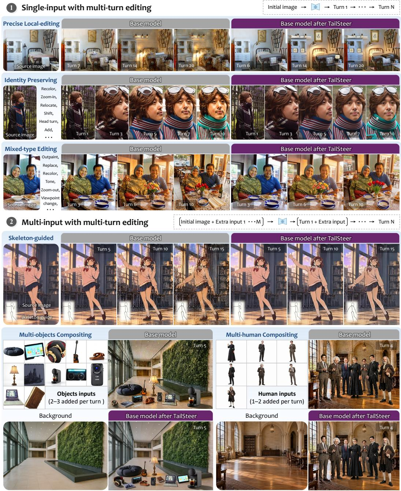  
Figure 1: Single- and multi-input multi-turn editing. TailSteer substantially reduces cumulative drift over editing turns while retaining the base model’s (FLUX.2 [klein] Base 9B) editing capability.

## ABSTRACT

Strong single-turn editing performance does not guarantee reliable multi-turn interaction: as edited outputs are repeatedly reused, small unintended changes can accumulate into severe visual drift. This long-term drift is often mitigated through training on multi-turn data or cross-turn rollouts, potentially altering pretrained priors, or through specialized inference-time mechanisms that are difficult to scale to foundation models. We introduce TailSteer, a final-stage training framework that improves multi-turn robustness while retaining the generative and editing capabilities acquired through earlier training. TailSteer follows a simple principle: keep early denoising dynamics close to those of the base model and concentrate preservation corrections near the trajectory tail, where fine-grained deviations can be suppressed. These corrections are learned from the editor’s own on-policy denoising rollouts, using unchanged source content as a preservation reference without requiring curated ground-truth editing pairs. Experiments across the FLUX, SenseNova, and Qwen families show that TailSteer substantially reduces cumulative drift over 15–20 editing turns while largely preserving base-model performance on extensive text-to-image and single-image editing benchmarks. These results demonstrate that long-horizon editing robustness can be unlocked in foundation models after TailSteer, rather than by relearning their existing capabilities. Project page: https://lyricccco.github.io/tailsteer/

## 1 INTRODUCTION

Large-scale generative models have substantially advanced instruction-based image editing, achieving increasingly strong instruction following, visual fidelity, and content preservation in single-turn editing (OpenAI, 2025a;b; Black Forest Labs et al., 2025; Black Forest Labs, 2025a; Google, 2025). At the same time, image generation is increasingly embedded in interactive and conversational creative workflows. Recent systems, such as Nano Banana 2, ChatGPT Images, Reve, or Muse Im age, allow users to repeatedly refine an image through natural-language feedback, visual references, and agentic interactions (Google, 2026; OpenAI, 2026; Reve, 2026; Meta, 2026). This interaction paradigm better matches how visual content is actually created: rather than specifying a complete target at once, users progressively develop an idea through a sequence of edits.

However, applying one-shot editors to iterative editing introduces a critical challenge: small errors in each edit can accumulate across successive turns. In a multi-turn workflow, each edited output becomes the next input, causing unintended changes to be repeatedly inherited by subsequent generations. As illustrated in Fig. 1, repeated editing can wash out fine textures, alter non-target object or facial details, distort background structures, and eventually produce visible artifacts. Thus, strong single-turn editing performance does not necessarily translate into robust long-horizon editing.

Existing approaches to improving multi-turn image editing can be broadly categorized into three families. i) Adding auxiliary modules or constraints to a pretrained model, by introducing spatial guidance (e.g., masks), specially trained LoRA adapters, or frequency corrections (Couairon et al., 2023; dx8152, 2026; Liao et al., 2026; Wang et al., 2026). These mechanisms improve preservation by sacrificing or constraining part of the large-scale generative prior learned by the pretrained model, and are therefore often limited to a relatively narrow range of localized edit types. ii) Refining the representation space to better support image editing. As reconstruction fidelity and generative capability are widely recognized as a latent-generative dilemma (Yao et al., 2025; Dieleman, 2025), Black Forest Labs specifically treats the VAE representation to obtain a more suitable editing space (Black Forest Labs, 2025b), while other approaches bypass the VAE and perform pixel-diffusion (Yu et al., 2026). Although these designs effectively alleviate errors within a single editing turn, they still suffer from noticeable degradation across repeated edits. iii) Maintaining explicit memory across edits within creative workflows, by caching latent states or previous visual context (Yu et al., 2025; Dalal et al., 2025; Kim et al., 2025a), or by leveraging reasoning models for agentic planning and iterative refinement in commercial generative systems (Meta, 2026; OpenAI, 2026). While these mechanisms help retain historical information across turns, they do not directly improve the underlying model itself. Consequently, long-horizon consistency remains bottlenecked by the base model’s own robustness under repeated editing, often with additional inference overhead.

Although these approaches can improve multi-turn consistency, they often require auxiliary modules, alternative representations, or dedicated models. We instead directly improve the foundation model, so that multi-turn robustness is built into the model. This will not introduce additional inference components and also remain complementary to existing agentic workflow-level solutions.

To improve the existing model, we first analyze why drifting happens in image editing, by inspecting the denoising trajectory. Prior studies show that diffusion sampling follows a coarse-to-fine progression: low-frequency structure is established early, whereas high-frequency details are mainly recov ered near the trajectory tail (Qian et al., 2024). This is particularly relevant to multi-turn editing, where repeated edits progressively degrade high-frequency information (Liao et al., 2026). Moreover, because each inference state depends on preceding model predictions, prediction errors can propagate along the sampling trajectory (Ning et al., 2023; 2024; Li et al., 2024). Fig. 2 reveals that low-frequency similarity is already high before the final steps, whereas higher-frequency similarity rises sharply near the tail. Meanwhile, preservation error in unchanged regions continues to decrease but remains nonzero at the endpoint. These observations motivate refining the trajectory tail, where fine-grained details are finalized and residual preservation errors remain correctable.

Based on this insight, we introduce TailSteer, a final-stage training framework that improves multi-turn robustness by steering only the trajectory tail. Rather than broadly reshaping the foundation model’s learned prior, TailSteer keeps early denoising dynamics close to those of the base model while progressively steering later denoising states toward a preservationaware endpoint. To address the trajectorylevel train-test gap, TailSteer learns from states reached through its own on-policy denoising rollouts, using unchanged source content as a preservation reference without curating ground-truth editing pairs. This targeted steering improves long-horizon robustness while retaining the foundation model’s learned priors.

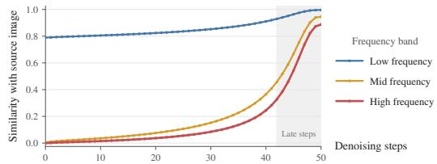

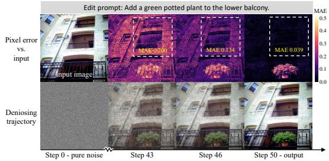

TailSteer’s tail-focused design offers three practical advantages. First, TailSteer improves long-horizon editing robustness while largely preserving the generative and editing capabilities acquired through earlier training. Extensive evaluations on text-to-image generation and single-turn editing benchmarks show per-

Figure 2: Trajectory tail remains correctable. Low-frequency content is recovered early, whereas higher-frequency details are primarily recovered near the tail (top), while preservation error in unchanged regions continues to decrease but remains non-zero at the endpoint (bottom).

formance close to the foundation models, alongside substantial reductions in cumulative drift. Second, TailSteer generalizes across model families and input settings by operating directly on denoising trajectories, without relying on a particular latent representation, attention mechanism, or model architecture. We validate this generality across FLUX (Black Forest Labs, 2026), SenseNova (Diao et al., 2026a), and Qwen (Qwen Team, 2026) backbones, including multi-image compositing and pose-guided editing. Finally, TailSteer constructs preservation supervision from source images and the base model’s own rollouts, without requiring curated ground-truth editing pairs or cross-turn training data. Our scaling experiments further show that larger and more diverse rollout datasets can improve drift resistance while retaining the base model’s editing capabilities.

Our contributions are three-fold: (1) We identify the denoising trajectory tail as a key intervention point for multi-turn editing, where fine-grained details are finalized while residual preservation errors remain correctable without broadly altering earlier dynamics. (2) We introduce TailSteer, a final-stage training framework that learns from the model’s own on-policy rollouts, unlocking multiturn robustness through trajectory-tail steering while largely preserving the base model’s learned pri ors. (3) We introduce Add & Preserve to separately evaluate cumulative drift and edit completion, alongside extensive evaluations on text-to-image generation, single-turn editing, and general multiturn benchmarks. Results across FLUX, SenseNova, and Qwen demonstrate substantially enhanced model-native long-horizon preservation while largely retaining original capabilities, with preserva tion performance rivaling or even surpassing GPT-Image-2.5 Sunburst (via direct API calls).

## 2 RELATED WORK

Multi-turn degradation has also been observed in LLMs (Laban et al., 2026), despite their growing success in agentic workflows. For image generation, however, repeatedly reusing generated outputs can compound visual errors, making long-horizon editing robustness a critical bottleneck for agentic creation. Existing methods address this limitation from several directions.

Representation fidelity. Prior work has explored the trade-off between reconstruction fidelity and generative learnability in latent representations, motivating improved representation designs (Dieleman, 2025; Yao et al., 2025; Black Forest Labs, 2025b). For iterative editing, other approaches mitigate accumulated reconstruction errors by reusing latent states across turns or improving stability under repeated encoding and decoding (Joseph et al., 2024; Almog et al., 2025). Alternatively, pixel-space generative models bypass the VAE bottleneck altogether (Li & He, 2026; Yu et al., 2026; Diao et al., 2026b). These approaches address representation-level limitations, whereas TailSteer improves long-horizon preservation by refining existing models’ denoising dynamics.

Inference-time guidance. Prior work improves preservation through mask-guided constraints that localize edits (Avrahami et al., 2022; Couairon et al., 2023; Yin et al., 2025), and frequency-based corrections that mitigate content degradation across turns (Liao et al., 2026; Wang et al., 2026). Beyond these constraints, training-free methods guide inversion and sampling to balance editing and preservation (Zhou et al., 2025; Jiang et al., 2026; Kim et al., 2025b). While effective in specific settings, these specialized inference procedures may not readily generalize across foundation models and do not directly improve the underlying model’s robustness.

Feature reuse and visual memory. Prior work improves editing consistency through feature reuse and cross-turn memory (Zhu et al., 2025; Kim et al., 2025a). Long-horizon video generation similarly leverages context retrieval and test-time memory (Yu et al., 2025; Dalal et al., 2025). Yet long-horizon consistency remains bottlenecked by the underlying generator’s per-step robustness.

Multi-turn-specific training. Prior work trains multi-turn editors using video-derived sequences or cross-turn reinforcement learning (Qu et al., 2026; Huang et al., 2026), while others train consistency LoRAs (dx8152, 2026). In contrast, TailSteer unlocks base model’s multi-turn potential through trajectory-tail steering, without relearning editing behavior from cross-turn supervision.

## 3 METHOD

TailSteer follows a simple principle: preserve the base model’s early denoising dynamics while steering only its tail toward better preservation. We present the framework through three progressively connected parts. First, we construct preservation-aware supervision directly from the frozen editor’s own rollouts, forming a “data-free” training paradigm without manually curated ground-truth editing pairs. Second, we study a one-step terminal intervention with supervision applied only to the final sampling step, demonstrating that endpoint correction alone can reduce cumulative drift. Finally, we extend this single-step intervention to TailSteer, distributing preservation-oriented steering over multiple steps in the trajectory tail while retaining the original dynamics of the earlier steps.

## 3.1 PRESERVATION-AWARE TRAJECTORY ENDPOINT

To steer the trajectory tail, the first question is what the trajectory should be steered toward. This target should remain aligned with the model’s own editing trajectory while correcting only the unintended deviations accumulated during sampling. However, conventional manually curated source– target editing pairs are poorly suited to this purpose. Given the same source image and instruction, a generative editor may produce different yet valid outputs under different sampling seeds. For example, an instruction to add an apple may yield apples with different sizes, colors, or surface patterns. Our goal is not to force the model toward one particular edit realization, but to correct the rollout-induced errors while preserving the edit already chosen by the model.

Remarkably, the preservation target is already available in the source image: the content not requested to change. For example, when replacing an object in a local region, the surrounding subject and background should remain unchanged. Although modern editors exhibit strong instruction following to localize the requested edit, their denoising rollouts still introduce small deviations into such non-target content. These model-induced deviations therefore provide exactly the preservation errors that TailSteer aims to correct.

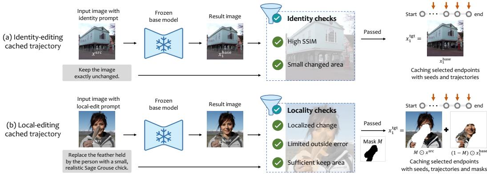  
Figure 3: Data curation of preservation-aware trajectory endpoints. We construct supervision from rollouts of the frozen base editor using two complementary edit types: (a) identity editing provides full-image preservation trajectories, while (b) local editing provides partial-preservation trajectories with spatially localized changes. Only samples that pass the corresponding sanity check are retained and cached as training trajectories for subsequent TailSteer optimization.

To obtain reliable supervision, we construct two complementary trajectory types in which the resulting edit is expected to preserve part of the source image, identity editing and local editing, as illustrated in Fig. 3. Identity editing requests no visual change and therefore provides full-image preservation supervision, whereas local editing confines the requested modification to a localized region, leaving the remaining content available for partial preservation supervision. We generate rollouts with the frozen base model and filter them using the corresponding identity or locality checks, retaining only trajectories with reliable preservation regions. For accepted edits, these regions are further converted into preservation masks, as described below.

For local editing, we further derive a binary preservation mask from the difference between the source image and the model’s generated result. The mask is not specified in advance as we do not require the generated edit to match a ground-truth target; instead, we only require the observed change in the masked regions to be sufficiently localized. Let $x ^ { \mathrm { s r c } }$ denote the source state, $x _ { 1 } ^ { \mathrm { b a s e } }$ the endpoint of the frozen base editor’s rollout, and M the resulting preservation mask, where $\bar { M } = 1$ denotes regions that should remain unchanged. We construct preservation-aware target endpoint as

$$
x _ { 1 } ^ { \mathrm { { t g t } } } = M \odot x ^ { \mathrm { { s r c } } } + ( 1 - M ) \odot x _ { 1 } ^ { \mathrm { { b a s e } } } .\tag{1}
$$

For identity editing, we simply set $M = 1$ . Thus, $x _ { 1 } ^ { \mathrm { { t g t } } }$ restores the source content in preservation regions while retaining the edit realization produced by the base editor elsewhere.

For each accepted rollout, we cache the source state, selected intermediate states, the terminal state, the preservation mask, and the sampling seed for subsequent TailSteer training. Importantly, the two restricted prompt families are used only to obtain reliable preservation supervision; TailSteer itself learns a trajectory-level correction rather than an edit-specific behavior. We later show that this supervision generalizes beyond these training edits, improving multi-turn robustness for subject identity and multi-image-conditioned editing without sacrificing broader editing capabilities.

## 3.2 ONE-STEP TERMINAL INTERVENTION

We first test whether the curated preservation-aware endpoint can improve multi-turn stability through the smallest possible intervention: correcting only the final sampling step. To test this native solution, we initialize from the original base model and fine-tune it exclusively on the final sampling step: starting from the cached pre-terminal state, the model is supervised toward the preservation-aware endpoint, while the preceding timesteps receive no training objective (Fig. 4 (a)).

Let $\tau < 1$ denote the pre-terminal sampling time, with time increasing from noise at 0 to output at 1. Given the cached state $x _ { \tau } ^ { \mathrm { b a s e } }$ , the velocity toward the preservation-aware endpoint $x _ { 1 } ^ { \mathrm { t g t } }$ is

$$
v _ { \tau } = \frac { x _ { 1 } ^ { \mathrm { t g t } } - x _ { \tau } ^ { \mathrm { b a s e } } } { 1 - \tau } .\tag{2}
$$

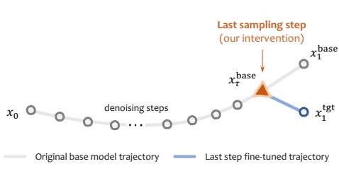  
(a) Terminal–step fine–tuning

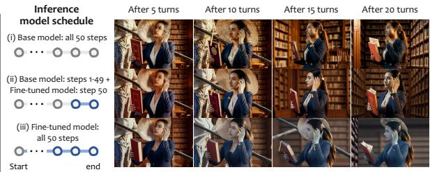  
(b) Multi-turn editing under different inference model schedules  
Figure 4: One-step terminal intervention: benefits and limitations. (a) We fine-tune FLUX.2- klein-9B with supervision only at the final sampling step, steering from the cached pre-terminal state $x _ { \tau } ^ { \mathrm { b a s e } }$ toward the preservation-aware target $\bar { x } _ { 1 } ^ { \mathrm { t g t } }$ . (b) The base model accumulates visible identity drift over repeated edits (top row). Applying the fine-tuned model only at the final step markedly improves long-horizon preservation (middle row), whereas using it throughout sampling causes desaturation and detail loss (bottom row). Therefore, it is necessary to preserve the earlier dynamics.

We then use vτ as the supervision target only at the terminal update, encouraging the velocity predicted from $x _ { \tau } ^ { \mathrm { b a s e } }$ to endpoint $x _ { 1 } ^ { \mathrm { t g t } }$ :

$$
\begin{array} { r } { \mathcal { L } _ { \mathrm { T e r m i n a l } } = \mathbb { E } \left[ \left. v _ { \theta } ( x _ { \tau } ^ { \mathrm { b a s e } } , \tau , c ) - v _ { \tau } \right. _ { 2 } ^ { 2 } \right] , } \end{array}\tag{3}
$$

where c denotes the editing condition. This confines the intervention to the final sampling update, directly examining how much multi-turn stability can be improved by modifying only the last step.

We evaluate this terminal intervention on FLUX.2 [klein] Base 9B with 50 sampling steps per edit (Fig. 4(b)). When the base model is used for all 50 steps, the base model exhibits visible facial degradation after five turns, which worsens with continued editing. In contrast, using the base model for the first 49 steps and the fine-tuned model only for the final update markedly reduces visible drift and better preserves subject identity, with visually stable results even after 20 turns. This demonstrates that the preservation-aware endpoint provides effective supervision for long-horizon multi-turn stability, even when correction is confined to a single sampling update.

However, applying the fine-tuned model to all 50 steps reveals a different trade-off. Although the outputs exhibit fewer conspicuous artifacts than those of the base model, they become desaturated and overly smooth, losing facial and scene details. Since the model’s parameters are shared across timesteps, terminal-only supervision can also disturb the model’s learned dynamics at earlier steps; preserving the original model prior therefore requires explicit model switching. Moreover, concentrating all correction in the final update leaves no opportunity for gradual adjustment. These limitations motivate our full TailSteer framework, which explicitly trains the model to preserve the model’s earlier dynamics while distributing the correction over the denoising trajectory tail, allowing a single trained model to perform the entire sampling process with improved multi-turn stability.

## 3.3 TAIL STEERING

The terminal intervention above leaves earlier predictions unconstrained and concentrates all correction in a single update. We therefore introduce TailSteer, an on-policy last-stage training framework that preserves the model’s learned dynamics over the earlier trajectory while progressively steering its tail toward the preservation-aware endpoint. Starting from the frozen base model, we initialize a trainable copy, denoted by $v _ { \theta } .$ , as the refined model. Importantly, all supervision is constructed on states reached by the refined model’s own denoising rollouts, as illustrated in Fig. 5.

Steering onset. We extend the terminal correction to a trajectory tail by introducing a steering onset $k _ { s } ~ < ~ \tau$ . This partitions the trajectory into a prior region, $0 \leq k \leq k _ { s }$ , and a transition region, $k _ { s } < k < 1$ . Before $k _ { s }$ , the refined model is trained to reproduce the original base model’s dynamics; after $k _ { s } .$ , the supervision gradually shifts toward the preservation endpoint.

Cached trajectory anchors. To obtain rollout states from the refined model without repeatedly replaying the full trajectory, we use cached base-model states as rollout anchors. In the prior region, states are cached at intervals of at most three sampling updates, including the onset state $x _ { k _ { s } } ^ { \mathrm { b a s e } }$ . For a sampled prior-region step, the refined model rolls out from the nearest strictly preceding cached state. In the transition region, all rollouts instead start from $x _ { k _ { \mathrm { s } } } ^ { \mathrm { b a s e } }$ , with no intermediate tail states used as restart anchors. This keeps early rollouts short while allowing the refined model to evolve along its own trajectory throughout the tail. We denote the state reached at the sampled step by $x _ { k }$

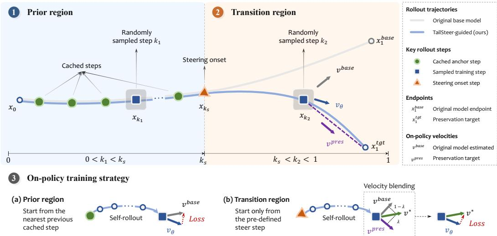  
Figure 5: On-policy training of TailSteer. At randomly sampled training states $x _ { k _ { 1 } }$ and $x _ { k _ { 2 } }$ , the refined model receives region-dependent supervision. In the prior region, its prediction is matched to the frozen base model’s velocity $v ^ { \mathrm { b a s e } }$ ; in the transition region, the target $v ^ { * }$ progressively blends $v ^ { \mathrm { b a s e } }$ with the preservation velocity $v ^ { \mathrm { p r e s } }$ toward $x _ { 1 } ^ { \mathrm { t g t } }$ . To obtain these states on-policy, the refined model rolls out from the nearest preceding cached anchor in prior region, and from the fixed steeringonset state in transition region. The velocity target is then recomputed at the state actually reached by the refined model, with gradients applied only to its prediction at the sampled step.

Velocity blending. At the state $x _ { k }$ reached by the refined model, we evaluate the frozen base model to obtain $v _ { k } ^ { \mathrm { { \bar { b a s e } } } } = v ^ { \mathrm { { b a s e } } } ( x _ { k } , k , c )$ . We generalize the endpoint-directed velocity in Eq. 2 to $v _ { k } ^ { \mathrm { p r e s } } = ( x _ { 1 } ^ { \mathrm { t g t } } - x _ { k } ^ { \top } ) / ( 1 - k )$ , where $1 - k$ is the remaining sampling time. The supervision target combines these velocities according to the trajectory region:

$$
v _ { k } ^ { * } = \left\{ \begin{array} { l l } { v _ { k } ^ { \mathrm { b a s e } } , } & { 0 < k \leq k _ { s } , } \\ { \lambda ( k ) v _ { k } ^ { \mathrm { b a s e } } + [ 1 - \lambda ( k ) ] v _ { k } ^ { \mathrm { p r e s } } , } & { k _ { s } < k \leq \tau . } \end{array} \right.\tag{4}
$$

The weight $\lambda ( k )$ decreases from 1 at $k _ { s }$ to 0 at τ, gradually shifting supervision from the base dynamics to endpoint correction. At the final update, the target has the same endpoint-directed form as in Sec. 3.2, now evaluated at the state reached by the refined model.

On-policy training. Crucially, both $v _ { k } ^ { \mathrm { b a s e } }$ and $v _ { k } ^ { \mathrm { p r e s } }$ are recomputed at the state $x _ { k }$ actually reached by the refined model. The supervision therefore adapts to deviations along the current rollout instead of relying on targets precomputed on the frozen base trajectory. We optimize

$$
\mathcal { L } _ { \mathrm { T a i l S t e e r } } = \mathbb { E } [ \mathrm { M S E } ( v _ { \theta } ( x _ { k } , k , c ) , \mathrm { s g } [ v _ { k } ^ { * } ] ) ] ,\tag{5}
$$

where the expectation is over cached examples and sampled training steps, and sg denotes stopgradient. The rollout itself is performed without gradient tracking, so gradients are backpropagated only through the refined model’s prediction at the sampled step, while all trainable parameters of the refined model are updated by this loss.

At inference, the refined model performs the entire sampling trajectory on its own. All auxiliary components—including the frozen base model, preservation targets, masks, and velocity blending— are used only during training TailSteer, requiring no model switching, external adapters, or additional consistency mechanisms at inference. TailSteer therefore improves multi-turn robustness as an intrinsic capability of the refined foundation model.

  
Turn 1: Add leaf latte art Turn 2: Flute the cup vertically. Turn 3: Add a crescent cookie. Turn 4: Fill the glass with sparkling water. Turn 5: Add a lemon slice to the rim. Turn 6: Add a woven bookmark. Turn 7: Add a bookmark tassel.

Turn 8: Replace the pen with a brushed-metal Turn 9: Place the pen cap on the page Turn 10: Slightly raise the viewpoint. Turn 11: Add a vase with chamomile Turn 12: Add a cork coaster under the glass. Turn 13: Emboss a book icon on the cup Turn 14: Dog-ear the page’s upper-right corner

Turn 15: Add round reading glasses Turn 16: Add soft window-frame shadows. Turn 17: Add a cookie bite mark. Turn 18: Add three saucer crumbs. Turn 19: Extend left with matching wood grain Turn 20: Add a “Reserved” card behind the vase

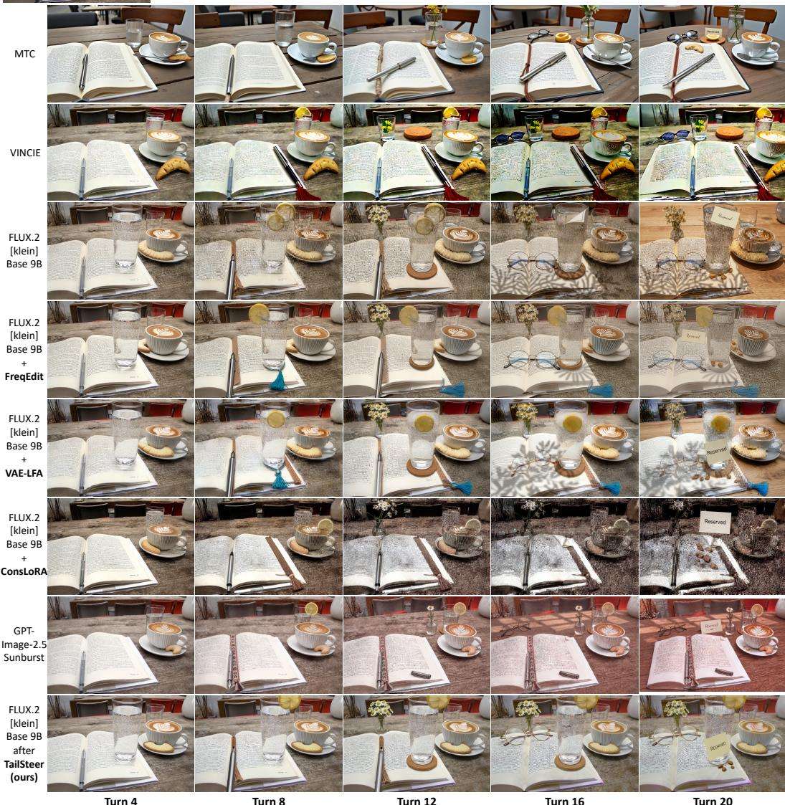  
Figure 6: 20-turn qualitative comparison. While competing methods exhibit cumulative visual drift, TailSteer faithfully preserves the original tabletop color and previously established details, including the coffee cup, latte art, and cookie on the right, even after 20 successive editing turns.

## 4 EXPERIMENTS

## 4.1 EXPERIMENTAL DETAILS

We evaluate TailSteer on four foundation models across three model families: FLUX.1 Kontext [dev] (30 steps) (Black Forest Labs et al., 2025), FLUX.2 [klein] Base 9B (50 steps) (Black Forest Labs, 2026), SenseNova-U1.5-8B-MoT (50 steps) (Diao et al., 2026a), and Qwen-Image-2.1 (40 steps) (Qwen Team, 2026). We collect 11,947 candidate source images from Open Images (Kuznetsova et al., 2020) and MONET (Aubin et al., 2026), each paired with three independent local-edit instructions and one identity-edit instruction. Training trajectories are generated and filtered independently for each backbone. We train each model for 2,000 updates using BF16 precision and an effective batch size of 16 on eight NVIDIA H100 GPUs. We evaluate three steering onsets per backbone using the final checkpoints, with $k _ { s } = 2 5$ , 46, 42, 30 selected for qualitative comparisons on Kontext, Klein, SenseNova, and Qwen, respectively. At inference, the refined model is applied throughout the denoising trajectory under the original sampling settings. The steering onset determines where preservation-oriented steering begins during training, rather than an inference-time model switch.

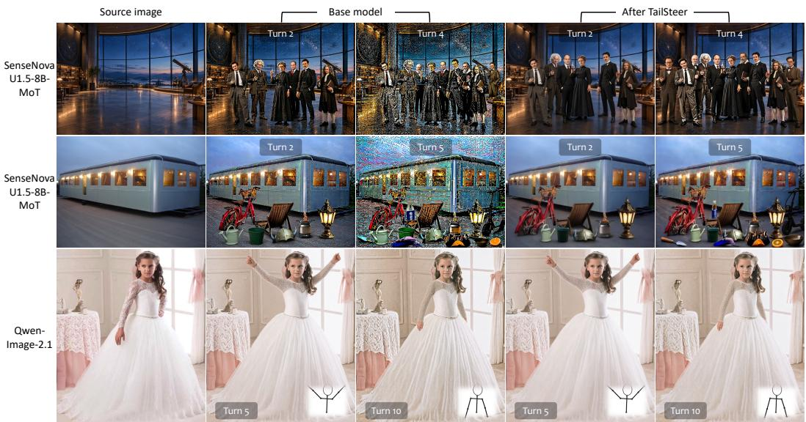  
Figure 7: Multi-input multi-turn editing. TailSteer retains base models’ multi-image editing capabilities while substantially reducing cumulative drift, preserving backgrounds during multi-person and multi-object compositing and the girl’s dress details across successive skeleton-guided edits.

## 4.2 QUALITATIVE EVALUATION

Fig. 6 compares TailSteer with training-free MTC (Zhou et al., 2025), video-data-trained VIN-CIE (Qu et al., 2026), and inference-time preservation modules, including FreqEdit (Liao et al., 2026), VAE-LFA (Wang et al., 2026), and Consistency LoRA V2 (dx8152, 2026). We also evaluate GPT-Image-2.5 Sunburst (OpenAI, 2026) as a strong proprietary generator via direct API calls. MTC maintains scene coherence but loses source-specific details, while VINCIE exhibits severe degradation across turns. Although the preservation modules alleviate some drift, they noticeably alter the base models’ behavior and substantially degrade its single-turn editing performance, as shown in Table 1. In contrast, TailSteer directly strengthens the base model, preserving the original tabletop color and previously established details, including the coffee cup, latte art, and cookie, even after 20 turns. Notably, TailSteer preserves the tabletop color more faithfully than GPT-Image-2.5 in this example, demonstrating that a open-weight model after TailSteer can rival or even surpass strong proprietary generators in long-horizon tasks. This advantage extends to multi-input editing (as shown in Fig. 7), where TailSteer retains the base models’ compositing and skeleton-guided edit ing capabilities while better preserving backgrounds and the girl’s dress details across pose changes.

## 4.3 QUANTITATIVE EVALUATION

Single-turn capability retention. We evaluate text-to-image generation on Qwen-Image-Bench (Li et al., 2026a) and BizGenEval (Li et al., 2026b), and single-turn editing on GEdit-Bench (Liu et al., 2025), RISEBench (Zhao et al., 2025), and ImgEdit-Bench (Ye et al., 2025). Table 1 shows that TailSteer largely retains pretrained capabilities across all four backbones and reported steering onsets. Text-to-image performance remains close to base model, as do GEdit and ImgEdit scores. In contrast, models with FreqEdit or ConsLoRA exhibit substantially larger declines in GEdit performance. These results support TailSteer’s ability to improve multi-turn robustness without broadly compromising the base model’s capabilities acquired through earlier training.

General multi-turn editing. While the preceding single-turn benchmarks assess the retention of pretrained generative and editing capabilities, we further evaluate their reliability across successive edits. MSE-Bench (Qu et al., 2026) measures instruction following and consistency over five editing turns, while EdiVal-Bench (Chen et al., 2026) employs agentic, object-centric evaluation to assess editing reliability as visual context evolves. As shown in Table 2, TailSteer consistently improves EdiVal content consistency across all settings and achieves higher MSE-Bench success rates at selected steering onsets, although instruction-following gains remain less consistent. However, aggregate multi-turn success cannot fully distinguish inherent editing limitations from accumulated drift: for example, a failed edit in a later turn may reflect either an instruction the base model already struggles with or visual degradation inherited from earlier turns. This motivates a more controlled evaluation that directly measures cumulative visual drift alongside edit completion.

Table 1: Single-turn capability retention. Text-to-image generation and single-turn editing performance across base models. Teal ↑ and orange ↓ indicate improvement/degradation from each base model. Bold number marks the best non-base score per backbone and metric, including ties.
<table><tr><td rowspan="2">Backbone</td><td rowspan="2">Baseline</td><td rowspan="2"> $k _ { s }$ </td><td colspan="3">Text-to-image</td><td colspan="4">Single-turn image editing</td></tr><tr><td>Qwen-IB EN ↑</td><td>Qwen-IB ZH ↑</td><td>BizGen ES (%) ↑</td><td>GEdit-EN ↑</td><td>GEdit-ZH ↑</td><td>RISE Acc. (%) ↑</td><td>ImgEdit ↑</td></tr><tr><td rowspan="5">FLUX.1 Kontext [dev]</td><td>Base model</td><td>一</td><td>41.19</td><td>19.23</td><td>1.70</td><td>5.99</td><td>0.89</td><td>8.89</td><td>3.77</td></tr><tr><td>W/ FreqEdit</td><td>=</td><td>=</td><td>=</td><td>1</td><td> $5 . 2 0 _ { \perp 0 . 7 9 }$ </td><td> $0 . 6 4 _ { \downarrow 0 . 2 5 }$ </td><td>6.94  $\downarrow 1 . 9 4$ </td><td> $3 . 6 2 _ { \perp 0 . 1 5 }$ </td></tr><tr><td></td><td>22</td><td> $\mathbf { 4 1 . 6 3 _ { \uparrow 0 . 4 4 } }$ </td><td> $1 9 . 1 7 _ { \perp 0 . 0 6 }$ </td><td> $\mathbf { 2 . 1 7 _ { \uparrow 0 . 4 8 } }$ </td><td> $5 . 9 3 _ { \perp 0 . 0 6 }$ </td><td> $0 . 8 1 _ { \perp 0 . 0 7 }$ </td><td> $6 . 9 4 _ { \perp 1 . 9 4 }$ </td><td> $3 . 8 0 _ { \uparrow 0 . 0 3 }$ </td></tr><tr><td>After TailSteer</td><td>25</td><td> $4 1 . 5 0 \dot { _ { \mathrm { \scriptsize ~ \uparrow 0 . 3 2 } } }$ </td><td> ${ \bf 1 9 . 1 9 } _ { \perp 0 . 0 4 }$ </td><td> $2 . 0 7 _ { \uparrow 0 . 3 8 }$ </td><td> $5 . 9 5 _ { \perp 0 . 0 4 }$ </td><td> $0 . 8 1 \overset { \cdot } { \underset { \cdot } { \downarrow } } 0 . 0 7$ </td><td> $7 . 2 2 _ { \scriptstyle \downarrow 1 . 6 7 }$ </td><td> ${ \bf 3 . 8 3 } _ { \uparrow 0 . 0 6 }$ </td></tr><tr><td></td><td>27</td><td> $4 1 . 3 0 _ { \uparrow 0 . 1 1 }$ </td><td> $1 8 . 8 9 _ { \perp 0 . 3 4 }$ </td><td> $1 . 7 0 { = } 0 . 0 0$ </td><td> ${ \bf 5 . 9 7 _ { \perp 0 . 0 2 } }$ </td><td> $\mathbf { 0 . 8 6 _ { \perp 0 . 0 2 } }$ </td><td> ${ \bf 7 . 5 0 } _ { \perp 1 . 3 9 }$ </td><td> $3 . 8 3 _ { \uparrow 0 . 0 6 }$ </td></tr><tr><td rowspan="6">FLUX.2 [Klein] Base 9B</td><td>Base model</td><td>一</td><td>49.27</td><td>49.16</td><td>9.87</td><td>7.47</td><td>7.42</td><td>14.17</td><td>4.20</td></tr><tr><td>W/FreqEdit</td><td>一</td><td>一</td><td>=</td><td></td><td> $7 . 2 0 _ { \perp 0 . 2 7 }$ </td><td> $7 . 1 8 _ { \perp 0 . 2 5 }$ </td><td> $1 1 . 1 1 _ { \perp 3 . 0 6 }$ </td><td> $4 . 0 9 _ { \perp 0 . 1 2 }$ </td></tr><tr><td>W/ ConsLoRA</td><td>一</td><td>一</td><td></td><td></td><td> $6 . 5 8 _ { \perp 0 . 8 9 }$ </td><td> $6 . 4 3 _ { \perp 0 . 9 9 }$ </td><td> $9 . 4 4 _ { \perp 4 . 7 2 }$ </td><td> $3 . 8 6 _ { \perp 0 . 3 4 }$ </td></tr><tr><td>After TailSteer</td><td>43</td><td> $4 9 . 6 8 _ { \uparrow 0 . 4 1 }$ </td><td> $\mathbf { 4 9 . 4 8 } _ { \uparrow 0 . 3 3 }$ </td><td> $8 . 3 0 _ { \perp 1 . 5 7 }$ </td><td> $7 . 4 3 _ { \perp 0 . 0 4 }$ </td><td> $7 . 3 5 _ { \perp 0 . 0 7 }$ </td><td> $1 3 . 3 3 _ { \perp 0 . 8 3 }$ </td><td> $4 . 1 7 _ { \perp 0 . 0 3 }$ </td></tr><tr><td></td><td>46 48</td><td> $4 9 . 4 2 _ { \uparrow 0 . 1 5 }$   $\mathbf { 4 9 . 7 4 } _ { \uparrow 0 . 4 7 }$ </td><td> $4 9 . 3 7 _ { \uparrow 0 . 2 1 }$ </td><td> ${ \bf 1 0 . 9 7 _ { \mathrm { \uparrow 1 . 1 0 } } }$ </td><td> $7 . 5 2 _ { \uparrow 0 . 0 5 }$ </td><td> $7 . 3 9 _ { \perp 0 . 0 4 }$ </td><td> ${ \bf 1 3 . 6 1 } _ { \perp 0 . 5 6 }$ </td><td> $4 . 1 9 _ { \perp 0 . 0 2 }$ </td></tr><tr><td></td><td></td><td></td><td> $4 9 . 4 6 _ { \uparrow 0 . 3 1 }$ </td><td> $9 . 3 7 _ { \perp 0 . 5 0 }$ </td><td> $7 . 4 1 _ { \perp 0 . 0 6 }$ </td><td> $7 . 4 4 _ { \uparrow 0 . 0 1 }$ </td><td> $1 1 . 3 9 _ { \downarrow 2 . 7 8 }$ </td><td> $4 . 2 4 _ { \uparrow 0 . 0 3 }$ </td></tr><tr><td rowspan="4">SenseNova U1.5-8B MoT</td><td>Base model</td><td>一</td><td>53.43</td><td>53.25</td><td>45.85</td><td>8.33</td><td>8.30</td><td>31.39</td><td>4.43</td></tr><tr><td>After TailSteer</td><td>37 42</td><td> $5 2 . 4 5 _ { \perp 0 . 9 8 }$ </td><td> $5 2 . 7 8 _ { \perp 0 . 4 6 }$ </td><td> $4 3 . 7 5 _ { \perp 2 . 1 0 }$ </td><td> $\mathbf { 8 . 3 0 _ { \perp 0 . 0 4 } }$ </td><td> $8 . 2 8 _ { \perp 0 . 0 2 }$ </td><td> $3 1 . 6 7 _ { \uparrow 0 . 2 8 }$ </td><td> $4 . 3 9 _ { \perp 0 . 0 5 }$ </td></tr><tr><td></td><td>47</td><td> $5 2 . 2 4 _ { \perp 1 . 1 9 }$   ${ \pm } 2 . 5 5 _ { \perp 0 . 8 9 }$ </td><td> $5 2 . 5 8 _ { \perp 0 . 6 7 }$   ${ \pmb 5 } 3 . { \bf 0 } 2 _ { \perp 0 . 2 2 }$ </td><td> $4 5 . 7 3 _ { \perp 0 . 1 2 }$   ${ \bf 4 6 . 1 7 } _ { \uparrow 0 . 3 2 }$ </td><td> $8 . 2 7 _ { \perp 0 . 0 6 }$   ${ \bf 8 . 3 0 } _ { \perp 0 . 0 4 }$ </td><td> ${ \bf 8 . 3 1 } _ { \uparrow 0 . 0 1 }$   $8 . 2 5 _ { \perp 0 . 0 5 }$ </td><td> $2 9 . 4 4 _ { \downarrow 1 . 9 4 }$   $3 1 . 6 7 _ { \uparrow 0 . 2 8 }$ </td><td> $\mathbf { 4 . 4 1 } _ { \perp 0 . 0 2 }$ </td></tr><tr><td>Base model</td><td></td><td> $5 3 . 3 9 $ </td><td></td><td></td><td></td><td></td><td></td><td> $4 . 3 9 _ { \perp 0 . 0 5 }$ </td></tr><tr><td rowspan="4">Qwen Image-2.1</td><td></td><td>一</td><td></td><td>53.34</td><td> $5 7 . 0 3 $ </td><td>8.11</td><td>7.80</td><td>20.56</td><td>4.40</td></tr><tr><td rowspan="2">After TailSteer</td><td>24</td><td> $5 3 . 4 9 _ { \uparrow 0 . 1 0 }$ </td><td> $5 2 . 8 6 _ { \perp 0 . 4 8 }$ </td><td> $5 6 . 2 5 _ { \perp 0 . 7 8 }$ </td><td> $7 . 9 6 _ { \perp 0 . 1 5 }$ </td><td> $7 . 7 3 _ { \perp 0 . 0 7 }$ </td><td> $1 8 . 3 3 \downarrow 2 . 2 2$ </td><td> $4 . 3 6 _ { \perp 0 . 0 4 }$ </td></tr><tr><td>30</td><td> $5 3 . 0 6 _ { \perp 0 . 3 3 }$ </td><td> ${ \bar { 5 } } 3 . 2 0 { \scriptstyle \downarrow } _ { 0 . 1 4 }$ </td><td> ${ \bar { \mathbf { s } } } 7 . 3 8 _ { \uparrow 0 . 3 5 }$ </td><td> $\mathbf { 8 . 0 4 } _ { \perp 0 . 0 6 }$ </td><td> $7 . 7 2 _ { \perp 0 . 0 9 }$ </td><td> $1 8 . 0 6 _ { \perp 2 . 5 0 }$ </td><td> $4 . 4 2 _ { \uparrow 0 . 0 2 }$ </td></tr><tr><td></td><td>35</td><td> $5 3 . 3 2 _ { \perp 0 . 0 7 }$ </td><td> $5 3 . 0 6 _ { \perp 0 . 2 8 }$ </td><td> $5 6 . 6 7 _ { \perp 0 . 3 5 }$ </td><td> $8 . 0 2 _ { \perp 0 . 0 9 }$ </td><td> $7 . 7 5 _ { \perp 0 . 0 5 }$ </td><td> ${ \bf 1 8 . 6 1 } _ { \perp 1 . 9 4 }$ </td><td> $4 . 3 9 _ { \perp 0 . 0 1 }$ </td></tr></table>

Table 2: Multi-turn editing and drift evaluation. MSE-Bench, EdiVal assess general multi-turn editing, while Add & Preserve measures Cumulative Object Accuracy (COA) and outside-box drift.
<table><tr><td rowspan="2">Backbone</td><td rowspan="2">Baseline</td><td rowspan="2"> $k _ { s }$ </td><td colspan="3">MSE-Bench</td><td colspan="2">EdiVal</td><td colspan="4">Add &amp; Preserve</td></tr><tr><td>SR@5 (%) ↑</td><td>PF@5↑</td><td></td><td>Cons.@5 ↑ IF@3 (%) ↑ CC@3 (%) ↑</td><td></td><td> $\mathrm { C O A } \left( \% \right) \uparrow$ </td><td></td><td>PSNR@10 ↑ SSIM@10 ↑ LPIPS@10 ↓</td><td></td></tr><tr><td rowspan="6">FLUX.1 Kontext [dev]</td><td>Base model</td><td></td><td>16.00</td><td>1.69</td><td>2.08</td><td>17.31</td><td>87.46</td><td>34.77</td><td>18.64</td><td>0.585</td><td>0.388</td></tr><tr><td>W/FreqEdit</td><td>=</td><td>10.00↓6.00</td><td> $1 . 0 2 _ { \downarrow , 0 . 6 7 }$ </td><td>1.09↓0.99</td><td> $1 1 . 5 4 _ { \perp 5 . 7 7 }$ </td><td> $9 2 . 6 8 _ { \uparrow 5 . 2 2 }$ </td><td> $3 6 . 8 2 _ { \uparrow 2 . 0 4 }$ </td><td> $1 7 . 2 0 _ { \perp 1 . 4 4 }$ </td><td>0.519 ↓0.066</td><td>0.278 ↓0.110</td></tr><tr><td>W/ VAE-LFA</td><td>=</td><td> $1 0 . 0 0 \dot { _ { \perp 6 . 0 0 } }$ </td><td> $1 . 0 0 \dot { _ { \perp 0 . 6 9 } }$ </td><td>1.10↓0.98</td><td> $1 6 . 7 8 _ { \perp 0 . 5 2 }$ </td><td> $8 6 . 3 9 _ { \perp 1 . 0 7 }$ </td><td> $3 5 . 0 7 _ { \uparrow 0 . 3 0 }$ </td><td> $1 9 . 6 5 _ { \uparrow 1 . 0 1 }$ </td><td>0.602  $\uparrow 0 . 0 1 7$ </td><td>0.363 ↓0.025</td></tr><tr><td></td><td>22 25</td><td> $1 3 . 0 0 \mathrm { ~ } _ { \perp 3 . 0 0 }$ </td><td> $1 . 4 3 _ { \perp 0 . 2 6 }$ </td><td>1.68↓0.40</td><td> $1 6 . 2 6 _ { \perp 1 . 0 5 }$ </td><td> $8 9 . 3 1 \dot { _ { \mathrm { \scriptsize ~  ~ } } }$ </td><td> $3 5 . 0 3 _ { \uparrow 0 . 2 6 }$ </td><td> $2 0 . 6 0 _ { \uparrow \uparrow . 9 6 }$ </td><td>0.671 ↑0.086</td><td>0.268 ↓0.121</td></tr><tr><td>After TailSteer</td><td></td><td> ${ \bf 1 7 . 0 0 } _ { \mathrm { \tiny \cdot 1 . 0 0 } }$ </td><td> $\mathbf { 1 . 6 0 } _ { \perp 0 . 0 9 }$ </td><td>1.74↓0.34</td><td> ${ \bf 1 6 . 9 6 } _ { \perp 0 . 3 5 }$ </td><td> $8 9 . 0 8 \substack { \uparrow 1 . 6 2 }$ </td><td> $3 4 . 8 4 _ { \uparrow 0 . 0 7 }$ </td><td> ${ \bf 2 1 . 0 2 } _ { \uparrow 2 . 3 8 }$ </td><td> $\mathbf { 0 . 6 7 2 } _ { \uparrow 0 . 0 8 7 }$ </td><td>0.257 ↓0.131</td></tr><tr><td></td><td>27</td><td> $1 6 . 0 0 { = } 0 . 0 0$ </td><td> $1 . 5 1 _ { \perp 0 . 1 8 }$ </td><td>1.72↓0.36</td><td> $1 6 . 7 8 \scriptstyle \downarrow 0 . 5 2$ </td><td> $8 8 . 7 0 \ast _ { 1 . 2 4 }$ </td><td> $3 4 . 5 8 _ { \perp 0 . 1 9 }$ </td><td> $2 0 . 1 0 \substack { \uparrow 1 . 4 6 }$ </td><td> $0 . 6 4 6 _ { \uparrow 0 . 0 6 1 }$ </td><td>0.297 ↓0.092</td></tr><tr><td rowspan="7">FLUX.2 [Klein] Base 9B</td><td>Base model</td><td></td><td>40.00</td><td>3.91</td><td>4.03</td><td>32.69</td><td>85.24</td><td>31.02</td><td>13.85</td><td>0.289</td><td>0.524</td></tr><tr><td>W/FreqEdit</td><td></td><td> $3 3 . 0 0 _ { \perp 7 . 0 0 }$ </td><td> $3 . 6 9 _ { \perp 0 . 2 2 }$ </td><td>4.11↑0.08</td><td> $2 7 . 9 7 _ { \scriptstyle \pm 4 . 7 2 }$ </td><td> $8 7 . 8 4 \substack { \cdot 2 . 6 0 }$ </td><td> $3 5 . 9 4 _ { \uparrow 4 . 9 1 }$ </td><td> $1 3 . 8 0 _ { \perp 0 . 0 5 }$ </td><td> $0 . 3 1 8 _ { \uparrow 0 . 0 3 0 }$ </td><td>0.405 ↓0.19</td></tr><tr><td>W/ VAÉ-LFA</td><td></td><td> $3 3 . 0 0 \mathrm { ~ \overset { . } { \_ } 7 . 0 0 }$ </td><td> $3 . 3 8 _ { \perp 0 . 5 3 }$ </td><td>3.56↓0.47</td><td> $3 1 . 4 7 _ { \perp 1 . 2 2 }$ </td><td> $8 5 . 9 3 _ { \uparrow 0 . 6 8 }$ </td><td> $3 1 . 0 3 _ { \uparrow 0 . 0 1 }$ </td><td> $1 6 . 4 7 _ { \uparrow 2 . 6 1 }$ </td><td> $0 . 4 3 4 _ { \uparrow 0 . 1 4 6 }$ </td><td>0.375 ↓0.149</td></tr><tr><td>W/ ConsLoRA</td><td></td><td> $3 9 . 0 0 \dot { _ { \perp 1 . 0 0 } }$ </td><td> $3 . 9 4 _ { \uparrow 0 . 0 3 }$ </td><td>4.47↑0.44</td><td> $2 6 . 0 5 _ { \perp 6 . 6 4 }$ </td><td> $\mathbf { 9 1 . 1 9 } _ { \uparrow 5 . 9 5 }$ </td><td> $3 2 . 8 7 _ { \uparrow 1 . 8 5 }$ </td><td> $1 4 . 6 3 _ { \uparrow 0 . 7 7 }$ </td><td> $0 . 4 4 6 _ { \uparrow 0 . 1 5 8 }$ </td><td>0.442 ↓0.082</td></tr><tr><td></td><td>43</td><td> $3 2 . 0 0 _ { \perp 8 . 0 0 }$ </td><td> $3 . 2 6 _ { \perp 0 . 6 5 }$ </td><td>3.47↓0.56</td><td> $3 0 . 9 4 _ { \perp 1 . 7 5 }$ </td><td> $8 7 . 3 8 \div 2 . 1 4$ </td><td> $3 0 . 9 2 _ { \perp 0 . 1 0 }$ </td><td> $1 9 . 7 6 _ { \uparrow 5 . 9 1 }$ </td><td> $0 . 6 1 6 _ { \uparrow 0 . 3 2 8 }$ </td><td>0.295 ↓0.229</td></tr><tr><td>After TailSteer</td><td>46</td><td> $3 3 . 0 0 _ { \perp 7 . 0 0 }$ </td><td> $3 . 2 3 _ { \perp 0 . 6 8 }$ </td><td>3.32↓0.71</td><td> $3 0 . 2 4 \dot { \downarrow } 2 . 4 5$ </td><td> $8 7 . 5 7 _ { \uparrow 2 . 3 2 }$ </td><td> $3 1 . 8 4 _ { \uparrow 0 . 8 1 }$ </td><td> $\mathbf { 1 9 . 9 6 } _ { \uparrow 6 . 1 1 }$ </td><td> $\mathbf { 0 . 6 2 1 } _ { \uparrow 0 . 3 3 3 }$ </td><td>0.290 ↓0.235</td></tr><tr><td></td><td>48</td><td> ${ \bf 4 1 . 0 0 } _ { \mathrm { \tiny \cdot 1 . 0 0 } }$ </td><td> $4 . 0 5 _ { \uparrow 0 . 1 4 }$ </td><td>4.32 ↑0.29</td><td> $2 9 . 7 2 _ { \scriptstyle \downarrow 2 . 9 7 }$ </td><td> $8 6 . 6 1 _ { \uparrow 1 . 3 7 }$ </td><td> $3 1 . 6 1 _ { \uparrow 0 . 5 9 }$ </td><td> $1 9 . 5 6 _ { \uparrow 5 . 7 1 }$ </td><td> $0 . 5 9 4 _ { \uparrow 0 . 3 0 5 }$ </td><td>0.317 ↓0.207</td></tr><tr><td rowspan="4">SenseNova U1.5-8B MoT</td><td>Base model</td><td></td><td>50.00</td><td>4.88</td><td>5.30</td><td>40.21</td><td>71.59</td><td>94.93</td><td>11.23</td><td>0.166</td><td>0.607</td></tr><tr><td></td><td>37</td><td> $5 4 . 0 0 \text{ textperthousand}$ </td><td> $5 . 5 7 _ { \uparrow 0 . 6 9 }$ </td><td> ${ \bf 5 . 8 3 _ { \uparrow 0 . 5 3 } }$ </td><td> $3 9 . 5 1 _ { \perp 0 . 7 0 }$ </td><td> $7 7 . 1 6 _ { \uparrow 5 . 5 7 }$ </td><td> $9 3 . 6 7 _ { \scriptstyle \perp 1 . 2 6 }$ </td><td> $1 8 . 2 2 _ { \uparrow 6 . 9 9 }$ </td><td> $\mathbf { 0 . 4 9 3 _ { \uparrow 0 . 3 2 7 } }$ </td><td> $\mathbf { 0 . 4 1 5 _ { \perp 0 . 1 9 2 } }$ </td></tr><tr><td>After TailSteer</td><td>42</td><td> ${ \bar { \mathbf { 5 5 . 0 0 } } } _ { \mathrm { \uparrow 5 . 0 0 } }$ </td><td> $5 . 4 0 \AA _ { \uparrow 0 . 5 2 }$ </td><td>5.64 ↑0.34</td><td> $\mathbf { 4 2 . 3 1 } _ { \uparrow 2 . 1 0 }$ </td><td> $7 7 . 0 3 \substack { \uparrow 5 . 4 4 }$ </td><td> $9 4 . 7 8 _ { \perp 0 . 1 5 }$ </td><td> $1 8 . 2 2 _ { \uparrow 6 . 9 9 }$ </td><td> $0 . 4 8 9 _ { \uparrow 0 . 3 2 3 }$ </td><td> $0 . 4 1 7 _ { \perp 0 . 1 9 0 }$ </td></tr><tr><td></td><td>47</td><td> ${ \bar { \mathbf { 5 5 . 0 0 } } } _ { \mathrm { \uparrow 5 . 0 0 } }$ </td><td> $5 . 3 4 _ { \uparrow 0 . 4 6 }$ </td><td> $5 . 6 3 _ { \uparrow 0 . 3 3 }$ </td><td> $3 9 . 1 6 _ { \perp 1 . 0 5 }$ </td><td> $7 6 . 3 6 \substack { \uparrow 4 . 7 7 }$ </td><td> $9 5 . 3 9 _ { \uparrow 0 . 4 6 }$ </td><td> $1 7 . 4 7 \substack { \uparrow 6 . 2 4 }$ </td><td> $0 . 4 5 2 _ { \uparrow 0 . 2 8 6 }$ </td><td> $0 . 4 4 4 _ { \downarrow 0 . 1 6 3 }$ </td></tr><tr><td rowspan="4">Qwen Image-2.1</td><td>Base model</td><td></td><td>42.00</td><td>4.41</td><td>4.53</td><td>26.22</td><td>89.02</td><td>67.36</td><td>16.93</td><td>0.438</td><td>0.270</td></tr><tr><td></td><td>24</td><td> $3 8 . 0 0 _ { \perp 4 . 0 0 }$ </td><td> $3 . 9 3 _ { \perp 0 . 4 8 }$ </td><td>4.19 ↓0.34</td><td> $2 4 . 1 3 \scriptstyle \downarrow 2 . 1 0$ </td><td> $8 9 . 6 6 \ L _ { \uparrow 0 . 6 4 }$ </td><td> $6 6 . 3 1 _ { \perp 1 . 0 5 }$ </td><td> $\mathbf { 1 8 . 3 8 } _ { \uparrow 1 . 4 5 }$ </td><td> $\mathbf { 0 . 5 2 4 _ { \uparrow 0 . 0 8 6 } }$ </td><td>0.233 ↓0.037</td></tr><tr><td>After TailSteer</td><td>30</td><td> $\mathbf { 4 4 . 0 0 } _ { \uparrow 2 . 0 0 } ^ { \cdot }$ </td><td> $\mathbf { 4 . 6 7 } _ { \uparrow 0 . 2 6 }$ </td><td> ${ \bar { \mathbf { s . 0 4 } } } _ { \uparrow 0 . 5 1 }$ </td><td> $2 4 . 8 3 _ { \perp 1 . 4 0 }$ </td><td> $\mathbf { 8 9 . 7 0 } _ { \uparrow 0 . 6 8 }$ </td><td>66.94↓0.43</td><td> $1 8 . 1 5 _ { \uparrow 1 . 2 2 }$ </td><td> $0 . 5 1 3 _ { \uparrow 0 . 0 7 5 }$ </td><td>0.239 ↓0.031</td></tr><tr><td></td><td>35</td><td> $3 8 . 0 0 _ { \perp 4 . 0 0 }$ </td><td> $3 . 9 2 _ { \perp 0 . 4 9 }$ </td><td> $4 . 3 9 _ { \perp 0 . 1 4 }$ </td><td> $2 3 . 9 5 _ { \perp 2 . 2 7 }$ </td><td> $8 9 . 3 1 _ { \uparrow 0 . 2 9 }$ </td><td> $6 5 . 6 8 _ { \perp 1 . 6 8 }$ </td><td> $1 7 . 7 4 _ { \uparrow 0 . 8 2 }$ </td><td> $0 . 4 9 3 _ { \uparrow 0 . 0 5 6 }$ </td><td> $0 . 2 4 9 _ { \downarrow 0 . 0 2 1 }$ </td></tr><tr><td colspan="2">GPT-Image-2.5-Sunburst (API)</td><td></td><td>48.45</td><td>4.52</td><td>4.67</td><td>41.10</td><td>88.80</td><td>98.29</td><td>18.55</td><td>0.540</td><td>0.378</td></tr></table>

Multi-turn drift evaluation. To measure cumulative visual drift more directly, here we introduce Add & Preserve, a controlled benchmark of 100 detail-rich natural images. For each image, we randomly place a white region enclosed by a red box and apply 10 successive instructions to add or remove objects within it (Fig. 9). Each edited output becomes the next input, while the surrounding content should remain unchanged. We track cumulative drift outside the box using PSNR, SSIM, and LPIPS against the original image, while Cumulative Object Accuracy (COA) evaluates whether the objects inside the box match the editing history. This design separately measures drift and edit completion, distinguishing genuine preservation gains from simply suppressing requested edits.

Despite training only on single-edit denoising rollouts, TailSteer substantially slows cumulative drift across turns (Fig. 8). Notably, the best preservation occurs at earlier or intermediate steering onsets rather than the latest ones, highlighting the benefit of steering before the final few steps. Table 2 confirms consistent gains across all backbones and steering onsets, with COA near base-model levels. TailSteer-Klein even surpasses GPT-Image-2.5 Sunburst on all three preservation metrics, while TailSteer-SenseNova reduces drift with nearly unchanged COA, demonstrating that TailSteer unlocks long-horizon robustness while largely retaining the base models’ generative capabilities.

   %1(-/'(,  %1(-/'(

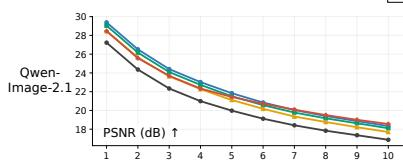

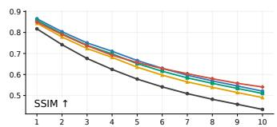

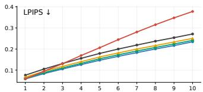

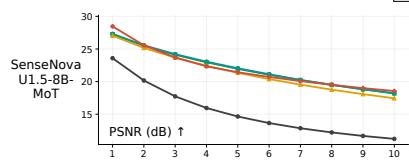

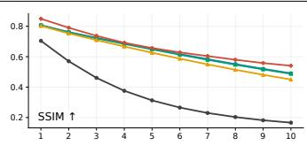

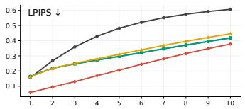  
%\*,2((0    %\*,2((0    %\*,2((0    %\*,2((0    %\*,2((0    %\*,2((0   

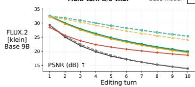

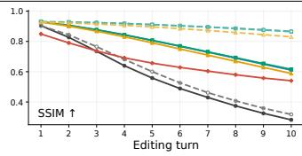

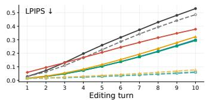

Figure 8: Cumulative drift across turns. Outside-box metrics on Add & Preserve over 10 turns. TailSteer reduces drift across all backbones, approaching or surpassing GPT-Image-2.5-Sunburst in preservation. Dashed curves show further gains from bypassing inter-turn VAE for TailSteer-Klein.  
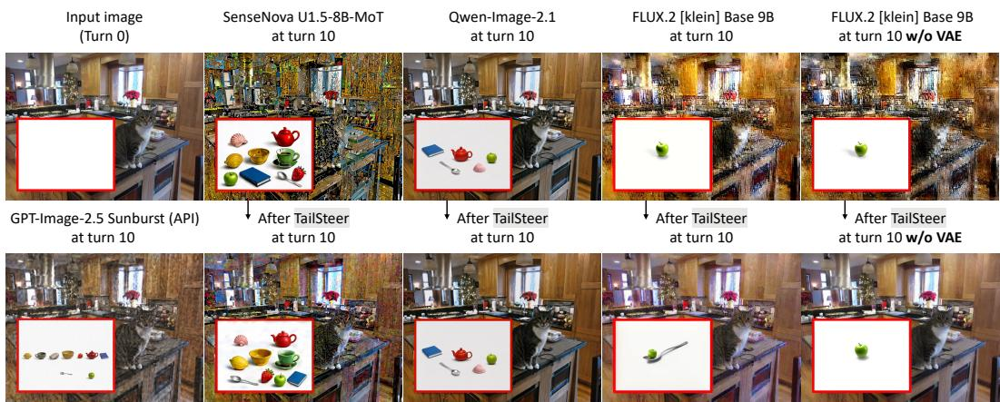  
Figure 9: Qualitative comparison after 10 editing turns. TailSteer substantially reduces background drift while retaining the requested object edits across different backbones. For Klein, bypassing inter-turn VAE conversions further preserves the original background colors and details.

The turn-10 examples in Fig. 9 further illustrate TailSteer’s improved anti-drift capability, particularly for SenseNova and Klein. However, residual color shifts in VAE-based editors suggest another potential source of drift: repeated VAE reconstruction between turns. Inspired by prior work (Joseph et al., 2024; Almog et al., 2025), we evaluate Klein with latent feedback to bypass repeated VAE conversions between turns (note that all other experiments use standard image-feedback). In Fig. 8, latent feedback alone offers limited improvement, but combining it with TailSteer achieves turn-10 PSNR comparable to standard feedback at turn 5, with less color distortion (Fig. 9), suggesting that latent reuse or improved VAE fidelity can further complement TailSteer’s trajectory-tail steering.

## 4.4 ABLATION STUDY

Training strategy. We compare different training strategies using the same cached preservation data on FLUX.2 [klein] Base 9B (Table 3). Standard SFT reduces visual drift but weakens instruction following, as illustrated by its failure to remove objects in Fig. 10 (turns 3, 6). Training only the trajectory tail achieves slightly higher PSNR but substantially degrades editing capability, while last-step-only training performs even worse under full-trajectory inference. Without on-policy training, preservation remains competitive, but spatial reasoning suffers: the model fails to arrange the cheese into the requested triangle at turn 8, consistent with its lower RISE score. In contrast, full TailSteer better preserves the cheese and cutting board at turn 6 while correctly executing the subsequent spatial rearrangement. Highlighting that preservation data alone is insufficient, retaining early dynamics and steering from on-policy states are key to retaining model’s prior with drift resistance.

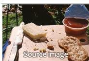  
Turn 1: Give the cutting board’s outer rim a darker walnut tone. Turn 2: Add one identical cracker on top of the right-hand cracker. Turn 3: Remove the knife from the cutting board. Turn 4: Give the scene a soft golden-hour glow. Turn 5: Remove the jam cup from the board’s top-right corner.

Turn 6: Remove only the crackers in the board’s bottom-right corner.   
Turn 7: Switch to a directly overhead view of the cutting board.   
Turn 8: Arrange the remaining cheese pieces in a neat triangle at the board’s center.   
Turn 9: Add three small green olives beside the centered cheese arrangement.   
Turn 10: Add a small rosemary sprig below the cheese and olives.

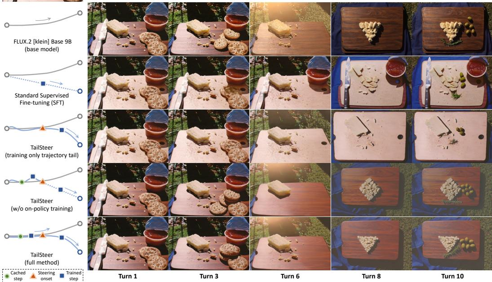  
Figure 10: Ablation of training strategies. With the same training data, full TailSteer better balances preserving the base model’s editing capabilities with enhancing multi-turn drift resistance.

Table 3: Training-strategy ablation. All variants share same training data and full-steps sampling.
<table><tr><td>Ablative training scheme</td><td colspan="4">Single-turn image editing</td><td colspan="4">Add &amp; Preserve</td></tr><tr><td>(Use FLUX.2 [klein] Base 9B as backbone)</td><td>GEdit-EN ↑</td><td></td><td>GEdit-ZH ↑ RISE Acc. (%) ↑ ImgEdit ↑</td><td></td><td>COA (%) ↑</td><td>PSNR@10↑</td><td>SSIM@10↑</td><td>LPIPS@10 ↓</td></tr><tr><td>Training only last-step</td><td> $2 . 2 4 \scriptstyle \perp 5 . 2 8$ </td><td> $2 . 1 7 _ { \perp 5 . 2 2 }$ </td><td> $3 . 3 3 _ { \perp 1 0 . 2 8 }$ </td><td> $2 . 1 5 _ { \perp 2 . 0 4 }$ </td><td> $1 3 . 1 0 _ { \perp 1 8 . 7 3 }$ </td><td>14.93 ↓5.03</td><td>0.399 ↓0.222</td><td>0.594↑0.305</td></tr><tr><td>Standard Supervised Fine-tuning (SFT)</td><td> $5 . 2 4 \perp _ { \perp 2 . 2 8 }$ </td><td> $5 . 2 8 _ { \perp 2 . 1 1 }$ </td><td> $8 . 8 9 _ { \perp . 4 . 7 2 }$ </td><td> $3 . 4 1 _ { \perp 0 . 7 7 }$ </td><td> $3 1 . 0 7 _ { \perp } _ { \mathrm { ~ 0 . 7 6 ~ } }$ </td><td> $1 9 . 7 7 _ { \perp 0 . 1 9 }$ </td><td>0.608 ↓0.013</td><td>0.287 ↓0.003</td></tr><tr><td>Training only trajectory tail (from step-46)</td><td> $6 . 0 9 _ { \perp 1 . 4 2 }$ </td><td> $6 . 0 2 _ { \perp 1 . 3 7 }$ </td><td> $1 0 . 2 8 { \scriptstyle \downarrow \ 3 . 3 3 }$ </td><td> $3 . 9 2 _ { \perp 0 . 2 6 }$ </td><td> $2 9 . 6 2 _ { \perp , ~ 2 . 2 2 }$ </td><td>20.04↑0.08</td><td>0.606 ↓0.015</td><td>0.313 ↑0.023</td></tr><tr><td>TailSteer w/o on-policy training</td><td>7.44↓0.08</td><td>7.40↑0.01</td><td> $1 1 . 3 9 _ { \perp } ~ 2 . 2 2$ </td><td> $4 . 1 7 _ { \perp 0 . 0 1 }$ </td><td> $3 1 . 9 4 _ { \uparrow \mathrm { ~ 0 . 1 1 } }$ </td><td>19.81↓0.15</td><td>0.607 7↓0.014</td><td>0.305 ↑0.015</td></tr><tr><td>TailSteer (full method, steering from step-46)</td><td>7.52</td><td>7.39</td><td>13.61</td><td>4.19</td><td>31.84</td><td>19.96</td><td>0.621</td><td>0.290</td></tr></table>

Table 4: Data scale and trajectory-type ablation. All variants are trained for nearly one epoch.
<table><tr><td>Ablative training data scale</td><td>Cached</td><td colspan="2">Single-turn image editing</td><td colspan="4">Add &amp; Preserve</td></tr><tr><td>(Use FLUX.2 [klein] Base 9B as backbone)</td><td>Trajectories</td><td>GEdit-EN ↑</td><td> $\mathrm { \bf G E d i t { - } Z H } \uparrow$ </td><td>COA (%) ↑</td><td>PSNR@10↑</td><td>SSIM@10↑</td><td>LPIPS@10↓</td></tr><tr><td>Identity-edit data</td><td></td><td> $7 . 0 5 _ { \perp 0 . 4 7 }$ </td><td> $6 . 8 2 _ { \perp 0 . 5 6 }$ </td><td> $3 0 . 2 7 _ { \perp 1 . 5 7 }$ </td><td> $1 4 . 1 5 _ { \perp 5 . 8 1 }$ </td><td>0.482 ↓0.139</td><td>0.400↑0.110</td></tr><tr><td>Local-edit data</td><td>1,000</td><td> $7 . 4 0 \dot { _ { \perp } } 0 . 1 2$ </td><td> $7 . 3 5 _ { \perp 0 . 0 4 }$ </td><td> $3 0 . 3 1 \check { \iota } _ { \perp 1 . 5 2 }$ </td><td> $1 7 . 6 1 \dot { \downarrow } 2 . 3 5$ </td><td>0.557↓0.064</td><td>0.330↑0.041</td></tr><tr><td>Identity-edit + Local-edit data</td><td></td><td> $7 . 2 8 _ { \perp 0 . 2 4 }$ </td><td> $7 . 2 6 _ { \perp 0 . 1 3 }$ </td><td> $3 0 . 4 2 _ { \scriptstyle \downarrow 1 . 4 1 }$ </td><td>16.88↓3.08</td><td>0.538 ↓0.083</td><td>0.349 ↑0.059</td></tr><tr><td>Identity-edit data</td><td></td><td> $6 . 9 2 _ { \perp 0 . 5 9 }$ </td><td> $6 . 9 7 _ { \perp 0 . 4 2 }$ </td><td> $3 1 . 2 3 _ { \perp 0 . 6 1 }$ </td><td>16.61↓3.35</td><td>0.540↓0.081</td><td>0.353 ↑0.063</td></tr><tr><td>Local-edit data</td><td>5,000</td><td>7.26↓0.26</td><td> $7 . 2 7 _ { \scriptstyle \downarrow , 0 . 1 2 }$ </td><td>31.11↓0.72</td><td>18.85↓1.11</td><td>0.614↓0.007</td><td>0.278↓0.012</td></tr><tr><td>Identity-edit + Local-edit data</td><td></td><td> $7 . 3 5 _ { \perp 0 . 1 7 }$ </td><td> $7 . 2 4 _ { \perp 0 . 1 5 }$ </td><td>31.19↓0.64</td><td>19.01 ↓0.95</td><td>0.619 ↓0.003</td><td>0.270 ↓0.019</td></tr><tr><td>Identity-edit data</td><td></td><td> $7 . 0 5 _ { \perp 0 . 4 7 }$ </td><td> $7 . 0 5 _ { \perp 0 . 3 3 }$ </td><td> $3 0 . 6 3 \scriptstyle \downarrow 1 . 2 1$ </td><td> $1 8 . 0 0 _ { \perp 1 . 9 6 }$ </td><td>0.559 ↓0.062</td><td> $0 . 3 3 7 _ { \uparrow 0 . 0 4 7 }$ </td></tr><tr><td>Local-edit data</td><td>10,000</td><td> $7 . 3 2 _ { \perp 0 . 2 0 }$ </td><td> $7 . 3 0 _ { \perp 0 . 0 8 }$ </td><td> $3 0 . 9 8 _ { \perp 0 . 8 5 }$ </td><td> $1 8 . 7 9 _ { \perp 1 . 1 7 }$ </td><td> $0 . 6 3 0 _ { \uparrow 0 . 0 0 9 }$ </td><td>0.268 ↓0.022</td></tr><tr><td>Identity-edit + Local-edit data</td><td></td><td> $7 . 3 0 _ { \perp 0 . 2 2 }$ </td><td> $7 . 1 7 _ { \perp 0 . 2 2 }$ </td><td> $3 1 . 9 6 _ { \uparrow 0 . 1 2 }$ </td><td> $1 8 . 9 4 _ { \perp 1 . 0 2 }$ </td><td> $0 . 6 1 6 _ { \perp 0 . 0 0 5 }$ </td><td> $0 . 2 8 0 \dot { _ { \perp 0 . 0 1 0 } }$ </td></tr><tr><td>Full data (main setting)</td><td>38,540</td><td>7.52</td><td>7.39</td><td>31.84</td><td>19.96</td><td>0.621</td><td>0.290</td></tr></table>

Data scale and trajectory types. We investigate how training data scale and trajectory type affect TailSteer, training each configuration for approximately one epoch (Table 4). At smaller scales, local-edit trajectories provide substantially stronger preservation than identity-edit trajectories, but this gap narrows as the dataset grows. Larger datasets generally improve drift resistance, while mixing both trajectory types offers a better balance between preservation and editing capability. Our main setting combines local-edit and identity-edit training data at a 3:1 ratio, highlighting the potential of scaling diverse self-generated preservation endpoints rollouts for robust multi-turn editing.

## 5 CONCLUSION

We presented TailSteer, a final-stage training framework that unlocks the multi-turn editing potential of foundation models without relearning their existing capabilities. By concentrating preservation corrections near the denoising trajectory tail while retaining earlier dynamics, TailSteer sub stantially reduces cumulative drift across successive edits. Extensive experiments across FLUX, SenseNova, and Qwen demonstrate stronger long-horizon preservation while largely retaining the base models’ generative capabilities. Our findings suggest that robust multi-turn editing need not be learned anew, but can be unlocked by refining how foundation models complete each edit.

## REFERENCES

Gal Almog, Ariel Shamir, and Ohad Fried. REED-VAE: RE-Encode decode training for iterative image editing with diffusion models. Computer Graphics Forum, 44(2):e70020, 2025. doi: 10. 1111/cgf.70020.

Benjamin Aubin, Gonzalo Iñaki Quintana, Onur Tasar, Sanjeev Sreetharan, Urszula Czerwinska, Damien Henry, and Clément Chadebec. Monet: A massive, open, non-redundant and enriched text-to-image dataset. arXiv preprint arXiv:2605.21272, 2026.

Omri Avrahami, Dani Lischinski, and Ohad Fried. Blended diffusion for text-driven editing of natural images. In Proceedings of the IEEE/CVF Conference on Computer Vision and Pattern Recognition (CVPR), pp. 18208–18218, 2022.

Black Forest Labs. FLUX.2: Frontier visual intelligence. Technical blog post, November 2025a. URL https://bfl.ai/blog/flux-2.

Black Forest Labs. FLUX.2: Analyzing and enhancing the latent space of FLUX—representation comparison. Technical report, November 2025b. URL https://bfl.ai/research/ representation-comparison.

Black Forest Labs. FLUX.2 [klein] Base 9B. Hugging Face model card, 2026. URL https: //huggingface.co/black-forest-labs/FLUX.2-klein-base-9B.

Black Forest Labs, Stephen Batifol, Andreas Blattmann, Frederic Boesel, Saksham Consul, Cyril Diagne, Tim Dockhorn, Jack English, et al. FLUX.1 Kontext: Flow matching for in-context image generation and editing in latent space. arXiv preprint arXiv:2506.15742, 2025.

Tianyu Chen, Yasi Zhang, Zhi Zhang, Peiyu Yu, Shu Wang, Zhendong Wang, Kevin Lin, Xiaofei Wang, Zhengyuan Yang, Linjie Li, et al. EdiVal-Agent: An object-centric framework for automated, fine-grained evaluation of multi-turn editing. In International Conference on Learning Representations, 2026.

Guillaume Couairon, Jakob Verbeek, Holger Schwenk, and Matthieu Cord. DiffEdit: Diffusionbased semantic image editing with mask guidance. In International Conference on Learning Representations, 2023.

Karan Dalal, Daniel Koceja, Jiarui Xu, Yue Zhao, Shihao Han, Ka Chun Cheung, Jan Kautz, Yejin Choi, Yu Sun, and Xiaolong Wang. One-minute video generation with test-time training. In Proceedings ofthe IEEE/CVF Conference on Computer Vision and Pattern Recognition (CVPR), pp. 17702–17711, 2025.

Haiwen Diao, Jiahao Wang, Chenjing Ding, Hanming Deng, Jiangnan Chen, Ruixi Zhang, Ruohui Wang, Wenwen Tong, Xiangyu Fan, Yubo Wang, et al. Sensenova-u1. 5: Towards native unified visual intelligence. arXiv preprint arXiv:2609.11929, 2026a.

Haiwen Diao, Penghao Wu, Hanming Deng, Jiahao Wang, Shihao Bai, Silei Wu, Weichen Fan, Wenjie Ye, Wenwen Tong, Xiangyu Fan, et al. Sensenova-u1: Unifying multimodal understanding and generation with neo-unify architecture. arXiv preprint arXiv:2605.12500, 2026b.

Sander Dieleman. Generative modelling in latent space. Technical blog post, April 2025. URL https://sander.ai/2025/04/15/latents.html.

dx8152. Flux2-Klein-9B-Consistency. Hugging Face model repository, 2026. URL https: //huggingface.co/dx8152/Flux2-Klein-9B-Consistency. Version 2, released April 17, 2026.

Google. Image editing in Gemini just got a major upgrade. Google product announcement, August 2025. URL https://blog.google/products-and-platforms/products/ gemini/updated-image-editing-model/.

Google. Nano Banana 2: Combining pro capabilities with lightning-fast speed. Google product announcement, February 2026. URL https://blog.google/innovation-and-ai/ technology/ai/nano-banana-2/.

Jiahui Huang, Yasi Zhang, Tianyu Chen, Shu Wang, Jianwen Xie, Oscar Leong, Mingyuan Zhou, Nanzhu Wang, and Ying Nian Wu. MT-EditFlow: Reinforcement learning for multi-turn image editing with flow matching. arXiv preprint arXiv:2606.01985, 2026.

Yilei Jiang, Zhen Wang, Yanghao Wang, Jun Yu, Yueting Zhuang, Jun Xiao, and Long Chen. FlowDC: Flow-based decoupling-decay for complex image editing. In Proceedings of the IEEE/CVF Conference on Computer Vision and Pattern Recognition (CVPR), pp. 25757–25766, 2026.

K. J. Joseph, Prateksha Udhayanan, Tripti Shukla, Aishwarya Agarwal, Srikrishna Karanam, Koustava Goswami, and Balaji Vasan Srinivasan. Iterative multi-granular image editing using diffusion models. In Proceedings of the IEEE/CVF Winter Conference on Applications of Computer Vision (WACV), pp. 8107–8116, 2024.

Daneul Kim, Jaeah Lee, and Jaesik Park. Improving editability in image generation with layerwise memory. In Proceedings of the IEEE/CVF Conference on Computer Vision and Pattern Recognition (CVPR), pp. 7889–7898, 2025a.

Jimyeong Kim, Jungwon Park, Yeji Song, Nojun Kwak, and Wonjong Rhee. ReFlex: Text-guided editing of real images in rectified flow via mid-step feature extraction and attention adaptation. In Proceedings of the IEEE/CVF International Conference on Computer Vision (ICCV), pp. 15939– 15948, 2025b.

Alina Kuznetsova, Hassan Rom, Neil Alldrin, Jasper Uijlings, Ivan Krasin, Jordi Pont-Tuset, Shahab Kamali, Stefan Popov, et al. The Open Images dataset V4: Unified image classification, object detection, and visual relationship detection at scale. International Journal of Computer Vision, 128(7):1956–1981, 2020. doi: 10.1007/s11263-020-01316-z.

Philippe Laban, Hiroaki Hayashi, Yingbo Zhou, and Jennifer Neville. LLMs get lost in multi-turn conversation. In International Conference on Learning Representations, pp. 54738–54778, 2026.

Mingxiao Li, Tingyu Qu, Ruicong Yao, Wei Sun, and Marie-Francine Moens. Alleviating exposure bias in diffusion models through sampling with shifted time steps. In International Conference on Learning Representations, pp. 16816–16838, 2024.

Niantong Li, Guangzheng Hu, Weixu Qiao, Ying Ba, Qichen Hong, Shijun Shen, Jinlin Wang, Fan Zhou, Jianye Kang, Xin Shang, et al. Qwen-image-bench: From generation to creation in textto-image evaluation. In Proceedings of the 2026 Conference on Empirical Methods in Natural Language Processing, pp. 22760–22787, 2026a.

Tianhong Li and Kaiming He. Back to basics: Let denoising generative models denoise. In Proceedings of the IEEE/CVF Conference on Computer Vision and Pattern Recognition (CVPR), pp. 36115–36125, 2026.

Yan Li, Zezi Zeng, Ziwei Zhou, Xin Gao, Muzhao Tian, Yifan Yang, Mingxi Cheng, Qi Dai, Yuqing Yang, Lili Qiu, Zhendong Wang, Zhengyuan Yang, Xue Yang, Lijuan Wang, Ji Li, and Chong Luo. BizGenEval: A systematic benchmark for commercial visual content generation. arXiv preprint arXiv:2603.25732, 2026b.

Yucheng Liao, Jiajun Liang, Kaiqian Cui, Baoquan Zhao, Haoran Xie, Wei Liu, Qing Li, and Xudong Mao. FreqEdit: Preserving high-frequency features for robust multi-turn image editing. In Proceedings of the IEEE/CVF Conference on Computer Vision and Pattern Recognition (CVPR), pp. 43525–43535, 2026.

Shiyu Liu, Yucheng Han, Peng Xing, Fukun Yin, Rui Wang, Wei Cheng, Jiaqi Liao, Yingming Wang, Honghao Fu, Chunrui Han, Guopeng Li, Yuang Peng, Quan Sun, Jingwei Wu, Yan Cai, et al. Step1X-Edit: A practical framework for general image editing. arXiv preprint arXiv:2504.17761, 2025.

Meta. Introducing Muse Image and Muse Video. Meta AI research announcement, July 2026. URL https://ai.meta.com/blog/introducing-muse-image-muse-video-msl/.

Mang Ning, Enver Sangineto, Angelo Porrello, Simone Calderara, and Rita Cucchiara. Input perturbation reduces exposure bias in diffusion models. In Proceedings of the 40th International Conference on Machine Learning, volume 202 of Proceedings of Machine Learning Research, pp. 26245–26265. PMLR, 2023.

Mang Ning, Mingxiao Li, Jianlin Su, Albert Ali Salah, and Itir Onal Ertugrul. Elucidating the exposure bias in diffusion models. In International Conference on Learning Representations, pp. 15167–15189, 2024.

OpenAI. Introducing our latest image generation model in the API. OpenAI product release, April 2025a. URL https://openai.com/index/image-generation-api/.

OpenAI. The new ChatGPT Images is here. OpenAI product release, December 2025b. URL https://openai.com/index/new-chatgpt-images-is-here/.

OpenAI. Introducing ChatGPT Images 2.5. OpenAI product release, September 2026. URL https://openai.com/index/introducing-chatgpt-images-2-5/.

Yurui Qian, Qi Cai, Yingwei Pan, Yehao Li, Ting Yao, Qibin Sun, and Tao Mei. Boosting diffusion models with moving average sampling in frequency domain. In Proceedings of the IEEE/CVF Conference on Computer Vision and Pattern Recognition (CVPR), pp. 8911–8920, 2024.

Leigang Qu, Feng Cheng, Ziyan Yang, Qi Zhao, Shanchuan Lin, Yichun Shi, Yicong Li, Wenjie Wang, Tat-Seng Chua, and Lu Jiang. VINCIE: Unlocking in-context image editing from video. In International Conference on Learning Representations, pp. 114873–114918, 2026.

Qwen Team. Qwen-Image-2.1. Hugging Face model card, 2026. URL https:// huggingface.co/Qwen/Qwen-Image-2.1.

Reve. Launching Reve 2.1. Reve product announcement, July 2026. URL https://blog. reve.com/posts/launching-reve-2.1/.

Xiaoce Wang, Sifan Zhou, Kaifei Wang, Leli Xu, Xuerui Qiu, Tao He, and Ming Li. Why do DiT editors drift? plug-and-play low frequency alignment in VAE latent space. arXiv preprint arXiv:2605.08250, 2026.

Jingfeng Yao, Bin Yang, and Xinggang Wang. Reconstruction vs. generation: Taming optimization dilemma in latent diffusion models. In Proceedings of the IEEE/CVF Conference on Computer Vision and Pattern Recognition (CVPR), pp. 15703–15712, 2025.

Yang Ye, Xianyi He, Zongjian Li, Bin Lin, Shenghai Yuan, Zhiyuan Yan, Bohan Hou, and Li Yuan. ImgEdit: A unified image editing dataset and benchmark. In Advances in Neural Information Processing Systems, volume 38. Curran Associates, Inc., 2025. doi: 10.52202/085713-4387.

Zixin Yin, Ling-Hao Chen, Lionel Ni, and Xili Dai. ConsistEdit: Highly consistent and precise training-free visual editing. In Proceedings of the SIGGRAPH Asia 2025 Conference Papers, pp. 1–11. Association for Computing Machinery, 2025. doi: 10.1145/3757377.3763909.

Jiwen Yu, Jianhong Bai, Yiran Qin, Quande Liu, Xintao Wang, Pengfei Wan, Di Zhang, and Xihui Liu. Context as memory: Scene-consistent interactive long video generation with memory retrieval. In Proceedings of the SIGGRAPH Asia 2025 Conference Papers, pp. 1–11. Association for Computing Machinery, 2025. doi: 10.1145/3757377.3763833.

Yongsheng Yu, Wei Xiong, Yichen Sheng, Shiqiu Liu, and Jiebo Luo. PixelDiT2: Representationgrounded pixel diffusion transformers. In Conference on Neural Information Processing Systems (NeurIPS), 2026.

Xiangyu Zhao, Peiyuan Zhang, Kexian Tang, Xiaorong Zhu, Hao Li, Wenhao Chai, Zicheng Zhang, Renqiu Xia, Guangtao Zhai, et al. Envisioning beyond the pixels: Benchmarking reasoninginformed visual editing. In Advances in Neural Information Processing Systems, volume 38. Curran Associates, Inc., 2025. doi: 10.52202/085713-5791.

Zijun Zhou, Yingying Deng, Xiangyu He, Weiming Dong, and Fan Tang. Multi-turn consistent image editing. In Proceedings of the IEEE/CVF International Conference on Computer Vision (ICCV), pp. 15792–15801, 2025.

Tianrui Zhu, Shiyi Zhang, Jiawei Shao, and Yansong Tang. KV-Edit: Training-free image editing for precise background preservation. In Proceedings of the IEEE/CVF International Conference on Computer Vision (ICCV), pp. 16607–16617, 2025.