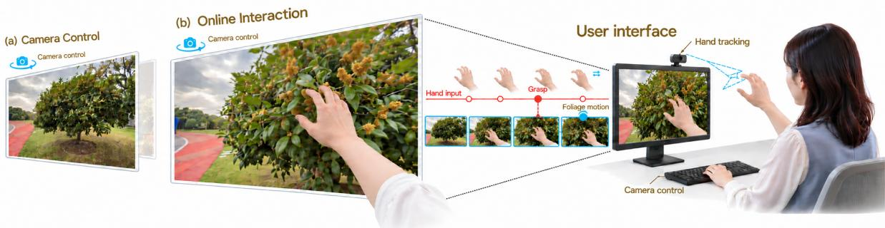
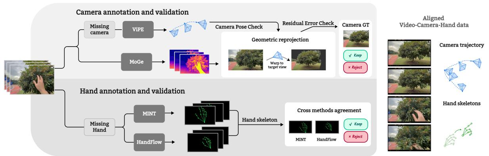
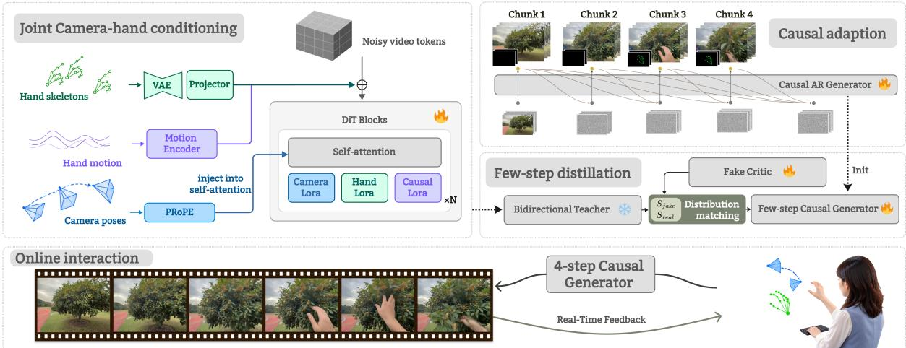
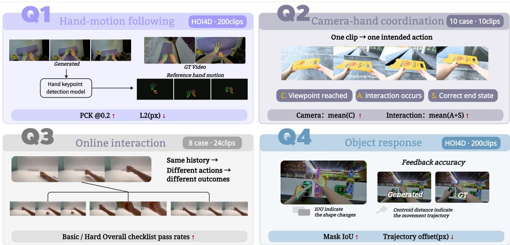
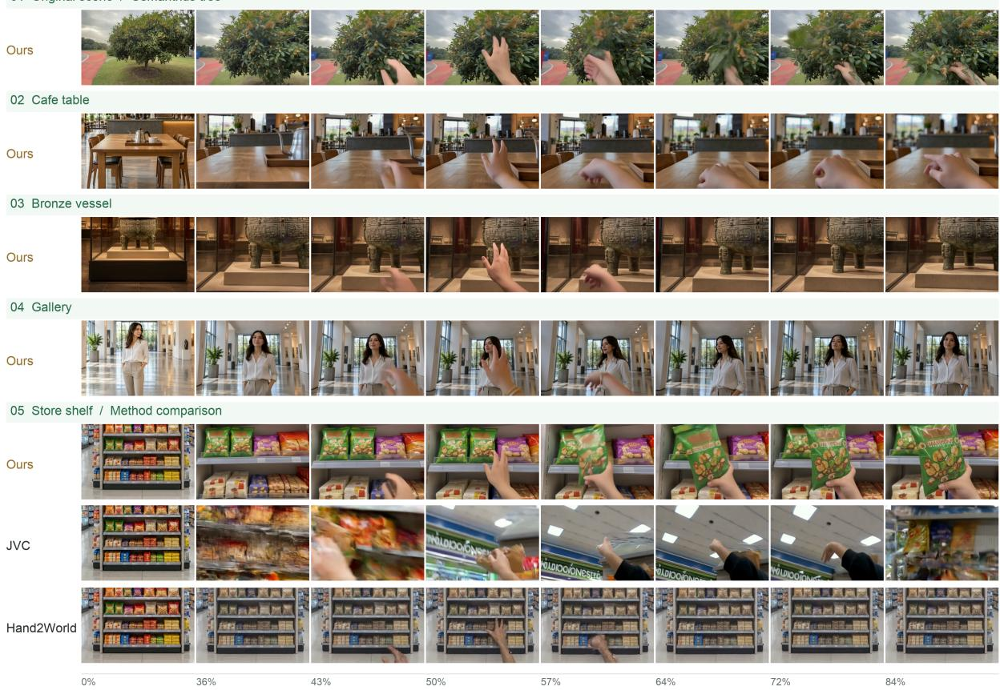
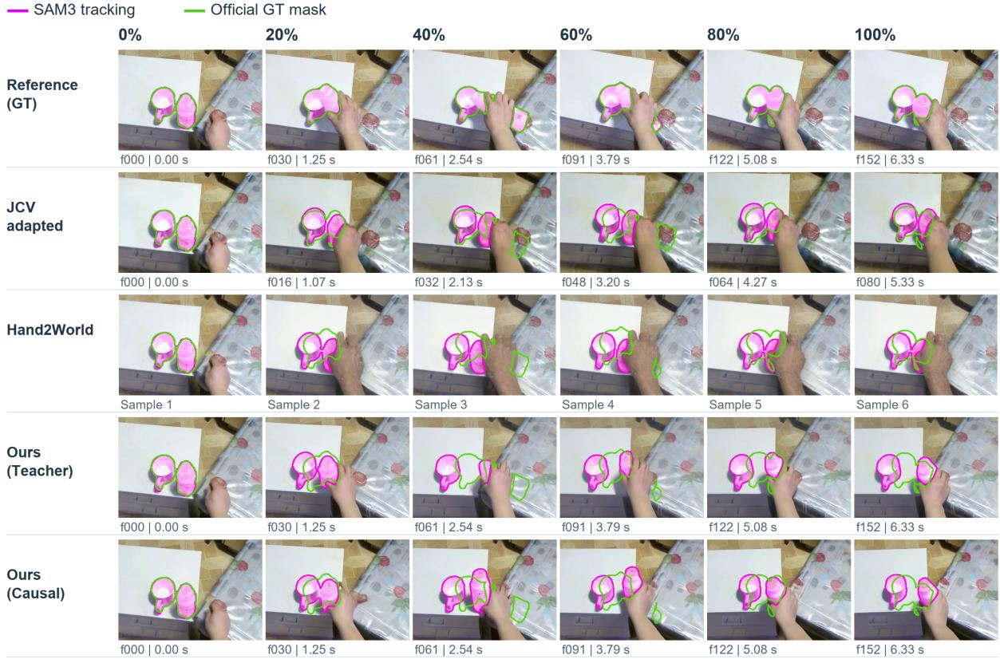
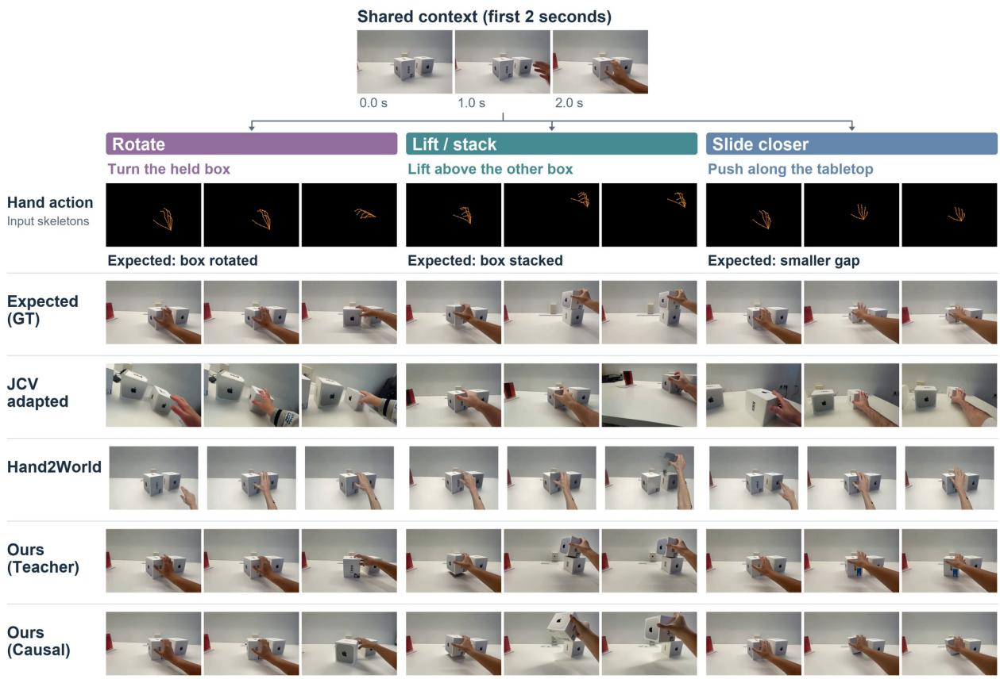

# TouchéWorld Tech Report Towards Online Unified Camera–Hand Exploration in Generative Worlds

Jiaao Yu3,∗ Yanjian Zhang1,2,∗,† Haoyang Jiang4

Guillaume Wisniewski2 Nadi Tomeh1 Shijie Jia4

1Université Sorbonne Paris Nord, LIPN, CNRS 2Université Paris Cité, LLF, CNRS 3East China Normal University 4Dalian Jiaotong University

Recent video world models allow users to explore generated environments through camera navigation. Continuous hand motion provides a fine-grained action channel for interacting with the people and objects encountered during exploration. We present Touché- World, a framework that integrates gesture-driven interaction into a camera-controlled video world model. Given an initial image and a scene-description prompt, the model generates video conditioned on temporally aligned camera and hand controls. We construct joint camera–hand training data from heterogeneous egocentric videos through annotation completion, consistency-based filtering, and temporal alignment. Building on a pretrained camera-controlled world model, we combine spatial hand-skeleton conditioning with numerical hand-motion features through parameter-eficient adaptation. Causal adaptation and few-step distillation support chunk-level online generation, allowing users to update their controls based on generated visual feedback. We further introduce TouchéBench to evaluate hand-motion following, camera–hand coordination, online interaction, and object response. Together, these components establish a framework for studying continuous exploration and hand-driven interaction within generative worlds.

∗Equal contribution. †Project lead.

Project Page Model Weights Dataset § Code

  
Figure 1: From camera-guided exploration to continuous hand–world interaction. Camera control allows users to navigate generated environments, while hand motion provides a fine-grained action channel for interacting with encountered scene contents. In the illustrated example, the user approaches an osmanthus tree and reaches into its canopy, producing hand contact and corresponding changes in the foliage. With scene-only text conditioning, camera and hand inputs guide the unfolding interaction, while causal chunkwise generation incorporates updated controls into subsequent visual output.

  
Figure 2: Joint camera–hand data construction through annotation completion, consistency-based filtering, and temporal alignment.

## 1 Introduction

Video world models are turning generated visual content into environments that users can explore. Advances in camera-conditioned generation [15, 23, 47] and streaming inference [53, 54] allow users to move through scenes, choose their viewpoints, and explore worlds as they unfold [19, 50, 53, 54]. Exploration, however, naturally invites participation. Users may wish not only to observe what they encounter, but also to act on it. Consider walking through a generated courtyard, approaching a sweet-scented osmanthus tree, reaching out to touch its branches, and then continuing along the path. Supporting this process requires camera-guided navigation and hand-driven interaction to work together, with the generated world responding to user actions as exploration continues.

Continuous hand motion provides a natural interface for such participation. Camera control determines how users observe the world, while hand position, orientation, and articulation provide a fine-grained action channel for influencing its contents. Users can express actions such as reaching, touching, pushing, and withdrawing, and adjust their subsequent behavior based on generated visual feedback. We organize this process as online interaction: the system receives user controls while producing visual output and incorporates updated controls into subsequent video chunks, allowing users to decide their next action through ongoing observation.

Recent work provides important foundations through hand–object dynamics generation, joint hand and camera control, and streaming interaction [21, 39, 41]. The supported range of scenes and interactions nevertheless remains limited, particularly when manipulation is embedded within continuous navigation and exploration. We focus on the continuity across these activities: a user navigates toward an object, reaches out to manipulate it, withdraws their hand, and resumes exploration. Across these transitions, viewpoint control, hand motion, and scene responses must remain coordinated, while subsequent generation carries forward the state established by earlier actions. This calls for jointly considering the data, generation process, and evaluation of continuous camera–hand interaction.

Three challenges arise. First, joint control requires reliable supervision that separates viewpoint changes from action-induced scene dynamics. Camera motion, hand articulation, and their visual consequences must be accurately annotated and temporally aligned, despite incomplete or inconsistent estimates in egocentric videos. Second, online generation requires causal processing of both controls and visual history: each generated chunk must respond to available camera and hand inputs without relying on future actions. Third, interaction quality extends beyond visual similarity. A generated hand may follow its controls while the object remains unresponsive, and camera motion may produce apparent hand–object alignment without the intended manipulation. Evaluation must therefore distinguish hand following, joint control, and action-dependent scene responses.

To this end, we present a framework that integrates continuous hand interaction into a cameracontrolled video world model. We first construct joint camera–hand training data from heterogeneous egocentric videos, completing missing annotations, filtering camera and hand estimates through consistency checks. Building on a pretrained camera-controlled model, we combine spatial hand-skeleton conditioning with numerical motion features through parameter-eficient adaptation. We further impose consistent causal constraints on hand conditioning and visual generation, and apply few-step distillation to accelerate chunk-wise synthesis. The resulting model incorporates updated camera and hand controls into subsequent chunks, connecting exploration and manipulation within a shared generated history.

We further introduce TouchéBench to evaluate four aspects of interactive world generation: hand-motion following, camera–hand coordination, online interaction, and object response. Reference-based evaluation on HOI4D [25] measures hand-control accuracy and object-response fidelity, while purpose-recorded scenarios assess joint camera–hand control and action-dependent continuations from shared contexts. Alongside TouchéBench, we evaluate video quality on unseen scenes from EgoStandard [24] and EgoLife [44], and on the out-of-domain HOT3D dataset [2]. Comparisons with external methods and across our bidirectional teacher, causal model, and four-step distilled model characterize visual quality and interaction performance across generation stages. Ablation studies further examine the efects of hand-weighted training on hand following and interaction outcomes.

Our contributions are threefold:

• Joint camera–hand training data. We construct a data pipeline that completes missing camera and hand annotations, filters estimates through consistency checks, and aligns video and control signals to provide joint supervision for camera-guided exploration and hand-driven interaction.

• A framework for online camera–hand interaction. We extend a camera-controlled video world model with spatial skeleton and numerical motion conditioning. Parametereficient adaptation, causal training, and few-step distillation enable chunk-level online generation with continuously updated camera and hand controls.

• TouchéBench and experimental evaluation. We introduce a benchmark covering hand-motion following, camera–hand coordination, online interaction, and object response. Comparisons and ablation studies evaluate these capabilities alongside video quality and examine the efects of causal adaptation, few-step distillation, and hand-weighted training.

## 2 Related work

## 2.1 Action-Conditioned Video World Models

Action-conditioned video world models enable generated environments to respond to user control and evolve continuously by incorporating action signals into the video generation process. While early works primarily utilized discrete keystrokes or latent actions as control signals [15, 30, 51], recent research has introduced continuous camera trajectories to support more flexible navigation and viewpoint changes [6, 10, 18, 32, 34, 35, 50, 52]. To link camera motion with spatial changes in the generated imagery, existing methods have explored various geometric representations and conditioning mechanisms. For instance, LingBot-World 2.0 [10] employs Plücker embeddings to encode pixel-level observation rays and injects camera conditions via adaptive layer normalization; SolarWM [18] utilizes fused-PRoPE [23] to integrate projection geometry transformations, derived from camera intrinsics and extrinsics into self-attention computations; and EchoWM [50] adopts relative UCPE [47] to encode geometric relationships between local ray coordinate systems, thereby supporting continuous trajectory control.

  
Figure 3: Overview of TouchéWorld: joint camera–hand conditioning, causal adaptation, few-step distillation, and online interaction with updated controls.

Beyond viewpoint navigation, recent work explores control [4, 12, 13, 36] interfaces for character behavior, scene events, and object dynamics. GameGen-X [6] and Hunyuan-GameCraft-2 [33] combine instruction-based control with game interaction, enabling users to specify actions and changes to scene contents. LongLive enables interactive streaming video generation and introduces KV-recache to refresh cached states when text prompts change [45]. H3-World [7] explores language-based action control on MiniMax-H3 [26] by converting character and camera actions into temporally aligned textual instructions [7]. Complementary approaches introduce spatial control signals: MotionStream [31] supports interactive motion guidance, while Force Prompting [11] and StreamForce [37] condition generation on physical forces, with StreamForce extending force control to causal streaming generation. Code World Model explores an alternative formulation in which a coding agent maintains executable world states and compiles them into proxy videos that condition visual generation [8]. These studies broaden the ways users can influence generated worlds. Our work investigates continuous hand motion as an action interface, jointly with camera control, to connect exploration and manipulation within an ongoing generation process.

## 2.2 Hand-Conditioned Video Generation and Interaction Evaluation

Hand-conditioned video generation models how hand motion influences scene contents. Inter-Dyn [1] conditions video generation on driving-motion cues, including hand-mask sequences, to synthesize the resulting interaction dynamics. Dexterous World Models [21] combines handmesh renderings with static-scene videos rendered along a specified camera trajectory to model action-induced scene changes. Recent egocentric approaches further investigate joint hand and viewpoint control: Generated Reality [41] conditions generation on tracked head and hand poses and supports autoregressive interaction. HandsOnWorld [9] learns from unconstrained monocular videos and introduces camera-disentangled hand control. Hand2World [39] and JCV [48] primarily study hand–object interaction in tabletop manipulation settings. While these settings capture local interactions, they provide limited coverage of the transitions between navigation and manipulation. Related interaction-generation methods also investigate structural supervision: SCAR jointly generates videos and structure- and contact-aware representations to improve hand–object interaction synthesis [43]. Building on these developments, we focus on connecting camera-guided exploration and hand-driven manipulation within a continuous generation process, supported by joint camera–hand data construction and causal control.

  
Figure 4: TouchéBench evaluates hand-motion following (Q1), camera–hand coordination (Q2), online interaction (Q3), and object response (Q4).

Interaction evaluation examines both control fidelity and the consequences of actions. Existing methods assess visual quality, hand-motion agreement, and generated interaction behavior under their respective conditioning settings [1, 21, 39, 41]. Complementing control-conditioned evaluation, Ego2Act evaluates goal-directed egocentric manipulation from an initial image and a high-level goal, assessing task completion and physical plausibility [20]. Continuous camera– hand interaction additionally calls for evaluating how newly introduced controls afect subsequent generation and how hand actions operate alongside navigation. TouchéBench brings these aspects together through hand-motion following, camera–hand coordination, online intervention response, and object response. Paired trajectory evaluation and action interventions from shared contexts relate control accuracy to the resulting interaction outcomes.

## 3 Method

We present a video world modeling framework that integrates continuous hand interaction with camera-guided exploration. Building on a camera-controlled image-to-video model, we introduce complementary skeleton and motion conditions, followed by causal adaptation and few-step distillation. Figure 2 illustrates joint data construction, while Figure 3 summarizes conditioning, training, and online interaction.

## 3.1 Problem Formulation

Given an initial image $I _ { 0 }$ and a scene-description prompt p, we generate a continuous video conditioned on camera controls C and hand controls H. Camera controls specify the viewing trajectory, while hand controls specify hand poses and motion at the corresponding video time positions. Together, they allow users to navigate the generated environment and interact with

its contents.

We generate video chunks $X _ { 1 } , \ldots , X _ { K }$ sequentially:

$$
\begin{array} { r l } {  { p _ { \theta } ( X _ { 1 : K } \mid I _ { 0 } , p , \mathcal { C } , \mathcal { H } ) } } \\ & { = \displaystyle \prod _ { k = 1 } ^ { K } p _ { \theta } ( X _ { k } \mid I _ { 0 } , p , X _ { < k } , \mathcal { C } _ { \leq k } , \mathcal { H } _ { \leq k } ) , } \end{array}\tag{1}
$$

where $\mathcal { C } _ { \leq k }$ and $\mathcal { H } _ { \leq k }$ denote the controls available when generating chunk k. Within each chunk, hand-control latents are temporally aligned with the corresponding video latent positions.

The system receives user controls while producing visual output and incorporates updated controls into subsequent chunks. This chunk-level online interaction allows users to adjust camera movement and hand actions based on generated visual feedback, connecting exploration and interaction within a shared video history.

## 3.2 Data Construction

As shown in Figure 2, we construct aligned video–camera–hand data from heterogeneous egocentric videos. We retain valid existing annotations and complete missing camera and hand annotations through separate estimation and validation branches.

For videos without camera annotations, we estimate camera poses using ViPE [17] and depth using MoGe2 [38]. We reproject source frames into target views using the estimated geometry and compare them with the observed target frames. Reprojection consistency and trajectoryquality checks are used to filter unreliable camera estimates.

For videos without hand annotations, we independently estimate hand poses using MINT [55] and HandFlow [42] and reject samples with inconsistent predictions. The retained annotations are converted into skeleton renderings and numerical hand features for joint conditioning.

We temporally align video frames, camera poses, and hand annotations, updating camera intrinsics and image-space hand coordinates consistently with resizing and cropping. Camera trajectories are expressed relative to the initial frame. Alongside interaction clips, we include clips with hands entering an initially hand-free view and static clips with and without hands, covering both interaction and periods without hand motion.

We plan to release the constructed dataset to support further research on joint camera–hand control in video world models.

## 3.3 Joint Camera–Hand Conditioning

Camera conditioning. We build on the LTX-2.5 [14] image-to-video backbone with a SolarWM camera adapter. Camera intrinsics and relative extrinsics are incorporated into selfattention through PRoPE. We retain this camera-conditioning pathway while introducing two complementary branches for hand control.

Hand conditioning. The spatial branch encodes rendered skeleton videos S with the video VAE [22] and projects their latents into the video-token space. The motion branch encodes numerical hand features H, consisting of wrist translation, joint geometry, and a validity mask, using a temporal encoder $E _ { m }$ with linear projections and a residual temporal convolution. Given noisy video latents $z _ { \tau }$ , we form the Transformer input as

$$
U = W _ { z } P ( z _ { \tau } ) + W _ { s } P ( E _ { \mathrm { V A E } } ( S ) ) + \mathcal { B } ( E _ { m } ( H ) ) ,\tag{2}
$$

where P denotes patchification, $W _ { z }$ and $W _ { s }$ are the video and skeleton projections, and B broadcasts each motion embedding across the spatial tokens at the corresponding latent time position.

The two branches provide spatially localized skeleton features and temporally contextualized motion features.

Joint adaptation. We freeze the pretrained backbone and camera LoRA[16], and jointly optimize an additional hand $\mathrm { L o R A }$ with the two hand-conditioning branches. The skeleton projection and the motion encoder’s output projection are bias-free and zero-initialized, so the added conditioning residual is initially zero.

To emphasize hand reconstruction while retaining scene-wide supervision, we use a weighted denoising loss:

$$
\mathcal { L } _ { \mathrm { j o i n t } } = \mathbb { E } \left[ \frac { \sum _ { i } w _ { i } \| \hat { y } _ { i } - y _ { i } \| _ { 2 } ^ { 2 } } { \sum _ { i } w _ { i } } \right] , \quad w _ { i } = m _ { i } ( 1 + \lambda _ { \mathrm { h a n d } } r _ { i } ) ,\tag{3}
$$

where $\hat { y } _ { i }$ and $y _ { i }$ are the prediction and denoising target for video token i, respectively. The binary mask $r _ { i }$ identifies hand-region tokens, $m _ { i }$ excludes the initial conditioning latent, and $\lambda _ { \mathrm { h a n d } }$ controls the additional hand weight. Setting $\lambda _ { \mathrm { h a n d } } = 0$ recovers uniform weighting over valid tokens.

## 3.4 Causal Adaptation and Asymmetric DMD

We obtain a streaming generator in two stages: teacher-forced causal adaptation, followed by asymmetric Distribution Matching Distillation (DMD) [46] from a bidirectional teacher to obtain a few-step causal generator.

Teacher-forced causal adaptation. We initialize from the bidirectional joint-control teacher, freeze the backbone, camera and hand LoRAs, and both hand-conditioning branches, and train only an additional causal-adaptation LoRA. We adopt bidirectional attention within each chunk and causal attention across chunks. Each chunk is jointly denoised with access to its own tokens and the available preceding chunks. During teacher-forced training, preceding video chunks are supplied from ground-truth sequences. We also use left-padded temporal convolutions in the motion encoder and restrict skeleton conditions to the available temporal range to prevent information leakage from future chunks.

Asymmetric DMD with self-forcing. We initialize the few-step student from the causally adapted model and distill it using the frozen bidirectional joint-control teacher. During distillation, the student performs self-forcing [19] rollouts, conditioning each chunk on its own generated history:

$$
\hat { z } ^ { ( k ) } = G _ { \theta } \Big ( \xi ^ { ( k ) } ; \hat { z } ^ { ( < k ) } , c _ { \le k } \Big ) ,\tag{4}
$$

where $G _ { \theta }$ denotes the complete few-step sampling procedure, ξ(k) denotes its sampling noise, and $c _ { \le k }$ contains the initial image, scene-description prompt, and camera–hand controls available when generating chunk k.

We apply Distribution Matching Distillation (DMD) to align the student and teacher distributions through a noise-averaged reverse KL objective. Given the generated sequence $\hat { z } ,$ , we construct $\hat { z } _ { \tau } = \alpha _ { \tau } \hat { z } + \sigma _ { \tau } \epsilon$ , where $\epsilon \sim \mathcal { N } ( 0 , I )$ . A trainable fake-score network $s _ { \psi }$ estimates the student distribution score, while the frozen teacher provides $s T$ . Their diference yields the generator update:

$$
\begin{array} { r } { \nabla _ { \boldsymbol { \theta } } \mathcal { L } _ { \mathrm { D M D } } \approx } \\ { \mathbb { E } \Big [ w ( \tau ) \boldsymbol { J } _ { \boldsymbol { \theta } } ^ { \top } \cdot ( s _ { \boldsymbol { \psi } } ( \hat { z } _ { \tau } , \tau ; c ) - s _ { T } ( \hat { z } _ { \tau } , \tau ; c ) ) \Big ] , } \end{array}\tag{5}
$$

where $J _ { \theta } = \partial \hat { z } / \partial \theta$ , c denotes the conditioning information for the full distillation sequence, and $w ( \tau )$ incorporates the noise weighting and the perturbation factor $\alpha _ { \tau }$ . Here, $s _ { \psi }$ and $s _ { T }$ denote the student-distribution and teacher-distribution scores, respectively, expressed in a common score parameterization.

01 Original scene / Osmanthus tree

  
Figure 5: Generation across scenes using shared camera and hand controls from an osmanthus-tree interaction. The final case compares methods on the store-shelf scene. Frames are sampled at matched relative progress.

Online inference. The distilled student generates video sequentially using four denoising steps per chunk. Each chunk conditions on the initial frame, a bounded history of generated chunks, and the available camera and hand controls. Committed outputs remain unchanged. The interface continues to receive updated controls during generation and incorporates them into subsequent chunks, allowing users to adjust their actions based on visual feedback.

## 3.5 TouchéBench

We introduce TouchéBench to evaluate four aspects of camera–hand-controlled world generation: hand-motion following, camera–hand coordination, online interaction, and object response (Fig. 4). The benchmark combines reference-based evaluation on 200 held-out HOI4D clips with purpose-recorded scenarios for joint camera–hand control and action-dependent continuations. Hand-motion following and object response are evaluated on the same HOI4D clips and generated outputs, allowing control accuracy and object-response fidelity to be assessed together.

Q1: Hand-motion following. We condition generation on the hand trajectories associated with each HOI4D clip and estimate hand keypoints from the generated frames. Following temporal alignment and hand correspondence matching, we compare detected joints $\hat { \mathbf { u } } _ { t , j }$ with reference joints $\mathbf { u } _ { t , j }$ in a common normalized image coordinate system. We report the percentage of correct keypoints:

$$
\mathrm { P C K } _ { \delta } = \frac { 1 } { | \mathcal { V } | } \sum _ { ( t , j ) \in \mathcal { V } } \mathcal { k } \big [ d _ { t , j } = 1 \mathrm { ~ \wedge ~ } \| \hat { \mathbf { u } } _ { t , j } - \mathbf { u } _ { t , j } \| _ { 2 } \leq \delta \big ] ,\tag{6}
$$

  
Figure 6: Object-response comparison on HOI4D. Magenta overlays show SAM3-tracked masks; green contours show reference masks. Image-space overlap can difer from action-consistent object motion.

where V contains valid reference joints, $d _ { t , j }$ indicates a matched detection, and δ is the normalized distance threshold. We report PCK at $\delta = 0 . 2$ , counting missing detections as incorrect. Joint localization error on matched detections and detection coverage are reported as supplementary measures. Scores are computed per clip and averaged across clips; the initial conditioning frame is excluded.

Q2: Camera–hand coordination. We evaluate joint camera–hand control on ten purposerecorded clips combining camera movement with hand interaction. Each clip uses first-frame image-to-video initialization and the camera and hand inputs supported by each method; JCV receives hand conditioning without camera control. GPT-6 Astra [28], accessed through Codex [27], assesses each continuation using six binary checklist questions covering visual consistency, viewpoint attainment, interaction execution, and the final object state. We report Camera as the viewpoint-attainment pass rate and Interaction as the average pass rate of interaction-execution and final-state judgments. Scores are averaged equally across clips.

Q3: Online interaction. We evaluate action-dependent continuations using eight purposerecorded scenarios, each containing three alternative hand-action branches following a shared approximately two-second context. The scene-description prompt remains unchanged across branches and does not specify the target action. Each branch supplies its corresponding hand controls to test whether the generated continuation realizes the intended interaction and distinguishes it from alternative outcomes. GPT-6 Astra [28], accessed through Codex [27], assesses the 24 continuations using six binary checklist questions per continuation, yielding 144 judgments. Three basic criteria assess visual and scene consistency, while three hard criteria assess action execution (A), the intended final state (S), and exclusion of alternative outcomes (X).

  
Figure 7: Action-dependent continuations from a shared two-second source context under rotating, lifting/stacking, and sliding controls. Branch labels describe evaluation goals and are not supplied as action-text prompts.

We report the mean pass rates for Basic, Hard, and Overall.

Q4: Object response. Using the same HOI4D-200 evaluation set, we compare target-object responses in generated and reference videos. We obtain temporally corresponding object masks with SAM3 [5] and evaluate mask overlap and centroid displacement:

$$
\begin{array} { r } { \mathrm { I o U } _ { t } = \frac { | \hat { M } _ { t } \cap M _ { t } | } { | \hat { M } _ { t } \cup M _ { t } | } , \quad } \\ { E _ { \mathrm { c e n t e r } , t } = \| \mathbf { c } ( \hat { M } _ { t } ) - \mathbf { c } ( M _ { t } ) \| _ { 2 } , \quad } \end{array}\tag{7}
$$

where $\hat { M } _ { t }$ and $M _ { t }$ denote generated and reference object masks, respectively, and $\mathbf { c } ( \cdot )$ denotes the mask centroid in image coordinates. We report mask IoU and centroid displacement in pixels. Frame-level measurements are averaged within each clip and then equally across clips, excluding the initial conditioning frame. Target-tracking coverage is reported separately.

## 4 Experiments

## 4.1 Experimental Setup

Datasets. We train our model on 40,958 egocentric video clips, comprising 24,000 EgoLife [44] clips, 15,918 EgoStandard clips, and 1,040 auxiliary clips. The auxiliary set includes handemergence clips, in which hands are removed from the initial frame and appear in subsequent chunks, as well as static clips with and without hands. We evaluate on EgoStandard-200 [24], EgoLife-300 [44], and HOT3D-45 [2]. All three test sets contain scenes unseen during training. EgoStandard and EgoLife evaluate generalization to unseen scenes within the training domains, while HOT3D provides an out-of-domain evaluation. For HOT3D, we follow the original 81- frame configuration.

Table 1: Video quality on unseen in-domain scenes and out-of-domain HOT3D. All our variants use hand-weighted loss. Best results are bold; KID is unscaled.
<table><tr><td></td><td colspan="5">EgoStandard-200</td><td colspan="5">EgoLife-300</td><td colspan="5">HOT3D-45 (OOD)</td></tr><tr><td>Method</td><td>PSNR↑</td><td>SSIM↑ LPIPS↓</td><td></td><td>DINOv2↑</td><td>KID↓</td><td></td><td>PSNR↑ SSIM↑ LPIPS↓</td><td></td><td>DINOv2↑</td><td>KID↓</td><td>PSNR↑</td><td>SSIM↑</td><td>LPIPS↓</td><td>DINOv2↑</td><td>KID↓</td></tr><tr><td>Bidirectional</td><td></td><td></td><td></td><td></td><td></td><td></td><td></td><td></td><td></td><td></td><td></td><td></td><td></td><td></td><td></td></tr><tr><td>LTX-2.5 I2V</td><td>15.95</td><td>0.615</td><td>0.551</td><td>0.724</td><td>0.00887</td><td>13.61</td><td>0.473</td><td>0.635</td><td>0.537</td><td>0.00648</td><td>14.04</td><td>0.517</td><td>0.558</td><td>0.707</td><td>0.01766</td></tr><tr><td>SolarWM (camera-only)</td><td>16.36</td><td>0.643</td><td>0.494</td><td>0.728</td><td>0.01732</td><td>14.53</td><td>0.527</td><td>0.584</td><td>0.542</td><td>0.01033</td><td>14.77</td><td>0.543</td><td>0.513</td><td>0.719</td><td>0.01154</td></tr><tr><td>JCV</td><td>16.63</td><td>0.643</td><td>0.486</td><td>0.757</td><td>0.00308</td><td>13.47</td><td>0.473</td><td>0.647</td><td>0.486</td><td>0.01533</td><td>12.64</td><td>0.470</td><td>0.634</td><td>0.726</td><td>0.02330</td></tr><tr><td>Hand2World</td><td>13.81</td><td>0.619</td><td>0.635</td><td>0.402</td><td>0.07425</td><td>12.08</td><td>0.468</td><td>0.692</td><td>0.354</td><td>0.02642</td><td>13.63</td><td>0.512</td><td>0.553</td><td>0.600</td><td>0.07396</td></tr><tr><td>Ours (bidirectional teacher)</td><td>19.18</td><td>0.708</td><td>0.345</td><td>0.816</td><td>0.00265</td><td>16.19</td><td>0.572</td><td>0.488</td><td>0.652</td><td>0.00657</td><td>15.11</td><td>0.552</td><td>0.488</td><td>0.769</td><td>0.00617</td></tr><tr><td>Causal</td><td></td><td></td><td></td><td></td><td></td><td></td><td></td><td></td><td></td><td></td><td></td><td></td><td></td><td></td><td></td></tr><tr><td>Ours (causal)</td><td>17.60</td><td>0.666</td><td>0.410</td><td>0.785</td><td>0.00367</td><td>15.05</td><td>0.519</td><td>0.556</td><td>0.582</td><td>0.00876</td><td>14.74</td><td>0.525</td><td>0.500</td><td>0.750</td><td>0.00747</td></tr><tr><td>Ours (causal-4 step)</td><td>18.38</td><td>0.696</td><td>0.408</td><td>0.742</td><td>0.00852</td><td>16.04</td><td>0.578</td><td>0.589</td><td>0.437</td><td>0.00746</td><td>15.17</td><td>0.556</td><td>0.499</td><td>0.732</td><td>0.01180</td></tr></table>

Baselines. Few existing methods closely match our joint camera–hand control setting. We compare against the following models:

1. LTX-2.5 I2V and the camera-only SolarWM model, which serve as baselines for video generation quality.

2. JCV [48] and Hand2World [39], two related hand-conditioned video generation models with publicly available weights. We use their released weights without additional training or fine-tuning, adapting the input representation, resolution, and evaluation interface to our test protocol. Each method receives the inputs supported by its original implementation. In particular, JCV does not expose a camera-control interface and therefore receives hand conditioning only. For Hand2World, we project 3D MANO meshes to construct the handconditioning input used by its original pipeline. We use the same evaluation examples and scoring implementation across methods, with method-specific context initialization and temporal alignment described below.

We report our bidirectional teacher, the multi-step causal model obtained through teacher-forced adaptation, and the four-step causal model obtained through self-forcing DMD to examine video quality and interaction performance across training stages.

Evaluation protocol. We evaluate video quality using PSNR, SSIM [40], LPIPS [49], DI-NOv2 [29] similarity, and KID [3], excluding the initial conditioning frame. The four paired metrics are averaged within each clip and then equally across clips, while KID measures distributional similarity over sampled frames. All methods are evaluated using a shared scoring implementation. We additionally assess hand-motion following, camera–hand coordination, online interaction, and object response using TouchéBench.

## 4.2 Video Generation Quality

Table 1 compares video generation quality across two in-domain test sets with unseen scenes and the out-of-domain HOT3D-45 benchmark. Our bidirectional teacher achieves strong results across all three datasets. Relative to camera-only SolarWM, it improves PSNR by 2.82 dB on EgoStandard-200 and 1.66 dB on EgoLife-300, while reducing LPIPS from 0.494 to 0.345 and from 0.584 to 0.488, respectively. On HOT3D-45, it achieves an LPIPS of 0.488 and a DINOv2 similarity of 0.769. These results show improved agreement with reference observations across both in-domain and out-of-domain scenes. Figure 5 further illustrates the visual results across diverse scenes, where the same camera and hand controls are reused with diferent initial images and scene descriptions.

Table 2: TouchéBench results. All our variants use hand-weighted loss. PCK, checklist scores, and IoU are percentages; L2 and target-center ofset (TO) are in pixels. Q2 Interaction averages action-execution and final-state pass rates. Best results are bold.
<table><tr><td rowspan="2">Method</td><td colspan="2">Q1: Hand following</td><td colspan="2">Q2: Camera-hand coordination</td><td colspan="3">Q3: Online interaction</td><td colspan="2">Q4: Object response</td></tr><tr><td>PCK@0.2 ↑</td><td>L2↓</td><td>Camera ↑</td><td>Interaction ↑</td><td>Basic ↑</td><td>Hard ↑</td><td>Overall ↑</td><td>IoU ↑</td><td>TO↓</td></tr><tr><td>JCV</td><td>59.1</td><td>34.3</td><td>50.0</td><td>15.0</td><td>79.2</td><td>23.6</td><td>51.4</td><td>38.7</td><td>54.0</td></tr><tr><td>Hand2World</td><td>61.2</td><td>28.2</td><td>40.0</td><td>15.0</td><td>48.6</td><td>18.1</td><td>33.3</td><td>28.6</td><td>189.3</td></tr><tr><td>Ours (Teacher)</td><td>65.8</td><td>48.2</td><td>100.0</td><td>60.0</td><td>97.2</td><td>45.8</td><td>71.5</td><td>36.6</td><td>49.3</td></tr><tr><td>Ours (Causal)</td><td>57.9</td><td>46.8</td><td>70.0</td><td>40.0</td><td>94.4</td><td>55.6</td><td>75.0</td><td>34.9</td><td>48.8</td></tr><tr><td>Ours (Causal-4 step)</td><td>54.0</td><td>58.9</td><td>60.0</td><td>35.0</td><td>93.1</td><td>44.4</td><td>68.8</td><td>35.0</td><td>49.3</td></tr></table>

Our multi-step causal model also achieves lower LPIPS and higher DINOv2 similarity than SolarWM on all three datasets, while its PSNR improves or remains comparable. The four-step distilled model further improves PSNR and SSIM over the multi-step causal model across all three datasets, with mixed changes in LPIPS, DINOv2 similarity, and KID. These results characterize the visual-quality trade-ofs introduced by causal adaptation and few-step distillation.

We next evaluate hand-motion following, camera–hand coordination, online interaction, and object response using TouchéBench to examine how these models translate visual generation quality into controllable interaction.

## 4.3 Evaluation on TouchéBench

Table 2 reports results on the four dimensions of TouchéBench. Our bidirectional teacher achieves the highest hand-following PCK@0.2 of 65.8%, compared with 61.2% for Hand2World and 59.1% for JCV, while our multi-step and four-step causal models obtain 57.9% and 54.0%, respectively. Hand2World achieves the lowest localization error on matched detections at 28.2 pixels. For camera–hand coordination, our teacher achieves 100.0% Camera and 60.0% Interaction pass rates, compared with 50.0% and 15.0% for JCV, and 40.0% and 15.0% for Hand2World. Our causal models retain this advantage, with the multi-step model scoring 70.0% and 40.0%, and the four-step model scoring 60.0% and 35.0%. On online interaction, the multi-step causal model achieves the highest overall pass rate of 75.0% and hard-criterion pass rate of 55.6%, exceeding the teacher’s 71.5% and 45.8%, respectively. The four-step model obtains 68.8% overall, remaining above JCV’s 51.4% and Hand2World’s 33.3%. For object response, JCV achieves the highest mask IoU of 38.7%, while our multi-step causal model achieves the lowest target-center ofset of 48.8 pixels. These results highlight the distinction between image-space alignment and interaction success: favorable keypoint or object-overlap scores can coexist with low actionexecution and final-state pass rates. The qualitative case study 6 illustrates this distinction through examples of camera movement and object behavior, while the action-branch examples 7 show diferent continuations from a shared context. Together, the quantitative and qualitative results demonstrate stronger joint-control and action-dependent interaction performance for our framework, with reduced hand-following and camera–hand coordination scores after causal adaptation and few-step distillation.

Table 3: Efect of hand-weighted loss on video quality. Better results within each Teacher or Causal pair are bold, including ties.
<table><tr><td>Model</td><td>Hand loss</td><td>PSNR ↑</td><td>SSIM ↑</td><td>LPIPS ↓</td><td>DINO↑</td><td>KID↓</td></tr><tr><td colspan="7">EgoStandard-200</td></tr><tr><td>Teacher</td><td> $\mathrm { w / o }$ </td><td>19.13</td><td>0.705</td><td>0.350</td><td>0.812</td><td>0.00280</td></tr><tr><td>Teacher</td><td>w/</td><td>19.18</td><td>0.708</td><td>0.345</td><td>0.816</td><td>0.00265</td></tr><tr><td>Causal</td><td> $\mathrm { w / o }$ </td><td>17.61</td><td>0.668</td><td>0.416</td><td>0.780</td><td>0.00354</td></tr><tr><td>Causal</td><td>w/</td><td>17.60</td><td>0.666</td><td>0.410</td><td>0.785</td><td>0.00367</td></tr><tr><td colspan="7">EgoLife-300</td></tr><tr><td>Teacher</td><td> $\mathrm { w / o }$ </td><td>15.97</td><td>0.564</td><td>0.503</td><td>0.633</td><td>0.00630</td></tr><tr><td>Teacher</td><td>w/</td><td>16.19</td><td>0.572</td><td>0.488</td><td>0.652</td><td>0.00657</td></tr><tr><td>Causal</td><td> $\mathrm { w / o }$ </td><td>14.85</td><td>0.516</td><td>0.568</td><td>0.558</td><td>0.01215</td></tr><tr><td>Causal</td><td>w/</td><td>15.05</td><td>0.519</td><td>0.556</td><td>0.582</td><td>0.00876</td></tr><tr><td colspan="7">HOT3D-45</td></tr><tr><td>Teacher</td><td> $\mathrm { w / o }$ </td><td>15.14</td><td>0.552</td><td>0.489</td><td>0.759</td><td>0.00704</td></tr><tr><td>Teacher</td><td>w/</td><td>15.11</td><td>0.552</td><td>0.488</td><td>0.769</td><td>0.00617</td></tr><tr><td>Causal</td><td> $\mathrm { w / o }$ </td><td>14.77</td><td>0.515</td><td>0.500</td><td>0.743</td><td>0.01005</td></tr><tr><td>Causal</td><td>w/</td><td>14.74</td><td>0.525</td><td>0.500</td><td>0.750</td><td>0.00747</td></tr><tr><td colspan="7">HOI4D-200</td></tr><tr><td>Teacher</td><td> $\mathrm { w / o }$ </td><td>15.74</td><td>0.663</td><td>0.438</td><td>0.792</td><td>0.00210</td></tr><tr><td>Teacher</td><td>w/</td><td>15.76</td><td>0.665</td><td>0.441</td><td>0.792</td><td>0.00240</td></tr><tr><td>Causal</td><td> $\mathrm { w / o }$ </td><td>15.55</td><td>0.660</td><td>0.445</td><td>0.787</td><td>0.00260</td></tr><tr><td>Causal</td><td>w/</td><td>15.39</td><td>0.656</td><td>0.450</td><td>0.786</td><td>0.00248</td></tr></table>

## 4.4 Case Study

Figure 5 illustrates how a shared camera–hand control sequence produces scene-dependent interactions. Starting from the osmanthus-tree example, we reuse the controls with four diferent scene initializations. The hand settles on the tabletop in the cafe scene, moves out of view after reaching through free space in the gallery, and grasps a package at the store shelf. These examples show that the generated hand behavior adapts to the surrounding scene while retaining the input motion pattern. In the shelf comparison, JCV produces substantial viewpoint changes toward the ceiling, while Hand2World generates hand motion in front of a largely unchanged shelf; our model instead produces a reach-and-lift interaction. Figure 6 further examines the distinction between spatial agreement and object interaction. In the reference, the hand moves the bottle relative to the cup. JCV retains the bottle near its initial position through much of the sequence, whereas our teacher and causal model generate more pronounced hand-associated object movement. Retaining an object near its initial location can preserve overlap with reference masks over parts of the sequence, illustrating why mask IoU should be interpreted alongside action execution and object-state changes. Finally, Figure 7 evaluates action-dependent continuations from a shared approximately two-second context. Diferent hand inputs ask the model to rotate a box, lift it above another box, or slide it along the tabletop. Our teacher and causal model produce distinct changes in box orientation, height, and position across these branches, while the baselines show less consistent separation of the intended outcomes. Together, these cases illustrate joint camera–hand control, scene-dependent contact behavior, and distinct object responses to actions introduced after a shared context.

Table 4: Efect of hand-weighted loss on TouchéBench. Scores are percentages except L2 (pixels). Weighted variants match the main-table models. Better results within each model pair are bold, including ties.
<table><tr><td rowspan="2">Model</td><td rowspan="2">Hand loss</td><td colspan="2">Q1: Hand following</td><td colspan="2">Q2: Camera-hand coordination</td><td colspan="2">Q3: Online interaction</td><td colspan="2">Q4: Object response</td></tr><tr><td>PCK@0.2 ↑</td><td>L2↓</td><td>Camera ↑</td><td>Interaction ↑</td><td>Overall ↑</td><td>Hard ↑</td><td>BBox IoU ↑ Mask IoU ↑</td><td></td></tr><tr><td>Teacher</td><td> $\mathrm { w } / \mathrm { o }$ </td><td>58.7</td><td>60.0</td><td>100.0</td><td>40.0</td><td>65.3</td><td>37.5</td><td>68.4</td><td>32.5</td></tr><tr><td>Teacher</td><td> $\mathrm { w } / $ </td><td>65.8</td><td>48.2</td><td>100.0</td><td>60.0</td><td>71.5</td><td>45.8</td><td>69.5</td><td>36.6</td></tr><tr><td>Causal</td><td> $\mathrm { w } / \mathrm { o }$ </td><td>55.0</td><td>55.0</td><td>90.0</td><td>45.0</td><td>72.2</td><td>50.0</td><td>68.5</td><td>33.6</td></tr><tr><td>Causal</td><td>w/</td><td>57.9</td><td>46.8</td><td>70.0</td><td>40.0</td><td>75.0</td><td>55.6</td><td>69.0</td><td>34.9</td></tr></table>

## 4.5 Ablation Studies and Analysis

Hand-weighted loss. Tables 3, 5, and 4 examine the efect of hand-weighted training on video quality and interaction. Hand weighting improves keypoint accuracy for both the teacher and causal models across all three PCK thresholds. For the teacher, PCK@0.2 increases from 58.7% to 65.8%, while localization error decreases from 60.0 to 48.2 pixels. The causal model improves from 55.0% to 57.9% PCK, with localization error decreasing from 55.0 to 46.8 pixels. These improvements also extend to online interaction: Q3 Overall increases from 65.3% to 71.5% for the teacher and from 72.2% to 75.0% for the causal model. For camera–hand coordination, the teacher’s Interaction score increases from 40.0% to 60.0%, while its Camera score remains at 100.0%. The causal model exhibits a trade-of, with Camera decreasing from 90.0% to 70.0% and Interaction from 45.0% to 40.0%. Object-mask IoU improves for both model types. Changes in global video quality are dataset-dependent: all five metrics improve for the teacher on Ego-Standard and for the causal model on EgoLife, while the remaining evaluation sets show mixed changes. Overall, hand-weighted supervision strengthens hand following and online interaction, with a coordination trade-of in the causal model.

Causal adaptation and few-step distillation. We examine the generation stages through the teacher, multi-step causal, and four-step causal results in Tables 1 and 2. Moving from the bidirectional teacher to the causal model reduces reference-based video quality and handfollowing accuracy, with PCK@0.2 decreasing from 65.8% to 57.9%. Q2 Camera and Interaction also decrease from 100.0% and 60.0% to 70.0% and 40.0%, respectively. On Q3, the causal model achieves higher Overall and Hard pass rates, increasing from 71.5% and 45.8% to 75.0% and 55.6% under the method-specific context initialization used in our evaluation. This contrast shows that stronger reference reconstruction and keypoint alignment do not directly imply better action-dependent continuations. Four-step distillation improves PSNR and SSIM over the multistep causal model on all three video-quality test sets, while changes in LPIPS, DINOv2 similarity, and KID are mixed. Hand-following PCK decreases to 54.0%, Q2 Camera and Interaction decrease to 60.0% and 35.0%, and Q3 Overall decreases to 68.8%. Object-response measurements remain close, with mask IoU changing from 34.9% to 35.0% and target-center ofset from 48.8 to 49.3 pixels. These results characterize the transition to four-step causal generation: objectresponse fidelity remains similar under the reported spatial metrics, while hand following, joint control, and online interaction show larger performance reductions.

## 5 Conclusion and Future Work

We presented TouchéWorld, a video world modeling framework that integrates continuous hand interaction with camera-guided exploration. We constructed joint camera–hand training data through annotation completion, consistency-based filtering, and temporal alignment, and combined spatial skeleton conditioning with numerical hand-motion features through parametereficient adaptation. Causal adaptation and few-step distillation enable chunk-level online generation with updated camera and hand controls. We further introduced TouchéBench to evaluate hand-motion following, camera–hand coordination, online interaction, and object response. Experiments demonstrate scene-dependent interaction across diverse environments and actiondependent continuations from shared contexts, while revealing distinct trade-ofs among visual quality, hand following, and interaction performance.

Table 5: Detailed hand-loss ablation. Scores are percentages except L2 (pixels). C, A, S, and X denote viewpoint attainment, action execution, final-state correctness, and alternative-outcome exclusion. Better results within each model pair are bold, including ties.  
(a) Q1: Hand-motion following on HOI4D-200
<table><tr><td>Model</td><td>Hand loss</td><td>PCK@0.05 ↑</td><td>PCK@0.10 ↑</td><td>PCK@0.20 ↑</td><td>L2 (px) ↓</td></tr><tr><td>Teacher</td><td> $\mathrm { w / o }$ </td><td>10.0</td><td>29.3</td><td>58.7</td><td>60.0</td></tr><tr><td>Teacher</td><td> $\mathrm { w } / $ </td><td>13.7</td><td>36.6</td><td>65.8</td><td>48.2</td></tr><tr><td>Causal</td><td> $\mathrm { w / o }$ </td><td>8.8</td><td>26.2</td><td>55.0</td><td>55.0</td></tr><tr><td>Causal</td><td> $\mathrm { w } / $ </td><td>10.1</td><td>28.9</td><td>57.9</td><td>46.8</td></tr></table>

(b) Q2: Camera–hand coordination
<table><tr><td>Model</td><td>Hand loss</td><td>Overall</td><td>Basic</td><td>Hard</td><td>Camera (C)</td><td>Interaction</td><td>A</td><td>S</td></tr><tr><td>Teacher</td><td> $\mathrm { w / o }$ </td><td>80.0</td><td>100.0</td><td>60.0</td><td>100.0</td><td>40.0</td><td>40.0</td><td>40.0</td></tr><tr><td>Teacher</td><td> $\mathrm { w } / $ </td><td>86.7</td><td>100.0</td><td>73.3</td><td>100.0</td><td>60.0</td><td>60.0</td><td>60.0</td></tr><tr><td>Causal</td><td> $\mathrm { w / o }$ </td><td>80.0</td><td>100.0</td><td>60.0</td><td>90.0</td><td>45.0</td><td>40.0</td><td>50.0</td></tr><tr><td>Causal</td><td> $\mathrm { w } / $ </td><td>68.3</td><td>86.7</td><td>50.0</td><td>70.0</td><td>40.0</td><td>40.0</td><td>40.0</td></tr></table>

(c) Q3: Action-dependent online interaction
<table><tr><td>Model</td><td>Hand loss</td><td>Overall</td><td>Basic</td><td>Hard</td><td>S</td><td>X</td><td>A</td></tr><tr><td>Teacher</td><td> $\mathrm { w / o }$ </td><td>65.3</td><td>93.1</td><td>37.5</td><td>29.2</td><td>58.3</td><td>25.0</td></tr><tr><td>Teacher</td><td> $\mathrm { w } / $ </td><td>71.5</td><td>97.2</td><td>45.8</td><td>37.5</td><td>66.7</td><td>33.3</td></tr><tr><td>Causal</td><td> $\mathrm { w / o }$ </td><td>72.2</td><td>94.4</td><td>50.0</td><td>41.7</td><td>66.7</td><td>41.7</td></tr><tr><td>Causal</td><td> $\mathrm { w } / $ </td><td>75.0</td><td>94.4</td><td>55.6</td><td>33.3</td><td>66.7</td><td>33.3</td></tr></table>

All checklist columns are higher-is-better. Q3 causal models use an approximately two-second context; teachers are initialized from the context endpoint. Loss efects are compared within each model type.

Our qualitative results also reveal early signs of gesture-mediated interaction with people in generated scenes. This opens a direction for extending interactive world models beyond object manipulation toward human interaction. Future work will explore how generated people perceive and respond to user gestures, enabling richer exchanges between users and the inhabitants of generative worlds.

## 6 Acknowledgements

This work is partially supported by a public grant overseen by the French National Research Agency(ANR) as part of the program Investissements d’Avenir (ANR-10-LABX-0083).

## References

[1] Rick Akkerman, Haiwen Feng, Michael J Black, Dimitrios Tzionas, and Victoria Fernández Abrevaya. Interdyn: Controllable interactive dynamics with video difusion models. In 2025 IEEE/CVF Conference on Computer Vision and Pattern Recognition (CVPR), pages 12467–12479. IEEE, 2025.

[2] Prithviraj Banerjee, Sindi Shkodrani, Pierre Moulon, Shreyas Hampali, Shangchen Han, Fan Zhang, Linguang Zhang, Jade Fountain, Edward Miller, Selen Basol, Richard Newcombe, Robert Wang, Jakob Julian Engel, and Tomas Hodan. Hot3d: Hand and object tracking in 3d from egocentric multi-view videos. In Proceedings of the IEEE/CVF Conference on Computer Vision and Pattern Recognition (CVPR), pages 7061–7071, 2025.

[3] Mikołaj Bińkowski, Danica J. Sutherland, Michael Arbel, and Arthur Gretton. Demystifying MMD GANs. In International Conference on Learning Representations, 2018.

[4] Jake Bruce, Michael D Dennis, Ashley Edwards, Jack Parker-Holder, Yuge Shi, Edward Hughes, Matthew Lai, Aditi Mavalankar, Richie Steigerwald, Chris Apps, et al. Genie: Generative interactive environments. In Forty-first international conference on machine learning, 2024.

[5] Nicolas Carion, Laura Gustafson, Yuan-Ting Hu, Shoubhik Debnath, Ronghang Hu, Didac Suris Coll-Vinent, Chaitanya Ryali, Kalyan Vasudev Alwala, Haitham Khedr, Andrew Huang, et al. Sam 3: Segment anything with concepts. In International conference on learning representations, pages 138846–138923, 2026.

[6] Haoxuan Che, Xuanhua He, Quande Liu, Cheng Jin, and Hao Chen. Gamegen-x: Interactive open-world game video generation. In International Conference on Learning Representations, pages 37546–37593, 2025.

[7] Danze Chen, Zeqing Wang, Ziyue Lin, Xingyi Yang, and Yeying Jin. H3-world: Turning language understanding into world control. arXiv preprint arXiv:2609.01560, 2026.

[8] Yiwen Chen, Guosheng Lin, and Chi Zhang. Code world model: Coding agent as world brain, 2026.

[9] Yushuo Chen, Xiaoyu Shi, Xiaoshi Wu, Xintao Wang, Pengfei Wan, and Yebin Liu. Handsonworld: Unconstrained egocentric video generation with camera-disentangled hand control. arXiv preprint arXiv:2607.02075, 2026.

[10] Zelin Gao, Qiuyu Wang, Jiapeng Zhu, Jingye Chen, Zichen Liu, Qingyan Bai, Jiahao Wang, Yufeng Yuan, Hanlin Wang, Yichong Lu, Ka Leong Cheng, Haojie Zhang, Jian Gao, Tianrui Feng, Yuzheng Liu, Yao Yao, Yinghao Xu, Xing Zhu, Yujun Shen, and Hao Ouyang. Infinite worlds with versatile interactions, 2026.

[11] Nate Gillman, Charles Herrmann, Michael Freeman, Daksh Aggarwal, Evan Luo, Deqing Sun, and Chen Sun. Force prompting: Video generation models can learn and generalize physics-based control signals. Advances in Neural Information Processing Systems, 38:103174–103201, 2026.

[12] Bohai Gu, Taiyi Wu, Yueyang Yuan, Jian Liu, Xiaocheng Lu, Dazhao Du, Jie Zhang, Jinxiang Lai, Shuai Yang, Xiaotong Zhao, et al. Worldcraft: From camera navigation to object manipulation in interactive video world models. arXiv preprint arXiv:2605.25077, 2026.

[13] Junliang Guo, Yang Ye, Tianyu He, Haoyu Wu, Yushu Jiang, Tim Pearce, and Jiang Bian. Mineworld: a real-time and open-source interactive world model on minecraft. arXiv preprint arXiv:2504.08388, 2025.

[14] Yoav HaCohen, Benny Brazowski, Nisan Chiprut, Yaki Bitterman, Andrew Kvochko, Avishai Berkowitz, Daniel Shalem, Daphna Lifschitz, Dudu Moshe, Eitan Porat, Eitan Richardson, Guy Shiran, Itay Chachy, Jonathan Chetboun, Michael Finkelson, Michael Kupchick, Nir Zabari, Nitzan Guetta, Noa Kotler, Ofir Bibi, Ori Gordon, Poriya Panet, Roi Benita, Shahar Armon, Victor Kulikov, Yaron Inger, Yonatan Shiftan, Zeev Melumian, and Zeev Farbman. Ltx-2: Eficient joint audio-visual foundation model, 2026.

[15] Xianglong He, Chunli Peng, Zexiang Liu, Boyang Wang, Yifan Zhang, Qi Cui, Fei Kang, Biao Jiang, Mengyin An, Yangyang Ren, Baixin Xu, Hao-Xiang Guo, Kaixiong Gong, Size Wu, Wei Li, Xuchen Song, Yang Liu, Yangguang Li, and Yahui Zhou. Matrix-game 2.0: An open-source, real-time, and streaming interactive world model, 2026.

[16] Edward J. Hu, Yelong Shen, Phillip Wallis, Zeyuan Allen-Zhu, Yuanzhi Li, Shean Wang, Lu Wang, and Weizhu Chen. LoRA: Low-rank adaptation of large language models. In International Conference on Learning Representations, 2022.

[17] Jiahui Huang, Qunjie Zhou, Hesam Rabeti, Aleksandr Korovko, Huan Ling, Xuanchi Ren, Tianchang Shen, Jun Gao, Dmitry Slepichev, Chen-Hsuan Lin, Jiawei Ren, Kevin Xie, Joydeep Biswas, Laura Leal-Taixe, and Sanja Fidler. Vipe: Video pose engine for 3d geometric perception, 2025.

[18] Junchao Huang, Guian Fang, Shengju Qian, Xianghao Kong, Zhuoran Zhao, Wei Huang, Yihua Du, Zixin Zhang, Justin Cui, Yuchao Gu, Yukang Chen, Xinting Hu, Tianyu He, Shaoshuai Shi, Zhuotao Tian, Xin Wang, Mike Zheng Shou, and Li Jiang. Solarwm: Open data and scalable training for long-horizon video world models, 2026.

[19] Xun Huang, Zhengqi Li, Guande He, Mingyuan Zhou, and Eli Shechtman. Self forcing: Bridging the train-test gap in autoregressive video difusion. Advances in Neural Information Processing Systems, 38:167283–167308, 2026.

[20] Patrick Amadeus Irawan, Iskandar Muda Rizky Parlambang, Rava Maulana, Qinrong Cui, Erland Hilman Fuadi, Zayd M. K. Zuhri, Nanda Ryaas Absar, Ahmed Elshabrawy, Wilfried Ariel Mulyawan, Shoubin Yu, Yue Zhang, Mohit Bansal, and Alham Fikri Aji. Ego2act: Evaluating goal-directed manipulation in egocentric video generation, 2026.

[21] Byungjun Kim, Taeksoo Kim, Junyoung Lee, and Hanbyul Joo. Dexterous world models. In Proceedings ofthe IEEE/CVF Conference on Computer Vision and Pattern Recognition, pages 29663–29673, 2026.

[22] Diederik P Kingma and Max Welling. Auto-encoding variational bayes. arXiv preprint arXiv:1312.6114, 2013.

[23] Ruilong Li, Brent Yi, Junchen Liu, Hang Gao, Yi Ma, and Angjoo Kanazawa. Cameras as relative positional encoding. Advances in Neural Information Processing Systems, 38:15984–16009, 2026.

[24] Lightwheel. EgoSuite-Open100K: A Fully Annotated Open Egocentric Human Dataset. https: //huggingface.co/collections/LightwheelAI/egosuite-open100k, 2026. Dataset.

[25] Yunze Liu, Yun Liu, Che Jiang, Kangbo Lyu, Weikang Wan, Hao Shen, Boqiang Liang, Zhoujie Fu, He Wang, and Li Yi. Hoi4d: A 4d egocentric dataset for category-level human-object interaction. In Proceedings of the IEEE/CVF Conference on Computer Vision and Pattern Recognition (CVPR), pages 21013–21022, 2022.

[26] MiniMax. MiniMax H3: An open model breaking the boundaries between tasks and modalities. https://www.minimax.io/blog/minimax-h3, 2026.

[27] OpenAI. Code generation with openai models and codex. https://developers.openai.com/api/ docs/guides/code-generation, 2026. Accessed: 2026-11-03.

[28] OpenAI. Gpt-6 astra: A new generation of intelligence. https://openai.com/index/ gpt-6-astra/, 2026. Accessed: 2026-11-03.

[29] Maxime Oquab, Timothée Darcet, Théo Moutakanni, Huy V. Vo, Marc Szafraniec, Vasil Khalidov, Pierre Fernandez, Daniel Haziza, Francisco Massa, Alaaeldin El-Nouby, Mido Assran, Nicolas Ballas, Wojciech Galuba, Russell Howes, Po-Yao Huang, Shang-Wen Li, Ishan Misra, Michael Rabbat, Vasu Sharma, Gabriel Synnaeve, Hu Xu, Hervé Jégou, Julien Mairal, Patrick Labatut, Armand Joulin, and Piotr Bojanowski. DINOv2: Learning robust visual features without supervision. Transactions on Machine Learning Research, 2024.

[30] Shaohao Rui, Xiaofeng Mao, Zhanyu Zhang, Peijia Lin, Yansong Zhu, Yibo Zhang, Haibin Wan, Zhangrui Zhao, and Weijie Ma. Biwm: Advancing open-source interactive video world models with bidirectional autoregression, 2026.

[31] Joonghyuk Shin, Zhengqi Li, Richard Zhang, Jun-Yan Zhu, Jaesik Park, Eli Shechtman, and Xun Huang. Motionstream: Real-time video generation with interactive motion controls. In International Conference on Learning Representations, pages 7381–7406, 2026.

[32] Wenqiang Sun, Haiyu Zhang, Haoyuan Wang, Junta Wu, Zehan Wang, Zhenwei Wang, Yunhong Wang, Jun Zhang, Tengfei Wang, and Chunchao Guo. Worldplay: Towards long-term geometric consistency for real-time interactive world modeling. arXiv preprint arXiv:2512.14614, 2025.

[33] Junshu Tang, Jiacheng Liu, Jiaqi Li, Longhuang Wu, Haoyu Yang, Penghao Zhao, Siruis Gong, Xiang Yuan, Shuai Shao, Linfeng Zhang, et al. Hunyuan-gamecraft-2: Instruction-following interactive game world model. arXiv preprint arXiv:2511.23429, 2025.

[34] AlayaWorld Team, Kaipeng Zhang, Chuanhao Li, Yifan Zhan, Yongtao Ge, Yuanyang Yin, Jiaming Tan, Kang He, Liaoyuan Fan, Ruicong Liu, et al. Alayaworld: Long-horizon and playable video world generation. arXiv preprint arXiv:2607.06291, 2026.

[35] DreamX Team, Yancheng Bai, Rui Chen, Xiangxiang Chu, Rujing Dang, Hao Dou, Bingjie Gao, Qiwen Gu, Siyu Hong, Jiachen Lei, et al. Dreamx-world 1.0: A general-purpose interactive world model. arXiv preprint arXiv:2606.16993, 2026.

[36] Dani Valevski, Yaniv Leviathan, Moab Arar, and Shlomi Fruchter. Difusion models are real-time game engines. In International Conference on Learning Representations, pages 73754–73776, 2025.

[37] Hanhui Wang, Yiming Xie, Haiwen Feng, Zhaoyang Lv, Shenlong Wang, and Huaizu Jiang. Streaming video generation with streaming force control. arXiv preprint arXiv:2606.07508, 2026.

[38] Ruicheng Wang, Sicheng Xu, Yue Dong, Yu Deng, Jianfeng Xiang, Zelong Lv, Guangzhong Sun, Xin Tong, and Jiaolong Yang. Moge-2: Accurate monocular geometry with metric scale and sharp details. In Advances in Neural Information Processing Systems, pages 35928–35959. Curran Associates, Inc., 2025.

[39] Yuxi Wang, Wenqi Ouyang, Tianyi Wei, Yi Dong, Zhiqi Shen, and Xingang Pan. Hand2world: Autoregressive egocentric interaction generation via free-space hand gestures, 2026.

[40] Zhou Wang, Alan C. Bovik, Hamid R. Sheikh, and Eero P. Simoncelli. Image quality assessment: From error visibility to structural similarity. IEEE Transactions on Image Processing, 13(4):600–612, 2004.

[41] Linxi Xie, Lisong C. Sun, Ashley Neall, Tong Wu, Shengqu Cai, and Gordon Wetzstein. Generated reality: Human-centric world simulation using interactive video generation with hand and camera control, 2026.

[42] Mingxi Xu, Bowen Duan, Yi Gu, Zhengyang Shen, Renjing Xu, and Yutao Yue. Handflow: Fully generative 4d hand recovery with flow matching, 2026.

[43] Haodong Yan, Hang Yu, Zhide Zhong, Weilin Yuan, Xin Gong, Zehang Luo, Chengxi Heyu, Junfeng Li, Wenxuan Song, Shunbo Zhou, and Haoang Li. Open-world hand-object interaction video generation based on structure and contact-aware representation, 2025.

[44] Jingkang Yang, Shuai Liu, Hongming Guo, Yuhao Dong, Xiamengwei Zhang, Sicheng Zhang, Pengyun Wang, Zitang Zhou, Binzhu Xie, Ziyue Wang, Bei Ouyang, Zhengyu Lin, Marco Cominelli, Zhongang Cai, Bo Li, Yuanhan Zhang, Peiyuan Zhang, Fangzhou Hong, Joerg Widmer, Francesco Gringoli, Lei Yang, and Ziwei Liu. Egolife: Towards egocentric life assistant. In Proceedings of the IEEE/CVF Conference on Computer Vision and Pattern Recognition (CVPR), pages 28885–28900, 2025.

[45] Shuai Yang, Wei Huang, Ruihang Chu, Yicheng Xiao, Yuyang Zhao, Xianbang Wang, Muyang Li, Enze Xie, Yingcong Chen, Yao Lu, et al. Longlive: Real-time interactive long video generation. arXiv preprint arXiv:2509.22622, 2025.

[46] Tianwei Yin, Michaël Gharbi, Richard Zhang, Eli Shechtman, Frédo Durand, William T. Freeman, and Taesung Park. One-step difusion with distribution matching distillation. In Proceedings of the IEEE/CVF Conference on Computer Vision and Pattern Recognition (CVPR), pages 6613–6623, 2024.

[47] Cheng Zhang, Boying Li, Meng Wei, Yan-Pei Cao, Camilo Gambardella, Dinh Phung, and Jianfei Cai. Unified camera positional encoding for controlled video generation. In Proceedings of the IEEE/CVF Conference on Computer Vision and Pattern Recognition, pages 38027–38037, 2026.

[48] Chenyangguang Zhang, Botao Ye, Boqi Chen, Alexandros Delitzas, Fangjinhua Wang, Marc Pollefeys, and Xi Wang. Controllable egocentric video generation via occlusion-aware sparse 3D hand joints. In European Conference on Computer Vision (ECCV), 2026.

[49] Richard Zhang, Phillip Isola, Alexei A. Efros, Eli Shechtman, and Oliver Wang. The unreasonable efectiveness of deep features as a perceptual metric. In Proceedings of the IEEE Conference on Computer Vision and Pattern Recognition (CVPR), pages 586–595, 2018.

[50] Songchun Zhang, Yaowei Li, Junhao Zhuang, Weiyang Jin, Haoyu Wang, Xin Lu, Yilang Sun, Shiyi Zhang, Haoran Li, Xiaoxiao Ma, et al. Echowm: Open and enterable omnimodal world models. arXiv preprint arXiv:2608.23189, 2026.

[51] Yifan Zhang, Chunli Peng, Boyang Wang, Puyi Wang, Qingcheng Zhu, Fei Kang, Biao Jiang, Zedong Gao, Eric Li, Yang Liu, and Yahui Zhou. Matrix-game: Interactive world foundation model, 2025.

[52] Min Zhao, Hongzhou Zhu, Bokai Yan, Zihan Zhou, Yimin Chen, Honglie Wang, Wenqiang Sun, Zhengwei Fang, Zizheng Xun, Zihao Li, et al. minwm: A full-stack open-source framework for real-time interactive video world models. arXiv preprint arXiv:2605.30263, 2026.

[53] Min Zhao, Hongzhou Zhu, Kaiwen Zheng, Zihan Zhou, Bokai Yan, Xinyuan Li, Xiao Yang, Chongxuan Li, and Jun Zhu. Causal forcing++: Scalable few-step autoregressive difusion distillation for real-time interactive video generation, 2026.

[54] Hongzhou Zhu, Min Zhao, Guande He, Hang Su, Chongxuan Li, and Jun Zhu. Causal forcing: Autoregressive difusion distillation done right for high-quality real-time interactive video generation. arXiv preprint arXiv:2602.02214, 2026.

[55] Zijie Zhu, Weiren Cai, Yizhou Wang, Zhenjie Yang, Yide Liu, Jiahao Chen, and Guanqi He. Mint: A unified model for world-space camera and hand motion estimation from scalable egocentric pipeline supervision, 2026.