# Traffic-VL: Reinforced Vision-Language Models for Generalizable End-to-End Traffic Signal Control

Xingchen Zou, Maonan Wang, Kemou Jiang, Jie Li, Yiqi Chen, Xi Chen, Hai Yang, and Yuxuan Liang

Abstract—Existing traffic signal control methods typically rely on structured traffic states produced by dedicated perception pipelines. Emerging visual approaches often use idealized simulator images and convert them into intermediate representations before control, limiting their ability to directly exploit roadside visual observations. To bridge both the visual-domain and perception-to-decision gaps, we introduce SynTra-V and Traffic-VL. SynTra-V converts physics-based traffic simulations into photorealistic multi-view surveillance imagery across diverse road topologies and sensing conditions, and automatic semantic auditing checks that control-critical geometry, vehicle movements, and lane semantics match the simulator state. Traffic-VL is an eight-billion-parameter vision-language model that directly maps synchronized multi-view images and natural-language phase descriptions to signal decisions without intermediate structured states. Building on Traffic-R1’s two-stage reinforced reasoning framework, Traffic-VL adapts its vision encoder via offline reinforcement learning on SynTra-V and freezes it during online visual stepwise trajectory policy optimization in closed-loop simulation. Experiments show that Traffic-VL matches structuredstate Traffic-R1 while outperforming image-based controllers and general-purpose vision-language models, including Gemini 3 Pro. Evaluations on unseen topologies, degraded sensing conditions, real surveillance footage, and a three-week deployment across ten intersections further demonstrate robust visual generalization and effective constrained online control.

Index Terms—Traffic signal control, vision-language model, optimization and control, road transportation, traffic networks.

## I. INTRODUCTION

S a critical urban public service, traffic signal control (TSC) directly affects transportation efficiency, energy   
consumption, and emissions [2], [3]. Effective control must   
respond to changing traffic demand across intersections with   
different road layouts, sensing conditions, and signal plans.

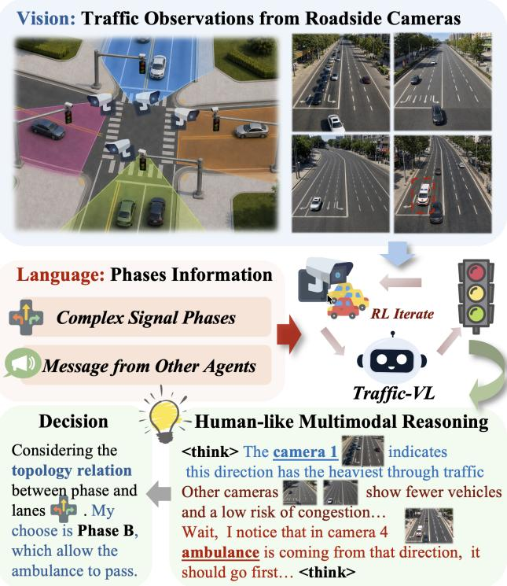  
Fig. 1. Traffic-VL maps multi-view roadside images and natural-language phase descriptions directly to traffic signal decisions.

This diversity makes generalization beyond individually engineered intersections a central challenge.

Reinforcement learning (RL) has advanced data-driven TSC by learning phase-selection policies from lane-level traffic measurements [4], [5]. More recently, large language models (LLMs) have enabled reasoning over textual traffic observations, as in LLMLight [6] and CoLLMLight [7]. Our conference work Traffic-R1 [1] extends this foundation-model paradigm with reinforced reasoning for zero-shot and out-ofdistribution control. However, in these pipelines, the upstream state interface still determines which evidence reaches the policy. For example, two queues of equal length may require different priorities if one contains an ambulance; count-only states cannot express this distinction. This limitation motivates keeping camera evidence available throughout phase reasoning, allowing the policy to use details that a fixed upstream representation may omit.

Visual TSC methods such as VLMLight [8] and Reason-Light [9] use vision-language models (VLMs) to incorporate multi-view observations, but two gaps remain. First, the visual-domain gap limits transfer from simulation to roadside surveillance. Methods such as VLMLight are developed primarily with simulator-native renderings, which offer controllable traffic scenes but lack realistic variation in illumination, weather, camera perspective, and visibility. Training visual control therefore requires observations that combine roadside appearance diversity with the traffic-state consistency needed for closed-loop simulation.

Second, the perception-to-decision gap reflects a separation between visual understanding and control optimization. Existing visual TSC pipelines commonly use images to construct intermediate traffic representations or to assist a separate controller [8], [9], [10]. The visual-to-action mapping thus remains split across perception and decision stages. Bridging this gap calls for a unified policy that retains visual evidence while grounding traffic demand in the movements served by each candidate phase. Reinforcement learning can then align this visual-to-phase reasoning with the consequences of successive decisions, optimizing the policy for long-term traffic outcomes.

To address these gaps, we jointly introduce SynTra-V for semantics-preserving Sim2Real data generation and Traffic-VL for reinforced end-to-end visual-to-phase control. We formulate this control task as a vision-language decision problem: visual observations describe where traffic demand occurs, while language specifies which movements each candidate phase serves. Jointly reasoning over these inputs connects visuospatial traffic understanding to symbolic control semantics.

SynTra-V is a semantics-preserving Sim2Real data engine that transforms physics-based traffic simulation into photorealistic multi-view surveillance imagery. For these images to support control, appearance must vary without changing the traffic configuration that determines the appropriate phase. The engine combines 2D-to-3D scene construction, annotationaligned rendering, structure-conditioned stylization, and automatic semantic auditing. Structural references constrain vehicle layout and lane geometry during generation, while audits check vehicle placement, movements, and lane semantics against the simulator state. Across diverse topologies and sensing conditions, the resulting observations support both visual-domain adaptation and realistic closed-loop evaluation without requiring large-scale access to private roadside camera data.

Built on this data engine, Traffic-VL is an 8B visionlanguage model that directly maps synchronized multi-view images and natural-language phase descriptions to phase decisions without an external state-extraction stage (Fig. 1). Each description identifies the movements served by a permitted phase; the model locates their corresponding lanes in the images and compares their observed demand. Describing phases by their movement semantics allows the same controller to accommodate standard and irregular signal plans without topology-specific output heads.

To learn this mapping, we extend Traffic-R1’s two-stage reinforced reasoning framework to visual control. Offline human-informed RL rewards expert-aligned phase decisions on audited SynTra-V imagery, adapting both the vision encoder and reasoning model. The online stage extends Stepwise Trajectory Policy Optimization to visual control (STPO-V), using deterministic Blender renderings for efficient, temporally consistent rollouts. We freeze the vision encoder to prevent updates on native simulator imagery from overwriting the surveillance-domain adaptation acquired offline. The remaining policy parameters are optimized for long-horizon traffic outcomes, separating visual-domain adaptation from closedloop policy optimization.

This journal extension inherits the two-stage RL framework and asynchronous cross-intersection communication of Traffic-R1 [1]. It replaces the structured-text observation interface with direct multi-view perception, extends the fixed fourphase template to natural-language descriptions of topologydependent phase sets, and introduces SynTra-V to support visual learning and evaluation. New evaluations cover degraded sensing, zero-shot phase decisions on unseen intersections in OmniTraffic and real surveillance images in Real-1296, and camera-based field operation. Table I summarizes the changes.

Operating directly on multi-view images, Traffic-VL matches the privileged structured-state Traffic-R1 across five closed-loop benchmarks while outperforming image-based controllers and general-purpose VLMs. On real surveillance images, it achieves 82.1% phase-selection accuracy compared with 75.0% for Gemini 3 Pro. In a three-week field evaluation across ten interconnected intersections serving over 55,000 drivers daily, Traffic-VL reduces average queue length by 10.4% relative to historical manual operation at the same intersections. Our main contributions are:

• SynTra-V, a semantics-preserving Sim2Real data engine. We combine structure-conditioned generation and control-critical semantic auditing to produce diverse surveillance-style imagery for visual adaptation and photorealistic closed-loop evaluation.

• Traffic-VL, an end-to-end vision-language TSC framework. We jointly ground multi-view traffic demand and natural-language phase semantics, enabling direct visual decisions across heterogeneous road layouts and signal plans.

• Two-stage reinforced visual reasoning. We combine offline visual adaptation with online policy optimization using a frozen vision encoder. Evaluation demonstrates structured-state-level control from raw images, robustness under emergency traffic and sensing degradation, and transfer to unseen topologies, real surveillance images, and constrained field operation.

## II. RELATED WORK

## A. RL-based Traffic Signal Control

RL-based TSC learns signal policies from traffic observations and operational rewards [11], [12]. IntelliLight [13] formulates intersection control through traffic-specific states, actions, and rewards, while PressLight [4] incorporates the max-pressure principle into policy learning. For networkwide control, MPLight [14] scales decentralized pressurebased policies to large road networks, and CoLight [5] uses graph attention to capture interactions among neighboring intersections. Together, these approaches establish effective mechanisms for adapting signal decisions and coordinating traffic flow. Network-wide cooperation is also studied through decentralized multi-agent RL [15] and graph-based cooperation [16].

TABLE I  
COMPARISON OF TRAFFIC-R1 AND TRAFFIC-VL ACROSS OBSERVATION, REASONING, TRAINING, AND DEPLOYMENT.
<table><tr><td>Aspect</td><td>Conference Version (Traffic-R1)</td><td>Journal Version (Traffic-VL)</td></tr><tr><td>Perception</td><td>Structured text states from upstream perception</td><td>Raw images with natural-language phase descriptions</td></tr><tr><td>Reasoning</td><td>LLM reasoning over pre-extracted states</td><td>Joint visual and language reasoning for phase selection</td></tr><tr><td>Phase Schema</td><td>Fixed four-phase lane template</td><td>Language descriptions for variable and complex phase sets</td></tr><tr><td>Training Data</td><td>Fixed textual symbolic traffic states</td><td>Photorealistic imagery across topologies and environments</td></tr><tr><td>Deployment</td><td>Dedicated V2X detectors and CV pipelines</td><td>Roadside-camera views with natural-language phase descriptions</td></tr><tr><td>Generalization</td><td>Standard intersections with fixed topology</td><td>Generalization across topological and environmental variation</td></tr></table>

Generalization also depends on how intersections are represented. MetaLight [17] uses meta-learning to accelerate adaptation to new traffic scenarios. FRAP [18] models competition between phases and exploits symmetry in traffic configurations. AttendLight [19] uses attention to accommodate varying numbers of roads, lanes, and phases, while Advanced-CoLight [20] enriches the state with pressure and running vehicle demand. These advances improve state representations and policy transfer, but their policies operate on predefined traffic measurements. Their transfer capability therefore depends on the state and phase schemas supplied to the policy, even when attention accommodates variable intersection sizes. Our focus extends this line of work to learning control directly from multi-view visual evidence and natural-language phase descriptions.

## B. Foundation Models for Traffic Signal Control

Vision-language pretraining [21], [22] and visual instruction tuning [23] support language-conditioned visual understanding, while chain-of-thought prompting [24] encourages intermediate reasoning steps. PaLM-E [25] and RT-2 [26] connect vision and language to embodied planning and control; DriveGPT4 [27] and DriveVLM [28] explore these capabilities in autonomous driving. Within traffic signal control, foundation models introduce semantic reasoning into phase selection. LLMLight [6] formulates phase selection as reasoning over textual traffic observations and introduces LightGPT as a task-specialized backbone. CoLLMLight [7] coordinates intersections through asynchronous cooperative reasoning and refines its model with rewards balancing network performance and reasoning cost. Our conference work Traffic-R1 [1] combines offline human-informed reinforcement learning, online trajectory optimization, and asynchronous communication to improve generalization and network-level coordination. These methods establish a foundation for reasoning-based control, with traffic information supplied through structured or textual state interfaces.

Visual approaches expand the available evidence to include road appearance and observable events. Yao et al. [10] extract traffic states from images for an LLM-based phase-selection agent. VLMLight [8] introduces multi-view simulation and a meta-controller that selects between an RL policy and a structured LLM reasoning branch. ReasonLight [9] combines camera observations, sensor-derived descriptions, and an RLproposed phase to refine decisions for unseen events. These systems connect visual perception to control through intermediate representations or interactions among specialized components. Traffic-VL instead learns a unified visual-to-phase policy: the same model grounds multi-view traffic demand in candidate phase semantics and is refined through expert feedback and closed-loop traffic outcomes.

## C. Synthetic Traffic Data and Sim2Real Transfer

Real-world datasets such as Cityscapes [29] and BDD100K [30] support visual understanding of road scenes. SYNTHIA [31] and Playing for Data [32] provide synthetic images with semantic annotations. Traffic simulation additionally provides controllable dynamics and annotations for data synthesis. SUMO [33] models microscopic traffic, while CARLA [34] renders urban scenes with configurable sensors and environmental conditions. OmniTraffic [35] further turns reconstructed intersections into synchronized multi-view supervision for traffic reasoning. However, transferring models trained on simulated observations to roadside cameras requires bridging the visual-domain gap while preserving the underlying traffic state. Domain randomization [36] and appearance randomization with pyramid consistency [37] address visual transfer by varying synthetic appearances.

Conditional generation offers tools for visual adaptation: ControlNet [38] adds spatial conditioning, and Magic-Drive [39] uses road maps, 3D boxes, and camera poses to generate street scenes with cross-view consistency. For closedloop TSC, however, generated images must remain aligned with the simulated traffic dynamics: a displaced vehicle or altered lane can change the appropriate phase even when an image appears realistic. SynTra-V therefore couples simulatorderived structural conditions with semantic auditing of vehicle placement, movements, and lane semantics. This connection enables diverse surveillance-style imagery to support both visual adaptation and closed-loop control evaluation while retaining the simulator’s traffic-state correspondence.

## III. PRELIMINARIES

## A. Road Network and Signal Phases

We consider traffic signal control at an intersection in an urban road network. An intersection consists of multiple incoming approaches, each containing one or more lanes. A traffic movement is a directed maneuver from an incoming lane toward an outgoing approach, typically categorized as a left turn, through movement, or right turn. A signal phase activates a set of mutually compatible traffic movements. Let $\mathcal { P }$ denote the candidate phase set of an intersection and $\mathcal { M } ( \boldsymbol { p } )$ the movements released by phase $p \in \mathcal P$ . For the four-approach example in Fig. 4, Phase 1 serves the through and right-turn movements of Views 1 and $^ { 3 , }$ and Phase 2 serves their left turns. Phases 3 and 4 provide the corresponding movements for Views 2 and 4. Both $\mathcal { P }$ and $\mathcal { M } ( \boldsymbol { p } )$ are determined by the intersection geometry, lane configuration, and signal plan. They may therefore differ across standard four-leg, T-shaped, and other irregular intersections.

## B. Synchronous Multi-View Observation

At decision time $t ,$ the controller receives an ordered tuple of synchronized roadside images,

$$
o _ { t } = \left( I _ { t } ^ { v _ { 1 } } , \ldots , I _ { t } ^ { v _ { K } } \right) ,\tag{1}
$$

where $\mathcal { V } = \{ v _ { 1 } , \ldots , v _ { K } \}$ denotes the K camera viewpoints associated with the intersection. The viewpoints follow a fixed order and are aligned with the incoming approaches. Each image may contain sensing imperfections encountered in roadside surveillance, including occlusion, illumination variation, visual noise, and perspective distortion.

We adopt a single-step observation protocol: the controller receives the current synchronized images at each decision step, without an explicit history of previous frames. Temporal effects are nevertheless reflected through repeated interaction with the evolving traffic environment.

## C. Problem Formulation

At each decision step, the controller selects a phase $p _ { t } \in \mathcal P$ from the candidate set according to the current observation and available operational context:

$$
p _ { t } = \pi _ { \theta } \left( o _ { t } , \mathcal { P } , c _ { t } \right) ,\tag{2}
$$

where $c _ { t }$ denotes the coordination messages received from neighboring intersections (Section IV-F). Timing and safety constraints are enforced by the environment or the signal controller rather than inferred by the policy. Under the traffic dynamics, the selected phase affects the subsequent state and observation. The control objective is to maximize the expected cumulative reward,

$$
\operatorname* { m a x } _ { \theta } \ \mathbb { E } _ { \pi _ { \theta } } \left[ \sum _ { t = 1 } ^ { T } \gamma ^ { t - 1 } r ( s _ { t } , p _ { t } ) \right] ,\tag{3}
$$

where $s _ { t }$ is the underlying traffic state, $r ( s _ { t } , p _ { t } )$ measures control quality, and $\gamma$ is the discount factor.

The policy produces a phase recommendation rather than directly actuating the signal. During physical deployment, each recommendation is executed through the existing signal controller under its approved timing and safety constraints.

## IV. METHODOLOGY

## A. Framework Overview

Fig. 2 summarizes the framework. SynTra-V (Section IV-C) converts traffic simulation into semantically audited, photorealistic multi-view observations (Fig. 2(a)). Traffic-VL (Section IV-D) maps these observations and natural-language phase descriptions to phase recommendations. It is trained in two stages (Section IV-E): offline human-informed RL on SynTra-V images and expert labels (Fig. 2(b)), followed by online STPO-V in a closed simulator loop (Fig. 2(c)). We first motivate this visual-native formulation.

## B. Design Rationale for Visual-Native Control

Let T denote a fixed external perception pipeline that maps the multi-view observation $o _ { t }$ to an estimated structured state $\tilde { s } _ { t } ~ = ~ T ( o _ { t } )$ . A controller operating on this representation selects

$$
p _ { t } = \pi _ { \mathrm { s t r } } \left( T ( o _ { t } ) , \mathcal { P } , c _ { t } \right) .\tag{4}
$$

Any decision rule based on $T ( o _ { t } )$ is also a function of $o _ { t } .$ . However, if T discards evidence relevant to phase $\mathrm { s e - }$ lection, the downstream controller cannot recover it from the structured state. This motivates conditioning Traffic-VL directly on the multi-view observation and candidate phase semantics, keeping visual evidence available throughout the decision process. Appendix A formalizes this informationceiling argument and the conditions under which a structured representation preserves decision-relevant information.

Three design principles follow. Evidence preservation keeps visual tokens available during phase reasoning. Modality-native alignment jointly grounds visual traffic demand and symbolic phase semantics within a unified model. Semantics-preserving synthesis varies appearance while maintaining control-critical geometry, vehicle movements, and lane semantics. These principles guide the controller, data engine, and two-stage training procedure.

## C. SynTra-V: Semantics-Preserving Sim2Real Data Engine

Real roadside camera data are difficult to acquire and annotate at scale because of privacy, regulatory, and deployment constraints. TSC research therefore relies heavily on traffic simulation, which provides closed-loop dynamics and exact traffic annotations at low cost. However, symbolic simulator states omit perception errors altogether, while simulator-native renderings rarely reproduce the appearance variation and sensing imperfections of roadside surveillance. Models trained only under these idealized visual conditions may therefore transfer poorly to physical intersections.

SynTra-V bridges this visual-domain gap by transforming dynamic traffic simulation into photorealistic multi-view surveillance imagery while preserving the traffic semantics required for phase selection. It retains the controllable dynamics and annotations of simulation, but introduces realistic variations in topology, roadside appearance, weather, illumination, camera perspective, and visibility. The resulting observations support both visual-domain adaptation during offline training and photorealistic closed-loop evaluation.

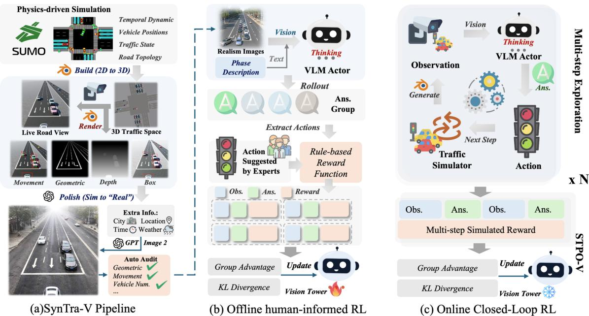  
Fig. 2. The Traffic-VL framework combines (a) SynTra-V data generation, (b) offline human-informed RL, and (c) online closed-loop policy optimization.

1) Simulation, Topology, and Scene Construction: For scene construction, SynTra-V uses SUMO [33], which provides dynamic vehicle positions, trajectories, traffic demand, signal states, and road topology. We construct standard fourleg intersections together with irregular layouts, including Tshaped and five-leg junctions. Each simulator state is converted into a three-dimensional traffic scene containing road geometry, lane markings, vehicles, and roadside context.

Virtual cameras are placed at surveillance-style positions to render synchronized multi-view observations. The underlying simulator state supplies exact vehicle positions, counts, queues, movements, and lane assignments for annotation and auditing. Signal states are available to the simulator but are not rendered as visible cues, preventing the model from selecting phases by reading the current signal appearance rather than the traffic demand.

For each topology, a rule-guided procedure constructs the candidate phase set from its compatible traffic movements. Natural-language phase descriptions are then generated under the schema introduced in Section IV-D3 and verified by trafficdomain experts. This process exposes Traffic-VL to diverse road structures, lane configurations, and signal plans without requiring topology-specific output heads.

2) Structure-Conditioned Photorealistic Generation: Although Blender rendering preserves traffic geometry, its native output lacks the visual variability of roadside surveillance. SynTra-V therefore applies the conditional image-to-image generator gpt-image-2 under controllable contextual conditions, including city style, location, time, weather, illumination, and camera appearance.

As shown in Fig. 2(a), the renderer produces a source view together with four pixel-aligned auxiliary references: Box, Movement, Geometric, and Depth. The Box and Movement references are combined into a vehicle control image Cveh, which constrains vehicle count, position, lane occupancy, and heading. The Geometric reference is used to construct the lane control image Clane, preserving road geometry, lane markings, and turn arrows, including regions occluded by vehicles. The Depth reference is retained for semantic auditing rather than used as a generation condition.

These references constrain the structure that determines the phase decision, leaving appearance free to vary. Fig. 3 illustrates the appearance diversity produced from a shared simulator state. By varying scene attributes while retaining simulator-derived structural references, SynTra-V expands the same traffic configuration across different times, weather conditions, and regional road styles. These variations expose the vision encoder to surveillance-domain appearance shifts without requiring additional real-world annotations.

3) Automatic Semantic Audit: For each generated candidate, SynTra-V executes four independent Gemini 3 Pro audit calls. Each call uses one of the pixel-aligned Blender references together with the generated image and a taskspecific auxiliary result: Box with a YOLO11n detection overlay, Geometric with a morphological lane-and-arrow overlay, Depth with a monocular depth estimate, and Movement with crop-level heading predictions. The four calls evaluate complementary dimensions:

• Box consistency: verifies vehicle count and spatial placement.

• Geometric consistency: verifies lane markings, turn arrows, road geometry, and vehicle-to-lane alignment.

Lane-to-Phase Grounding

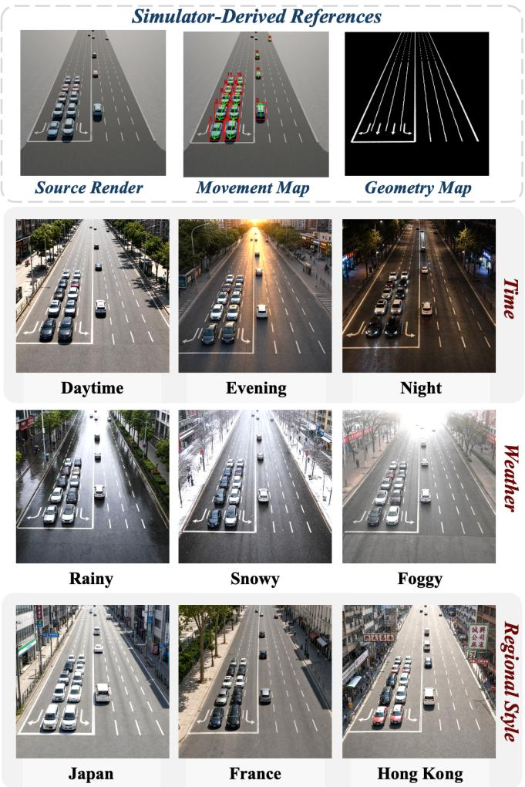  
Fig. 3. SynTra-V imagery across city styles and weather conditions.

• Depth consistency: verifies near-to-far ordering and occlusion relationships.

• Movement consistency: verifies vehicle headings and rejects reversed or physically implausible movements.

A candidate is accepted only if all four independent audit calls return PASS; otherwise, it is discarded and resampled. Accepted images form the photorealistic observations used for offline visual adaptation. The same generation and auditing protocol is used to construct observations during photorealistic closed-loop evaluation. Appendix B reports the generation inputs and prompt, task-specific audit inputs, four audit prompts, and acceptance rule.

## D. End-to-End Visual-to-Phase Controller

1) Controller Overview: Traffic-VL implements a direct mapping from multi-view visual observations to phase-level recommendations. Given the current observation $o _ { t } ,$ candidate phase set ${ \mathcal { P } } _ { : }$ , natural-language phase descriptions, and operational context $c _ { t }$ , the controller encodes the ordered camera views into visual tokens. A single Qwen3-VL model jointly processes these tokens with the phase descriptions and task instruction. We use the 8B model as the primary configuration.

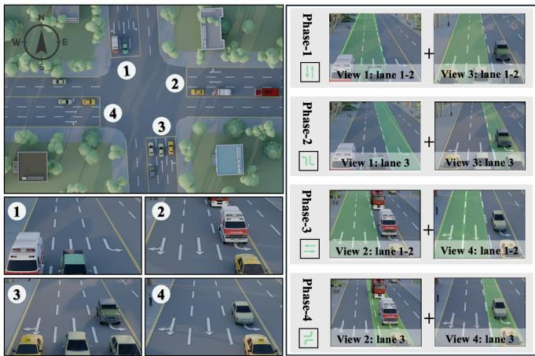  
Natural-Language Phase Schema

You are given four synchronized images from 4 directions of the same intersection in order: View 1, View 2, View 3, View 4. , they are taken at the same time. Below is the phase information for this intersection. Lanes are indexed Left-to-Right per image viewpoint.   
(S: Straight, L: Left, R: Right)   
Phase 1: View 1 (Lane 1R,2S); View 3 (Lane 1R,2S)   
Phase 2: View 1 (Lane 3L); View 3 (Lane 3L)   
Phase 3: View 2 (Lane 1R, 2S); View 4 (Lane 1R,2S)   
Phase 4: View 2 (Lane 3L); View 4 (Lane 3L)

Fig. 4. Natural-language phase descriptions and lane-to-phase grounding.

During inference, Traffic-VL identifies traffic demand from the images, grounds the movements referenced by each candidate phase in their corresponding visual lanes, and compares the candidate phases before producing a structured response. The response contains an optional reasoning trace and one recommended phase identifier.

2) Multi-View Visual Encoding and View Alignment: Traffic-VL uses the synchronized multi-view observation ot defined in Section III. In the standard four-approach setting, the input contains K = 4 roadside images at $5 1 2 \times 5 1 2$ resolution, ordered by incoming approach. For other layouts, K follows the number of observed approaches.

The fixed view order establishes a common spatial reference between the images and phase descriptions. Each image is processed by the Qwen3-VL vision encoder, and the resulting tokens retain their view order when passed to the language model. This organization allows the controller to associate visual evidence with a specific approach while remaining applicable to different numbers and arrangements of approaches.

3) Natural-Language Phase Schema and Lane-to-Phase Grounding: A phase p is defined by its set of mutually compatible movements $\mathcal { M } ( \boldsymbol { p } )$ . To communicate these action semantics across heterogeneous intersections, we represent each candidate phase $p \in \mathcal P$ using a natural-language descriptor $D ( p )$

As illustrated in Fig. 4, each movement is addressed by

$$
m = ( \boldsymbol { v } , \boldsymbol { \ell } , d ) ,\tag{5}
$$

where $v$ identifies the source viewpoint and incoming approach, ℓ is the lane index within that view, and $d \in \{ L , S , R \}$ denotes a left-turn, through, or right-turn movement. The descriptor $D ( p )$ lists the compatible movements released by phase $p$ across the available viewpoints.

This representation separates phase semantics from the model architecture. Standard four-phase plans and nonstandard plans for T-shaped, five-leg, and other irregular intersections can be expressed using the same addressing convention. Introducing a new topology therefore changes the candidate phase descriptions rather than requiring a topology-specific output head.

The descriptor specifies the movements released by a phase but does not encode their current demand. Traffic-VL must locate each referenced movement in the corresponding image, infer its demand from visual evidence, and compare the candidate phases according to their movement composition. We refer to this process as lane-to-phase semantic grounding. It dynamically connects symbolic phase semantics to visual lane regions instead of applying a fixed phase-to-lane mapping to pre-extracted traffic features.

4) Reasoning and Valid Phase Selection: The ordered visual tokens, phase descriptors, and task instruction are concatenated into a single model context. Traffic-VL generates a structured response containing a reasoning field and an answer field. The answer field must contain exactly one phase identifier from the candidate set $\mathcal { P } _ { \cdot }$ The reasoning trace supports visual comparison and phase selection but is not parsed as part of the executed action.

The candidate set contains only conflict-free phases admitted by the intersection signal plan. A response is valid if its answer field yields exactly one identifier in $\mathcal { P } .$ During training, an unparsable response receives zero format and action rewards. During simulation, an invalid response retains the previous valid phase. Yellow and all-red clearance intervals are inserted by the environment and are not selected by the model. The reward evaluates the validity and selected phase rather than supervising individual reasoning tokens. Traffic-VL can therefore develop visual grounding and phase-comparison strategies from outcome-level feedback without requiring manually authored reasoning traces for every observation.

## E. Two-Stage Reinforcement Training

Figs. 2(b) and 2(c) summarize the two training stages. Traffic-R1 previously established through controlled comparisons with supervised fine-tuning that two-stage reinforcement learning improves zero-shot and safety-critical generalization over structured traffic states. Traffic-VL extends this reinforced reasoning paradigm to vision-language control.

Offline human-informed reinforcement learning uses semantically audited SynTra-V images and expert phase labels to establish traffic-specific visual grounding and phase reasoning. The vision encoder remains trainable in this stage. Online STPO-V then refines long-horizon control through multi-step simulator interaction. To enable deterministic and scalable rollouts, online training uses native Blender renderings and freezes the vision encoder, confining policy updates to reasoning and phase selection.

1) Offline Human-Informed Reinforcement Learning: For an observation $^ { O , }$ phase descriptor set ${ \mathcal { D } } = \{ D ( p ) \mid p \in { \mathcal { P } } \}$ expert phase label $a ^ { \star }$ , and policy πθ, we sample a group of G structured responses $\{ y _ { i } \} _ { i = 1 } ^ { G }$ . Each response contains a reasoning trace and a parsed phase $\hat { a } ( y _ { i } )$ . We assign the rule-based reward

$$
{ \cal R } _ { i } = \lambda _ { f } { \cal R } _ { \mathrm { f m t } } ( y _ { i } ) + \lambda _ { a } { \bf 1 } [ \hat { a } ( y _ { i } ) = a ^ { \star } ] ,\tag{6}
$$

where $R _ { \mathrm { f m t } } ( y _ { i } ) = 1$ only if the response follows the prescribed output format and contains one parseable phase identifier; otherwise it is zero. If no valid phase can be parsed, the action reward is also zero.

We optimize the policy using Group Relative Policy Optimization (GRPO) [40]. The group-normalized advantage is

$$
A _ { i } = \frac { R _ { i } - \mu _ { G } } { \sigma _ { G } + \varepsilon _ { \mathrm { s t d } } } ,\tag{7}
$$

where $\mu _ { G }$ and $\sigma _ { G }$ are the reward mean and standard deviation within the sampled response group. The offline objective uses a clipped surrogate [41]:

$$
\begin{array} { r l } & { \mathcal { L } _ { \mathrm { o f f i n e } } = \mathrm { ~ - ~ } \mathbb { E } \Bigg [ \frac { 1 } { G } \sum _ { i = 1 } ^ { G } \frac { 1 } { | y _ { i } | } \sum _ { u = 1 } ^ { | y _ { i } | } \operatorname* { m i n } \Big ( \rho _ { i , u } A _ { i } , } \\ & { ~ \qquad \mathrm { c l i p } _ { \epsilon } ( \rho _ { i , u } ) A _ { i } \Big ) \Bigg ] + \beta D _ { \mathrm { K L } } ( \pi _ { \theta } \| \pi _ { \mathrm { r e f } } ) , } \end{array}\tag{8}
$$

where $\mathrm { c l i p } _ { \epsilon } ( z ) = \mathrm { c l i p } ( z , 1 - \epsilon , 1 + \epsilon )$ , and

$$
\rho _ { i , u } = \frac { \pi _ { \theta } ( y _ { i , u } \mid o , \mathcal { D } , y _ { i , < u } ) } { \pi _ { \mathrm { o l d } } ( y _ { i , u } \mid o , \mathcal { D } , y _ { i , < u } ) } .\tag{9}
$$

The expert annotations provide preferred phases rather than unique token-level reasoning traces. The model therefore generates its own reasoning process and is optimized according to output validity and agreement with the expert decision. Both the language model and vision encoder are trainable during this stage, allowing the visual representation to adapt to traffic-specific geometry, camera perspective, occlusion, weather, illumination, and image degradation before closedloop optimization.

2) Online Closed-Loop Reinforcement Learning via STPO-V: The online stage places Traffic-VL in a closed loop with CityFlow [42] traffic dynamics and deterministic multi-view rendering. Applying stochastic photorealistic stylization at every decision step would introduce appearance inconsistency across a trajectory and increase the variance of multi-step credit assignment. Moreover, SynTra-V auditing has variable generation latency, which limits parallel rollout throughput. Online STPO-V therefore uses multi-view images rendered directly by Blender from the current simulator state. This provides temporally consistent observations, predictable rendering cost, and scalable parallel interaction.

At decision step t, Traffic-VL receives observation $o _ { t } ,$ generates a structured response $y _ { t }$ , and selects phase $a _ { t } .$ . The simulator then transitions to state $s _ { t + 1 }$ . A trajectory of $T$ control steps is

$$
\tau = \left\{ \left( s _ { t } , o _ { t } , y _ { t } , a _ { t } \right) \right\} _ { t = 1 } ^ { T } .\tag{10}
$$

Let $q _ { t , l }$ and $w _ { t , l }$ denote the queue length and accumulated waiting time on lane l at step t. We define

$$
\bar { q } _ { t } = \frac { 1 } { | \mathcal { L } | } \sum _ { l \in \mathcal { L } } q _ { t , l } , \qquad \bar { w } _ { t } = \frac { 1 } { | \mathcal { L } | } \sum _ { l \in \mathcal { L } } w _ { t , l } ,\tag{11}
$$

and the operational cost

$$
c ( s _ { t } ) = \omega _ { q } \bar { q } _ { t } + \omega _ { w } \bar { w } _ { t } .\tag{12}
$$

Each cost is measured after the selected phase has been executed, and the resulting state also provides the next observation. The trajectory return is

$$
R _ { \mathrm { t r a j } } ( \tau ) = - \sum _ { t = 1 } ^ { T } c ( s _ { t + 1 } ) .\tag{13}
$$

Following the Stepwise Trajectory Policy Optimization rule of Traffic-R1, the trajectory return is broadcast to its $T$ decision responses with length normalization:

$$
r _ { t } = \mathcal { C } _ { t } ( R _ { \mathrm { t r a j } } ) = \frac { R _ { \mathrm { t r a j } } ( \tau ) } { T } .\tag{14}
$$

For $G _ { \mathrm { o n } }$ rollouts generated from the same initial traffic condition, the stepwise group advantage is

$$
A _ { t } ^ { ( j ) } = \frac { r _ { t } ^ { ( j ) } - \mu _ { t } } { \sigma _ { t } + \varepsilon _ { \mathrm { s t d } } } ,\tag{15}
$$

where $\mu _ { t }$ and $\sigma _ { t }$ are computed across the rollout group.

Here, stepwise means that every response along the trajectory enters the policy objective under the shared longhorizon outcome; it does not introduce a separate temporaldifference target within the trajectory. STPO-V optimizes the same clipped, KL-regularized policy objective as Eq. 8, replacing the offline expert-derived advantage A with the trajectory-derived advantage $A _ { t } ^ { ( j ) }$ . Each structured response in the trajectory is therefore optimized against the long-horizon outcome of its rollout rather than only its agreement with a local expert decision.

The vision encoder is frozen throughout online optimization, while the language-model reasoning and phase-selection parameters remain trainable. This prevents deterministic Blender imagery from overwriting the surveillance-style visual representation learned from SynTra-V. Online learning can then focus on multi-step phase comparison and adaptation to closedloop traffic dynamics while preserving the end-to-end mapping from images to phase recommendations.

## F. Asynchronous Cross-Intersection Coordination

Traffic-VL retains the asynchronous coordination mechanism of Traffic-R1 for multi-intersection control. Let the road network be $G = ( \mathcal { T } , \mathcal { E } )$ . Intersections are partitioned into two groups, $\mathcal { T } _ { 1 }$ and $\mathcal { T } _ { 2 }$ , according to positional parity.

As illustrated in Fig. 5, each control step consists of two inner steps. Intersections in $\mathcal { T } _ { 1 }$ act first using their local visual observations and messages received from $\mathcal { T } _ { 2 }$ during the preceding inner step. Their outgoing messages are then delivered to eligible intersections in $\mathcal { T } _ { 2 }$ , which act in the second inner step. An inactive intersection retains its previous valid phase until its group is activated.

Communication is restricted to connected intersections within 2 km, and each message summarizes the directional traffic expected to reach the receiver. Appendix C details the message format, lifecycle, and half-step execution procedure.

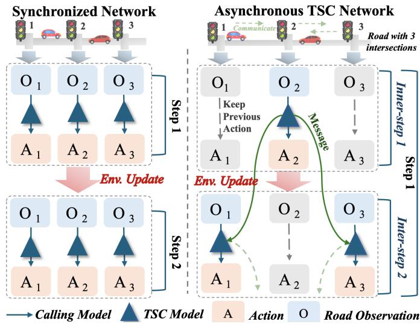  
Fig. 5. Synchronous control updates all intersections together; asynchronous control alternates two groups with half-step message exchange.

## V. EXPERIMENTAL SETUP

We evaluate Traffic-VL as a vision-language controller that acts directly on synchronized multi-view images. Our experiments address five research questions. RQ1: Can Traffic-VL preserve the control quality of privileged structured-state controllers while operating directly on raw multi-view images? RQ2: Can it handle safety-critical and abnormal traffic conditions, including emergency prioritization and degraded sensing? RQ3: Does it generalize zero-shot to unseen intersection topologies and real surveillance frames? RQ4: What is the contribution of each component? RQ5: Can Traffic-VL meet the real-time control deadline on local server-class hardware, and how does model scale affect latency and accuracy? We first describe the experimental setup and then address these questions in turn.

## A. Implementation Details

Traffic-VL uses Qwen3-VL 8B as its primary backbone; Qwen3-VL 4B is included only in the scaling study. As detailed in Section IV-E, training consists of offline humaninformed GRPO followed by online STPO-V. We reuse the phase annotations collected for Traffic-R1 from 11 traffic experts and use SynTra-V to construct approximately 5,000 photorealistic multi-view training samples spanning diverse city styles and traffic densities.

Both stages use a constant learning rate of $1 \times 1 0 ^ { - 6 }$ , a global batch size of 256, a clipping range of 0.2–0.3, and a KL coefficient of 0.01. Prompts and responses are capped at 2048 tokens. Training is conducted on four NVIDIA A800 GPUs with 80 GB memory each.

During offline GRPO, we train for 45 epochs using AdamW [43] with $( \beta _ { 1 } , \beta _ { 2 } ) = ( 0 . 9 , 0 . 9 9 9 )$ , weight decay 0.01, and no warmup. For each state, we sample five responses with temperature 1.0 and top-p 1.0; validation uses one response with temperature 0.6 and top-p 0.95. The complete actor, including the vision tower, is optimized end to end with BF16 FSDP.

Online STPO-V is performed in CityFlow on the same 4×4 simulated network as Traffic-R1, using trajectory length $T = 5$ and $G _ { \mathrm { o n } } = 5$ rollouts per initial condition. The vision encoder is frozen to preserve the visual representation learned offline, while all remaining parameters are fully optimized. Neither stage uses LoRA or any other parameter-efficient adaptation method.

## B. Environments and Datasets

We evaluate closed-loop control in CityFlow on the five public Jinan and Hangzhou benchmarks used in Traffic-R1: Jinan1, Jinan2, Jinan3, Hangzhou1, and Hangzhou2. Unlike online STPO-V training, which uses deterministic Blender renders, these evaluations employ the complete SynTra-V pipeline. At each decision step, the current simulator state is rendered into four synchronized photorealistic roadside views and passed through the semantic audit before being presented to the controller. The selected phase then updates the simulator, from which the next visual observation is generated, forming a stepwise closed control loop. All raw-image methods follow the same observation-generation and auditing protocol. Although the evaluation is closed-loop, it is not constrained by wall-clock execution time: the simulator advances only after a valid observation and control decision are obtained. Imagegeneration latency therefore does not affect the simulated traffic dynamics or the reported control metrics. Following Traffic-R1, each selected phase is activated for 15 s, followed by a 3 s yellow interval and a 2 s all-red clearance interval. Closed-loop results are averaged over five paired traffic-demand seeds. City style, weather, illumination, and camera parameters remain fixed within each rollout and are resampled across seeds; every controller is evaluated under the same seed-specific conditions. Appendix D reports dispersion and paired equivalence tests for the two principal controllers.

Zero-shot topology generalization is evaluated on twelve held-out OmniTraffic intersections [35], none of which appears during training. OmniTraffic retains its native simulatorrendered observations. We further evaluate Sim2Real generalization on Real-1296, a fixed benchmark of 1,296 synchronized multi-view surveillance samples. Real-1296 contains anonymized samples from 14 intersections that are disjoint from both the training networks and the ten deployment intersections. The model, prompts, and evaluation protocol are frozen before any benchmark result is inspected, and no sample is used for model selection. Samples from the same camera are separated by at least 300 s to limit temporal duplication. The collection spans daytime and nighttime operation, rain, strong occlusion, visual noise, and heterogeneous intersection layouts. License plates and faces are removed or blurred before annotation. Three traffic-domain experts independently label each sample with the preferred next phase, followed by adjudication when their initial labels differ. Inter-expert agreement is 0.84 by Fleiss’ κ. Multiple acceptable phases are retained when two or more choices are operationally equivalent; these cases account for approximately 15% of the benchmark.

## C. Baselines

We compare Traffic-VL with three groups of baselines. Structured-state controllers access simulator-provided lanelevel states. They include rule-based methods (FixedTime [44] and MaxPressure [45]), RL methods (MPLight [14], CoLight [5], Advanced-CoLight [20], and AttendLight [19]), and language-based controllers that reason over structured textual observations (LLMLight [6], CoLLMLight [7], Traffic-R1 [1], and the original VLMLight [8]).

Raw-image baselines receive the same raw multi-view images as Traffic-VL. They include the unfine-tuned Qwen3- VL 8B base model [46], Gemini 3 Pro [47], and VLMLight (adapted). For VLMLight (adapted), we retain its original 32B scene-understanding VLM and 72B reasoning LLM while replacing its simulator-native views with the same SynTra-V observations used by Traffic-VL.

We further include Advanced-CoLight† as a full-shot perception-to-structure baseline. It applies a fine-tuned Grounding DINO detector [48] to multi-view images and uses manually specified, intersection-specific mappings to derive the lane-level queue and pressure states required by Advanced-CoLight. The mappings are calibrated separately for the Jinan and Hangzhou layouts, and the controller is trained on each target benchmark. This baseline exposes the deployment cost of conventional visual pipelines, which require detector integration, topology-specific state engineering, and targetenvironment training.

Following Traffic-R1, all learning-based baselines except Advanced-CoLight† are trained in a shared simulated environment and evaluated zero-shot on the test benchmarks, without benchmark-specific retraining. Since conventional RL controllers do not reliably transfer across topologies under this protocol, their full-shot results are additionally reported in Appendix F. Traffic-VL is never trained on the evaluation benchmarks and acts at each unseen intersection without additional adaptation.

## D. Metrics

We use metrics matched to each evaluation setting. For standard closed-loop control, we report Average Travel Time (ATT) and Average Waiting Time (AWT), in seconds, where lower is better. For zero-shot topology generalization on OmniTraffic, we report phase-selection accuracy. For real surveillance frames, we report expert-agreement accuracy, defined as the fraction of predicted phases matching traffic-expert annotations. Following Traffic-R1, safety-critical evaluations use Emergency Action Accuracy (EAA) for local incidents, such as on-site accidents, and Average Emergency Travel Time (AETT) and Average Emergency Waiting Time (AEWT) for network-level incidents, such as emergency-vehicle routing. EAA measures the fraction of correct priority actions, while lower AETT and AEWT indicate better emergency response. We additionally report end-to-end decision latency to assess deployment efficiency.

In result tables, Depl. denotes direct camera-based deployment without topology-specific structured-state engineering; bold and underlining mark the best and second-best values, respectively. A dash in a metric column denotes an unevaluated result.

TABLE II  
CLOSED-LOOP TRAFFIC SIGNAL CONTROL ON FIVE PUBLIC BENCHMARKS (ATT/AWT IN SECONDS; FIVE PAIRED TRAFFIC-DEMAND SEEDS).
<table><tr><td rowspan="2">Method</td><td rowspan="2">Input</td><td rowspan="2">Setting</td><td rowspan="2">Depl.</td><td colspan="2">Jinan1</td><td colspan="2">Jinan2</td><td colspan="2">Jinan3</td><td colspan="2">Hangzhou1</td><td colspan="2">Hangzhou2</td></tr><tr><td>ATT</td><td>AWT</td><td>ATT</td><td>AWT</td><td>ATT</td><td>AWT</td><td>ATT</td><td>AWT</td><td>ATT</td><td>AWT</td></tr><tr><td>FixedTime</td><td>Structured-Oracle</td><td>Rule-based</td><td>x</td><td>453.41</td><td>51.32</td><td>370.34</td><td>35.15</td><td>384.53</td><td>36.95</td><td>497.54</td><td>36.41</td><td>408.53</td><td>53.94</td></tr><tr><td>MaxPressure</td><td>Structured-Oracle</td><td>Rule-based</td><td>x</td><td>274.34</td><td>32.04</td><td>246.35</td><td>22.56</td><td>245.66</td><td>24.31</td><td>289.55</td><td>21.52</td><td>349.53</td><td>67.52</td></tr><tr><td>MPLight</td><td>Structured-Oracle</td><td>Zero-shot</td><td>x</td><td>455.34</td><td>72.45</td><td>471.14</td><td>78.03</td><td>427.37</td><td>64.91</td><td>491.32</td><td>64.05</td><td>425.42</td><td>69.85</td></tr><tr><td>CoLight</td><td>Structured-Oracle</td><td>Zero-shot</td><td>x</td><td>472.44</td><td>91.09</td><td>450.41</td><td>78.59</td><td>498.84</td><td>89.94</td><td>494.61</td><td>72.18</td><td>435.32</td><td>81.11</td></tr><tr><td>Advanced-CoLight</td><td>Structured-Oracle</td><td>Zero-shot</td><td>x</td><td>347.31</td><td>56.54</td><td>345.78</td><td>35.96</td><td>342.56</td><td>37.55</td><td>485.32</td><td>54.11</td><td>523.19</td><td>72.56</td></tr><tr><td>AttendLight</td><td>Structured-Oracle</td><td>Zero-shot</td><td>x</td><td>381.11</td><td>67.59</td><td>305.53</td><td>64.72</td><td>331.34</td><td>66.42</td><td>318.94</td><td>67.84</td><td>348.41</td><td>65.58</td></tr><tr><td>LLMLight</td><td>Structured-Oracle (text)</td><td>Zero-shot</td><td>x</td><td>274.47</td><td>33.66</td><td>286.53</td><td>28.66</td><td>271.11</td><td>28.27</td><td>299.31</td><td>25.53</td><td>331.38</td><td>51.79</td></tr><tr><td>CoLLMLight</td><td>Structured-Oracle (text)</td><td>Zero-shot</td><td>x</td><td>281.12</td><td>33.23</td><td>269.34</td><td>25.51</td><td>268.32</td><td>34.36</td><td>298.42</td><td>24.45</td><td>336.92</td><td>45.43</td></tr><tr><td>Traffic-R1</td><td>Structured-Oracle (text)</td><td>Zero-shot</td><td>x</td><td>270.34</td><td>27.95</td><td>239.53</td><td>21.11</td><td>238.03</td><td>23.17</td><td>277.83</td><td>15.51</td><td>324.11</td><td>33.14</td></tr><tr><td>Qwen3-VL 8B (base)</td><td>Raw-Image</td><td>Zero-shot</td><td>√</td><td>372.32</td><td>47.31</td><td>331.56</td><td>43.22</td><td>325.81</td><td>42.08</td><td>386.09</td><td>49.19</td><td>449.24</td><td>80.37</td></tr><tr><td>Gemini 3 Pro</td><td>Raw-Image</td><td>Zero-shot</td><td>√</td><td>333.06</td><td>41.10</td><td>297.79</td><td>36.94</td><td>289.92</td><td>35.76</td><td>340.23</td><td></td><td>42.34403.88</td><td>69.57</td></tr><tr><td>VLMLight (adapted)</td><td>Raw-Image</td><td>Zero-shot</td><td>√</td><td>300.53</td><td>36.04</td><td>263.47</td><td>31.53</td><td>266.11</td><td>32.42</td><td>305.76</td><td>37.23</td><td>357.55</td><td>61.02</td></tr><tr><td>Advanced-CoLight† Traffic-VL (ours)</td><td>Raw-Image→Struct</td><td>Full-shot</td><td>x √</td><td>315.03</td><td>40.05 27.82</td><td>277.44</td><td>34.89 21.05</td><td>281.27</td><td>35.89</td><td>324.50 277.56</td><td>41.62 15.62</td><td>376.97 323.8933.12</td><td>66.41</td></tr><tr><td></td><td>Raw-Image</td><td>Zero-shot</td><td></td><td>269.71</td><td></td><td>239.81</td><td></td><td>237.95</td><td>23.31</td><td></td><td></td><td></td><td></td></tr></table>

## VI. EXPERIMENTS

## A. RQ1: Overall Performance

We compare closed-loop control under each method’s native observation interface. Structured-state baselines receive simulator-provided lane-level states, whereas Traffic-VL operates directly on raw multi-view images. The central question is whether end-to-end vision-language reasoning can preserve the control quality of a privileged structured-state controller under a more realistic observation setting.

We include two bridge baselines. VLMLight (adapted) receives the same raw multi-view images as Traffic-VL while retaining its original scene-understanding and reasoning pipeline. Advanced-CoLight† represents an engineered perception-to-structure pipeline: detections from a fine-tuned Grounding DINO model are converted into queue and pressure states through manually specified, topology-dependent mappings, after which the controller is trained in the fullshot setting. These baselines separate direct visual reasoning from adapting an existing VLM controller or reconstructing a conventional structured-state interface.

Table II shows that Traffic-VL matches the privileged structured-state reference, Traffic-R1, across all five Jinan and Hangzhou benchmarks. Paired two one-sided tests (TOST) with a pre-specified ±2% relative equivalence margin support equivalence in both ATT and AWT on every benchmark after Holm correction for multiple comparisons (Appendix D). Traffic-VL therefore preserves structured-state-level control quality while inferring traffic demand directly from raw images.

The advantage is clearer against alternative raw-image controllers. On Jinan1, Traffic-VL reduces ATT by approximately 19% relative to Gemini 3 Pro and by 10% relative to VLMLight (adapted). It also outperforms Advanced-CoLight†, whose engineered perception-to-structure pipeline reaches 315.03 s despite topology-specific state design and full-shot training. Conventional RL controllers transfer less effectively under the zero-shot protocol: Advanced-CoLight, even with structured inputs, reaches 347.31 s ATT and trails the rule-based MaxPressure baseline. Together, these results show that Traffic-VL closes the gap to the privileged structuredstate reference while acting directly on camera images. When retrained on each target benchmark, conventional RL controllers become competitive, and full-shot Advanced-CoLight attains the lowest ATT on three of the five benchmarks (Appendix F); Traffic-VL reaches comparable performance without benchmark-specific training.

## B. RQ2: Safety-Critical and Abnormal Scenes

1) Emergency-Vehicle Prioritization: Following Traffic-R1, we evaluate emergency-vehicle prioritization at both the localintersection and three-intersection corridor levels, using EAA, AETT, and AEWT. The central difference is the observation interface. Traffic-R1 receives an emergency annotation in its structured text state, whereas Traffic-VL receives only synchronized raw images and must identify the emergency, interpret the traffic context, and select a phase directly from visual evidence. SynTra-V renders emergency vehicles and lane-blocking accidents into the multi-view observations. Textbased baselines receive oracle emergency annotations, while conventional RL baselines retain count-based states without vehicle-class information.

Table III first confirms the limitation of count-based control: without vehicle-class information, conventional RL controllers cannot reliably prioritize emergency vehicles. Under the same oracle incident descriptions, Traffic-R1 substantially outperforms the SFT-based LLMLight. This gap further validates the reinforced reasoning paradigm of Traffic-R1, in which twostage RL improves both traffic-semantic reasoning and generalization to safety-critical events beyond supervised demonstrations.

Despite receiving no incident description, Traffic-VL approaches the oracle-input Traffic-R1 on local emergency actions and achieves the strongest results among raw-image methods in corridor-level emergency response. These results show that direct vision-language reasoning can support both emergency recognition and coordinated control without privileged annotations or an external structured-state pipeline. Traffic-VL achieves this with a single 8B model, compared with VLMLight’s 32B vision model and 72B reasoning model.

TABLE III  
EMERGENCY-VEHICLE PRIORITIZATION: LOCAL EAA AND CORRIDOR AETT/AEWT (S).
<table><tr><td>Method</td><td>Input</td><td>Scale</td><td>Depl.</td><td>EAA</td><td>AETT</td><td>AEWT</td></tr><tr><td>MaxPressure</td><td>Structured- Oracle</td><td>1</td><td>x</td><td>0.20</td><td>287.94</td><td>21.87</td></tr><tr><td>Advanced- CoLight</td><td>Structured- Oracle</td><td>~1M</td><td>x</td><td>0.30</td><td>286.32</td><td>24.53</td></tr><tr><td>LLMLight (oracle emerg.)</td><td>Structured- Oracle (text)</td><td>7B</td><td>x</td><td></td><td>0.42 273.55</td><td>15.21</td></tr><tr><td>Traffic-R1 (oracle Structured- emerg.)</td><td>Oracle</td><td>3B</td><td>x</td><td></td><td>0.85 215.58</td><td>7.98</td></tr><tr><td>Advanced- CoLight†</td><td>(text) Raw- Img→Str.</td><td>~1M</td><td>x</td><td></td><td>0.34 289.03</td><td>25.81</td></tr><tr><td>Gemini 3 Pro</td><td>Raw-Image</td><td>Undisclosed</td><td>√</td><td>0.712</td><td>232.06</td><td>13.15</td></tr><tr><td>VLMLight (adapted)</td><td>Raw-Image</td><td>32B+72B</td><td>√</td><td></td><td>0.82 226.10</td><td>11.22</td></tr><tr><td>Traffic-VL (ours)</td><td>Raw-Image</td><td>8B</td><td>√</td><td>0.83</td><td>219.09</td><td>8.77</td></tr></table>

2) Robustness under Degraded Perception: We further evaluate robustness to degraded visual observations, a common failure mode in physical deployments. Occlusion, unstable illumination, and cropping can corrupt detector outputs; in a perception-to-structure pipeline, the resulting errors in lane counts and geometry are directly propagated to the downstream controller.

Fig. 6 reports closed-loop travel time on Jinan 1 as camera occlusion increases. Advanced-CoLight†, our perception-tostructure bridge baseline, first applies a fine-tuned Grounding DINO detector and topology-specific mappings to convert images into the structured queue and pressure states required by its controller. Its travel time rises from 315.03 s to 452 s at 45% occlusion, a 43% increase. In contrast, Traffic-VL increases from 269.71 s to 313 s, or 16%, under the same condition.

Traffic-R1 receives the structured text produced by its CV perception pipeline from the same occluded views. It matches Traffic-VL on clean observations, but as occlusion increases, the pipeline reports erroneous queue lengths and its travel time rises in the same pattern as Advanced-CoLight†. Traffic-VL instead reasons over the partially occluded views directly and maintains substantially more stable control.

## C. RQ3: Zero-Shot Generalization

1) Phase Decision on Unseen Intersections: A controller deployed at a new intersection must handle a topology and signal plan absent from training. We evaluate this setting on OmniTraffic, which reconstructs twelve real-world intersections from several cities in China, France, Hong Kong, and South Korea as controllable 3D environments (Fig. 7(a)). For each environment, the benchmark renders synchronized views of the four incoming approaches and provides the definition of every candidate phase. We use its two decision-support tasks. Signal Phase Analysis (Phase Ana.) asks which phase is most relevant to the current scene, such as the phase whose movements are blocked by an accident or contain an emergency vehicle. Signal Phase Decision (Phase Dec.) corresponds to the control task of Traffic-VL: the model selects the next green phase, and the reference answer is fixed by a traffic-engineering rule. None of the twelve intersections appears in training. We compare Traffic-VL with the seven frontier multimodal models reported on the benchmark.

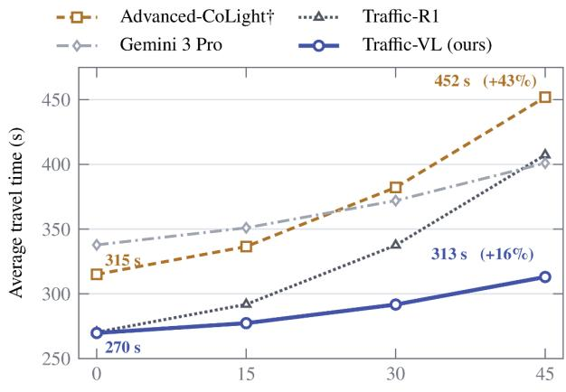  
Camera occlusion ratio (%)

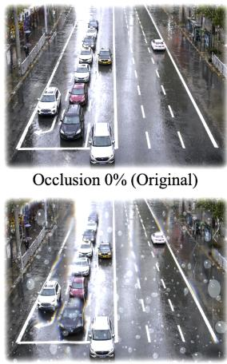

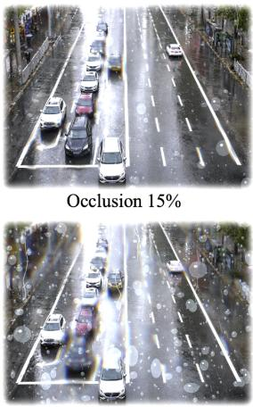  
Occlusion 30%  
Occlusion 45%  
Fig. 6. Closed-loop travel time (top) and example camera views (bottom) under increasing rain-induced occlusion on Jinan1.

On Phase Dec., Traffic-VL reaches 72.0%, about 7 points above the strongest general models, Gemini 3 Pro [47] and Qwen-VL-Max [49] (65.2%) (Fig. 7(b)). Gemini-3-Flash reaches 64.0%, and the remaining models fall between 56% and 63%. Traffic-VL outperforms Gemini 3 Pro at each of the twelve intersections, with per-intersection accuracy from 64.3% to 80.7%. Absolute scores remain moderate for all methods because each scene has a single rule-defined answer and many scenes are near-ties decided by phase-transition logic; non-expert human annotators reach 55.0%. The samebackbone comparison isolates the effect of training: the unfinetuned Qwen3-VL-8B scores 54.0%, 18 points below Traffic-VL.

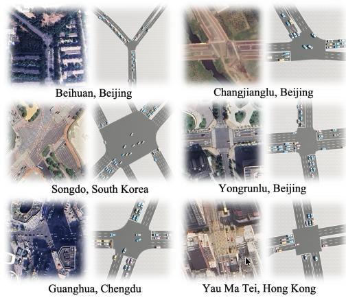

(a) Intersections of OmniTraffic Benchmark  
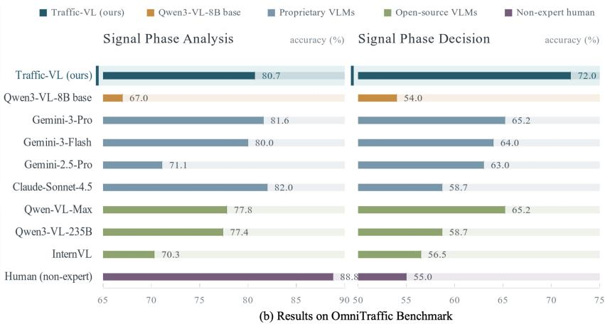  
Fig. 7. Zero-shot evaluation on OmniTraffic: (a) satellite views and 3D intersection reconstructions; (b) phase-analysis and phase-decision accuracy.

TABLE IV  
ZERO-SHOT PHASE-SELECTION ACCURACY ON REAL-1296, WITH PAIRED-BOOTSTRAP 95% CONFIDENCE INTERVALS.
<table><tr><td>Method</td><td>Scale</td><td>Acc. (%) 95% CI</td></tr><tr><td>Qwen3-VL (base)</td><td>8B</td><td>56.4 53.7–59.1</td></tr><tr><td>GPT-5.2</td><td>Undisc.</td><td>70.067.5–72.5</td></tr><tr><td>VLMLight (adapted)</td><td>32B+72B</td><td>73.571.1–75.9</td></tr><tr><td>Gemini 3 Pro</td><td>Undisc.</td><td>75.0 72.7-77.3</td></tr><tr><td>Traffic-VL w/o SynTra-V 8B</td><td></td><td>66.063.4–68.6</td></tr><tr><td>Traffic-VL (ours)</td><td>8B</td><td>82.1 80.0–84.1</td></tr></table>

Although Traffic-VL is never trained on Phase Ana., it reaches 80.7% on this task, close to Claude Sonnet 4.5 [50] (82.0%) and Gemini 3 Pro (81.6%) and well above its 8B base (67.0%). Training for phase decisions therefore also improves the recognition of phase-relevant scene events.

2) From Simulation to Real Frames: We finally evaluate Sim2Real generalization on the fixed Real-1296 benchmark in a zero-shot, open-loop setting. Accuracy is the fraction of samples for which the predicted phase matches at least one expert-approved phase, as reported in Table IV. Unlike OmniTraffic, which assigns a single rule-defined optimal phase and excludes ambiguous scenes, Real-1296 permits multiple acceptable phases when they are operationally equivalent. Structured-state methods, including Traffic-R1, are excluded because they cannot operate directly on raw camera observations without intersection-specific perception engineering.

Traffic-VL achieves 82.1% accuracy, compared with 75.0% for Gemini 3 Pro and 73.5% for VLMLight (adapted). A paired bootstrap estimates a 7.1-point improvement over Gemini 3 Pro (95% CI: 4.4–9.8 points, $p < 0 . 0 0 1 ) ;$ the corresponding 95% confidence interval for Traffic-VL accuracy is 80.0– 84.1%. The result shows that traffic-specific visual grounding transfers across real intersections and sensing conditions that are absent from training.

## D. RQ4: Ablation Studies

1) Training and Coordination: Traffic-VL uses two complementary training stages. Offline human-informed RL learns traffic-specific visual grounding and phase reasoning from semantically audited SynTra-V images and expert labels, while online STPO-V refines the policy through multi-step simulator interaction. We ablate offline GRPO, online STPO-V, and asynchronous coordination, evaluating Real-1296 accuracy, Jinan1 closed-loop ATT, and corridor emergency waiting time.

TABLE V  
ABLATION OF TRAINING, DECISION INTERFACE, AND ASYNCHRONOUS COORDINATION (MEAN±SD OVER FIVE SEEDS).
<table><tr><td>Variant</td><td>Acc. (%)</td><td>ATT (s) AEWT (s)</td></tr><tr><td>Full model (two-stage + coordination)</td><td> ${ \bf 8 2 . 1 \pm 1 . 4 }$ </td><td> ${ \bf 2 6 9 . 7 \pm 3 . 1 }$   ${ \bf 8 . 7 \pm 0 . 7 }$ </td></tr><tr><td>SFT-only (same backbone and</td><td> $7 5 . 8 \pm 0 . 9$ </td><td> $2 8 8 . 9 \pm 4 . 1$ </td></tr><tr><td>data) SFT + STPO-V</td><td> $7 9 . 8 \pm 1 . 2$ </td><td> $2 7 8 . 6 \pm 3 . 6$ </td></tr><tr><td>Image-to-text bottleneck (same VLM/data)</td><td> $7 3 . 8 \pm 0 . 9$ </td><td> $2 9 1 . 1 \pm 4 . 0$ </td></tr><tr><td>Offline GRPO + stepwise PPO</td><td> $8 0 . 2 \pm 1 . 2$ </td><td> $2 7 7 . 8 \pm 3 . 6$ </td></tr><tr><td>Offline-only (no STPO-V)</td><td> $7 9 . 3 \pm 1 . 3$ </td><td> $2 8 1 . 3 \pm 3 . 8$ </td></tr><tr><td>Online-only (no offline GRPO)</td><td> $7 2 . 2 \pm 1 . 5$ </td><td> $2 9 7 . 0 \pm 4 . 4$ </td></tr><tr><td>No asynchronous coordination</td><td> $8 1 . 9 \pm 0 . 8$ </td><td> $2 6 9 . 9 \pm 3 . 4$   $1 2 . 0 \pm 1 . 1$ </td></tr></table>

Table V shows that both training stages are necessary. Under the same backbone, data, and training budget, SFTonly reaches 75.8% accuracy and 288.9 s ATT; adding STPO-V improves these values to 79.8% and 278.6 s, respectively. Offline GRPO provides a stronger starting policy without token-level reasoning supervision.

We further isolate the decision interface with a matched image-to-text bottleneck using the same Qwen3-VL backbone, SynTra-V images, and training data. This variant first verbalizes the ordered views as lane-level traffic state and then selects a phase from that text and the same candidate phase descriptions, without retaining the visual tokens in the decision stage. It reaches 73.8% accuracy and 291.1 s ATT. The gap reflects the difficulty of preserving the correspondence between visual lanes and phase descriptions through an intermediate textual state.

Replacing STPO-V with stepwise PPO reaches 80.2% accuracy and 277.8 s ATT, further supporting the trajectorylevel objective. Removing offline GRPO yields an online-only policy with 72.2% accuracy and 297.0 s ATT, indicating that closed-loop exploration alone does not reliably acquire trafficspecific visual semantics and phase knowledge. The offlineonly variant improves to 79.3% accuracy and 281.3 s ATT, but remains below the full model at 82.1% and 269.7 s, demonstrating the additional value of long-horizon policy refinement. Asynchronous coordination mainly benefits network-level control. Its removal changes single-intersection results little, to 81.9% accuracy and 269.9 s ATT, but increases corridor emergency waiting time from 8.7 s to 12.0 s. Directional traffic information therefore helps upstream intersections prepare for approaching vehicles before they enter the local view.

TABLE VI  
EFFECT OF VISUAL-DOMAIN ADAPTATION ON JINAN1, REAL-1296, AND OMNITRAFFIC (MEAN±SD OVER FIVE SEEDS).
<table><tr><td>Variant</td><td>Jinan1 ATT (s)</td><td>Real-1296 Acc. (%)</td><td>Omni Acc. (%)</td></tr><tr><td>Traffic-VL (full)</td><td> ${ \bf 2 6 9 . 7 \pm 3 . 1 }$ </td><td> ${ \bf 8 2 . 1 \pm 1 . 4 }$ </td><td> $7 2 . 0 \pm 1 . 0$ </td></tr><tr><td>Vision encoder unfrozen</td><td> $2 8 4 . 6 \pm 4 . 0$ </td><td> $7 3 . 4 \pm 1 . 5$ </td><td> $7 2 . 3 \pm 1 . 1$ </td></tr><tr><td>No SynTra-V stylization</td><td> $2 9 5 . 6 \pm 4 . 6$ </td><td> $6 6 . 0 \pm 1 . 6$ </td><td> ${ \bf 7 3 . 1 \pm 0 . 7 }$ </td></tr></table>

2) Visual Domain Adaptation: The training procedure deliberately separates visual adaptation from online policy optimization. During offline learning, the vision encoder is updated on photorealistic SynTra-V imagery to learn surveillance-style traffic appearance, including viewpoint, illumination, weather, and occlusion variation. During online STPO-V, the simulator instead provides deterministic Blender renders, and the vision encoder is frozen while the remaining policy parameters are optimized. This prevents online optimization from overwriting visual representations learned from photorealistic data with simulator-specific appearance. We evaluate this design by unfreezing the vision encoder during online STPO-V and by removing photorealistic stylization from SynTra-V. The variants are tested on stylized Jinan closed-loop control, real surveillance frames, and OmniTraffic, whose observations are raw simulator renders.

Table VI supports both design choices. Updating the vision encoder online raises Jinan ATT from 269.7 s to 284.6 s and reduces real-frame accuracy from 82.1% to 73.4%. This result suggests that exposure to raw simulator imagery during online learning weakens the real-style visual representation acquired offline. Removing photorealistic stylization has a larger effect, increasing ATT to 295.6 s and lowering real-frame accuracy to 66.0%. In contrast, all variants achieve approximately 72% accuracy on OmniTraffic. Because OmniTraffic uses raw simulator renders, it does not expose the appearance gap that photorealistic synthesis and encoder freezing are designed to address.

## E. RQ5: Inference Efficiency and the Latency-Accuracy Trade-off

We evaluate whether Traffic-VL can satisfy the operational control deadline while maintaining sufficient decision accuracy. The deployed system follows a nominal 15 s decision cycle, defining the maximum time from receiving the current multi-view observation to issuing the next phase recommendation. Lower latency remains preferable because traffic conditions may continue to evolve within this interval.

All local latency measurements are obtained on a single NVIDIA A800 GPU with 80 GB memory. We use unquantized BF16 inference with a batch size of one. Each decision takes four $5 1 2 \times 5 1 2$ images, corresponding to approximately 1.3K visual tokens after tokenization, and the generated response is capped at 1024 tokens. We perform 3 warm-up runs followed by 20 timed runs. The reported end-to-end latency includes image preprocessing, visual encoding, and autoregressive response generation, with GPU synchronization applied before and after each measurement. Traffic-VL-8B requires 4.96 s per decision, while Traffic-VL-4B requires 2.34 s. The unfinetuned Qwen3-VL-8B base model requires 5.03 s, indicating that our reinforcement-learning adaptation introduces negligible inference overhead relative to the same backbone. Both Traffic-VL variants therefore satisfy the 15 s deadline in this server-class local setting.

For proprietary models, we report the end-to-end cloud API latency observed under our evaluation environment. Gemini 3 Pro and GPT-5.2 require 22.4 s and 26.7 s per decision, respectively. These values include network transmission, service queuing, and provider-side inference. Under our tested environment, both cloud APIs exceed the 15 s deadline and achieve lower real-frame accuracy than Traffic-VL-8B.

Fig. 8 also illustrates the effect of model scale. Although Traffic-VL-4B is faster, it achieves only 65.5% real-frame accuracy, compared with 82.1% for Traffic-VL-8B, and follows the required output format less reliably after training. Because both local variants meet the deadline on the A800, model capacity rather than latency becomes the primary constraint in this setting. Traffic-VL-8B therefore provides the better latency-accuracy trade-off for our server-based deployment.

## VII. REAL-WORLD DEPLOYMENT

## A. From Advance Dispatch to Constrained Online Control

Traffic-VL is deployed on the same traffic-management platform and ten interconnected arterial intersections used in the Traffic-R1 field study. These intersections serve more than 55,000 drivers daily. As shown in Fig. 9, the existing platform integrates roadside cameras and millimeter-wave radar with the signal controller.

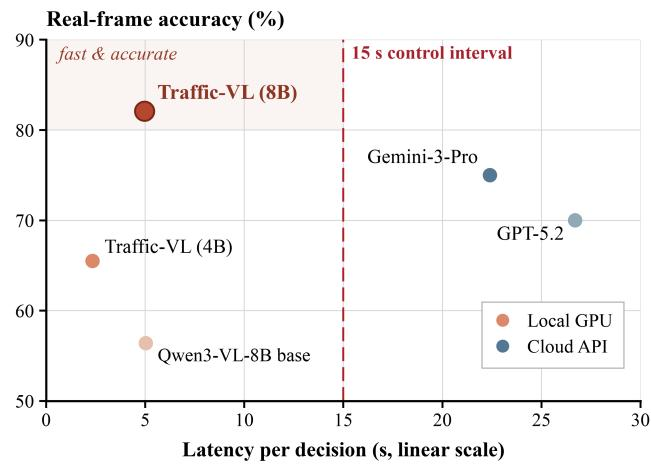  
Fig. 8. Real-frame accuracy versus decision latency for local models and cloud APIs, with the 15 s control deadline marked.

Traffic-R1 relied on numerical traffic states produced by these sensing devices and a fixed, intersection-specific phase schema. Although lane aggregation, contextual prompts, and additional fine-tuning adapted the model to the deployment sites, its decisions remained tied to predefined state and action interfaces. Routine operation therefore used advance dispatch: traffic demand was forecast from historical observations, Traffic-R1 generated a preliminary timing plan, and engineers reviewed and revised the plan before implementation. This workflow supported offline planning but limited the model’s ability to respond directly to evolving traffic conditions.

Traffic-VL instead processes synchronized frames from the existing surveillance cameras and interprets the approved signal plan through natural-language phase descriptions. It does not require per-intersection lane-count encoding or a topologyspecific output head, allowing the model to recommend a preferred phase from current visual demand rather than from an advance traffic forecast.

Field operation follows a certified phase sequence with minimum and maximum green times, pedestrian service, and yellow and all-red clearance intervals. Traffic-VL is therefore connected to the existing signal controller through a phasepriority interface: the model recommends which phase should receive priority, and the controller applies the admissible timing adjustment within these constraints. If the recommended phase is currently green, the controller extends it up to the maximum green time; otherwise, it terminates the current phase once its minimum green has elapsed and advances along the approved sequence, serving intermediate phases at minimum green until the recommended phase is reached. Fig. 10 summarizes the resulting change in deployment. Traffic-R1 produces a manually revised advance plan from forecast structured states, whereas Traffic-VL uses live visual observations to guide constrained online phase-priority control with continuous feedback.

The deployed system runs Traffic-VL-8B with BF16 inference on the centralized traffic server. Traffic-VL preserves the end-to-end mapping from raw observations to phase recommendations, while the existing controller provides constraintpreserving execution. Its visual grounding identifies where traffic demand is accumulating, and the multi-step policy learned through STPO-V accounts for how current adjustments affect subsequent traffic states. This combination replaces offline advance planning with bounded, traffic-responsive online adaptation.

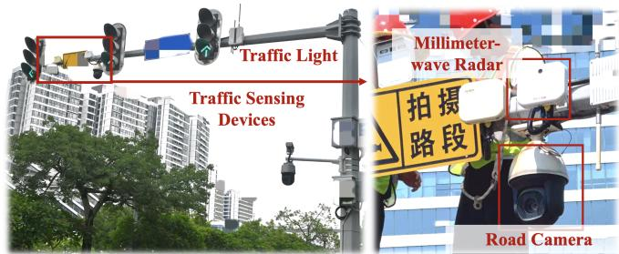  
Fig. 9. Field sensing infrastructure with roadside cameras, millimeter-wave radar, and the existing traffic signal controller.

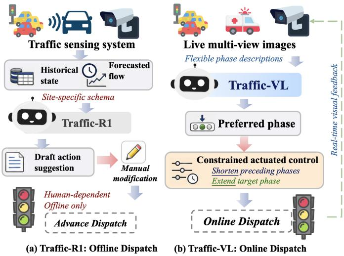  
Fig. 10. Deployment workflows: (a) Traffic-R1 advance dispatch with manual revision; (b) Traffic-VL constrained online phase-priority control.

TABLE VII  
THREE-WEEK EVALUATION ACROSS TEN INTERSECTIONS (QUEUE LENGTHS: MEAN±SD; TIMING-PLAN WORKLOAD: H/DAY).
<table><tr><td>Operating mode</td><td>Dispatch</td><td>Avg. Q↓</td><td>Max. Q↓ Plan h↓</td><td></td></tr><tr><td>Manual control</td><td>Manual</td><td> $3 4 . 5 \pm 3 . 6$ </td><td> $5 0 . 3 \pm 4 . 8$ </td><td>2+</td></tr><tr><td>Traffic-R1</td><td>Advance</td><td> $3 1 . 3 \pm 2 . 9$ </td><td> $4 8 . 1 \pm 3 . 9$ </td><td>0.5+</td></tr><tr><td>Traffic-VL</td><td>Online</td><td> ${ \bf 3 0 . 9 \pm 3 . 1 }$ </td><td> ${ \bf 4 7 . 5 \pm 4 . 2 }$ </td><td>≈0</td></tr><tr><td>Improvement vs. manual</td><td></td><td> $\downarrow 1 0 . 4 \%$ </td><td>↓5.6%</td><td>≈100%</td></tr></table>

## B. Three-Week Field Evaluation

We operated Traffic-VL for three consecutive weeks on the same ten-intersection network, evaluating fifteen weekday evening peaks from 16:00 to 19:30. Manual operation and Traffic-R1 are compared using the results of the Traffic-R1 field study [1], which used the same intersections, roadside measurement system, and evaluation window.

A queued vehicle was defined as a vehicle traveling below 0.1 m/s on an incoming approach. At each sampling time, the queue at an intersection was the total number of queued vehicles across its incoming approaches. Average queue was computed over all sampling times, intersections, and evaluation periods. Maximum queue was obtained by first identifying the peak queue in each intersection-period and then averaging these peaks. Operator workload measures the daily time spent preparing, reviewing, and adjusting signal timing plans.

As shown in Table VII, Traffic-VL reduces average and maximum queue lengths by 10.4% and 5.6%, respectively, relative to historical manual operation at the same intersections. It also nearly eliminates routine timing-plan workload by replacing advance plan preparation with online phase adjustment. In comparison, Traffic-R1 achieved reductions of 9.3% and 4.4% while still requiring approximately 0.5 operator hours per day for plan review. Across the 15 evening-peak periods, the bootstrap 95% confidence intervals for the reductions are 5.1– 15.2% for average queue and 0.9–10.1% for maximum queue. The median and 95th-percentile end-to-end field latencies are 6.3 s and 9.2 s, respectively.

The field results demonstrate that Traffic-VL can convert live visual observations into useful phase priorities for constrained online control. Beyond improving traffic flow and reducing routine workload, it removes dedicated radar or V2X measurements from the model input and eliminates the per-intersection pipeline used to construct structured traffic states. Existing roadside cameras can therefore support more scalable and responsive deployment across heterogeneous intersections.

## VIII. LIMITATIONS AND FUTURE WORK

Traffic-VL currently conditions each decision on synchronized multi-view still images rather than video. This protocol matches Traffic-R1 and established TSC baselines, allowing us to isolate the effect of replacing structured states with visual observations. Although STPO-V learns the long-term consequences of successive decisions, the model receives no explicit motion history at each inference step. Short surveillance clips could reveal whether traffic demand is accumulating or dissipating, improve reasoning under temporary occlusion, and provide stronger evidence for abnormal events. However, video substantially increases the visual-token sequence, memory consumption, and inference latency. Developing an efficient temporal representation without compromising realtime deployment is therefore an important direction for future work.

Traffic-VL also inherits residual perceptual errors and hallucinations from its vision-language backbone. In rare safetycritical scenes, it may miss an emergency vehicle or incorrectly assign priority to an ordinary vehicle. The existing signal controller prevents infeasible signal transitions, but it cannot eliminate every suboptimal decision caused by incorrect scene interpretation. This risk is greater in multi-intersection coordination, where an erroneous flow-direction message may propagate to neighboring controllers. Traffic-VL therefore remains integrated with certified signal-control constraints rather than directly actuating unrestricted signal transitions. Future work will explore stronger visual grounding, calibrated uncertainty, temporal-consistency checks, and confidence-aware communication. With further validation, these mechanisms may support progressively more autonomous deployment.

## IX. CONCLUSION

This work presented Traffic-VL, an 8B vision-language model that maps synchronized multi-view surveillance images and natural-language phase descriptions directly to traffic signal decisions. Traffic-VL replaces intersection-specific structured states with end-to-end vision-language reasoning, supported by the SynTra-V semantics-preserving Sim2Real data engine, two-stage offline and online reinforcement learning, a natural-language phase interface, and asynchronous coordination. Operating on raw images, it matches the structuredstate Traffic-R1 on five zero-shot closed-loop benchmarks, handles emergency events and camera occlusion more reliably than perception-to-structure pipelines, and transfers to unseen topologies and real surveillance frames within the realtime inference budget. In a three-week deployment across ten interconnected intersections, Traffic-VL reduced average queue length by 10.4% relative to historical manual operation at the same sites, showing that camera-based reasoning can support effective constrained online control in a physical traffic network.

More broadly, our results suggest that real-world traffic signal control can be formulated as a unified vision-language decision problem rather than a sequence of independently engineered perception, state-construction, and control modules. Preserving raw visual evidence until the decision stage allows multimodal foundation models to jointly ground physical traffic demand in symbolic control semantics, reducing dependence on dedicated sensing hardware and per-intersection dynamic-state engineering. Extending this paradigm with efficient temporal perception, calibrated uncertainty, and progressively validated autonomy offers a promising path toward generalizable and scalable foundation models for real-world urban infrastructure control.

## REFERENCES

[1] X. Zou et al., “Traffic-R1: Reinforced LLMs Bring Human-Like Reasoning to Traffic Signal Control Systems,” in Proceedings of the 64th Annual Meeting of the Association for Computational Linguistics (Volume 1: Long Papers). San Diego, California, United States: Association for Computational Linguistics, 2026, pp. 21 823–21 838. [Online]. Available: https://aclanthology.org/2026.acl-long.995/

[2] H. Xiao et al., “Intelligent Traffic Signal Control Based on Reinforcement Learning: A Survey,” Artificial Intelligence Review, vol. 59, p. 128, 2026.

[3] M. Hassan et al., “A Comprehensive Survey of Adaptive Traffic Signal Control: Methods, Applications, Challenges, and Future Research,” Archives of Computational Methods in Engineering, 2026.

[4] H. Wei et al., “PressLight: Learning Max Pressure Control to Coordinate Traffic Signals in Arterial Network,” in Proceedings of the 25th ACM SIGKDD International Conference on Knowledge Discovery & Data Mining, 2019, pp. 1290–1298.

[5] ——, “CoLight: Learning Network-level Cooperation for Traffic Signal Control,” in Proceedings of the 28th ACM International Conference on Information and Knowledge Management, 2019, pp. 1913–1922.

[6] S. Lai, Z. Xu, W. Zhang, H. Liu, and H. Xiong, “LLMLight: Large Language Models as Traffic Signal Control Agents,” in Proceedings of the 31st ACM SIGKDD Conference on Knowledge Discovery and Data Mining V.1, 2025, pp. 2335–2346.

[7] Z. Yuan, S. Lai, and H. Liu, “CoLLMLight: Cooperative Large Language Model Agents for Network-Wide Traffic Signal Control,” in The Fourteenth International Conference on Learning Representations, 2026. [Online]. Available: https://openreview.net/forum?id=KeJqoEVOeY

[8] M. Wang et al., “VLMLight: Safety-Critical Traffic Signal Control via Vision-Language Meta-Control and Dual-Branch Reasoning Architecture,” in Advances in Neural Information Processing Systems, vol. 38. Curran Associates, Inc., 2025, pp. 39 590–39 621. [Online]. Available: https://proceedings.neurips.cc/paper files/paper/ 2025/file/3849b5861dcaeaf4758eef0979a98cc6-Paper-Conference.pdf

[9] A. Pang, M. Wang, Y. Xie, C. S. Chen, Z. Yang, and M.-O. Pun, “ReasonLight: A Multimodal Foundation Model-Enhanced Reinforcement Learning Framework for Zero-Shot Traffic Signal Control,” arXiv preprint arXiv:2605.29425, 2026.

[10] J. Yao, J. Li, X. Xu, C. Tan, K. H. Yap, and R. Su, “Incorporating Vision-Based Artificial Intelligence and Large Language Model for Smart Traffic Light Control,” Applied Soft Computing, vol. 179, p. 113333, 2025.

[11] L. Li, Y. Lv, and F.-Y. Wang, “Traffic signal timing via deep reinforcement learning,” IEEE/CAA Journal of Automatica Sinica, vol. 3, no. 3, pp. 247–254, 2016.

[12] H. Wei, G. Zheng, V. Gayah, and Z. Li, “Recent Advances in Reinforcement Learning for Traffic Signal Control: A Survey of Models and Evaluation,” ACM SIGKDD Explorations Newsletter, vol. 22, no. 2, pp. 12–18, 2021.

[13] H. Wei, G. Zheng, H. Yao, and Z. Li, “IntelliLight: A Reinforcement Learning Approach for Intelligent Traffic Light Control,” in Proceedings of the 24th ACM SIGKDD International Conference on Knowledge Discovery & Data Mining, 2018, pp. 2496–2505.

[14] C. Chen et al., “Toward A Thousand Lights: Decentralized Deep Reinforcement Learning for Large-Scale Traffic Signal Control,” Proceedings of the AAAI Conference on Artificial Intelligence, vol. 34, no. 04, pp. 3414–3421, 2020.

[15] T. Chu, J. Wang, L. Codeca, and Z. Li, “Multi-Agent Deep Reinforcement Learning for Large-Scale Traffic Signal Control,” IEEE Transactions on Intelligent Transportation Systems, vol. 21, no. 3, pp. 1086–1095, 2020.

[16] J. Shang et al., “Graph-Based Cooperation Multiagent Reinforcement Learning for Intelligent Traffic Signal Control,” IEEE Internet of Things Journal, vol. 12, no. 10, pp. 14 362–14 374, 2025.

[17] X. Zang, H. Yao, G. Zheng, N. Xu, K. Xu, and Z. Li, “MetaLight: Value-Based Meta-Reinforcement Learning for Traffic Signal Control,” Proceedings of the AAAI Conference on Artificial Intelligence, vol. 34, no. 01, pp. 1153–1160, 2020.

[18] G. Zheng et al., “Learning Phase Competition for Traffic Signal Control,” in Proceedings of the 28th ACM International Conference on Information and Knowledge Management, 2019, pp. 1963–1972.

[19] A. Oroojlooy, M. Nazari, D. Hajinezhad, and J. Silva, “AttendLight: Universal Attention-Based Reinforcement Learning Model for Traffic Signal Control,” in Advances in Neural Information Processing Systems, vol. 33, 2020, pp. 4079–4090.

[20] L. Zhang, Q. Wu, J. Shen, L. Lu, B. Du, and J. Wu, “Expression might¨ be enough: representing pressure and demand for reinforcement learning based traffic signal control,” in Proceedings of the 39th International Conference on Machine Learning, ser. Proceedings of Machine Learning Research, vol. 162, 2022, pp. 26 645–26 654.

[21] A. Radford et al., “Learning Transferable Visual Models From Natural Language Supervision,” in Proceedings of the 38th International Conference on Machine Learning, ser. Proceedings of Machine Learning Research, vol. 139, 2021, pp. 8748–8763.

[22] J. Li, D. Li, S. Savarese, and S. Hoi, “BLIP-2: Bootstrapping Language-Image Pre-training with Frozen Image Encoders and Large Language Models,” in Proceedings of the 40th International Conference on Machine Learning, ser. Proceedings of Machine Learning Research, vol. 202, 2023, pp. 19 730–19 742.

[23] H. Liu, C. Li, Q. Wu, and Y. J. Lee, “Visual Instruction Tuning,” in Advances in Neural Information Processing Systems, vol. 36, 2023, pp. 34 892–34 916.

[24] J. Wei et al., “Chain-of-Thought Prompting Elicits Reasoning in Large Language Models,” in Advances in Neural Information Processing Systems, vol. 35, 2022, pp. 24 824–24 837.

[25] D. Driess et al., “PaLM-E: An Embodied Multimodal Language Model,” in Proceedings of the 40th International Conference on Machine Learning, ser. Proceedings of Machine Learning Research, vol. 202, 2023, pp. 8469–8488.

[26] B. Zitkovich et al., “RT-2: Vision-Language-Action Models Transfer Web Knowledge to Robotic Control,” in Proceedings of The 7th Conference on Robot Learning, ser. Proceedings of Machine Learning Research, vol. 229, 2023, pp. 2165–2183.

[27] Z. Xu et al., “DriveGPT4: Interpretable End-to-End Autonomous Driving Via Large Language Model,” IEEE Robotics and Automation Letters, vol. 9, no. 10, pp. 8186–8193, 2024.

[28] X. Tian et al., “DriveVLM: The Convergence of Autonomous Driving and Large Vision-Language Models,” in Proceedings of The 8th Conference on Robot Learning, ser. Proceedings of Machine Learning Research, vol. 270, 2025, pp. 4698–4726.

[29] M. Cordts et al., “The Cityscapes Dataset for Semantic Urban Scene Understanding,” in Proceedings of the IEEE Conference on Computer Vision and Pattern Recognition, 2016, pp. 3213–3223.

[30] F. Yu et al., “BDD100K: A Diverse Driving Dataset for Heterogeneous Multitask Learning,” in Proceedings of the IEEE/CVF Conference on Computer Vision and Pattern Recognition, 2020, pp. 2636–2645.

[31] G. Ros, L. Sellart, J. Materzynska, D. Vazquez, and A. M. Lopez, “The SYNTHIA Dataset: A Large Collection of Synthetic Images for Semantic Segmentation of Urban Scenes,” in Proceedings of the IEEE Conference on Computer Vision and Pattern Recognition, 2016, pp. 3234–3243.

[32] S. R. Richter, V. Vineet, S. Roth, and V. Koltun, “Playing for Data: Ground Truth from Computer Games,” in Computer Vision – ECCV 2016, 2016, pp. 102–118.

[33] P. A. Lopez et al., “Microscopic Traffic Simulation using SUMO,” in 2018 IEEE 21st International Conference on Intelligent Transportation Systems (ITSC), 2018, pp. 2575–2582.

[34] A. Dosovitskiy, G. Ros, F. Codevilla, A. Lopez, and V. Koltun, “CARLA: An Open Urban Driving Simulator,” in Proceedings of the 1st Annual Conference on Robot Learning, ser. Proceedings of Machine Learning Research, vol. 78, 2017, pp. 1–16. [Online]. Available: https://proceedings.mlr.press/v78/dosovitskiy17a.html

[35] M. Wang et al., “OmniTraffic: A Controllable Generation Pipeline and Benchmark for Spatio-Temporal Traffic Reasoning,” arXiv preprint arXiv:2606.15749, 2026.

[36] J. Tobin, R. Fong, A. Ray, J. Schneider, W. Zaremba, and P. Abbeel, “Domain randomization for transferring deep neural networks from simulation to the real world,” in 2017 IEEE/RSJ International Conference on Intelligent Robots and Systems (IROS), 2017, pp. 23–30.

[37] X. Yue, Y. Zhang, S. Zhao, A. Sangiovanni-Vincentelli, K. Keutzer, and B. Gong, “Domain Randomization and Pyramid Consistency: Simulation-to-Real Generalization Without Accessing Target Domain Data,” in Proceedings of the IEEE/CVF International Conference on Computer Vision, 2019, pp. 2100–2110.

[38] L. Zhang, A. Rao, and M. Agrawala, “Adding Conditional Control to Text-to-Image Diffusion Models,” in Proceedings of the IEEE/CVF International Conference on Computer Vision, 2023, pp. 3836–3847. [Online]. Available: https://openaccess.thecvf. com/content/ICCV2023/html/Zhang Adding Conditional Control to Text-to-Image Diffusion Models ICCV 2023 paper.html

[39] R. Gao et al., “MagicDrive: Street View Generation with Diverse 3D Geometry Control,” in International Conference on Learning Representations, 2024. [Online]. Available: https://arxiv.org/abs/2310. 02601

[40] Z. Shao et al., “DeepSeekMath: Pushing the Limits of Mathematical Reasoning in Open Language Models,” arXiv preprint arXiv:2402.03300, 2024.

[41] J. Schulman, F. Wolski, P. Dhariwal, A. Radford, and O. Klimov, “Proximal Policy Optimization Algorithms,” arXiv preprint arXiv:1707.06347, 2017.

[42] H. Zhang et al., “CityFlow: A Multi-Agent Reinforcement Learning Environment for Large Scale City Traffic Scenario,” in The World Wide Web Conference, 2019, pp. 3620–3624.

[43] I. Loshchilov and F. Hutter, “Decoupled Weight Decay Regularization,” in International Conference on Learning Representations, 2019.

[44] P. Koonce et al., “Traffic Signal Timing Manual,” Federal Highway Administration, U.S. Department of Transportation, Tech. Rep. FHWA-HOP-08-024, 2008.

[45] P. Varaiya, “Max pressure control of a network of signalized intersections,” Transportation Research Part C: Emerging Technologies, vol. 36, pp. 177–195, 2013.

[46] S. Bai et al., “Qwen3-VL Technical Report,” arXiv preprint arXiv:2511.21631, 2025.

[47] Google DeepMind, “Gemini 3 Pro Model Card,” Google DeepMind, Model Card, 2025.

[48] S. Liu et al., “Grounding DINO: Marrying DINO with Grounded Pretraining for Open-Set Object Detection,” in Computer Vision – ECCV 2024, ser. Lecture Notes in Computer Science, vol. 15105, 2024, pp. 38–55.

[49] J. Bai et al., “Qwen-VL: A Versatile Vision-Language Model for Understanding, Localization, Text Reading, and Beyond,” arXiv preprint arXiv:2308.12966, 2023.

[50] Anthropic, “Claude Sonnet 4.5 System Card,” Anthropic, System Card, 2025.

## APPENDIX A

## INFORMATION-PRESERVATION RATIONALE

We formalize the information-preservation principle underlying the design rationale in Section IV-B. Let S denote the latent traffic state, O the raw multi-view observation, and $Z ~ = ~ T ( O )$ the structured state produced by a fixed deterministic extractor T. At a decision step, the controller selects a phase $A \ \in \ { \mathcal { P } }$ and receives utility $u ( S , A )$ . The candidate phases and operational context are treated as part of the decision context and held fixed in the comparison.

For an observation variable X, let $\Pi _ { X }$ be the set of possibly randomized decision rules measurable with respect to X. Its optimal decision value is

$$
V ^ { * } ( X ) = \operatorname* { s u p } _ { \pi \in \Pi _ { X } } \mathbb { E } \big [ u \big ( S , \pi ( X ) \big ) \big ] .\tag{16}
$$

This definition compares observation interfaces through the policy classes they support.

Proposition 1 (Information ceiling). For every deterministic extractor T,

$$
V ^ { * } ( O ) \geq V ^ { * } ( T ( O ) ) .\tag{17}
$$

Proof. Take any rule $\pi _ { Z } ~ \in ~ \Pi _ { Z }$ . Its lifted rule $\pi _ { \cal { O } } ( o ) \ =$ $\pi _ { Z } ( T ( o ) )$ belongs to $\Pi _ { O }$ and induces the same action distribution and expected utility. Composition with T therefore embeds every Z-based rule into the O-based policy class. Taking the supremum over the two classes yields Eq. 17. □

Two cases follow from Eq. 17. Equality holds when an optimal raw-observation policy factors through T, so that $T ( O )$ is decision-sufficient for phase selection. The inequality is strict when no optimal raw-observation policy admits such a factorization. A direct instance is schema aliasing: two positive-probability visual situations map to the same structured state but have different optimal phases. Every Z-based policy must use the same action distribution in both situations and therefore cannot attain both raw-observation optima. Once this distinction is removed by T, increasing the capacity of the downstream controller cannot recover it.

For Traffic-VL, the implication is direct. Retaining the multi-view observation until phase selection preserves the full feasible decision class, whereas a fixed extraction of counts, occupancies, or detector outputs restricts that class to decisions expressible through the schema. A structured interface reaches the same ceiling precisely when it preserves the evidence required by the optimal decision. Model capacity and training determine the value realized within each policy class; the information ordering established above remains fixed. The same lifting argument applies when history or additional decision context is included in O.

## APPENDIX B

## SYNTRA-V GENERATION AND AUDIT PROTOCOL

This section traces the complete path from a simulatorrendered view to an accepted photorealistic observation. We first specify the generation inputs and prompt, then describe the four independent semantic audits and their joint acceptance rule, and finally report calibration against blind human judgments.

## A. Generation Inputs

For each synchronized camera view, SynTra-V uses the multi-image editing interface of gpt-image-2 to generate a 2048×2048 image. The generator receives three pixel-aligned inputs in a fixed order: the native Blender rendering, a vehiclecontrol image, and a lane-control image. The depth reference is reserved for post-generation auditing and does not condition generation. Accepted images are resized to $5 1 2 \times 5 1 2$ before being passed to the controller.

## B. Generation Prompt Template

Generation is performed in a single pass, with vehicle count, city style, and weather or lighting supplied through scenespecific fields. Figure 11 records the attachment order and the prompt.

## C. Independent Audit Prompts

Each generated candidate is then evaluated by four independent Gemini 3 Pro calls, aligned with the Box, Geometric, Depth, and Movement references introduced in Section IV-C. Every call receives the relevant pixel-aligned Blender reference, the generated RGB image, and an auxiliary result extracted from that image. YOLO11n, morphological extraction, monocular depth estimation, and crop-level heading recognition construct these auxiliary results; Gemini combines them with the images to issue the audit verdict.

Figure 12 gives the shared system instruction and the four task-specific prompts. The image indices in each prompt define the attachment order for that call.

## D. Acceptance Rule

A candidate is accepted only when all four calls return PASS. A FAIL or UNCERTAIN verdict rejects the candidate, after which SynTra-V resamples an image from the same simulator state. The four JSON outputs are retained separately.

## E. Blind Human Calibration

We calibrate the joint decision rule on 500 candidate views sampled before automatic filtering. Three traffic-domain experts independently assess preservation along the same four dimensions, and majority vote defines the reference label. Table VIII shows 96.1% macro agreement with the human labels, a 2.8% false-accept rate, and per-audit F1 above 0.94. Inter-expert agreement reaches Fleiss $\kappa = 0 . 9 3$ . Constructing the final 5,000-sample corpus requires 6,420 candidates, corresponding to a 77.9% acceptance rate and 1.28 candidates per accepted sample.

## APPENDIX C

## ASYNCHRONOUS COORDINATION PROTOCOL

This section specifies the asynchronous coordination mechanism introduced in Section IV-F. The presentation proceeds from the local state, action, and message interfaces to the symmetric half-step schedule and message lifecycle. The protocol follows Traffic-R1, with multi-view images and topologyconditioned phase descriptions in place of structured textual observations.

<table><tr><td>Generation Input Contract</td></tr><tr><td>Image 1 – source RGB: the native Blender rendering to be transformed. Image  $2 - C _ { \mathrm { v e h } } \colon$  the source view overlaid with one near-to-far numbered red box per vehicle and a green arrow obtained by projecting that vehicle&#x27;s 3D heading; annotations scale with object size. Image  $3 - C _ { \mathrm { l a n e } } \colon$  the complete lane lines, stop lines, crosswalks, and turn arrows, with intensity decreasing mildly with distance. Dynamic fields: {N}, {CITY_STYLE}, and {WEATHER_LIGHTING}.</td></tr><tr><td>Final SynTra-V Generation Prompt Turn Image 1, a 3D-rendered road intersection, into a photorealistic real urban photograph, never a 3D render, CGI image, or game scene. Apply</td></tr><tr><td>{CITY_STYLE} and {WEATHER_LIGHTING}. Add a realistic streetscape beyond the road, including sidewalks, trees, lamp posts, shops, and a few pedestrians. Do not add a timestamp, watermark, text overlay, or visible control annotation. Image 2 marks each of the exactly {N} vehicles with a numbered red box and a green arrow showing where its front points. Image 3 maps the painted road markings, brighter when near and dimmer when far. All three images are pixel-aligned views from the same camera. Never draw the boxes, indices,</td></tr><tr><td>arrows, or lane-control map in the output. Vehicles. Produce exactly {N} vehicles, one per red box, at the same position and scale. Preserve every vehicle&#x27;s lane occupancy, spacing, footprint,</td></tr><tr><td>and facing direction. Orientation is invariant: if Image 1 shows the front, the output shows the front; if it shows the rear, the output shows the rear. Never exchange front and rear, turn a vehicle around, create a wrong-way vehicle, move a vehicle across a lane, add a vehicle, or remove one. Retexture</td></tr><tr><td>each existing vehicle in place using photorealistic paint, glass, and wheels. Replace all pastel placeholder colors with a natural traffic palette, dominated by white, black, silver, and gray with a few muted colors and an occasional taxi. Vehicles should look driven rather than showroom-new, with subtle</td></tr><tr><td>road dust on lower bodywork, light brake dust on wheels, and faint glass smudges. Apply mild directional motion blur only to vehicles already moving; queued vehicles remain sharp.</td></tr><tr><td>Road markings and surface. Reproduce every lane line, lane divider, centerline, stop line, crosswalk, and turn arrow at the location specified by Image 3. Preserve lane count and connectivity; do not add, remove, merge, or laterally shift markings. Keep dashed markings dashed as shown in Image 1, even when the control channel uses continuous traces for clarity. Lane markings remain visible to the far end of the road, becoming thinner with perspective without fading away. Markings occluded by vehicles remain occluded, and no arrow or marking is added beyond the stop line unless Image 3 contains</td></tr></table>

Fig. 11. SynTra-V generation inputs and prompt template, with aligned vehicle/lane constraints and scene-specific city, weather, and lighting fields.

TABLE VIII  
BLIND HUMAN-EXPERT CALIBRATION OF THE SYNTRA-V AUDIT ON 500 CANDIDATE VIEWS BEFORE FILTERING.
<table><tr><td>Audit statistic</td><td>Value</td></tr><tr><td>Candidate views</td><td>500</td></tr><tr><td>Human traffic experts</td><td>3</td></tr><tr><td>Macro agreement across four audits</td><td>96.1%</td></tr><tr><td>False accept / false reject</td><td>2.8% / 4.4%</td></tr><tr><td>Per-audit F1 range</td><td>0.942–0.965</td></tr><tr><td>Expert agreement (Fleiss’κ)</td><td>0.93</td></tr><tr><td>Full-corpus acceptance rate</td><td>77.9% (5,000/6,420)</td></tr></table>

## A. Local Inputs, Actions, and Messages

Let the road network be a directed graph $G = ( \mathcal { T } , \mathcal { E } )$ , where I is the set of signalized intersections and E represents their traffic-flow connectivity. The intersections are partitioned by positional parity into two disjoint groups, $\mathcal { T } _ { 1 }$ and $\mathcal { T } _ { 2 }$ , such that $\mathcal { T } _ { 1 } \cup \mathcal { T } _ { 2 } = \mathcal { T } .$ . Adjacent intersections are assigned to different groups whenever permitted by the network topology.

At intersection i, the local policy input is

$$
x _ { i , t } = \left( o _ { i , t } , \mathcal { D } _ { i } , \mathcal { M } _ { i , t } \right) ,\tag{18}
$$

where $o _ { i , t }$ is the synchronized multi-view observation, $\mathcal { D } _ { i } =$ $\{ D _ { i } ( p ) \mid p \in { \mathcal { P } } _ { i } \}$ contains the candidate phase descriptions, and $\mathcal { M } _ { i , t }$ is the set of messages received from neighboring intersections during the preceding inner step. Traffic-VL generates a structured response

$$
y _ { i , t } \sim \pi _ { \boldsymbol \theta } ( \cdot  { \mid } x _ { i , t } ) , \qquad a _ { i , t } = \mathrm { P a r s e } ( y _ { i , t } ) ,\tag{19}
$$

where $a _ { i , t }$ is valid only if it contains exactly one phase identifier in the candidate set $\mathcal { P } _ { i }$ . Because every phase in $\mathcal { P } _ { i }$ is conflict-free by construction, phase legality is enforced through membership in this set. If the response is invalid or unparsable, the controller retains its previous valid action:

$$
\begin{array} { r } { \tilde { a } _ { i , t } = \left\{ \begin{array} { l l } { a _ { i , t } , } & { a _ { i , t } \in \mathscr { P } _ { i } , } \\ { \tilde { a } _ { i , t - 1 } , } & { \mathrm { o t h e r w i s e } . } \end{array} \right. } \end{array}\tag{20}
$$

Yellow and all-red clearance intervals are inserted by the simulator and are not selected by the policy.

Each active intersection also produces a directional-flow message for its downstream neighbors. We represent the message sent from intersection i toward neighbor $j$ as

$$
m _ { i  j , t } = ( i , j , t , \hat { f } _ { i  j , t } ) ,\tag{21}
$$

where i and $j$ identify the source and receiver, t is the controlstep timestamp, and $\hat { f } _ { i \to j , t }$ summarizes the traffic flow expected to leave intersection i toward $j .$ In implementation, this tuple is serialized into a compact natural-language message and appended to the receiver’s next policy input. The message supplements the receiver’s local visual observation rather than replacing it.

## B. Symmetric Half-Step Coordination

Each control step is divided into two inner steps. Intersections in $\mathcal { T } _ { 1 }$ act first, using messages produced by $\mathcal { T } _ { 2 }$ during the preceding inner step. Their new messages are then delivered to intersections in $\mathcal { T } _ { 2 }$ , which act in the second inner step.

## Shared System Prompt

You are a strict semantic auditor for a traffic-scene image-generation pipeline. Treat the Blender-derived reference as ground truth and evaluate control-relevant consistency rather than pixel-level similarity. Permit changes in city style, weather, illumination, texture, and rendering appearance. Use only the supplied images and auxiliary evidence. If the inputs do not support a reliable decision, return UNCERTAIN. Return exactly one JSON object: {"verdict": "PASS|FAIL|UNCERTAIN", "reason": "<one concise sentence>", "mismatches": ["<item>"]}.

## Vehicle-Layout Audit

Input order: Image 1 – Blender Box reference; Image 2 – generated RGB image; Image 3 – YOLO11n boxes detected from Image 2.

User prompt: Audit vehicle-layout preservation. Match the reference boxes in Image 1 to the detected boxes in Image 3, using Image 2 to resolve missed or imprecise detections. Compare vehicle count, approximate box centers and sizes, lane assignment, and relative front-to-back order. Return FAIL for a missing or duplicated vehicle, a vehicle moved to another lane, or a major layout change. Do not fail solely because of small box offsets, minor scale changes, or detector jitter.

## Geometric-Structure Audit

Input order: Image 1 – Blender Geometric reference used to construct Clane; Image 2 – generated RGB image; Image 3 – morphological lane-line and turn-arrow extraction from Image 2. User prompt: Audit preservation of road and lane geometry. Compare the number and connectivity of approaches, lane count, lane boundaries, centerlines, and turn arrows across the three inputs. Use Image 2 to distinguish true structural changes from markings hidden by vehicles or weakly recovered in Image 3. Return FAIL for changed topology, removed or added lanes, incompatible turn arrows, or visibly displaced road boundaries. Do not penalize texture changes or plausible occlusion.

## Depth-Ordering Audit

Only the active group invokes Traffic-VL; inactive intersections retain their latest valid phases. Because directional-flow estimates reach the other group before it acts, downstream controllers can anticipate traffic not yet visible in their local views. Inference remains decentralized: each decision uses local images, local phase descriptions, and messages from nearby intersections, without access to a global structured traffic state.

## Vehicle-Heading Audit

## C. Message Lifecycle and Execution Scope

Intersections outside the active group retain their previous actions. Algorithm 1 presents the complete procedure.

Input order: Image 1 – pixel-aligned Blender Depth reference; Image 2 – generated RGB image; Image 3 – monocular depth estimate computed from Image 2.

Input order: Image 1 – Blender Movement reference; Image 2 – generated RGB image; Image 3 – vehicle crops from Image 2 annotated with crop-level heading predictions.

User prompt: Audit ordinal depth preservation; absolute depth scale need not match. Compare near-to-far ordering for vehicles and major road regions, foreground-background occlusion, and perspective-consistent overlap. Treat a monotonic rescaling of Image 3 as valid. Return FAIL for reversed object order, impossible occlusion, or a major depth layout inconsistent with Image 1. Return UNCERTAIN when the RGB view lacks enough visible cues for comparison.

User prompt: Audit vehicle heading and movement preservation. Associate vehicles across the inputs by box position and lane. For each visible vehicle, compare its predicted heading with the direction encoded in Image 1 and verify that it is compatible with the lane’s legal movement. Return FAIL for a reversed vehicle, a cross-lane orientation, or a heading incompatible with the reference movement. Allow small yaw differences introduced by photorealistic rendering.

Fig. 12. SynTra-V auditing prompts share a system instruction and independently check vehicle layout, geometry, depth order, and vehicle heading.

The message buffer is replaced after each group activation rather than accumulated over the rollout. Messages are consumed at the receiver’s next activation and are therefore delayed by at most one inner step. The evaluation assumes reliable, in-order delivery between eligible neighboring intersections.

Algorithm 1 Asynchronous Traffic-VL Control with Symmetric Half-Step Communication   
Require: Road network $\overline { { G = ( \mathcal { L } , \mathcal { E } ) } } ;$ ; intersection groups $\overline { { ( \mathcal { L } _ { 1 } , \mathcal { L } _ { 2 } ) } }$ ; simulator Env; policy π ; communication radius $d _ { \operatorname* { m a x } } = 2$ km; total   
control steps H   
Ensure: Sequence of executed phase actions $\{ \tilde { a } _ { i , t } \} _ { i \in \mathcal { T } , t = 1 } ^ { H }$   
1: Initialize a valid action $\mathbf { \widetilde { a } } _ { i , 0 } \mathbf { \widetilde { e } } \mathbf { \mathcal { P } } _ { i }$ for ever $, i \in { \tilde { \mathcal { T } } }$   
2: Initialize the incoming message buffer $\mathcal { M } ^ { 2 \right. 1 } \left. \mathcal { O }$   
3: for $t = 1 , \dots , H$ do   
4: ▷ Inner step 1: activate $\mathcal { T } _ { 1 }$   
5: $( \mathcal { A } _ { 1 } , \mathcal { M } ^ { 1  2 } )  \mathrm { A C T I V A T E G R O U P } ( \mathcal { T } _ { 1 } , \mathcal { T } _ { 2 } , \mathcal { M } ^ { 2  1 } , t )$   
6: Env $\mathrm { . U P D A T E } \left( \mathcal { A } _ { 1 } , \left\{ \tilde { a } _ { j , t - 1 } \right\} _ { j \in \mathcal { T } _ { 2 } } \right)$ ▷ $\mathcal { T } _ { 2 }$ retains previous actions   
7: ▷ Inner step 2: activate $\mathcal { T } _ { 2 }$   
8: $( \mathcal { A } _ { 2 } , \mathcal { M } ^ { 2  1 } )  \mathrm { A C T I V A T E G R O U P } ( \mathcal { T } _ { 2 } , \mathcal { T } _ { 1 } , \mathcal { M } ^ { 1  2 } , t )$   
9: $\mathrm { E n v . U P D A T E } \left( \mathcal { A } _ { 2 } , \left\{ \tilde { a } _ { i , t } \right\} _ { i \in \mathcal { T } _ { 1 } } \right)$ ▷ $\mathcal { T } _ { 1 }$ retains its latest actions   
10: end for   
11: procedure ACTIVATEGROU $\mathcal { V } ( \mathcal { T } _ { \mathrm { a c t } } , \mathcal { T } _ { \mathrm { r e c v } } , \mathcal { M } _ { \mathrm { i n } } , t )$   
12: $A  \emptyset$   
13: $\mathcal { M } _ { \mathrm { n e x t } }  \emptyset$   
14: for all $i \in \mathcal { T } _ { \mathrm { a c t } }$ do   
15: $o _ { i , t } \gets$ Env.GETVISUALOBSERVATION(i)   
16: $\mathcal { D } _ { i }  \{ D _ { i } ( p ) \vert . p \in \mathcal { P } _ { i } \}$   
17: $\mathcal { M } _ { i , t } \gets \dot { \mathcal { M } } _ { \mathrm { i n } } [ i ]$   
18: $y _ { i , t } \sim \pi _ { \theta } ( \cdot \mid \dot { o _ { i , t } } , D _ { i } , M _ { i , t } )$   
19: $a _ { i , t } \gets \mathrm { P A R S E } ( y _ { i , t } )$   
20: if $a _ { i , t } \in \mathcal P _ { i }$ then   
21: $\tilde { a } _ { i , t } \gets a _ { i , t }$   
22: else   
23: $\tilde { a } _ { i , t } \gets \tilde { a } _ { i , t - 1 }$ ▷ Retain the previous valid action   
24: end if   
25: $\mathbf { \mathcal { A } } [ i ]  \tilde { \boldsymbol { a } } _ { i , t }$   
26: for all $j \in \mathcal { N } ( i ) \cap \mathcal { T } _ { \mathrm { r e c v } }$ do   
27: if dis $( i , j ) \leq d _ { \operatorname* { m a x } }$ then   
28: $\hat { f } _ { i \to j , t } \gets$ ESTIMATEDIRECTIONALFLOW $\left( o _ { i , t } , j \right)$   
29: $m _ { i  j , t }  ( i , j , t , \hat { f } _ { i  j , t } )$   
30: $\mathcal { M } _ { \mathrm { n e x t } } [ j ] \left. \mathcal { M } _ { \mathrm { n e x t } } [ j ] \cup \{ m _ { i \right. j , t } \}$   
31: end if   
32: end for   
33: end for   
34: return $( \mathcal { A } , \mathcal { M } _ { \mathrm { n e x t } } )$   
35: end procedure

## APPENDIX D STATISTICAL REPORTING

Table IX reports mean±SD over the five paired demand seeds used in Table II. Paired two one-sided tests (TOST) with a pre-specified $\pm 2 \%$ relative margin support ATT/AWT equivalence between Traffic-VL and Traffic-R1 on every network after Holm correction (all adjusted $p < 0 . 0 5 )$ .

TABLE IX  
PAIRED ATT/AWT OVER FIVE DEMAND SEEDS (MEAN±SD; SECONDS).
<table><tr><td rowspan="3">Network</td><td colspan="3">Traffic-R1</td><td colspan="3">Traffic-VL</td></tr><tr><td>ATT</td><td></td><td>AWT</td><td>ATT</td><td></td><td>AWT</td></tr><tr><td>Jinan1</td><td>270.34 ± 3.18</td><td> $2 7 . 9 5 \pm 0 . 7 4$ </td><td></td><td> $2 6 9 . 7 1 \pm 3 . 2 6$ </td><td> $2 7 . 8 2 \pm 0 . 7 7$ </td><td></td></tr><tr><td>Jinan2</td><td>239.53 ± 2.71</td><td></td><td> $2 1 . 1 1 \pm 0 . 6 2$ </td><td> $2 3 9 . 8 1 \pm 2 . 7 9$ </td><td> $2 1 . 0 5 \pm 0 . 6 5$ </td><td></td></tr><tr><td>Jinan3</td><td>238.03 ± 2.56</td><td></td><td> $2 3 . 1 7 \pm 0 . 6 8$ </td><td> $2 3 7 . 9 5 \pm 2 . 6 3$ </td><td> $2 3 . 3 1 \pm 0 . 7 0$ </td><td></td></tr><tr><td>Hangzhou1</td><td>277.83 ± 3.42</td><td> $1 5 . 5 1 \pm 0 . 5 1$ </td><td></td><td> $2 7 7 . 5 6 \pm 3 . 5 0$ </td><td> $1 5 . 6 2 \pm 0 . 5 4$ </td><td></td></tr><tr><td>Hangzhou2</td><td>324.11 ± 4.06</td><td> $3 3 . 1 4 \pm 0 . 9 1$ </td><td></td><td> $3 2 3 . 8 9 \pm 4 . 1 5$ </td><td> $3 3 . 1 2 \pm 0 . 9 4$ </td><td></td></tr></table>

entry denotes the structured-state reference configuration specified in the experimental setup, whose reasoning and control components receive simulator-provided traffic descriptions. VLMLight (adapted) retains the scene-understanding and reasoning pipeline while receiving SynTra-V images. Advanced-CoLight† uses a fine-tuned Grounding DINO detector and topology-specific mappings to construct structured states for the original controller.

## APPENDIX E BASELINE DEFINITIONS

Table X provides a unified inventory of the baselines used in Section $^ { \mathrm { V I } , }$ including their method category, observation interface, and role in the comparison. The VLMLight (original)

TABLE X  
BASELINE TAXONOMY, OBSERVATION INTERFACES, AND ROLES IN THE COMPARISON.
<table><tr><td>Baseline</td><td>Category</td><td>Observation</td><td>Description</td></tr><tr><td>FixedTime [44]</td><td>Rule-based</td><td>Structured-Oracle</td><td>Fixed-cycle plan with preset phase durations; no learning.</td></tr><tr><td>MaxPressure [45]</td><td>Rule-based</td><td>Structured-Oracle</td><td>Greedily activates the phase of maximum pressure each step.</td></tr><tr><td>MPLight [14]</td><td>RL</td><td>Structured-Oracle</td><td>Pressure-based deep RL with FRAP backbone and parameter sharing.</td></tr><tr><td>CoLight [5]</td><td>RL</td><td>Structured-Oracle</td><td>Graph-attention RL that coordinates with neighboring intersections.</td></tr><tr><td>Advanced-CoLight [20]</td><td>RL</td><td>Structured-Oracle</td><td>Strongest RL baseline; advanced traffic-state features over CoLight.</td></tr><tr><td>AttendLight [19]</td><td>RL</td><td>Structured-Oracle</td><td>Attention policy across intersection structures; evaluated zero-shot without target-intersection fine-tuning in the main</td></tr><tr><td>LLMLight [6]</td><td>LLM</td><td>Structured-Oracle (text)</td><td>comparison. LLM controller fine-tuned or prompted on textual per-lane state.</td></tr><tr><td>CoLLMLight [7]</td><td>LLM</td><td>Structured-Oracle (text)</td><td>Cooperative LLM controller for multi-intersection coordination.</td></tr><tr><td>Traffic-R1 [1] VLMLight (original) [8]</td><td>LLM VLM</td><td>Structured-Oracle (text) Structured-Oracle (text)</td><td>Our conference model; two-stage RL over structured traffic text. Structured-state reference configuration in this comparison; its</td></tr><tr><td></td><td></td><td></td><td>reasoning and control components receive simulator-provided traffic descriptions.</td></tr><tr><td>Qwen3-VL 8B (base) [46]</td><td>VLM</td><td>Raw-Image</td><td>Unfine-tuned deployment backbone, prompted zero-shot.</td></tr><tr><td>Gemini 3 Pro [47]</td><td>VLM</td><td>Raw-Image</td><td>Frontier general-purpose VLM, evaluated zero-shot.</td></tr><tr><td>VLMLight (adapted) [8]</td><td>Adapted</td><td>Raw-Image</td><td>Original scene-understanding and reasoning pipeline evaluated on the same SynTra-V observations as Traffic-VL. A fine-tuned Grounding DINO detector supplies vehicle</td></tr><tr><td>Advanced-CoLight† [20]</td><td>Adapted</td><td>Raw-Image→Struct</td><td>detections, which topology-specific mappings convert into queue and pressure states for the controller.</td></tr></table>

TABLE XI

FULL-SHOT BASELINE COMPARISON ON FIVE PUBLIC BENCHMARKS, WITH ZERO-SHOT TRAFFIC-R1 AND TRAFFIC-VL AS REFERENCES (ATT/AWT IN SECONDS).
<table><tr><td rowspan="2">Method</td><td rowspan="2">Setting</td><td colspan="2">Jinan1</td><td colspan="2">Jinan2</td><td colspan="2">Jinan3</td><td colspan="2">Hangzhou1</td><td colspan="2">Hangzhou2</td></tr><tr><td>ATT</td><td>AWT</td><td>ATT</td><td>AWT</td><td>ATT</td><td>AWT</td><td>ATT</td><td>AWT</td><td>ATT</td><td>AWT</td></tr><tr><td>FixedTime</td><td>Rule-based</td><td>453.41</td><td>51.32</td><td>370.34</td><td>35.15</td><td>384.53</td><td>36.95</td><td>497.54</td><td>36.41</td><td>408.53</td><td>53.94</td></tr><tr><td>MaxPressure</td><td>Rule-based</td><td>274.34</td><td>32.04</td><td>246.35</td><td>22.56</td><td>245.66</td><td>24.31</td><td>289.55</td><td>21.52</td><td>349.53</td><td>67.52</td></tr><tr><td>MPLight</td><td>Full-shot</td><td>310.54</td><td>50.45</td><td>270.14</td><td>48.03</td><td>272.37</td><td>42.91</td><td>319.32</td><td>44.05</td><td>365.42</td><td>69.85</td></tr><tr><td>CoLight</td><td>Full-shot</td><td>272.44</td><td>41.09</td><td>250.41</td><td>38.59</td><td>248.84</td><td>39.94</td><td>294.61</td><td>42.18</td><td>335.32</td><td>61.11</td></tr><tr><td>Advanced-CoLight</td><td>Full-shot</td><td>247.31</td><td>32.54</td><td>235.78</td><td>25.96</td><td>242.56</td><td>27.55</td><td>285.32</td><td>24.11</td><td>323.19</td><td>52.56</td></tr><tr><td>AttendLight</td><td>Full-shot</td><td>280.11</td><td>47.59</td><td>250.53</td><td>34.72</td><td>251.34</td><td>36.42</td><td>288.94</td><td>27.84</td><td>338.41</td><td>55.58</td></tr><tr><td>LLMLight</td><td>Full-shot</td><td>274.47</td><td>33.66</td><td>256.53</td><td>28.66</td><td>247.11</td><td>28.27</td><td>289.31</td><td>25.53</td><td>331.38</td><td>51.79</td></tr><tr><td>Traffic-R1</td><td>Zero-shot</td><td>270.34</td><td>27.95</td><td>239.53</td><td>21.11</td><td>238.03</td><td>23.17</td><td>277.83</td><td>15.51</td><td>324.11</td><td>33.14</td></tr><tr><td>Traffic-VL (ours)</td><td>Zero-shot</td><td>269.71</td><td>27.82</td><td>239.81</td><td>21.05</td><td>237.95</td><td>23.31</td><td>277.56</td><td>15.62</td><td>323.89</td><td>33.12</td></tr></table>

## APPENDIX F

## FULL-SHOT COMPARISON

The main evaluation emphasizes zero-shot transfer. For context, Table XI also reports conventional RL controllers retrained on each target benchmark under Traffic-R1’s full-shot protocol. Traffic-R1 and Traffic-VL remain zero-shot, with their values reproduced from Table II; the comparison therefore separates benchmark-specific optimization from transfer performance.