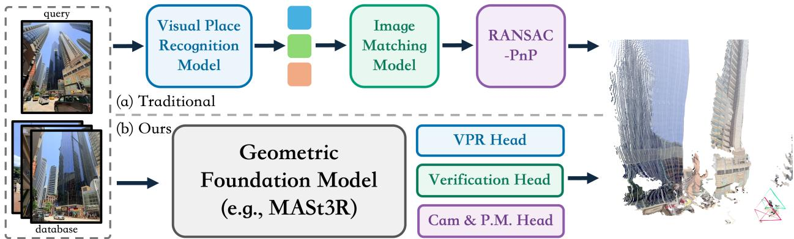
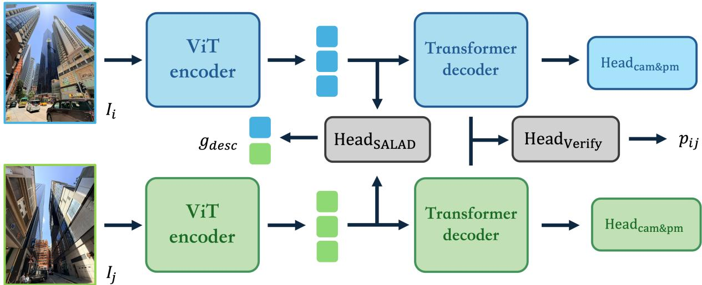

# UNILOOP: Unified Loop Closure Detection from Retrieval to Geometric Verification and Relative Pose Estimation

Jingwen Yu1,2, Pengyu Wang1, Jin Wu3, Weinan Chen4, Ping Tan1, and Hong Zhang2

  
Fig. 1: UNILOOP unifies retrieval, geometric verification, and relative pose estimation within a single MASt3R backbone. Unlike cascades of separately trained visual models, UNILOOP reuses the image encoder for global retrieval, the cross-view decoder for pairwise verification, and the geometric heads for relative pose constraints, sharing an image encoding across all stages. This framework proposes a new paradigm for loop closure detection, improving robustness and accuracy while reducing redundant computation.

Abstract— Loop closure detection conventionally cascades separate models for global retrieval, geometric verification, and relative pose estimation, leading to redundant computation and disconnected visual representations. We propose UNILOOP, a unified framework that reuses the hierarchical representations of the pretrained geometric foundation model throughout this pipeline. A shared image encoder produces features for compact global descriptors; the same features are passed to the cross-view decoder for pairwise verification; and the original geometric predictions provide relative camera constraints for pose-graph optimization. Experiments on place recognition, loop verification, and relative pose estimation show that UNILOOP improves loop-closure robustness and accuracy while reducing redundant backbone computation relative to modular pipelines. UNILOOP achieves the best Recall@10 on MSLS (96.6) and Pitts30k (99.3) among the compared methods, while its verification branch reaches 95.63 AP and 96.29 ROC-AUC, surpassing the existing geometric verification baselines.

## I. INTRODUCTION

Loop closure detection lets a robot recognize previously visited places, correct accumulated odometry drift, and build a globally consistent map over long-term operation. Despite its central role in Simultaneous Localization And Mapping (SLAM), it is still commonly implemented as a multi-stage cascade of separate visual models, as shown in Fig. 1. A visual place recognition model retrieves candidate matches, a geometric verification (e.g., local feature image matching model) module checks their consistency, and a relative pose module recovers the camera pose between the query and its top candidate, which is finally fed as a constraint into pose graph optimization. Although effective, this design duplicates image encoding, prevents intermediate representation sharing, and yields independently optimized modules whose objectives are only loosely aligned with the final loop closure decision.

Recent geometric foundation models (GFMs) offer a different opportunity. MASt3R [1] contains a natural hierarchy of 3D-aware visual representations, where its image encoder produces single-view features, its cross-view decoder constructs pair-conditioned representations, and its geometric heads predict dense 3D structure and matching cues. This hierarchy aligns with the stages of loop closure detection: global representations serve retrieval, while patch-level representations support verification and relative pose estimation.

Motivated by this observation, we introduce UNILOOP, a unified loop-closure framework that reuses a single GFM backbone, MASt3R, for retrieval, verification, and relative pose estimation. We attach a SALAD aggregator [2] to the MASt3R encoder and train the resulting global descriptors with contrastive learning. For verification, we build on the pairwise reasoning paradigm of Doppelgangers++ [3] to classify retrieved pairs from intermediate MASt3R decoder states. Finally, we retain MASt3R’s dense outputs and convert them into relative camera constraints for the downstream posegraph optimization.

A key design principle of UNILOOP is that the three tasks do not merely coexist as independent heads: the same image encoding is reused across retrieval and pairwise decoding, avoiding redundant backbone inference. Training is staged rather than fully joint—we first train the SALAD retrieval branch, then freeze it and supervise the verification head on hard negatives mined from the trained retrieval branch.

Our main contributions are summarized as follows:

• We propose UNILOOP, a unified loop-closure detection framework that maps the hierarchical representations of a 3D geometric foundation model onto the retrieval, verification, and relative pose estimation stages, sharing a single backbone across all three.

• We instantiate this design through (i) a MASt3R-encoder retrieval branch that aggregates encoder tokens into compact global place descriptors without a separate image backbone, (ii) a lightweight verification transformer that classifies retrieved pairs from pair-conditioned MASt3R decoder states, and (iii) the retained MASt3R geometric predictions, converted into relative camera constraints for pose-graph optimization.

• We establish a staged training and evaluation protocol that measures both module-level performance and end-to-end retrieval-conditioned loop-closure quality.

The rest of the paper is organized as follows. Section II reviews related work. Section III presents the UNILOOP framework and training strategy, and Section IV reports the experimental evaluation. Finally, Section V concludes the paper and outlines future work.

## II. RELATED WORK

## A. Visual Place Recognition

Modern visual place recognition (VPR) aggregates patchlevel features from pretrained vision transformers into compact global descriptors for retrieval under viewpoint and appearance changes [4], [5]. SALAD [2] uses optimal-transport aggregation with a dustbin to suppress non-informative regions, and MegaLoc [6] scales this paradigm through large-scale training, but their representations are independent of geometric downstream tasks. UNILOOP instead applies SALAD-style aggregation to the MASt3R [1] encoder, so the same geometry-aware tokens support both retrieval and subsequent geometric reasoning.

## B. Loop Closure Detection and Geometric Verification

Loop closure detection typically retrieves candidates before testing their geometric consistency [7]. Because global descriptors are prone to perceptual aliasing [8], verification commonly relies on local correspondences and epipolar geometry or learned pairwise classifiers. Doppelgangers++ [3] demonstrates that geometric features from GFMs can disambiguate image pairs. UNILOOP builds on this idea by classifying intermediate, pair-conditioned decoder states from the shared backbone, thereby rejecting geometrically inconsistent retrieved candidates.

## C. Geometric Foundation Models

Geometric foundation models (GFMs) predict dense, viewconsistent 3D representations from images. DUSt3R [9] predicts pointmaps for unconstrained pairs, and MASt3R [1] adds dense local descriptors and reciprocal matching. VGGT [10] extends this to multi-view reconstruction, and VGGT-Omega [11] scales it with substantially larger training data. Their encoder–decoder–head hierarchy naturally supports the retrieval, verification, and pose-estimation tasks addressed by UNILOOP.

## D. Geometric Foundation Models for Loop Closure

GFMs support navigation [12], SLAM [13], and crowdsourced mapping [14], but in loop closure they serve mainly as frozen matchers or pose regressors: FLOCC-SLAM [15] pairs a VPR model with a frozen MASt3R pose regressor; MASt3R-SLAM [16] reuses features for retrieval and pointmap matching without training; and MR.ScaleMaster [17] though leverages various GFMs as front-end, it still relies on backend heuristics for loop rejection and scale consistency. UNILOOP instead trains task-specific retrieval and verification heads on the MASt3R hierarchy, while retaining its geometric heads for relative pose estimation.

## III. UNILOOP

## A. Problem Formulation and Overview

Let a robot observe an RGB image stream $\mathcal { T } = \{ I _ { t } \} _ { t = 1 } ^ { T }$ $I _ { t } \in \mathbb { R } ^ { 3 \times H \times W }$ . Given a query image $I _ { q }$ and a database $\mathcal { D } = \{ I _ { j } \} _ { j = 1 } ^ { M }$ , full loop closure must (i) retrieve a compact candidate set $\mathcal { C } _ { q } \subset \mathcal { D }$ , (ii) decide whether each pair $( I _ { q } , I _ { j } )$ is a valid loop, and (iii) estimate a relative geometric constraint $\mathbf { T } _ { q j }$ for each accepted pair. We therefore seek

$$
\mathcal { F } ( I _ { q } , I _ { j } ) = \left( s _ { q j } ^ { \mathrm { r e t } } , p _ { q j } ^ { \mathrm { l o o p } } , \mathbf { T } _ { q j } , \Omega _ { q j } \right) ,\tag{1}
$$

where $s _ { q j } ^ { \mathrm { r e t } }$ is the global retrieval similarity, $p _ { q j } ^ { \mathrm { l o o p } }$ the verification probability, $\mathbf { T } _ { q j } \in \mathrm { S E } ( 3 )$ the relative transformation, and $\Omega _ { q j }$ an optional information/confidence term for pose graph optimization. UNILOOP instantiates $\mathcal { F }$ by reusing a single geometric foundation model across all three outputs, detailed in Fig. 2, which illustrates the framework. A shared MASt3R encoder extracts patch tokens, a SALAD retrieval head converts them into a global descriptor for candidate retrieval. For each retrieved pair, the same encoder outputs feed the cross-view decoder, whose intermediate features a lightweight verification transformer classifies into a loop candidate probability. The pair model’s geometric outputs are retained for relative pose estimation.

## B. Global Retrieval Branch

a) Shared single-image encoder: Given image $I _ { i } ,$ the MASt3R encoder produces patch tokens $\mathbf { F } _ { i } ~ = ~ \mathcal { E } ( I _ { i } ) ~ \in$ $\mathbb { R } ^ { N _ { i } \times C _ { e } }$ , where $N _ { i }$ is the number of image patches and $C _ { e }$ is the encoder dimension. For the ViT-L MASt3R encoder used in our implementation, $C _ { e } = 1 0 2 4$ . The tokens are reshaped into a spatial feature map $\widetilde { \mathbf { F } } _ { i } \in \mathbb { R } ^ { C _ { e } \times H _ { p } \times W _ { \gamma } }$

  
Fig. 2: Architecture of UniLoop for a candidate image pair $( I _ { i } , I _ { j } )$ . A shared-weight MASt3R ViT encoder processes each image once. The SALAD head aggregates the resulting single-view tokens into normalized global descriptors $\mathbf { g } _ { i }$ and $\mathbf { g } _ { j }$ for candidate retrieval. For each shortlisted pair, the same tokens are passed to the cross-view decoder to obtain pair-conditioned features. A lightweight verification head predicts the loop probability $p _ { i j } ^ { \mathrm { l o o p } }$ , while the retained MASt3R’s camera and pointmap heads recover the geometry used to construct relative-pose constraints for pose-graph optimization. Blue and green denote the two input views and their corresponding feature streams.

The central computational constraint of UNILOOP is that $\mathbf { F } _ { i }$ is computed once per image and reused by both retrieval and pairwise decoding. This distinguishes the proposed framework from a naive ensemble in which separate retrieval and verification networks independently encode the same RGB input.

b) Global retrieval from encoder tokens: We attach a SALAD-style optimal-transport aggregator $\mathcal { A } _ { \phi }$ to the MASt3R encoder features. Because MASt3R does not provide a dedicated CLS token, we construct an initial global token by mean pooling:

$$
\mathbf { t } _ { i } = \frac { 1 } { N _ { i } } \sum _ { n = 1 } ^ { N _ { i } } \mathbf { F } _ { i , n } .\tag{2}
$$

The retrieval descriptor is:

$$
\mathbf { g } _ { i } = \mathrm { n o r m } \left[ \mathcal { A } _ { \phi } \left( \widetilde { \mathbf { F } } _ { i } , \mathbf { t } _ { i } \right) \right] \in \mathbb { R } ^ { D _ { g } } ,\tag{3}
$$

where norm(·) denotes $\ell _ { 2 }$ normalization. Using $K = 6 4$ clusters, cluster dimension $D _ { c } = 1 2 8$ , and token dimension $D _ { t } = 2 5 6$ gives $D _ { g } = K D _ { c } + D _ { t } = 8 4 4 8$ . Retrieval similarity between query q and database image $j$ is $s _ { q j } ^ { \mathrm { r e t } } = \mathbf { g } _ { q } ^ { \intercal } \mathbf { g } _ { j }$ . The top-Kr images according to $s _ { q j } ^ { \mathrm { r e t } }$ define the candidate set $\mathcal { C } _ { q } ^ { \phantom { \dagger } } .$

## C. Verification Branch

a) Pair-conditioned cross-view decoder: For a candidate pair $( I _ { i } , I _ { j } )$ , the single-image tokens are passed to the pretrained MASt3R cross-view decoder:

$$
\left\{ \mathbf { H } _ { i j } ^ { ( \ell ) } , \mathbf { H } _ { j i } ^ { ( \ell ) } \right\} _ { \ell = 1 } ^ { L } = \mathcal { D } _ { \psi } \left( \mathbf { F } _ { i } , \mathbf { F } _ { j } \right) .\tag{4}
$$

Unlike the encoder tokens, the decoder features are pairconditioned: each representation is constructed in the context of the other image. This makes them suitable for reasoning about whether the two views can be reconciled geometrically.

Following the existing Doppelgangers++ [3] design, we extract a configurable set of hidden layers, i.e., encoder/decoder stages corresponding to {0, 6, 9, 12} in the default 12-layer decoder configuration. We denote the resulting token sequence by

$$
\mathbf Z _ { i j } = \mathrm { B u i l d T o k e n s } \left( \{ \mathbf H _ { i j } ^ { ( \ell ) } \} _ { \ell \in \mathcal { S } } , \{ \mathbf H _ { j i } ^ { ( \ell ) } \} _ { \ell \in \mathcal { S } } \right) .\tag{5}
$$

b) Loop verification and relative pose constraints: The verification transformer reasons over the decoder tokens where a lightweight transformer encoder produces $\mathbf { Y } _ { i j } = \mathcal { V } _ { \omega } ^ { \mathrm { t r } } \left( \mathbf { Z } _ { i j } \right)$ After pooling, a binary classifier predicts

$$
\begin{array} { r } { \mathbf { z } _ { i j } ^ { \mathrm { l o o p } } = \mathcal { V } _ { \omega } ^ { \mathrm { c l s } } \left( \mathrm { P o o l } ( \mathbf { Y } _ { i j } ) \right) \in \mathbb { R } ^ { 2 } , } \end{array}\tag{6}
$$

and

$$
p _ { i j } ^ { \mathrm { l o o p } } = \mathrm { s o f t m a x } \left( \mathbf { z } _ { i j } ^ { \mathrm { l o o p } } \right) _ { 1 } .\tag{7}
$$

The pairwise MASt3R branch additionally predicts dense geometric outputs, including pointmaps, confidence maps, and local matching features. We denote these outputs by $\mathbf { G } _ { i j } = \mathcal { G } \left( \mathbf { H } _ { i j } ^ { ( L ) } , \mathbf { \check { H } } _ { j i } ^ { ( L ) } \right)$ . A relative pose module convert the predicted pairwise geometry into $\left( \mathbf { T } _ { i j } , c _ { i j } ^ { \mathrm { p o s e } } , \pmb { \Omega } _ { i j } \right) \ =$ $\mathcal { P } ( \mathbf { G } _ { i j } )$ , where $\mathbf { T } _ { i j } \ \in \ \mathrm { S E } ( 3 )$ is the transformation from camera i to camera j. An accepted loop edge is:

$$
e _ { i j } = ( i , j , \mathbf { T } _ { i j } , \pmb { \Omega } _ { i j } ) \quad \mathrm { ~ i f ~ } \quad p _ { i j } ^ { \mathrm { l o o p } } \geq \tau _ { \mathrm { l o o p } } .\tag{8}
$$

For a query image $I _ { q } ,$ , the complete inference proceeds as in Algorithm 1.

Algorithm 1 UNILOOP inference   
Require: Query $I _ { q } ,$ database D, top-Kr   
1: Encode $I _ { q }$ once: $\mathbf { F } _ { q } \gets \mathcal { E } ( I _ { q } )$   
2: Compute descriptor: $\mathbf { g } _ { q }  \mathcal { A } ( \mathbf { F } _ { q } )$   
3: Retrieve candidate set $\mathbf { \bar { \mathcal { C } } } _ { q } \gets \mathrm { T o p K } ( \mathbf { g } _ { q } , \mathcal { D } )$   
4: for $I _ { j } \in { \mathcal { C } } _ { q }$ do   
5: Reuse cached $\mathbf { F } _ { j } , \mathbf { g } _ { j }$   
6: Decode pair: $\mathbf { H } _ { q j } \ '  \mathcal { D } ( \mathbf { F } _ { q } , \mathbf { F } _ { j } )$   
7: Verify: $p _ { q j } ^ { \mathrm { l o o p } }  \mathcal { \tilde { V } } ( \mathbf { H } _ { q j } )$   
8: if $p _ { q j } ^ { \mathrm { l o o p } } \geq \tau _ { \mathrm { l o o p } }$ then   
9: Estimate $\mathbf { T } _ { q j } , \Omega _ { q j }$ from geometric output   
10: Add loop edge $( \bar { q } , j , \mathbf { T } _ { q j } , \Omega _ { q j } )$   
11: end if   
12: end for

## D. Training Strategy

We use staged optimization to avoid destabilizing the pretrained geometric backbone and to independently study the contribution of each branch. During retrieval adaptation, we distill knowledge from a frozen MegaLoc [6] teacher into our MASt3R–SALAD retrieval branch. The teacher is used only during training and therefore introduces no inference-time cost.

1) Stage I: Retrieval Adaptation on GSV-Cities: Given a batch containing multiple images per place, the shared MASt3R encoder and SALAD head produce normalized global descriptors {gi}. We first optimize the Multi-Similarity metric-learning loss with hard-pair mining:

$$
\begin{array} { r } { \mathcal { L } _ { \mathrm { r e t } } = \mathcal { L } _ { \mathrm { M S } } \left( \{ \mathbf { g } _ { i } \} , \{ y _ { i } ^ { \mathrm { p l a c e } } \} \right) , } \end{array}\tag{9}
$$

where ${ \mathcal { L } } _ { \mathrm { M S } }$ denotes Multi-Similarity loss with hard-pair mining.

To transfer the teacher’s retrieval knowledge, the frozen MegaLoc model produces normalized descriptors $\{ \mathbf { g } _ { i } ^ { \mathrm { { T } } } \}$ for the same images. The per-image distillation term ${ \mathcal { L } } _ { \mathrm { d e s c } }$ maximizes the cosine similarity between the student and teacher descriptors extracted from each identical image:

$$
\mathcal { L } _ { \mathrm { d e s c } } = \frac { 1 } { B } \sum _ { i } \left( 1 - \mathbf { g } _ { i } ^ { \top } \mathbf { g } _ { i } ^ { \mathrm { T } } \right) .\tag{10}
$$

The resulting Stage-I objective is

$$
\begin{array} { r } { \mathcal { L } _ { \mathrm { s t a g e - I } } = \mathcal { L } _ { \mathrm { M S } } \qquad } \\ { + \lambda _ { \mathrm { d e s c } } \mathcal { L } _ { \mathrm { d e s c } } , } \end{array}\tag{11}
$$

where $\lambda _ { \mathrm { d e s c } }$ balances the distillation term. This objective retains place-level supervision while encouraging the student to match the MegaLoc descriptors. Earlier MASt3R encoder blocks, the cross-view decoder, and geometric heads remain frozen.

2) Stage II: Retrieval-Conditioned Pair Mining on MSLS: After Stage I, the retrieval branch is frozen and used to mine verification candidates. For each MSLS query $I _ { q } ,$ , we retrieve top-Kr database images $\mathcal { C } _ { q } = \mathrm { T o p K } \left( \mathbf { g } _ { q } ^ { \top } \mathbf { g } _ { j } \right)$ . The MSLS annotations label retrieved pairs as positive, negative, or ignored. Rather than sampling negatives uniformly at random, we preferentially retain high-ranking retrieved negative pairs as hard negatives. These retrieval-conditioned negatives are visually similar but nonmatching candidates produced by the Stage-I retriever, and train the verifier to reject the difficult false positives it encounters at inference time.

3) Stage III: Verification Training: For each mined pair $( I _ { i } , I _ { j } , y _ { i j } )$ , the encoder, retrieval head, MASt3R decoder, and geometry heads are initially frozen. We train only the verification transformer $\mathcal { V } _ { \omega }$ . The binary verification loss is:

$$
\mathcal { L } _ { \mathrm { v e r } } = - \alpha _ { y _ { i j } } \log p ( y _ { i j } \mid I _ { i } , I _ { j } ) ,\tag{12}
$$

where $\alpha _ { y }$ optionally compensates class imbalance. Focal loss can be substituted when hard negatives dominate the training distribution.

## IV. EXPERIMENTS

We evaluate the global retrieval and loop-verification branches separately. Retrieval is assessed with Recall@K $( K \in \{ 1 , 5 , 1 0 \} )$ , i.e., the fraction of queries whose groundtruth match is retrieved among the top-K database images. For loop verification, we report average precision (AP), ROC-AUC, and maximum recall at 100% precision (MR). This branch-wise evaluation isolates the contribution of candidate retrieval and subsequent geometric disambiguation.

## A. Datasets

a) Training.: Stage-I retrieval adaptation is trained on GSV-Cities [18], which provides multiple street-level views per place and thus supports per-place metric-learning batches with natural positive pairs. Stage-II pair mining and Stage-III verification training use Mapillary Street-Level Sequences (MSLS) [19], a large-scale multi-city dataset with substantial appearance, viewpoint, and seasonal change.

b) Evaluation.: We evaluate retrieval on five standard VPR benchmarks: MSLS [19], Pitts250k and Pitts30k [20], [21], Tokyo 24/7 [22], and Baidu [23]. Together, these benchmarks cover city-scale retrieval under substantial viewpoint and appearance variation. For verification, we evaluate on the MSLS validation set, which contains 150K positive pairs and 180K negative pairs for loop verification.

## B. Comparison with State of the Art

1) Retrieval Branch: Table I compares UNILOOP with classical VPR baselines, including NetVLAD [21] and AP-GeM [24], and recent learned methods, including Cos-Place [25], MixVPR [26], EigenPlaces [27], SALAD [29], CricaVPR [30], CliqueMining [31], and MegaLoc [6]. UNILOOP achieves the best Recall@10 on MSLS (96.6) and Pitts30k (99.3). It ranks third on MSLS Recall@1 (90.1) and second on Pitts30k Recall@1 (93.6), while exceeding the MegaLoc teacher on MSLS Recall@10 (96.6 versus 95.8). These results indicate that the shared MASt3R representation retrieves correct places reliably within the candidate set, which is particularly important for the subsequent verification stage.

On Pitts250k and Tokyo 24/7, UNILOOP obtains 93.4/97.3 and 92.1/96.3 Recall@1/10, respectively, but remains behind MegaLoc. Its performance on Baidu is also lower than that of the strongest dedicated VPR methods. Thus, although the proposed shared representation is competitive on MSLS and Pitts30k, improving cross-domain generalization remains an important direction for future work.

TABLE I: Recall@1 and Recall@10 on multiple VPR datasets. The best, second-best, and third-best results in each metric are highlighted in dark, medium, and light green, respectively.
<table><tr><td rowspan="2">Method</td><td rowspan="2">Venue</td><td rowspan="2">Dim.</td><td colspan="2">MSLS val [19]</td><td colspan="2">Pitts250k [20], [21]</td><td colspan="2">Pitts30k [20], [21]</td><td colspan="2">Tokyo 24/7 [22]</td><td colspan="2">Baidu [23]</td></tr><tr><td>R1</td><td>R10</td><td>R1</td><td>R10</td><td>R1</td><td>R10</td><td>R1</td><td>R10</td><td>R1</td><td>R10</td></tr><tr><td>NetVLAD [21]</td><td>TPAMI &#x27;18</td><td>4096</td><td>54.5</td><td>70.4</td><td>85.9</td><td>95.0</td><td>85.0</td><td>94.4</td><td>69.8</td><td>82.9</td><td>69.0</td><td>95.0</td></tr><tr><td>AP-GeM [24]</td><td>ICCV &#x27;19</td><td>2048</td><td>56.0</td><td>72.9</td><td>80.0</td><td>93.5</td><td>80.7</td><td>94.1</td><td>57.5</td><td>77.5</td><td>59.8</td><td>90.8</td></tr><tr><td>CosPlace [25]</td><td>CVPR ’22</td><td>2048</td><td>85.0</td><td>92.6</td><td>92.3</td><td>98.4</td><td>90.9</td><td>96.7</td><td>87.3</td><td>95.6</td><td>52.0</td><td>80.4</td></tr><tr><td>MixVPR [26]</td><td>WACV &#x27;23</td><td>4096</td><td>83.2</td><td>91.9</td><td>94.3</td><td>98.9</td><td>91.6</td><td>96.4</td><td>87.0</td><td>94.0</td><td>71.9</td><td>94.7</td></tr><tr><td>EigenPlaces [27]</td><td>ICCV ’23</td><td>2048</td><td>85.9</td><td>93.1</td><td>94.1</td><td>98.7</td><td>92.5</td><td>97.6</td><td>93.0</td><td>97.5</td><td>69.1</td><td>91.9</td></tr><tr><td>AnyLoc [28]</td><td>RAL &#x27;23</td><td>49152</td><td>58.7</td><td>74.5</td><td>89.4</td><td>98.0</td><td>86.3</td><td>96.7</td><td>87.6</td><td>97.5</td><td>75.6</td><td>95.2</td></tr><tr><td>SALAD [29]</td><td>CVPR &#x27;24</td><td>8448</td><td>88.2</td><td>95.0</td><td>95.0</td><td>99.2</td><td>92.3</td><td>97.4</td><td>94.6</td><td>98.1</td><td>72.7</td><td>93.6</td></tr><tr><td>CricaVPR [30]</td><td>CVPR &#x27;24</td><td>10752</td><td>76.7</td><td>87.2</td><td>92.6</td><td>98.3</td><td>90.0</td><td>96.7</td><td>82.9</td><td>93.7</td><td>65.6</td><td>93.2</td></tr><tr><td>CliqueMining [31]</td><td>ECCV ’24</td><td>8448</td><td>91.6</td><td>95.9</td><td>95.3</td><td>99.2</td><td>92.6</td><td>97.8</td><td>96.8</td><td>97.8</td><td>72.9</td><td>92.7</td></tr><tr><td>MegaLoc [6]</td><td>CVPRW &#x27;25</td><td>8448</td><td>91.0</td><td>95.8</td><td>96.4</td><td>99.3</td><td>94.1</td><td>98.2</td><td>96.5</td><td>99.4</td><td>87.7</td><td>98.0</td></tr><tr><td>UniLoop (Ours)</td><td></td><td>8448</td><td>90.1</td><td>96.6</td><td>93.4</td><td>97.3</td><td>93.6</td><td>99.3</td><td>92.1</td><td>96.3</td><td>64.0</td><td>78.1</td></tr></table>

TABLE II: Retrieval branch ablation on MSLS and Pitts30k-val, and Pitts30k-test. “Blks” is the number of fine-tuned MASt3R encoder blocks; “Dist.” indicates whether distillation is used (✓/✗). “Avg. Rel. Imp.” is the mean relative improvement across the nine reported metrics with respect to the first row.
<table><tr><td rowspan="2">Trainable Blks</td><td rowspan="2">Distill.</td><td rowspan="2">Resolution</td><td rowspan="2">Avg. Rel. Imp. (%)</td><td colspan="3">MSLS</td><td colspan="3">Pitts30k-val</td><td colspan="3">Pitts30k-test</td></tr><tr><td>R@1</td><td>R@5</td><td>R@10</td><td>R@1</td><td>R@5</td><td>R@10</td><td>R@1</td><td>R@5</td><td>R@10</td></tr><tr><td>0</td><td>x</td><td>224/224</td><td></td><td>76.35</td><td>84.59</td><td>87.97</td><td>90.17</td><td>97.24</td><td>98.26</td><td>88.13</td><td>94.06</td><td>95.58</td></tr><tr><td>2</td><td>x</td><td>224/224</td><td>3.09</td><td>83.65</td><td>89.86</td><td>92.55</td><td>92.55</td><td>98.05</td><td>98.82</td><td>89.60</td><td>94.63</td><td>96.02</td></tr><tr><td>2</td><td>√</td><td>224/224</td><td>3.75</td><td>83.65</td><td>91.22</td><td>93.65</td><td>93.48</td><td>98.38</td><td>99.07</td><td>90.18</td><td>95.03</td><td>96.45</td></tr><tr><td>2</td><td>x</td><td>224/512</td><td>4.29</td><td>87.16</td><td>93.24</td><td>93.92</td><td>92.18</td><td>97.66</td><td>98.62</td><td>90.17</td><td>95.30</td><td>96.33</td></tr><tr><td>4</td><td>x</td><td>224/224</td><td>3.50</td><td>84.32</td><td>90.95</td><td>92.84</td><td>93.20</td><td>97.95</td><td>98.70</td><td>90.05</td><td>94.76</td><td>96.07</td></tr><tr><td>4</td><td>S</td><td>224/224</td><td>4.69</td><td>85.54</td><td>93.65</td><td>95.41</td><td>93.73</td><td>98.55</td><td>99.30</td><td>90.35</td><td>95.13</td><td>96.57</td></tr><tr><td>4</td><td>√</td><td>224/512</td><td>5.42</td><td>89.86</td><td>95.00</td><td>95.81</td><td>93.28</td><td>98.55</td><td>99.19</td><td>89.70</td><td>95.09</td><td>96.74</td></tr><tr><td>4</td><td>S</td><td>336/512</td><td>5.87</td><td>90.14</td><td>95.54</td><td>96.62</td><td>93.60</td><td>98.57</td><td>99.28</td><td>90.67</td><td>95.47</td><td>96.88</td></tr></table>

2) Verification Branch: Table III compares image-retrieval (IR), geometric verification (GV), and neural-classifier (NC) baselines. The proposed hard-negative-trained NC verifier achieves the strongest results among the listed methods, with 95.63 AP, 96.29 ROC-AUC, and 0.52 MR. It outperforms the GV baselines SP+LG and eLoFTR and improves over the IR-only SALAD score, showing the value of pair-conditioned MASt3R decoder features for rejecting difficult retrieved candidates. However, the MR of 0.52 shows that the NC branch does not yet retain all true loops at a strict 100%- precision operating point. This leaves room for more powerful verification heads and end-to-end training.

## C. Ablation

Table II isolates three design choices, fine-tuned encoder blocks, teacher model distillation, and training resolution on MSLS val, Pitts30k-val, and Pitts30k-test.

a) Encoder adaptation.: With a frozen encoder, MSLS Recall@1 is 76.35. Fine-tuning the final two encoder blocks raises it to 83.65, demonstrating the benefit of adapting MASt3R features for global retrieval.

b) MegaLoc distillation.: At 224×224, adding MegaLoc distillation to a four-block configuration improves MSLS Recall@1 from 84.32 to 85.54 and Pitts30k-test Recall@10 from 96.07 to 96.57. It also raises MSLS Recall@10 from 92.84 to 95.41, indicating that the teacher improves the ranking of correct matches beyond the first retrieved result.

TABLE III: Comparison and ablation of the loop verification branch. IR denotes image retrieval, GV denotes geometric verification, and NC denotes the proposed neural classifier.
<table><tr><td>Method</td><td></td><td>AP</td><td>ROC-AUC</td><td>MR</td></tr><tr><td rowspan="2">R</td><td>SALAD</td><td>94.85</td><td>94.97</td><td>0.25</td></tr><tr><td>Ours (VPR-branch)</td><td>92.41</td><td>92.88</td><td>0.31</td></tr><tr><td rowspan="2">GW</td><td>SP+LG</td><td>84.67</td><td>89.87</td><td>0.0</td></tr><tr><td>eLoFTR</td><td>86.94</td><td>91.31</td><td>0.0</td></tr><tr><td rowspan="6">ON</td><td>Train from scratch</td><td>93.22</td><td>94.36</td><td>0.12</td></tr><tr><td> + Hard Negatives</td><td>94.00</td><td>95.49</td><td>0.45</td></tr><tr><td>Pre-trained</td><td>28.09</td><td>7.66</td><td>0.0</td></tr><tr><td> + Fine-tuned</td><td>94.23</td><td>95.12</td><td>0.0</td></tr><tr><td>+ Hard Negatives</td><td>95.63</td><td>96.29</td><td>0.52</td></tr><tr><td></td><td></td><td></td><td></td></tr></table>

c) Training resolution.: Holding four blocks and distillation fixed, MSLS Recall@1 rises from 85.54 (224×224) to 89.86 (224×512) to 90.14 (336×512); Recall@10 reaches 96.62 at the highest resolution.

d) Best configuration.: Four trainable blocks, distillation, and 336×512 resolution give the overall best result (MSLS 90.14/95.54/96.62, Pitts30k-test 90.67/95.47/96.88), reported in Table I.

e) Verification adaptation and hard negatives.: Table III shows that fine-tuning the pretrained MASt3R verifier raises AP from 28.09 to 94.23. Adding retrieval-conditioned hard negatives further increases performance to 95.63 AP, 96.29 ROC-AUC, and 0.52 MR. Hard negatives also improve the scratch-trained model, but it remains behind the fine-tuned counterpart (94.00 AP and 0.45 MR), supporting the use of pretrained representations and hard-negative mining.

## V. CONCLUSION AND FUTURE WORK

We introduced UNILOOP, a unified framework for full loop closure detection built on the hierarchical representations of GFM, i.e., MASt3R. The shared image encoder supports global retrieval through a trainable SALAD aggregation head, pair-conditioned decoder features support loop verification, and dense geometric outputs provide the basis for relative pose constraints. By reusing a common backbone, UNILOOP connects candidate generation and geometric validation while avoiding redundant image encoding.

Several directions remain for future work. First, UNILOOP can be extended to multi-view GFMs, which jointly reason over more than two images. Such backbones could provide a richer multi-view representation and improve efficiency by reducing the repeated pairwise decoding required by the currently two-view MASt3R backbone. Second, our current MegaLoc distillation supervises only the final global descriptor. Incorporating consistency constraints on intermediate latent representations may transfer richer retrieval knowledge and further improve the student retrieval branch. Finally, we will deploy UNILOOP in real robot localization systems and evaluate its impact on long-term pose-graph optimization. This evaluation will establish the practical effectiveness of the unified retrieval, verification, and the relative-pose pipeline under real-world operating conditions.

## REFERENCES

[1] V. Leroy, Y. Cabon, and J. Revaud, “Grounding image matching in 3d with mast3r,” in European Conference on Computer Vision, 2024.

[2] S. Izquierdo and J. Civera, “Optimal transport aggregation for visual place recognition,” in IEEE/CVF Conference on Computer Vision and Pattern Recognition, 2024.

[3] Y. Xiangli, R. Cai, H. Chen, J. Byrne, and N. Snavely, “Doppelgangers++: Improved visual disambiguation with geometric 3d features,” in Proc. IEEE Conf. Comput. Vis. Pattern Recognit., 2025.

[4] H. Ye, W. Chen, J. Yu, L. He, Y. Guan, and H. Zhang, “Conditioninvariant and compact visual place description by convolutional autoencoder,” Robotica, vol. 41, no. 6, pp. 1718–1732, 2023.

[5] M. Oquab, T. Darcet, T. Moutakanni, H. Vo, M. Szafraniec, V. Khalidov, P. Fernandez, D. Haziza, F. Massa, A. El-Nouby et al., “Dinov2: Learning robust visual features without supervision,” arXiv preprint arXiv:2304.07193, 2023.

[6] G. Berton and C. Masone, “Megaloc: One retrieval to place them all,” in Proceedings of the Computer Vision and Pattern Recognition Conference, 2025, pp. 2861–2867.

[7] J. Yu, H. Ye, J. Jiao, P. Tan, and H. Zhang, “Gv-bench: Benchmarking local feature matching for geometric verification of long-term loop closure detection,” in Proc. IEEE/RJS Int. Conf. Intell. Robots Syst. IEEE, 2024, pp. 7922–7928.

[8] J. Yu, J. Yang, J. Jiao, A. Hu, Z. Liu, J. Wang, P. Tan, and H. Zhang, “Rover: Robust loop closure verification with trajectory prior in repetitive environments,” IEEE Autom. Sci. Eng., 2026.

[9] S. Wang, V. Leroy, Y. Cabon, B. Chidlovskii, and J. Revaud, “Dust3r: Geometric 3d vision made easy,” in Proc. IEEE Conf. Comput. Vis. Pattern Recognit., 2024.

[10] J. Wang, M. Chen, N. Karaev, A. Vedaldi, C. Rupprecht, and D. Novotny, “Vggt: Visual geometry grounded transformer,” in Proc. IEEE Conf. Comput. Vis. Pattern Recognit., 2025, pp. 5294–5306.

[11] J. Wang, M. Chen, S. Zhang, N. Karaev, J. Schonberger, P. Labatut,¨ P. Bojanowski, D. Novotny, A. Vedaldi, and C. Rupprecht, “Vggt-Ω,” arXiv preprint arXiv:2605.15195, 2026.

[12] J. Zheng, J. Yu, G. Chen, and H. Zhang, “Enhancing glass surface reconstruction via depth prior for robot navigation,” Proc. IEEE/RJS Int. Conf. Intell. Robots Syst., 2026.

[13] D. Maggio, H. Lim, and L. Carlone, “Vggt-slam: Dense rgb slam optimized on the sl (4) manifold,” Adv. Neural Inf. Process. Syst., vol. 39, 2025.

[14] J. Jiao, C. Liu, J. Yu, B. Liu, Q. Zhang, Y. Wang, and D. Kanoulas, “Opennavmap: Structure-free topometric mapping via large-scale collaborative localization,” arXiv preprint arXiv:2601.12291, 2026.

[15] P.-Y. Lajoie, B. Ramtoula, D. De Martini, and G. Beltrame, “3d foundation model-based loop closing for decentralized collaborative slam,” IEEE Robot. Autom. Lett., 2025.

[16] R. Murai, E. Dexheimer, and A. J. Davison, “MASt3R-SLAM: Realtime dense SLAM with 3D reconstruction priors,” in Proc. IEEE Conf. Comput. Vis. Pattern Recognit., 2025.

[17] H. Ju and G. Kim, “Mr. scalemaster: Scale-consistent collaborative mapping from crowd-sourced monocular videos,” Proc. IEEE/RJS Int. Conf. Intell. Robots Syst., 2026.

[18] A. Ali-bey, B. Chaib-draa, and P. Giguere, “Gsv-cities: Toward \` appropriate supervised visual place recognition,” Neurocomputing, vol. 513, pp. 194–203, 2022.

[19] F. Warburg, S. Hauberg, M. Lopez-Antequera, P. Gargallo, Y. Kuang, ´ and J. Civera, “Mapillary street-level sequences: A dataset for lifelong place recognition,” in 2020 IEEE/CVF Conference on Computer Vision and Pattern Recognition (CVPR), 2020, pp. 2623–2632.

[20] P. Gronat, G. Obozinski, J. Sivic, and T. Pajdla, “Learning and´ calibrating per-location classifiers for visual place recognition,” in 2013 IEEE Conference on Computer Vision and Pattern Recognition, 2013, pp. 907–914.

[21] R. Arandjelovic, P. Gronat, A. Torii, T. Pajdla, and J. Sivic, “NetVLAD:´ CNN architecture for weakly supervised place recognition,” IEEE Transactions on Pattern Analysis and Machine Intelligence, vol. 40, no. 6, pp. 1437–1451, 2018.

[22] A. Torii, R. Arandjelovic, J. Sivic, M. Okutomi, and T. Pajdla, “24/7´ place recognition by view synthesis,” IEEE Transactions on Pattern Analysis and Machine Intelligence, vol. 40, no. 2, pp. 257–271, 2018.

[23] X. Sun, Y. Xie, P. Luo, and L. Wang, “A dataset for benchmarking image-based localization,” 2017 IEEE Conference on Computer Vision and Pattern Recognition (CVPR), pp. 5641–5649, 2017. [Online]. Available: https://api.semanticscholar.org/CorpusID:20531893

[24] J. Revaud, J. Almazan, R. S. Rezende, and C. R. de Souza, “Learning´ with average precision: Training image retrieval with a listwise loss,” 2019 IEEE/CVF International Conference on Computer Vision (ICCV), pp. 5106–5115, 2019.

[25] G. Berton, C. Masone, and B. Caputo, “Rethinking visual geolocalization for large-scale applications,” in IEEE/CVF Conference on Computer Vision and Pattern Recognition, 2022, pp. 4868–4878.

[26] A. Ali-bey, B. Chaib-draa, and P. Giguere, “MixVPR: Feature mixing\` for visual place recognition,” in Proceedings of the IEEE/CVF Winter Conference on Applications of Computer Vision, 2023, pp. 2998–3007.

[27] G. Berton, G. Trivigno, B. Caputo, and C. Masone, “Eigenplaces: Training viewpoint robust models for visual place recognition,” in Proceedings of the IEEE/CVF International Conference on Computer Vision (ICCV), October 2023, pp. 11 080–11 090.

[28] N. Keetha, A. Mishra, J. Karhade, K. M. Jatavallabhula, S. Scherer, M. Krishna, and S. Garg, “Anyloc: Towards universal visual place recognition,” IEEE Robot. Autom. Lett., 2023.

[29] S. Izquierdo and J. Civera, “Optimal transport aggregation for visual place recognition,” in Proceedings of the IEEE/CVF Conference on Computer Vision and Pattern Recognition, June 2024.

[30] F. Lu, X. Lan, L. Zhang, D. Jiang, Y. Wang, and C. Yuan, “CricaVPR: Cross-image correlation-aware representation learning for visual place recognition,” in Proceedings of the IEEE/CVF Conference on Computer Vision and Pattern Recognition (CVPR), June 2024.

[31] S. Izquierdo and J. Civera, “Close, but not there: Boosting geographic distance sensitivity in visual place recognition,” in Proc. Eur. Conf. Comput. Vis., 2024.