# Uncertainty-Driven Efficient Communication for UAV-Based Collaborative Perception

Jiuwu Hao1,∗, Yuting Wan1,∗, Liguo Sun2, Zao Zhang2, Yueyang Wu1 and Pin Lv2,†

Abstract— Unmanned aerial vehicle (UAV)-based collaborative perception enables multiple agents to share complementary perceptual information, overcoming limitations such as occlusion and limited sensing range. Communication efficiency is a critical bottleneck, as UAVs operate under stringent bandwidth and computational constraints. However, existing spatial selection methods focus predominantly on foreground regions to reduce missed detections, neglecting perceptually ambiguous regions and leaving false detections unresolved. We propose UCP, an uncertainty-driven framework that characterizes collaborative value through observational uncertainty, identifying sensor-limited regions, and discriminative uncertainty, capturing model-level ambiguity near the decision boundary. These estimates drive spatial request and supply maps for efficient inter-agent communication, and the received messages are aggregated via U-Fusion, an uncertainty-guided cross-attention module. Experiments on three benchmarks across 3D object detection and trajectory prediction demonstrate a superior performance-bandwidth trade-off with high interpretability and strong generalizability.

## I. INTRODUCTION

UAV-based collaborative perception has emerged as a promising paradigm that enables multiple agents to share complementary perceptual information, effectively overcoming the inherent limitations of single-agent systems such as occlusion and limited sensing range [1]–[3]. This paradigm has demonstrated significant potential across a broad range of applications, including traffic monitoring, search and rescue, and autonomous driving support.

Despite these advances, communication efficiency remains a critical bottleneck in practice, as UAVs are subject to stringent constraints on bandwidth, computational resources, and energy consumption. Among existing approaches, spatial selection mechanisms based on Bird’s Eye View (BEV) representations have emerged as a particularly promising direction, owing to their efficiency and high interpretabil ity. However, existing methods typically focus on sparse background regions to address missed detections through collaboration [4], [5], while overlooking perceptually ambiguous regions where the single-agent model struggles to make confident decisions. This asymmetric focus leaves false detections largely unaddressed, limiting the overall effectiveness of collaboration.

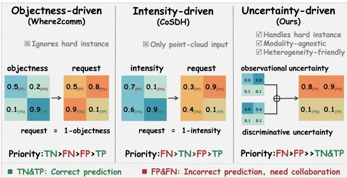  
Fig. 1: Comparison of spatial selection strategies for collaborative perception. The proposed uncertainty-driven strategy combines observational uncertainty and discriminative uncertainty to jointly identify observation-limited and perceptually ambiguous regions, assigning the highest collaboration priority to incorrectly predicted regions.

We observe that the uncertainty of a perception model is a strong indicator of its failure modes. As shown in Fig. 2, incorrect predictions consistently exhibit significantly higher uncertainty than correct ones, and correcting high-uncertainty regions yields substantially larger improvements in detection performance. These observations motivate us to go beyond objectness-based spatial selection and additionally consider the uncertainty of each spatial location as a key criterion for determining collaborative priority.

Grounded in this insight, we propose UCP, a novel uncertainty-driven collaborative perception framework that characterizes the collaborative value of each spatial location through two complementary forms of uncertainty. Each agent first estimates its intra-agent uncertainty, comprising observational uncertainty to identify sensor-limited regions and discriminative uncertainty to capture model-level ambiguity. These uncertainty estimates are then used to construct spatial request and supply maps, which jointly determine where each agent needs assistance and where it can provide reliable support. Guided by these maps, the most valuable spatial regions are selected for transmission, and the received messages are aggregated through an uncertainty-guided cross-attention fusion module (U-Fusion) that explicitly conditions attention on the spatial demand and reliability of each collaborator.

As illustrated in Fig. 1, the proposed UCP offers three key advantages over existing methods. First, it is heterogeneityfriendly: since the transmitted messages consist of modalityagnostic semantic perception results paired with uncertainty estimates, UCP supports collaboration among agents with heterogeneous sensor configurations without any retraining. Second, it achieves high interpretability: the uncertainty maps explicitly distinguish whether a spatial region suf fers from observation limitations or model-level ambiguity, providing physically meaningful guidance for spatial selection. Third, UCP achieves a superior performance-bandwidth trade-off by concentrating communication on the most uncertain and informative spatial regions, significantly reducing redundant transmission while maintaining high perception quality.

To validate the effectiveness of UCP, we conduct extensive experiments across multiple tasks, including 3D object detection and trajectory prediction, on three UAV-based collaborative perception datasets spanning both simulation and real-world settings. The results consistently demonstrate the effectiveness and robustness of the proposed framework.

The main contributions of this work are as follows:

• We propose UCP, a unified uncertainty-driven collaborative perception framework that jointly models spatial demand and supply through intra-agent uncertainty estimation, enabling efficient and interpretable inter-agent communication.

• We introduce a dual uncertainty characterization combining observational uncertainty and discriminative uncertainty, which captures complementary failure modes of single-agent perception and enables a superior performance-bandwidth trade-off compared to existing spatial selection methods.

• Extensive experiments on three UAV-based collaborative perception benchmarks across diverse tasks and settings validate the effectiveness and generalizability of the proposed framework.

## II. RELATED WORK

Collaborative Perception. Collaborative perception is a promising solution to overcome the inherent limitations of single-agent sensing, enabling agents to share complementary observations and achieve a more comprehensive understanding of the environment. UAV-based collaborative perception has attracted growing attention owing to the wide field of view and operational flexibility that aerial platforms provide. This emerging field has witnessed a surge of dedicated datasets to support algorithmic development [1]– [3], [6]–[11]. Building on these resources, recent works have demonstrated consistent gains across diverse UAVbased perception tasks, including object detection [12], [13], trajectory forecasting [2], and occupancy prediction [14]. In this work, we focus on the trade-off between perception performance and communication overhead, which is essential for the scale-up of UAV-based collaborative perception in real-world deployment.

Spatial selection for efficient communication. Considering that communication efficiency is the bottleneck issue in multi-agent collaborative perception, prior works have explored several strategies, including partner identification [15], [16], message representation [17], spatial selection [4], [5], [18]–[21], and temporal aggregation [22].

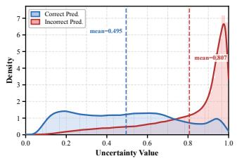  
(a)

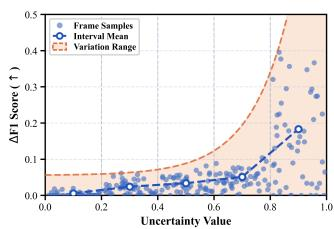  
(b)  
Fig. 2: Statistical analysis of prediction uncertainty. (a) Incorrect predictions exhibit significantly higher uncertainty than correct ones. (b) Correcting high-uncertainty regions yields larger performance gains, motivating uncertainty-driven spatial selection.

Among them, spatial selection has been widely adopted for its generalizability and interpretability. Where2comm [4] is the first to leverage spatial confidence maps to guide the communication process, and has since inspired a line of follow-up works [23], [24]. CoSDH [5] and QTF [25] adopt local point cloud density as an indicator of collaborative necessity. DHD [2] and UMC [21] quantify the collaborative value of each spatial region by measuring local feature discrepancy within a sliding window. Birdcast [18] constructs maps of interest by combining local information density with inter-agent confidence gaps. In contrast, we propose to leverage the intrinsic observational and discriminative uncertainties of individual agents to model the spatial supplydemand relationship for collaboration, achieving a superior perception-communication trade-off.

Uncertainty estimation. Uncertainty estimation has been widely studied as a principled approach to quantifying the reliability of model predictions in perception tasks. GevBEV [20] employ a learnable uncertainty estimation framework to identify and prioritize spatially informative regions for transmission. CoAlign [26] estimates bounding box uncertainty to identify reliable scene landmarks for pose graph optimization, improving robustness against localization errors. Double-M [27] captures both epistemic and aleatoric uncertainty of collaborative detection via a moving block bootstrap algorithm, providing principled uncertainty quantification for safety-critical applications. CoCa3D [28] selects depth features with low pixel-wise entropy for sharing and uses detection confidence to identify perceptually critical regions, improving camera-only collaborative 3D detection.

## III. PROBLEM FORMULATION

Consider N agents in the scene. Each agent i is equipped with its own sensor modality and a corresponding perception model. Let $\mathcal { X } _ { i }$ denote the raw observation of agent i, and let $\mathcal { \mathrm { V } } _ { i }$ denote the corresponding ground-truth supervision. Each agent concurrently acts as both a supporter and a receiver: as a supporter, it contributes perceptual messages to assist others; as a receiver, it aggregates messages from other agents to enhance its own perception.

Let $P _ { j  i }$ denote the message transmitted from agent $j$ to agent i. The objective of collaborative perception is to maximize the perception performance of all agents under a communication budget B:

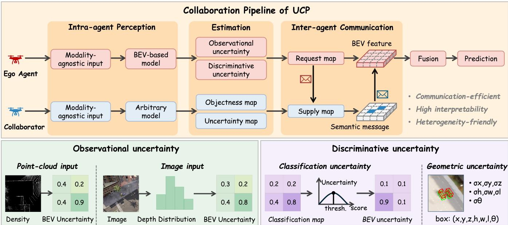  
Fig. 3: Overview of the proposed UCP framework. Each agent estimates intra-agent uncertainty from single-agent perception, comprising observational uncertainty (derived from point cloud density for LiDAR-based agents or depth estimation confidence for camera-based agents) and discriminative uncertainty (classification uncertainty and geometric uncertainty). These estimates are used to construct a request map for the ego agent and a supply map for the collaborator, which jointly drive spatial selection of the most valuable regions for transmission. The transmitted semantic message is then fused with the ego BEV feature via the proposed U-Fusion, an uncertainty-guided cross-attention module, to produce the final perception result.

$$
\operatorname* { m a x } _ { \theta , \mathcal { P } } \sum _ { i = 1 } ^ { N } g ( \Phi _ { \theta } ( \mathcal { X } _ { i } , \{ P _ { j  i } \} _ { j = 1 , j \neq i } ^ { N } ) , \mathcal { V } _ { i } ) ,\tag{1}
$$

$$
{ \mathrm { s . t . } } \quad \sum _ { i , j , j \neq i } b ( P _ { j  i } ) \leq B ,\tag{2}
$$

where $g ( \cdot , \cdot )$ is the evaluation metric for the perception task, $\Phi _ { \theta }$ is the collaborative perception model with trainable parameters θ, and $b ( \cdot )$ measures the communication cost of the transmitted message.

## IV. METHOD

## A. Overall Architecture

The overall architecture of the proposed method is illustrated in Fig. 3. Each agent first processes its raw observation $\mathcal { X } _ { i }$ through a modality-specific perception model, such as PointPillars [29] for point clouds or BEVFusion [30] for multi-modal inputs, to generate a BEV feature map $\mathcal { F } _ { i }$ and a single-agent perception result $\mathcal { O } _ { i }$ . Each agent derives a spatial supply map and a demand map, which characterize where it can provide reliable perceptual information and where it requires assistance from others, respectively. Guided by these maps, each agent selects and transmits compact yet informative messages to its collaborators. For homogeneous agents, BEV features can additionally be included in the transmitted messages to further enhance collaboration. Upon receiving messages from other agents, each agent fuses them with its local BEV feature ${ \mathcal { F } } _ { i }$ to obtain an enhanced representation, which is subsequently passed to the perception head to produce the final collaborative perception result $\hat { \mathcal { O } } _ { i }$

## B. Intra-Agent Uncertainty Estimation

Single-agent perception failures can be attributed to two distinct sources: i) observation-limited regions, where insufficient sensor coverage leads to missed detections, and ii) perceptually ambiguous regions, where hard instances near the decision boundary induce significantly elevated model uncertainty and degrade detection reliability. These two types of regions represent the highest collaborative value, yet existing works fail to account for both simultaneously. This observation motivates us to characterize collaboration priority through two complementary forms of perceptual uncertainty, namely observational uncertainty and discriminative uncertainty, corresponding to observation-limited regions and perceptually ambiguous regions, respectively.

1) Observational Uncertainty Estimation: Observational uncertainty reflects the degree to which an agent’s sensor fails to adequately cover a given spatial region, and serves as the demand signal indicating where collaborative assistance is needed.

For LiDAR-based agents, following [5], we use local point cloud density as the indicator: regions with sparse or absent point cloud returns correspond to distant or occluded areas that are poorly observed, and are thus assigned high observational uncertainty. For agent i, the point cloud density at each BEV cell is computed by counting the number of points within the corresponding pillar and normalizing to [0, 1], yielding a density map $\hat { A } _ { i } ~ \in ~ [ 0 , 1 ] ^ { H \times W }$ . The observational uncertainty map is then defined as:

$$
U _ { i } ^ { o b s } = 1 - A _ { i } .\tag{3}
$$

For camera-based agents, we propose to derive observational uncertainty from the depth estimation confidence of the LSS [31] depth network. The depth network predicts a per-pixel categorical depth distribution over D discretized depth bins via softmax. A confident depth prediction concentrates probability mass on a single bin, producing a highdensity BEV projection at the corresponding spatial location, whereas an uncertain prediction yields a diffuse distribution and low BEV density. Formally, let $p _ { i } ^ { n } ( h , w ) \in \mathbb { R } ^ { D }$ denote the depth probability of pixel $( h , w )$ from camera n, and let $\pi ( n , d , h , w )$ denote its projected BEV coordinate at depth bin d. The depth-probability-weighted BEV accumulation is:

$$
\tilde { A } _ { i } ( u , v ) = \sum _ { n , d , h , w } p _ { i } ^ { n } ( h , w , d ) \cdot \mathbf { 1 } [ \pi ( n , d , h , w ) = ( u , v ) ] ,\tag{4}
$$

where $\mathbf { 1 } [ \cdot ]$ denotes the indicator function. The accumulation is then normalized to obtain $A _ { i } ~ = ~ \tilde { A } _ { i } / \operatorname* { m a x } ( \tilde { A } _ { i } ) ~ \in$ $[ 0 , 1 ] ^ { H \times W }$ . The observational uncertainty map is defined as $\bar { U } _ { i } ^ { o b s } = 1 - A _ { i }$ , with high values indicating regions where depth perception is unreliable and collaborative assistance is most beneficial.

2) Discriminative Uncertainty Estimation: Beyond observational uncertainty, we propose discriminative uncertainty to jointly assess the collaborative value of each spatial region, which can be regarded as the systematic uncertainty intrinsic to the single-agent perception model. Taking object detection as the representative task, discriminative uncertainty can be decomposed into two components: classification uncertainty, which reflects ambiguity in determining whether a region contains an object, and geometric uncertainty, which captures imprecision in the geometric estimation of object position and extent.

Classification uncertainty. Let $s _ { i } ( h , w ) \in [ 0 , 1 ]$ denote the detection confidence at BEV cell (h, w). A piecewise linear mapping is applied to transform $s _ { i }$ into a probability $p _ { i }$ that reflects its proximity to the decision boundary:

$$
p _ { i } ( h , w ) = \left\{ \begin{array} { l l } { \displaystyle \frac { s _ { i } ( h , w ) } { 2 \tau } } & { s _ { i } ( h , w ) < \tau , } \\ { \displaystyle \frac 1 2 + \frac { s _ { i } ( h , w ) - \tau } { 2 ( 1 - \tau ) } } & { s _ { i } ( h , w ) \geq \tau , } \end{array} \right.\tag{5}
$$

where $\tau$ is the detection threshold. The classification uncertainty map is then defined as the binary entropy of $p _ { i } \colon$

$$
\begin{array} { r } { U _ { i } ^ { c l s } ( h , w ) = - p _ { i } \log _ { 2 } p _ { i } - ( 1 - p _ { i } ) \log _ { 2 } ( 1 - p _ { i } ) \in [ 0 , 1 ] . } \end{array}\tag{6}
$$

The map $U _ { i } ^ { c l s }$ reaches its maximum of 1 when $s _ { i } = \tau _ { : }$ , corresponding to the most ambiguous regions, and approaches 0 for confidently detected foreground or clearly observed background.

Geometric uncertainty. Geometric uncertainty characterizes the imprecision of each detected bounding box in terms of center position, heading angle, and box dimensions. Following [26], a lightweight uncertainty head is attached to the BEV feature map to predict per-location log-uncertainty values. Specifically, for each BEV cell, the uncertainty head outputs five channels: log $\cdot \sigma _ { x } ^ { 2 }$ and log $\sigma _ { y } ^ { 2 }$ for center position, log $\kappa _ { \theta }$ for heading angle, and log $\sigma _ { w } ^ { 2 }$ and $\log \sigma _ { l } ^ { 2 }$ for box dimensions. Center position and box dimensions are modeled as Gaussian distributions, while the heading angle, due to its periodicity, is modeled as a Von-Mises distribution with concentration parameter $\kappa _ { \theta } = e ^ { - s _ { \theta } }$

## C. Uncertainty-Driven Inter-Agent Communication

Based on the intra-agent uncertainty estimates, spatial request and supply maps are constructed to model the collaborative demand and contribution of each agent, and the most valuable regions are selected for communication.

Request map. The request map $R _ { i } \in [ 0 , 1 ] ^ { H \times W }$ of agent i characterizes where collaborative assistance from other agents is needed. It is defined as a weighted combination of the three uncertainty components derived in the previous section:

$$
R _ { i } = \alpha _ { 1 } U _ { i } ^ { o b s } + \alpha _ { 2 } U _ { i } ^ { c l s } + \alpha _ { 3 } U _ { i } ^ { g e o } ,\tag{7}
$$

where $\alpha _ { 1 } , \alpha _ { 2 }$ , and $\alpha _ { 3 }$ are hyperparameters. Regions with high request values correspond to areas where the perception of the agent is either observation-limited or model-uncertain, and thus benefit most from external collaborative information.

Supply map. The supply map $S _ { j } \in [ 0 , 1 ] ^ { H \times W }$ of agent $j$ characterizes where it can provide reliable and informative perceptual support to others. It is defined as a weighted combination of an objectness score and a certainty score:

$$
S _ { j } = \beta _ { 1 } \cdot { \mathrm { O b j } } _ { j } + \beta _ { 2 } \cdot ( 1 - U _ { j } ) ,\tag{8}
$$

where $\mathrm { O b j } _ { j }$ is the objectness map, $U _ { j } = { \alpha _ { 1 } } U _ { j } ^ { o b s } + { \alpha _ { 2 } } U _ { j } ^ { c l s } +$ $\alpha _ { 3 } U _ { i } ^ { g e o }$ is the aggregated uncertainty of agent $j ,$ and $\beta _ { 1 } .$ $\beta _ { 2 }$ are hyperparameters. Regions with high supply values indicate that agent $j$ has confident detections and reliable perception, making them valuable candidates for transmission.

Spatial selection and communication. Given the request map of agent i and the supply map of agent $j ,$ the spatial collaboration score is defined as:

$$
\begin{array} { r } { \mathcal { M } _ { j \to i } ( h , w ) = R _ { i } ( h , w ) \cdot S _ { j } ( h , w ) . } \end{array}\tag{9}
$$

The top- $K$ spatial locations with the highest collaboration scores are selected for transmission, where $K = \lfloor \rho \cdot H \cdot W \rfloor$ and $\rho$ is the communication ratio. To support heterogeneous agent collaboration, the transmitted message consists of compressed semantic perception results, i.e., detection outputs paired with their associated uncertainty estimates. This representation is modality-agnostic and thus compatible across agents with different sensor configurations. For homogeneous agents, BEV features can additionally be included in the transmitted message to further enhance collaborative fusion. Upon receiving the messages, each agent fuses them with its local BEV representation to produce the final collaborative perception result.

## D. Uncertainty-Guided Collaborative Fusion

Upon receiving messages from collaborating agents, the detection outputs and associated uncertainty estimates are scattered onto the BEV grid to form a sparse semantic feature map $\mathcal { V } _ { j  i } \in \mathbb { R } ^ { H \times \tilde { W } \times C _ { s } }$ . To adaptively aggregate the received messages, we design an uncertainty-guided crossattention fusion module, termed U-Fusion, in which the query is derived from the ego BEV feature $\mathcal { F } _ { i } ,$ and the key and value are derived from $\nu _ { j  i }$ . The attention score is jointly modulated by the ego request map $R _ { i }$ and the supply map of collaborator j:

$$
e _ { j  i } ( h , w ) = \frac { \mathbf { Q } ( h , w ) ^ { \top } \mathbf { K } ( h , w ) } { \sqrt { d } } \cdot R _ { i } ( h , w ) \cdot S _ { j } ( h , w ) ,\tag{10}
$$

$$
\mathbf { A } _ { j \to i } ( h , w ) = \mathrm { s o f t m a x } \left( e _ { j \to i } ( h , w ) \right) ,\tag{11}
$$

where attention is amplified at locations where the ego agent has high demand and the collaborator is reliable, and suppressed otherwise. The value features are further weighted by the perceptual certainty of the collaborator, $1 - U _ { j }$ , yielding the fused contribution $\tilde { \mathcal { V } } _ { j  i }$ . The final enhanced BEV feature is obtained via residual aggregation across all collaborators:

$$
\hat { { \mathcal F } } _ { i } = { { \mathcal F } _ { i } } + \sum _ { j \ne i } \tilde { { \mathcal V } } _ { j  i } ,\tag{12}
$$

which is subsequently passed to the perception head to produce the final collaborative result $\hat { \mathcal { O } } _ { i }$

## E. Training Strategy and Loss

Random masking. To prevent the ego agent from overrelying on collaborative information, a random masking strategy is adopted during training. Specifically, for each training sample, the messages from collaborating agents are randomly masked with probability $p _ { m }$ , forcing the ego agent to maintain strong single-agent perception capability while learning to exploit collaborative information when it is available.

Perception loss. The perception loss $\mathcal { L } _ { d e t }$ follows the standard CenterPoint detection head formulation, consisting of a focal loss for heatmap classification and a smooth- ${ \boldsymbol { \cdot } } { \boldsymbol { \ell } } _ { 1 }$ loss for box regression:

$$
\mathcal { L } _ { d e t } = \mathcal { L } _ { c l s } + \lambda _ { r e g } \mathcal { L } _ { r e g } ,\tag{13}
$$

where $\lambda _ { r e g }$ is a balancing weight.

Geometric uncertainty loss. To supervise the geometric uncertainty estimation, a KL-divergence-based loss is adopted following [26]. For center position and box dimensions, modeled as Gaussian distributions, the loss for each attribute x is:

$$
\mathcal { L } _ { x } = \frac { 1 } { 2 } \left( e ^ { - s _ { x } } ( \hat { x } - x _ { 0 } ) ^ { 2 } + s _ { x } \right) ,\tag{14}
$$

where $s _ { x } ~ = ~ \log { \sigma _ { x } ^ { 2 } }$ and $x _ { 0 }$ is the ground truth. For the heading angle, modeled as a Von-Mises distribution, the loss is:

$$
\begin{array} { r } { \mathcal { L } _ { \theta } = \log I _ { 0 } ( \kappa _ { \theta } ) - \kappa _ { \theta } \cos ( \hat { \theta } - \theta _ { 0 } ) + \lambda \cdot \mathrm { E L U } ( s _ { \theta } - c ) , } \end{array}\tag{15}
$$

where $I _ { 0 } ( \cdot )$ is the zero-order modified Bessel function and $\lambda ,$ c are hyperparameters. The total geometric uncertainty loss is:

$$
\begin{array} { r } { \mathcal { L } _ { g e o } = \mathcal { L } _ { x } + \mathcal { L } _ { y } + \alpha _ { \theta } \mathcal { L } _ { \theta } + \alpha _ { s } ( \mathcal { L } _ { w } + \mathcal { L } _ { l } ) . } \end{array}\tag{16}
$$

The overall training objective is:

$$
\begin{array} { r } { \mathcal { L } = \mathcal { L } _ { d e t } + \lambda _ { g e o } \mathcal { L } _ { g e o } , } \end{array}\tag{17}
$$

where $\lambda _ { g e o }$ balances the perception loss and the geometric uncertainty supervision objective.

## V. EXPERIMENTS

## A. Experimental settings

Datasets. We evaluate the proposed UCP on three opensource UAV-based collaborative perception datasets, including two simulation datasets, UAV3D [1] and Air-Co-Pred [2], and one real-world dataset, AGC-Drive [3]. In UAV3D, the perception area is set to 204.8 × 204.8 meters, where five UAVs act as collaborating agents and maintain a fixed formation at an altitude of approximately 60 meters. Air-Co-Pred involves four UAVs acting as collaborating agents at traffic intersections. They operate at an altitude of approximately 50 meters, covering a ground area of about 100 × 100 meters, with images captured at a frequency of 2 Hz. AGC-Drive involves one UAV and two equipped vehicles collecting synchronized data, with a perception range of [−150, 150] meters along both the X and Y axes.

Implementation. For the request and supply maps, the weighting hyperparameters are set to $\beta _ { 1 } = 0 . 7 , \beta _ { 2 } = 0 . 3 ,$ $\alpha _ { 1 } = 0 . 5$ , and $\alpha _ { 2 } = 0 . 5$ . For tasks that produce bounding box outputs, geometric uncertainty is additionally incorporated with $\alpha _ { 3 } ~ = ~ 0 . 1$ . To supervise the geometric uncertainty estimation, we set $\alpha _ { r e g } = 2 , \alpha _ { c e n t e r } = 0 . 2 5 , \alpha _ { \theta } = 0 . 1 2 5 ,$ $\lambda _ { e l u } = 0 . 0 1 , c = 1$ , and $\lambda _ { g e o } = 0 . 2$ . All models are trained on four NVIDIA RTX A6000 GPUs.

Evaluation metrics. For 3D object detection, we adopt average precision (AP) at intersection-over-union (IoU) thresholds of 0.5 and 0.7. For trajectory prediction, we employ IoU and Video Panoptic Quality (VPQ) for frame-level and video-level evaluation, respectively.

## B. Quantitative evaluation

Accuracy-bandwidth trade-Off comparison. We evaluate the performance of UCP on the UAV3D and Air-Co-Pred datasets, focusing on the trade-off between accuracy and communication bandwidth. In both datasets, we compare two fusion paradigms: late-intermediate (transmitting only perception outputs) and intermediate (transmitting BEV feature maps). Our method achieves the best performancebandwidth trade-off in both paradigms.

As shown in Fig. 4 and Fig. 5, UCP outperforms other methods in terms of key metrics such as mAP, IoU, and VPQ while maintaining a relatively low communication volume. This demonstrates that UCP strikes an optimal balance between high accuracy and efficient communication, making it an effective solution for real-world multi-UAV collaborative perception tasks.

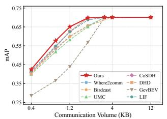

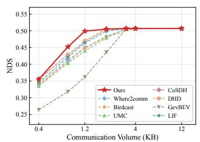  
(a) Late-intermediate fusion paradigm.

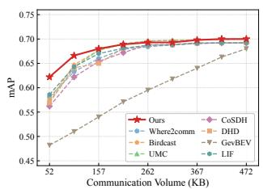

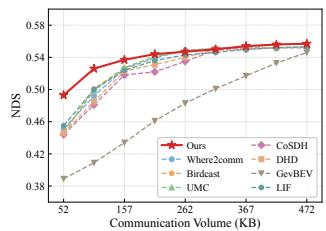  
(b) Intermediate fusion paradigm.

Fig. 4: Evaluation on the UAV3D dataset. Ours UCP achieves the best performance-bandwidth trade-off across both the late-intermediate paradigm (transmitting only perception outputs) and the intermediate paradigm (transmitting BEV feature maps).  
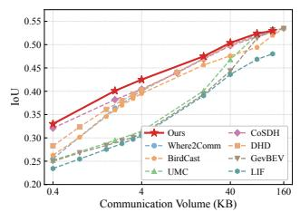

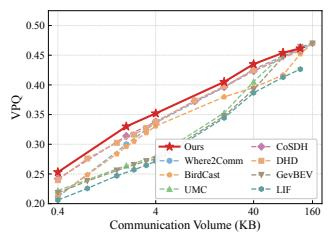  
(a) Late-intermediate fusion paradigm.

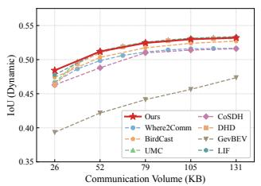  
(b) Intermediate fusion paradigm.

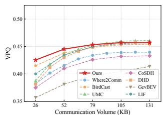  
Fig. 5: Evaluation on the Air-Co-Pred dataset. UCP achieves the best performance-bandwidth trade-off across both the late-intermediate paradigm (transmitting only perception outputs) and the intermediate paradigm (transmitting BEV feature maps).

TABLE I: Trajectory prediction results on the Air-Co-Pred dataset. DHD denotes the official results, and ∗ denotes the results we reproduce.
<table><tr><td rowspan=1 colspan=1>Method</td><td rowspan=1 colspan=1>Shared Data</td><td rowspan=1 colspan=3>Comm. (Mbps) ↓</td><td rowspan=1 colspan=2>IoU ↑ VPQ ↑</td></tr><tr><td rowspan=2 colspan=1>No CollaborationEarly CollaborationLate Collaboration</td><td rowspan=2 colspan=1>1RGB imagesperception outputs</td><td rowspan=2 colspan=3>0~1000~0.01</td><td rowspan=1 colspan=1>0.3260.545</td><td rowspan=1 colspan=1>0.2780.459</td></tr><tr><td rowspan=1 colspan=1>0.514</td><td rowspan=1 colspan=1>0.436</td></tr><tr><td rowspan=8 colspan=1>V2X-ViT [32]V2VNet [33]Who2com [16]When2com [15]Where2comm [4]UMC [21]UMC (w/o GRU)DHD [2]DHD*</td><td rowspan=8 colspan=1>feature maps</td><td rowspan=1 colspan=3></td><td rowspan=1 colspan=1>0.533</td><td rowspan=1 colspan=1>0.457</td></tr><tr><td rowspan=1 colspan=3></td><td rowspan=1 colspan=1>0.538</td><td rowspan=1 colspan=1>0.469</td></tr><tr><td rowspan=1 colspan=3></td><td rowspan=1 colspan=1>0.443</td><td rowspan=2 colspan=1>0.3700.404</td></tr><tr><td rowspan=1 colspan=1></td><td></td><td rowspan=1 colspan=1></td><td rowspan=1 colspan=1>0.458</td></tr><tr><td rowspan=1 colspan=2>~10</td><td rowspan=1 colspan=1>0</td><td rowspan=1 colspan=1>0.514</td><td rowspan=1 colspan=1>0.442</td></tr><tr><td rowspan=1 colspan=3></td><td rowspan=1 colspan=1>0.5230.532</td><td rowspan=1 colspan=1>0.4430.459</td></tr><tr><td rowspan=2 colspan=3></td><td rowspan=1 colspan=1>0.540</td><td rowspan=1 colspan=1>0.462</td></tr><tr><td rowspan=1 colspan=1>0.532</td><td rowspan=1 colspan=1>0.460</td></tr><tr><td rowspan=1 colspan=1>UCP (ours)</td><td rowspan=1 colspan=1>perception outputs</td><td rowspan=1 colspan=3>~0.01</td><td rowspan=1 colspan=1>0.535</td><td rowspan=1 colspan=1>0.470</td></tr></table>

Comparison with SOTA performance. We compare UCP with state-of-the-art methods on both the simulated Air-Co-Pred dataset and the real-world AGC-Drive dataset.

Table I presents results on the Air-Co-Pred trajectory prediction benchmark. UCP achieves the best performance with an IoU of 0.535 and a VPQ of 0.470, outperforming feature-map-based methods such as V2X-ViT [32] and Where2comm [4] while transmitting significantly less data, demonstrating the effectiveness of U-Fusion in aggregating compact semantic messages into informative collaborative representations. Table II further validates the generalizability of UCP on the real-world AGC-Drive 3D object detection benchmark, where UCP surpasses all competing methods with an AP@0.5 of 36.2% and an AP@0.7 of 23.7%, exceeding the strongest baseline LIF [19] by 1.7% and 1.0%,

TABLE II: 3D Detection Performance (%) on AGC-Drive.
<table><tr><td>Co-Mode</td><td>Model</td><td>mAP@0.5</td><td>mAP@0.7</td></tr><tr><td>Late</td><td>Lower-bound</td><td>26.6</td><td>12.2</td></tr><tr><td>Early</td><td>Upper-bound</td><td>58.2</td><td>43.1</td></tr><tr><td rowspan="4">Intermediate</td><td>V2VNet [33]</td><td>27.2</td><td>14.1</td></tr><tr><td>Cobevt [34]</td><td>28.6</td><td>14.9</td></tr><tr><td>Where2comm [4]</td><td>34.8</td><td>22.5</td></tr><tr><td>V2X-ViT [32]</td><td>32.7</td><td>18.7</td></tr><tr><td rowspan="2">Late-Intermediate</td><td>LIF [19]</td><td>34.5</td><td>22.7</td></tr><tr><td>UCP (Ours)</td><td>36.2</td><td>23.7</td></tr></table>

respectively.

## C. Qualitative Evaluation

Fig. 6 presents the visualization results of the proposed method on the UAV3D dataset. The uncertainty map effectively identifies regions where the single-agent model suffers from either observation limitations or perceptually hard instances, and the spatial distribution of high-uncertainty regions closely aligns with the locations of missed and false detections in the BEV detection results. Prioritizing the exchange of complementary information in these regions enables the model to address both failure modes, thereby improving overall perception performance and robustness.

## D. Ablation Studies

Table III presents the ablation study on the Air-Co-Pred dataset. Incorporating classification uncertainty into the request map yields consistent gains over observational uncertainty alone, confirming that the two components capture complementary demand signals. On the supply side, adding the objectness map and certainty score progressively improves performance by prioritizing critical regions and suppressing unreliable transmissions. Removing the uncertaintyguided fusion module leads to a non-trivial performance drop, demonstrating that uncertainty-aware attention aggregation is essential for effective collaborative fusion.

<table><tr><td colspan="2">Request map</td><td colspan="2">Supply map</td><td rowspan="2">U-Fusion</td><td rowspan="2">IoU↑</td><td rowspan="2">VPQ↑</td></tr><tr><td> $\overline { { U ^ { o b s } } }$ </td><td> $\overline { { U ^ { c l s } } }$ </td><td>Obj</td><td>Certainty</td></tr><tr><td> $\overline { { \checkmark } }$ </td><td></td><td></td><td></td><td>√</td><td>0.496</td><td>0.418</td></tr><tr><td> $\checkmark$ </td><td> $\checkmark$ </td><td></td><td></td><td>√</td><td>0.501</td><td>0.422</td></tr><tr><td> $\checkmark$ </td><td></td><td> $\checkmark$ </td><td></td><td>√</td><td>0.519</td><td>0.440</td></tr><tr><td> $\checkmark$ </td><td> $\checkmark$ </td><td> $\checkmark$ </td><td> $\checkmark$ </td><td> $\checkmark$ </td><td>0.522</td><td>0.443</td></tr><tr><td> $\overline { { \checkmark } }$ </td><td> $\overline { { \checkmark } }$ </td><td> $\checkmark$ </td><td> $\overline { { \checkmark } }$ </td><td></td><td>0.513</td><td>0.431</td></tr></table>

TABLE III: Ablation study of the key components in UCP on the Air-Co-Pred dataset. Obj denotes the objectness map derived from the predicted classification scores, and Certainty denotes the perceptual certainty map defined as $1 - U _ { j }$

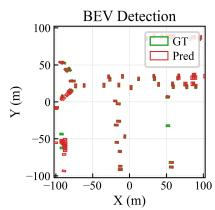

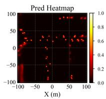

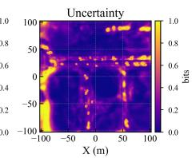  
Fig. 6: Visualization results of our UCP on the UAV3D dataset.

## VI. CONCLUSION

In this work, we present UCP, an uncertainty-driven collaborative perception framework for UAV-based multi-agent systems. By characterizing each spatial location through observational uncertainty and discriminative uncertainty, UCP constructs spatial request and supply maps that enable efficient and targeted inter-agent communication. The received messages are further aggregated via U-Fusion, which conditions cross-attention on spatial demand and collaborator reliability. Extensive experiments on three benchmarks across 3D object detection and trajectory prediction demonstrate that UCP achieves a superior performance-bandwidth tradeoff while remaining heterogeneity-friendly and highly interpretable.

## REFERENCES

[1] Hui Ye, Rajshekhar Sunderraman, and Shihao Ji, “Uav3d: A largescale 3d perception benchmark for unmanned aerial vehicles,” Advances in Neural Information Processing Systems, vol. 37, pp. 55425– 55442, 2024.

[2] Zhechao Wang, Peirui Cheng, Mingxin Chen, Pengju Tian, Zhirui Wang, Xinming Li, Xue Yang, and Xian Sun, “Drones help drones: A collaborative framework for multi-drone object trajectory prediction and beyond,” Advances in Neural Information Processing Systems, vol. 37, pp. 64604–64628, 2024.

[3] Yunhao Hou, Bochao Zou, Min Zhang, Ran Chen, Shangdong Yang, Yanmei Zhang, Junbao Zhuo, Siheng Chen, Jiansheng Chen, and Huimin Ma, “Agc-drive: A large-scale dataset for real-world aerial-ground collaboration in driving scenarios,” arXiv preprint arXiv:2506.16371, 2025.

[4] Yue Hu, Shaoheng Fang, Zixing Lei, Yiqi Zhong, and Siheng Chen, “Where2comm: Communication-efficient collaborative perception via spatial confidence maps,” Advances in neural information processing systems, vol. 35, pp. 4874–4886, 2022.

[5] Junhao Xu, Yanan Zhang, Zhi Cai, and Di Huang, “Cosdh: communication-efficient collaborative perception via supply-demand awareness and intermediate-late hybridization,” in Proceedings of the Computer Vision and Pattern Recognition Conference, 2025, pp. 6834– 6843.

[6] Tongtong Feng, Xin Wang, Feilin Han, Leping Zhang, and Wenwu Zhu, “U2udata: A large-scale cooperative perception dataset for swarm uavs autonomous flight,” in Proceedings of the 32nd ACM International Conference on Multimedia, 2024, pp. 7600–7608.

[7] Tongtong Feng, Xin Wang, Feilin Han, Leping Zhang, and Wenwu Zhu, “U2udata+: A scalable swarm uavs autonomous flight dataset for embodied long-horizon tasks,” in Proceedings of the AAAI Conference on Artificial Intelligence, 2026, vol. 40, pp. 1792–1800.

[8] Jiahao Wang, Xiangyu Cao, Jiaru Zhong, Yuner Zhang, Zeyu Han, Haibao Yu, Chuang Zhang, Lei He, Shaobing Xu, and Jianqiang Wang, “Griffin: Aerial-ground cooperative detection and tracking dataset and benchmark,” in Proceedings of the AAAI Conference on Artificial Intelligence, 2026, vol. 40, pp. 9867–9875.

[9] Xiangbo Gao, Yuheng Wu, Fengze Yang, Xuewen Luo, Keshu Wu, Xinghao Chen, Yuping Wang, Chenxi Liu, Yang Zhou, and Zhengzhong Tu, “Airv2x: Unified air-ground vehicle-to-everything collaboration,” arXiv preprint arXiv:2506.19283, 2025.

[10] Jirong Zha, Yuxuan Fan, Tianyu Zhang, Geng Chen, Yingfeng Chen, Chen Gao, and Xinlei Chen, “Aircopbench: A benchmark for multidrone collaborative embodied perception and reasoning,” in Proceedings of the AAAI Conference on Artificial Intelligence, 2026, vol. 40, pp. 1507–1515.

[11] Weijia Li, Haoen Xiang, Tianxu Wang, Shuaibing Wu, Qiming Xia, Cheng Wang, and Chenglu Wen, “V2u4real: A real-world largescale dataset for vehicle-to-uav cooperative perception,” arXiv preprint arXiv:2603.25275, 2026.

[12] Pengju Tian, Zhirui Wang, Peirui Cheng, Yuchao Wang, Zhechao Wang, Liangjin Zhao, Menglong Yan, Xue Yang, and Xian Sun, “Ucdnet: Multi-uav collaborative 3-d object detection network by reliable feature mapping,” IEEE Transactions on Geoscience and Remote Sensing, vol. 63, pp. 1–16, 2024.

[13] Mingxin Chen, Zhirui Wang, Zhechao Wang, Liangjin Zhao, Peirui Cheng, and Hongqi Wang, “C2f-net: Coarse-to-fine multi-drone collaborative perception network for object trajectory prediction,” IEEE Journal of Selected Topics in Applied Earth Observations and Remote Sensing, 2025.

[14] Zefu Lin, Wenbo Chen, Xiaojuan Jin, Yuran Yang, Lue Fan, Yixin Zhang, Yufeng Zhang, and Zhaoxiang Zhang, “Mcop: Multi-uav collaborative occupancy prediction,” in Proceedings of the IEEE/CVF International Conference on Computer Vision, 2025, pp. 27242– 27251.

[15] Yen-Cheng Liu, Junjiao Tian, Nathaniel Glaser, and Zsolt Kira, “When2com: Multi-agent perception via communication graph grouping,” in Proceedings of the IEEE/CVF Conference on computer vision and pattern recognition, 2020, pp. 4106–4115.

[16] Yen-Cheng Liu, Junjiao Tian, Chih-Yao Ma, Nathan Glaser, Chia-Wen Kuo, and Zsolt Kira, “Who2com: Collaborative perception via learnable handshake communication,” in 2020 IEEE International Conference on Robotics and Automation (ICRA). IEEE, 2020, pp. 6876–6883.

[17] Yue Hu, Juntong Peng, Sifei Liu, Junhao Ge, Si Liu, and Siheng Chen, “Communication-efficient collaborative perception via information filling with codebook,” in Proceedings of the IEEE/CVF Conference on Computer Vision and Pattern Recognition, 2024, pp. 15481–15490.

[18] Yanan Ma, Zhengru Fang, Yihang Tao, Yu Guo, Yiqin Deng, Xianhao Chen, and Yuguang Fang, “Birdcast: Interest-aware bev multicasting for infrastructure-assisted collaborative perception,” arXiv preprint arXiv:2604.00701, 2026.

[19] Jiuwu Hao, Liguo Sun, Yuting Wan, Yueyang Wu, Ti Xiang, Haolin Song, and Pin Lv, “Is intermediate fusion all you need for uav-based collaborative perception?,” arXiv preprint arXiv:2504.21774, 2025.

[20] Yunshuang Yuan, Hao Cheng, Michael Ying Yang, and Monika Sester, “Generating evidential bev maps in continuous driving space,” ISPRS Journal of Photogrammetry and Remote Sensing, vol. 204, pp. 27–41, 2023.

[21] Tianhang Wang, Guang Chen, Kai Chen, Zhengfa Liu, Bo Zhang, Alois Knoll, and Changjun Jiang, “Umc: A unified bandwidth-efficient and multi-resolution based collaborative perception framework,” in Proceedings of the IEEE/CVF International Conference on Computer Vision, 2023, pp. 8187–8196.

[22] Yue Hu, Xianghe Pang, Xiaoqi Qin, Yonina C Eldar, Siheng Chen, Ping Zhang, and Wenjun Zhang, “Pragmatic communication in multi-agent collaborative perception,” IEEE Transactions on Pattern Analysis and Machine Intelligence, 2026.

[23] Xiaojun Tan, Rui Wang, Jinping Wang, Shuai Wang, Xu Wang, and Dongsheng Wu, “Confidence-v2x: Confidence-driven sparse communication for efficient v2x cooperative perception,” Advanced Engineering Informatics, vol. 69, pp. 103914, 2026.

[24] Kang Yang, Peng Wang, Lantao Li, Tianci Bu, Chen Sun, Deying Li, and Yongcai Wang, “Eimc: Efficient instance-aware multi-modal collaborative perception,” arXiv preprint arXiv:2603.02532, 2026.

[25] Yihan Tian, Xuan Zhang, Shuaichen Zhuo, Dong Zhang, Zhiqiang Tian, Yuying Liu, and Shaoyi Du, “Uncertainty-guided and reliable collaborative ground robot perception for open heterogeneous systems,” Pattern Recognition Letters, 2026.

[26] Yifan Lu, Quanhao Li, Baoan Liu, Mehrdad Dianati, Chen Feng, Siheng Chen, and Yanfeng Wang, “Robust collaborative 3d object detection in presence of pose errors,” arXiv preprint arXiv:2211.07214, 2022.

[27] Sanbao Su, Yiming Li, Sihong He, Songyang Han, Chen Feng, Caiwen Ding, and Fei Miao, “Uncertainty quantification of collaborative detection for self-driving,” in 2023 IEEE international conference on robotics and automation (ICRA). IEEE, 2023, pp. 5588–5594.

[28] Yue Hu, Yifan Lu, Runsheng Xu, Weidi Xie, Siheng Chen, and Yanfeng Wang, “Collaboration helps camera overtake lidar in 3d detection,” in Proceedings of the IEEE/CVF Conference on Computer Vision and Pattern Recognition, 2023, pp. 9243–9252.

[29] Alex H Lang, Sourabh Vora, Holger Caesar, Lubing Zhou, Jiong Yang, and Oscar Beijbom, “Pointpillars: Fast encoders for object detection from point clouds,” in Proceedings of the IEEE/CVF conference on computer vision and pattern recognition, 2019, pp. 12697–12705.

[30] Zhijian Liu, Haotian Tang, Alexander Amini, Xinyu Yang, Huizi Mao,

Daniela L Rus, and Song Han, “Bevfusion: Multi-task multi-sensor fusion with unified bird’s-eye view representation,” in 2023 IEEE international conference on robotics and automation (ICRA). IEEE, 2023, pp. 2774–2781.

[31] Jonah Philion and Sanja Fidler, “Lift, splat, shoot: Encoding images from arbitrary camera rigs by implicitly unprojecting to 3d,” in European conference on computer vision. Springer, 2020, pp. 194– 210.

[32] Runsheng Xu, Hao Xiang, Zhengzhong Tu, Xin Xia, Ming-Hsuan Yang, and Jiaqi Ma, “V2x-vit: Vehicle-to-everything cooperative perception with vision transformer,” in European conference on computer vision. Springer, 2022, pp. 107–124.

[33] Tsun-Hsuan Wang, Sivabalan Manivasagam, Ming Liang, Bin Yang, Wenyuan Zeng, and Raquel Urtasun, “V2vnet: Vehicle-to-vehicle communication for joint perception and prediction,” in European conference on computer vision. Springer, 2020, pp. 605–621.

[34] Runsheng Xu, Zhengzhong Tu, Hao Xiang, Wei Shao, Bolei Zhou, and Jiaqi Ma, “Cobevt: Cooperative bird’s eye view semantic segmentation with sparse transformers,” arXiv preprint arXiv:2207.02202, 2022.