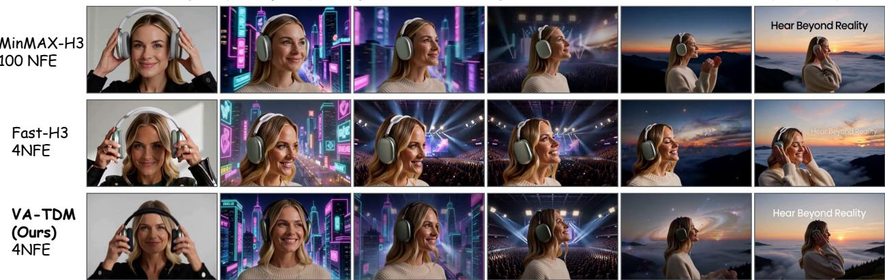
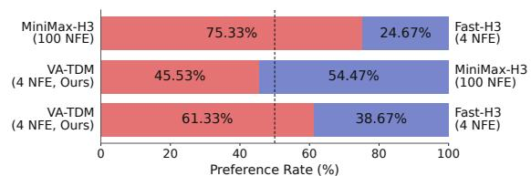
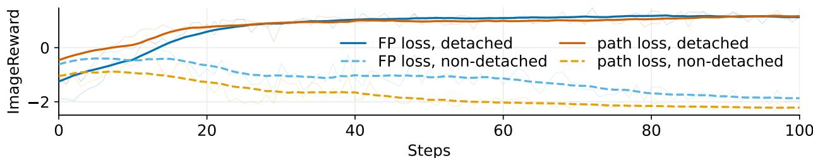
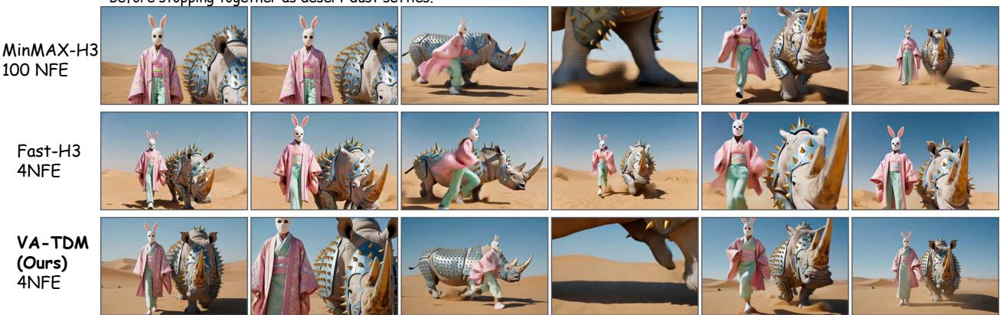
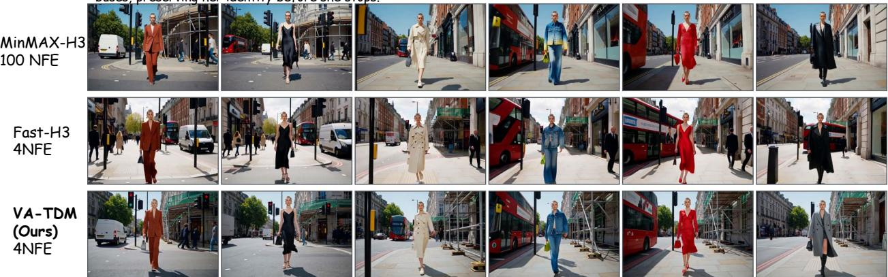
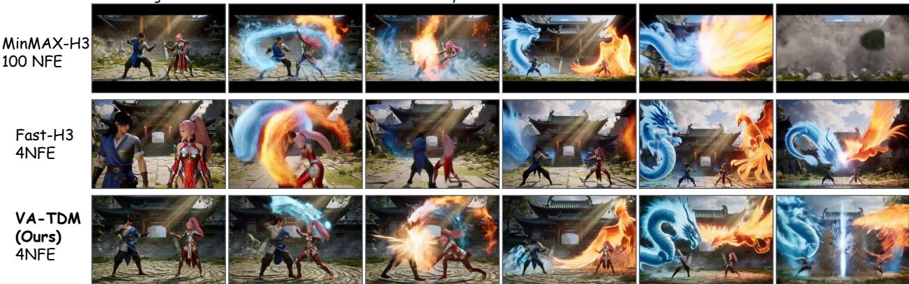
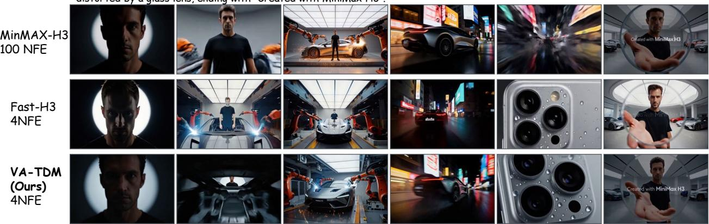

# VA-TDM: A Unified View for Improving Few-Step Difusion Models by Velocity Adversarial Distillation

Yihong Luo1, Tianyu Pang, and Tianyang Hu2

1Hong Kong University of Science and Technology

2The Chinese University of Hong Kong, Shenzhen

Summarized Prompt: A woman wearing headphones journeys through surreal worlds, ending at a mountain sunrise with the text "hear beyond reality".

  
Figure 1 | Comparison of VA-TDM-H3 and competing baselines. Our VA-TDM delivers better visual quality and sufers less oversaturation than the few-step competitor. More samples in Appendix D.

Few-step distillation ofers eficient generation with difusion and flow models, but preserving quality with only a few sampling steps remains challenging. Distribution-matching methods via score distillation provide a strong foundation, yet they rely on accurately tracking the student’s changing distribution. At intermediate generation steps in few-step sampling, student-score estimation can be dificult, and commonly used estimators may describe a diferent distribution from the one used to update the student. Flow matching allows a more flexible approach to supervision through velocity fields constructed from the student’s sampling process. Building on this perspective, we introduce Velocity Adversarial Distillation (VAD), which uses a learned critic to compare student and teacher fields and turn their disagreement into feedback for learning. VAD unifies score distillation, Fisher-based matching, and moment matching, also explaining existing heuristic MMD updates and delivering new training objectives. We further develop VA-TDM, which follows trajectory distribution matching: providing supervision for partial denoising along the student trajectory. Beyond this, VA-TDM combines transition-aware online velocity learning and dual-form VAD supervision across intermediate student transitions. Extensive results show that VA-TDM is powerful for learning few-step generators, achieving state-of-the-art four-step performance in both text-to-image and text-to-video generation across various backbones and scaling efectively to 33B MiniMax-H3. In particular, our VA-TDM-H3 notably outperforms the few-step Fast-H3 and is closer to the original many-step H3 according to human preference. Code is available at https://github.com/Luo-Yihong/VA-TDM.

## 1. Introduction

Few-step distillation seeks to make difusion and flow models eficient without sacrificing generation quality (Esser et al., 2024; Ho et al., 2020). A central challenge is to provide efective supervision when a small number of student transitions must replace a long teacher trajectory. Trajectory distillation learns from individual teacher trajectories (Song et al., 2023), whereas distribution matching allows the student to learn its own mapping by aligning student and teacher distributions (Luo et al., 2023; Yin et al., 2023). Trajectory Distribution Matching (TDM) (Luo et al., 2025) extends this principle to intermediate transitions. Each step then learns a partial denoising task, distributing supervision across the student trajectory and providing a natural foundation for few-step distillation.

For intermediate supervision to be efective, however, the training signal must faithfully reflect the distribution produced at each student step. In score-based methods, generator updates depend on the diference between teacher and student scores, requiring an auxiliary model to track the evolving student distribution. Intermediate transitions complicate this estimation: the student’s clean prediction and retained residual can be correlated, so perturbing its intermediate output generally difers from adding fresh Gaussian noise to the clean prediction. Our analysis of TDM shows why this distinction matters. Direct score estimation for the perturbed intermediate output can involve high-variance targets, while clean-target denoising can estimate a diferent distribution from the one used for generator supervision.

These observations motivate supervision that explicitly accounts for the student’s sampling process while allowing alternatives to its noisy-marginal score. Velocity targets ofer this flexibility because they can be defined through paths with coupled endpoints (Liu et al., 2022), including dependencies inherited from a student transition. We build on this flexibility to introduce Velocity Adversarial Distillation (VAD), a framework for constructing student velocity fields and using their discrepancies from the teacher to guide distillation. Two prototypical velocity constructions are derived within VAD. A-form is a rectified velocity that captures the expected clean prediction conditioned on a perturbed sample; B-form is a score-equivalent Gaussian velocity for the student’s perturbed distribution. The two forms thus express conditional-moment and distributional supervision within the same sampling process. A vector-valued critic estimates the discrepancy between the chosen student field and the teacher field, and the generator learns from this discrepancy.

The resulting framework provides a unified perspective along two axes: which field to match and how to use its discrepancy to update the generator. With diferent generator updates, A-form connects to conditional moment matching, while B-form connects reverse-KL score distillation and Fisher-based field matching. These connections also clarify the relationship between an intended objective and its practical update. In particular, VAD explains the heuristic update of MMD (Salimans et al., 2024) and derives an alternative surrogate that recovers the exact gradient of MMD’s desired objective.

To use both types of supervision along a few-step trajectory, we develop VA-TDM, retaining TDM’s supervision of intermediate transitions. VA-TDM combines A-form and B-form through a shared auxiliary backbone and blends complementary generator updates. Because samples from diferent student steps can follow diferent distributions even at the same

  
Figure 2 | Human preference on video synthesis.

noise level, we also condition field estimation on the transition being supervised. This provides diferent and accurate supervision signals among diferent steps.

Overall, our unified VAD framework connects existing distillation updates and derives new objectives, which VA-TDM combines with complementary velocity fields and transition-aware estimation for four-step generation, achieving state-of-the-art performance across backbones and tasks. On

SD3.5-Medium, VA-TDM outperforms the compared few-step baselines across prompt following, image quality, and preference metrics, improving GenEval from TDM’s 0.61 to 0.67 while increasing sample diversity. On FLUX.2-Klein-Base 4B, it surpasses the released four-step model, raising GenEval from 0.78 to 0.80 and OCR similarity from 0.64 to 0.69, with diversity measured by LPIPS improving from 0.47 to 0.56. Most notably, VA-TDM scales to MiniMax-H3 (MiniMax, 2026), a state-of-the-art open-source audio-video model with 33B parameters. In our user study (Fig. 2), VA-TDM wins 61.33% of comparisons against Fast-H3 at the same 4-NFE budget and achieves a 45.53% preference rate against the 100-NFE teacher, compared with 24.67% for Fast-H3. These results demonstrate that VA-TDM substantially narrows the perceptual quality gap to the teacher while requiring only 4-NFE.

## 2. Preliminaries

Difusion and Flow Models. Difusion models (Ho et al., 2020; Sohl-Dickstein et al., 2015) use the Gaussian forward process ${ \bf x } _ { \tau } = \alpha _ { \tau } { \bf x } _ { 0 } + \sigma _ { \tau } \pmb { \varepsilon } .$ , where $\mathbf { x } _ { 0 } \sim q _ { 0 } , \varepsilon \sim N ( \mathbf { 0 } , \mathbf { I } )$ independently, and $q _ { \tau }$ denotes the perturbed marginal. Time $\tau \in [ 0 , 1 ]$ runs from clean data to the noise prior; conditioning on c is omitted. For $\sigma _ { \tau } > 0 .$ , denoising score matching (DSM) learns the marginal score by regressing onto the conditional target:

$$
\begin{array} { r } { \mathbf { s } _ { \tau } ^ { q } ( \mathbf { x } _ { \tau } ) : = \nabla _ { \mathbf { x } _ { \tau } } \log q _ { \tau } ( \mathbf { x } _ { \tau } ) = \mathbb { E } _ { q _ { 0 } ( \mathbf { x } _ { 0 } | \mathbf { x } _ { \tau } = \mathbf { x } ) } \left[ \nabla _ { \mathbf { x } _ { \tau } } \log q _ { \tau } ( \mathbf { x } | \mathbf { x } _ { 0 } ) \right] . } \end{array}\tag{1}
$$

Rectified flow (Liu et al., 2022) uses the linear schedule $\alpha _ { \tau } = 1 - \tau , \sigma _ { \tau } = \tau$ and velocity $\mathbf { u } _ { \tau } ( \mathbf { x } ) = $ $\mathbb { E } [ \pmb { \varepsilon } - \mathbf { x } _ { 0 } \mid \mathbf { x } _ { \tau } = \mathbf { x } ]$ . For Gaussian forward processes, it is equivalent to difusion models.

Trajectory Distribution Matching (TDM). TDM (Luo et al., 2025) matches intermediate student and teacher distributions along a �-step student trajectory $0 = t _ { 0 } < \cdots < t _ { K } = 1$ . For a transition $t = t _ { k } \to s = t _ { k - 1 }$ , perturbing $\mathbf { x } _ { s } \sim p _ { \theta , k } ( \mathbf { x } _ { s } )$ with $q ( \mathbf { x } _ { \tau } \mid \mathbf { x } _ { s } )$ , gives student marginal $p _ { \theta , \tau } ^ { \mathtt { p a t h } }$ . Learning is performed by reverse-KL divergence (Luo et al., 2023) along the student trajectory:

$$
\nabla _ { \theta } \mathcal { L } _ { \mathrm { T D M } } = \mathbb { E } _ { k , t > \tau > s } \mathbb { E } _ { q ( \mathbf { x } _ { \tau } | \mathbf { x } _ { s } ) p _ { \theta , k } ( \mathbf { x } _ { s } ) } \left[ w _ { k , \tau } \left( \frac { \partial \mathbf { x } _ { \tau } } { \partial \theta } \right) ^ { \top } \left( \nabla _ { \mathbf { x } _ { \tau } } \log p _ { \theta , \tau } ^ { \mathrm { p a t h } } ( \mathbf { x } _ { \tau } ) - s _ { \tau } ^ { q } ( \mathbf { x } _ { \tau } ) \right) \right] .\tag{2}
$$

Teacher scores are supplied by the pretrained model; student scores require online estimation.

## 3. Method

Problem Setup. We consider distilling a pretrained conditional difusion or flow model into an eficient few-step generator. Let $q _ { t } ( \mathbf { x } _ { t } \mid \mathbf { c } )$ and ${ \bf u } _ { t } ( { \bf x } _ { t } , { \bf c } )$ denote the teacher’s marginal distribution and velocity field at time $t \in [ 0 , 1 ]$ , respectively, where $t = 0$ corresponds to clean samples and $t = 1$ to the noise prior. Given a condition c and a desired number of sampling steps �, our goal is to learn a student that transforms noise into a sample through � transitions while matching the teacher’s marginal distributions along the generation trajectory.

Overview. We introduce Velocity Adversarial Distillation (VAD) as a unified framework for distilling difusion models through aligning student and teacher velocity fields by an adversarial game. Sec. 3.1 motivates this formulation by examining the challenges of student score estimation and introduces two constructions of student velocity. Sec. 3.2 develops the adversarial velocity game, characterizes its matching equilibrium, and establishes connections to existing distillation methods. Sec. 3.3 presents practical generator and critic updates and applies the framework along the student trajectory, with transition-aware field estimation.

## 3.1. From Score Distillation to Velocity Distillation

We focus on learning a one-step marginal transition from $\mathbf { x } _ { t }$ to a less noisy $\mathbf { x } _ { s } ,$ , where $0 \leq s < t \leq 1$ whose output distribution $p _ { \theta , s }$ should match the teacher marginal $q _ { s }$ . Matching an intermediate

distribution requires only partial denoising at each step, easing the learning task compared with requiring a clean output at every step, and is more eficient and efective (Luo et al., 2025).

Under the rectified-flow schedule, the student predicts a clean anchor and its residual given x�:

$$
\hat { \mathbf { x } } _ { 0 } = g _ { \theta } ( \mathbf { x } _ { t } , t ) = \mathbf { x } _ { t } - t \nu _ { \theta } ( \mathbf { x } _ { t } , t ) , \qquad \hat { \pmb { \varepsilon } } = \frac { \mathbf { x } _ { t } - ( 1 - t ) \hat { \mathbf { x } } _ { 0 } } { t } .\tag{3}
$$

Given $\hat { \mathbf { x } } _ { 0 }$ and $\hat { \varepsilon } ,$ we can parameterize a DDIM-style intermediate transition (Song et al., 2021):

$$
\mathbf { x } _ { s } = ( 1 - s ) \hat { \mathbf { x } } _ { 0 } + \eta s \hat { \varepsilon } + s \sqrt { 1 - \eta ^ { 2 } } \mathbf { z } _ { s } \sim p _ { \theta } ( \mathbf { x } _ { s } | \mathbf { x } _ { t } ) \triangleq \mathcal { N } ( ( 1 - s ) \hat { \mathbf { x } } _ { 0 } + \eta s \hat { \varepsilon } , s ^ { 2 } ( 1 - \eta ^ { 2 } ) \mathbf { I } ) ,\tag{4}
$$

where $0 \leq \eta \leq 1$ and $\mathbf { z } _ { s } \sim { \cal N } ( \mathbf { 0 } , \mathbf { I } )$ . Note that the clean anchor is a parameterization of the transition; the desired matching objective is imposed on $\mathbf { X } _ { s }$ , not separately on $\hat { \mathbf { x } } _ { 0 }$ . By default, we let $\eta = 1$ , which forms a deterministic transition, while its outputs remain random across inputs.

Distributional Supervision at a Perturbed Time. To supervise the intermediate distribution, existing works in the line of score distillation (Luo et al., 2023, 2025) further perturb $\mathbf { x } _ { s }$ to $\mathbf { x } _ { \tau }$ , where $\tau > s .$ This smooths the distributions and makes the teacher’s knowledge at additional noise levels available for supervision. For $s < \tau < 1$ , we use the teacher-compatible kernel

$$
q ( \mathbf { x } _ { \tau } \mid \mathbf { x } _ { s } ) = N ( \mathbf { x } _ { \tau } ; \alpha _ { \tau \mid s } \mathbf { x } _ { s } , \beta _ { \tau \mid s } ^ { 2 } \mathbf { I } ) , \quad \alpha _ { \tau \mid s } = \frac { 1 - \tau } { 1 - s } , \qquad \beta _ { \tau \mid s } ^ { 2 } = \tau ^ { 2 } - \alpha _ { \tau \mid s } ^ { 2 } s ^ { 2 } .\tag{5}
$$

Thus $\mathbf { x } _ { \tau } = \alpha _ { \tau | s } \mathbf { x } _ { s } + \beta _ { \tau | s } \mathbf { z } _ { \tau }$ , where $\mathbf { z } _ { \tau } \sim { \cal N } ( \mathbf { 0 } , \mathbf { I } )$ . The full sampling chain factors into $q ( \mathbf { x } _ { s } \mid \hat { \mathbf { x } } _ { 0 } , \hat { \varepsilon } , \eta )$ and $q ( \mathbf { x } _ { \tau } \mid \mathbf { x } _ { s } )$ . Unless otherwise specified, expectations are taken over sampled $\tau ,$ this student transition and subsequent perturbation, with conditioning fixed. Let $p _ { \theta , s }$ denote the distribution of the student’s intermediate output $\mathbf { x } _ { s }$ . After applying the perturbation kernel, the resulting perturbed marginal distribution is

$$
p _ { \theta , \tau } ^ { \mathrm { p a t h } } ( \mathbf { x } _ { \tau } ) = \int q ( \mathbf { x } _ { \tau } \mid \mathbf { x } _ { s } ) p _ { \theta , s } ( \mathbf { x } _ { s } ) \mathrm { d } \mathbf { x } _ { s } .\tag{6}
$$

This is the student distribution whose score is required for reverse-KL supervision at time �. Because $\mathbf { x } _ { s }$ retains the residual inherited from the student transition, this distribution generally difers from one obtained by adding independent Gaussian noise directly to $\hat { \mathbf { x } } _ { 0 }$

If the optimization is formed by reverse-KL following previous works (Luo et al., 2025), we would require the score diference ∇ log $p _ { \theta , \tau } ^ { \mathrm { p a t h } } - \nabla$ log $q _ { \tau }$ . The teacher supplies the latter score, whereas the former must be learned online for the current student’s actual perturbation distribution.

The Dificulty of Learning the Student Score. DSM can estimate this score ∇ log $p _ { \theta , \tau } ^ { \mathtt { p a t h } }$ by regressing onto $\nabla _ { \mathbf { x } _ { \tau } }$ log $q ( \mathbf { x } _ { \tau } \mid \mathbf { x } _ { s } )$ . Although population-correct, under the reference Gaussian forward process this target has larger conditional variance than standard DSM, which regresses $\nabla _ { \mathbf x _ { \tau } }$ log $q ( \mathbf { x } _ { \tau } \mid \mathbf { x } _ { 0 } )$ (Xue et al., 2025), thereby making the online score harder to learn.

Remark 1 (Mismatch in TDM). To avoid this dificulty, TDM learns its online score through clean-target denoising with importance sampling (Luo et al., 2025). Although importance sampling allows training samples to be drawn from $p _ { \theta , \tau } ^ { \mathrm { p a t h } }$ , the objective still estimates the score of the distribution obtained by independently perturbing $\hat { \mathbf { x } } _ { 0 }$ to �. This generally difers from the score of $p _ { \theta , \tau } ^ { \mathtt { p a t h } }$ required by the generator update, introducing a distribution mismatch (See detailed derivation in Appendix B.2).

Velocity as a Choice of Path and Coupling. This distinction motivates a shift from score distillation to velocity distillation, which can define student fields directly from the actual sampling chain. In particular, Velocity targets can be induced by diferentiable paths with correlated or non-Gaussian endpoint couplings, therefore giving us greater flexibility. In the student transition $t \longrightarrow s ,$ , xˆ and $\hat { \pmb { \varepsilon } }$ share the same input and can be dependent, alongside optional fresh noise; the forward perturbation $s  \tau$ adds independent Gaussian noise. This gives two choices: use the clean-to-perturbed coupling induced by the composite process $t \to s \to \tau _ { : }$ , or follow the $s  \tau$ path alone. Throughout the remaining sections, $p _ { \theta , \tau }$ abbreviates $p _ { \theta , \tau } ^ { \mathtt { p a t h } }$ , the perturbed marginal.

A-form: Rectified Velocity. The composite process $t \to s \to \tau$ couples the clean prediction $\hat { \mathbf { x } } _ { 0 }$ to $\mathbf { x } _ { \tau }$ . Expanding Eq. (4) yields

$$
\begin{array} { r } { \mathbf { x } _ { \tau } = ( 1 - \tau ) \hat { \mathbf { x } } _ { 0 } + \boldsymbol { \xi } _ { \theta , s , \tau } , \qquad } \\ { \mathbf { \xi } _ { \xi \theta , s , \tau } = \alpha _ { \tau | s } \eta s \hat { \varepsilon } + \alpha _ { \tau | s } s \sqrt { 1 - \eta ^ { 2 } } \mathbf { z } _ { s } + \beta _ { \tau | s } \mathbf { z } _ { \tau } . } \end{array}\tag{7}
$$

The efective noise $\pmb { \varepsilon } _ { \mathrm { e f f } } = \pmb { \xi } _ { \theta , s , \tau } / \tau$ contains the residual inherited from the student and standard Gaussian noise. This can deliver a corresponding rectified velocity coupled with the endpoint:

$$
\mathbf { v } _ { \tau } ^ { A } ( \mathbf { x } _ { \tau } \mid \mathbf { x } _ { s } , \hat { \mathbf { x } } _ { 0 } ) = \pmb { \varepsilon } _ { \mathrm { e f f } } - \hat { \mathbf { x } } _ { 0 } = \frac { \mathbf { x } _ { \tau } - \hat { \mathbf { x } } _ { 0 } } { \tau } .\tag{8}
$$

The $\mathsf { A } \mathrm { - }$ form rectified velocity uses the clean prediction as its anchor through the composite coupling. It produces reduced training variance when $s > 0$ , which benefits learning of the online field. This marginal velocity is an afine reparameterization of a moment $\mathbb { E } [ \hat { \mathbf { x } } _ { 0 } \mid \mathbf { x } _ { \tau } ]$

B-form: Gaussian Velocity. The perturbation $s  \tau$ defines a path starting at $\mathbf { X } _ { s }$ . Diferentiating this path with respect to $\tau ,$ and using $\mathbf { z } _ { \tau } = ( \mathbf { x } _ { \tau } - \alpha _ { \tau | s } \mathbf { x } _ { s } ) / \beta _ { \tau | s }$ , gives the conditional velocity

$$
{ \mathbf { v } } _ { \tau } ^ { B } ( \mathbf { x } _ { \tau } \mid \mathbf { x } _ { s } , \hat { \mathbf { x } } _ { 0 } ) = \dot { \alpha } _ { \tau | s } \mathbf { x } _ { s } + \frac { \dot { \beta } _ { \tau | s } } { \beta _ { \tau | s } } \big ( \mathbf { x } _ { \tau } - \alpha _ { \tau | s } \mathbf { x } _ { s } \big ) .\tag{9}
$$

Dots denote � derivatives with � fixed. Its conditional average is the marginal velocity of the $s  \tau$ perturbation path. This marginal velocity is an afine reparameterization of the score of the actual perturbed distribution (see proof in Appendix $\mathsf { A } . 4 )$

The Induced Student Field. We use the common notation $\mathbf { v } _ { \tau } ^ { F } ( \mathbf { x } _ { \tau } \mid \mathbf { x } _ { s } , \hat { \mathbf { x } } _ { 0 } )$ for these two conditional targets, with $F \in \{ A , B \}$ . The field to be compared with the teacher is

$$
\bar { \mathbf { v } } _ { \theta , \tau } ^ { F } ( \mathbf { x } ) = \mathbb { E } _ { p _ { \theta } ( \mathbf { x } _ { s } , \hat { \mathbf { X } } _ { 0 } | \mathbf { x } _ { \tau } = \mathbf { X } ) } \left[ \mathbf { v } _ { \tau } ^ { F } ( \mathbf { x } \mid \mathbf { x } _ { s } , \hat { \mathbf { x } } _ { 0 } ) \right] .\tag{10}
$$

Both formulations can be computed via student samples, but their marginal fields require averaging over the implicit student distribution.

## 3.2. Velocity Adversarial Distillation

Dif-Instruct has discussed that reverse-KL-based score distillation is related to GANs (Goodfellow et al., 2014; Luo et al., 2023). We further find that, after shifting from score distillation to velocity distillation, explicitly defining an adversarial game that aims to align the teacher velocity with the student velocity forms a unified framework and view, which deepens the understanding of existing methods and might inspire the design of new distillation losses.

Matching Implicit Velocity. We propose to align the student and teacher velocity fields through an adversarial game defined by their inner products with a vector-valued critic $\mathbf { f } , \mathrm { i . e . , } \mathbf { f } ^ { \intercal } \mathbf { v } .$ In particular, the critic maximizes its alignment with the teacher velocity and minimizes its alignment with the student velocity, subject to a quadratic penalty. The student opposes the critic by maximizing its own velocity’s alignment with the critic, with the critic held fixed.

For brevity, we write $\mathbf { v } _ { \tau } ^ { F } \equiv \mathbf { v } _ { \tau } ^ { F } ( \mathbf { x } _ { \tau } \mid \mathbf { x } _ { s } , \hat { \mathbf { x } } _ { 0 } )$ for the sampled conditional velocity, and let � denote expectation over � and the full sampling chain $p _ { \theta } ( \mathbf { x } _ { t } , \mathbf { x } _ { s } , \hat { \mathbf { x } } _ { 0 } ) q ( \mathbf { x } _ { \tau } \mid \mathbf { x } _ { s } )$ . Since f depends only on $\mathbf { x } _ { \tau } ,$ replacing the sampled velocity v� by its conditional-mean velocity $\bar { \mathbf { v } } _ { \tau } ^ { F }$ leaves the expected inner product unchanged:

$$
\begin{array} { r } { \mathbb { E } \big [ \mathbf { f } ( \mathbf { x } _ { \tau } ) ^ { \top } \mathbf { v } _ { \tau } ^ { F } \big ] = \mathbb { E } _ { \mathbf { x } _ { \tau } \sim p _ { \theta , \tau } } \big [ \mathbf { f } ( \mathbf { x } _ { \tau } ) ^ { \top } \bar { \mathbf { v } } _ { \theta , \tau } ^ { F } ( \mathbf { x } _ { \tau } ) \big ] . } \end{array}\tag{11}
$$

This identity motivates two generator losses with the same expected value but diferent gradient conventions. The pathwise update diferentiates through the full sampling process, changing both the outer sampling distribution and the student velocity at those locations. The conditional-mean update stops the gradient of the sampling distribution and adjusts only the student velocity field.

In particular, the adversarial game in the velocity space can be formulated as:

$$
\begin{array} { r l } & { \quad \underset { \mathbf { f } } { \mathrm { m a x } } \quad V _ { F } ( \mathbf { f } , \theta ) = \mathbb { E } \big [ \mathbf { f } ( \mathbf { x } _ { \tau } ) ^ { \top } \big ( \mathbf { u } _ { \tau } ( \mathbf { x } _ { \tau } ) - \bar { \mathbf { v } } _ { \theta , \tau } ^ { F } \big ) - \frac { 1 } { 2 } \| \mathbf { f } ( \mathbf { x } _ { \tau } ) \| ^ { 2 } \big ] , } \\ & { \quad \underset { \theta } { \mathrm { m i n } } \quad \mathcal { L } _ { \mathrm { p a t h } } ^ { F } ( \theta ; \mathbf { f } ) = - \mathbb { E } \big [ \mathbf { f } ( \mathbf { x } _ { \tau } ) ^ { \top } \mathbf { v } _ { \tau } ^ { F } \big ] , } \\ { \mathrm { o r } \quad } & { \underset { \theta } { \mathrm { m i n } } \quad \mathcal { G } _ { \mathrm { m e a n } } ^ { F } ( \theta ; \mathbf { f } ) = - \mathbb { E } _ { \mathbf { x } _ { \tau } \sim p _ { S \xi ( \theta ) , \tau } } \big [ \mathbf { f } ( \mathbf { x } _ { \tau } ) ^ { \top } \bar { \mathbf { v } } _ { \theta , \tau } ^ { F } ( \mathbf { x } _ { \tau } ) \big ] . } \end{array}\tag{12}
$$

(13)

Here sg denotes stop-gradient. Only the outer distribution is stopped in $\mathcal { G } _ { \mathrm { m e a n } } ^ { F } ; ~ \bar { \mathbf { v } } _ { \theta , \tau } ^ { F }$ retains its parameter dependence. The following lemma reveals the formulation of the optimal critic:

Lemma 2 (Optimal critic). For a fixed student �, under the regularity and critic assumptions detailed in Appendix A, the maximizing critic is unique up to $p _ { \theta , \tau }$ -null sets and satisfies

$$
\mathbf { f } _ { F } ^ { \star } ( \mathbf { x } ) = \mathbf { u } _ { \tau } ( \mathbf { x } ) - \bar { \mathbf { v } } _ { \theta , \tau } ^ { F } ( \mathbf { x } ) .\tag{14}
$$

The proof is given in Appendix A.1.

Matching Equilibrium. The optimal critic in Theorem 2 is the velocity residual. Its zero identifies the following equilibrium of the two-player game.

Proposition 3 (Matching equilibrium). Under the regularity, critic, and realizability assumptions in Appendix A, the game in Eq. (12) admits a Nash equilibrium satisfying

$$
\bar { \mathbf { v } } _ { \theta ^ { \star } , \tau } ^ { F } = \mathbf { u } _ { \tau } ~ p _ { \theta ^ { \star } , \tau } { - a l m o s t ~ e \nu e r y w h e r e } ,
$$

$$
\mathbf { f } ^ { \star } \equiv \mathbf { 0 } .\tag{15}
$$

It attains zero velocity discrepancy, the minimum of the maximized critic payof.

The proof is in Appendix A.2.

Directly computing the conditional-mean update is intractable because it requires diferentiating the implicit field $\bar { \mathbf { v } } _ { \theta , i } ^ { F }$ with respect to �. The following lemma gives a general flow-product update through a tractable surrogate whose gradient agrees with the conditional-mean update.

Lemma 4 (General Flow-Product Update). Fix a reference parameter $\theta _ { 0 } = \bar { \theta }$ and let $\mathbf { h } _ { 0 } ^ { F } ( \mathbf { x } ) = \bar { \mathbf { v } } _ { \theta _ { 0 } , \tau } ^ { F } ( \mathbf { x } )$ Hold the parameters of f and $\mathbf { h } _ { 0 } ^ { F }$ fixed, while retaining their input derivatives. Define

$$
\begin{array} { r } { \mathcal { G } _ { \mathrm { f p } } ^ { F } ( \theta ; \mathbf { f } , \mathbf { h } _ { 0 } ) : = - \mathbb { E } _ { p _ { \theta } ( \mathbf { x } _ { t } , \mathbf { x } _ { s } , \hat { \mathbf { x } } _ { 0 } ) q ( \mathbf { x } _ { \tau } | \mathbf { x } _ { s } ) } \left[ \mathbf { f } ( \mathbf { x } _ { \tau } ) ^ { \top } \left( \mathbf { v } _ { \tau } ^ { F } ( \mathbf { x } _ { \tau } \mid \mathbf { x } _ { s } , \hat { \mathbf { x } } _ { 0 } ) - \mathbf { h } _ { 0 } ^ { F } ( \mathbf { x } _ { \tau } ) \right) \right] . } \end{array}\tag{16}
$$

Under the regularity conditions detailed in Appendix A.3,

$$
\begin{array} { r } { \nabla _ { \theta } \mathcal { G } _ { \mathrm { f p } } ^ { F } \Big | _ { \theta _ { 0 } } = \nabla _ { \theta } \mathcal { G } _ { \mathrm { m e a n } } ^ { F } ( \theta ; \theta _ { 0 } , \mathbf { f } ) \Big | _ { \theta _ { 0 } } = - \mathbb { E } _ { \mathbf { x } _ { \tau } \sim p _ { \theta _ { 0 } , \tau } } \left[ \mathbf { f } ( \mathbf { x } _ { \tau } ) ^ { \top } \left. \partial _ { \theta } \bar { \mathbf { v } } _ { \theta , \tau } ^ { F } ( \mathbf { x } _ { \tau } ) \right| _ { \theta _ { 0 } } \right] . } \end{array}\tag{17}
$$

The proof is given in Appendix A.3.

  
Figure 3 | Comparison between detached critic and non-detached critic. We found that the nondetached critic leads to unstable training and collapse.

Theorem 5 (Matching meanings and algorithmic unification). Use the compatible Gaussian kernel in Eq. (5) and an exact teacher. For the gradient identities, fix the input law and times $0 \leq s < t \leq 1$ $s < \tau < 1 .$ , take $\eta = 1 .$ , and assume exact critics and reference fields with the diferentiability conditions of Appendix A.3.

(i) Matching. A-form velocity matching is equivalent to the conditional-moment matching

$$
\mathbf { m } _ { \theta } ( \mathbf { x } ) : = \mathbb { E } [ \hat { \mathbf { x } } _ { 0 } \mid \mathbf { x } _ { \tau } = \mathbf { x } ] = \mathbf { m } _ { q } ( \mathbf { x } ) : = \mathbf { x } - \tau \mathbf { u } _ { \tau } ( \mathbf { x } ) .\tag{18}
$$

B-form velocity matching is equivalent to distribution matching $p _ { \theta , \tau } = q _ { \tau } ,$ , and hence $p _ { \theta , s } = q _ { s }$

(ii) Equivalence at $s = 0 , \ A t \ s = 0 ,$ A and B coincide, with identical matching conditions and population gradients under the same generator update.

(iii) Unifying Algorithms. The two forms and two gradient choices yield the correspondences below, up to positive time weights.

<table><tr><td>Form</td><td>Pathwise w/ detached critic sg(  $\mathbf { f } ( \mathbf { x } _ { \tau } ) )$ </td><td>Flow-product w/ non-detach critic  $\mathbf { f } ( \mathbf { x } _ { \tau } )$ </td></tr><tr><td>A</td><td>MMD practical update (Salimans et al., 2024)</td><td>Exact Moment Matching</td></tr><tr><td>B</td><td>Reverse-KL (Luo et al., 2023, 2025; Yin et  $a l . ,$  2023)</td><td>Fisher Divergence (Luo et al., 2024; Zhou et al., 2024b)</td></tr></table>

The proof and time coeficients are in Appendix A.4.

MMD: Objective and Approximate Update. MMD (Salimans et al., 2024) aims to minimize a squared conditional-moment discrepancy to align the teacher moment and student moment. Because diferentiating the student’s implicit moment is intractable, it adopts a heuristic approximate gradient to update the student generator. Our unified framework provides both an exact gradient and a mechanistic explanation of this heuristic: A-form flow-product updates recover the intended objective’s exact gradient under MMD’s fixed-outer-measure convention, while A-form pathwise updates with a detached critic recover the surrogate update as a generator update in the adversarial velocity game, up to positive time weighting on the same sampling chain. Appendix A.4 explicitly gives the target objective, the approximation leading to the surrogate, and both gradient identities.

## 3.3. VA-TDM: Distillation Along the Student Trajectory

Generator Learning. We observe unstable training when gradients are propagated through the critic output (Fig. 3). We therefore stop the entire critic output in the practical update. Let sg denote this stop-gradient operation and define

$$
\begin{array} { r l } & { \mathcal { L } _ { \mathrm { p a t h } , s g } ^ { F } = - \mathbb { E } _ { p _ { \theta } ( \mathbf { x } _ { t } , \mathbf { x } _ { s } , \hat { \mathbf { x } } _ { 0 } ) q ( \mathbf { x } _ { \tau } | \mathbf { x } _ { s } ) } \left[ s g ( \mathbf { f } ^ { F } ( \mathbf { x } _ { \tau } ) ) ^ { \top } \mathbf { v } _ { \tau } ^ { F } ( \mathbf { x } _ { \tau } \mid \mathbf { x } _ { s } , \hat { \mathbf { x } } _ { 0 } ) \right] , } \\ & { \quad \mathcal { L } _ { \mathrm { f p } , s g } ^ { F } = - \mathbb { E } _ { p _ { \theta } ( \mathbf { x } _ { t } , \mathbf { x } _ { s } , \hat { \mathbf { x } } _ { 0 } ) q ( \mathbf { x } _ { \tau } | \mathbf { x } _ { s } ) } \left[ s g ( \mathbf { f } ^ { F } ( \mathbf { x } _ { \tau } ) ) ^ { \top } \left( \mathbf { v } _ { \tau } ^ { F } ( \mathbf { x } _ { \tau } \mid \mathbf { x } _ { s } , \hat { \mathbf { x } } _ { 0 } ) - \bar { \mathbf { v } } _ { \theta , \tau } ^ { F } \right) \right] . } \end{array}\tag{19}
$$

Note that $L _ { \mathrm { f p , s g } } ^ { F }$ and $L _ { \mathrm { p a t h } , \mathrm { s g } } ^ { F }$ correspond to diferent adversarial flexibility for the generator: the latter allows the generator to cheat the critic by altering both the outer sampling distribution and the velocity. Since the balance of the adversarial game is crucial for performance, we propose optimizing the hybrid loss to provide an explicit knob for controlling the balance.

$$
\begin{array} { r } { \mathscr { L } _ { \mathrm { m i x } } ^ { F } = ( 1 - \lambda ) \mathscr { L } _ { \mathrm { p a t h , s g } } ^ { F } + \lambda \mathscr { L } _ { \mathrm { f p , s g } } ^ { F } . } \end{array}\tag{20}
$$

Critic Learning. With the help of Theorem 2, we parameterize the critic as $\mathbf { f } _ { \psi } ^ { F } = \mathbf { u } _ { \tau } - \mathbf { h } _ { \psi } ^ { F }$ and fit the student field with

$$
\mathcal { L } _ { \mathrm { f i e l d } } ^ { F } ( \psi ) = \mathbb { E } _ { p _ { \theta } ( \mathbf { x } _ { s } , \hat { \mathbf { x } } _ { 0 } ) q ( \mathbf { x } _ { \tau } | \mathbf { x } _ { s } ) } \left[ \| \mathbf { h } _ { \psi } ^ { F } ( \mathbf { x } _ { \tau } ) - \mathbf { v } _ { \tau } ^ { F } ( \mathbf { x } _ { \tau } \mid \mathbf { x } _ { s } , \hat { \mathbf { x } } _ { 0 } ) \| ^ { 2 } \right] .\tag{21}
$$

To retain the pre-trained knowledge, we add the regularization term $\lambda _ { r } \mathbb { E } [ \| \mathbf { h } _ { \psi } ^ { F } ( \mathbf { x } _ { \tau } ) - \mathbf { u } _ { \tau } ( \mathbf { x } _ { \tau } ) \| _ { 2 } ^ { 2 } ]$ , with $\lambda _ { r } > 0$ , under the same sampling distribution. The optimal minimizer then becomes

$$
\mathbf { h } _ { \psi ^ { \star } } ^ { F } ( \mathbf { x } ) = \frac { \bar { \mathbf { v } } _ { \theta , \tau } ^ { F } ( \mathbf { x } ) + \lambda _ { r } \mathbf { u } _ { \tau } ( \mathbf { x } ) } { 1 + \lambda _ { r } } .
$$

We therefore should correctly parameterize the critic as $\mathbf { f } _ { \psi } ^ { F } = ( 1 + \lambda _ { r } ) ( \mathbf { u } _ { \tau } - \mathbf { h } _ { \psi } ^ { F } )$ to perform best.

Dual-Form Velocity Game with a Shared Backbone. The A-form produces low-variance online field learning, but it only captures the conditional-mean moment of the distribution; the B-form induces high-variance online field learning, yet it encodes the full distributional information. Since no single velocity construction enjoys both benefits, we propose to optimize the adversarial games induced by the two velocity constructions simultaneously, the generator loss becomes:

$$
\mathcal { L } _ { \mathrm { m i x } } = \lambda _ { m } \mathcal { L } _ { \mathrm { m i x } } ^ { A } + ( 1 - \lambda _ { m } ) \mathcal { L } _ { \mathrm { m i x } } ^ { B } ,\tag{22}
$$

where each term follows Eq. (20) with its corresponding velocity target. To avoid the cost of maintaining two online fields, we propose a shared-backbone strategy: the two field networks share the backbone with separate output heads. Tab. 2 shows that this sharing strategy not only reduces memory and training overhead, but also improves performance.

Distillation Along the Student Trajectory. Matching only the final output places the entire distributional correction at the end of generation. We have discussed the algorithm for learning one-step marginal transition from $\mathbf { x } _ { t }$ to $\mathbf { x } _ { s }$ . Following TDM (Luo et al., 2025), we instead apply VAD to intermediate student transitions along the student trajectory. Let $0 = t _ { 0 } < t _ { 1 } < \cdot \cdot \cdot < t _ { K } = 1$ be a sampling grid. Starting from $\mathbf { x } _ { t _ { K } } \sim N ( \mathbf { 0 } , \mathbf { I } )$ , the student repeatedly applies the student transition in Eq. (4) with $( t , s ) = \left( t _ { k } , t _ { k - 1 } \right)$ and $\eta = 1$ . Each transition learns a distributional mapping from its current noisy state to the next state; no pointwise teacher ODE solution is needed.

On-Trajectory ODE Regression Warm-up. We initialize VA-TDM with ODE regression along the student’s own sampling trajectory. For a sampled transition $\left( t _ { k } , t _ { k - 1 } \right)$ , we roll out the student from noise to obtain $\mathbf { x } _ { t _ { k } }$ and integrate the teacher ODE over the same interval using multiple solver steps:

$$
\begin{array} { r } { { \bf x } _ { t _ { k - 1 } } ^ { \mathrm { t e a } } = \mathrm { O D E S o l v e r } ( { \bf x } _ { t _ { k } } , \nu _ { \mathrm { t e a } } , t _ { k } , t _ { k - 1 } ) . } \end{array}\tag{23}
$$

We train the student transition in Eq. (4), whose output is denoted by $\hat { \mathbf { x } } _ { t _ { k - } }$ 1 , with

$$
\mathcal { L } _ { \mathrm { w a r m } } = \mathbb { E } _ { k , \mathbf { x } _ { t _ { k } } \sim p _ { \theta , t _ { k } } } \left[ d \left( \hat { \mathbf { x } } _ { t _ { k - 1 } } , s g \big [ \mathbf { x } _ { t _ { k - 1 } } ^ { \mathrm { t e a } } \big ] \right) \right] ,\tag{24}
$$

where $d ( \cdot , \cdot )$ is the distance metric and $p _ { \theta , t _ { k } }$ is the student marginal at $t _ { k }$ and sg denotes stop-gradient. Following the connection between ODE regression and distribution matching in TDM (Luo et al., 2025),

perfect pointwise matching also implies trajectory distribution alignment. Specifically, assuming exact teacher integration and that every transition is sampled with positive probability,

$$
\mathcal { L } _ { \mathrm { w a r m } } = 0 , \qquad p _ { \theta , t _ { K } } = p _ { \mathsf { t e a } , t _ { K } } \quad \Longrightarrow \quad p _ { \theta , t _ { k } } = p _ { \mathsf { t e a } , t _ { k } } , \quad k = 0 , \ldots , K ,\tag{25}
$$

where $p _ { \mathrm { t e a } , t _ { k } }$ denotes the teacher ODE marginal. This follows by induction: each perfectly matched transition pushes the shared current marginal to the same next marginal. Thus, ODE regression imposes a stronger pointwise constraint whose exact satisfaction also fulfills trajectory distribution matching. Therefore, this initialization directly targets the intermediate transitions and marginals optimized by VA-TDM. We subsequently switch to VAD, relaxing pointwise regression to distributional alignment.

Transition-Aware Field Estimation. In both our framework and existing score distillation work, it is crucial for the auxiliary score to accurately track the student distribution in order to achieve strong performance. However,we identify an aspect that has been consistently overlooked in prior work (Liu et al., 2026; Yin et al., 2024): in the few-step generation setting, student transitions with diferent step indices generally induce distinct noisy distributions, yet existing methods typically model them with a shared auxiliary score, which theoretically precludes the possibility of precisely tracking the student distribution. TDM tries to avoid this by assigning student transitions with diferent step indices to disjoint perturbation intervals, which is partially efective but sacrifices part of supervision signals. To resolve this issue, we propose that the field network should additionally receive the identity of the transition—for instance, in our setting, the target timestep of the student transition can be injected as extra input, i.e., learn $h _ { \psi } ( \mathbf { x } _ { \tau } , \tau , s )$ as online velocity. Results in Tab. 2 show that this modification is essential for providing accurate supervision signals, and substantially improves diversity and fine-grained rendering of images, such as text rendering.

## 4. Experiments

Models and Baselines. We distill SD3.5-Medium (Esser et al., 2024), FLUX.2-Klein-Base 4B (Black Forest Labs, 2026) and MiniMax-H3 (MiniMax, 2026) into four-step generators. For SD3.5-Medium, the baselines include DMD2 (Yin et al., 2024), D-DMD (Liu et al., 2026), DPDMD (Wu et al., 2026), and TDM (Luo et al., 2025). For FLUX.2 4B, we compare with the oficially released four-step model.

Evaluation Protocol. We evaluate images along four complementary dimensions. Promptfollowing is assessed using GenEval (Ghosh et al., 2023) for compositional generation and OCR for visual text rendering. Image quality is measured by Aesthetic Score (Schuhmann et al., 2022), while preference is assessed with ImageReward (Xu et al., 2023), PickScore (Kirstain et al., 2023), HPSv2, and HPSv3; these quality and preference metrics are evaluated on DrawBench (Saharia et al., 2022). Finally, diversity is measured by average pairwise LPIPS (Zhang et al., 2018) between independently generated images by the same prompt. For audio-video generation, we conduct anonymized pairwise human comparisons of audio-visual quality and prompt alignment (Appendix C.2).

## 4.1. Main Results

Quantitative Results. Tab. 1 compares VA-TDM with few-step baselines and their teachers on text-toimage generation. At four NFE, VA-TDM improves compositional prompt following and text rendering on both backbones. On SD3.5-Medium, it leads the compared few-step models on all verifiable, quality, and preference metrics, raising GenEval from the strongest baseline TDM’s 0.61 to 0.67 while increasing TDM’s diversity. On FLUX2, gains in prompt following and most quality and preference metrics are accompanied by an LPIPS increase from 0.47 to 0.56. Together, the results demonstrate the state-of-the-art performance of our proposed VA-TDM in few-step generation.

Table 1 | Systematic evaluation. Best / second-best few-step results per backbone are bold / underlined.
<table><tr><td rowspan="2">Model</td><td rowspan="2">NFE</td><td colspan="2">Verifiable</td><td>ImgQ</td><td colspan="4">Preference</td><td>Div.</td></tr><tr><td></td><td>GenEval OCR</td><td>Aest.</td><td>ImgRwd PickScore</td><td></td><td>HPSv2</td><td>HPSv3</td><td>LPIPS</td></tr><tr><td>SD3.5-Medium (teacher, CFG=4.5)</td><td>50×2</td><td>0.65</td><td>0.58</td><td>5.37</td><td>0.86</td><td>0.8628</td><td>0.2805</td><td>9.78</td><td>0.61</td></tr><tr><td>SD3.5-Medium (teacher, CFG=7)</td><td>50×2</td><td>0.67</td><td>0.62</td><td>5.37</td><td>0.96</td><td>0.8640</td><td>0.2854</td><td>9.87</td><td>0.60</td></tr><tr><td>DMD2</td><td>4</td><td>0.60</td><td>0.53</td><td>5.55</td><td>1.00</td><td>0.8648</td><td>0.2977</td><td>11.18</td><td>0.53</td></tr><tr><td>D-DMD</td><td>4</td><td>0.55</td><td>0.56</td><td>5.51</td><td>0.99</td><td>0.8567</td><td>0.2897</td><td>10.93</td><td>0.57</td></tr><tr><td>DPDMD</td><td>4</td><td>0.62</td><td>0.33</td><td>5.28</td><td>0.80</td><td>0.8530</td><td>0.2707</td><td>8.13</td><td>0.59</td></tr><tr><td>TDM</td><td>4</td><td>0.61</td><td>0.57</td><td>5.58</td><td>1.01</td><td>0.8679</td><td>0.2969</td><td>11.54</td><td>0.57</td></tr><tr><td>VA-TDM (Ours)</td><td>4</td><td>0.67</td><td>0.59</td><td>5.65</td><td>1.02</td><td>0.8702</td><td>0.3010</td><td>11.89</td><td>0.58</td></tr><tr><td>FLUX.2-Klein-Base 4B (teacher, CFG=4.0)</td><td>50×2</td><td>0.77</td><td>0.60</td><td>5.31</td><td>0.85</td><td>0.8605</td><td>0.2768</td><td>10.28</td><td>0.56</td></tr><tr><td>FLUX.2-Klein-Base 4B (teacher, CFG=7)</td><td>50×2</td><td>0.80</td><td>0.64</td><td>5.38</td><td>0.93</td><td>0.8620</td><td>0.2840</td><td>10.58</td><td>0.54</td></tr><tr><td>FLUX.2-Klein 4B</td><td>4</td><td>0.78</td><td>0.64</td><td>5.28</td><td>1.04</td><td>0.8746</td><td>0.2886</td><td>11.27</td><td>0.47</td></tr><tr><td>VA-TDM (Ours)</td><td>4</td><td>0.80</td><td>0.69</td><td>5.43</td><td>1.07</td><td>0.8694</td><td>0.2930</td><td>11.58</td><td>0.56</td></tr><tr><td></td><td></td><td></td><td></td><td>D-DMD</td><td></td><td></td><td></td><td></td><td></td></tr><tr><td>Base Model 50 NFE</td><td>DMD2 4NFE</td><td>DP-DMD 4 NFE</td><td></td><td>4NFE</td><td></td><td>TDM 4NFE</td><td></td><td>4 NFE</td><td>VA-TDM (Ours)</td></tr></table>

  
A majestic lion with a thick mane in warm evening light, close-up wildlife portrait.

  
A small wooden toy airplane on top of a stack of colorful books, soft studio light.

  
Fresh strawberries and blueberries falling into a bowl of yogurt, high-speed food photograph.

Figure 4 | Qualitative comparison among VA-TDM and competing baselines.

Qualitative Results. Across visual comparisons in image and video generation (Figs. 1 and 4), VA-TDM consistently delivers better visual quality compared with few-step baselines, significantly approaching the many-step base model. Moreover, we find that previous methods either sufer from oversaturation or excessively dark outputs, whereas VA-TDM efectively avoids these undesirable artifacts.

Table 2 | Ablation study. Best / second-best results are bold / underlined.
<table><tr><td rowspan="2">Configuration</td><td colspan="2">Verifiable</td><td rowspan="2">ImgQ</td><td colspan="4">Preference</td><td rowspan="2">Div. LPIPS</td></tr><tr><td>GenEval OCR</td><td></td><td>Aest.</td><td>ImgRwd PickScore</td><td>HPSv2</td><td>HPSv3</td></tr><tr><td> $\lambda _ { m } { = } 1$  (A-form only)</td><td>0.64</td><td>0.55</td><td>5.53</td><td>1.00</td><td>0.8671</td><td>0.2949</td><td>11.20</td><td>0.58</td></tr><tr><td> $\lambda _ { m } { = } 0$  (B-form only)</td><td>0.61</td><td>0.57</td><td>5.57</td><td>0.99</td><td>0.8665</td><td>0.2987</td><td>11.47</td><td>0.59</td></tr><tr><td> $\lambda _ { m } { = } 0$  w/o transition-aware field</td><td>0.58</td><td>0.53</td><td>5.56</td><td>0.99</td><td>0.8655</td><td>0.2964</td><td>11.13</td><td>0.56</td></tr><tr><td> $\lambda _ { m } { = } 0 . 8$  w/o shared backbone</td><td>0.62</td><td>0.56</td><td>5.55</td><td>0.99</td><td>0.8669</td><td>0.2971</td><td>11.33</td><td>0.57</td></tr><tr><td> $\lambda _ { m } { = } 0 . 8$ </td><td>0.63</td><td>0.58</td><td>5.56</td><td>1.01</td><td>0.8674</td><td>0.2983</td><td>11.47</td><td>0.58</td></tr><tr><td>+ path/flow-product mixing (λ=0.7)</td><td>0.65</td><td>0.57</td><td>5.56</td><td>0.96</td><td>0.8687</td><td>0.2950</td><td>11.39</td><td>0.59</td></tr><tr><td>+ field regularization  $\scriptstyle ( \lambda _ { r } = 1 )$ </td><td>0.66</td><td>0.58</td><td>5.58</td><td>0.96</td><td>0.8682</td><td>0.2952</td><td>11.44</td><td>0.57</td></tr><tr><td>+ regularization-corrected critic</td><td>0.67</td><td>0.59</td><td>5.65</td><td>1.02</td><td>0.8702</td><td>0.3010</td><td>11.89</td><td>0.58</td></tr></table>

## 4.2. Ablation Study

We examine the components introduced in Sec. 3.3 using four-step SD3.5-Medium (Tab. 2). Following Eq. (22), $\lambda _ { m }$ mixes the A-form and B-form games; the separate coeficient � in Eq. (20) controls the path/flow-product mixture within each form, and �� weights the online field’s regularization toward the teacher velocity. Starting from $\lambda _ { m } = 0 . 8$ , the final three rows report cumulative configurations with generator-update mixing, field regularization, and critic correction.

Dual-Form Velocity Mixing. The A-form rectified velocity and B-form Gaussian velocity in Sec. 3.1 yield complementary results. A-form alone improves GenEval over B-form alone, but has lower OCR and HPS scores. Combining the two games produces higher OCR and ImageReward than either endpoint while retaining the A-form diversity. This supports combining their supervision.

Shared Backbone. Sharing the online-field backbone between the two forms not only reduces training cost but also improves performance. We believe that this is because the high-variance B-form is dificult to learn on its own, whereas the shared backbone allows the network to learn from both online fields jointly, which potentially leads to better internal representations and thus provides better supervision signals.

Path/Flow-Product Mixing. The mixed update notably improves GenEval and diversity, while the other metrics remain roughly unchanged. This indicates that the mixed update allows us to find a better-performing sweet spot.

Online Field Regularization and Regularization-Corrected Critic. We augment the field regression in Eq. (21) with the teacher-velocity regularizer, using $\lambda _ { r } = 1$ . Even without critic correction, this also slightly improves GenEval, OCR, supporting the benefit of retaining teacher information during online field learning. By applying the regularization-corrected critic $\mathbf { f } _ { \psi } ^ { F } = ( 1 + \lambda _ { r } ) ( \mathbf { u } _ { \tau } - \mathbf { h } _ { \psi } ^ { F } )$ and adjusted loss coeficients, the resulting configuration notably improves the performance and achieves the strongest verifiable, quality, and preference scores among variants.

Transition-Aware Field Estimation. This enables accurate tracking of the student field and notably improves instruction following (GenEval), text rendering (OCR), and diversity (LPIPS).

## 5. Related Works

Training-Free Difusion Acceleration. Training-free methods for accelerating difusion model sampling have progressed substantially (Li et al., 2025; Lu et al., 2022; Ma et al., 2024; Si et al., 2024; Xue et al., 2024; Zhao et al., 2023). However, difusion distillation remains essential for high-quality few-step generation.

Difusion Distillation. Distilled models generate images from noise in one or a few steps. Two main approaches transfer knowledge from pre-trained DMs: 1) Trajectory distillation (Luhman and Luhman, 2021; Meng et al., 2023; Salimans and Ho, 2022; Song and Dhariwal, 2024; Song et al., 2023; Yan et al., 2024) matches teacher ODE trajectories at the instance level, facing challenging instance-wise alignment and numerical errors in teacher PF-ODE solutions; 2) Distribution matching via score distillation (Liu et al., 2026; Luo et al., 2023; Wu et al., 2026; Yin et al., 2023; Zhou et al., 2024a,b) aligns student and teacher distributions using objectives such as reverse KL, Fisher divergence, and moment matching. FGM aligns velocity fields but considers only Gaussian forward processes (Huang et al., 2024), where its objective reduces to Fisher divergence (Zhou et al., 2024b). TDM (Luo et al., 2025) has shown strong few-step performance by learning partial denoising at each step. Our VA-TDM unifies score distillation, Fisher divergence, and moment matching while yielding new distillation objectives. Combined with transition-aware online field learning, it achieves state-of-the-art few-step performance.

Generative adversarial networks.. Early GAN research achieved strong results on domain-specific datasets (Karras et al., 2020, 2021; Reed et al., 2016; Zhang et al., 2017), while it has been efectively extended these successes to ImageNet (Brock et al., 2019; Russakovsky et al., 2015; Sauer et al., 2022). However, training instability and limited scalability remain key challenges. Large-scale text-to-image GANs still rely on convolutional architectures with complex designs (Kang et al., 2023; Zhu et al., 2025), and scaling transformer-based GANs remains dificult (Jiang et al., 2021; Lee et al., 2021). Adversarial Flow Models (AFM) (Lin et al., 2026) train many-step flow-matching models through an adversarial game in velocity space, requiring discriminator Jacobian-vector products (JVPs). Our work also formulates an adversarial game in velocity space, but targets few-step distillation and avoids expensive JVP computation.

## 6. Conclusions

We introduced Velocity Adversarial Distillation (VAD), a unified framework that guides distillation through velocity fields constructed from the student’s sampling process. By separating the choice of field from the generator update, VAD connects score distillation, Fisher-based matching, and moment matching, clarifies MMD’s heuristic updates, and derives new training objectives. Building on this framework, VA-TDM combines dual-form supervision with transition-aware online velocity learning to supervise partial denoising along few-step student trajectories, without adding inference cost. Experiments across text-to-image and text-to-video generation demonstrate VA-TDM consistently achieves state-of-the-art four-step performance. VA-TDM also scales efectively to 33B MiniMax-H3, outperforming Fast-H3 in human evaluation and substantially narrowing the perceptual quality gap to the many-step teacher. These results highlight the value of our work, establishing VAD as a principled foundation for designing efective few-step distillation methods.

## References

Black Forest Labs. FLUX.2 [klein]. https://bfl.ai/models/flux-2-klein, 2026.

Andrew Brock, Jef Donahue, and Karen Simonyan. Large scale GAN training for high fidelity natural image synthesis. In International Conference on Learning Representations, 2019.

Patrick Esser, Sumith Kulal, Andreas Blattmann, Rahim Entezari, Jonas Müller, Harry Saini, Yam Levi, Dominik Lorenz, Axel Sauer, Frederic Boesel, Dustin Podell, Tim Dockhorn, Zion English, Kyle Lacey, Alex Goodwin, Yannik Marek, and Robin Rombach. Scaling rectified flow transformers for high-resolution image synthesis, 2024. URL https://arxiv.org/abs/2403.03206.

Dhruba Ghosh, Hannaneh Hajishirzi, and Ludwig Schmidt. Geneval: An object-focused framework for evaluating text-to-image alignment. Advances in Neural Information Processing Systems, 36: 52132–52152, 2023.

Ian Goodfellow, Jean Pouget-Abadie, Mehdi Mirza, Bing Xu, David Warde-Farley, Sherjil Ozair, Aaron Courville, and Yoshua Bengio. Generative adversarial nets. Advances in neural information processing systems, 27, 2014.

Jonathan Ho, Ajay Jain, and Pieter Abbeel. Denoising difusion probabilistic models. Advances in Neural Information Processing Systems, 33:6840–6851, 2020.

Zemin Huang, Zhengyang Geng, Weijian Luo, and Guo jun Qi. Flow generator matching, 2024. URL https://arxiv.org/abs/2410.19310.

Yifan Jiang, Shiyu Chang, and Zhangyang Wang. Transgan: Two pure transformers can make one strong gan, and that can scale up. Advances in Neural Information Processing Systems, 34: 14745–14758, 2021.

Minguk Kang, Jun-Yan Zhu, Richard Zhang, Jaesik Park, Eli Shechtman, Sylvain Paris, and Taesung Park. Scaling up gans for text-to-image synthesis. In Proceedings of the IEEE/CVF Conference on Computer Vision and Pattern Recognition, pages 10124–10134, 2023.

Tero Karras, Samuli Laine, Miika Aittala, Janne Hellsten, Jaakko Lehtinen, and Timo Aila. Analyzing and improving the image quality of stylegan. In Proceedings of the IEEE/CVF conference on computer vision and pattern recognition, pages 8110–8119, 2020.

Tero Karras, Miika Aittala, Samuli Laine, Erik Härkönen, Janne Hellsten, Jaakko Lehtinen, and Timo Aila. Alias-free generative adversarial networks. Advances in Neural Information Processing Systems, 34:852–863, 2021.

Yuval Kirstain, Adam Polyak, Uriel Singer, Shahbuland Matiana, Joe Penna, and Omer Levy. Pick-a-pic: An open dataset of user preferences for text-to-image generation. Advances in neural information processing systems, 36:36652–36663, 2023.

Kwonjoon Lee, Huiwen Chang, Lu Jiang, Han Zhang, Zhuowen Tu, and Ce Liu. Vitgan: Training gans with vision transformers. arXiv preprint arXiv:2107.04589, 2021.

Tiancheng Li, Weijian Luo, Zhiyang Chen, Liyuan Ma, and Guo-Jun Qi. Self-guidance: Boosting flow and difusion generation on their own. IEEE Transactions on Pattern Analysis and Machine Intelligence, 2025.

Shanchuan Lin, Ceyuan Yang, Zhijie Lin, Hao Chen, and Haoqi Fan. Adversarial flow models, 2026. URL https://arxiv.org/abs/2511.22475.

Dongyang Liu, Peng Gao, David Liu, Ruoyi Du, Zhen Li, Qilong Wu, Xin Jin, Sihan Cao, Shifeng Zhang, Steven HOI, and Hongsheng Li. Decoupled DMD: CFG augmentation as the spear, distribution matching as the shield. In The Fourteenth International Conference on Learning Representations, 2026. URL https://openreview.net/forum?id=jBztvOiCKE.

Xingchao Liu, Chengyue Gong, et al. Flow straight and fast: Learning to generate and transfer data with rectified flow. In The Eleventh International Conference on Learning Representations, 2022.

Cheng Lu, Yuhao Zhou, Fan Bao, Jianfei Chen, Chongxuan Li, and Jun Zhu. Dpm-solver: A fast ode solver for difusion probabilistic model sampling in around 10 steps. Advances in Neural Information Processing Systems, 35:5775–5787, 2022.

Eric Luhman and Troy Luhman. Knowledge distillation in iterative generative models for improved sampling speed. arXiv preprint arXiv:2101.02388, 2021.

Weijian Luo, Tianyang Hu, Shifeng Zhang, Jiacheng Sun, Zhenguo Li, and Zhihua Zhang. Dif-instruct: A universal approach for transferring knowledge from pre-trained difusion models. Advances in Neural Information Processing Systems, 36, 2023.

Weijian Luo, Zemin Huang, Zhengyang Geng, J Zico Kolter, and Guo-Jun Qi. One-step difusion distillation through score implicit matching. In The Thirty-eighth Annual Conference on Neural Information Processing Systems, 2024. URL https://openreview.net/forum?id=ogk236hsJM.

Yihong Luo, Tianyang Hu, Jiacheng Sun, Yujun Cai, and Jing Tang. Learning few-step difusion models by trajectory distribution matching. arXiv preprint arXiv:2503.06674, 2025.

Jiajun Ma, Shuchen Xue, Tianyang Hu, Wenjia Wang, Zhaoqiang Liu, Zhenguo Li, Zhi-Ming Ma, and Kenji Kawaguchi. The surprising efectiveness of skip-tuning in difusion sampling. arXiv preprint arXiv:2402.15170, 2024.

Chenlin Meng, Robin Rombach, Ruiqi Gao, Diederik Kingma, Stefano Ermon, Jonathan Ho, and Tim Salimans. On distillation of guided difusion models. In Proceedings of the IEEE/CVF Conference on Computer Vision and Pattern Recognition (CVPR), pages 14297–14306, June 2023.

MiniMax. MiniMax-H3. Hugging Face model card, 2026. URL https://huggingface.co/ MiniMaxAI/MiniMax-H3. Accessed: 2026-09-26.

Scott Reed, Zeynep Akata, Xinchen Yan, Lajanugen Logeswaran, Bernt Schiele, and Honglak Lee. Generative adversarial text to image synthesis. In International conference on machine learning, pages 1060–1069. PMLR, 2016.

Olga Russakovsky, Jia Deng, Hao Su, Jonathan Krause, Sanjeev Satheesh, Sean Ma, Zhiheng Huang, Andrej Karpathy, Aditya Khosla, Michael Bernstein, et al. Imagenet large scale visual recognition challenge. International journal of computer vision, 115(3):211–252, 2015.

Chitwan Saharia, William Chan, Saurabh Saxena, Lala Li, Jay Whang, Emily L Denton, Kamyar Ghasemipour, Raphael Gontijo Lopes, Burcu Karagol Ayan, Tim Salimans, et al. Photorealistic text-to-image difusion models with deep language understanding. Advances in neural information processing systems, 35:36479–36494, 2022.

Tim Salimans and Jonathan Ho. Progressive distillation for fast sampling of difusion models. In International Conference on Learning Representations, 2022.

Tim Salimans, Thomas Mensink, Jonathan Heek, and Emiel Hoogeboom. Multistep distillation of difusion models via moment matching, 2024. URL https://arxiv.org/abs/2406.04103.

Axel Sauer, Katja Schwarz, and Andreas Geiger. Stylegan-xl: Scaling stylegan to large diverse datasets. In ACM SIGGRAPH 2022 conference proceedings, pages 1–10, 2022.

Christoph Schuhmann, Romain Beaumont, Richard Vencu, Cade Gordon, Ross Wightman, Mehdi Cherti, Theo Coombes, Aarush Katta, Clayton Mullis, Mitchell Wortsman, et al. Laion-5b: An open large-scale dataset for training next generation image-text models. Advances in Neural Information Processing Systems, 35:25278–25294, 2022.

Chenyang Si, Ziqi Huang, Yuming Jiang, and Ziwei Liu. Freeu: Free lunch in difusion u-net. In Proceedings of the IEEE/CVF Conference on Computer Vision and Pattern Recognition, pages 4733– 4743, 2024.

Jascha Sohl-Dickstein, Eric Weiss, Niru Maheswaranathan, and Surya Ganguli. Deep unsupervised learning using nonequilibrium thermodynamics. In International Conference on Machine Learning, pages 2256–2265. PMLR, 2015.

Jiaming Song, Chenlin Meng, and Stefano Ermon. Denoising difusion implicit models. In International Conference on Learning Representations, 2021. URL https://openreview.net/forum?id= St1giarCHLP.

Yang Song and Prafulla Dhariwal. Improved techniques for training consistency models. In The Twelfth International Conference on Learning Representations, 2024. URL https://openreview. net/forum?id=WNzy9bRDvG.

Yang Song, Prafulla Dhariwal, Mark Chen, and Ilya Sutskever. Consistency models. 2023.

Pascal Vincent. A Connection Between Score Matching and Denoising Autoencoders. Neural Computation, 23(7):1661–1674, 2011.

Tianhe Wu, Ruibin Li, Lei Zhang, and Kede Ma. Diversity-preserved distribution matching distillation for fast visual synthesis. arXiv preprint arXiv:2602.03139, 2026.

Jiazheng Xu, Xiao Liu, Yuchen Wu, Yuxuan Tong, Qinkai Li, Ming Ding, Jie Tang, and Yuxiao Dong. Imagereward: learning and evaluating human preferences for text-to-image generation. In Proceedings of the 37th International Conference on Neural Information Processing Systems, pages 15903–15935, 2023.

Shuchen Xue, Zhaoqiang Liu, Fei Chen, Shifeng Zhang, Tianyang Hu, Enze Xie, and Zhenguo Li. Accelerating difusion sampling with optimized time steps. In Proceedings of the IEEE/CVF Conference on Computer Vision and Pattern Recognition, pages 8292–8301, 2024.

Shuchen Xue, Chongjian Ge, Shilong Zhang, Yichen Li, and Zhi-Ming Ma. Advantage weighted matching: Aligning rl with pretraining in difusion models, 2025. URL https://arxiv.org/ abs/2509.25050.

Hanshu Yan, Xingchao Liu, Jiachun Pan, Jun Hao Liew, Qiang Liu, and Jiashi Feng. Perflow: Piecewise rectified flow as universal plug-and-play accelerator. arXiv preprint arXiv:2405.07510, 2024.

Tianwei Yin, Michaël Gharbi, Richard Zhang, Eli Shechtman, Fredo Durand, William T Freeman, and Taesung Park. One-step difusion with distribution matching distillation. arXiv preprint arXiv:2311.18828, 2023.

Tianwei Yin, Michaël Gharbi, Taesung Park, Richard Zhang, Eli Shechtman, Fredo Durand, and William T. Freeman. Improved distribution matching distillation for fast image synthesis, 2024. URL https://arxiv.org/abs/2405.14867.

Han Zhang, Tao Xu, Hongsheng Li, Shaoting Zhang, Xiaogang Wang, Xiaolei Huang, and Dimitris N Metaxas. Stackgan: Text to photo-realistic image synthesis with stacked generative adversarial networks. In Proceedings of the IEEE international conference on computer vision, pages 5907–5915, 2017.

Richard Zhang, Phillip Isola, Alexei A Efros, Eli Shechtman, and Oliver Wang. The unreasonable efectiveness of deep features as a perceptual metric. In CVPR, 2018.

Wenliang Zhao, Lujia Bai, Yongming Rao, Jie Zhou, and Jiwen Lu. Unipc: A unified predictor-corrector framework for fast sampling of difusion models. Advances in Neural Information Processing Systems, 36:49842–49869, 2023.

Mingyuan Zhou, Huangjie Zheng, Yi Gu, Zhendong Wang, and Hai Huang. Adversarial score identity distillation: Rapidly surpassing the teacher in one step, 2024a. URL https://arxiv.org/abs/ 2410.14919.

Mingyuan Zhou, Huangjie Zheng, Zhendong Wang, Mingzhang Yin, and Hai Huang. Score identity distillation: Exponentially fast distillation of pretrained difusion models for one-step generation. In International Conference on Machine Learning, 2024b.

Jiapeng Zhu, Ceyuan Yang, Kecheng Zheng, Yinghao Xu, Zifan Shi, Yifei Zhang, Qifeng Chen, and Yujun Shen. Exploring sparse moe in gans for text-conditioned image synthesis. In Proceedings of the Computer Vision and Pattern Recognition Conference, pages 18411–18423, 2025.

## A. Proofs of Main Results

Throughout, time variables and conditioning information are fixed. For the population game in Eq. (12), assume that the teacher field and sampled target have finite second moments, and that critic optimization ranges over all square-integrable fields under the student’s marginal law. Theorem 3 additionally assumes realizability: there exists a student $\theta ^ { \star }$ with $\bar { \mathbf { v } } _ { \theta ^ { \star } , \tau } ^ { F } = \mathbf { u } .$ almost everywhere under $p _ { \theta ^ { \star } , \tau }$ . The critic maximizes $V _ { F } ,$ , while the student minimizes $\mathcal { L } _ { \mathrm { p a t h } } ^ { F }$ with the critic fixed.

## A.1. Proof of Theorem 2

Proof. Conditioning on $\mathbf { x } _ { \tau }$ gives the marginal payof

$$
V _ { F } ( \mathbf { f } , \theta ) = \mathbb { E } _ { p _ { \theta , \tau } } \left[ \mathbf { f } ^ { \top } \big ( \mathbf { u } _ { \tau } - \bar { \mathbf { v } } _ { \theta , \tau } ^ { F } \big ) - \frac { 1 } { 2 } \| \mathbf { f } \| ^ { 2 } \right] .\tag{26}
$$

Writing $\begin{array} { r } { \mathbf { r } _ { \theta } = \mathbf { u } _ { \tau } - \bar { \mathbf { v } } _ { \theta , { ' } } ^ { F } } \end{array}$ and completing the square yields

$$
V _ { F } ( \mathbf { f } , \theta ) = \frac { 1 } { 2 } \mathbb { E } _ { p _ { \theta , \tau } } \Vert \mathbf { r } _ { \theta } \Vert ^ { 2 } - \frac { 1 } { 2 } \mathbb { E } _ { p _ { \theta , \tau } } \Vert \mathbf { f } - \mathbf { r } _ { \theta } \Vert ^ { 2 } .\tag{27}
$$

The upper bound is attained exactly when $\mathbf { f } = \mathbf { r } _ { \theta }$ almost everywhere under $p _ { \theta , \tau } ,$ , proving the optimal critic and value. □

Parameterizing $\mathbf { f } _ { \psi } ^ { F } = \mathbf { u } _ { \tau } - \mathbf { h } _ { \psi } ^ { F }$ makes critic optimization equivalent to the field regression in Eq. (21), by the conditional variance decomposition.

## A.2. Proof of Theorem 3

Proof. Choose a realizable matching student $\theta ^ { \star }$ and the globally zero critic $\mathbf { f } ^ { \star } \equiv \mathbf { 0 }$ . For any admissible critic,

$$
V _ { F } ( \mathbf { f } , \theta ^ { \star } ) = - \frac { 1 } { 2 } \mathbb { E } _ { p _ { \theta ^ { \star } , \tau } } \lVert \mathbf { f } \rVert ^ { 2 } \leq 0 = V _ { F } ( \mathbf { f } ^ { \star } , \theta ^ { \star } ) ,\tag{28}
$$

so $\mathbf { f } ^ { \star }$ is a best response. With this critic, $\mathcal { L } _ { \mathrm { p a t h } } ^ { F } ( \boldsymbol { \theta } ; { \bf f } ^ { \star } ) = 0$ for every student, so $\theta ^ { \star }$ is also a best response. Thus $( \theta ^ { \star } , \mathbf { f } ^ { \star } )$ is a Nash equilibrium. By Theorem 2, the maximized critic payof is nonnegative and vanishes at $\theta ^ { \star }$ , establishing the claimed optimality. □

## A.3. Proof of Theorem 4

Our proof uses the conditional-projection principle underlying denoising score matching (Vincent, 2011) and the score-projection identity used in SiD (Zhou et al., 2024b) and SIM (Luo et al., 2024). FGM (Huang et al., 2024) develops the corresponding flow-product identity. Here the argument applies to conditional target fields under the student’s composite sampling law, without requiring a Gaussian forward kernel.

Assume diferentiable marginal densities and conditional fields near $\theta _ { 0 } ,$ integrability, and domination suficient to interchange diferentiation and integration. Reparameterized derivatives are assumed to exist and commute with expectation. Input laws and time variables are held fixed during diferentiation; auxiliary parameters are frozen while their input derivatives are retained.

Proof. Let $P _ { \theta }$ be the joint sampling law, write $X = \mathbf { x } _ { \tau }$ and $V _ { \theta } ^ { F } = \mathbf { v } _ { \tau } ^ { F } ( \mathbf { x } _ { \tau } \mid \mathbf { x } _ { s } , \hat { \mathbf { x } } _ { 0 } )$ , and define $\bar { \mathbf { v } } _ { \theta , \tau } ^ { F } ( \mathbf { x } ) =$ $\mathbb { E } _ { P _ { \theta } } [ V _ { \theta } ^ { F } \mid X = \mathbf { x } ]$ . For any admissible test field $\mathbf { a } _ { \theta _ { \cdot } }$ , conditional expectation gives

$$
\mathbb { E } _ { P _ { \theta } } \left[ { \bf a } _ { \theta } ( X ) ^ { \top } \big ( { \cal V } _ { \theta } ^ { F } - \bar { \bf v } _ { \theta , \tau } ^ { F } ( X ) \big ) \right] = 0 .\tag{29}
$$

Fix $\theta _ { 0 } .$ , set $\mathbf { h } _ { 0 } ^ { F } = \bar { \mathbf { v } } _ { \theta _ { 0 } , \tau } ^ { F }$ , and hold $\mathbf { f } _ { 0 }$ and $\mathbf { h } _ { 0 } ^ { F }$ fixed as functions. The projection identity gives

$$
H ( \theta ; \theta _ { 0 } ) = \mathbb { E } _ { P _ { \theta } } \left[ \mathbf { f } _ { 0 } ( X ) ^ { \top } \big ( V _ { \theta } ^ { F } - \mathbf { h } _ { 0 } ^ { F } ( X ) \big ) \right]\tag{30}
$$

$$
= \int p _ { \theta , \tau } ( \mathbf { x } ) \mathbf { f } _ { 0 } ( \mathbf { x } ) ^ { \top } \big ( \bar { \mathbf { v } } _ { \theta , \tau } ^ { F } ( \mathbf { x } ) - \mathbf { h } _ { 0 } ^ { F } ( \mathbf { x } ) \big ) \mathrm { d } \mathbf { x } .\tag{31}
$$

At $\theta \ : = \ : \theta _ { 0 }$ , the centered diference vanishes pointwise, so its product with the sampling-density derivative is zero. Hence

$$
\nabla _ { \boldsymbol { \theta } } H ( \boldsymbol { \theta } ; \boldsymbol { \theta } _ { 0 } ) \vert _ { \boldsymbol { \theta } _ { 0 } } = \mathbb { E } _ { p _ { \boldsymbol { \theta } _ { 0 } , \tau } } \left[ \mathbf { f } _ { 0 } ( \mathbf { x } ) ^ { \top } \left. \partial _ { \boldsymbol { \theta } } \boldsymbol { \bar { \mathbf { v } } } _ { \boldsymbol { \theta } , \tau } ^ { F } ( \mathbf { x } ) \right| _ { \boldsymbol { \theta } _ { 0 } } \right] ,\tag{32}
$$

where $\partial _ { \theta }$ diferentiates at a fixed spatial argument. Since $\mathcal { G } _ { \mathrm { f p } } ^ { F } = - H$ , this is precisely

$$
\left. \nabla _ { \boldsymbol { \theta } } \mathcal { G } _ { \mathrm { f p } } ^ { F } \right| _ { \boldsymbol { \theta } _ { 0 } } = \left. \nabla _ { \boldsymbol { \theta } } \mathcal { G } _ { \mathrm { m e a n } } ^ { F } ( \boldsymbol { \theta } ; \boldsymbol { \theta } _ { 0 } , \mathbf { f } _ { 0 } ) \right| _ { \boldsymbol { \theta } _ { 0 } } ,\tag{33}
$$

whose right-hand side holds the outer measure fixed at $p _ { \theta _ { 0 } , \tau }$ . The argument allows both the target and the joint law to depend on $\theta ,$ and applies to both A-form and B-form. □

The practical mixed update in Eq. (20) uses learned auxiliary fields and detaches the critic output while retaining input gradients through the centering field.

## A.4. Proof of Theorem 5

Fix $0 \leq s < t \leq 1 , s < \tau < 1$ , and $\eta = 1$ . Let $P _ { \theta }$ denote the law of the local reparameterized chain

$$
\hat { \mathbf { x } } _ { 0 } = g _ { \theta } ( \mathbf { x } _ { t } , t ) , \qquad \mathbf { x } _ { s } = \frac { s } { t } \mathbf { x } _ { t } + \left( 1 - \frac { s } { t } \right) \hat { \mathbf { x } } _ { 0 } , \qquad \mathbf { x } _ { \tau } = \alpha _ { \tau | s } \mathbf { x } _ { s } + \beta _ { \tau | s } \pmb { \varepsilon } ,\tag{34}
$$

with fixed input law and independent standard Gaussian $\varepsilon .$ Use the regularity conditions of $\mathsf { A p - }$ pendix $\mathsf { A } . 3 ,$ an exact teacher, and finite reverse KL with the boundary conditions needed for its pathwise gradient. Write $\scriptstyle \mathrm { { D } } _ { \theta }$ for total sample derivatives with base noises fixed, and $\partial _ { \theta }$ for field derivatives at fixed spatial arguments. All gradient identities are evaluated at a reference student ${ \bar { \theta } } ,$ using the exact reference field $\bar { \mathbf { v } } _ { \bar { \theta } , \tau } ^ { F }$ and critic $\mathbf { u } _ { \tau } - \bar { \mathbf { v } } _ { \bar { \theta } , \tau } ^ { F }$ . For a teacher-regularized regressor, the unregularized reference field is $( 1 + \lambda _ { r } ) \mathbf { h } _ { \psi ^ { \star } } ^ { F } - \lambda _ { r } \mathbf { u } _ { \tau }$

Proof. (i) Matching. For A-form, conditioning the target on $\mathbf { x } _ { \tau }$ gives

$$
\bar { \mathbf { v } } _ { \theta , \tau } ^ { A } ( \mathbf { x } ) = \frac { \mathbf { x } - \mathbf { m } _ { \theta } ( \mathbf { x } ) } { \tau } , \qquad \mathbf { f } _ { A } ^ { \star } ( \mathbf { x } ) = \frac { \mathbf { m } _ { \theta } ( \mathbf { x } ) - \mathbf { m } _ { q } ( \mathbf { x } ) } { \tau } ,\tag{35}
$$

with the moments defined in Eq. (18). Thus zero residual is equivalent to conditional-moment matching.

For B-form, Gaussian diferentiation gives $\mathbb { E } [ { \pmb { \varepsilon } } \mid \mathbf { x } _ { \tau } = \mathbf { x } ] = - \beta _ { \tau \mid s } \nabla$ log $p _ { \theta , \tau } ( \mathbf { x } )$ . Using the coeficients of Eq. (5), with $\alpha = \alpha _ { \tau | s }$ and $\beta = \beta _ { \tau | s }$ , yields

$$
\begin{array} { l } { { \displaystyle { \bar { \bf v } } _ { \theta , \tau } ^ { B } ( { \bf x } ) = \frac { \dot { \alpha } } { \alpha } { \bf x } - \left( \beta \dot { \beta } - \frac { \dot { \alpha } } { \alpha } \beta ^ { 2 } \right) \nabla \log p _ { \theta , \tau } ( { \bf x } ) } } \\ { ~ } \\ { { \displaystyle ~ = - \frac { { \bf x } } { 1 - \tau } - \frac { \tau } { 1 - \tau } \nabla \log p _ { \theta , \tau } ( { \bf x } ) } , } \\ { { \displaystyle ~ { \bf f } _ { B } ^ { \star } = \frac { \tau } { 1 - \tau } ( \nabla \log p _ { \theta , \tau } - \nabla \log q _ { \tau } ) } . } \end{array}\tag{36}
$$

The kernel maps $q _ { s }$ to $q _ { \tau } ,$ since $\alpha _ { \tau | s } ( 1 - s ) = 1 - \tau$ and $\alpha _ { \tau | s } ^ { 2 } s ^ { 2 } + \beta _ { \tau | s } ^ { 2 } = \tau ^ { 2 }$ . Gaussian smoothing gives positive densities on $\mathbb { R } ^ { d }$ , so equal scores imply equal normalized densities. Since $\alpha _ { \tau | s } > 0$ and the Gaussian characteristic function never vanishes, deconvolution makes $p _ { \theta , \tau } = q _ { \imath }$ � equivalent to $p _ { \theta , s } = q _ { s }$

(ii) The clean endpoint. $\mathrm { A t } \ s = 0 , { \bf x } _ { s } = \hat { \bf x } _ { 0 }$ and $\mathbf { x } _ { \tau } = ( 1 - \tau ) \hat { \mathbf { x } } _ { 0 } + \tau \mathbf { z } _ { \tau }$ , giving

$$
\mathbf { v } _ { \tau } ^ { A } = \frac { \mathbf { X } _ { \tau } - \hat { \mathbf { X } } _ { 0 } } { \tau } = \mathbf { z } _ { \tau } - \hat { \mathbf { x } } _ { 0 } = \mathbf { v } _ { \tau } ^ { B } .\tag{37}
$$

The sampled targets coincide, so their conditional means, optimal critics, and gradients under identical diferentiation conventions coincide.

(iii) Pathwise updates with the critic output detached. Set $a = 1 - s / t > 0$ and $c = \alpha _ { \tau | s } a \in ( 0 , 1 )$ From Eq. (34),

$$
\mathrm { D } _ { \theta } \mathbf { x } _ { s } = a \mathrm { D } _ { \theta } \hat { \mathbf { x } } _ { 0 } , \qquad \mathrm { D } _ { \theta } \mathbf { x } _ { \tau } = c \mathrm { D } _ { \theta } \hat { \mathbf { x } } _ { 0 } ,\tag{38}
$$

and the sampled targets satisfy

$$
\mathrm { D } _ { \theta } \mathbf { v } _ { \tau } ^ { A } = - \frac { 1 - c } { \tau } \mathrm { D } _ { \theta } \hat { \mathbf { x } } _ { 0 } , \qquad \mathrm { D } _ { \theta } \mathbf { v } _ { \tau } ^ { B } = - \frac { a } { 1 - s } \mathrm { D } _ { \theta } \hat { \mathbf { x } } _ { 0 } .\tag{39}
$$

The reverse-KL pathwise identity is

$$
\begin{array} { r } { \nabla _ { \theta } \mathrm { K L } \big ( p _ { \theta , \tau } \| q _ { \tau } \big ) = \mathbb { E } \left[ ( \mathrm { D } _ { \theta } \mathbf { x } _ { \tau } ) ^ { \top } ( \nabla \log p _ { \theta , \tau } - \nabla \log q _ { \tau } ) ( \mathbf { x } _ { \tau } ) \right] . } \end{array}\tag{40}
$$

Substituting the optimal critics into Eq. (19) gives

$$
\nabla _ { \boldsymbol { \theta } } \mathcal { L } _ { \mathrm { p a t h } , \mathrm { s g } } ^ { A } = \frac { 1 - c } { \tau ^ { 2 } } \mathbb { E } \left[ ( \mathrm { D } _ { \boldsymbol { \theta } } \hat { \mathbf { x } } _ { 0 } ) ^ { \top } ( \mathbf { m } _ { \boldsymbol { \theta } } - \mathbf { m } _ { q } ) ( \mathbf { x } _ { \tau } ) \right] ,\tag{41}
$$

$$
\nabla _ { \theta } \mathcal { L } _ { \mathrm { p a t h } , s g } ^ { B } = \frac { a } { 1 - s } \mathbb { E } [ ( \mathrm { D } _ { \theta } \hat { \mathbf { x } } _ { 0 } ) ^ { \top } \mathbf { f } _ { B } ^ { \star } ] = \frac { \tau } { ( 1 - \tau ) ^ { 2 } } \nabla _ { \theta } \mathrm { K L } ( p _ { \theta , \tau } \| q _ { \tau } ) .\tag{42}
$$

The A-form expectation is the MMD surrogate update made explicit below; the B-form gives reverse KL. Both coeficients are positive time weights.

(iv) Flow-product updates without output detachment. Define the discrepancy with its outer measure held fixed:

$$
\mathcal { D } _ { F } ( \boldsymbol { \theta } ; \bar { \boldsymbol { \theta } } ) = \frac { 1 } { 2 } \mathbb { E } _ { p _ { \bar { \theta } , \tau } } \Vert \mathbf { u } _ { \tau } - \bar { \mathbf { v } } _ { \boldsymbol { \theta } , \tau } ^ { F } \Vert ^ { 2 } .\tag{43}
$$

Theorem 4, applied to the optimal reference critic, gives

$$
\boldsymbol { \nabla } _ { \boldsymbol { \theta } } \boldsymbol { G } _ { \mathrm { f p } } ^ { F } \Big | _ { \bar { \boldsymbol { \theta } } } = - \mathbb { E } _ { p _ { \bar { \boldsymbol { \theta } } , \tau } } \left[ \left( \partial _ { \boldsymbol { \theta } } \bar { \mathbf { v } } _ { \boldsymbol { \theta } , \tau } ^ { F } \Big | _ { \bar { \boldsymbol { \theta } } } \right) ^ { \top } \mathbf { f } _ { F } ^ { \star } \right] = \boldsymbol { \nabla } _ { \boldsymbol { \theta } } \mathcal { D } _ { F } ( \boldsymbol { \theta } ; \bar { \boldsymbol { \theta } } ) \big | _ { \bar { \boldsymbol { \theta } } } .\tag{44}
$$

The residual identities in part (i) identify the objectives as

$$
\mathcal { D } _ { A } ( \theta ; \bar { \theta } ) = \frac { 1 } { 2 \tau ^ { 2 } } \mathbb { E } _ { p _ { \bar { \theta } , \tau } } \| \mathbf { m } _ { \theta } - \mathbf { m } _ { q } \| ^ { 2 } ,\tag{45}
$$

$$
\mathcal { D } _ { B } ( \theta ; \bar { \theta } ) = \frac { \tau ^ { 2 } } { 2 ( 1 - \tau ) ^ { 2 } } \mathbb { E } _ { P _ { \bar { \theta } , \tau } } \Vert \nabla \log p _ { \theta , \tau } - \nabla \log q _ { \tau } \Vert ^ { 2 } .\tag{46}
$$

These are the conditional-moment and scaled Fisher discrepancies, respectively, with the fixed-outermeasure gradient convention.

MMD objective and surrogate. To make the MMD correspondence explicit (Salimans et al., 2024), write $\pmb { \delta } _ { \theta } = \mathbf { m } _ { \theta } - \mathbf { m } _ { q }$ . Its moment objective and local fixed-measure version are

$$
J _ { \mathrm { M M } } ( \theta ) = \frac 1 2 \mathbb { E } _ { p _ { \theta , \tau } } \lVert \pmb { \delta } _ { \theta } \rVert ^ { 2 } , \qquad L _ { \mathrm { M M } } ( \theta ; \bar { \theta } ) = \frac 1 2 \mathbb { E } _ { p _ { \bar { \theta } , \tau } } \lVert \pmb { \delta } _ { \theta } \rVert ^ { 2 } = \tau ^ { 2 } \mathcal { D } _ { A } ( \theta ; \bar { \theta } ) .\tag{47}
$$

The exact local gradient is

$$
\mathbf { g } _ { \mathrm { M M } } = \nabla _ { \boldsymbol { \theta } } L _ { \mathrm { M M } } \vert _ { \bar { \boldsymbol { \theta } } } = \mathbb { E } _ { p _ { \bar { \boldsymbol { \theta } } , \tau } } \left[ \left( \partial _ { \boldsymbol { \theta } } \mathbf { m } _ { \boldsymbol { \theta } } \vert _ { \bar { \boldsymbol { \theta } } } \right) ^ { \top } \pmb { \delta } _ { \bar { \boldsymbol { \theta } } } \right] .\tag{48}
$$

MMD approximates the implicit conditional-mean derivative by the sampled clean-prediction derivative, giving

$$
\begin{array} { r } { \mathbf { g } _ { \mathrm { M M } } \approx \mathbf { g } _ { \mathrm { s u r } } : = \mathbb { E } _ { P _ { \bar { \theta } } } \left[ \left( \left. \mathrm { D } _ { \theta } \hat { \mathbf { x } } _ { 0 } \right| _ { \bar { \theta } } \right) ^ { \top } \pmb { \delta } _ { \bar { \theta } } ( \mathbf { x } _ { \tau } ) \right] . } \end{array}\tag{49}
$$

This is the gradient of the detached surrogate

$$
L _ { \mathrm { s u r } } ( \theta ) = \mathbb { E } _ { P _ { \theta } } \left[ \hat { \mathbf { x } } _ { 0 } ^ { \top } s g ( \pmb { \delta } _ { \theta } ( \mathbf { x } _ { \tau } ) ) \right] .\tag{50}
$$

Parts (iii)–(iv) therefore give both correspondences directly:

$$
\tau ^ { 2 } \left. \nabla _ { \theta } \mathcal { G } _ { \mathrm { f p } } ^ { A } \right| _ { \bar { \theta } } = \mathbf { g } _ { \mathrm { M M } } ,\tag{51}
$$

$$
\nabla _ { \theta } \mathcal { L } _ { \mathrm { p a t h , } s g } ^ { A } \Big | _ { \bar { \theta } } = \frac { 1 - c } { \tau ^ { 2 } } \mathbf { g } _ { s \mathrm { u r } } .\tag{52}
$$

Thus flow-product recovers the exact local moment gradient, while the detached pathwise update recovers MMD’s surrogate direction up to time weighting. □

## B. Supporting Derivations

## B.1. Reference DSM Variance

Consider the reference Gaussian forward process with $0 < s < \tau < 1 , { \bf x } _ { s } = ( 1 - s ) { \bf x } _ { 0 } + s { \bf e } _ { s }$ , and $\mathbf { x } _ { \tau } = \alpha _ { \tau | s } \mathbf { x } _ { s } + \beta _ { \tau | s } \mathbf { e } _ { \tau } ,$ where the standard Gaussian noises are independent of each other and $\mathbf { x } _ { 0 }$ . The two DSM targets

$$
\mathbf { S } _ { s  \tau } = - \frac { \mathbf { x } _ { \tau } - \alpha _ { \tau \mid s } \mathbf { x } _ { s } } { \beta _ { \tau \mid s } ^ { 2 } } , \qquad \mathbf { S } _ { 0  \tau } = - \frac { \mathbf { x } _ { \tau } - ( 1 - \tau ) \mathbf { x } _ { 0 } } { \tau ^ { 2 } }\tag{53}
$$

have the same conditional mean $\nabla \log q _ { \tau } ( \mathbf { x } _ { \tau } )$ . The Gaussian bridge and the law of total covariance give the comparison of Xue et al. (2025) in our notation:

$$
\operatorname { C o v } ( \mathbf { S } _ { s  \tau } \mid \mathbf { x } _ { \tau } ) = \operatorname { C o v } ( \mathbf { S } _ { 0  \tau } \mid \mathbf { x } _ { \tau } ) + ( \frac { 1 } { \beta _ { \tau \mid s } ^ { 2 } } - \frac { 1 } { \tau ^ { 2 } } ) \mathbf { I } .\tag{54}
$$

The excess is positive for $0 < s < \tau < 1$ and vanishes at $s = 0$ . This reference-process comparison motivates the noisy-target DSM discussion in Sec. 3.1.

## B.2. Clean-Target and Path-Marginal Score Mismatch

Fix $t , s , \tau$ with $s < \tau <$ 1 and the input law. Let $R _ { \theta } ( { \bf d x } _ { s } , { \bf d } \hat { \bf x } _ { 0 } )$ be the joint law of the intermediate output and clean anchor. The two perturbed marginals are

$$
\begin{array} { r l } & { q ( \mathbf { x } _ { \tau } \mid \hat { \mathbf { x } } _ { 0 } ) = N ( \mathbf { x } _ { \tau } ; ( 1 - \tau ) \hat { \mathbf { x } } _ { 0 } , \tau ^ { 2 } \mathbf { I } ) , } \\ & { p _ { \theta , \tau } ^ { \mathrm { c l e a n } } ( \mathbf { x } _ { \tau } ) = \displaystyle \int q ( \mathbf { x } _ { \tau } \mid \hat { \mathbf { x } } _ { 0 } ) R _ { \theta } ( \mathrm { d } \mathbf { x } _ { s } , \mathrm { d } \hat { \mathbf { x } } _ { 0 } ) , } \\ & { p _ { \theta , \tau } ^ { \mathrm { p a t h } } ( \mathbf { x } _ { \tau } ) = \displaystyle \int q ( \mathbf { x } _ { \tau } \mid \mathbf { x } _ { s } ) R _ { \theta } ( \mathrm { d } \mathbf { x } _ { s } , \mathrm { d } \hat { \mathbf { x } } _ { 0 } ) . } \end{array}\tag{55}
$$

TDM’s ideal importance-weighted clean-target objective (Luo et al., 2025) uses the ratio of these conditional kernels. Since both kernels have positive densities, for any integrable loss $\ell _ { \psi . }$

$$
w ( \mathbf { x } _ { \tau } , \mathbf { x } _ { s } , \hat { \mathbf { x } } _ { 0 } ) = \frac { q ( \mathbf { x } _ { \tau } \mid \hat { \mathbf { x } } _ { 0 } ) } { q ( \mathbf { x } _ { \tau } \mid \mathbf { x } _ { s } ) } ,\tag{56}
$$

$$
\mathbb { E } _ { R _ { \theta } q ( \mathbf { x } _ { \tau } | \mathbf { x } _ { s } ) } [ w \ell _ { \psi } ] = \mathbb { E } _ { R _ { \theta } q ( \mathbf { x } _ { \tau } | \hat { \mathbf { x } } _ { 0 } ) } [ \ell _ { \psi } ] .\tag{57}
$$

For $\ell _ { \psi } = \omega _ { \tau } \lvert | h _ { \psi } ( \mathbf x _ { \tau } , \tau ) - \hat { \mathbf x } _ { 0 } \rvert | ^ { 2 }$ with $\omega _ { \tau } > 0$ , an unrestricted regressor with finite second moments has optimum $h ^ { * } ( \mathbf { x } _ { \tau } , \tau ) = \mathbb { E } _ { R _ { \theta } q ( \mathbf { x } _ { \tau } | \hat { \mathbf { x } } _ { 0 } ) } \left[ \hat { \mathbf { x } } _ { 0 } \mid \mathbf { x } _ { \tau } \right]$ . Gaussian diferentiation identifies its score and the required path score as

$$
\begin{array} { r l } & { \nabla \log p _ { \theta , \tau } ^ { \mathrm { c l e a n } } ( \mathbf { x } _ { \tau } ) = - \frac { \mathbf { X } _ { \tau } - ( 1 - \tau ) h ^ { * } ( \mathbf { x } _ { \tau } , \tau ) } { \displaystyle \tau ^ { 2 } } , } \\ & { \nabla \log p _ { \theta , \tau } ^ { \mathrm { p a t h } } ( \mathbf { x } _ { \tau } ) = \mathbb { E } _ { R _ { \theta } q ( \mathbf { x } _ { \tau } | \mathbf { x } _ { s } ) } [ - \frac { \mathbf { X } _ { \tau } - \alpha _ { \tau | s } \mathbf { X } _ { s } } { \displaystyle \beta _ { \tau | s } ^ { 2 } }  \mathbf { x } _ { \tau } ] . } \end{array}\tag{58}
$$

Thus importance weighting recovers the clean-denoising objective, whose population score can difer from the path score needed by the generator. For example, in one dimension with $\hat { x } _ { 0 } = \hat { \epsilon } = 0$ and $\eta = 1$ , the transition gives $x _ { s } = 0 \mathrm { : }$ : the path marginal is $\mathcal { N } ( 0 , \beta _ { \tau | s } ^ { 2 } )$ and the clean marginal is $N ( 0 , \tau ^ { 2 } )$ , with diferent variances for $s > 0 . \mathrm { ~ A t ~ } s = 0 , \mathbf { x } _ { s } = \hat { \mathbf { x } } _ { 0 }$ and the two marginals coincide.

## C. Experimental Details

This section provides the training details for the experiments in Sec. 4.

## C.1. Training Configurations

VA-TDM trains a generator and an online auxiliary field while keeping the teacher fixed. The generator combines the two velocity forms through Eq. (22), and the auxiliary field follows the regression and regularization objectives in Sec. 3.3. By default, we apply LoRA fine-tuning with rank 64. We update the online score and generator once each iteration. We use the AdamW optimizer and set $( \beta _ { 1 } , \beta _ { 2 } ) = ( 0 . , 0 . 9 5 )$

## C.2. User Study

The study in Fig. 2 compares MiniMax-H3 with Fast-H3, VA-TDM with MiniMax-H3, and VA-TDM with Fast-H3. We carried out a user study in which participants were shown two anonymized audio-videos, each produced by a diferent model, and were asked to pick the one with superior audio-visual quality and closer alignment with the prompt. For audio-video generation, we randomly chose 10 prompts, and every generated audio-video was manually checked to confirm it contained no inappropriate or harmful content.

## D. Additional Visual Samples

Figs. 5 to 9 provide additional text-to-video comparisons complementing Fig. 1. Each figure presents six selected frames per method, with the summarized prompt shown above the panels. From top to bottom, the rows correspond to MiniMax-H3 (100 NFE), Fast-H3 (4 NFE), and VA-TDM-H3 (4 NFE). The examples cover human–animal interactions, clothing changes, fantasy combat, stylized game scenes, and multi-scene cinematic sequences.

Summarized Prompt:   
A figure wearing a rabbit mask and pastel clothes walks and sprints beside a white rhino in spiked blue armor, charging the camera before stopping together as desert dust settles.

  
Figure 5 | Additional visual comparison of MiniMax-H3 (100 NFE), Fast-H3 (4 NFE), and VA-TDM-H3 (4 NFE).  
Summarized Prompt: In one continuous backward tracking shot, a walking model’s clothes morph through suits, silk dresses, denim, and coats amid passing buses, preserving her identity before she stops.

  
Figure 6 | Additional visual comparison of MiniMax-H3 (100 NFE), Fast-H3 (4 NFE), and VA-TDM-H3 (4 NFE).

  
Figure 7 | Additional visual comparison of MiniMax-H3 (100 NFE), Fast-H3 (4 NFE), and VA-TDM-H3 (4 NFE).

Six chibi characters battle on a floating arena using cards, a golden beast, and shields, displaying “-120”, “-128”, “-150” damage as “TURN 1” becomes “TURN 2”, with “END TURN” visible.

  
Figure 8 | Additional visual comparison of MiniMax-H3 (100 NFE), Fast-H3 (4 NFE), and VA-TDM-H3 (4 NFE).  
Summarized Prompt: Robots assemble a sports car around a man before neon drifting, wet smartphone camera closeups, and a showroom portrait distorted by a glass lens, ending with “Created with MiniMax H3”.

  
Figure 9 | Additional visual comparison of MiniMax-H3 (100 NFE), Fast-H3 (4 NFE), and VA-TDM-H3 (4 NFE).