# Where to Connect? Boosting MLLMs via Dynamic Gated Pathways across ALL ViT and LLM Layers

Yingying Yan1,\* Jiaqi Tang2,\* Wei Wei1,† Qianzhou Wang1 Lei Zhang1 Jianmin Chen1 Yuyang Xia1 Botong Geng1 Jinjian Wu1 Qifeng Chen2

1Northwestern Polytechnical University, Xi’an, China 2Hong Kong University of Science and Technology, Hong Kong, China

{yanyyy, wangqianzhou, chenjianmin, wujinjian}@mail.nwpu.edu.cn {weiweinwpu, nwpuzhanglei}@nwpu.edu.cn jtang092@connect.ust.hk, cqf@ust.hk

## Abstract

A central yet under-explored question in Multimodal Large Language Models (MLLMs) is where to connect—how visual information from a hierarchical vision encoder should be wired into the layer-wise semantics of a large language model. Mainstream MLLMs inject a fixed single-layer visual representation into the LLM and treat all LLM layers as a single consumer, ignoring that different layers demand different visual granularities. Recent multi-layer fusion methods either compress hierarchical features on the encoder side or rely on predefined sparse or hierarchical layer-to-layer connections, and therefore stop short of modeling adaptive crosslayer interactions between the ViT and LLM hierarchies. We address this gap with DGP (Dynamic Gated Pathways), a routing mechanism that establishes all-toall connections between every ViT layer and every LLM layer, with each LLM layer dynamically gating its preference over visual layers conditioned on its own semantic state. Built on top of LLaVA-1.5-7B and 13B, DGP delivers consistent gains over the LLaVA-1.5-7B baseline (e.g., +4.2 on SQAI, +3.3 on MM-Vet, +3.1 on VizWiz and LLaVAW ) and surpasses prior multi-layer visual fusion methods on most benchmarks. Layer-wise routing analyses further show that different LLM layers do select different visual granularities on demand, supporting both the effectiveness and interpretability of the proposed dynamic gated pathways. The code is available: https://github.com/YingyingYan1/DGP.

## 1 Introduction

Multimodal Large Language Models (MLLMs) [3, 16, 19, 21] encode an image with a pretrained vision backbone [31, 32, 42], project the resulting features through an adapter, and inject the visual tokens into a language model. In this paradigm, the effectiveness of visual information depends not only on the representational power of the encoder [7, 34, 38], but—more critically—on where to connect: how the visual tokens are wired into the internal layers of the LLM.

As illustrated in Figure 1, attention patterns across ViT layers differ markedly: shallow layers attend to edges, textures, and local details, whereas deeper layers progressively concentrate on a small number of semantic anchors. Yet, most MLLMs [2, 10, 26] simply forward the output of one fixed ViT layer (typically the last or penultimate layer) to the LLM, as illustrated in Figure 2(A), effectively collapsing the image into a single-granularity semantic representation. Connecting the LLM only to the terminal deep layer therefore discards shallow- and mid-level cues and prevents the LLM’s layer-wise semantics from interacting with the full visual hierarchy.

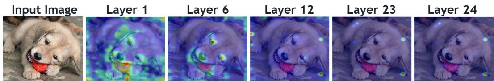  
Figure 1: Attention distributions across ViT layers. Shallow layers show dispersed attention over edges and textures; deeper layers progressively concentrate on a few semantic anchors.

(C) Sparse-Hierarchical Connections(A) Single-layer Connection (B) Encoder-side Fusion (D) Dynamic Gated Pathway  
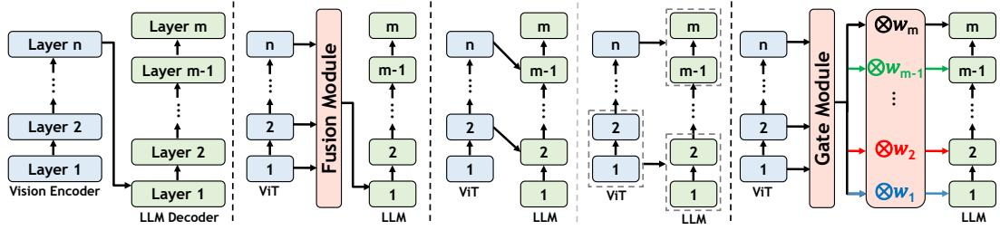  
Figure 2: Strategies for visual token insertion. (A) Fixed single-layer connection. (B) Encoderside fusion of multiple ViT layers into one representation. (C) Predefined sparse or hierarchical connections between ViT and LLM layers. (D) DGP (Ours): dynamic gated pathways between all ViT and all LLM layers. $w _ { m }$ denotes the routing weights that LLM layer m assigns across all ViT layers.

Two lines of work have started to expose multi-layer visual features to the LLM, but each falls short on the where to connect question. Encoder-side fusion [4, 20, 23, 36, 39] merges multi-layer features into one representation before the LLM (Figure 2(B)); any dynamism is consumed inside the encoder and cannot adapt to the differentiated demands of individual LLM layers. Predefined sparse or hierarchical connections [8, 30, 37, 43] wire selected ViT layers to specific LLM layers (Figure 2(C)), typically using hand-crafted connection patterns or fixed hierarchical mappings. CLI [5] introduces adaptive gating conditioned on the current LLM state, but operates over sampled ViT layers and designated LLM injection points. Neither category explicitly models the adaptive, dynamic cross-layer interactions between all ViT layers and all LLM layers that the question of where to connect demands.

Predictive coding in visual neuroscience suggests that perception is not a unidirectional feed-forward process but a hierarchical feedback loop that continuously modulates activations across layers [33]. We take this as inspiration to revisit visual token injection: visual evidence should not be delivered in one shot through a fixed pathway, but should keep participating in the LLM’s representation updates through dynamic cross-layer pathways. Building on this view, we introduce DGP (Dynamic Gated Pathways), which connects all ViT layers to all LLM layers via learned, dynamically gated routes (Figure 2(D)).

Concretely, the outputs of different ViT layers act as candidate representations at varying granularities. At every LLM layer, DGP produces a routing distribution over all ViT layers from the current hidden state, aggregates the candidates via gated weighted fusion, and injects the result back into the layer’s visual hidden states through a residual connection. The hierarchical visual evidence keeps supplying cues for language reasoning, while the LLM’s layer-wise semantic state drives the preference over visual hierarchies, yielding a cross-layer, progressively evolving vision–language interaction that integrates low-level details and high-level semantics on demand at different decoding depths.

We instantiate DGP on top of LLaVA-1.5 [26] and further validate it on Qwen3-VL-2B [3] and LLaVA-NeXT [27]. Across a wide range of multimodal benchmarks, DGP yields consistent improvements over baselines and outperforms prior multi-layer visual feature utilization methods. The learned routing patterns confirm that different LLM layers indeed prefer different visual granularities, alleviating the information bottleneck of fixed single-layer fusion. Our contributions are:

• We reframe visual information injection in MLLMs around the question of where to connect, and show that fixed single-layer inputs and predefined sparse or hierarchical connections cannot match the differentiated demands of hierarchical ViT representations and layer-wise LLM semantics.

• We propose DGP (Dynamic Gated Pathways), an all-to-all cross-layer connection mechanism in which every LLM layer dynamically gates its preference over every ViT layer conditioned on its current semantic state.

• We demonstrate the effectiveness and interpretability of DGP on multiple multimodal benchmarks, where layer-wise routing analyses reveal the adaptive, layer-dependent selection behavior of the proposed dynamic gated pathways.

## 2 Related Work

## 2.1 Multimodal Large Language Model

A typical Multimodal Large Language Model (MLLM) couples a vision encoder, a vision–language adapter, and a large language model: the encoder turns the image into visual tokens, the adapter projects them into the language space, and the LLM consumes the joint visual–textual sequence to generate responses. Existing MLLMs mainly fall into two architectural families: projectorbased decoder-only designs (e.g., LLaVA [26], MiniGPT-4 [44], Qwen-VL [2], InternVL [10]) and cross-attention-based designs (e.g., Flamingo [1]).

Current MLLMs use pretrained vision backbones such as CLIP-ViT [32] and SigLIP [42], all of which expose representations of varying granularities across their layers. Yet most pipelines project only a single fixed layer into the LLM, so the language model sees only one level of visual abstraction. The visual connection mechanism is not merely a cross-modal interface: it determines whether the rich, hierarchical visual representations can be accessed and reused inside the LLM.

## 2.2 Connection Strategies for Visual Token Insertion

Different ViT layers carry different semantic granularities: shallow layers retain local textures and spatial details, while middle and deep layers progressively encode object structures and high-level semantics [6]. A single deep layer is not always the best choice [6], and exploiting the visual hierarchy depends as much on how layers are connected to the LLM as on which layers are selected [24]. The crux, in other words, is to establish effective connections between vision-encoder layers and LLM layers—i.e., the where to connect problem. Prior efforts can be grouped into two categories.

Unified Encoder-side Connections. Methods in this category fuse multi-layer visual features on the encoder side and pass a single unified representation to the LLM. DenseConnector [39] concatenates features from different ViT layers along the token or channel dimension. MMFuser [4] uses deep-layer features as queries to pull fine-grained information from shallow layers. IGVA [20] and TGIF [23] adjust ViT-layer weights conditioned on the instruction. CCRA [36] combines several attention mechanisms for text-conditioned region–semantic alignment. While these designs improve multi-layer feature utilization, the entire fusion happens before the LLM; the LLM still receives one homogenized input and cannot reach back into the visual hierarchy as decoding progresses.

Predefined Sparse or Hierarchical Connections. Methods in this category route hierarchical visual information to different LLM layers. DeepStack [30] distributes visual tokens across decoder depths according to a fixed hierarchical schedule. Sparse Shortcuts [43] wires ViT and LLM layers through predefined connection patterns. EVLM [8] feeds multi-layer ViT features into different gated cross-attention layers. CLI [5] applies adaptive gating at sampled vision layers and designated LLM injection points, rather than treating every ViT–LLM pair as a candidate connection. A more recent line of work [37] selects and fuses hierarchical visual features conditioned on each LLM layer’s representation. Although these methods begin to acknowledge the hierarchical correspondence between vision and language, most still rely on hand-crafted connection patterns or fixed layer-tolayer mappings, and few of them simultaneously realize (i) all-to-all cross-layer connectivity, (ii) routing weights driven by the current LLM-layer state, and (iii) end-to-end training with a stable routing distribution—the design point that DGP targets.

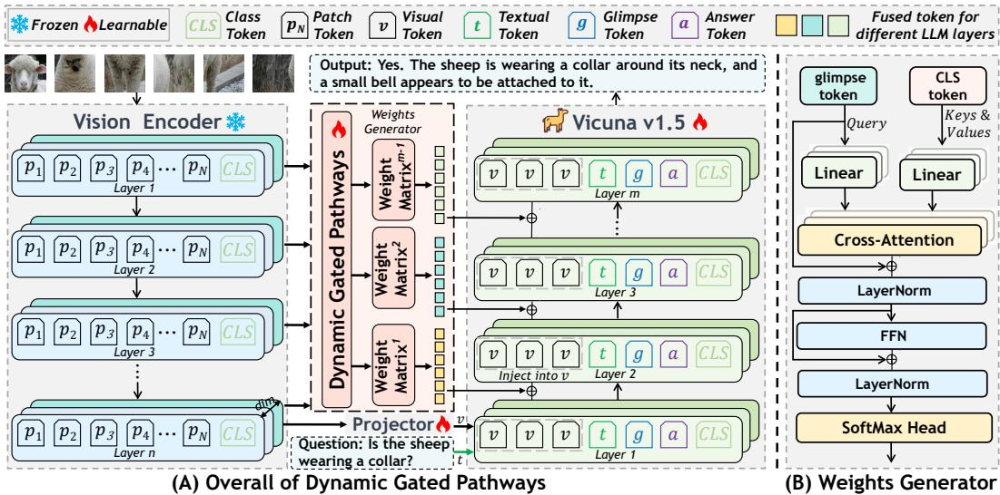  
Figure 3: Overview of DGP. (A) At every LLM layer, the Dynamic Gated Pathways module routes over all ViT layers conditioned on the current language-layer state, aggregates the selected visual features, and injects them back into the LLM hidden states through a gated residual connection— establishing all-to-all cross-layer connections between ViT and LLM. (B) Inside the module, ViT layer summaries serve as keys/values and the language-layer state as the query; a shared cross-attention followed by a layer-specific routing MLP produces the per-layer routing weights. Weight Matrix(m) denotes the routing weights of LLM layer m over all ViT layers.

In summary, existing methods either compress the visual hierarchy into a single pre-LLM representation, or wire it into the LLM through predefined sparse or hierarchical connections; neither answers where to connect via dynamic cross-layer interactions between all ViT layers and all LLM layers. We close this gap with DGP, which establishes adaptive, all-to-all connections between ViT and LLM layers through dynamic gated pathways.

## 3 Methodology

Problem Formulation. In existing MLLMs, a single fixed visual representation is injected once and then propagates implicitly through the LLM [2, 10, 26], leaving no direct cross-layer pathway between the visual hierarchy and the language hierarchy. As a result, different decoding stages cannot reach back to the visual granularity they actually need. DGP (Dynamic Gated Pathways) removes this bottleneck by opening dynamic gated pathways between every ViT layer and every LLM layer, so that each LLM layer can adaptively pick the visual hierarchy that best fits its current semantic state.

Let the vision encoder have $L _ { v }$ layers, with the output of the ℓ-th layer $( \ell = 1 , \ldots , L _ { v } )$ denoted as $\mathbf { X } _ { v } ^ { ( \ell ) }$ . The LLM has $L$ layers in total, and the hidden state of the l-th layer $( l = 1 , \ldots , L )$ is $\mathbf { H } ^ { ( l ) } \in \mathbb { R } ^ { ( N _ { v } + N _ { t } ) \times d }$ , where $\mathbf { H } _ { v } ^ { ( l ) } \in \mathbb { R } ^ { N _ { v } \times d }$ corresponds to the visual token segment. For each LLM layer $l ,$ we aim to learn a layer-specific fusion function:

$$
\widehat { \mathbf { Z } } ^ { ( l ) } = g ^ { ( l ) } \left( \mathbf { H } ^ { ( l ) } , \{ \mathbf { X } _ { v } ^ { ( \ell ) } \} _ { \ell = 1 } ^ { L _ { v } } \right) ,\tag{1}
$$

where $\widehat { \mathbf { Z } } ^ { ( l ) } \in \mathbb { R } ^ { N _ { v } \times d }$ is the fused visual representation tailored to the l-th LLM layer. The objective of $g ^ { ( l ) } ( \cdot )$ is to allocate fusion weights over visual layers conditioned on the current language-layer state, so that visual evidence at multiple depths is integrated on demand during decoding.

## 3.1 All-to-All Cross-Layer Connections

Our structural departure from typical MLLMs is to wire every LLM layer $( l = 1 , \ldots , L )$ to every ViT layer $( \ell = 1 , \ldots , L _ { v } ) { \mathrm { : } }$ : each decoding depth retains direct access to the full visual hierarchy, rather than being restricted to one fixed depth or a hand-crafted sparse routing pattern. As illustrated in

Figure 2(D) and Figure $3 ( \mathrm { A } )$ , we replace the conventional fixed single-layer visual injection with dynamic gated cross-layer pathways between the ViT and LLM stacks. Given an input image I, the vision encoder $F ( \cdot )$ produces a hierarchy of visual representations:

$$
\{ \mathbf { X } _ { v } ^ { ( \ell ) } \} _ { \ell = 1 } ^ { L _ { v } } = F ( \mathbf { I } ) , \qquad \mathbf { X } _ { v } ^ { ( \ell ) } = [ \mathbf { c } ^ { ( \ell ) } ; \mathbf { P } ^ { ( \ell ) } ] ,\tag{2}
$$

where $\mathbf { c } ^ { ( \ell ) }$ is the [CLS] representation of the ℓ-th ViT layer and $\mathbf { P } ^ { ( \ell ) } \in \mathbb { R } ^ { N _ { v } \times d _ { v } }$ is its patch representation. Instead of relying on implicit propagation of the initial visual tokens, we connect every LLM layer to every ViT layer explicitly. Concretely, for any LLM layer $l = 1 , \ldots , L$ , the model derives a layer-specific visual representation $\widehat { \mathbf { Z } } ^ { ( l ) }$ from $\{ \mathbf { X } _ { v } ^ { ( \ell ) } \} _ { \ell = 1 } ^ { L _ { v } }$ via Eq. (1). This realizes an all-to-all connection set between visual and language hierarchies:

$$
\mathcal { E } = \{ ( \ell , l ) \mid \ell = 1 , \ldots , L _ { v } , l = 1 , \ldots , L \} .\tag{3}
$$

Each LLM layer can therefore reach low-level details, mid-level structures, and high-level semantics directly, rather than being locked to a single visual layer or a hand-crafted sparse routing pattern.

The layer-specific representation $\widehat { \mathbf { Z } } ^ { ( l ) }$ is written back into the visual token segment of the same LLM layer via a gated residual connection (formalized in the Token Fusion paragraph below). Importantly, $g ^ { ( l ) } ( \cdot )$ is not a uniform average over visual layers: it is realized by the Dynamic Gated Pathways module described next, which adaptively controls the strength of each ViT–LLM connection.

## 3.2 Dynamic Gated Pathways Module

Weight Generation. Inspired by existing glimpse-token designs [41], we prepend a learnable glimpse token $\mathbf { g } \in \mathbb { R } ^ { d }$ immediately before the first answer token of every multimodal training sample. Because of the causal autoregressive structure, this token can attend to all preceding visual and textual context, and therefore acts as a compact query signal that summarises the current decoding depth. Let $\mathbf { h } _ { g } ^ { ( l ) } \in \mathbb { R } ^ { d }$ denote the hidden state at the glimpse position in the l-th LLM layer; we use it as the routing query, $\mathbf { Q } ^ { ( l ) } = \mathbf { h } _ { g } ^ { ( l ) }$

For each ViT layer ℓ, we take its global [CLS] representation $\mathbf { c } ^ { ( \ell ) }$ as the layer summary: since [CLS] already aggregates the whole image inside that layer, it provides a compact layer-level descriptor of the corresponding visual granularity [12]. We map all $L _ { v }$ summaries into the LLM hidden space and stack them into shared keys and values, $\mathbf { K } = \mathbf { V } = \mathrm { S t a c k } \big ( \widetilde { \mathbf { c } } ^ { ( 1 ) } , \dots , \widetilde { \mathbf { c } } ^ { ( L _ { v } ) } \big ) \in \mathbb { R } ^ { L _ { v } \times d }$ . A multi-head cross-attention [35] module—shared across all LLM layers—then models the interaction between the current language-layer state and the visual-layer summaries, yielding a routing feature:

$$
\mathbf { r } ^ { ( l ) } = \mathrm { M H A } _ { \mathrm { s h a r e d } } \left( \mathbf { Q } ^ { ( l ) } , \mathbf { K } , \mathbf { V } \right) + \mathbf { Q } ^ { ( l ) } ,\tag{4}
$$

where $\mathbf { Q } ^ { ( l ) }$ encodes the multimodal context of the current LLM layer and K, V summarize all candidate visual layers; together they determine how the l-th LLM layer should allocate connection strength across the ViT hierarchy.

Conditioned on this routing feature, the l-th LLM layer produces a routing distribution over all ViT layers through a layer-specific—i.e., not shared—routing MLP:

$$
\begin{array} { r } { \omega ^ { ( l ) } = \mathrm { S o f t m a x } \left( \mathbf { W } _ { 2 } ^ { ( l ) } \operatorname { D r o p o u t } \left( \operatorname { G E L U } \left( \mathbf { W } _ { 1 } ^ { ( l ) } \operatorname { L N } ( \mathbf { r } ^ { ( l ) } ) + \mathbf { b } _ { 1 } ^ { ( l ) } \right) \right) + \mathbf { b } _ { 2 } ^ { ( l ) } \right) \in \mathbb { R } ^ { L _ { v } } , } \end{array}\tag{5}
$$

where $\boldsymbol { \omega } ^ { ( l ) } = ( \omega _ { 1 } ^ { ( l ) } , \dots , \omega _ { L , \mathrm { , } } ^ { ( l ) } ) ^ { \top }$ denotes the routing weights of LLM layer l over the $L _ { v }$ ViT layers and satisfies $\begin{array} { r } { \sum _ { k = 1 } ^ { L _ { v } } \omega _ { k } ^ { ( l ) } = \dot { 1 } . \mathbf { W } _ { 1 } ^ { ( l ) } \in \mathbb { R } ^ { h \times d } } \end{array}$ and $\mathbf { b } _ { 1 } ^ { ( l ) } \in \mathbb { R } ^ { h }$ map the routing feature from the LLM hidden space to the routing hidden space; $\mathbf { W } _ { 2 } ^ { ( l ) } \in \mathbb { R } ^ { L _ { v } \times h }$ and $\mathbf { b } _ { 2 } ^ { ( l ) } \in \mathbb { R } ^ { L _ { v } }$ project it to an $L _ { v } .$ dimensional logit that softmax converts into the per-layer routing distribution. In short, $\mathrm { M H A } _ { \mathrm { s h a r e d } }$ exposes the same query–summary interface to every LLM layer for fair comparison across visual layers, whereas the layer-specific routing MLP $\{ \mathbf { W } _ { 1 } ^ { ( l ) } , \mathbf { b } _ { 1 } ^ { ( l ) } , \dot { \mathbf { W } } _ { 2 } ^ { ( l ) } , \mathbf { b } _ { 2 } ^ { ( l ) } \}$ lets each LLM layer voice its own preference over the visual hierarchy.

Token Fusion. Given the routing weights, we fuse patch features from different visual layers position by position:

$$
\widetilde { \mathbf { p } } _ { i } ^ { ( l ) } = \sum _ { k = 1 } ^ { L _ { v } } \omega _ { k } ^ { ( l ) } \mathbf { p } _ { i } ^ { ( k ) } , \quad i = 1 , \hdots , N _ { v } ,\tag{6}
$$

where $\mathbf { p } _ { i } ^ { ( k ) } \in \mathbb { R } ^ { d _ { v } }$ is the patch at position i from the k-th visual layer and $ { \widetilde { \mathbf { p } } } _ { i } ^ { ( l ) } \in  { \mathbb { R } } ^ { d _ { v } }$ is the aggregated visual feature at that position for the l-th LLM layer. Stacking these vectors row-wise gives $\mathbf { \widetilde { P } } ^ { ( l ) } = [ \widetilde { \mathbf { p } } _ { 1 } ^ { ( l ) } ; \dots ; \widetilde { \mathbf { p } } _ { N _ { \circ } } ^ { ( l ) } ] \in \mathbb { \widetilde { R } } ^ { N _ { v } \times d _ { v } }$ . A layer-specific projector $\rho _ { l } : \mathbb { R } ^ { d _ { v } }  \mathbb { R } ^ { d }$ is then applied row-wise, $\widehat { \mathbf { Z } } ^ { ( l ) } = \rho _ { l } \big ( \widetilde { \mathbf { P } } ^ { ( l ) } \big ) ^ { \widehat { } } \in \mathbb { R } ^ { N _ { v } \times d }$ , and the result is injected back into the visual hidden states through a gated residual connection:

$$
\widetilde { \mathbf H } _ { v } ^ { ( l ) } = \mathbf H _ { v } ^ { ( l ) } + \gamma _ { l } \widehat { \mathbf Z } ^ { ( l ) } , \quad \gamma _ { l } = \sigma ( a _ { l } ) ,\tag{7}
$$

where $a _ { l }$ is a learnable scalar and σ is the sigmoid function; the gate $\gamma _ { l }$ controls how strongly visual information is injected at the current layer.

Through these dynamic gated pathways, the visual hierarchy interacts with the LLM at every layer: the visual representation evolves with decoding depth rather than being committed up front by a one-shot, fixed injection.

## 3.3 Training Objective

To prevent the routing distribution from collapsing onto a small subset of visual layers, we augment the standard autoregressive loss with a lightweight entropy regularizer that maximizes the entropy of the batch-averaged routing distribution at every LLM layer:

$$
\mathcal { L } _ { \mathrm { t o t a l } } = - \frac { 1 } { | \mathcal { M } | } \sum _ { t \in \mathcal { M } } \log p _ { \theta } \Big ( x _ { t } | x _ { < t } , \{ \widehat { \mathbf { Z } } ^ { ( l ) } \} _ { l = 1 } ^ { L } \Big ) - \lambda \frac { 1 } { L } \sum _ { l = 1 } ^ { L } H \Big ( \bar { \omega } ^ { ( l ) } \Big ) , \quad H ( p ) = - \sum _ { k = 1 } ^ { L _ { \infty } } p _ { k } \log p _ { k } .\tag{8}
$$

Here M denotes the set of valid supervision positions, $\{ \widehat { \mathbf { Z } } ^ { ( l ) } \} _ { l = 1 } ^ { L }$ are the per-layer fused visual representations injected into the LLM, $\bar { \boldsymbol { \omega } } ^ { ( l ) } = ( \bar { \omega } _ { 1 } ^ { ( l ) } , \dots , \bar { \omega } _ { L _ { v } } ^ { ( l ) } ) ^ { \top }$ is the batch-averaged routing distribution at LLM layer $l , H ( \cdot )$ is the Shannon entropy, and $\lambda \geq 0$ controls the regularization strength. The second term rewards higher entropy and therefore discourages collapse onto a few visual layers. Following TGIF [23], we set $\lambda = 0 . { \bar { 0 1 } }$ during pre-training and $\bar { \lambda } = 0$ during instruction fine-tuning so that routing can specialize to task-relevant visual granularities.

## 4 Experiments

## 4.1 Experimental Settings

Implementation Details and Training Recipe. We follow the LLaVA-1.5 [26] training recipe, using CLIP-ViT-L/14-336 [32] as the vision encoder and Vicuna as the LLM backbone. Training proceeds in two stages: pre-training (PT) on LLaVA-558K [26] and supervised fine-tuning (SFT) on LLaVA-mixed-665K [26]. Because DGP interacts with the hidden states at every LLM layer, both stages jointly optimize the LLM together with the newly introduced DGP modules. The vision encoder is kept frozen throughout, and each stage is trained for one epoch.

All hyperparameters follow LLaVA-1.5: AdamW with cosine scheduling (warmup ratio 0.03), batch sizes of 256/128 and learning rates of $1 \times 1 0 ^ { - 3 } / 2 \times 1 0 ^ { - 5 }$ for PT/SFT, respectively. The routing MLP uses a hidden dimension of 1024, and the residual gate is initialized to 0.3. Following TGIF [23], the entropy regularizer uses $\lambda = 0 . 0 1$ during PT and is disabled $( \lambda = 0 )$ during SFT so routing can specialize. More hyperparameter sensitivity results are provided in Appendix C.

Benchmarks. We evaluate on two complementary suites of multimodal benchmarks. Academic VQA covers GQA [15], SciQA-IMG [29], VQAv2 [13], and VizWiz [14]. Instruction-following / LMM benchmarks cover SEED-Bench (SEED/SEEDI) [18], LLaVA-Wild [25], MM-Vet [40], MMBench [28], and POPE [22], jointly probing multimodal comprehension, fine-grained perception, and hallucination resistance.

Baselines. We compare DGP against two groups of baselines. The first group consists of generalpurpose MLLMs: BLIP-2 [19], InstructBLIP [11], Shikra [9], IDEFICS [17], Qwen-VL [2], and LLaVA-1.5 [26]. The second group focuses on multi-layer visualfeature utilization: MMFuser [4], Dense Connector [39], DeepStack-L [30], Sparse Shortcuts [43], IGVA [20], and TGIF [23]. For a fair comparison, we focus on methods that share the Vicuna backbone and the LLaVA-1.5 configuration.

Table 1: Comparison with state-of-the-art MLLMs. We evaluate on Academic-oriented VQA tasks and recent LMM benchmarks. Best results are in bold; second-best are underlined. “–” denotes results not reported in the original papers. Rows below DGP report the absolute point gain (↑) or loss (↓) relative to LLaVA-1.5.
<table><tr><td rowspan="2">Method</td><td rowspan="2">LLM</td><td colspan="4">Academic-oriented VQA</td><td colspan="7">LMM benchmarks</td></tr><tr><td></td><td></td><td></td><td></td><td></td><td>GQASQA VQAv2 VizWizSEEDSEED LLaVA</td><td></td><td></td><td>MM-VetMMBMMBCN</td><td></td><td>POPE</td></tr><tr><td>BLIP-2 [19]</td><td>Vicuna-13B</td><td>41.0</td><td>61.0</td><td>65.0</td><td>19.6</td><td>46.4</td><td>49.7</td><td>38.1</td><td>22.4</td><td></td><td></td><td>85.3</td></tr><tr><td>InstructBLIP [11]</td><td>Vicuna-7B</td><td>49.2</td><td>60.5</td><td></td><td>34.5</td><td>53.4</td><td>58.8</td><td>60.9</td><td>26.2</td><td>36.0</td><td>23.7</td><td></td></tr><tr><td>InstructBLIP [11]</td><td>Vicuna-13B</td><td>49.5</td><td>63.1</td><td></td><td>33.4</td><td>78.9</td><td></td><td>58.2</td><td>25.6</td><td></td><td></td><td>78.9</td></tr><tr><td>Shikra [9]</td><td>Vicuna-13B</td><td></td><td></td><td>77.4</td><td></td><td></td><td></td><td></td><td></td><td>58.8</td><td></td><td></td></tr><tr><td>IDEFICS-9B [17]</td><td>LLaMA-7B</td><td>38.4</td><td></td><td>50.9</td><td>35.5</td><td></td><td>44.5</td><td></td><td></td><td>48.2</td><td>25.2</td><td></td></tr><tr><td>IDEFICS-80B [17]</td><td>LLaMA-65B</td><td>45.2</td><td></td><td>60.0</td><td>36.0</td><td></td><td>53.2</td><td></td><td></td><td>54.5</td><td>38.1</td><td>一</td></tr><tr><td>Qwen-VL [2]</td><td>Qwen-7B</td><td>59.3</td><td>67.1</td><td>78.8</td><td>35.2</td><td>56.3</td><td>62.3</td><td></td><td></td><td>38.2</td><td>7.4</td><td>一</td></tr><tr><td>Qwen-VL-Chat [2]</td><td>Qwen-7B</td><td>57.5</td><td>68.2</td><td>78.2</td><td>38.9</td><td>58.2</td><td>65.4</td><td></td><td></td><td>60.6</td><td>56.7</td><td>一</td></tr><tr><td>LLaVA-1.5 [26]</td><td>Vicuna-7B</td><td>62.0</td><td>66.8</td><td>78.5</td><td>50.0</td><td>58.6</td><td>66.1</td><td>63.4</td><td>30.5</td><td>64.3</td><td>58.3</td><td>85.9</td></tr><tr><td>MMFuser [4]</td><td>Vicuna-7B</td><td>62.8</td><td>68.7</td><td>79.1</td><td>53.4</td><td>60.8</td><td>一</td><td>65.5</td><td>32.6</td><td>67.5</td><td>60.1</td><td>86.3</td></tr><tr><td>Dense Connector [39]</td><td>Vicuna-7B</td><td>63.8</td><td>69.5</td><td>79.5</td><td></td><td></td><td>一</td><td></td><td>32.7</td><td>66.8</td><td></td><td>86.6</td></tr><tr><td>DeepStack-L [30]</td><td>Vicuna-7B</td><td>63.1</td><td></td><td>79.5</td><td></td><td>60.6</td><td></td><td></td><td>29.9</td><td></td><td></td><td>86.7</td></tr><tr><td>SparseCut [43]</td><td>Vicuna-7B</td><td>63.6</td><td>70.0</td><td>80.0</td><td>54.2</td><td></td><td>67.3</td><td></td><td></td><td>67.3</td><td>60.1</td><td>87.7</td></tr><tr><td>IGVA [20]</td><td>Vicuna-7B</td><td>63.1</td><td>70.2</td><td></td><td>54.3</td><td></td><td>68.3</td><td></td><td>33.5</td><td>66.9</td><td></td><td>87.8</td></tr><tr><td>TGIF [23]</td><td>Vicuna-7B</td><td>62.6</td><td>70.1</td><td></td><td></td><td></td><td></td><td></td><td></td><td>66.4</td><td></td><td>86.2</td></tr><tr><td>DGP</td><td>Vicuna-7B</td><td>64.6</td><td>71.0</td><td>79.7</td><td>53.1</td><td>61.5</td><td>67.5</td><td>66.5</td><td>33.8</td><td>66.7</td><td>60.5</td><td>87.0</td></tr><tr><td></td><td></td><td>↑2.6</td><td>↑4.2</td><td>↑1.2</td><td>↑3.1</td><td>↑2.9</td><td>↑1.4</td><td>↑3.1</td><td>↑3.3</td><td>↑2.4</td><td>↑2.2</td><td>↑1.1</td></tr><tr><td>LLaVA-1.5 [26]</td><td>Vicuna-13B</td><td>63.3</td><td>71.6</td><td>80.0</td><td>53.6</td><td>61.6</td><td>68.2</td><td>70.7</td><td>35.4</td><td>67.7</td><td>63.6</td><td>85.9</td></tr><tr><td>MMFuser [4]</td><td>Vicuna-13B</td><td>63.4</td><td>71.2</td><td>80.1</td><td>57.4</td><td>62.0</td><td></td><td>71.8</td><td>36.6</td><td>69.9</td><td>63.8</td><td>87.5</td></tr><tr><td>DeepStack-L [30]</td><td>Vicuna-13B</td><td>64.2</td><td></td><td>80.9</td><td></td><td>63.5</td><td></td><td></td><td>35.9</td><td></td><td></td><td>87.7</td></tr><tr><td>SparseCut [43]</td><td>Vicuna-13B</td><td>64.0</td><td>71.8</td><td>81.8</td><td>56.1</td><td></td><td>69.0</td><td></td><td></td><td>69.7</td><td>64.1</td><td>87.8</td></tr><tr><td>DGP</td><td>Vicuna-13B</td><td>65.5</td><td>73.0</td><td>80.7</td><td>57.4</td><td>63.0</td><td>69.0</td><td>70.0</td><td>37.5</td><td>70.1</td><td>65.4</td><td>87.6</td></tr><tr><td></td><td></td><td>↑2.2</td><td>↑1.4</td><td>↑0.7</td><td>↑3.8</td><td>↑1.4</td><td>↑0.8</td><td>↓0.7</td><td>↑2.1</td><td>↑2.4</td><td>↑1.8</td><td>↑1.7</td></tr></table>

## 4.2 Main Results

Comparison with SOTA Methods. Table 1 compares DGP with mainstream MLLMs and multi-layer visual feature utilization methods under Vicuna-7B and 13B settings. Taking Vicuna-7B as an illustrative example, DGP consistently improves over the LLaVA-1.5 baseline—most prominently on VizWiz (+3.1), SQAI (+4.2), LLaVAW (+3.1), and MM-Vet (+3.3)—with similar trends on the remaining benchmarks. Against the strongest multi-layer baselines, DGP attains the best score on GQA, SQAI, SEED, LLaVAW , MM-Vet, and MMBCN , suggesting that compressing the visual hierarchy on the encoder side or using predefined sparse or hierarchical connections is insufficient to capture the full interaction between hierarchical visual evidence and the layer-wise LLM state. Overall, the gains support our central claim: dynamically gating where to connect between ViT and LLM layers is a more effective use of the visual hierarchy than any fixed wiring.

Generalization Across MLLM Frameworks. To verify that DGP captures a general architectural principle, we evaluate it on two additional MLLM configurations that differ substantially in vision encoder, LLM backbone, and resolution strategy. For fair comparison, all models are trained on the same

Table 2: Generalization across MLLM frameworks. We evaluate DGP on different vision encoders (SigLIP2 vs. CLIP), LLM backbones (Qwen3 vs. Vicuna), and high-resolution tiling.
<table><tr><td>Method</td><td>ViT</td><td>LLM</td><td>GQA</td><td>SQAI</td><td>MMB</td><td>MM-Vet</td></tr><tr><td rowspan="2">Qwen3-VL-2B [3] + DGP</td><td>SigLIP2-L</td><td>Qwen3-1.7B</td><td>63.9</td><td>85.3</td><td>76.4</td><td>49.8</td></tr><tr><td>SigLIP2-L</td><td>Qwen3-1.7B</td><td>65.4</td><td>86.9</td><td>77.4</td><td>50.9</td></tr><tr><td rowspan="2">LLaVA-NeXT [27] + DGP</td><td>CLIP-L</td><td>Vicuna-7B</td><td>64.0</td><td>69.5</td><td>66.5</td><td>33.1</td></tr><tr><td>CLIP-L</td><td>Vicuna-7B</td><td>64.8</td><td>72.3</td><td>68.7</td><td>34.6</td></tr></table>

558K (PT) + 665K (SFT) data splits following DenseConnector [39], with one epoch per stage. As shown in Table 2, DGP delivers consistent improvements on both Qwen3-VL-2B (SigLIP2 + Qwen3-1.7B) and LLaVA-NeXT (AnyRes tiling), confirming that the where to connect principle is architecture-agnostic.

Case Study. To make the effect of DGP more concrete, Figure 4 contrasts DGP with LLaVA-1.5 on math reasoning, OCR understanding, and fine-grained visual reasoning. LLaVA-1.5 frequently fails to read critical visual evidence or forms wrong semantic associations—for example, misreading

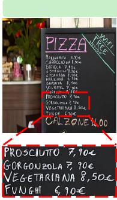

Question: I am getting one funghi pizza and one prosciutto pizza. How much should I pay in total?

LLaVA-1.5:To determine the total cost of your order, you need to add the prices of the two pizzas to the cost of the calzone. The calzone costs 11.40 euros. Therefore, the total cost of your order would be: 1 Funghi Pizza: 7.50 euros, 1 Prosciutto Pizza: 7.50 euros, 1 Calzone: 11.40 euros. Total cost: 26.40 euros.

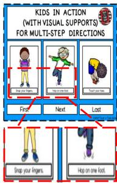

DGP: To determine the total cost of your order, you need to add the prices of the two pizzas. From the menu, the Funghi pizza costs 6.90 euros and the Prosciutto pizza costs 7.90 euros. Therefore, the total cost is: 6.90 + 7.90 = 14.80 euros. So, the total amount to pay is 14.8 euros.

## Optical Character Recognition

Question: What should kids do after snap fingers?

LLaVA-1.5: After snapping their fingers, kids should follow the visual support provided in the image, which is a step-by-step direction for multi-step directions. This visual support helps them understand the sequence of actions required to complete a task, such as following a recipe or performing a specific activity. By following the visual support, kids can ensure they are following the correct steps and completing the task correctly.

DGP: After snapping their fingers, kids should follow the next step in the multi-step directions, which is to hop on one foot.This activity helps improve their coordination, balance, and following directions skills.

LLaVA-1.5: The funny aspect of this image is the juxtaposition of two women pointing fingers at a cat, which is sitting at a table with a plate of food. The cat appears to be looking at the women with an angry expression, as if it is reacting to their pointing fingers. This creates a humorous and unexpected scene, as it is not common to see a cat reacting to human gestures in such a manner. The image captures a light-hearted and amusing moment between the women and the cat.

DGP: The humor in this image comes from the contrast between the two scenes. On the left, two women appear very emotional and angry, with one of them yelling and pointing. On the right, a white cat is calmly sitting at a dining table with a plate of food in front of it, almost like a person. The scene is funny because the cat seems to be the target of the women ’ s yelling, and its serious or slightly confused expression makes the situation feel absurd and unexpected.

Figure 4: Qualitative comparison between DGP and LLaVA-1.5. Representative examples from math solving, OCR understanding, and detailed visual reasoning. LLaVA-1.5 often misses critical visual evidence or hallucinates content; DGP produces more accurate, evidence-grounded responses by adaptively accessing multi-granularity visual features.

menu prices or hallucinating non-existent items such as a “calzone”—and this propagates into clearly hallucinated reasoning. DGP, in contrast, uses its dynamic gated pathways to let different LLM layers access multi-granularity visual cues on demand, accurately recovering textual and numerical details, facial expressions, and other fine-grained evidence, and grounds the final answer in those cues.

Efficiency Analysis. Table 3 reports the computational overhead of DGP. The DGP module introduces only 5.29% additional parameters for the 7B model and 4.27% for the 13B model. The FLOPs overhead is modest for 7B (+4.07%) and negligible for 13B (−0.07%), while peak memory is nearly unchanged for 7B (−0.13%) and increases by 4.13% for 13B. Taken together with the performance gains, these modest

Table 3: Efficiency analysis of DGP at batch size 1. FLOPs and peak memory are measured during endto-end autoregressive generation.
<table><tr><td>Method</td><td>Params (M)</td><td>FLOPs (G)</td><td>Mem (GB)</td></tr><tr><td>LLaVA-1.5-7B</td><td>6,759.4</td><td>9,168.3</td><td>15.51</td></tr><tr><td>+ DGP</td><td>7,117.3 +5.29%</td><td>9,541.2+4.07%</td><td>15.49−0.13%</td></tr><tr><td>LLaVA-1.5-13B</td><td>13,047.3</td><td>17,731.2</td><td>27.34</td></tr><tr><td>+ DGP</td><td>13,604.9+4.27%</td><td>17,718.8-0.07%</td><td>28.47+4.13%</td></tr></table>

overheads indicate a favorable trade-off between multimodal performance and computational cost.

## 4.3 Ablation Studies and Analysis

Ablation of DGP Components. Table 4 ablates the two key ingredients of DGP—gated routing and entropy regularization—and keeps a uniform average over the 24 ViT layers as a control, so as to disentangle gains coming from “using more visual layers” from those coming from where to connect. Adding gated routing alone already yields consistent improvements over the LLaVA-1.5 baseline on most benchmarks. By contrast, uniform average fusion without gated routing hurts performance on most benchmarks relative to the baseline. Equal-weight mixing across the visual hierarchy appears to blend incompatible granularities and weaken fine-grained evidence, whereas gated routing keeps connectivity selective and conditioned on the language-layer state. Stacking the entropy regularizer on top of gated routing brings a further gain, indicating that a well-spread routing distribution prevents collapse onto a few visual layers and stabilizes training. Together, these results show that the improvement is driven by the where to connect mechanism—routing that adapts to the language-layer state—rather than by the mere availability of more visual features.

Table 4: Ablation of DGP components. We evaluate the contribution of average fusion, gated routing, and entropy regularization.
<table><tr><td rowspan="2">Avg.</td><td rowspan="2">Gated Fusion Routing</td><td rowspan="2">Entropy Reg.</td><td colspan="4">Academic-oriented VQA</td><td colspan="7">LMM benchmarks</td></tr><tr><td>GQA SQA1 VQAv2</td><td></td><td></td><td>VizWiz</td><td>SEED SEED LLaVAW</td><td></td><td></td><td>MM-Vet MMB MMBCN</td><td></td><td></td><td>POPE</td></tr><tr><td>x</td><td>x</td><td>x</td><td>62.0</td><td>66.8</td><td>78.5</td><td>50.0</td><td>58.6</td><td>66.1</td><td>63.4</td><td>30.5</td><td>64.3</td><td>58.3</td><td>85.9</td></tr><tr><td>√</td><td>x</td><td>x</td><td>60.2</td><td>64.3</td><td>72.0</td><td>50.2</td><td>57.9</td><td>63.3</td><td>56.3</td><td>25.3</td><td>57.6</td><td>44.9</td><td>77.2</td></tr><tr><td>x</td><td>√</td><td>x</td><td>64.1</td><td>70.5</td><td>78.9</td><td>52.0</td><td>60.9</td><td>66.7</td><td>63.6</td><td>32.4</td><td>65.6</td><td>59.1</td><td>86.4</td></tr><tr><td>x</td><td>√</td><td>√</td><td>64.6</td><td>71.0</td><td>79.7</td><td>53.1</td><td>61.5</td><td>67.5</td><td>66.5</td><td>33.8</td><td>66.7</td><td>60.5</td><td>87.0</td></tr></table>

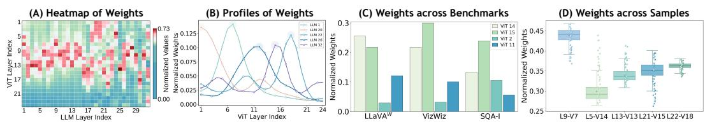  
Figure 5: Gated Pathway Analysis. (A) Heatmap of routing weights over LLM (x) and ViT (y) layers. (B) Routing curves of representative LLM layers with multimodal patterns. (C) Routing weights of LLM layer 21 across benchmarks, showing task-specific preferences. (D) Per-sample routing distributions within the same benchmark, showing sample-level diversity.

Layer-wise Gated Pathway Analysis. To inspect what DGP actually learns, we visualize the routing weights of every LLM layer over the ViT layers. Figure 5(A) shows a clearly non-uniform, layerdependent distribution: DGP neither fixates on the last ViT layer nor degenerates into a uniform average. Middle ViT layers are activated most frequently, suggesting that they offer a useful trade-off between local structure and high-level semantics. Shallow and deep features are also selected by certain LLM layers, confirming that the model dynamically reaches into different visual granularities according to where it is in decoding rather than relying on a single visual layer.

Figure 5(B) zooms in on representative LLM layers. Their routing curves peak at different positions: LLM layer 1 favors shallow-to-middle ViT layers, LLM layer 20 leans toward shallow features, whereas LLM layers 22 and 32 peak at mid-deep and deep ViT layers, respectively. The curves are typically multimodal rather than unimodal or flat, showing that DGP selectively combines several visual layers per LLM layer and that different LLM layers prefer different visual granularities depending on their language state. These visualizations confirm that DGP discovers non-uniform, dynamic ViT–LLM connection patterns, exploiting the complementarity of the visual hierarchy.

Task-aware Gated Pathway Analysis. We next ask whether the routing also adapts to the task itself. Figure 5(C) plots the routing weights of LLM layer 21 across benchmarks: each benchmark induces a distinct visual-layer profile. LLaVAW and VizWiz allocate more mass to mid-level features, in line with the need to balance object-level semantics and local visual cues for open-ended QA and real-world understanding, whereas SQAI additionally puts noticeable weight on shallow ViT layer 2, reflecting the fine-grained details required in scientific reasoning. Figure 5(D) zooms one level further down: even within a single benchmark, individual samples exhibit substantial routing diversity, indicating that DGP’s adaptivity goes beyond benchmark-level differences and operates at the sample level.

Figure 6 fixes the image and varies the question. For questions about attribute recognition or smallregion details, DGP activates shallow or shallow-to-middle ViT features—layers that preserve edges, textures and local spatial structure. For questions that rely more on global semantics or abstract reasoning—painting identification, historical significance, action understanding—the routing weight peaks instead at mid-deep or deep ViT layers. For open-ended questions such as “describe the image in detail,” which require both local details and holistic semantics, the routing distribution naturally widens into a broader multimodal shape that simultaneously taps multiple visual hierarchies. These patterns indicate that DGP’s routing is dynamically conditioned on the layer-wise linguistic context and semantic state of the LLM, rather than being determined solely by fixed visual-layer priors.

Feature Visualization. Figure 7 compares fixed single-layer CLIP features (L23), a uniform average over all 24 ViT layers, and the features produced by DGP at different LLM layers. CLIP (L23) yields coarse spatial responses with noisy activations in the background; naive average fusion brings in multi-layer information but, because features at different semantic granularities are superposed without selection, still suffers from diffuse responses and amplified local noise. DGP’s LLM-layerspecific features instead show clearly more stable spatial structure, sharper subject contours, and lower background noise, preserving local details such as spoon edges and building boundaries. Crucially, the fused features differ across LLM layers 1, 18, and 28, confirming that DGP generates differentiated visual representations via dynamic routing rather than collapsing into a fixed averaging pattern. Overall, DGP strengthens global semantics while keeping shallow and middle-layer cues intact, mitigating both the information bottleneck of fixed single-layer features and the noise accumulation of naive averaging.

Input Image  

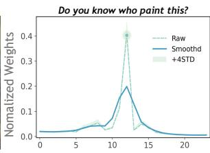

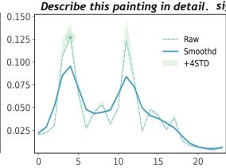

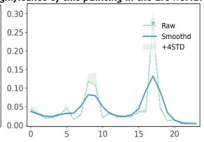

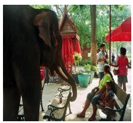

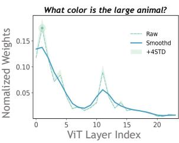

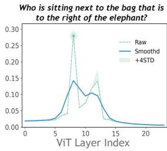

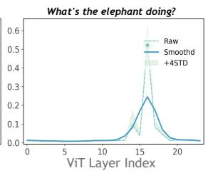  
Figure 6: Task-aware routing for the same image. As the question changes, routing shifts: attribute recognition activates shallower layers, while global-semantic questions activate deeper ones.

CLIP (L23)  
Input Image  
AVG  
LLM 1  
LLM 18  
LLM 28  
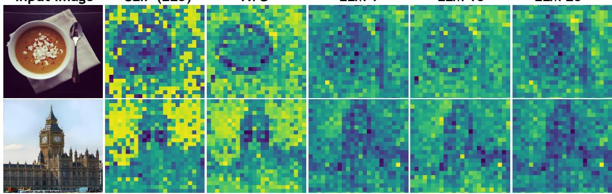  
Figure 7: Fused visual feature visualization. We compare CLIP layer 23, the uniform average over all 24 ViT layers, and DGP’s gated fusion at different LLM layers.

## 5 Conclusion

In this work, we reframe visual information injection in MLLMs around the question of where to connect, and argue that fixed single-layer inputs or predefined sparse or hierarchical connections cannot match the differentiated demands of hierarchical ViT representations and layer-wise LLM semantics. We answer this question with DGP (Dynamic Gated Pathways), an all-to-all cross-layer connection mechanism in which each LLM layer adaptively gates its preference over every ViT layer based on its current semantic state, integrating multi-granularity visual information on demand at every decoding depth. DGP delivers consistent gains across a broad set of multimodal benchmarks, while routing analyses and feature visualizations show that it learns interpretable, layer-dependent connection patterns that explain where the gains come from.

## Acknowledgments and Disclosure of Funding

This work was supported by the National Natural Science Foundation of China (Nos. 62472359 and 62372379).

## References

[1] Jean-Baptiste Alayrac, Jeff Donahue, Pauline Luc, Antoine Miech, Iain Barr, Yana Hasson, Karel Lenc, Arthur Mensch, Katherine Millican, Malcolm Reynolds, et al. Flamingo: a visual language model for few-shot learning. Advances in neural information processing systems, 35:23716–23736, 2022.

[2] Jinze Bai, Shuai Bai, Shusheng Yang, Shijie Wang, Sinan Tan, Peng Wang, Junyang Lin, Chang Zhou, and Jingren Zhou. Qwen-vl: A versatile vision-language model for understanding, localization, text reading, and beyond, 2023.

[3] Shuai Bai, Yuxuan Cai, Ruizhe Chen, Keqin Chen, Xionghui Chen, Zesen Cheng, Lianghao Deng, Wei Ding, Chang Gao, Chunjiang Ge, et al. Qwen3-vl technical report. arXiv preprint arXiv:2511.21631, 2025.

[4] Yue Cao, Yong Huang, Wei Zhu, Yangzhou Liu, Zhe Chen, Guangchen Shi, Yong Fa, Yujie Yang, Song Mei, and Tong Lu. Mmfuser: Multimodal multi-layer feature fuser for fine-grained vision-language understanding. In International Conference on Pattern Recognition, pages 406–421. Springer, 2026.

[5] Cheng Chen, Yuyu Guo, Pengpeng Zeng, Jingkuan Song, Peng Di, Hang Yu, and Lianli Gao. From one-to-one to many-to-many: Dynamic cross-layer injection for deep vision-language fusion. In European Conference on Computer Vision, pages 616–634. Springer, 2026.

[6] Haoran Chen, Junyan Lin, Xinghao Chen, Yue Fan, Jianfeng Dong, Xin Jin, Hui Su, Jinlan Fu, and Xiaoyu Shen. Multimodal language models see better when they look shallower. In Proceedings of the 2025 Conference on Empirical Methods in Natural Language Processing, pages 6688–6706, 2025.

[7] Jianmin Chen, Jiaqi Tang, Wei Wei, Xiaogang Xu, Jiafei Wu, Zhe Liu, Qianzhou Wang, Yingying Yan, Botong Geng, Yuyang Xia, et al. Remember-r1: Mitigating long-context visual forgetting through reinforcement learning. arXiv preprint arXiv:2608.01314, 2026.

[8] Kaibing Chen, Dong Shen, Hanwen Zhong, Huasong Zhong, Kui Xia, Di Xu, Wei Yuan, Yifei Hu, Bin Wen, Tianke Zhang, et al. Evlm: An efficient vision-language model for visual understanding. arXiv preprint arXiv:2407.14177, 2024.

[9] Keqin Chen, Zhao Zhang, Weili Zeng, Richong Zhang, Feng Zhu, and Rui Zhao. Shikra: Unleashing multimodal llm’s referential dialogue magic. arXiv preprint arXiv:2306.15195, 2023.

[10] Zhe Chen, Jiannan Wu, Wenhai Wang, Weijie Su, Guo Chen, Sen Xing, Muyan Zhong, Qinglong Zhang, Xizhou Zhu, Lewei Lu, et al. Internvl: Scaling up vision foundation models and aligning for generic visual-linguistic tasks. In Proceedings of the IEEE/CVF conference on computer vision and pattern recognition, pages 24185–24198, 2024.

[11] Wenliang Dai, Junnan Li, Dongxu Li, Anthony Tiong, Junqi Zhao, Weisheng Wang, Boyang Li, Pascale N Fung, and Steven Hoi. Instructblip: Towards general-purpose vision-language models with instruction tuning. Advances in neural information processing systems, 36:49250–49267, 2023.

[12] Alexey Dosovitskiy, Lucas Beyer, Alexander Kolesnikov, Dirk Weissenborn, Xiaohua Zhai, Thomas Unterthiner, Mostafa Dehghani, Matthias Minderer, Georg Heigold, Sylvain Gelly, et al. An image is worth 16x16 words: Transformers for image recognition at scale. arXiv preprint arXiv:2010.11929, 2020.

[13] Yash Goyal, Tejas Khot, Douglas Summers-Stay, Dhruv Batra, and Devi Parikh. Making the v in vqa matter: Elevating the role of image understanding in visual question answering. In Proceedings of the IEEE conference on computer vision and pattern recognition, pages 6904–6913, 2017.

[14] Danna Gurari, Qing Li, Abigale J Stangl, Anhong Guo, Chi Lin, Kristen Grauman, Jiebo Luo, and Jeffrey P Bigham. Vizwiz grand challenge: Answering visual questions from blind people. In 2018 IEEE/CVF Conference on Computer Vision and Pattern Recognition, pages 3608–3617. IEEE, 2018.

[15] Drew A Hudson and Christopher D Manning. Gqa: A new dataset for real-world visual reasoning and compositional question answering. In 2019 IEEE/CVF Conference on Computer Vision and Pattern Recognition (CVPR), pages 6693–6702. IEEE, 2019.

[16] Aaron Hurst, Adam Lerer, Adam P Goucher, Adam Perelman, Aditya Ramesh, Aidan Clark, AJ Ostrow, Akila Welihinda, Alan Hayes, Alec Radford, et al. Gpt-4o system card. arXiv preprint arXiv:2410.21276, 2024.

[17] Hugo Laurençon, Lucile Saulnier, Léo Tronchon, Stas Bekman, Amanpreet Singh, Anton Lozhkov, Thomas Wang, Siddharth Karamcheti, Alexander Rush, Douwe Kiela, et al. Obelics: An open web-scale filtered dataset of interleaved image-text documents. Advances in Neural Information Processing Systems, 36: 71683–71702, 2023.

[18] Bohao Li, Rui Wang, Guangzhi Wang, Yuying Ge, Yixiao Ge, and Ying Shan. Seed-bench: Benchmarking multimodal llms with generative comprehension. arXiv preprint arXiv:2307.16125, 2023.

[19] Junnan Li, Dongxu Li, Silvio Savarese, and Steven Hoi. Blip-2: Bootstrapping language-image pre-training with frozen image encoders and large language models. In International conference on machine learning, pages 19730–19742. PMLR, 2023.

[20] Xu Li, Yi Zheng, Haotian Chen, Xiaolei Chen, Yuxuan Liang, Chenghang Lai, Bin Li, and Xiangyang Xue. Instruction-guided fusion of multi-layer visual features in large vision-language models. Pattern Recognition, 170:111932, 2026.

[21] Yanwei Li, Yuechen Zhang, Chengyao Wang, Zhisheng Zhong, Yixin Chen, Ruihang Chu, Shaoteng Liu, and Jiaya Jia. Mini-gemini: Mining the potential of multi-modality vision language models. IEEE Transactions on Pattern Analysis and Machine Intelligence, 2025.

[22] Yifan Li, Yifan Du, Kun Zhou, Jinpeng Wang, Xin Zhao, and Ji-Rong Wen. Evaluating object hallucination in large vision-language models. In Proceedings ofthe 2023 conference on empirical methods in natural language processing, pages 292–305, 2023.

[23] Chenchen Lin, Sanbao Su, Rachel Luo, Yuxiao Chen, Yan Wang, Marco Pavone, and Fei Miao. Text-guided layer fusion mitigates hallucination in multimodal llms. arXiv preprint arXiv:2601.03100, 2026.

[24] Junyan Lin, Haoran Chen, Yue Fan, Yingqi Fan, Xin Jin, Hui Su, Jinlan Fu, and Xiaoyu Shen. Multi-layer visual feature fusion in multimodal llms: Methods, analysis, and best practices. In 2025 IEEE/CVF Conference on Computer Vision and Pattern Recognition (CVPR), pages 4156–4166. IEEE, 2025.

[25] Haotian Liu, Chunyuan Li, Qingyang Wu, and Yong Jae Lee. Visual instruction tuning. Advances in neural information processing systems, 36:34892–34916, 2023.

[26] Haotian Liu, Chunyuan Li, Yuheng Li, and Yong Jae Lee. Improved baselines with visual instruction tuning. In 2024 IEEE/CVF Conference on Computer Vision and Pattern Recognition (CVPR), pages 26286–26296. IEEE, 2024.

[27] Haotian Liu, Chunyuan Li, Yuheng Li, Bo Li, Yuanhan Zhang, Sheng Shen, and Yong Jae Lee. LLaVA-NeXT: Improved reasoning, OCR, and world knowledge. https://llava-vl.github.io/blog/ 2024-01-30-llava-next/, 2024.

[28] Yuan Liu, Haodong Duan, Yuanhan Zhang, Bo Li, Songyang Zhang, Wangbo Zhao, Yike Yuan, Jiaqi Wang, Conghui He, Ziwei Liu, et al. Mmbench: Is your multi-modal model an all-around player? In European conference on computer vision, pages 216–233. Springer, 2024.

[29] Pan Lu, Swaroop Mishra, Tanglin Xia, Liang Qiu, Kai-Wei Chang, Song-Chun Zhu, Oyvind Tafjord, Peter Clark, and Ashwin Kalyan. Learn to explain: Multimodal reasoning via thought chains for science question answering. Advances in neural information processing systems, 35:2507–2521, 2022.

[30] Lingchen Meng, Jianwei Yang, Rui Tian, Xiyang Dai, Zuxuan Wu, Jianfeng Gao, and Yu-Gang Jiang. Deepstack: Deeply stacking visual tokens is surprisingly simple and effective for lmms. Advances in Neural Information Processing Systems, 37:23464–23487, 2024.

[31] Maxime Oquab, Timothée Darcet, Théo Moutakanni, Huy Vo, Marc Szafraniec, Vasil Khalidov, Pierre Fernandez, Daniel Haziza, Francisco Massa, Alaaeldin El-Nouby, et al. Dinov2: Learning robust visual features without supervision. arXiv preprint arXiv:2304.07193, 2023.

[32] Alec Radford, Jong Wook Kim, Chris Hallacy, Aditya Ramesh, Gabriel Goh, Sandhini Agarwal, Girish Sastry, Amanda Askell, Pamela Mishkin, Jack Clark, et al. Learning transferable visual models from natural language supervision. In International conference on machine learning, pages 8748–8763. PmLR, 2021.

[33] Rajesh PN Rao and Dana H Ballard. Predictive coding in the visual cortex: a functional interpretation of some extra-classical receptive-field effects. Nature neuroscience, 2(1):79–87, 1999.

[34] Jiaqi Tang, Jianmin Chen, Wei Wei, Xiaogang Xu, Runtao Liu, Xiangyu Wu, Qipeng Xie, Jiafei Wu, Lei Zhang, and Qifeng Chen. Robust-r1: Degradation-aware reasoning for robust visual understanding. In Proceedings ofthe AAAI Conference on Artificial Intelligence, volume 40, pages 9421–9429, 2026.

[35] Ashish Vaswani, Noam Shazeer, Niki Parmar, Jakob Uszkoreit, Llion Jones, Aidan N Gomez, Łukasz Kaiser, and Illia Polosukhin. Attention is all you need. Advances in neural information processing systems, 30, 2017.

[36] Yifan Wang, Hongfeng Ai, Quangao Liu, Maowei Jiang, Ruiyuan Kang, Ruiqi Li, Ruikai Liu, Qi Wang, Tianyu Zhou, Wenyan Zhang, et al. Ccra: Optimizing vision-language consistency via cross-layer regional attention alignment. Information Fusion, page 104833, 2026.

[37] Xinyu Wei, Guoli Yang, Jialu Zhou, Mingyue Yang, Leqian Li, Kedi Zhang, and Chunping Qiu. Dynamic embedding of hierarchical visual features for efficient vision-language fine-tuning. arXiv preprint arXiv:2508.17638, 2025.

[38] Yingying Yan, Jiaqi Tang, Wei Wei, Qianzhou Wang, Jinjian Wu, Botong Geng, Jianmin Chen, Yuyang Xia, and Lei Zhang. Heattok: Enhancing remote sensing image understanding via thermodiffusion-based tokenization. arXiv preprint arXiv:2608.22485, 2026.

[39] Huanjin Yao, Wenhao Wu, Taojiannan Yang, YuXin Song, Mengxi Zhang, Haocheng Feng, Yifan Sun, Zhiheng Li, Wanli Ouyang, and Jingdong Wang. Dense connector for mllms. Advances in Neural Information Processing Systems, 37:33108–33140, 2024.

[40] Weihao Yu, Zhengyuan Yang, Linjie Li, Jianfeng Wang, Kevin Lin, Zicheng Liu, Xinchao Wang, and Lijuan Wang. Mm-vet: Evaluating large multimodal models for integrated capabilities. arXiv preprint arXiv:2308.02490, 2023.

[41] Quan-Sheng Zeng, Yunheng Li, Qilong Wang, Peng-Tao Jiang, Zuxuan Wu, Ming-Ming Cheng, and Qibin Hou. A glimpse to compress: Dynamic visual token pruning for large vision-language models. IEEE Transactions on Circuits and Systemsfor Video Technology, 2026.

[42] Xiaohua Zhai, Basil Mustafa, Alexander Kolesnikov, and Lucas Beyer. Sigmoid loss for language image pre-training. In 2023 IEEE/CVF International Conference on Computer Vision (ICCV), pages 11941–11952. IEEE, 2023.

[43] Jingrui Zhang, Feng Liang, Yong Zhang, Wei Wang, Runhao Zeng, and Xiping Hu. Sparse shortcuts: Facilitating efficient fusion in multimodal large language models. arXiv preprint arXiv:2602.00505, 2026.

[44] Deyao Zhu, Xiaoqian Shen, Xiang Li, Mohamed Elhoseiny, et al. Minigpt-4: Enhancing vision-language understanding with advanced large language models. In International Conference on Learning Representa tions, volume 2024, pages 18378–18394, 2024.

## A Methodological Details

Algorithm 1 summarizes the overall procedure of DGP. Table 5 details the token flow and tensor shapes of DGP under the Vicuna-7B setting.

## A.1 Algorithm

Algorithm 1 Dynamic Gated Pathways (DGP)   
Require: Input image $\overline { { \mathbf { I } \in \mathbb { R } ^ { H \times W \times 3 } } } ,$ , text tokens $\mathbf { T } \in \mathbb { R } ^ { N _ { t } \times d }$   
Require: Vision encoder $F ( \cdot )$ with $L _ { v }$ layers, LLM with L layers   
Require: Shared cross-attention MHAshared, layer-specific routing MLPs $\{ \mathrm { M L P } ^ { ( l ) } \} _ { l = 1 } ^ { L }$   
Require: Layer-specific projectors $\{ \rho _ { l } \} _ { l = 1 } ^ { L } ,$ gate scalars $\{ a _ { l } \} _ { l = 1 } ^ { L }$   
Require: Learnable glimpse token g $\mathbf { \Lambda } \in \mathbb { R } ^ { d } .$ , layer ID embeddings $\mathbf { E } _ { \mathrm { i d } } \in \mathbb { R } ^ { L _ { v } \times d }$   
// Step 1: Vision Encoding and Feature Caching   
1: $\{ \mathbf { X } _ { v } ^ { ( \ell ) } \} _ { \ell = 1 } ^ { L _ { v } }  F ( \mathbf { I } )$ ▷ Extract hierarchical visual features   
2: for $\ell = 1 , \ldots , L _ { v }$ do   
3: $\mathbf { P } ^ { ( \ell ) } \gets \mathbf { X } _ { v } ^ { ( \ell ) } [ : , 1 : ]$ ▷ Patch features: $[ B , N _ { v } , d _ { v } ]$   
4: $\mathbf { c } ^ { ( \ell ) } \gets \mathbf { X } _ { v } ^ { ( \ell ) } [ : , 0 ]$ ▷ CLS token: $[ B , d _ { v } ]$   
5: $\widetilde { \mathbf { c } } ^ { ( \ell ) } \gets \mathrm { L i n e a r } ( \dot { \mathrm { L N } } ( \mathbf { c } ^ { ( \ell ) } ) )$ ▷ Project CLS to LLM space: $[ B , d ]$   
6: end for   
7: $\mathbf { K } = \mathbf { V }  \operatorname { S t a c k } ( \widetilde { \mathbf { c } } ^ { ( 1 ) } , \dots , \widetilde { \mathbf { c } } ^ { ( L _ { v } ) } ) + \mathbf { E } _ { \mathrm { i d } }$ ▷ CLS summaries with layer IDs: $[ B , L _ { v } , d ]$   
// Step 2: Initial Visual Token Injection   
8: $\mathbf { V } _ { 0 } \stackrel { \cdot } {  } \operatorname* { m m } _ { - \operatorname { p r o j e c t o r } } ( \mathbf { P } ^ { ( L _ { v } - 1 ) ^ { \prime } } )$ ▷ Penultimate-layer patches to LLM space: $[ B , N _ { v } , d ]$   
9: ${ \bf H } ^ { ( 0 ) }  \mathrm { C o n c a t } ( { \bf V } _ { 0 } , { \bf T } , { \bf g } )$ ▷ Multimodal input sequence   
// Step 3: Layer-wise Dynamic Gated Pathway Injection   
10: for $\bar { l = 1 } , \ldots , L$ do   
11: $\mathbf { h } _ { g } ^ { ( l ) }  \mathbf { H } ^ { ( l - 1 ) } |$ [glimpse\_pos] ▷ Glimpse hidden state: $[ B , 1 , d ]$   
12: $\bar { \mathbf { Q } ^ { ( l ) } }  \mathbf { h } _ { g } ^ { ( l ) }$ ▷ Routing query (as in Methodology)   
13: $\bar { \mathbf { r } ^ { ( l ) } }  \mathrm { M H A } _ { \mathrm { s h a r e d } } ( \mathbf { Q } ^ { ( l ) } , \mathbf { K } , \mathbf { V } ) + \mathbf { Q } ^ { ( l ) }$ ▷ Cross-attention with residual   
14: $\omega ^ { ( l ) } \gets \mathrm { S o f t m a x } ( \mathrm { M L P } ^ { ( l ) } ( \mathrm { L N } ( \mathbf { r } ^ { ( l ) } ) ) )$ ▷ Routing weights: $[ B , L _ { v } ]$   
15: $\begin{array} { r } { \widetilde { \mathbf { P } } ^ { ( l ) }  \sum _ { k = 1 } ^ { L _ { v } } \omega _ { k } ^ { ( l ) } \cdot \mathbf { P } ^ { ( k ) } } \end{array}$ ▷ Weighted patch fusion: $[ B , N _ { v } , d _ { v } ]$   
16: $\widehat { \mathbf { Z } } ^ { ( l ) }  \rho _ { l } ( \widetilde { \mathbf { P } } ^ { ( l ) } )$ ▷ Project to LLM space: $[ B , N _ { v } , d ]$   
17: $\gamma _ { l }  \sigma ( a _ { l } )$ ▷ Gating coefficient   
18: $\widetilde { \mathbf { H } } _ { v } ^ { ( l - 1 ) } \gets \mathbf { H } _ { v } ^ { ( l - 1 ) } + \boldsymbol { \gamma } _ { l } \cdot \widehat { \mathbf { Z } } ^ { ( l ) }$ ▷ Gated residual injection (Methodology Eq. (7))   
19: $\mathbf { H } ^ { ( l ) } \gets \mathrm { L L M L a y e r } _ { l } ( \mathbf { H } ^ { ( l - 1 ) }$ with $\mathbf { H } _ { v } ^ { ( l - 1 ) }  \widetilde { \mathbf { H } } _ { v } ^ { ( l - 1 ) } )$ ▷ Forward with injected visual   
segment   
20: end for   
21: Return Final hidden states $\mathbf { H } ^ { ( L ) }$ for autoregressive decoding

## A.2 Token Flow in DGP (Vicuna-7B Example)

Taking Vicuna-7B (32 LLM layers, hidden dimension 4096) and CLIP-ViT-L/14-336 (24 ViT layers, hidden dimension $1 0 2 4 , 2 4 \times 2 4 = 5 7 6$ patches) as an example, Table 5 details the token flow and dimension changes at each stage of DGP.

As shown in the table, the glimpse token is inserted immediately before the answer tokens (sequence format: $\texttt { v . . . v } \texttt { t . . . t g a . . a }$ , allowing it to attend to all visual and textual context under causal attention. At each LLM layer, the hidden state at the glimpse position queries the CLS summaries of all 24 ViT layers to produce layer-specific routing weights, which are then used to perform a weighted fusion over the original 1024-dimensional patch features. The fused features are projected to 4096 dimensions by a layer-specific projector and injected into the visual token hidden states via gated residual connections. This mechanism enables each LLM layer to adaptively select the visual granularity that best matches its current semantic state.

Table 5: Token flow and tensor dimensions in DGP. We illustrate each processing stage using Vicuna-7B (32 layers, $d = 4 0 9 6 )$ and CLIP-ViT-L/14-336 (24 layers, $d _ { v } = 1 0 2 4 , N _ { v } = 5 7 6$ patches). B denotes batch size, $N _ { t }$ denotes the number of text tokens.
<table><tr><td>Stage</td><td>| Operation</td><td>Tensor Shape</td><td>Description</td></tr><tr><td colspan="4">Vision Encoding (ViT)</td></tr><tr><td>Raw patches</td><td>ViT layer l output</td><td>[B, 577,1024]</td><td>1 CLS + 576 patches per layer</td></tr><tr><td>Patch features CLS tokens</td><td>Remove CLS Extract CLS</td><td>[B, 576, 1024] × 24  $[ B , 1 , 1 0 2 4 ] \times 2 4$ </td><td>Cache all 24 layers for routing Layer summaries for cross-attention</td></tr><tr><td>CLS Projection for Routing</td><td></td><td></td><td></td></tr><tr><td colspan="4"></td></tr><tr><td>CLS projection</td><td> $\mathrm { L N } ( 1 0 2 4 )  \mathrm { L i n e a r } ( 1 0 2 4  4 0 9 6 )$ </td><td> $[ B , 1 , 4 0 9 6 ] \times 2 4$ </td><td>Project each CLS to LLM space</td></tr><tr><td>Layer-ID keys/values</td><td> $\mathrm { S t a c k } ( \widetilde { \mathbf { c } } ^ { ( \mathrm { i } ) } + \mathbf { e } _ { 1 } , \ldots , \widetilde { \mathbf { c } } ^ { ( L _ { v } ) } + \mathbf { e } _ { L _ { v } } )$ </td><td> $[ B , L _ { v } , d ]$ </td><td> $\mathbf { K } , \mathbf { V } \mathrm { f o r ~ M H A } _ { \mathrm { s h a r e d } } ( L _ { v } = 2 4 , d { = } 4 0 9 6 )$ </td></tr><tr><td colspan="4">Initial LLM Input Construction</td></tr><tr><td>Visual tokens Text tokens</td><td> $\mathrm { m m \_ p r o j e c t o r } ( \mathbf P ^ { ( L _ { v } - 1 ) } )$  Embedding lookup</td><td>[B, 576,4096] [B, Nt, 4096]</td><td>Penultimate ViT patches → LLM space (Lv=24) Standard text embedding</td></tr><tr><td>Glimpse token</td><td> $\mathrm { L e a r n a b l e + L i n e a r  R M S N o r m }$ </td><td>[B, 1, 4096]</td><td>Inserted before first answer token</td></tr><tr><td>Full sequence</td><td>[V; T; g; A]</td><td> $[ B , 5 7 6 + N _ { t } + 1 + \bar { N _ { a } } , 4 0 9 6 ]$ </td><td>[v v v ... t t t ...  $\texttt { g a a a } \ldots ]$ </td></tr><tr><td colspan="4">Per-Layer Dynamic Gated Pathways (at LLM layer l)</td></tr><tr><td>Glimpse query</td><td> $\mathbf { Q } ^ { ( l ) } = \mathbf { h } _ { g } ^ { ( l ) }$  (glimpse position)</td><td>[B, 1, 4096]</td><td>Routing query from current language-layer state</td></tr><tr><td>Cross-attention</td><td> $\mathrm { M H A } _ { \mathrm { s h a r e d } } ( \mathbf { Q } ^ { ( l ) } , \mathbf { K } , \mathbf { V } )$ </td><td>[B, 1, 4096]</td><td>Shared cross-attention over ViT CLS summaries</td></tr><tr><td>Routing feature</td><td> $\mathrm { M H A } _ { \mathrm { s h a r e d } }$  output + residual</td><td>[B, 1, 4096]</td><td>Input to layer-specific routing MLP</td></tr><tr><td>Routing weights</td><td> $\mathrm { M L P } ^ { ( l ) } \to \mathrm { S o f t m a x }$ </td><td>[B,24]</td><td>Per-layer distribution over ViT layers</td></tr><tr><td colspan="4">Per-Layer Patch Fusion and Injection (at LLM layer l)</td></tr><tr><td>Stacked patches</td><td>Stack 24-layer patches</td><td>[B,24,576,1024]</td><td>All ViT layers&#x27; patch features</td></tr><tr><td>Weighted fusion</td><td> $\begin{array} { r } { \sum _ { \ell } \boldsymbol { \omega } _ { \ell } ^ { ( l ) } \cdot \dot { \mathbf { P } } ^ { ( \ell ) } } \end{array}$ </td><td>[B, 576, 1024]</td><td>Softmax-weighted combination</td></tr><tr><td>Fusion projection</td><td> $\overline { { \rho _ { l } } } : \mathrm { L N } ( 1 0 2 4 )  \mathrm { L i n e a r } ( 1 0 2 4  4 0 9 6 )$ </td><td>[B, 576,4096]</td><td>Layer-specific projector</td></tr><tr><td>Gated injection</td><td> $\mathbf { H } _ { v } ^ { ( l ) } + \boldsymbol { \gamma } _ { l } \cdot \widehat { \mathbf { Z } } ^ { ( l ) }$ </td><td>[B, 576, 4096]</td><td>Update visual token hidden states</td></tr></table>

## B Training Configuration and Benchmark Descriptions

## B.1 Training Configuration

Table 6 lists the detailed training hyperparameters for the pre-training (PT) and supervised fine-tuning (SFT) stages. We follow the LLaVA-1.5 training recipe, using CLIP-ViT-L/14-336 as the vision encoder and Vicuna as the LLM backbone. The vision encoder is kept frozen throughout both stages, each trained for one epoch. The entropy regularizer is enabled during PT to stabilize routing distributions, and disabled during SFT to allow task-specific specialization. All training and efficiency measurements are conducted on NVIDIA L40-48GB GPUs.

Backbone Selection Rationale. Our primary experiments are conducted under the LLaVA-1.5 framework, which remains a widely adopted open-source baseline in the research community. Specif ically, we select Vicuna-v1.5 (7B/13B) as the LLM backbone and adopt the standard LLaVA-1.5 training data (LLaVA-558K for PT and LLaVA-mixed-665K for SFT). This design choice serves two purposes: (i) reproducibility, as all components are publicly available and well-documented; and (ii)fair comparison with modern multi-layer visual fusion methods (e.g., MMFuser [4], IGVA [20], TGIF [23]) that likewise build upon LLaVA-1.5. By holding the backbone architecture, training data, and recipe constant, any observed performance improvement can be cleanly attributed to the proposed DGP module itself, rather than to differences in the underlying LLM, vision encoder, or training corpus.

## B.2 Benchmark Descriptions

To validate the effectiveness of DGP under varying visual granularity requirements, we adopt two complementary suites of multimodal benchmarks. Different tasks exhibit significantly different demands on visual granularity: fine-grained OCR and attribute recognition rely more on shallow local features, while scene understanding and abstract reasoning require deep global semantics. This diversity in granularity requirements directly motivates the design of DGP’s dynamic gated pathways—enabling different LLM layers to adaptively select the visual granularity that best matches their current needs. Table 7 summarizes the benchmark taxonomy and evaluated capabilities.

Table 6: Training hyperparameters. Configuration for pre-training (PT) on LLaVA-558K and supervised fine-tuning (SFT) on LLaVA-mixed-665K.
<table><tr><td colspan="2">Pre-training (PT)</td><td colspan="2">Supervised Fine-tuning (SFT)</td></tr><tr><td>Global batch size Learning rate Vision encoder LR LR schedule LR warmup ratio</td><td>256  $1 \times 1 0 ^ { - 3 }$  frozen cosine decay 0.03</td><td>Global batch size Learning rate Vision encoder LR LR schedule LR warmup ratio</td><td>128  $2 \times 1 0 ^ { - 5 }$  frozen cosine decay 0.03 1</td></tr><tr><td>Optimizer Routing MLP hidden dim Residual gate init (γ) Entropy regularizer λ</td><td>AdamW 1024 0.3 0.01</td><td>Optimizer Routing MLP hidden dim Residual gate init (γ) Entropy regularizer λ</td><td>AdamW 1024 0.3 0</td></tr></table>

Table 7: Benchmark descriptions. We evaluate on two complementary suites: academic taskoriented benchmarks and instruction-following / LMM benchmarks.
<table><tr><td>Category</td><td>Benchmark</td><td>Task Type</td><td>Evaluated Capabilities</td></tr><tr><td rowspan="4">Ac AA</td><td> $\mathsf { V Q A } ^ { v 2 } [ 1 3 ]$ </td><td>General VQA</td><td>Basic image understanding, object attribute recognition, and commonsense visual reason- ing</td></tr><tr><td>GQA [15]</td><td>Compositional VQA</td><td>Compositional visual reasoning with structured scene-graph annotations (relations, attributes, and logical consistency)</td></tr><tr><td>VizWiz [14]</td><td>Real-world VQA</td><td>Real user questions from visually impaired users with often noisy images, testing robust visual</td></tr><tr><td> $\mathbf { S } \mathbf { Q } \mathbf { A } ^ { I } \left[ 2 9 \right]$ </td><td>Science QA (image)</td><td>understanding Scientific knowledge, image-grounded reason- ing, and multi-step inference</td></tr><tr><td rowspan="5">LM Bnceh</td><td>POPE [22]</td><td>Hallucination probing</td><td>Contrastive image-question pairs to test visual grounding and robustness against object halluci- nation Classification-style questions covering percep-</td></tr><tr><td>MMBench (MMB/MMBCN) [28]</td><td>Multi-choice</td><td>tion, reasoning, and instruction following (En- glish/Chinese subsets) Vision-centric instruction-following prompts re-</td></tr><tr><td>SEED-Bench (SEED) [18]</td><td>Multimodal understanding</td><td>quiring image understanding, captioning, and grounding</td></tr><tr><td>SEED [18]</td><td>Multi-choice</td><td>Multiple-choice questions on images, testing vision-centric understanding and instruction compliance</td></tr><tr><td>LLaVA-Wild (LLaVAW) [25] MM-Vet [40]</td><td>Open-ended QA</td><td>Open-ended multimodal dialogue, complex in- struction following, and response quality Normalized score over six core vision-language</td></tr><tr><td></td><td></td><td>Integrated capability</td><td>skills, probing alignment and reasoning consis- tency</td></tr></table>

The diversity of these benchmarks ensures comprehensive coverage from local details to global semantics, and from perception to reasoning, thereby thoroughly validating the adaptive capability of DGP’s dynamic gated pathways under varying visual granularity requirements.

## C Hyperparameter Sensitivity Analysis

This section analyzes the design choices of key hyperparameters in DGP, including the entropy regularization coefficient λ, the routing MLP hidden dimension h, and the gating initialization value γinit.

Entropy Regularization Coefficient λ. The entropy regularizer discourages routing collapse onto a small subset of visual layers. We adopt the same stage-wise schedule as TGIF [23]: $\lambda = 0 . 0 1$ during pre-training to encourage exploration across layers, and no entropy regularization during supervised fine-tuning (equivalently $\lambda = 0 )$ so routing can specialize to downstream tasks.

Routing MLP Hidden Dimension h. The routing MLP maps the 4096-dimensional routing feature to a 24-dimensional layer weight distribution. To balance expressiveness and computational efficiency, we set the intermediate hidden dimension to $h = 1 0 2 4$ , aligning with the ViT hidden dimension. This design ensures that the routing network has sufficient nonlinear modeling capacity while avoiding the additional computational overhead of using the full LLM dimension (4096).

Gating Initialization $\gamma _ { \mathrm { i n i t } } .$ . The gating coefficient $\gamma _ { l } = \sigma ( a _ { l } )$ controls the injection strength of visual information at the l-th layer, where $a _ { l }$ is a learnable scalar. We use a default gate initialization of $\gamma _ { \mathrm { i n i t } } = 0 . 3$ and set the gate learning rate to $5 \times 1 0 ^ { - 3 }$ . An initialization value that is too small leads to insufficient visual injection, causing the model to degenerate toward pure language model behavior; an initialization value that is too large may introduce excessive noise in early training, affecting convergence stability. Table 8 shows the impact of different initialization values on performance.

Table 8: Effect of gating initialization $\gamma _ { \mathrm { i n i t } }$ . We vary the initial value of the residual gate and report performance across the full benchmark suite.
<table><tr><td rowspan="2">Yinit</td><td colspan="3">Academic-oriented VQA</td><td rowspan="2"></td><td colspan="7">LMM benchmarks</td></tr><tr><td>GQA SQA1</td><td> $\mathbf { V O A } ^ { v 2 }$ </td><td>VizWiz</td><td>SEED</td><td> $\mathbf { S E E D } ^ { I }$ </td><td> $\mathbf { L L a V A } ^ { W }$ </td><td>MM-Vet MMB</td><td></td><td> ${ \bf M M B } ^ { C N }$ </td><td>POPE</td></tr><tr><td>0.1</td><td>64.4</td><td>70.6</td><td>79.3</td><td>52.7</td><td>61.4</td><td>67.3</td><td>66.2</td><td>33.5</td><td>66.2</td><td>60.2</td><td>87.2</td></tr><tr><td>0.3 (default)</td><td>64.6</td><td>71.0</td><td>79.7</td><td>53.1</td><td>61.5</td><td>67.5</td><td>66.5</td><td>33.8</td><td>66.7</td><td>60.5</td><td>87.0</td></tr><tr><td>0.5</td><td>64.3</td><td>70.8</td><td>79.1</td><td>53.0</td><td>61.4</td><td>67.1</td><td>66.3</td><td>34.0</td><td>66.5</td><td>60.4</td><td>86.9</td></tr></table>

The results indicate that $\gamma _ { \mathrm { i n i t } } = 0 . 3$ achieves the best performance on most benchmarks, while $\gamma _ { \mathrm { i n i t } } = 0 . 1$ peaks slightly on POPE and $\gamma _ { \mathrm { i n i t } } = 0 . 5$ peaks slightly on MM-Vet. Too-small gates risk insufficient visual injection, whereas overly large gates may inject noisy visual signals early and mildly hurt broader reasoning benchmarks.

## D Efficiency Analysis

A natural concern is whether the dynamic gated pathways introduce prohibitive overhead. Table 9 breaks down the parameters of the DGP module for the 7B and 13B models.

Table 9: Parameter breakdown of the DGP module.
<table><tr><td>Component</td><td>7B (M)</td><td>% of DGP</td><td>13B (M)</td><td>% of DGP</td></tr><tr><td>Routers (per-layer MLP)</td><td>135.3</td><td>37.80%</td><td>211.2</td><td>37.88%</td></tr><tr><td>Shared Cross-Attention</td><td>67.1</td><td>18.75%</td><td>104.9</td><td>18.81%</td></tr><tr><td>CLS Expert</td><td>4.2</td><td>1.17%</td><td>5.3</td><td>0.95%</td></tr><tr><td>Post-Fusion Experts</td><td>134.4</td><td>37.55%</td><td>210.0</td><td>37.66%</td></tr><tr><td>Others (embeddings, gates, norms)</td><td>16.9</td><td>4.72%</td><td>26.2</td><td>4.70%</td></tr><tr><td>Total DGP Module</td><td>357.9</td><td>100%</td><td>557.6</td><td>100%</td></tr></table>

The routers and post-fusion experts constitute the majority of additional parameters (∼75%), while the shared cross-attention module accounts for only ∼19%, demonstrating efficient parameter sharing across layers.

## E Additional Analysis

## E.1 Effect of Unfreezing Vision Encoder

A natural question is whether unfreezing the vision encoder during training could further improve performance. Table 10 compares DGP with frozen versus unfrozen ViT. Interestingly, unfreezing the

ViT leads to performance drops on most benchmarks (e.g., GQA, VQAv2, VizWiz, SEEDI , POPE), while only MMB shows improvement.

We attribute this to a key property of our method: the dynamic routing mechanism relies on the stable semantic hierarchy across ViT layers—shallow layers encode textures and edges, while deeper layers capture high-level semantics. This layerwise division of labor is established during CLIP’s large-scale pre-training on 400M image-text pairs. When the ViT is fine-tuned on our comparatively smaller dataset, this hierarchical structure may drift, causing the router to “chase a moving target.” In contrast, freezing the ViT provides a stable visual foundation, allowing the router and fusion modules to learn consistent layer-selection strategies.

Table 10: Effect of unfreezing the vision encoder. Comparison between DGP with frozen and unfrozen (‡) vision encoder during training.
<table><tr><td rowspan="2">Method</td><td rowspan="2">LLM</td><td colspan="3">Academic-oriented VQA</td><td colspan="7">LMM benchmarks</td></tr><tr><td></td><td>GQA SQA1 VQAv2 VizWiz</td><td></td><td></td><td>SEED SEED LLaVAW </td><td></td><td></td><td>MM-Vet MMB MMBCN</td><td></td><td>POPE</td></tr><tr><td>LLaVA-1.5 [26] Vicuna-7B</td><td></td><td>62.0 66.8</td><td>78.5</td><td>50.0</td><td>58.6</td><td>66.1</td><td>63.4</td><td>30.5</td><td>64.3</td><td>58.3</td><td>85.9</td></tr><tr><td>DGP</td><td>Vicuna-7B</td><td>64.671.0</td><td>79.7</td><td>53.1</td><td>61.5</td><td>67.5</td><td>66.5</td><td>33.8</td><td>66.7</td><td>60.5</td><td>87.0</td></tr><tr><td>DGP</td><td>Vicuna-7B</td><td>64.1 71.0</td><td>78.9</td><td>50.2</td><td>59.7</td><td>65.3</td><td>63.5</td><td>33.7</td><td>68.3</td><td>59.4</td><td>84.8</td></tr></table>

## E.2 Full Routing Weight Matrix

Table 11 presents the complete routing weight matrix on the POPE benchmark, showing the average attention each LLM layer assigns to each ViT layer. Values are percentages (summing to 100 per row). Several patterns emerge: (1) different LLM layers exhibit distinct preferences—e.g., LLM layer 3 concentrates 58.8% on ViT layer 13, while LLM layer 19 spreads mass across shallow layers 1–3; (2) middle ViT layers (7–13) receive high weights from many LLM layers, suggesting they provide a useful balance between low-level details and high-level semantics; (3) the routing distribution is highly non-uniform, confirming that DGP learns meaningful layer-selection strategies rather than degenerating into uniform averaging.

## E.3 Quantitative Evidence for Routing Patterns

To provide causal evidence that the learned routing patterns are functionally meaningful, we conduct inference-time intervention experiments on the trained DGP-7B model without retraining.

Experimental Setup. We compare four routing strategies: (1) DGP (Learned): the learned 24-dim routing weights; (2) Baseline (Last-2): LLaVA-1.5 default using only the penultimate ViT layer; (3) Uniform: equal weights across all 24 ViT layers; (4) Reversed: flipping the learned routing weights while retaining access to all ViT layers.

Findings. As shown in Table 12, (i) Learned > Baseline > Uniform: Dynamic routing consistently outperforms both single-layer baseline and naive averaging, confirming the necessity of selective multi-layer fusion. (ii) Reversed degrades but does not collapse: Since each LLM layer still accesses the same ViT layers via its trained router, performance remains above Uniform. However, perturbing the weight distribution leads to consistent degradation (e.g., LLaVAW : 66.5→57.0, MMB: 66.7→61.7). These results demonstrate that performance depends not only on which ViT layers are accessible, but also on how they are weighted, providing causal evidence that the routing patterns are functionally meaningful.

## E.4 Additional Visualizations

Figure 8 shows additional ViT attention heatmaps illustrating how attention shifts from low-level edges to high-level semantics across layers. Figure 9 presents more case-study comparisons between DGP and LLaVA-1.5, demonstrating improved fine-grained reasoning. Figure 10 shows DGP gatedfusion feature maps across all 32 LLM layers, illustrating improved spatial structure and semantic coherence. Figure 11 compares fixed single-layer, uniform-average, and DGP gated-fusion features, showing that our method yields sharper boundaries and more coherent object segmentation. Figure 12 further illustrates question-aware routing: for the same image, different questions trigger distinct routing patterns across ViT layers. Figure 13 shows routing weight distributions at LLM layer 32 across different benchmarks, revealing that distinct tasks favor different ViT-layer combinations. Figures 14 and 15 provide additional routing weight distributions for various samples, showing that different inputs produce different weighting patterns.

Table 11: Full routing weight matrix on POPE. Each cell shows the percentage weight (×100) that LLM layer l assigns to ViT layer v. Rows sum to 100.
<table><tr><td rowspan=2 colspan=2>LLMLayer</td><td rowspan=1 colspan=24>ViT Layer</td></tr><tr><td rowspan=1 colspan=24>1  2  3  4  5  6  7  8  9 10 11 12 13 14 15 16 17 181920212223 24</td></tr><tr><td rowspan=1 colspan=2></td><td rowspan=1 colspan=6>2.42.11.92.916.82.2</td><td rowspan=1 colspan=1>38.3</td><td rowspan=1 colspan=1>2.7</td><td rowspan=1 colspan=2>5.86.8</td><td rowspan=1 colspan=2>2.82.2</td><td rowspan=1 colspan=1>1.8</td><td rowspan=1 colspan=11>1.51.61.41.3 1.10.90.80.70.60.6 0.6</td></tr><tr><td rowspan=1 colspan=2></td><td rowspan=1 colspan=2>2.02.0</td><td rowspan=1 colspan=1>1.8</td><td rowspan=1 colspan=1>2.6</td><td rowspan=1 colspan=1>2.3</td><td rowspan=1 colspan=1>2.3</td><td rowspan=1 colspan=1>2.7</td><td rowspan=1 colspan=1>4.6</td><td rowspan=1 colspan=1>4.8</td><td rowspan=1 colspan=1>5.1</td><td rowspan=1 colspan=1>6.3</td><td rowspan=1 colspan=1>4.0</td><td rowspan=1 colspan=1>19.1</td><td rowspan=1 colspan=1>12.1</td><td rowspan=1 colspan=1>10.2</td><td rowspan=1 colspan=2>9.52.8</td><td rowspan=1 colspan=1>1.6</td><td rowspan=1 colspan=3>1.00.80.7</td><td rowspan=1 colspan=1>0.6</td><td rowspan=1 colspan=2>0.50.6</td></tr><tr><td rowspan=1 colspan=2></td><td rowspan=1 colspan=2>1.71.5</td><td rowspan=1 colspan=1>1.3</td><td rowspan=1 colspan=1>1.3</td><td rowspan=1 colspan=1>1.4</td><td rowspan=1 colspan=1>1.3</td><td rowspan=1 colspan=1>1.5</td><td rowspan=1 colspan=1>1.5</td><td rowspan=1 colspan=1>1.8</td><td rowspan=1 colspan=1>1.9</td><td rowspan=1 colspan=1>2.1</td><td rowspan=1 colspan=1>11.0</td><td rowspan=1 colspan=1>58.8</td><td rowspan=1 colspan=1>2.5</td><td rowspan=1 colspan=1>2.5</td><td rowspan=1 colspan=1>1.7</td><td rowspan=1 colspan=1>1.4</td><td rowspan=1 colspan=1>1.1</td><td rowspan=1 colspan=3>1.00.70.6</td><td rowspan=1 colspan=1>0.5</td><td rowspan=1 colspan=2>0.4 0.5</td></tr><tr><td rowspan=1 colspan=2>4</td><td rowspan=1 colspan=2>1.81.8</td><td rowspan=1 colspan=1>1.7</td><td rowspan=1 colspan=1>1.9</td><td rowspan=1 colspan=1>1.9</td><td rowspan=1 colspan=1>2.0</td><td rowspan=1 colspan=1>3.0</td><td rowspan=1 colspan=1>3.5</td><td rowspan=1 colspan=1>4.3</td><td rowspan=1 colspan=1>2.9</td><td rowspan=1 colspan=1>3.4</td><td rowspan=1 colspan=1>11.6</td><td rowspan=1 colspan=1>44.9</td><td rowspan=1 colspan=1>2.6</td><td rowspan=1 colspan=1>3.3</td><td rowspan=1 colspan=1>2.7</td><td rowspan=1 colspan=1>1.7</td><td rowspan=1 colspan=1>1.2</td><td rowspan=1 colspan=3>1.00.80.6</td><td rowspan=1 colspan=1>0.5</td><td rowspan=1 colspan=2>0.4 0.5</td></tr><tr><td rowspan=1 colspan=2>5</td><td rowspan=1 colspan=2>1.71.7</td><td rowspan=1 colspan=1>1.6</td><td rowspan=1 colspan=1>1.6</td><td rowspan=1 colspan=1>1.5</td><td rowspan=1 colspan=1>1.6</td><td rowspan=1 colspan=1>1.8</td><td rowspan=1 colspan=1>2.0</td><td rowspan=1 colspan=1>3.2</td><td rowspan=1 colspan=1>2.6</td><td rowspan=1 colspan=1>4.1</td><td rowspan=1 colspan=1>20.8</td><td rowspan=1 colspan=1>11.3</td><td rowspan=1 colspan=1>29.9</td><td rowspan=1 colspan=1>3.8</td><td rowspan=1 colspan=1>3.2</td><td rowspan=1 colspan=1>1.9</td><td rowspan=1 colspan=1>1.5</td><td rowspan=1 colspan=3>1.00.80.7</td><td rowspan=1 colspan=1>0.6</td><td rowspan=1 colspan=1>0.5</td><td rowspan=1 colspan=1>0.7</td></tr><tr><td rowspan=1 colspan=2>6</td><td rowspan=1 colspan=2>1.81.8</td><td rowspan=1 colspan=1>1.6</td><td rowspan=1 colspan=1>1.7</td><td rowspan=1 colspan=1>1.9</td><td rowspan=1 colspan=1>2.0</td><td rowspan=1 colspan=1>4.7</td><td rowspan=1 colspan=1>3.7</td><td rowspan=1 colspan=1>39.9</td><td rowspan=1 colspan=1>21.8</td><td rowspan=1 colspan=1>3.0</td><td rowspan=1 colspan=1>2.5</td><td rowspan=1 colspan=1>2.3</td><td rowspan=1 colspan=1>1.6</td><td rowspan=1 colspan=1>1.7</td><td rowspan=1 colspan=1>1.7</td><td rowspan=1 colspan=1>1.2</td><td rowspan=1 colspan=1>1.2</td><td rowspan=1 colspan=3>0.90.70.6</td><td rowspan=1 colspan=1>0.6</td><td rowspan=1 colspan=1>0.60</td><td rowspan=1 colspan=1>.6</td></tr><tr><td rowspan=1 colspan=2></td><td rowspan=1 colspan=2>1.41.3</td><td rowspan=1 colspan=1>1.1</td><td rowspan=1 colspan=1>1.3</td><td rowspan=1 colspan=1>1.5</td><td rowspan=1 colspan=1>1.7</td><td rowspan=1 colspan=1>2.3</td><td rowspan=1 colspan=1>3.3</td><td rowspan=1 colspan=1>5.3</td><td rowspan=1 colspan=1>6.1</td><td rowspan=1 colspan=1>3.1</td><td rowspan=1 colspan=1>21.6</td><td rowspan=1 colspan=1>30.8</td><td rowspan=1 colspan=1>4.9</td><td rowspan=1 colspan=1>3.2</td><td rowspan=1 colspan=1>2.1</td><td rowspan=1 colspan=1>2.5</td><td rowspan=1 colspan=1>1.8</td><td rowspan=1 colspan=3>1.50.90.7</td><td rowspan=1 colspan=1>0.6</td><td rowspan=1 colspan=1>0.5</td><td rowspan=1 colspan=1>0.7</td></tr><tr><td rowspan=1 colspan=2>8</td><td rowspan=1 colspan=1>1.9</td><td rowspan=1 colspan=1>1.9</td><td rowspan=1 colspan=1>1.9</td><td rowspan=1 colspan=1>2.2</td><td rowspan=1 colspan=1>2.2</td><td rowspan=1 colspan=1>2.8</td><td rowspan=1 colspan=1>3.2</td><td rowspan=1 colspan=1>4.8</td><td rowspan=1 colspan=1>4.4</td><td rowspan=1 colspan=1>11.5</td><td rowspan=1 colspan=1>6.1</td><td rowspan=1 colspan=1>34.6</td><td rowspan=1 colspan=1>8.7</td><td rowspan=1 colspan=1>2.9</td><td rowspan=1 colspan=1>2.3</td><td rowspan=1 colspan=1>1.8</td><td rowspan=1 colspan=1>1.6</td><td rowspan=1 colspan=1>1.2</td><td rowspan=1 colspan=3>0.90.80.7</td><td rowspan=1 colspan=1>0.5</td><td rowspan=1 colspan=1>0.5</td><td rowspan=1 colspan=1>0.6</td></tr><tr><td rowspan=1 colspan=2>9</td><td rowspan=1 colspan=1>2.6</td><td rowspan=1 colspan=1>2.4</td><td rowspan=1 colspan=1>2.1</td><td rowspan=1 colspan=1>2.8</td><td rowspan=1 colspan=1>3.5</td><td rowspan=1 colspan=1>12.5</td><td rowspan=1 colspan=1>43.8</td><td rowspan=1 colspan=1>3.5</td><td rowspan=1 colspan=1>3.1</td><td rowspan=1 colspan=1>6.5</td><td rowspan=1 colspan=1>2.4</td><td rowspan=1 colspan=1>2.2</td><td rowspan=1 colspan=1>2.0</td><td rowspan=1 colspan=1>1.5</td><td rowspan=1 colspan=1>1.5</td><td rowspan=1 colspan=1>1.4</td><td rowspan=1 colspan=1>1.2</td><td rowspan=1 colspan=1>1.0</td><td rowspan=1 colspan=3>0.90.83 0.6</td><td rowspan=1 colspan=1>0.6</td><td rowspan=1 colspan=1>0.5</td><td rowspan=1 colspan=1>0.6</td></tr><tr><td rowspan=1 colspan=2>10</td><td rowspan=1 colspan=1>1.7</td><td rowspan=1 colspan=1>1.5</td><td rowspan=1 colspan=1>1.5</td><td rowspan=1 colspan=1>1.7</td><td rowspan=1 colspan=1>1.6</td><td rowspan=1 colspan=1>1.7</td><td rowspan=1 colspan=1>2.1</td><td rowspan=1 colspan=1>2.1</td><td rowspan=1 colspan=1>19.5</td><td rowspan=1 colspan=1>44.5</td><td rowspan=1 colspan=1>4.7</td><td rowspan=1 colspan=1>3.6</td><td rowspan=1 colspan=1>3.0</td><td rowspan=1 colspan=1>1.9</td><td rowspan=1 colspan=1>1.5</td><td rowspan=1 colspan=1>1.3</td><td rowspan=1 colspan=1>1.1</td><td rowspan=1 colspan=1>1.0</td><td rowspan=1 colspan=3>0.80.8</td><td rowspan=1 colspan=1>0.70.6</td><td rowspan=1 colspan=1>0.6</td><td rowspan=1 colspan=1>0.6</td></tr><tr><td rowspan=1 colspan=2>11</td><td rowspan=1 colspan=1>1.8</td><td rowspan=1 colspan=1>2.0</td><td rowspan=1 colspan=1>1.8</td><td rowspan=1 colspan=1>2.2</td><td rowspan=1 colspan=1>2.0</td><td rowspan=1 colspan=1>2.2</td><td rowspan=1 colspan=1>3.5</td><td rowspan=1 colspan=1>4.2</td><td rowspan=1 colspan=1>28.3</td><td rowspan=1 colspan=1>5.9</td><td rowspan=1 colspan=1>7.5</td><td rowspan=1 colspan=1>11.7</td><td rowspan=1 colspan=1>13.7</td><td rowspan=1 colspan=1>2.4</td><td rowspan=1 colspan=1>2.2</td><td rowspan=1 colspan=1>1.7</td><td rowspan=1 colspan=1>1.3</td><td rowspan=1 colspan=1>1.1</td><td rowspan=1 colspan=2>0.90.9</td><td rowspan=1 colspan=1>0.8</td><td rowspan=1 colspan=1>0.6</td><td rowspan=1 colspan=1>0.60</td><td rowspan=1 colspan=1>.6</td></tr><tr><td rowspan=1 colspan=2>12</td><td rowspan=1 colspan=1>1.9</td><td rowspan=1 colspan=1>2.1</td><td rowspan=1 colspan=1>2.3</td><td rowspan=1 colspan=1>2.8</td><td rowspan=1 colspan=1>2.5</td><td rowspan=1 colspan=1>3.3</td><td rowspan=1 colspan=1>11.6</td><td rowspan=1 colspan=1>5.3</td><td rowspan=1 colspan=1>18.9</td><td rowspan=1 colspan=1>4.4</td><td rowspan=1 colspan=1>26.1</td><td rowspan=1 colspan=1>3.5</td><td rowspan=1 colspan=1>3.7</td><td rowspan=1 colspan=1>1.9</td><td rowspan=1 colspan=1>1.7</td><td rowspan=1 colspan=1>1.6</td><td rowspan=1 colspan=1>1.2</td><td rowspan=1 colspan=1>1.0</td><td rowspan=1 colspan=2>0.90.8</td><td rowspan=1 colspan=1>0.7</td><td rowspan=1 colspan=1>0.6</td><td rowspan=1 colspan=1>0.6</td><td rowspan=1 colspan=1>0.7</td></tr><tr><td rowspan=1 colspan=2>13</td><td rowspan=1 colspan=1>1.5</td><td rowspan=1 colspan=1>1.6</td><td rowspan=1 colspan=1>1.5</td><td rowspan=1 colspan=1>1.7</td><td rowspan=1 colspan=1>1.8</td><td rowspan=1 colspan=1>1.9</td><td rowspan=1 colspan=1>2.2</td><td rowspan=1 colspan=1>2.5</td><td rowspan=1 colspan=1>3.3</td><td rowspan=1 colspan=1>2.9</td><td rowspan=1 colspan=1>3.3</td><td rowspan=1 colspan=1>31.4</td><td rowspan=1 colspan=1>33.9</td><td rowspan=1 colspan=1>1.8</td><td rowspan=1 colspan=1>1.4</td><td rowspan=1 colspan=1>1.2</td><td rowspan=1 colspan=1>1.1</td><td rowspan=1 colspan=1>0.9</td><td rowspan=1 colspan=3>0.80.80.7</td><td rowspan=1 colspan=1>0.6</td><td rowspan=1 colspan=1>0.6</td><td rowspan=1 colspan=1>0.6</td></tr><tr><td rowspan=1 colspan=2>14</td><td rowspan=1 colspan=1>1.6</td><td rowspan=1 colspan=1>1.6</td><td rowspan=1 colspan=1>1.6</td><td rowspan=1 colspan=1>2.2</td><td rowspan=1 colspan=1>2.4</td><td rowspan=1 colspan=1>2.5</td><td rowspan=1 colspan=1>22.4</td><td rowspan=1 colspan=1>5.0</td><td rowspan=1 colspan=1>26.0</td><td rowspan=1 colspan=1>8.1</td><td rowspan=1 colspan=1>10.4</td><td rowspan=1 colspan=1>2.6</td><td rowspan=1 colspan=1>2.3</td><td rowspan=1 colspan=1>1.6</td><td rowspan=1 colspan=1>1.4</td><td rowspan=1 colspan=1>1.4</td><td rowspan=1 colspan=1>1.3</td><td rowspan=1 colspan=1>1.1</td><td rowspan=1 colspan=1>1.0</td><td rowspan=1 colspan=1>0.9</td><td rowspan=1 colspan=1>0.8</td><td rowspan=1 colspan=1>0.7</td><td rowspan=1 colspan=1>0.7</td><td rowspan=1 colspan=1>0.7</td></tr><tr><td></td><td rowspan=1 colspan=1>15</td><td rowspan=1 colspan=1>1.8</td><td rowspan=1 colspan=1>1.9</td><td rowspan=1 colspan=1>1.9</td><td rowspan=1 colspan=1>2.6</td><td rowspan=1 colspan=1>2.8</td><td rowspan=1 colspan=1>2.6</td><td rowspan=1 colspan=1>2.5</td><td rowspan=1 colspan=1>15.7</td><td rowspan=1 colspan=1>14.0</td><td rowspan=1 colspan=1>36.1</td><td rowspan=1 colspan=1>2.8</td><td rowspan=1 colspan=1>2.5</td><td rowspan=1 colspan=1>2.3</td><td rowspan=1 colspan=1>1.6</td><td rowspan=1 colspan=1>1.2</td><td rowspan=1 colspan=1>1.2</td><td rowspan=1 colspan=1>1.0</td><td rowspan=1 colspan=1>0.9</td><td rowspan=1 colspan=1>0.8</td><td rowspan=1 colspan=1>0.8</td><td rowspan=1 colspan=1>0.8</td><td rowspan=1 colspan=1>0.7</td><td rowspan=1 colspan=1>0.7</td><td rowspan=1 colspan=1>0.7</td></tr><tr><td></td><td rowspan=1 colspan=1>16</td><td rowspan=1 colspan=1>1.6</td><td rowspan=1 colspan=1>1.4</td><td rowspan=1 colspan=1>1.6</td><td rowspan=1 colspan=1>1.5</td><td rowspan=1 colspan=1>1.7</td><td rowspan=1 colspan=1>2.0</td><td rowspan=1 colspan=1>1.9</td><td rowspan=1 colspan=1>2.7</td><td rowspan=1 colspan=1>2.1</td><td rowspan=1 colspan=1>3.0</td><td rowspan=1 colspan=1>5.9</td><td rowspan=1 colspan=1>3.0</td><td rowspan=1 colspan=1>5.5</td><td rowspan=1 colspan=1>10.0</td><td rowspan=1 colspan=1>37.9</td><td rowspan=1 colspan=1>7.6</td><td rowspan=1 colspan=1>3.8</td><td rowspan=1 colspan=1>2.5</td><td rowspan=1 colspan=1>1.3</td><td rowspan=1 colspan=1>0.9</td><td rowspan=1 colspan=1>0.7</td><td rowspan=1 colspan=1>0.6</td><td rowspan=1 colspan=1>0.4</td><td rowspan=1 colspan=1>0.5</td></tr><tr><td></td><td rowspan=1 colspan=1>17</td><td rowspan=1 colspan=1>2.3</td><td rowspan=1 colspan=1>1.1</td><td rowspan=1 colspan=1>1.2</td><td rowspan=1 colspan=1>1.1</td><td rowspan=1 colspan=1>1.0</td><td rowspan=1 colspan=1>1.2</td><td rowspan=1 colspan=1>1.2</td><td rowspan=1 colspan=1>1.1</td><td rowspan=1 colspan=1>1.2</td><td rowspan=1 colspan=1>2.1</td><td rowspan=1 colspan=1>1.8</td><td rowspan=1 colspan=1>4.6</td><td rowspan=1 colspan=1>1.6</td><td rowspan=1 colspan=1>38.6</td><td rowspan=1 colspan=1>14.9</td><td rowspan=1 colspan=1>8.7</td><td rowspan=1 colspan=1>4.8</td><td rowspan=1 colspan=1>4.1</td><td rowspan=1 colspan=1>2.5</td><td rowspan=1 colspan=1>2.1</td><td rowspan=1 colspan=1>0.8</td><td rowspan=1 colspan=1>0.7</td><td rowspan=1 colspan=1>0.6</td><td rowspan=1 colspan=1>0.7</td></tr><tr><td></td><td rowspan=1 colspan=1>18</td><td rowspan=1 colspan=1>2.1</td><td rowspan=1 colspan=1>2.5</td><td rowspan=1 colspan=1>3.6</td><td rowspan=1 colspan=1>8.8</td><td rowspan=1 colspan=1>10.6</td><td rowspan=1 colspan=1>5.9</td><td rowspan=1 colspan=1>2.1</td><td rowspan=1 colspan=1>3.1</td><td rowspan=1 colspan=1>3.9</td><td rowspan=1 colspan=1>3.2</td><td rowspan=1 colspan=1>5.9</td><td rowspan=1 colspan=1>17.0</td><td rowspan=1 colspan=1>8.1</td><td rowspan=1 colspan=1>2.3</td><td rowspan=1 colspan=1>5.3</td><td rowspan=1 colspan=1>5.0</td><td rowspan=1 colspan=1>2.7</td><td rowspan=1 colspan=1>3.6</td><td rowspan=1 colspan=1>1.3</td><td rowspan=1 colspan=1>0.8</td><td rowspan=1 colspan=1>0.7</td><td rowspan=1 colspan=1>0.5</td><td rowspan=1 colspan=1>0.3</td><td rowspan=1 colspan=1>0.7</td></tr><tr><td rowspan=1 colspan=1></td><td rowspan=1 colspan=1>19</td><td rowspan=1 colspan=1>26.2</td><td rowspan=1 colspan=1>12.6</td><td rowspan=1 colspan=1>17.2</td><td rowspan=1 colspan=1>5.2</td><td rowspan=1 colspan=1>4.0</td><td rowspan=1 colspan=1>2.9</td><td rowspan=1 colspan=1>1.7</td><td rowspan=1 colspan=1>3.0</td><td rowspan=1 colspan=1>2.5</td><td rowspan=1 colspan=1>1.6</td><td rowspan=1 colspan=1>1.7</td><td rowspan=1 colspan=1>3.9</td><td rowspan=1 colspan=1>2.8</td><td rowspan=1 colspan=1>3.5</td><td rowspan=1 colspan=1>1.7</td><td rowspan=1 colspan=1>1.6</td><td rowspan=1 colspan=1>1.4</td><td rowspan=1 colspan=1>1.4</td><td rowspan=1 colspan=1>1.0</td><td rowspan=1 colspan=1>0.8</td><td rowspan=1 colspan=1>0.5</td><td rowspan=1 colspan=1>0.6</td><td rowspan=1 colspan=1>0.5</td><td rowspan=1 colspan=1>1.6</td></tr><tr><td rowspan=1 colspan=2>20</td><td rowspan=1 colspan=1>12.1</td><td rowspan=1 colspan=1>17.5</td><td rowspan=1 colspan=1>11.9</td><td rowspan=1 colspan=1>7.5</td><td rowspan=1 colspan=1>8.7</td><td rowspan=1 colspan=1>4.0</td><td rowspan=1 colspan=1>1.9</td><td rowspan=1 colspan=1>2.3</td><td rowspan=1 colspan=1>1.4</td><td rowspan=1 colspan=1>2.0</td><td rowspan=1 colspan=1>2.9</td><td rowspan=1 colspan=1>8.8</td><td rowspan=1 colspan=1>4.1</td><td rowspan=1 colspan=1>2.0</td><td rowspan=1 colspan=1>2.9</td><td rowspan=1 colspan=1>1.6</td><td rowspan=1 colspan=1>1.9</td><td rowspan=1 colspan=1>1.6</td><td rowspan=1 colspan=1>1.4</td><td rowspan=1 colspan=1>1.1</td><td rowspan=1 colspan=1>0.5</td><td rowspan=1 colspan=1>0.4</td><td rowspan=1 colspan=1>0.9</td><td rowspan=1 colspan=1>0.7</td></tr><tr><td rowspan=1 colspan=2>21</td><td rowspan=1 colspan=1>4.9</td><td rowspan=1 colspan=1>4.6</td><td rowspan=1 colspan=1>3.1</td><td rowspan=1 colspan=1>2.5</td><td rowspan=1 colspan=1>2.0</td><td rowspan=1 colspan=1>1.6</td><td rowspan=1 colspan=1>2.0</td><td rowspan=1 colspan=1>1.8</td><td rowspan=1 colspan=1>1.9</td><td rowspan=1 colspan=1>1.1</td><td rowspan=1 colspan=1>6.5</td><td rowspan=1 colspan=1>2.2</td><td rowspan=1 colspan=1>2.0</td><td rowspan=1 colspan=1>16.8</td><td rowspan=1 colspan=1>35.1</td><td rowspan=1 colspan=1>3.7</td><td rowspan=1 colspan=1>2.0</td><td rowspan=1 colspan=1>1.3</td><td rowspan=1 colspan=1>1.2</td><td rowspan=1 colspan=1>0.9</td><td rowspan=1 colspan=1>0.9</td><td rowspan=1 colspan=1>0.6</td><td rowspan=1 colspan=1>0.5</td><td rowspan=1 colspan=1>0.5</td></tr><tr><td rowspan=1 colspan=2>22</td><td rowspan=1 colspan=1>4.5</td><td rowspan=1 colspan=1>3.3</td><td rowspan=1 colspan=1>1.6</td><td rowspan=1 colspan=1>1.7</td><td rowspan=1 colspan=1>2.0</td><td rowspan=1 colspan=1>3.3</td><td rowspan=1 colspan=1>1.1</td><td rowspan=1 colspan=1>2.0</td><td rowspan=1 colspan=1>8.1</td><td rowspan=1 colspan=1>8.2</td><td rowspan=1 colspan=1>1.7</td><td rowspan=1 colspan=1>2.9</td><td rowspan=1 colspan=1>1.8</td><td rowspan=1 colspan=1>2.2</td><td rowspan=1 colspan=1>2.4</td><td rowspan=1 colspan=1>4.6</td><td rowspan=1 colspan=1>3.7</td><td rowspan=1 colspan=1>36.3</td><td rowspan=1 colspan=1>4.6</td><td rowspan=1 colspan=1>1.0</td><td rowspan=1 colspan=1>1.5</td><td rowspan=1 colspan=1>0.3</td><td rowspan=1 colspan=1>0.4</td><td rowspan=1 colspan=1>0.5</td></tr><tr><td rowspan=1 colspan=2>23</td><td rowspan=1 colspan=1>2.3</td><td rowspan=1 colspan=1>1.7</td><td rowspan=1 colspan=1>1.8</td><td rowspan=1 colspan=1>2.2</td><td rowspan=1 colspan=1>2.0</td><td rowspan=1 colspan=1>1.8</td><td rowspan=1 colspan=1>2.5</td><td rowspan=1 colspan=1>3.9</td><td rowspan=1 colspan=1>25.3</td><td rowspan=1 colspan=1>9.8</td><td rowspan=1 colspan=1>7.0</td><td rowspan=1 colspan=1>4.2</td><td rowspan=1 colspan=1>9.4</td><td rowspan=1 colspan=1>10.4</td><td rowspan=1 colspan=1>4.3</td><td rowspan=1 colspan=1>4.3</td><td rowspan=1 colspan=1>1.2</td><td rowspan=1 colspan=1>1.5</td><td rowspan=1 colspan=1>0.9</td><td rowspan=1 colspan=1>0.7</td><td rowspan=1 colspan=1>0.5</td><td rowspan=1 colspan=1>0.6</td><td rowspan=1 colspan=1>0.80</td><td rowspan=1 colspan=1>.9</td></tr><tr><td rowspan=1 colspan=2>24</td><td rowspan=1 colspan=1>4.4</td><td rowspan=1 colspan=1>3.1</td><td rowspan=1 colspan=1>3.9</td><td rowspan=1 colspan=1>53.8</td><td rowspan=1 colspan=1>9.0</td><td rowspan=1 colspan=1>2.7</td><td rowspan=1 colspan=1>3.4</td><td rowspan=1 colspan=1>1.7</td><td rowspan=1 colspan=1>1.6</td><td rowspan=1 colspan=1>1.7</td><td rowspan=1 colspan=1>2.6</td><td rowspan=1 colspan=1>1.6</td><td rowspan=1 colspan=1>1.0</td><td rowspan=1 colspan=1>1.1</td><td rowspan=1 colspan=1>0.7</td><td rowspan=1 colspan=1>0.9</td><td rowspan=1 colspan=1>0.7</td><td rowspan=1 colspan=1>0.8</td><td rowspan=1 colspan=1>0.7</td><td rowspan=1 colspan=1>0.7</td><td rowspan=1 colspan=1>0.7</td><td rowspan=1 colspan=1>0.7</td><td rowspan=1 colspan=1>1.1</td><td rowspan=1 colspan=1>1.1</td></tr><tr><td rowspan=1 colspan=2>25</td><td rowspan=1 colspan=1>0.9</td><td rowspan=1 colspan=1>0.9</td><td rowspan=1 colspan=1>0.8</td><td rowspan=1 colspan=1>0.8</td><td rowspan=1 colspan=1>0.8</td><td rowspan=1 colspan=1>0.9</td><td rowspan=1 colspan=1>0.7</td><td rowspan=1 colspan=1>0.8</td><td rowspan=1 colspan=1>1.3</td><td rowspan=1 colspan=1>0.9</td><td rowspan=1 colspan=1>0.8</td><td rowspan=1 colspan=1>1.7</td><td rowspan=1 colspan=1>6.4</td><td rowspan=1 colspan=1>72.5</td><td rowspan=1 colspan=1>1.7</td><td rowspan=1 colspan=1>1.9</td><td rowspan=1 colspan=1>1.4</td><td rowspan=1 colspan=1>0.8</td><td rowspan=1 colspan=1>0.7</td><td rowspan=1 colspan=1>0.7</td><td rowspan=1 colspan=1>0.6</td><td rowspan=1 colspan=1>0.8</td><td rowspan=1 colspan=1>0.6</td><td rowspan=1 colspan=1>0.5</td></tr><tr><td rowspan=1 colspan=2>26</td><td rowspan=1 colspan=1>1.9</td><td rowspan=1 colspan=1>1.7</td><td rowspan=1 colspan=1>1.3</td><td rowspan=1 colspan=1>1.0</td><td rowspan=1 colspan=1>1.4</td><td rowspan=1 colspan=1>0.9</td><td rowspan=1 colspan=1>6.2</td><td rowspan=1 colspan=1>8.2</td><td rowspan=1 colspan=1>4.6</td><td rowspan=1 colspan=1>13.3</td><td rowspan=1 colspan=1>7.9</td><td rowspan=1 colspan=1>13.9</td><td rowspan=1 colspan=1>9.6</td><td rowspan=1 colspan=1>8.5</td><td rowspan=1 colspan=1>2.2</td><td rowspan=1 colspan=1>2.7</td><td rowspan=1 colspan=1>4.1</td><td rowspan=1 colspan=1>3.3</td><td rowspan=1 colspan=1>2.6</td><td rowspan=1 colspan=1>1.4</td><td rowspan=1 colspan=1>0.7</td><td rowspan=1 colspan=1>0.4</td><td rowspan=1 colspan=1>0.6</td><td rowspan=1 colspan=1>1.5</td></tr><tr><td rowspan=1 colspan=2>27</td><td rowspan=1 colspan=1>1.2</td><td rowspan=1 colspan=1>1.2</td><td rowspan=1 colspan=1>1.3</td><td rowspan=1 colspan=1>1.7</td><td rowspan=1 colspan=1>3.1</td><td rowspan=1 colspan=1>3.3</td><td rowspan=1 colspan=1>4.7</td><td rowspan=1 colspan=1>2.5</td><td rowspan=1 colspan=1>11.0</td><td rowspan=1 colspan=1>54.0</td><td rowspan=1 colspan=1>2.9</td><td rowspan=1 colspan=1>1.8</td><td rowspan=1 colspan=1>1.8</td><td rowspan=1 colspan=1>1.0</td><td rowspan=1 colspan=1>0.8</td><td rowspan=1 colspan=1>1.0</td><td rowspan=1 colspan=1>0.8</td><td rowspan=1 colspan=1>0.9</td><td rowspan=1 colspan=1>0.7</td><td rowspan=1 colspan=1>0.8</td><td rowspan=1 colspan=1>0.6</td><td rowspan=1 colspan=1>0.8</td><td rowspan=1 colspan=1>0.7</td><td rowspan=1 colspan=1>1.4</td></tr><tr><td rowspan=1 colspan=2>28</td><td rowspan=1 colspan=1>1.9</td><td rowspan=1 colspan=1>1.7</td><td rowspan=1 colspan=1>1.3</td><td rowspan=1 colspan=1>2.5</td><td rowspan=1 colspan=1>1.5</td><td rowspan=1 colspan=1>2.3</td><td rowspan=1 colspan=1>3.4</td><td rowspan=1 colspan=1>62.6</td><td rowspan=1 colspan=1>3.4</td><td rowspan=1 colspan=1>2.7</td><td rowspan=1 colspan=1>3.5</td><td rowspan=1 colspan=1>2.4</td><td rowspan=1 colspan=1>2.4</td><td rowspan=1 colspan=1>1.5</td><td rowspan=1 colspan=1>1.0</td><td rowspan=1 colspan=1>0.7</td><td rowspan=1 colspan=1>0.5</td><td rowspan=1 colspan=1>0.6</td><td rowspan=1 colspan=2>0.70.8</td><td rowspan=1 colspan=1>0.6</td><td rowspan=1 colspan=1>0.6</td><td rowspan=1 colspan=1>0.5</td><td rowspan=1 colspan=1>0.7</td></tr><tr><td rowspan=1 colspan=2>29</td><td rowspan=1 colspan=1>1.1</td><td rowspan=1 colspan=1>1.1</td><td rowspan=1 colspan=1>1.1</td><td rowspan=1 colspan=1>1.5</td><td rowspan=1 colspan=1>1.3</td><td rowspan=1 colspan=1>1.1</td><td rowspan=1 colspan=1>1.1</td><td rowspan=1 colspan=1>1.0</td><td rowspan=1 colspan=1>1.6</td><td rowspan=1 colspan=1>54.6</td><td rowspan=1 colspan=1>12.2</td><td rowspan=1 colspan=1>5.7</td><td rowspan=1 colspan=1>3.7</td><td rowspan=1 colspan=1>3.3</td><td rowspan=1 colspan=1>1.2</td><td rowspan=1 colspan=1>1.1</td><td rowspan=1 colspan=1>1.1</td><td rowspan=1 colspan=1>1.0</td><td rowspan=1 colspan=2>1.21.2</td><td rowspan=1 colspan=1>0.8</td><td rowspan=1 colspan=1>0.7</td><td rowspan=1 colspan=1>0.7</td><td rowspan=1 colspan=1>0.6</td></tr><tr><td rowspan=1 colspan=2>30</td><td rowspan=1 colspan=1>1.5</td><td rowspan=1 colspan=1>1.4</td><td rowspan=1 colspan=1>0.8</td><td rowspan=1 colspan=1>1.1</td><td rowspan=1 colspan=1>1.0</td><td rowspan=1 colspan=1>0.5</td><td rowspan=1 colspan=1>0.8</td><td rowspan=1 colspan=1>0.9</td><td rowspan=1 colspan=1>0.9</td><td rowspan=1 colspan=1>1.4</td><td rowspan=1 colspan=1>1.3</td><td rowspan=1 colspan=1>1.0</td><td rowspan=1 colspan=1>1.1</td><td rowspan=1 colspan=1>1.3</td><td rowspan=1 colspan=1>11.8</td><td rowspan=1 colspan=1>4.9</td><td rowspan=1 colspan=1>50.0</td><td rowspan=1 colspan=1>7.0</td><td rowspan=1 colspan=2>4.01.3</td><td rowspan=1 colspan=1>1.7 1</td><td rowspan=1 colspan=2>.6 1.8</td><td rowspan=1 colspan=1>0.9</td></tr><tr><td rowspan=2 colspan=2>3132</td><td rowspan=1 colspan=1>2.9</td><td rowspan=1 colspan=1>2.3</td><td rowspan=1 colspan=1>1.5</td><td rowspan=1 colspan=1>1.2</td><td rowspan=1 colspan=1>1.0</td><td rowspan=1 colspan=1>1.1</td><td rowspan=1 colspan=1>1.4</td><td rowspan=1 colspan=1>2.1</td><td rowspan=1 colspan=1>6.9</td><td rowspan=1 colspan=1>51.1</td><td rowspan=1 colspan=1>10.3</td><td rowspan=1 colspan=1>3.5</td><td rowspan=1 colspan=1>3.6</td><td rowspan=1 colspan=1>2.2</td><td rowspan=1 colspan=1>1.2</td><td rowspan=1 colspan=1>1.1</td><td rowspan=1 colspan=1>0.8</td><td rowspan=1 colspan=1>0.6</td><td rowspan=1 colspan=2>1.10.9</td><td rowspan=1 colspan=1>0.8</td><td rowspan=1 colspan=2>0.8 0.7</td><td rowspan=1 colspan=1>1.0</td></tr><tr><td rowspan=1 colspan=5>3.41.03.47.86.4</td><td rowspan=1 colspan=2>1.62.7</td><td rowspan=1 colspan=1>1.0</td><td rowspan=1 colspan=1>2.6</td><td rowspan=1 colspan=1>3.8</td><td rowspan=1 colspan=1>1.5</td><td rowspan=1 colspan=1>0.4</td><td rowspan=1 colspan=1>0.4</td><td rowspan=1 colspan=2>9.614.1</td><td rowspan=1 colspan=1>20.2</td><td rowspan=1 colspan=1>2.2</td><td rowspan=1 colspan=7>0.81.61.0 1.74.2 6.0 2.6</td></tr></table>

Table 12: Inference-time routing intervention. Comparison of different routing strategies on DGP-7B without retraining.
<table><tr><td rowspan="2">Routing</td><td colspan="3">Academic-oriented VQA</td><td colspan="7">LMM benchmarks</td></tr><tr><td>GQA  $\mathbf { S Q A } ^ { I }$ </td><td>VQAv2</td><td> $\mathbf { V i z W i z } |$ </td><td>SEED SEED1</td><td></td><td> $\mathbf { L L a V A } ^ { W }$ </td><td>MM-Vet MMB MMBCN</td><td></td><td></td><td>POPE</td></tr><tr><td>DGP (Learned)</td><td>64.6 71.0</td><td>79.7</td><td></td><td>53.1</td><td>61.5 67.5</td><td>66.5</td><td>33.8</td><td>66.7</td><td>60.5</td><td>87.0</td></tr><tr><td>Baseline (Last-2)</td><td>62.0 66.8</td><td>78.5</td><td>50.0</td><td>58.6</td><td>66.1</td><td>63.4</td><td>30.5</td><td>64.3</td><td>58.3</td><td>85.9</td></tr><tr><td>Uniform</td><td>60.2 64.3</td><td>72.0</td><td></td><td>50.2</td><td>57.9 63.3</td><td>56.3</td><td>25.3</td><td>57.6</td><td>44.9</td><td>77.2</td></tr><tr><td>Reversed</td><td>63.6 67.5</td><td>77.8</td><td></td><td>52.4</td><td>61.3 67.1</td><td>57.0</td><td>32.1</td><td>61.7</td><td>55.8</td><td>86.6</td></tr></table>

## F Limitations and Future Work

The Dynamic Gated Pathways module is designed to be plug-and-play: it introduces only lightweight, layer-wise routing components that interface with the LLM hidden states, without modifying the vision encoder or the LLM architecture itself. This modularity suggests that DGP should generalize across vision encoders and LLM backbones, adaptively selecting appropriate visual granularities regardless of the specific encoder–decoder pairing.

In this work, we validate DGP primarily under the LLaVA-1.5 setting (CLIP + Vicuna-7B/13B) and further on smaller-scale alternative frameworks, including Qwen3-VL-2B (SigLIP2 + Qwen3-1.7B) and LLaVA-NeXT (AnyRes tiling). Due to resource and time constraints, however, experiments on

Input Image

larger LLMs (30B+), broader families of vision encoders, and larger-scale multimodal corpora remain limited. Extending validation along these axes constitutes our primary future work. We anticipate that the dynamic routing mechanism will remain effective—and potentially more beneficial—as model capacity and data scale increase, since richer language representations should enable even finer-grained visual-layer selection.

## G Broader Impacts

This work improves hierarchical visual access in MLLMs, which may benefit applications such as accessibility tools and educational assistants. At the same time, stronger visual reasoning could be misused for surveillance or misleading content, and DGP may inherit biases from the pretrained vision and language backbones it fine-tunes. We therefore view DGP as an architectural improvement for research use under the licenses and safety practices of the host models.

## H Use of Large Language Models

For transparency, we disclose that general-purpose large language models (LLMs) were used during the preparation of this manuscript solely as writing-assistance tools to improve the clarity, concision, and grammaticality of the text. Their use was restricted to language-level editing: rewriting sentences for readability, tightening phrasing, polishing transitions, and correcting typos. No LLM was used to generate scientific claims, design experiments, produce technical content, or decide on methodology; all results, figures, analyses, and conclusions were conceived and verified by the authors, who take full responsibility for the content of every paragraph.

Layer 1  
Layer 6  
Layer 12  
Layer 23  
Layer 24  
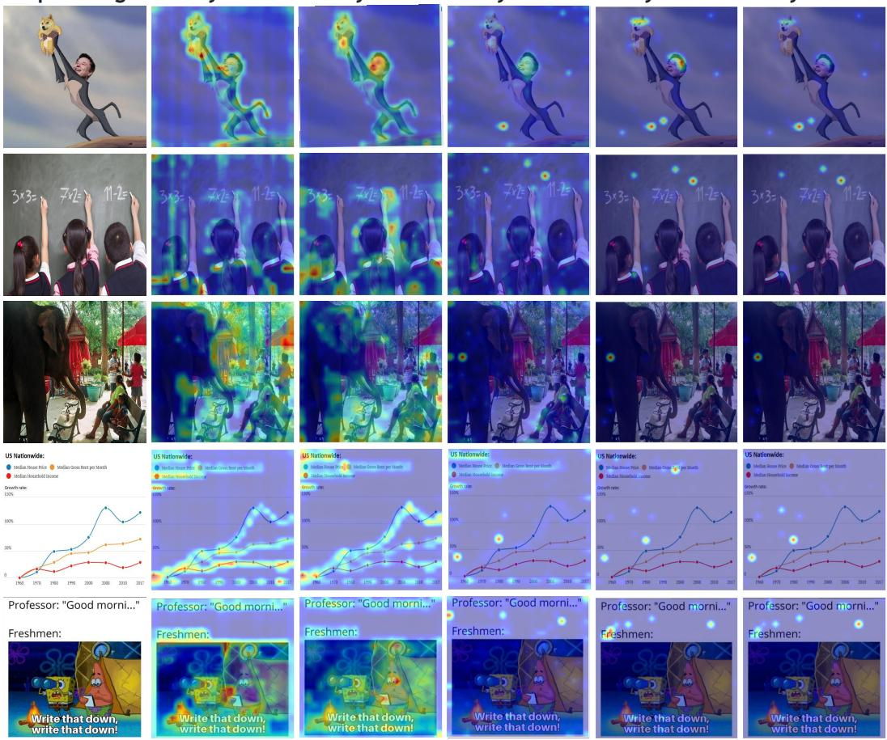  
Figure 8: Additional attention visualizations across ViT layers. Supplementary heatmaps showing the progression of attention patterns from shallow to deep ViT layers.

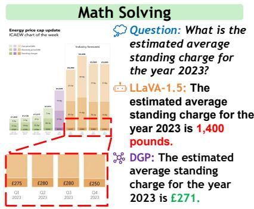

## Optical Character Recognition

Question: What should be drawn in the fourth step?

LLaVA-1.5: In the fourth step, the child should draw a nose after they have drawn the eyes. This is important because the nose is a crucial facial feature and helps to complete the overall appearance of the face. The child should use the pencil to carefully outline the shape of the nose, taking into consideration the proportions and the distance between the eyes and the nose.

DGP: In the fourth step, a nose should be drawn after the boy has drawn earrings.

## Detail reasoning

DGP: In a peaceful magical forest, beneath a canopy of leaves, three close friends — a brown bear, a blue-grey cat, and a light-brown rabbit—gathered around a tree stump that served as their table. The bear, who had a sweet tooth, brought a plate filled with delicious cookies and smiled with excitement as he took a big bite of a chocolate cookie. The cat sat quietly with her favorite blue mug, enjoying the warm drink in her paws. Beside her, the rabbit gracefully sipped from a pink mug. Surrounded by soft grass and rustling leaves, the three friends shared cookies, stories, and laughter.

Question: Write a fairy tale based on this painting.   
LLaVA-1.5: In a magical forest, a group of animals gathered around a dining table to share a meal. There was a large brown bear, a white cat, and a rabbit sitting together, enjoying each other's company. The table was set with a variety of food, including a cake and a bowl of cookies. The animals were using utensils like forks and spoons to eat their meal.As they ate, they engaged in lively conversations, sharing stories and laughter.   
Question: Write a fairy tale based on this painting.   
LLaVA-1.5: The meme features two cartoon characters, one of which is a spongebob-like character, standing next to each other. The spongebob character is holding a telescope, while the other character is holding a piece of paper. The meme is captioned with a humorous message, suggesting that the spongebob character is trying to write something down while looking through the telescope. The message reads, "Write that down, write that down, write that down, write that down, write that down, write that down,

DGP: The meme features two cartoon characters, one resembling SpongeBob and the other resembling Patrick Star, from the popular animated show SpongeBob SquarePants. They are standing next to each other, with SpongeBob and Patrick appearing to urgently write something down. The caption shows a professor saying “ Good morning,” while the freshmen react as if even this simple greeting is important information. The meme humorously suggests that new college students are so eager to learn and take notes that they would even write down the professor’s greeting.

Figure 9: Additional qualitative comparison examples. More case studies comparing DGP with LLaVA-1.5 across diverse visual understanding tasks.  
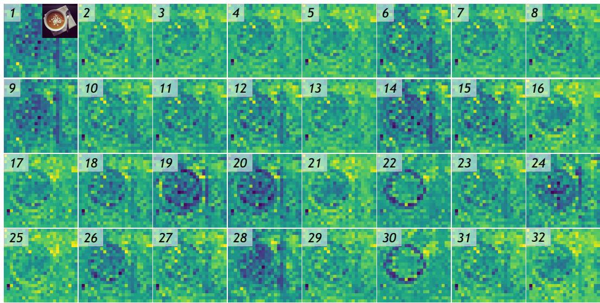  
Figure 10: Additional feature visualizations (Part 1). Supplementary DGP gated-fusion feature maps across all 32 LLM layers, illustrating improved spatial structure and semantic coherence.

LLM 17  
LLM 31  
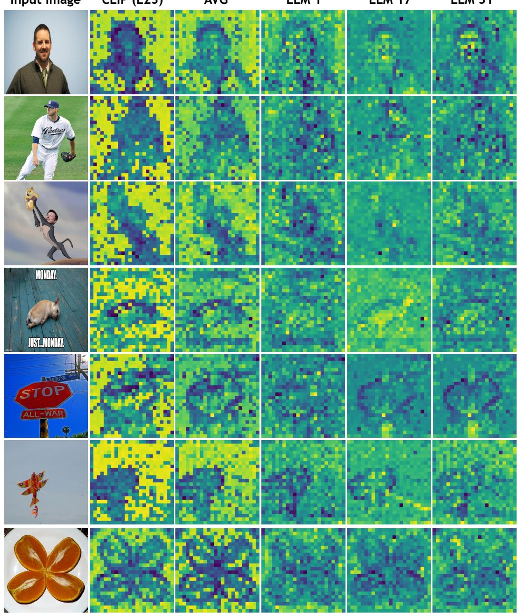  
Figure 11: Additional feature visualizations (Part 2). More comparisons of fixed single-layer features, uniform average fusion, and DGP’s gated fusion at different LLM layers.

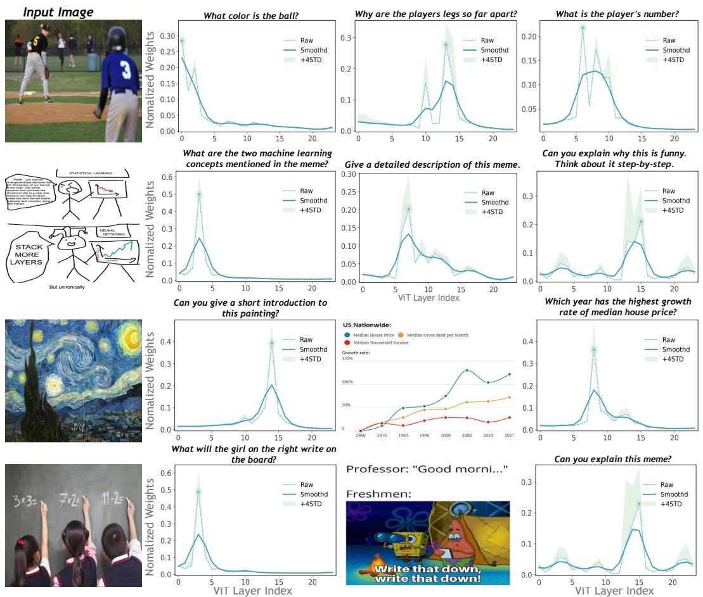  
Figure 12: Additional question-aware routing analysis. More examples showing how routing weights shift as the question varies for the same image.

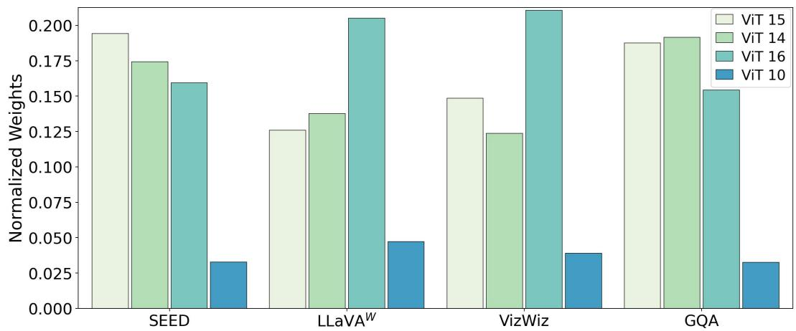  
Figure 13: Routing weight distributions at LLM layer 32. Weights that the last LLM layer assigns across ViT layers on different benchmarks, showing that distinct tasks favor different ViT-layer combinations.

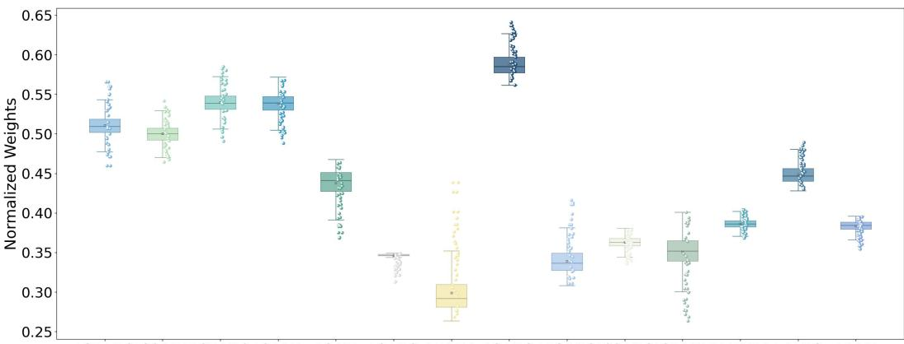  
L31-V10L30-V17L27-V10 L24-V4 L9-V7 L8-V12 L5-V14 L3-V13 L13-V13L22-V18L21-V15L17-V14 L4-V13 L1-V7

Figure 14: Additional routing analysis (Part 1). Supplementary visualizations of sample-wise routing weights.  
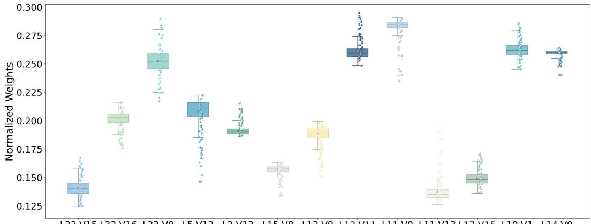  
L32-V15 L32-V16 L23-V9 L5-V12 L2-V13 L15-V8 L12-V9 L12-V11 L11-V9 L11-V13 L17-V15 L19-V1 L14-V9  
Figure 15: Additional routing analysis (Part 2). More examples showing the diversity of routing patterns across different inputs.