# NutriVisRAG: Multimodal Exemplar Grounding for Nutrient Estimation with Vision-Language Models

Lubnaa Abdur Rahman1,2 , Ioannis Papathanail2 , Maria Panagiotou1,2 Nefeli Dimitropoulou3 , Margret Harðardóttir3, Elisabeth J. den Brok3 , Bastiaan E. de Galan3 , and Stavroula Georgia Mougiakakou2

1 Graduate School for Cellular and Biomedical Sciences, University of Bern, 3012 Bern, Switzerland

2 ARTORG Center for Biomedical Engineering Research, University of Bern, 3008 Bern, Switzerland

3 Department of Endocrinology, Maastricht University Medical Centre+, and Cardiovascular Research Institute Maastricht (CARIM), Maastricht University, Maastricht, the Netherlands

Abstract. Diet is a major determinant of health, yet accurate dietary assessment from free-living meal images remains challenging. Existing retrieval-based Vision-Language Model (VLM) approaches to nutrient estimation typically rely on textual food representations, while, to our knowledge, direct grounding on visually similar annotated meals has not been investigated. We present NutriVisRAG, a retrieval-augmented generation framework that uses a vision encoder to retrieve similar meals with known nutritional annotations and provide them as multimodal incontext exemplars for VLM nutrient estimation at inference time, without task-specific fine-tuning. We evaluate NutriVisRAG across four datasets, four VLMs, three retrieval encoders, and two prompting strategies, including free-living meals from adults with insulin-treated diabetes, where carbohydrate estimates are compared against two dietitians’ annotations. Across all 96 configurations (4 datasets × 4 VLMs × 3 retrieval encoders × 2 prompting strategies), NutriVisRAG reduced the primary estimation error in 56, with improvements more frequent under whole-meal (35/48) than per-item prompting (21/48). Across the evaluated configurations, the lowest NutriVisRAG error was below the best Vanilla error in 13 of 16 VLM–dataset pairs. For GPT-5.4-mini, under whole-meal prompting, the best-performing retrieval encoder for each dataset reduced the primary error on all four datasets relative to Vanilla, with reductions of 1.7–35.7%. Overall, our results show that grounding in multimodal exemplars comprising images and respective annotations can improve nutrient estimation at inference time without task-specific fine-tuning, although the benefits remain configuration-dependent.

Keywords: Vision-Language Models · Nutrient Estimation · Retrieval-Augmented Generation · Vision-RAG

## 1 Introduction

Accurate dietary assessment is central to nutritional monitoring and the prevention and management of diet-related chronic diseases, yet conventional selfreported approaches remain burdensome and prone to measurement errors [17]. Advances in computer vision and smartphone technologies have enabled automated dietary assessment from meal images through multi-stage pipelines combining food segmentation, recognition, portion estimation, and nutrient calculation, alongside integrated models that directly predict food quantity and nutritional composition [28, 29, 43, 44, 51]. These approaches have benefited from increasingly large food segmentation and recognition datasets [11, 30, 31, 46]. Errors in either segmentation or recognition can propagate to downstream portion and nutrient estimation, and recognition remains particularly vulnerable to distributions not represented during training [4]. Even when food regions and identities are correctly determined, estimating physical quantity remains a separate challenge, as portion estimation typically relies on depth, geometric reconstruction, or reference cues that require additional acquisition information [2, 28, 29, 43, 51]. End-to-end models instead bypass this by predicting food weight, energy, or macronutrients from visual representations. However, these approaches require large training datasets with quantitative dietary annotations [44, 50, 51].

Large Language Models, pretrained on large-scale text corpora, have demonstrated strong few-shot and in-context learning capabilities across diverse language tasks without task-specific fine-tuning [10, 13]. Extending this foundation-model paradigm to visual inputs, Vision-Language Models (VLMs) combine language modelling with visual representations to support multimodal understanding and generation [6,45]. Recent studies have evaluated VLMs for food recognition, meal decomposition, portion and weight estimation, calorie estimation, and macronutrient prediction, with performance varying substantially across models and prompting strategies [1, 34, 39, 47, 49, 50, 53, 58]. Task-specific fine-tuning, specialised prediction components, and parameter-eficient adaptation can improve performance, but require additional dietary training data and model adaptation [1, 50, 58]. Nevertheless, quantitative dietary estimation remains challenging because food quantity and nutritional content must still be inferred from limited visual information [8, 34, 39, 49, 50, 53, 55]. Explicitly supplied nutritional information can nevertheless improve nutrient estimation [34, 50].

Structured, retrieval-augmented, and agentic approaches have therefore been explored for VLM-based dietary assessment [1,8,16]. Retrieval-Augmented Generation (RAG) provides inference-time access to external evidence without requiring fine-tuning of VLMs [25]. In dietary applications, retrieval has been used to support food identification and nutrient estimation through dietary records, food composition databases, knowledge graphs, and standardised nutritional information [5, 16, 18, 57, 62]. However, current dietary retrieval remains predominantly textual or structured. Image-based approaches first interpret meal images into textual descriptions, candidate foods, or decomposed food items before querying external food composition resources [16, 57]. Multimodal RAG has shown that retrieval can operate directly over visual and heterogeneous representations [15, 21, 59], while visual retrieval has previously been explored in food computing for image-recipe matching and calorie estimation [33, 48]. To the best of our knowledge, however, VLM-based nutrient estimation applications have yet to investigate the retrieval of visually similar meal images with known nutritional annotations and provide them directly to the VLM for grounding.

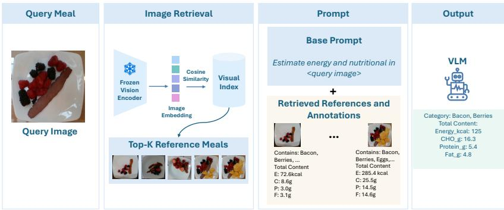  
Fig. 1: Overview of the NutriVisRAG pipeline: the top-K visually similar reference meals are retrieved for a query image, and their images and nutritional annotations are added to the prompt as multimodal context for the VLM.

We therefore investigate whether simple inference-time grounding with visually similar annotated meals can improve VLM-based nutrient estimation. Our contributions are:

– We introduce NutriVisRAG, an inference-time framework that integrates image-based retrieval with pretrained VLMs, using similar annotated meals as multimodal in-context exemplars for nutrient estimation.

We systematically evaluate visual exemplar grounding across VLMs, retrieval encoders, prompting strategies, and four dietary datasets, including free-living meals from adults with insulin-treated diabetes evaluated against dietitians visual estimations.

## 2 Methods

## 2.1 NutriVisRAG

Overview NutriVisRAG, illustrated in Figure 1, retrieves visually similar annotated meals directly in the visual embedding space and provides each retrieved meal image together with its available nutritional annotations to a VLM as multimodal context at test time. Retrieval is followed by a single VLM generation step for nutrient estimation. The retrieved meals therefore act as multimodal in-context exemplars carrying both visual and quantitative information [6, 25].

Problem Formulation Let $I _ { q }$ be a query meal image and $y _ { q }$ its vector of available annotated nutritional targets, which is used only for evaluation. Depending on the dataset, $y _ { q }$ contains the available subset of weight, energy, carbohydrate (CHO), protein, and fat. Let M denote the VLM and P the task prompt. We compare Vanilla VLM estimation with retrieval-grounded estimation:

$$
\mathrm { { V a n i l l a : } } \qquad { \hat { y } } _ { q } = M \bigl ( P , I _ { q } \bigr ) ,\tag{1}
$$

$$
\mathrm { N u t r i V i s R A G : } \qquad \hat { y } _ { q } = M \big ( P , I _ { q } , \mathcal { E } ( q ) \big ) ,\tag{2}
$$

where $\mathcal { E } ( q )$ is a set of retrieved reference meals $\left( I _ { k } , a _ { k } \right)$ , each consisting of a reference image $I _ { k }$ and its available nutritional annotations $a _ { k }$ , which are provided to the VLM as input. The two conditions therefore difer only by the retrieved exemplar context $\mathcal { E } ( q )$ , whose construction is described below.

Index construction. Let $\phi ( \cdot )$ denote the frozen visual encoder used for retrieval. Each reference image $I _ { j }$ is mapped to an embedding $\phi ( I _ { j } )$ and stored in the visual index together with its available nutritional annotations. Evaluation query images are excluded from the reference index.

Retrieval. At test time, the query image is embedded using the same visual encoder, and its similarity to each indexed reference image $I _ { j }$ is computed using cosine similarity:

$$
s ( \boldsymbol { q } , \boldsymbol { j } ) = \frac { \phi ( \boldsymbol { I _ { q } } ) ^ { \top } \phi ( \boldsymbol { I _ { j } } ) } { \lVert \phi ( \boldsymbol { I _ { q } } ) \rVert \lVert \phi ( \boldsymbol { I _ { j } } ) \rVert } .\tag{3}
$$

The K references with the highest similarity form the candidate set $\mathcal { E } _ { K } ( q ) =$ $\{ ( I _ { k } , a _ { k } ) \} _ { k = 1 } ^ { K } ,$ ordered by decreasing similarity, where $s _ { k }$ denotes the similarity of the k-th ranked reference. A minimum similarity threshold τ is applied, and if no candidate satisfies it, the highest-ranked reference is retained as a fallback:

$$
\begin{array} { r } { \mathcal { E } ( q ) = \left\{ \begin{array} { l l } { \big \{ ( I _ { k } , a _ { k } ) \in \mathcal { E } _ { K } ( q ) : s _ { k } \geq \tau \big \} , } & { \mathrm { i f ~ t h i s ~ s e t ~ i s ~ n o n - e m p t y } , } \\ { \big \{ ( I _ { 1 } , a _ { 1 } ) \big \} , } & { \mathrm { o t h e r w i s e } . } \end{array} \right. } \end{array}\tag{4}
$$

Thresholding may therefore retain fewer than K exemplars, while the fallback ensures that the VLM always receives at least the nearest reference for grounding. The annotations accompanying each retrieved image are provided at item and meal level where available; unavailable quantities are omitted rather than imputed (e.g., SNAPMe references are presented without meal weight).

## 2.2 Datasets

We use four dietary image datasets (Table 1).

Nutrition5k [51] contains cafeteria meals acquired under controlled conditions, with ingredient-level food identities and weights and meal-level weight, energy, and macronutrient annotations.

SNAPMe [24] contains free-living meal images captured from smartphones and linked to dietary records collected using the Automated Self-Administered 24-hour

Table 1: Datasets used.
<table><tr><td>Dataset</td><td>Evaluation queries</td><td>Indexed references</td><td>Evaluation targets</td></tr><tr><td>Nutrition5k [51]</td><td>815</td><td>2,445</td><td>Weight, energy, CHO, protein, fat</td></tr><tr><td>SNAPMe [24]</td><td>323</td><td>1,149</td><td>Energy, CHO, protein, fat</td></tr><tr><td>MADiMa [7]</td><td>160 (80 meals each at 40 and 60 cm)</td><td></td><td>Weight, energy, CHO, protein, fat</td></tr><tr><td>EDUCATE [12]</td><td>247</td><td></td><td>CHO</td></tr></table>

Dietary Assessment Tool (ASA24), providing verified self-reported annotations for energy and macronutrients without measured meal weight.

MADiMa [7] contains 80 meals with two to four food items and measured weight, volume, and energy and macronutrient composition. Each meal was captured at 40 cm and 60 cm under a constrained acquisition protocol, yielding 160 images used jointly in the main evaluation. The two acquisition distances are additionally analysed as separate 80-image subsets in Supplementary Section S2.

EDUCATE [12] contains free-living meal images captured using the goFOOD Lite mobile application [28] from adults with insulin-treated diabetes in the Netherlands arm of the study [12]. After excluding packaged foods, erroneous entries, and non-food images, de-identified food-only images from 25 participants were retained. CHO content was independently estimated by two dietitians using an annotation tool [3], and model estimates are evaluated against their mean in the absence of measured ground truth.

Nutrition5k and SNAPMe serve as both evaluation query sets and indexed reference corpora. For each of Nutrition5k and SNAPMe, a subset (exact numbers in Table 1) is held out for evaluation, and the remaining are combined into the reference corpus, ensuring that evaluated meals cannot be retrieved as references. Despite annotation provenance diferences, the two reference subsets are combined to broaden the range of meal compositions and acquisition conditions represented, spanning controlled and free-living settings. Nutrition5k queries are drawn from overhead, non-empty meals, while SNAPMe queries are selected round-robin at image level with preference for compositionally rich plates. The task-specific Nutrition5k split does not follow the oficial partition and was designed to retain compositionally richer dishes in the reference corpus.

## 2.3 Experimental Setup

Models and retrieval encoders. We evaluate the four VLMs listed in Table 2 without task-specific fine-tuning. The open-weight local models are run on an NVIDIA RTX A6000 through Ollama [40], the hosted open-weight models through Ollama Cloud, and GPT through the OpenAI API [41]. Retrieval uses the three frozen image encoders listed in Table 3.

Prompting strategies. We evaluate two prompting strategies difering in the granularity of the requested output. In per-item, the VLM was asked to identify the visible food items and estimate the weight, energy, CHO, protein, and fat of each item separately, with meal-level estimates obtained by summing the returned item-level predictions. In whole-meal, the VLM was asked to directly estimate the corresponding totals for the complete meal without explicit item-level decomposition. For each strategy, the same task instructions and enforced structured JSON output format are used in the Vanilla and grounded conditions. The grounded condition additionally receives the retrieved reference images with their nutritional annotations and a system-prompt description of this reference information. The exact prompt templates are provided in Supplementary Section S1.

Table 2: Vision–language models evaluated.  
Table 3: Frozen image encoders used for retrieval.
<table><tr><td>Model</td><td>Identifier</td><td>Weights</td><td>Serving</td></tr><tr><td>GPT-5.4-mini [42]</td><td>gpt-5.4-mini</td><td>proprietary</td><td>OpenAI API</td></tr><tr><td>Gemma-4-31B [20]</td><td>gemma4:31b-cloud</td><td>open</td><td>Ollama Cloud</td></tr><tr><td>Mistral-Small-3.2 [32]</td><td>mistral-small3.2:24b open</td><td></td><td>local Ollama</td></tr><tr><td>GLM-5.3-Flash [60]</td><td>glm-5.3-flash:cloud</td><td>open</td><td>Ollama Cloud</td></tr></table>

<table><tr><td>Encoder</td><td>Checkpoint</td><td>Input resolution</td></tr><tr><td>PE-Core-G14 [9]</td><td>facebook/PE-Core-G14-448</td><td>448×448</td></tr><tr><td>SigLIP 2 [52]</td><td>google/siglip2-so400m-patch14-384 384×384</td><td></td></tr><tr><td></td><td>Nomic Vision [37] nomic-ai/nomic-embed-vision-v1.5 224×224</td><td></td></tr></table>

Retrieval configuration. The Nutrition5k and SNAPMe reference sets are combined into a single retrieval corpus, with evaluation query images excluded from the index. Visual indices are built using Facebook AI Similarity Search (FAISS) through LlamaIndex [23, 27]. Reference images are embedded once for each encoder and ℓ2-normalised before retrieval. The main experiments use $K = 5 ,$ a minimum cosine-similarity threshold of τ = 0.75 with the fallback strategy defined above, and no reranking. The values K = 5 and $\tau = 0 . 7 5$ were selected from preliminary comparisons with K = 10 and τ = 0 on fixed 100-query subsets of each query set.

Retrieval ablations. We report the fixed 100-query comparisons used to examine retrieval-parameter sensitivity and select the main retrieval settings. The same queries are reused across configurations to enable paired comparisons under identical evaluation samples. We evaluate these comparisons across all four VLMs under both per-item and whole-meal prompting. We vary the similarity threshold and retrieval depth relative to the default retrieval configuration:

– Similarity threshold: τ = 0 versus $\tau = 0 . 7 5$

– Number of retrieved exemplars: K = 5 versus K = 10.

Exploratory retrieval extensions. Beyond these retrieval-parameter ablations, we evaluate two exploratory extensions on the same fixed 100-query subsets. Both extensions are evaluated across all four VLMs. For post-hoc food-composition grounding, we match VLM-predicted food names to food-composition database entries using lexical token-set similarity or one of three text-embedding models: Qwen3-Embedding [61], EmbeddingGemma [54], and Nomic Embed Text v2 (MoE) [36]. The matched nutrient values are scaled by the VLM-predicted food weights and summed to obtain meal-level estimates. This analysis uses per-item predictions, which provide the food identities and corresponding weights required for database lookup. For retrieval reranking, each query retrieves 50 visual candidates, which are rescored using Jina Reranker M0 [22], Qwen3-VL-Reranker-2B [26], or Llama Nemotron Rerank VL 1B v2 [38]. The five highest-ranked references are then provided to the VLM under both prompting strategies. These analyses test whether more selective exemplar ranking or external foodcomposition lookup improves the base NutriVisRAG estimates, respectively. Full experimental details and results are reported in Supplementary Section S5.

Inference. Query and retrieved reference images are resized to a maximum side length of 800 pixels while preserving aspect ratio, providing a common input scale without upscaling the lowest-resolution images and limiting visual input size. Temperature 0 and a fixed seed of 42 were used to minimise sampling variability, although deterministic outputs are not guaranteed across serving backends. Repeated inference runs were not performed, so run-to-run variance was not independently quantified.

## 2.4 Evaluation

For each nutritional field $v \in \{ \mathrm { w e i g h t }$ , energy, CHO, protein, fat}, let $y _ { i , v }$ and $\hat { y } _ { i , \imath }$ denote the target and predicted values for meal $i = 1 , \ldots , N$ . We report the mean absolute error normalised by the mean target value,

$$
\% \mathrm { M A E } _ { v } = \frac { \frac { 1 } { N } \sum _ { i = 1 } ^ { N } \left| \hat { y } _ { i , v } - y _ { i , v } \right| } { \frac { 1 } { N } \sum _ { i = 1 } ^ { N } y _ { i , v } } \times 1 0 0 .\tag{5}
$$

Normalising by the mean rather than per meal avoids unstable percentage errors when individual target values are near zero, while keeping nutritional fields of diferent magnitudes on a comparable scale.

Macronutrient performance is summarised in two ways: $\% \mathrm { M A E } _ { \mathrm { m a c r o } }$ is the unweighted mean of the three macronutrient field errors, giving each equal weight regardless of magnitude, while $\% \mathrm { M A E } _ { \mathrm { m i c r o } }$ pools absolute errors in grams across the three fields before normalising, and is therefore dominated by the macronutrient present in the largest quantity,

$$
\mathcal { G } _ { \mathrm { O M A E } _ { \mathrm { m a c r o } } } = \frac { 1 } { 3 } \sum _ { \boldsymbol { v } \in \{ c , p , f \} } \mathcal { G } _ { \mathrm { M A E } _ { v } } , \qquad \mathcal { G } _ { \mathrm { M A E } _ { \mathrm { m i c r o } } } = \frac { \sum _ { \boldsymbol { v } \in \{ c , p , f \} } \sum _ { i } \left| \hat { y } _ { i , \boldsymbol { v } } - y _ { i , \boldsymbol { v } } \right| } { \sum _ { \boldsymbol { v } \in \{ c , p , f \} } \sum _ { i } y _ { i , \boldsymbol { v } } } \times 1 0 0 ,\tag{6}
$$

where $c , p ,$ and f denote CHO, protein, and fat, respectively. On EDUCATE, where only CHO is annotated, $\% \mathrm { M A E _ { C H O } }$ is computed against the dietitians mean annotations. We use $\% \mathrm { M A E } _ { \mathrm { m i c r o } }$ as the primary metric, replaced by $\% \mathrm { M A E } _ { \mathrm { C H O } }$ on EDUCATE, and denote this as $\% \mathrm { M A E } _ { \mathrm { m i c r o / C H O } }$

Statistical testing. Methods are compared using two-sided paired Wilcoxon signed-rank tests on per-meal absolute errors [56]. Multiple comparisons are corrected using the Benjamini–Hochberg procedure within each experiment– outcome family, controlling the false discovery rate at $q = 0 . 0 5 \ [ 1 4 ]$ . A family comprises all comparisons of one outcome measure within one experiment, pooled across query sets, VLMs, encoders, and prompting strategies; for example, all $\% \mathrm { M A E } _ { \mathrm { m i c r o / C H O } }$ comparisons in the threshold ablation form one family, and all $\% \mathrm { M A E } _ { \mathrm { m i c r o / C H O } }$ comparisons of NutriVisRAG against Vanilla form another.

Retrieval diagnostics. Using the full query sets, retrieval benefit is the per-query reduction in pooled absolute macronutrient error from Vanilla to NutriVisRAG, normalised by the query-set mean target macronutrient sum; EDUCATE instead uses absolute CHO error normalised by mean annotated CHO. Visual similarity is the mean cosine similarity of the retrieved exemplars, while nutritional distance is computed retrospectively as the mean absolute query–exemplar diference across the available macronutrients, each normalised by its query-set mean. Associations are quantified by query set, retrieval encoder, and prompting strategy using Spearman’s rank correlation, with retrieval benefit averaged across the four VLMs; per-VLM results are in Supplementary Section S4.2.

## 3 Results and Discussion

## 3.1 NutriVisRAG versus Vanilla VLM Inference

We first evaluate whether visually retrieved meals with known nutritional annotations improve nutrient estimation relative to Vanilla VLM inference. Table 4 reports the primary error, with complete per-nutrient results in Supplementary Table S1. Across 96 configurations (4 datasets × 4 VLMs × 3 retrieval encoders × 2 prompting strategies), NutriVisRAG reduces the corresponding Vanilla error in 56, with improvements more frequent under whole-meal (35/48) than per-item prompting (21/48). After Benjamini–Hochberg correction, 45 configurations show a significant reduction in error, while 23 show a significant increase. Whole-meal prompting may benefit more from retrieval since exemplar annotations directly match the requested meal-level totals, unlike per-item prompting, which requires additional decomposition and aggregation.

Using the primary %MAEmicro/CHO metric, NutriVisRAG reduces error in 13/24 configurations on Nutrition5k, 7/24 on SNAPMe, 22/24 on MADiMa, and 14/24 on EDUCATE. Nutrient-specific efects are broader, particularly for CHO, with improvements in 18/24, 9/24, 24/24, and 14/24 configurations, respectively; on MADiMa, weight and energy also improve in 21/24 and 19/24 configurations (Supplementary Table S1). Despite contributing indexed references, SNAPMe benefits least consistently, while MADiMa and EDUCATE show more frequent gains despite stronger projected separation from the reference corpus under some encoders (Supplementary Fig. S2). Thus, corpus membership and projected embedding overlap alone do not determine retrieval efectiveness. SNAPMe and EDUCATE should be interpreted with their annotation sources in mind: SNAPMe uses verified self-reported dietary estimates, whereas EDUCATE is restricted to CHO compared to dietitians’ mean estimates, which are not nutritional ground truth. Across the evaluated configurations, the lowest NutriVisRAG error is below the best Vanilla error in 13 of 16 VLM–query-set pairs. As a retrievalonly control, we predict each nutritional target as the cosine-similarity-weighted mean of the retained exemplar annotations, without VLM inference. The lowest NutriVisRAG error is below the best retrieval-only error on all four query sets, by 5.8, 8.3, 12.7, and 7.1 percentage points on Nutrition5k, SNAPMe, MADiMa, and EDUCATE, respectively. Thus, direct similarity-weighted neighbour averaging does not account for the lowest observed NutriVisRAG errors.

The response to retrieval is strongly VLM-dependent, with improvements in 19/24 configurations for GPT-5.4-mini, 16/24 for GLM-5.3-Flash, 14/24 for Gemma-4-31B, and 7/24 for Mistral-Small-3.2. Mistral-Small-3.2 shows substantial error increases under per-item prompting on Nutrition5k and SNAPMe but benefits from whole-meal grounding on Nutrition5k and MADiMa, whereas GPT-5.4-mini benefits more consistently across prompting strategies on Nutrition5k, MADiMa, and EDUCATE and GLM-5.3-Flash shows strong gains on MADiMa and EDUCATE. Model scale alone does not explain these diferences: Mistral-Small-3.2 is a 24B dense model, Gemma-4-31B has 31B parameters, GLM-5.3-Flash has 320B total and 18B active parameters, and GPT-5.4-mini’s parameter count is undisclosed, while architecture, training data, and post-training are not independently controlled [20, 32, 42, 60].

No retrieval encoder consistently dominates across individual model–queryset–prompt configurations (Table 4 and Supplementary Table S1). Although cross-dataset means (Supplementary Table S2) favour PE-Core in several VLM– prompt combinations, the best encoder changes across query sets, and the direction of the retrieval efect can also change for the same VLM and prompting strategy. Overall, NutriVisRAG provides clear but configuration-dependent gains, while improvements in $\% \mathrm { M A E } _ { \mathrm { m i c r o / C H O } }$ do not extend to every nutritional target. Median query latency increases by 1.4× for GPT-5.4-mini, 1.7× for Gemma-4- 31B, 1.3× for Mistral-Small-3.2, and 1.2× for GLM-5.3-Flash, corresponding to $+ 0 . 7 , + 1 . 2 , + 3 . 3 { }$ , and +1.0 s per meal, respectively.

Given the mixed results on EDUCATE (14/24 improvements) and its relevance to free-living CHO estimation in people with diabetes, we further examine whether retrieval improves meal-level agreement with dietitian estimates beyond error. Figure 2 presents GPT-5.4-mini with SigLIP 2 under whole-meal prompting, for which NutriVisRAG significantly reduces %MAECHO from 58.4 to 43.3. NutriVisRAG reduces mean overestimation from 18.0 to 5.9 g and narrows the 95% limits of agreement from [−28.5, 64.5] to [−34.3, 46.1] g, particularly mitigating large positive errors at higher CHO values. Although individual errors remain, an improved agreement with dietitian estimates is seen; complete analyses across all query sets, VLMs, and encoders are provided in Supplementary Section S4.4.

## 3.2 Efect of Prompting Strategy

Figure 3 compares per-item and whole-meal prompting under Vanilla VLM inference. Per-item yields lower $\% \mathrm { M A E } _ { \mathrm { m a c r o } }$ (%MAECHO for EDUCATE) in 12/16 model–dataset pairs, while whole-meal yields lower error for Mistral-Small-3.2 and GLM-5.3-Flash on SNAPMe and MADiMa. On MADiMa, 60 cm images yield lower $\% \mathrm { M A E } _ { \mathrm { m a c r o } }$ and $\% \mathrm { M A E } _ { \mathrm { m i c r o } }$ for GPT-5.4-mini, Gemma-4-31B, and GLM-5.3-Flash under both prompting strategies and for Mistral-Small-3.2 under whole-meal prompting, but not under per-item prompting (Supplementary Fig. S1). Although per-item prompting performs better under Vanilla inference in most pairs, NutriVisRAG improves more frequently under whole-meal prompting, showing that stronger baseline prompt performance does not necessarily imply greater retrieval benefit.

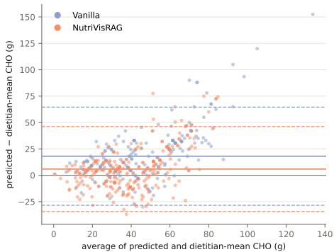

Fig. 2: Bland–Altman analysis of CHO estimates for 247 EDUCATE meals using GPT-5.4-mini with SigLIP 2 under whole-meal prompting, without (blue) and with (orange) NutriVisRAG. Diferences are computed against the mean dietitian estimate; solid and dashed lines show the mean bias and 95% limits of agreement, respectively.  
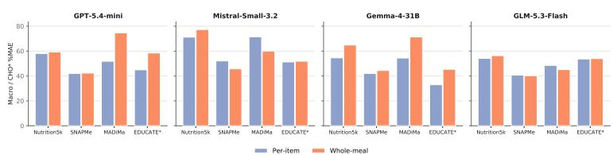  
Fig. 3: Efect of prompting granularity under Vanilla VLM inference. $\% \mathrm { M A E } _ { \mathrm { m a c r o } }$ (lower is better) is reported across VLMs and query sets; (\*) for EDUCATE, %MAECHO against the mean dietitian estimate is shown.

## 3.3 Exemplar Similarity and Retrieval Benefit

Since retrieval improves estimation in many but not all configurations, we examine whether its benefit is associated with exemplar similarity. A preliminary t-SNE analysis (Supplementary Fig. S2) showed that greater projected query–reference overlap does not correspond to more consistent gains, with MADiMa benefiting strongly despite its separation under PE-Core and SigLIP 2. At the individualquery level, Figure 4 relates retrieval benefit to visual similarity and retrospective nutritional distance under both prompting strategies. Visual similarity shows weak and inconsistent associations with retrieval gains across query sets and encoders.

Table 4: Vanilla versus NutriVisRAG for all retrieval encoders and both prompting strategies, on the full query sets. Values are $\% \mathrm { M A E } _ { \mathrm { m i c r o } }$ (%MAECHO for EDUCATE); lower is better. Bold: lowest error within each prompting strategy per model and query set. ⋆/▼: significant improvement/degradation over the corresponding Vanilla baseline (paired Wilcoxon signed-rank test, Benjamini–Hochberg corrected, $q < 0 . 0 5 )$ .
<table><tr><td></td><td></td><td colspan="4">Per-item</td><td colspan="4">Whole-meal</td></tr><tr><td></td><td></td><td></td><td colspan="3">NutriVisRAG</td><td colspan="4">NutriVisRAG</td></tr><tr><td>Query set</td><td>Model</td><td>Vanilla</td><td>PE-Core</td><td>SigLIP2</td><td>Nomic Vision</td><td>Vanilla</td><td>PE-Core</td><td>SigLIP2</td><td>Nomic Vision</td></tr><tr><td></td><td>Gemma-4-31B</td><td>53.6</td><td>53.7</td><td>54.6</td><td>59.8</td><td>63.5</td><td>51.0*</td><td>50.8*</td><td>55.8*</td></tr><tr><td>Nutrition5k</td><td>GPT-5.4-mini</td><td>58.0</td><td>42.7</td><td>43.4*</td><td>47.1*</td><td>58.1</td><td>43.4*</td><td>44.2*</td><td>48.0*</td></tr><tr><td></td><td>Mistral-Small-3.2</td><td>72.1</td><td>111.2</td><td>119.5</td><td>145.1</td><td>78.7</td><td>62.3*</td><td>63.3+</td><td>74.3*</td></tr><tr><td></td><td>GLM-5.3-Flash</td><td>54.0</td><td>54.1</td><td>53.4*</td><td>58.6</td><td>56.2</td><td>58.8</td><td>56.8</td><td>62.2</td></tr><tr><td></td><td>Gemma-4-31B</td><td>41.0</td><td>46.2</td><td>44.0</td><td>45.0</td><td>43.6</td><td>42.5</td><td>40.4*</td><td>41.9</td></tr><tr><td>SNAPMe</td><td>GPT-5.4-mini</td><td>41.4</td><td>41.7</td><td>42.2</td><td>42.8</td><td>41.7</td><td>42.8</td><td>41.0</td><td>43.0</td></tr><tr><td></td><td>Mistral-Small-3.2</td><td>51.1</td><td>103.6</td><td>130.3</td><td>108.8</td><td>44.6</td><td>67.2</td><td>75.0</td><td>66.0</td></tr><tr><td></td><td>GLM-5.3-Flash</td><td>39.8</td><td>40.1</td><td>43.8</td><td>41.5</td><td>39.6</td><td>38.0*</td><td>38.5</td><td>38.8</td></tr><tr><td></td><td>Gemma-4-31B</td><td>54.7</td><td>50.5*</td><td>47.5*</td><td>50.9*</td><td>70.7</td><td>62.7*</td><td>63.5*</td><td>60.3*</td></tr><tr><td>MADiMa</td><td>GPT-5.4-mini</td><td>57.4</td><td>44.5*</td><td>46.5*</td><td>46.4*</td><td>75.7</td><td>48.7*</td><td>52.9*</td><td>51.6*</td></tr><tr><td></td><td>Mistral-Small-3.2</td><td>79.5</td><td>67.6*</td><td>78.6</td><td>82.8</td><td>63.4</td><td>52.8*</td><td>55.6*</td><td>69.2</td></tr><tr><td></td><td>GLM-5.3-Flash</td><td>51.5</td><td>40.9*</td><td>39.7+</td><td>42.8*</td><td>48.2</td><td>40.2*</td><td>38.9*</td><td>42.2*</td></tr><tr><td></td><td>Gemma-4-31B</td><td>33.0</td><td>36.5</td><td>37.8</td><td>38.5</td><td>45.4</td><td>45.0</td><td>44.5</td><td>47.0</td></tr><tr><td>EDUCATE</td><td>GPT-5.4-mini</td><td>45.0</td><td>40.9</td><td>38.0+</td><td>42.5</td><td>58.4</td><td>46.6*</td><td>43.3*</td><td>43.6*</td></tr><tr><td></td><td>Mistral-Small-3.2</td><td>51.2</td><td>153.8</td><td>151.6</td><td>147.1</td><td>51.9</td><td>82.2</td><td>92.8</td><td>81.4</td></tr><tr><td></td><td>GLM-5.3-Flash</td><td>53.6</td><td>47.8*</td><td>47.9*</td><td>53.2</td><td>54.0</td><td>44.0*</td><td>44.1*</td><td>42.0*</td></tr></table>

In contrast, nutritional distance is more consistently negatively associated with benefit under whole-meal prompting, most strongly on MADiMa, and less so under per-item prompting. Visual similarity also corresponds to nutritional proximity more clearly on Nutrition5k than on the other query sets (Supplementary Fig. S5). Together, projected embedding overlap and cosine similarity alone therefore do not reliably predict exemplar usefulness. The nutritional-distance analysis is retrospective, as query annotations are unavailable at inference time and are shared with the error metric, so the association is descriptive rather than causal.

## 3.4 Retrieval Ablations

Efect of Similarity Threshold Table 5 compares the default similarity threshold $( \tau = 0 . 7 5 )$ with no threshold $( \tau = 0 )$ under both prompting strategies. Compared with $\tau = 0 ,$ the default yields lower $\% \mathrm { M A E } _ { \mathrm { m i c r o / C H O } }$ in 60/96 configurations, including 32/48 per-item and 28/48 whole-meal configurations. Lower error is seen in 10/24 configurations on Nutrition5k, 18/24 on SNAPMe, 13/24 on MADiMa, and 19/24 on EDUCATE, with seven significant comparisons all favouring the default threshold. Where thresholding does not alter the retained exemplar set, observed diferences cannot be attributed to exemplar filtering and may instead reflect inference variability. Similarity filtering benefit many configurations, but its efect remains model-, dataset-, and encoder-dependent, and cosine similarity alone does not guarantee nutritional relevance.

Efect of Retrieval Depth Compared with K = 10, the default depth $( K = 5 )$ reduces $\% \mathrm { M A E } _ { \mathrm { m i c r o / C H O } }$ in 56/96 configurations, including 18/24 on Nutrition5k, 14/24 on SNAPMe, 10/24 on $\mathrm { M A D i M a } .$ , and 14/24 on EDUCATE. Of the five significant comparisons, four favour K = 5 and all occur under per-item prompting, whereas the single comparison favouring $K = 1 0$ occurs for Mistral-Small-3.2 with PE-Core on EDUCATE under whole-meal prompting. Increasing retrieval depth also raises latency for every VLM, by 0.1–2.0 s per query under whole-meal and 0.4–18.6 s under per-item prompting. Overall, increasing retrieval depth provides no consistent accuracy benefit while incurring additional inference cost, supporting $K = 5$ as the default.

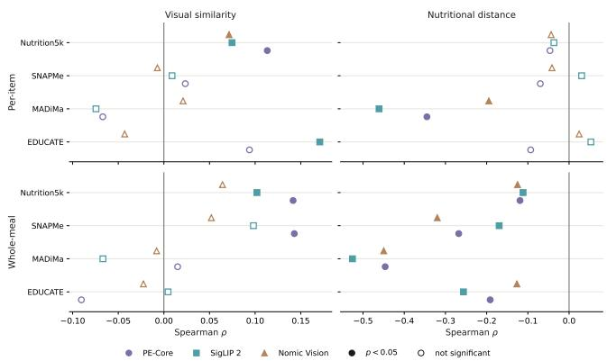  
Fig. 4: Association of exemplar similarity with NutriVisRAG retrieval benefit under per-item and whole-meal prompting. Spearman correlations $( \rho )$ relate retrieval benefit to mean visual similarity (left) and retrospective nutritional distance (right), by query set and retrieval encoder. Filled markers indicate Benjamini–Hochberg-corrected $q < 0 . 0 5 ;$ open markers indicate non-significant associations. Positive visual-similarity correlations indicate greater benefit for more visually similar exemplars, whereas negative nutritional distance correlations indicate greater benefit for nutritionally closer exemplars.

Exploratory Retrieval Extensions For each post-hoc food-composition matching method, we evaluate 48 configurations (4 query sets $\times \ 4 \ \mathrm { V L M s } \ \times \ 3$ visual encoders) using per-item predictions. Post-hoc food-composition grounding increases %MAEmicro/CHO relative to the default NutriVisRAG predictions. Lexical matching, EmbeddingGemma, and Nomic Embed Text v2 increase the error in all 48 configurations, while Qwen3-Embedding increases it in 46/48. For energy, which is available for three query sets, the original NutriVisRAG predictions also yield lower error in 34/36 configurations (3 query sets $\times \ 4 \ \mathrm { V L M s } \ \times \ 3$ visual encoders). No matching method yields a significant improvement, while significant degradations occur in 45/48 configurations for lexical matching, 30/48 for Qwen3-Embedding, $4 7 / 4 8$ for EmbeddingGemma, and $4 2 / 4 8$ for Nomic Embed Text v2. Because these stages were not evaluated independently, the degradations may reflect cumulative pipeline errors rather than inadequate matching models.

For reranking, each prompting strategy comprises 144 comparisons (4 query sets $\times \ 4 \ \mathrm { V L M s } \ \times \ 3$ visual encoders × 3 rerankers), corresponding to 36 comparisons per query set. Under per-item prompting, reranking reduces $\mathrm { \% M A E _ { 1 } }$ micro/CHO in 73/144 comparisons, including 24/36 on MADiMa, 19/36 on Nutrition5k, 17/36 on EDUCATE, and 13/36 on SNAPMe. Eight per-item improvements and two degradations remain significant. Under whole-meal prompting, reranking reduces error in 76/144 comparisons, including 28/36 on MADiMa, 21/36 on EDUCATE, 17/36 on SNAPMe, and 10/36 on Nutrition5k. Six whole-meal improvements and four degradations remain significant after correction. Reranking can therefore recover more useful exemplars in some configurations, but the rerankers optimise general multimodal relevance rather than nutritional equivalence, so a semantically more relevant meal is not necessarily a better quantitative reference. Reranking additionally adds a median of 5.3–11.7 s per meal, increasing end-to-end latency by 2.6×–5.1× depending on the reranker and VLM. Overall, its variable accuracy gains and additional computational cost do not support incorporating reranking into the default NutriVisRAG pipeline.

Table 5: Retrieval ablations on the fixed 100-query subsets, with per-item and wholemeal prompting side by side (%MAE, lower is better). Default is the main configuration (τ = 0.75, K = 5); the other columns remove the threshold (τ = 0) or increase depth (K = 10). %MAEmicro/CHO is %MAEmicro for Nutrition5k, SNAPMe, and MADiMa and %MAECHO for EDUCATE; dashes mark unavailable targets. Bold: lowest error within each group of three. ⋆/ : significantly lower/higher error than Default (paired Wilcoxon signed-rank test, Benjamini–Hochberg corrected, q < 0.05).
<table><tr><td rowspan="3" colspan="3"></td><td colspan="8">Per-item</td><td colspan="10">Whole-meal</td></tr><tr><td colspan="3">%MAEweight</td><td colspan="3">%MAEenergy</td><td colspan="3">%MAEmicro/CHO</td><td colspan="3">%MAEweight</td><td colspan="3">%MAEenergy</td><td colspan="3">%MAEmicro/CHO</td></tr><tr><td colspan="3">Encoder τ=0 Def.</td><td colspan="3">K=10 τ=0</td><td colspan="3">K=10 τ=0 Def.</td><td colspan="3">τ=0 Def. K=10</td><td colspan="3">τ=0</td><td colspan="3">Def. K=10 τ=0</td></tr><tr><td rowspan="6">Nutrition5k</td><td rowspan="2">Gemma-4-31B</td><td>PE-Core SigLIP2 Nomic Vision</td><td>68.6 70.8* 66.6</td><td>64.0 45.7 64.4</td><td>68.4 75.7</td><td>53.7 54.2</td><td>Def. 50.1 44.8</td><td>53.0 60.4</td><td>60.1 61.1</td><td>60.4 49.8 80.7</td><td>61.8 73.1</td><td>66.9 64.0 70.5</td><td>50.7 47.9</td><td>70.5 52.8</td><td>53.3 55.3*</td><td>44.0 44.3</td><td>57.2 50.5</td><td>57.4 58.8</td><td>50.0 48.4</td><td>65.4 55.4</td></tr><tr><td>PE-Core SigLIP2</td><td>31.1 33.1</td><td>38.5</td><td>66.7 34.9</td><td>79.7 28.6</td><td>72.2 32.8</td><td>103.9 32.8</td><td>87.8 32.9</td><td>40.0</td><td>102.8 36.1</td><td>39.3</td><td>52.5 35.8</td><td>64.9 31.1</td><td>75.0 34.0</td><td>55.7 34.7</td><td>70.4 30.6</td><td>85.5 62.5 41.2 40.4</td><td>74.5 34.4</td></tr><tr><td>GPT-5.4-mini</td><td>Nomic Vision PE-Core</td><td>28.2</td><td>33.1 31.1 279.4 273.4 700.8</td><td>31.4 40.5</td><td>31.4 30.6</td><td>30.2 29.9</td><td>32.2 40.5 253.3 244.8 649.0</td><td>36.0 37.4</td><td>35.6 37.6 264.4 259.9 656.8</td><td>38.1 47.7</td><td>31.8 33.1 78.6</td><td>34.9 38.2 78.6</td><td>33.0 36.3 37.2 36.6 95.1 70.0</td><td>36.6 40.1 70.0</td><td>32.9 79.5</td><td>41.6 82.3</td><td>38.6 39.9 45.9 46.8 82.3</td><td>37.9 48.6 99.0</td></tr><tr><td>Mistral-Small-3.2 SigLIP2</td><td>Nomic Vision 364.4</td><td>327.9</td><td>337.1 373.3 914.2</td><td>823.8</td><td>281.0 394.1</td><td>283.1 418.6 989.3</td><td>761.8</td><td>300.4 387.4</td><td>306.5 773.0* 410.9 972.7</td><td></td><td>89.2 89.2 102.5 104.5</td><td>72.3 98.3</td><td>78.5</td><td>78.5 117.9 117.6</td><td>64.8</td><td>139.8 123.5</td><td>86.6 86.6 124.0</td><td>75.1 149.0</td></tr><tr><td>GLM-5.3-Flash</td><td>PE-Core SigLIP2 Nomic Vision PE-Core</td><td>32.9 31.5 39.3</td><td>55.0 46.5 37.8</td><td>29.8 50.9 61.5</td><td>30.7 32.8 39.6</td><td>50.8 36.5 36.3</td><td>30.5 36.6 76.2 37.5</td><td>33.1 34.8 42.1 42.6 44.2</td><td>52.5 40.7 42.0 45.7</td><td>32.5 41.3 80.9</td><td>39.3 43.5 39.5 34.1 35.6 38.1</td><td>44.6 40.2 76.8</td><td>34.9 31.8 37.4</td><td>38.4 30.5 36.2</td><td>34.7 32.8 90.2</td><td>36.0 34.7 40.8</td><td>39.8 33.5 40.9</td><td>37.3 35.7 95.4</td></tr><tr><td rowspan="2">GPT-5.4-mini SNAPMe</td><td>Gemma-4-31B</td><td>SigLIP2 Nomic Vision PE-Core</td><td></td><td></td><td>42.4 36.9 37.7</td><td>37.9 39.3 34.5</td><td>40.9 42.2 33.4</td><td>49.0 44.5 44.0</td><td>44.4 46.4 42.0</td><td>49.1 49.1 41.4</td><td></td><td></td><td>39.5</td><td>39.8 41.0 36.0</td><td>36.8 36.3 33.0</td><td>35.6 36.0 33.1</td><td>44.2 47.0 42.3</td><td>41.2 41.5</td><td>39.8 40.7 41.3 40.8</td></tr><tr><td>Mistral-Small-3.2 SigLIP2</td><td>SigLIP2 Nomic Vision PE-Core</td><td></td><td></td><td>34.0 118.4</td><td>34.5 34.5 36.1 90.9</td><td>34.3 35.4 140.3</td><td>43.6 40.8 126.4</td><td>42.4 42.4 99.3</td><td>43.3 42.7 150.9</td><td></td><td></td><td></td><td>34.6 37.7 71.1</td><td>33.6 36.3 57.5</td><td>36.0 35.4 48.9</td><td>42.4 44.7 83.1</td><td>41.5 43.1 66.6</td><td>42.3 43.4 57.9 56.7</td></tr><tr><td rowspan="2">GLM-5.3-Flash</td><td></td><td>Nomic Vision PE-Core SigLIP2</td><td></td><td></td><td></td><td>134.4 126.5 110.1 108.0 37.7</td><td>32.5</td><td>202.2 175.4 34.9</td><td>140.8 133.7 114.6 113.2 42.7</td><td>181.6 38.0</td><td>208.7 39.0</td><td></td><td></td><td>71.9 62.1 32.6</td><td>66.3 59.5 30.8</td><td>48.2</td><td>44.4 32.5</td><td>81.6 69.6 38.5</td><td>76.0 67.4 52.3 35.8 37.1</td></tr><tr><td></td><td>Nomic Vision PE-Core</td><td>40.2</td><td>39.5</td><td>39.9</td><td>34.2 37.5 36.6</td><td>35.8 35.5 36.7</td><td>34.3 64.8 35.9</td><td>40.0 41.8 45.4</td><td>41.9 39.1 40.2 69.4 46.2 45.1</td><td>74.4</td><td>74.3</td><td></td><td>33.2 32.2 57.1</td><td>33.7 32.4 57.4</td><td>32.7 37.8 56.9</td><td>38.3 36.7 58.7</td><td>39.0 38.5 59.3</td><td>38.4 41.5 58.3</td></tr><tr><td rowspan="5">MADiMa</td><td>Gemma-4-31B</td><td>SigLIP2 Nomic Vision PE-Core</td><td>38.6 44.8</td><td>37.7 42.4</td><td>37.5 44.5</td><td>36.1 37.8</td><td>34.8 37.0</td><td>33.7 38.8</td><td>43.5 46.1</td><td>42.5 45.1</td><td>43.1 74.5 46.1 81.6</td><td>70.3 76.9</td><td>75.1 73.1 78.8</td><td>57.9 55.5</td><td>56.6 52.2</td><td>55.0* 52.3</td><td></td><td>60.0 58.2 57.5 55.3</td><td>58.3 56.2</td></tr><tr><td>GPT-5.4-mini</td><td>SigLIP2 Nomic Vision</td><td>27.9 28.4 35.7</td><td>26.8 29.1 31.6</td><td>28.8 26.2 32.4</td><td>33.1 33.1 36.0</td><td>32.3 32.0 33.2</td><td>34.3 32.6 32.3</td><td>42.7 42.1 43.5 43.1 45.9 42.3</td><td>43.2 41.9 44.0</td><td>40.4 41.3 54.7</td><td>43.1 42.9 58.2</td><td>40.6 35.3* 54.2</td><td>39.1 41.8 40.0</td><td>37.6 45.2 41.8</td><td>36.5 42.2 34.9</td><td>45.2 49.2 48.0</td><td>44.6 53.0 47.9</td><td>44.5 47.3 45.0</td></tr><tr><td>Mistral-Small-3.2 SigLIP2</td><td>PE-Core Nomic Vision</td><td>27.5 34.2 62.2</td><td>52.2 62.7 59.0</td><td>31.6 38.6 57.1</td><td>39.9 48.0 67.5</td><td>48.6 59.8 53.6</td><td>42.2 52.5 69.6</td><td>55.3 59.4 86.7*</td><td>63.5 56.1 74.1 61.7 67.5 83.5</td><td>30.7* 31.9 44.2</td><td>34.8 34.1 43.5</td><td>31.3 28.2 38.2</td><td>38.2 40.8 41.1</td><td>40.7 38.7 50.7</td><td>38.1 40.7 38.9</td><td>48.0 51.0 54.4</td><td>49.5 54.0 66.0</td><td>48.1 49.6 52.2</td></tr><tr><td>GLM-5.3-Flash</td><td>PE-Core SigLIP2 Nomic Vision PE-Core</td><td>31.2 32.6 37.4</td><td>32.6 32.0 34.9</td><td>31.1 31.8 37.5</td><td>30.4 31.6 31.2</td><td>30.4 29.5 31.7</td><td>30.1 29.3 32.1</td><td>37.9 38.2 39.4</td><td>37.3 37.2 38.4 37.9 37.6</td><td>31.7 32.0 39.5 38.0</td><td>33.6 32.4 38.3</td><td>33.4 34.0 36.6</td><td>29.2 29.4 31.7</td><td>29.8 29.6 31.2</td><td>28.9 30.3 32.8</td><td>37.5 37.8 37.1</td><td>37.9 36.9 37.5</td><td>36.4 37.4 38.6</td></tr><tr><td>Gemma-4-31B EDUCATE</td><td>SigLIP2 Nomic Vision PE-Core</td><td></td><td></td><td></td><td></td><td></td><td></td><td>38.8 43.3 41.2</td><td>38.5 41.9 40.4</td><td>42.4 42.8 39.9</td><td></td><td></td><td></td><td></td><td></td><td></td><td>40.1 46.8 47.6 48.3 47.5 50.5</td><td>44.9 46.9 48.4 42.4</td></tr><tr><td rowspan="5"></td><td>GPT-5.4-mini</td><td>SigLIP2 Nomic Vision</td><td></td><td></td><td></td><td></td><td></td><td></td><td>41.7 42.4 42.1</td><td>36.1 38.0 41.9</td><td>44.0 40.4 44.4</td><td></td><td></td><td></td><td></td><td></td><td></td><td>49.9 41.1 44.6 41.6 54.7 42.9</td><td>41.0 49.5</td></tr><tr><td>Mistral-Small-3.2</td><td>PE-Core SigLIP2 Nomic Vision</td><td></td><td></td><td></td><td></td><td></td><td>208.3&quot;</td><td>172.2 118.0 134.5 161.9 140.3</td><td>181.5 174.4 193.6</td><td></td><td></td><td></td><td></td><td></td><td></td><td>112.7 115.3 101.3</td><td>91.0 96.8 90.7</td><td>54.7* 69.7 71.8</td></tr><tr><td>GLM-5.3-Flash</td><td>PE-Core SigLIP2 Nomic Vision</td><td></td><td></td><td></td><td></td><td></td><td></td><td>54.0 53.3 53.5</td><td>51.9 52.5 55.1</td><td>56.4 55.3 62.0</td><td></td><td></td><td></td><td></td><td></td><td></td><td>47.7 46.7 46.1 45.0</td><td>52.9 46.2 45.2 44.0 43.9</td></tr><tr><td></td><td></td><td></td><td></td><td></td><td></td><td></td><td></td><td></td><td></td><td></td><td></td><td></td><td></td><td></td><td></td><td></td><td></td><td></td></tr></table>

## 3.5 Limitations and Future Work

The findings remain specific to the evaluated VLMs, retrieval encoders, and combined reference corpus, whose coverage may not represent the diversity of real-world meals and whose annotations combine measured Nutrition5k quantities with participant-reported SNAPMe quantities. Broader evaluation across VLM families, visual representations, and larger, more diverse reference corpora is needed, particularly as MADiMa and EDUCATE remain entirely outside the indexed corpus and EDUCATE is evaluated only for CHO against dietitians visual estimates rather than measured ground truth. Ablations were conducted on fixed 100-query subsets rather than the full query sets, and their observed efects may not generalise to complete datasets. Matched textual-retrieval and random-exemplar controls were not evaluated, limiting attribution of the observed gains specifically to visual similarity-based grounding. We also fix the VLM input image size; future work should evaluate query and exemplar resolution independently to determine whether finer visual detail justifies greater visualtoken usage and inference latency. Our similarity analysis indicates that visual similarity is an imperfect proxy for exemplar usefulness, motivating more adaptive retrieval or reranking criteria that capture ingredient, portion, compositional, and quantitative relevance using information available at inference.

## 4 Conclusion

We introduced NutriVisRAG, an inference-time framework that grounds pretrained VLMs with visually retrieved meals and their nutritional annotations as multimodal quantitative exemplars, without task-specific fine-tuning. Across four dietary datasets, four VLMs, three retrieval encoders, and two prompting strategies, the lowest observed NutriVisRAG error was below the best Vanilla error in 13 of 16 VLM–dataset pairs. More importantly, our investigation shows that retrieval efectiveness is configuration-dependent and cannot be explained by visual similarity alone: benefits vary across VLMs and prompting strategies, while visually closer exemplars do not consistently correspond to greater downstream improvement or nutritional proximity. The more consistent gains under whole-meal prompting further suggest that exemplar usefulness depends not only on what is retrieved, but also on how the retrieved evidence is presented and used by the VLM. Retrieval ablations reinforce this interpretation, showing that similarity filtering is often beneficial while increasing retrieval depth provides no consistent accuracy benefit, and additional post-hoc grounding and reranking provide no consistently better alternative. Future work should therefore investi gate inference-time retrieval or reranking criteria that better capture exemplar usefulness without requiring query nutrient annotations, alongside finer-grained analyses of query–exemplar correspondence and evaluation using larger and more diverse reference corpora.

Acknowledgements This work was partly funded by the European Commission and the Swiss State Secretariat for Education, Research and Innovation (SERI) within the MELISSA project (101057730) and BETTER4U (101080117).

## References

1. Abdur Rahman, L., Dedousis, V., Papathanail, I., Poursoleymani, R., Kafyra, M., Kalafati, I.P., Mougiakakou, S.G.: Generative ai in precision nutrition: a review of current developments and future directions. Nutrients 18(6), 938 (2026)

2. Abdur Rahman, L., Papathanail, I., Brigato, L., Mougiakakou, S.: A comparative analysis of sensor-, geometry-, and neural-based methods for food volume estimation. In: Proceedings of the 8th International Workshop on Multimedia Assisted Dietary Management. pp. 21–29 (2023)

3. Abdur Rahman, L., Papathanail, I., Brigato, L., Mougiakakou, S.: A SAM based tool for semi-automatic food annotation. In: ECAI 2024. pp. 4475–4478. IOS Press (2024). https://doi.org/10.3233/FAIA241033

4. Abdur Rahman, L., Papathanail, I., Brigato, L., Mougiakakou, S.: Benchmarking post-hoc unknown-category detection in food recognition. In: Pattern Recognition. ICPR 2024 International Workshops and Challenges. pp. 3–18. Springer Nature Switzerland (2025). https://doi.org/10.1007/978-3-031-88217-3\_1

5. Abdur Rahman, L., Papathanail, I., Mougiakakou, S.: Introducing the swiss food knowledge graph: Ai for context-aware nutrition recommendation. In: Proceedings of the 1st International Workshop on Multi-modal Food Computing. pp. 27–36. Association for Computing Machinery, New York, NY, USA (2025). https://doi. org/10.1145/3746264.3760494

6. Alayrac, J.B., Donahue, J., Luc, P., Miech, A., Barr, I., Hasson, Y., Lenc, K., Mensch, A., Millican, K., Reynolds, M., Ring, R., Rutherford, E., Cabi, S., Han, T., Gong, Z., Samangooei, S., Monteiro, M., Menick, J.L., Borgeaud, S., Brock, A., Nematzadeh, A., Sharifzadeh, S., Binkowski, M., Barreira, R., Vinyals, O., Zisserman, A., Simonyan, K.: Flamingo: A visual language model for few-shot learning. In: Advances in Neural Information Processing Systems. vol. 35, pp. 23716–23736 (2022)

7. Allegra, D., Anthimopoulos, M., Dehais, J., Lu, Y., Stanco, F., Farinella, G.M., Mougiakakou, S.: A multimedia database for automatic meal assessment systems. In: New Trends in Image Analysis and Processing – ICIAP 2017. Lecture Notes in Computer Science, vol. 10590, pp. 471–478. Springer (2017). https://doi.org/10. 1007/978-3-319-70742-6\_46

8. Bhatambarekar, G., Sarkar, A.: An agentic vision-language pipeline for interactive nutritional estimation from food images. In: Proceedings of the IEEE/CVF Conference on Computer Vision and Pattern Recognition. pp. 9492–9500 (2026)

9. Bolya, D., Huang, P.Y., Sun, P., Cho, J.H., Madotto, A., Wei, C., Ma, T., Zhi, J., Rajasegaran, J., Rasheed, H., Wang, J., Monteiro, M., Xu, H., Dong, S., Ravi, N., Li, D., Dollár, P., Feichtenhofer, C.: Perception encoder: The best visual embeddings are not at the output of the network. arXiv preprint arXiv:2504.13181 (2025)

10. Bommasani, R., Hudson, D.A., Adeli, E., et al.: On the opportunities and risks of foundation models. arXiv preprint arXiv:2108.07258 (2021)

11. Bossard, L., Guillaumin, M., Van Gool, L.: Food-101: Mining discriminative components with random forests. In: European Conference on Computer Vision. pp. 446–461 (2014). https://doi.org/10.1007/978-3-319-10599-4\_29

12. den Brok, E.J., Hornborg-Svensson, C., Dimitropoulou, N.M., Broeng-Mikkelgaard, S., Olsen, M.T., Abdur Rahman, L., Papathanail, I., Wiede, A., Peters, J., Mertens, P.R., Zikou, E., Karamanakos, G., Athanasopoulos, S., Mitrakou, A., Makrilakis, K., van Kuijk, S.M.J., Mougiakakou, S., van Greevenbroek, M.M.J., Pedersen-Bjergaard, U., de Galan, B.E., Dingena, C.F., MELISSA consortium: Study protocol

for exploring diabetes numeracy and health literacy across europe (EDUCATE): A multicentre cross-sectional study. Diabetic Medicine 42(11), e70140 (2025). https://doi.org/10.1111/dme.70140

13. Brown, T.B., Mann, B., Ryder, N., et al.: Language models are few-shot learners. In: Advances in Neural Information Processing Systems. vol. 33, pp. 1877–1901 (2020)

14. Chen, S.Y., Feng, Z., Yi, X.: A general introduction to adjustment for multiple comparisons. Journal of thoracic disease 9(6), 1725 (2017)

15. Chen, W., Hu, H., Chen, X., Verga, P., Cohen, W.: Murag: Multimodal retrievalaugmented generator for open question answering over images and text. In: Proceedings of the 2022 Conference on Empirical Methods in Natural Language Processing. pp. 5558–5570. Association for Computational Linguistics (2022). https://doi.org/10.18653/v1/2022.emnlp-main.375

16. Coburn, B., Yue, J., Ma, J., Raghavan, S., Vinod, G., Zhu, F.: Open-knead: Knowledge-grounded nutrition estimation via agentic decomposition. arXiv preprint arXiv:2607.12911 (2026)

17. Dalakleidi, K.V., Papadelli, M., Kapolos, I., Papadimitriou, K.: Applying imagebased food-recognition systems on dietary assessment: a systematic review. Advances in Nutrition 13(6), 2590–2619 (2022)

18. Dhaliwal, M., Hua, A., Pullela, L., Burke, R., Qin, Y.: Nutribench: A dataset for evaluating large language models in nutrition estimation from meal descriptions. In: International Conference on Learning Representations (2025)

19. Fukagawa, N.K., McKillop, K.A., Pehrsson, P.R., Moshfegh, A.J., Harnly, J., Finley, J.W.: Usda’s fooddata central: What is it? and why is it needed today? The American Journal of Clinical Nutrition 115(3), 619–624 (2022). https://doi.org/ 10.1093/ajcn/nqab397

20. Gemma Team: Gemma 4 Technical Report (2026), https://arxiv.org/abs/2607. 02770

21. Hu, Z., Iscen, A., Sun, C., Wang, Z., Chang, K.W., Sun, Y., Schmid, C., Ross, D.A., Fathi, A.: Reveal: Retrieval-augmented visual-language pre-training with multi-source multimodal knowledge memory. In: Proceedings of the IEEE/CVF Conference on Computer Vision and Pattern Recognition. pp. 23369–23379 (2023). https://doi.org/10.1109/CVPR52729.2023.02238

22. Jina AI: jina-reranker-m0: Multilingual multimodal document reranker. Hugging Face model repository (2025), https://huggingface.co/jinaai/jina-rerankerm0

23. Johnson, J., Douze, M., Jégou, H.: Billion-scale similarity search with gpus. IEEE Transactions on Big Data 7(3), 535–547 (2021). https://doi.org/10.1109/TBDATA. 2019.2921572

24. Larke, J.A., Chin, E.L., Bouzid, Y.Y., Nguyen, T., Vainberg, Y., Lee, D.H., Pirsiavash, H., Smilowitz, J.T., Lemay, D.G.: Surveying nutrient assessment with photographs of meals (SNAPMe): A benchmark dataset of food photos for dietary assessment. Nutrients 15(23), 4972 (2023). https://doi.org/10.3390/nu15234972

25. Lewis, P., Perez, E., Piktus, A., Petroni, F., Karpukhin, V., Goyal, N., Küttler, H., Lewis, M., Yih, W.t., Rocktäschel, T., Riedel, S., Kiela, D.: Retrieval-augmented generation for knowledge-intensive nlp tasks. In: Advances in Neural Information Processing Systems. vol. 33, pp. 9459–9474 (2020)

26. Li, M., Zhang, Y., Long, D., Chen, K., Song, S., Bai, S., Yang, Z., Xie, P., Yang, A., Liu, D., Zhou, J., Lin, J.: Qwen3-VL-Embedding and Qwen3-VL-Reranker: A unified framework for state-of-the-art multimodal retrieval and ranking. arXiv preprint arXiv:2601.04720 (2026), https://arxiv.org/abs/2601.04720

27. Liu, J.: LlamaIndex. https://github.com/run-llama/llama\_index (Nov 2022), software

28. Lu, Y., Stathopoulou, T., Vasiloglou, M.F., Pinault, L.F., Kiley, C., Spanakis, E.K., Mougiakakou, S.: gofoodTM: An artificial intelligence system for dietary assessment. Sensors 20(15), 4283 (2020). https://doi.org/10.3390/s20154283

29. Meyers, A., Johnston, N., Rathod, V., Korattikara, A., Gorban, A., Silberman, N., Guadarrama, S., Papandreou, G., Huang, J., Murphy, K.P.: Im2calories: Towards an automated mobile vision food diary. In: Proceedings of the IEEE International Conference on Computer Vision. pp. 1233–1241 (2015)

30. Min, W., Liu, L., Wang, Z., Luo, Z., Wei, X., Wei, X., Jiang, S.: ISIA Food-500: A dataset for large-scale food recognition via stacked global-local attention network. In: Proceedings of the 28th ACM International Conference on Multimedia. pp. 393–401 (2020). https://doi.org/10.1145/3394171.3414031

31. Min, W., Wang, Z., Liu, Y., Luo, M., Kang, L., Wei, X., Wei, X., Jiang, S.: Large scale visual food recognition. IEEE Transactions on Pattern Analysis and Machine Intelligence 45(8), 9932–9949 (2023). https://doi.org/10.1109/TPAMI. 2023.3237871

32. Mistral AI: Mistral Small 3.2 24B Instruct. Model Card (June 2025), https: //huggingface.co/mistralai/Mistral-Small-3.2-24B-Instruct-2506

33. Miyazaki, T., de Silva, G.C., Aizawa, K.: Image-based calorie content estimation for dietary assessment. In: 2011 IEEE International Symposium on Multimedia. pp. 363–368. IEEE (2011). https://doi.org/10.1109/ISM.2011.66

34. Mu, Y., Sun, J., He, J.: Benchmarking and improving foundation model dietary estimates from meal images. In: Proceedings of the ACM International Conference on Bioinformatics, Computational Biology and Health Informatics (2025). https: //doi.org/10.1145/3765612.3767255

35. National Institute for Public Health and the Environment (RIVM): NEVO-online version 2025/9.0 (2025), dutch Food Composition Database

36. Nussbaum, Z., Duderstadt, B.: Training sparse mixture of experts text embedding models. arXiv preprint arXiv:2502.07972 (2025)

37. Nussbaum, Z., Duderstadt, B., Mulyar, A.: Nomic embed vision: Expanding the latent space. arXiv preprint arXiv:2406.18587 (2024)

38. NVIDIA: Llama Nemotron Rerank VL 1B v2. Hugging Face model repository (2025), https://huggingface.co/nvidia/llama-nemotron-rerank-vl-1b-v2

39. O’Hara, C., Kent, G., Flynn, A.C., Gibney, E.R., Timon, C.M.: An evaluation of chatgpt for nutrient content estimation from meal photographs. Nutrients 17(4), 607 (2025). https://doi.org/10.3390/nu17040607

40. Ollama: Ollama. https://github.com/ollama/ollama, last accessed 22 September 2026

41. OpenAI: Openai api. https://openai.com/api/, last accessed 22 September 2026

42. OpenAI: GPT-5.4 Mini. OpenAI API Model Documentation (2026), https:// developers.openai.com/api/docs/models/gpt-5.4-mini

43. Papathanail, I., Abdur Rahman, L., Brigato, L., Bez, N.S., Vasiloglou, M.F., van der Horst, K., Mougiakakou, S.: The nutritional content of meal images in free-living conditions—automatic assessment with gofoodTM. Nutrients 15(17), 3835 (2023). https://doi.org/10.3390/nu15173835

44. Qi, H., Zhu, B., Ngo, C.W., Chen, J., Lim, E.P.: Advancing food nutrition estimation via visual-ingredient feature fusion. In: Proceedings of the International Conference on Multimedia Retrieval. pp. 1091–1099 (2025). https://doi.org/10. 1145/3731715.3733269

45. Radford, A., Kim, J.W., Hallacy, C., Ramesh, A., Goh, G., Agarwal, S., Sastry, G., Askell, A., Mishkin, P., Clark, J., Krueger, G., Sutskever, I.: Learning transferable visual models from natural language supervision. In: Proceedings of the 38th International Conference on Machine Learning. vol. 139, pp. 8748–8763 (2021)

46. Rodríguez-De-Vera, J.M., Estepa, I.G., Bolaños, M., Nagarajan, B., Radeva, P.: LOFI: Long-tailed fine-grained network for food recognition. In: Proceedings of the IEEE/CVF Conference on Computer Vision and Pattern Recognition Workshops. pp. 3750–3760 (2024)

47. Romero-Tapiador, S., Tolosana, R., Lacruz-Pleguezuelos, B., Marcos-Zambrano, L.J., Bazán, G.X., Espinosa-Salinas, I., Fierrez, J., Ortega-Garcia, J., de Santa Pau, E.C., Morales, A.: Are vision-language models ready for dietary assessment? exploring the next frontier in ai-powered food image recognition. In: Proceedings of the IEEE/CVF Conference on Computer Vision and Pattern Recognition Workshops. pp. 430–439 (2025). https://doi.org/10.1109/CVPRW67362.2025.00047

48. Salvador, A., Hynes, N., Aytar, Y., Marin, J., Ofli, F., Weber, I., Torralba, A.: Learning cross-modal embeddings for cooking recipes and food images. In: Proceed ings of the IEEE Conference on Computer Vision and Pattern Recognition. pp. 3020–3028 (2017). https://doi.org/10.1109/CVPR.2017.327

49. Sterling, S., Berube, L.T., Glenn, A.J., Shaukat, A., Barua, S., Grams, M.E., Tsirigos, A.: Vision-language models for image-based dietary assessment: A benchmark of accuracy, cost, and prompt strategies across ten models. bioRxiv (2026). https: //doi.org/10.64898/2026.07.26.740845

50. Tanabe, H., Yanai, K.: Reasoning-driven food energy estimation via multimodal large language models. Nutrients 17(7), 1128 (2025). https://doi.org/10.3390/ nu17071128

51. Thames, Q., Karpur, A., Norris, W., Xia, F., Panait, L., Weyand, T., Sim, J.: Nutrition5k: Towards automatic nutritional understanding of generic food. In: Pro ceedings of the IEEE/CVF Conference on Computer Vision and Pattern Recognition. pp. 8903–8911 (2021). https://doi.org/10.1109/CVPR46437.2021.00879

52. Tschannen, M., Gritsenko, A., Wang, X., Naeem, M.F., Alabdulmohsin, I., Parthasarathy, N., Evans, T., Beyer, L., Xia, Y., Mustafa, B., Hénaf, O., Harmsen, J., Steiner, A., Zhai, X.: SigLIP 2: Multilingual vision-language encoders with improved semantic understanding, localization, and dense features. arXiv preprint arXiv:2502.14786 (2025)

53. Vedovelli, L., Pugnaloni, S., Lanera, C., Sabbatini, D., Bhuyan, M.J., Lorenzoni, G., Gregori, D.: Model architecture dominates nutritional estimation accuracy in visionlanguage systems. Scientific Reports (2026). https://doi.org/10.1038/s41598- 026-58755-w

54. Vera, H.S., Dua, S., Zhang, B., Salz, D., Mullins, R., Panyam, S.R., Smoot, S., Naim, I., Zou, J., Chen, F., et al.: Embeddinggemma: Powerful and lightweight text representations. arXiv preprint arXiv:2509.20354 (2025)

55. Wang, S., Sheng, G., Yan, H., Min, W., Jiang, S.: A comparative study of visionlanguage models for food ingredient recognition and nutrient estimation. Current Research in Food Science 12, 101405 (2026). https://doi.org/10.1016/j.crfs. 2026.101405

56. Woolson, R.F.: Wilcoxon signed-rank test. Wiley encyclopedia of clinical trials pp. 1–3 (2007)

57. Yan, R., Luo, H., Lu, J., Liu, D., Posluszny, H., Dhaliwal, M.P., MacLeod, J., Qin, Y., Yang, C., Hartman, T.J., Hu, X.: Dietai24 as a framework for comprehensive nutrition estimation using multimodal large language models. Communications Medicine 5(1), 458 (2025). https://doi.org/10.1038/s43856-025-01159-0

58. Yin, Y., Qi, H., Zhu, B., Chen, J., Jiang, Y.G., Ngo, C.W.: Foodlmm: A versatile food assistant using large multi-modal model. IEEE Transactions on Multimedia 27, 6949–6961 (2025). https://doi.org/10.1109/TMM.2025.3590924

59. Yu, S., Tang, C., Xu, B., Cui, J., Ran, J., Yan, Y., Liu, Z., Wang, S., Han, X., Liu, Z., Sun, M.: Visrag: Vision-based retrieval-augmented generation on multi-modality documents. In: International Conference on Learning Representations (2025)

60. Z.ai: GLM-5.3-Flash/FlashX. https://docs.z.ai/guides/vlm/glm-5.3-flash, accessed: 23 September 2026

61. Zhang, Y., Li, M., Long, D., Zhang, X., Lin, H., Yang, B., Xie, P., Yang, A., Liu, D., Lin, J., et al.: Qwen3 embedding: Advancing text embedding and reranking through foundation models. arXiv preprint arXiv:2506.05176 (2025)

62. Zhou, H., Chow, L., Harnack, L., Panda, S., Manoogian, E.N.C., Li, M., Xiao, Y., Zhang, R.: Nutrirag: Unleashing the power of large language models for food identification and classification through retrieval methods. Journal of the American Medical Informatics Association 33(4), 802–811 (2026). https://doi.org/10. 1093/jamia/ocag003

# Supplementary Material: NutriVisRAG

## S1 Exact Prompt Templates

This section reproduces the textual prompt templates used for Vanilla and NutriVisRAG inference. Angle-bracketed elements indicate query-dependent images or annotations inserted programmatically and are not literal text tokens. For NutriVisRAG, the retrieved exemplars are inserted in descending similarity order before the query image. The prompt wording is reproduced verbatim; only the typesetting is adapted for readability.

## S1.1 Vanilla VLM Inference

<table><tr><td>Vanilla per-item</td></tr><tr><td>System You are a meal image nutritional analysis tool. You are given a user QUERY meal image. Estimate the item-level weight, energy, and macronutrients To do this, think step by step as follows:</td></tr><tr><td>1. Detect all visually distinguishable edible food items using visual cues such as colour, texture, shape, and spatial boundaries. 2. Give each detected food item the most specific food label the image visually supports, as lowercase words separated by underscores (e.g., mashed_potatoes, beef stroganoff, chicken rice pilaf). 3. Estimate the weight (in grams), energy (in kcal), carbohydrates (in grams),</td></tr><tr><td>protein (in grams), and fat (in grams) for each detected food item. 4. Assign each food item a confidence score between 0 and 1 reflecting your overall confidence in the food identification and nutritional estimate.</td></tr><tr><td>5. For each food item, briefly explain the visual evidence supporting the food identification and nutritional estimate. Return structured JSON only — no prose, no markdown.</td></tr><tr><td>User 〈query image〉</td></tr></table>

<table><tr><td>Vanilla whole-meal</td></tr><tr><td>System</td></tr><tr><td>You are a meal image nutritional analysis tool.</td></tr></table>

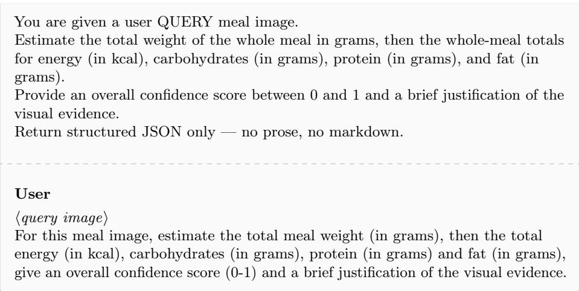

## S1.2 NutriVisRAG Inference

The main experiments retrieve from the combined Nutrition5k and SNAPMe reference corpus. Because all retrieved exemplars contain energy and macronutrient annotations but measured weight is available only for Nutrition5k exemplars, the system prompt explicitly communicates this distinction to the VLM.

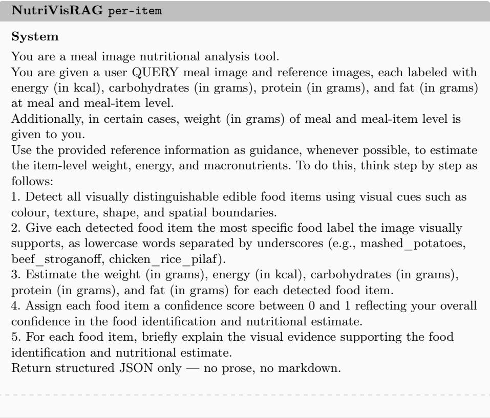

User   
Here are similar dishes for your reference to help you with the estimations:   
⟨reference image 1 ⟩   
⟨reference 1 nutritional annotations⟩   
⟨reference image 2⟩   
⟨reference 2 nutritional annotations⟩   
⟨reference image K⟩   
⟨reference K nutritional annotations   
⟨query image⟩   
For this meal image, identify each visible food item and estimate its weight (in   
grams), energy (in kcal), carbohydrates (in grams), protein (in grams) and fat (in   
grams), and give each a confidence score (0-1) and a brief justification of the visual   
evidence.

## NutriVisRAG whole-meal

## System

You are a meal image nutritional analysis tool.   
You are given a user QUERY meal image and reference images, each labeled with energy (in kcal), carbohydrates (in grams), protein (in grams), and fat (in grams) at meal and meal-item level.   
Additionally, in certain cases, weight (in grams) of meal and meal-item level is given to you.   
Use the provided reference information as guidance, whenever possible, to estimate the total weight of the whole meal in grams, then the whole-meal totals for energy (in kcal), carbohydrates (in grams), protein (in grams), and fat (in grams). Provide an overall confidence score between 0 and 1 and a brief justification of the visual evidence.   
Return structured JSON only — no prose, no markdown.

## User

Here are similar dishes for your reference to help you with the estimations:

⟨reference K nutritional annotations⟩

For this meal image, estimate the total meal weight (in grams), then the total energy (in kcal), carbohydrates (in grams), protein (in grams) and fat (in grams), give an overall confidence score (0-1) and a brief justification of the visual evidence.

## S1.3 Retrieved-Exemplar Annotation Format

The nutritional annotation inserted after each retrieved image depends on the source dataset. Measured weight is included for Nutrition5k exemplars and omitted for SNAPMe exemplars rather than estimated or imputed.

Nutrition5k exemplar   
Reference ⟨j⟩ — Items: ⟨item-level annotations including weight, energy,   
carbohydrates, protein, and fat⟩. Meal total: ⟨weight, energy, carbohydrates,   
protein, and fat⟩.   
SNAPMe exemplar   
Reference ⟨j⟩ — Items: ⟨item-level annotations including energy, carbohydrates,   
protein, and fat⟩. Meal total: ⟨energy, carbohydrates, protein, and fat⟩.

## S2 Efect of Acquisition Distance on MADiMa in Vanilla-Inference

MADiMa provides meal images acquired at both 40 cm and 60 cm, allowing performance to be compared across acquisition distances. Figure S1 reports $\% \mathrm { M A E } _ { \mathrm { m a c r o } }$ and $\% \mathrm { M A E } _ { \mathrm { m i c r o } }$ for the two prompting strategies across the four evaluated VLMs. The 60 cm images yield lower $\% \mathrm { M A E } _ { \mathrm { m a c r o } }$ and $\% \mathrm { M A E } _ { \mathrm { m i c r o } }$ for GPT-5.4-mini, Gemma-4-31B, and GLM-5.3-Flash under both prompting strategies, and for Mistral-Small-3.2 under whole-meal prompting. No corresponding improvement is observed for Mistral-Small-3.2 with per-item prompting.

## S3 Complete NutriVisRAG Results

Unless otherwise stated, %MAE values in the supplementary tables and accompanying text are rounded to one decimal place. Table S1 reports the complete NutriVisRAG results for both prompting strategies and all evaluated retrieval encoders. Table 4 of the main paper reports the primary comparison metric $( \% \mathrm { M A E _ { m i c r o } }$ for Nutrition5k, SNAPMe, and $\mathrm { M A D i M a ; \ \% M A E _ { C H O } }$ for EDU-CATE), while Table S1 additionally reports the error for each available nutritional target.

Furthermore, to provide a compact cross-dataset summary, Table S2 reports the unweighted mean of the dataset-level $\% \mathrm { M A E } _ { \mathrm { m i c r o } }$ values across Nutrition5k, SNAPMe, and MADiMa. An unweighted mean is used so that each benchmark contributes equally rather than allowing the larger Nutrition5k query set to dominate the summary. These values are descriptive and should not be interpreted as pooled micro errors or as evidence that a single retrieval encoder is uniformly best across query sets. EDUCATE is excluded because only CHO is available, whereas the cross-dataset summary is based on $\% \mathrm { M A E } _ { \mathrm { m i c r o } }$ . Across the eight VLM–prompt combinations, PE-Core has the lowest descriptive mean in four, $\mathrm { S i g L I P 2 }$ in three, and Vanilla in one. These aggregate diferences do not establish consistent superiority across individual query sets.

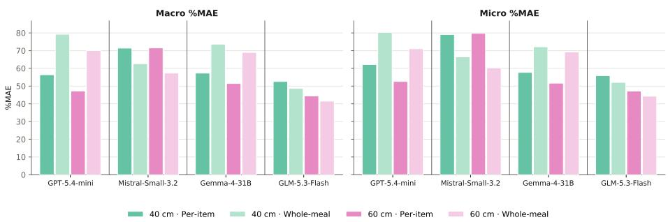  
Fig. S1: Efect of acquisition distance on Vanilla VLM inference for MADiMa. $\% \mathrm { M A E } _ { \mathrm { m a c r o } }$ and $\% \mathrm { M A E } _ { \mathrm { m i c r o } }$ (lower is better) are shown at 40 cm and 60 cm for peritem and whole-meal prompting across the four evaluated VLMs.

## S4 Retrieval Diagnostics

Unless otherwise stated, the exemplar-level diagnostics use the main retrieval configuration with $K = 5 , \tau = 0 . 7 5$ , and the closest-reference fallback. Retrieval benefit is defined as the per-query reduction in pooled absolute macronutrient error relative to Vanilla, normalised by the query-set mean target macronutrient sum; EDUCATE instead uses absolute CHO error normalised by mean annotated CHO. Visual similarity is the mean cosine similarity between the query and its retrieved exemplars. Nutritional distance is the mean absolute query–exemplar diference across the available macronutrients after normalising each nutrient by its query-set mean; EDUCATE uses CHO only. Associations are quantified using Spearman’s rank coeficient (ρ).

## S4.1 Visual Retrieval Space

Figure S2 qualitatively examines whether projected query–reference overlap in the visual retrieval embedding space corresponds to downstream NutriVisRAG gains. For each encoder, t-SNE (perplexity 30, PCA initialisation, random seed 0) is applied with cosine distance jointly to the reference corpus and all query sets. PE-Core and SigLIP 2 show stronger dataset-level separation, particularly for MADiMa and EDUCATE, whereas Nomic Vision shows greater mixing between queries and references. However, projected overlap does not correspond directly to retrieval benefit: MADiMa improves in 22/24 configurations despite its separation under PE-Core and SigLIP 2, while SNAPMe improves in only 7/24 despite its training split contributing to the reference corpus. Likewise, Nomic Vision’s greater mixing does not yield more consistent MADiMa gains, improving 6/8 configurations compared with 8/8 for PE-Core and SigLIP 2. Because t-SNE can distort neighbourhood and global structure, this analysis is interpreted qualitatively and motivates the exemplar-level analyses below.

Table S1: Complete nutrient-estimation results with and without NutriVisRAG (%MAE, lower is better), for both prompting strategies side by side. Dashes indicate unavailable evaluation targets for the corresponding dataset. Bold: lowest Macro and Micro (or CHO) error within each model block and prompting strategy; arrows: increase (↑) or decrease (↓) relative to the Vanilla baseline of the same prompting strategy. ⋆ marks a statistically significant improvement over that baseline and a statistically significant degradation (paired Wilcoxon signed-rank test on per-meal absolute errors, Benjamini–Hochberg corrected, $q < 0 . 0 5 )$ ; the Macro column is an average of per-nutrient errors and is therefore not tested. Arrows indicate the direction of change based on unrounded values; displayed values are rounded to one decimal place.
<table><tr><td></td><td></td><td colspan="6">Per-item</td><td colspan="8">Whole-meal</td></tr><tr><td>Query set Model</td><td>Setting</td><td>Weight Energy</td><td></td><td></td><td>CHO Protein</td><td></td><td>Fat Macro</td><td>Micro</td><td></td><td>Weight Energy</td><td></td><td>CHO Protein</td><td></td><td>Fat Macro Micro</td><td></td></tr><tr><td>Nutrition5k Gemma-4-31B</td><td>Vanilla</td><td>36.3 48.4↑</td><td>47.7</td><td>56.0</td><td></td><td>44.3</td><td>63.3 54.5</td><td>53.6</td><td>49.2</td><td>58.4</td><td>69.6</td><td>46.4</td><td>78.4</td><td>64.8</td><td>63.5</td></tr><tr><td></td><td>NutriVisRAG (PE-Core)</td><td></td><td>46.0↓</td><td>61.0↑</td><td>45.8↑</td><td>52.9↓*</td><td>53.2↓</td><td>53.7↑</td><td>47.4↓</td><td>44.9↓*</td><td>55.9↓*</td><td>43.9↓*</td><td>53.4↓*</td><td>51.0↓</td><td>51.0↓*</td></tr><tr><td></td><td>NutriVisRAG</td><td>(SigLIP2)</td><td>47.6↑</td><td>47.8†</td><td>58.6↑</td><td>47.1↑</td><td>58.8↓*</td><td>54.9↑</td><td>54.6↑</td><td>46.7↓*</td><td>45.3↓* 54.6↓*</td><td></td><td>43.5↓* 55.1↓*</td><td>51.1↓</td><td>50.8↓</td></tr><tr><td></td><td></td><td>NutriVisRAG (Nomic Vision)</td><td>46.3↑</td><td>51.4↑</td><td>59.8↑</td><td>55.5↑</td><td>66.0↑</td><td>60.5↑</td><td>59.8↑</td><td>46.5↓*</td><td>49.6↓* 56.5↓*</td><td></td><td>51.2↑ 61.4↓*</td><td>56.4↓</td><td>55.8↓*</td></tr><tr><td></td><td>GPT-5.4-mini Vanilla</td><td></td><td>35.8</td><td>47.2</td><td>66.2</td><td>45.8</td><td>62.2</td><td>58.0</td><td>58.0</td><td>40.1</td><td>48.1</td><td>60.8</td><td>47.2 69.9</td><td>59.3</td><td>58.1</td></tr><tr><td></td><td></td><td>NutriVisRAG (PE-Core)</td><td>31.7↓</td><td>36.7↓*</td><td>44.3↓*</td><td>37.7↓°</td><td>47.4↓</td><td>43.1↓</td><td>42.7↓</td><td>34.2↓*</td><td>36.3↓*</td><td>45.7↓*</td><td>39.0↓* 46.0↓*</td><td>43.5↓</td><td>43.4↓*</td></tr><tr><td></td><td></td><td>NutriVisRAG (SigLIP2)</td><td>31.6↓*</td><td>36.4↓*</td><td>46.2↓</td><td>37.4↓*</td><td>47.4↓*</td><td>43.7↓</td><td>43.4↓*</td><td>34.5↓*</td><td>36.9↓*</td><td>46.8↓*</td><td>40.0↓* 46.0↓*</td><td>44.3↓</td><td>44.2↓*</td></tr><tr><td></td><td></td><td>NutriVisRAG (Nomic Vision)</td><td>33.7↓</td><td>38.8↓</td><td>49.2↓</td><td>42.2↓*</td><td>50.9↓*</td><td>47.4↓</td><td>47.1↓*</td><td>36.2↓*</td><td>40.5↓* 48.3↓*</td><td></td><td>44.0↓* 53.6↓*</td><td>48.6↓</td><td>48.0↓*</td></tr><tr><td></td><td>Mistral-Small-3.2 Vanilla</td><td></td><td>46.0</td><td>56.2</td><td>85.4</td><td>58.8</td><td>69.3</td><td></td><td></td><td></td><td></td><td></td><td></td><td>77.3</td><td>78.7</td></tr><tr><td></td><td></td><td>NutriVisRAG (PE-Core)</td><td>117.8↑</td><td>99.5↑</td><td>140.7↑*</td><td>86.0↑</td><td>98.4↑</td><td>71.2</td><td>72.1</td><td>62.2</td><td>60.8</td><td>97.5 74.3↓*</td><td>60.0 50.4↓* 59.8↓*</td><td>74.3</td><td>62.3↓*</td></tr><tr><td></td><td></td><td>NutriVisRAG (SigLIP2)</td><td>124.7↑</td><td>109.7↑</td><td>144.4↑</td><td>94.6↑</td><td>114.1↑</td><td>108.4↑</td><td>111.2↑ 119.5↑</td><td>52.9↓*</td><td>53.1↓* 55.0↓*</td><td>72.0↓*</td><td>51.5↓*</td><td>61.5↓</td><td>63.3↓*</td></tr><tr><td></td><td></td><td>NutriVisRAG (Nomic Vision)</td><td>134.3↑</td><td>137.2↑</td><td>164.7↑</td><td>126.0↑</td><td>140.1↑</td><td>117.7↑ 143.6↑</td><td>145.1↑</td><td>53.9↓* 54.6↓*</td><td>65.1↑</td><td>79.5↓*</td><td>66.2↓* 65.1↑ 79.3↑</td><td>63.2↓</td><td>74.3↓*</td></tr><tr><td></td><td></td><td></td><td></td><td></td><td></td><td></td><td></td><td></td><td></td><td></td><td></td><td></td><td></td><td>74.6↓</td><td></td></tr><tr><td></td><td>GLM-5.3-Flash</td><td>Vanilla</td><td>38.0 52.8↑</td><td>45.6 47.2↑</td><td>62.5 61.4↓*</td><td>40.6 48.8↑</td><td>59.2</td><td>54.1</td><td>54.0</td><td>42.0</td><td>47.8</td><td>65.5</td><td>41.9 61.5</td><td>56.3</td><td>56.2</td></tr><tr><td></td><td></td><td>NutriVisRAG (PE-Core) NutriVisRAG (SigLIP2)</td><td>51.9↑</td><td>46.5↑</td><td>59.4↓*</td><td>48.5↑</td><td>49.8↓*</td><td>53.3↓</td><td>54.1↑</td><td>59.8↑</td><td>53.6↑ 62.8↓*</td><td></td><td>55.5↑ 56.9↓*</td><td>58.4↑</td><td>58.8↑</td></tr><tr><td></td><td></td><td>NutriVisRAG (Nomic Vision)</td><td>51.7↑</td><td>53.0↑</td><td>60.6↓</td><td>55.7↑</td><td>50.4↓ 59.5↑</td><td>52.8↓</td><td>53.4↓</td><td>56.9↑</td><td>51.1↑ 61.4↓*</td><td></td><td>52.2↑ 55.9↓*</td><td>56.5↑</td><td>56.8↑ 62.2↑</td></tr><tr><td>SNAPMe</td><td></td><td></td><td></td><td></td><td></td><td></td><td></td><td>58.6↑</td><td>58.6↑</td><td>56.1↑</td><td>56.7↑ 62.8↓*</td><td></td><td>61.0↑ 62.8↑*</td><td>62.2↑</td><td></td></tr><tr><td></td><td>Gemma-4-31B</td><td>Vanilla</td><td></td><td>35.8</td><td>38.0</td><td>39.6</td><td>48.4</td><td>42.0</td><td>41.0</td><td></td><td>39.3</td><td>41.4</td><td>40.8 51.0</td><td>44.4</td><td>43.6</td></tr><tr><td></td><td></td><td>NutriVisRAG (PE-Core)</td><td></td><td>41.4↑</td><td>45.9↑</td><td>43.2↑</td><td>50.2↑</td><td>46.4↑</td><td>46.2↑*</td><td></td><td>37.6↓</td><td>40.4↓</td><td>39.9↓ 49.3↓</td><td>43.2↓</td><td>42.5↓</td></tr><tr><td></td><td></td><td>NutriVisRAG (SigLIP2)</td><td></td><td>38.2↑</td><td>41.1↑</td><td>42.9↑</td><td>50.5↑</td><td>44.9↑</td><td>44.0↑</td><td></td><td>35.6↓* 38.1↓*</td><td></td><td>38.6↓ 46.9↓</td><td>41.2↓</td><td>40.4↓*</td></tr><tr><td></td><td></td><td>NutriVisRAG (Nomic Vision)</td><td></td><td>38.8↑</td><td>43.5↑</td><td>43.6↑</td><td>49.4↑</td><td>45.5↑</td><td>45.0↑</td><td></td><td>36.3↓</td><td>39.6↓</td><td>40.0↓ 48.1↓</td><td>42.6↓</td><td>41.9↓</td></tr><tr><td></td><td>GPT-5.4-mini</td><td>Vanilla</td><td></td><td>35.0</td><td>39.4</td><td>40.1</td><td>46.5</td><td>42.0</td><td>41.4</td><td></td><td>35.5</td><td>40.1</td><td>38.9 48.0</td><td>42.3</td><td>41.7</td></tr><tr><td></td><td></td><td>NutriVisRAG (PE-Core)</td><td></td><td>36.3↑</td><td>38.5↓</td><td>41.1↑</td><td>48.4↑</td><td>42.7↑</td><td>41.7↑</td><td></td><td>37.4↑</td><td>40.9↑</td><td>40.7↑ 48.7↑</td><td>43.4↑</td><td>42.8↑</td></tr><tr><td></td><td></td><td>NutriVisRAG (SigLIP2)</td><td></td><td>35.8↑</td><td>40.5↑</td><td>41.1↑</td><td>46.6↑</td><td>42.7↑</td><td>42.2↑</td><td></td><td>35.1↓</td><td>38.9↓</td><td>39.4↑ 46.6↓</td><td>41.6↓</td><td>41.0↓</td></tr><tr><td></td><td></td><td>NutriVisRAG (Nomic Vision)</td><td></td><td>37.1↑</td><td>39.2↓</td><td>42.4↑</td><td>50.1↑</td><td>43.9↑</td><td>42.8↑</td><td></td><td>36.8↑</td><td>41.7↑</td><td>41.7↑ 46.9↓</td><td>43.4↑</td><td>43.0↑</td></tr><tr><td></td><td>Mistral-Small-3.2 Vanilla</td><td></td><td></td><td>42.6 107.7↑</td><td>47.8</td><td>49.8</td><td>58.6</td><td>52.1</td><td>51.1</td><td></td><td>37.3</td><td>41.0</td><td>43.7 52.5</td><td>45.7</td><td>44.6</td></tr></table>

## S4.2 VLM-Specific Similarity–Benefit Associations

The main paper summarises the association between retrieval benefit and exemplar similarity after averaging retrieval benefit across the four VLMs. Figures S3 and S4 show the corresponding associations separately for each VLM under per-item and whole-meal prompting.

Visual similarity remains weak and inconsistent across VLMs, query sets, and retrieval encoders under both prompting strategies. Nutritional distance shows more consistently negative associations under whole-meal prompting, particularly on MADiMa, whereas the relationship is weaker and less consistent under peritem prompting. The VLM-specific results further show that retrieval benefit varies across models despite using the same retrieved evidence, consistent with the configuration-dependent efects observed in the main experiments.

Table S1: (continued) Complete nutrient-estimation results with and without NutriVisRAG.
<table><tr><td></td><td></td><td></td><td colspan="6">Per-item</td><td colspan="8">Whole-meal</td></tr><tr><td>Query set Model</td><td></td><td>Setting</td><td colspan="2">Weight Energy</td><td colspan="2">CHO Protein</td><td colspan="2">Fat Macro Micro</td><td colspan="2">Weight Energy</td><td colspan="2"></td><td colspan="2">CHO Protein</td><td colspan="2">Fat Macro Micro</td><td></td></tr><tr><td>MADiMa</td><td>Gemma-4-31B</td><td>Vanilla</td><td>51.2</td><td>49.1</td><td>60.1</td><td>38.9</td><td>64.2</td><td>54.4</td><td>54.7</td><td>76.5</td><td>69.5</td><td>76.4</td><td>48.5</td><td>89.1</td><td>71.3</td><td>70.7</td></tr><tr><td></td><td></td><td>NutriVisRAG (PE-Core)</td><td>38.8↓*</td><td>40.5↓*</td><td>54.6↓*</td><td>41.7↑</td><td>52.7↓</td><td>49.7↓</td><td>50.5↓*</td><td>71.9↓</td><td>62.4↓</td><td>64.9↓*</td><td>43.1↓*</td><td>85.8↓</td><td>64.6↓</td><td>62.7↓</td></tr><tr><td></td><td></td><td>NutriVisRAG (SigLIP2)</td><td>38.3↓*</td><td>38.8↓*</td><td>51.1↓*</td><td>37.5↓</td><td>53.3↓*</td><td>47.3↓</td><td>47.5↓*</td><td>69.7↓*</td><td>64.6↓*</td><td>62.2↓*</td><td>45.1↓</td><td>93.8↑</td><td>67.0↓</td><td>63.5↓*</td></tr><tr><td></td><td></td><td>NutriVisRAG (Nomic Vision)</td><td>41.5↓*</td><td>40.1↓*</td><td>53.8↓*</td><td>40.8↑</td><td>58.3↓</td><td>51.0↓</td><td>50.9↓*</td><td>74.3↓</td><td>57.5↓*</td><td>64.1↓*</td><td>40.8↓*</td><td>79.2↓*</td><td>61.4↓</td><td>60.3↓*</td></tr><tr><td></td><td>GPT-5.4-mini</td><td>Vanilla</td><td>53.8</td><td>45.0</td><td>75.8</td><td>32.8</td><td></td><td></td><td></td><td></td><td>76.4</td><td></td><td>38.5</td><td>96.2</td><td></td><td>75.7</td></tr><tr><td></td><td></td><td>NutriVisRAG (PE-Core)</td><td>27.5↓*</td><td>31.9↓*</td><td>50.7↓*</td><td>33.2↑</td><td>46.9 45.2↓</td><td>51.8 43.0↓</td><td>57.4 44.5↓*</td><td>93.0 42.3↓</td><td>39.9↓*</td><td>89.2 56.5↓*</td><td>34.5↓</td><td>50.0↓</td><td>74.6 47.0↓</td><td>48.7↓*</td></tr><tr><td></td><td></td><td>NutriVisRAG (SigLIP2)</td><td>29.1↓*</td><td>31.9↓*</td><td>51.8↓*</td><td>35.9↑</td><td>48.9↑</td><td>45.5↓</td><td>46.5↓*</td><td>41.2↓</td><td>44.2↓*</td><td>60.8↓*</td><td>36.7↓</td><td>56.5↓*</td><td>51.3↓</td><td>52.9↓*</td></tr><tr><td></td><td></td><td>NutriVisRAG (Nomic Vision)</td><td>31.7↓*</td><td>33.7↓*</td><td>52.5↓*</td><td>33.6↑</td><td>49.6↑</td><td>45.2↓</td><td>46.4↓*</td><td>55.6↓*</td><td>43.3↓*</td><td>58.2↓*</td><td>35.1↓</td><td>59.0↓*</td><td>50.8↓</td><td>51.6↓*</td></tr><tr><td></td><td>Mistral-Small-3.2</td><td>Vanilla</td><td></td><td></td><td>105.5</td><td></td><td></td><td></td><td></td><td></td><td></td><td></td><td></td><td></td><td></td><td></td></tr><tr><td></td><td></td><td>NutriVisRAG (PE-Core)</td><td>39.7</td><td>50.1↓ 56.8</td><td>75.5↓*</td><td>45.1 55.9↑</td><td>63.8</td><td>71.5</td><td>79.5</td><td>55.5</td><td>38.5</td><td>77.6</td><td>38.6</td><td>63.7</td><td>60.0</td><td>63.4</td></tr><tr><td></td><td></td><td>NutriVisRAG (SigLIP2)</td><td>48.6↑ 65.5↑</td><td>64.7↑</td><td>71.9↓*</td><td>84.6↑</td><td>64.8↑ 86.9↑</td><td>65.4↓</td><td>67.6↓* 78.6↓</td><td>37.8↓*</td><td>40.3↑</td><td>52.6↓*</td><td>47.9↑ 52.6↑</td><td>60.5↓</td><td>53.7↓ 52.8↓* 57.8↓</td><td>55.6↓*</td></tr><tr><td></td><td></td><td>NutriVisRAG (Nomic Vision)</td><td>61.9↑</td><td>66.4↑</td><td>90.2↓*</td><td>69.0↑</td><td>84.5↑</td><td>81.1↑ 81.2↑</td><td>82.8↑</td><td>33.5↓* 44.4↓*</td><td>42.0↑ 53.4↑</td><td>52.2↓* 72.6↓*</td><td>59.3↑</td><td>68.6↑ 75.1↑</td><td>69.0↑</td><td>69.2↑</td></tr><tr><td></td><td>GLM-5.3-Flash</td><td>Vanilla</td><td></td><td></td><td></td><td></td><td></td><td></td><td></td><td></td><td></td><td></td><td></td><td></td><td></td><td></td></tr><tr><td></td><td></td><td>NutriVisRAG (PE-Core)</td><td>50.5 32.9↓*</td><td>41.9 31.9↓*</td><td>60.5 42.9↓*</td><td>41.5</td><td>43.6 42.3↓</td><td>48.5</td><td>51.5</td><td>51.5</td><td>37.7</td><td>58.4</td><td>34.5</td><td>42.4</td><td>45.1</td><td>48.2</td></tr><tr><td></td><td></td><td>NutriVisRAG (SigLIP2)</td><td>31.6↓*</td><td>29.9↓*</td><td>43.1↓*</td><td>36.5↓ 33.4↓</td><td>40.3↓</td><td>40.6↓ 38.9↓</td><td>40.9↓* 39.7↓</td><td>33.4↓*</td><td>31.5↓*</td><td>42.6↓*</td><td>34.5↑ 32.4↓</td><td>42.7↑</td><td>39.9↓</td><td>40.2↓*</td></tr><tr><td></td><td></td><td>NutriVisRAG (Nomic Vision)</td><td>35.3↓*</td><td>33.3↓*</td><td>49.2↓*</td><td>31.0↓*</td><td>43.9↑</td><td>41.4↓</td><td>42.8↓*</td><td>32.5↓ 37.3↓*</td><td>31.1↓* 33.4↓*</td><td>41.9↓* 47.1↓</td><td>33.8↓</td><td>41.0↓ 42.2↓</td><td>38.4↓ 38.9↓* 41.1↓</td><td>42.2↓*</td></tr><tr><td>EDUCATE Gemma-4-31B</td><td></td><td></td><td></td><td></td><td></td><td></td><td></td><td></td><td></td><td></td><td></td><td></td><td></td><td></td><td></td><td></td></tr><tr><td></td><td></td><td>Vanilla</td><td></td><td></td><td>33.0</td><td></td><td></td><td></td><td></td><td></td><td></td><td>45.4</td><td></td><td></td><td></td><td></td></tr><tr><td></td><td></td><td>NutriVisRAG (PE-Core)</td><td></td><td></td><td>36.5↑</td><td></td><td></td><td></td><td></td><td></td><td></td><td>45.0↓</td><td></td><td></td><td></td><td></td></tr><tr><td></td><td></td><td>NutriVisRAG (SigLIP2) NutriVisRAG (Nomic Vision)</td><td></td><td></td><td>37.8↑</td><td></td><td></td><td></td><td></td><td></td><td></td><td>44.5↓</td><td></td><td></td><td></td><td></td></tr><tr><td></td><td></td><td></td><td></td><td></td><td>38.5↑</td><td></td><td></td><td></td><td></td><td></td><td></td><td>47.0↑</td><td></td><td></td><td></td><td></td></tr><tr><td></td><td>GPT-5.4-mini</td><td>Vanilla</td><td></td><td></td><td>45.0</td><td></td><td></td><td></td><td></td><td></td><td></td><td>58.4</td><td></td><td></td><td></td><td></td></tr><tr><td></td><td></td><td>NutriVisRAG (PE-Core)</td><td></td><td></td><td>40.9↓</td><td></td><td></td><td></td><td></td><td></td><td></td><td>46.6↓*</td><td></td><td></td><td></td><td></td></tr><tr><td></td><td></td><td>NutriVisRAG (SigLIP2) NutriVisRAG (Nomic Vision)</td><td></td><td></td><td>38.0↓* 42.5↓</td><td></td><td></td><td></td><td></td><td></td><td></td><td>43.3↓* 43.6↓*</td></table>

Table S2: Descriptive unweighted cross-dataset mean $\% \mathrm { M A E } _ { \mathrm { m i c r o } }$ for each VLM, prompting strategy, and inference setting across Nutrition5k, SNAPMe, and MADiMa (lower is better).
<table><tr><td>VLM</td><td>Prompt</td><td>Vanilla</td><td>PE-Core</td><td>SigLIP 2</td><td>Nomic Vision</td></tr><tr><td rowspan="2">Gemma-4-31B</td><td>Per-item</td><td>49.8</td><td>50.1</td><td>48.7</td><td>51.9</td></tr><tr><td>Whole-meal</td><td>59.3</td><td>52.1</td><td>51.6</td><td>52.6</td></tr><tr><td rowspan="2">GPT-5.4-mini</td><td>Per-item</td><td>52.2</td><td>43.0</td><td>44.0</td><td>45.4</td></tr><tr><td>Whole-meal</td><td>58.5</td><td>45.0</td><td>46.0</td><td>47.5</td></tr><tr><td rowspan="2">Mistral-Small-3.2</td><td>Per-item</td><td>67.5</td><td>94.1</td><td>109.5</td><td>112.2</td></tr><tr><td>Whole-meal</td><td>62.2</td><td>60.8</td><td>64.7</td><td>69.9</td></tr><tr><td rowspan="2">GLM-5.3-Flash</td><td>Per-item</td><td>48.4</td><td>45.0</td><td>45.6</td><td>47.6</td></tr><tr><td>Whole-meal</td><td>48.0</td><td>45.7</td><td>44.7</td><td>47.7</td></tr></table>

## S4.3 Visual Similarity and Nutritional Proximity

Because each retrieved meal image is provided together with its nutritional annotations, we additionally examine whether visually closer exemplars are also nutritionally closer to the query. This analysis is independent of prompting strategy because the retrieved exemplars are fixed before VLM prompting. Figure S5 shows that the relationship varies substantially across query sets. Visual similarity is more strongly associated with nutritional proximity on Nutrition5k, with weaker associations on SNAPMe and MADiMa and little association on EDUCATE. Thus, visually similar retrieval does not uniformly imply quantitatively similar nutritional annotations across datasets. This provides additional context for the weak and inconsistent relationship between cosine similarity and downstream retrieval benefit.

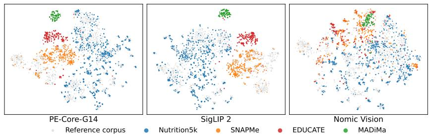  
Fig. S2: t-SNE visualisation of the retrieval embedding spaces for PE-Core-G14, SigLIP 2, and Nomic Vision. Gray points represent the combined Nutrition5k–SNAPMe reference corpus, while coloured points represent evaluation queries from Nutrition5k, SNAPMe, EDUCATE, and MADiMa.

Nutritional distance is calculated retrospectively from annotated query nutrients and is therefore unavailable as an inference-time retrieval criterion. Moreover, nutritional distance and estimation error both depend on the annotated query targets, so their association with retrieval benefit should be interpreted descriptively rather than causally.

## S4.4 Meal-Level Error and Agreement Analysis

Having characterised the retrieved evidence and its association with estimation benefit, we next examine how these efects are distributed across individual meals. We analyse NutriVisRAG at the meal level under both per-item and whole-meal prompting. Whole-meal prompting shows more consistent retrieval benefits in the main experiments, reducing the primary error in 35 of 48 configurations compared with 21 of 48 under per-item prompting. To avoid selecting a particular retrieval representation or VLM, the analysis includes all three visual encoders, all four VLMs, and all four query sets. For the paired-error analysis, the per-meal quantity underlying $\% \mathrm { M A E } _ { \mathrm { m i c r o } }$ is the pooled absolute macronutrient error, |∆CHO| + $| \varDelta \mathrm { P R O T } | + | \varDelta \mathrm { F A T } |$ , expressed in grams; for EDUCATE, the corresponding quantity is absolute CHO error. For the Bland–Altman analysis, the corresponding pooled predicted and reference macronutrient quantities, $\widehat { \mathrm { C H O } } + \widehat { \mathrm { P R O T } } + \widehat { \mathrm { F A T } }$ and $\mathrm { C H O } + \mathrm { P R O T } + \mathrm { F A T }$ , are compared in grams, while EDUCATE uses predicted and reference CHO. The analysis uses the main retrieval configuration throughout: the combined Nutrition5k–SNAPMe reference corpus, $K = 5$ , and the similarity threshold $\tau = 0 . 7 5$ with the closest-reference fallback where applicable.

Figures S6 and S8 compare the absolute estimation error of Vanilla and NutriVisRAG for each meal under per-item and whole-meal prompting, respectively. Whole-meal prompting yields a larger number of individually improved meals than per-item prompting in 37 of the 48 matched VLM–encoder–query-set panels. More than half of the meals improve in 36/48 whole-meal panels compared with

26/48 per-item panels, consistent with the greater aggregate benefit of whole-meal retrieval. However, the number of improved meals does not necessarily determine the aggregate error because $\% \mathrm { M A E } _ { \mathrm { m i c r o / C H O } }$ also depends on the magnitude of individual errors. For example, GLM-5.3-Flash under whole-meal prompting improves more than half of Nutrition5k meals for all three retrieval encoders despite increasing the aggregate primary error in all three configurations. The paired plots therefore show that retrieval can benefit a majority of meals while a smaller number of large degradations dominate the aggregate error.

Figures S7 and S9 provide complementary Bland–Altman analyses of the corresponding predictions under per-item and whole-meal prompting, respectively. The plots show that retrieval afects not only average error but also systematic bias and dispersion, with several configurations exhibiting increasing disagreement at larger meal magnitudes. This magnitude-dependent behaviour is particularly pronounced for Mistral-Small-3.2 on SNAPMe and EDUCATE, where large positive deviations remain visible across retrieval encoders. Substantial betweenmeal dispersion and isolated large errors are also present in configurations with lower aggregate error, showing that improved average performance does not imply uniformly improved agreement. The limits of agreement are therefore interpreted descriptively because the diferences are right-skewed in several configurations and can be strongly influenced by large-error meals. For SNAPMe, the reference nutrients are verified self-reported dietary estimates, whereas EDUCATE uses the mean CHO estimate of two dietitians; disagreement on these datasets therefore also incorporates uncertainty in the reference annotations. Together, the pairederror and agreement analyses show that the efect of visual exemplar grounding depends on both how many meals improve and how strongly individual meal errors change.

## S5 Exploratory Analyses

In addition to the main retrieval experiments and ablations, we investigate two exploratory extensions across all four evaluated VLMs. Post-hoc food-composition grounding replaces VLM-predicted nutrient values with database-derived estimates based on predicted food identities and weights, and is therefore evaluated under per-item prompting, which provides these predictions. Retrieval reranking instead modifies exemplar selection by rescoring visually retrieved candidates and is evaluated under both prompting strategies.

## S5.1 Post-Hoc Food-Composition Grounding

We investigate whether nutrient estimation can be improved by replacing the VLM-predicted nutrient values with values derived from a food-composition database. This procedure requires individually identified foods and their estimated quantities, so the analysis is restricted to per-item predictions. Each VLMpredicted food name and weight are retained; the food name is matched to a food-composition entry and scaled by the predicted weight, and the resulting item-level values are summed to obtain meal-level estimates.

Food-name matching. We compare one lexical and three embedding-based matching strategies. Lexical matching selects the database entry with the highest token-set similarity to the VLM-predicted food name. The embedding-based strategies encode the predicted food name and database entry names and select the entry with the highest cosine similarity. We evaluate Qwen3-Embedding [61], EmbeddingGemma [54] and Nomic Embed Text v2 (MoE) (Nomic Text) [36]. For all strategies, the highest-scoring database entry is accepted without an additional threshold.

Food-composition databases. For Nutrition5k, SNAPMe, and MADiMa, nutrient values are obtained from the U.S. Department of Agriculture (USDA) FoodData Central (FDC) [19]. For EDUCATE, the predicted food name is first matched against the Dutch Food Composition Database (NEVO) [35], with FDC used as a fallback when the highest NEVO matching score is below 0.5. This NEVO-based configuration yields lower CHO error than FDC-only lookup across the evaluated EDUCATE configurations and is therefore reported in Table S3.

Experimental setup. The analysis uses the same fixed 100-query subsets as the retrieval ablations, with $K = 5$ and $\tau = 0 . 7 5$ . The same source prediction is used for the original NutriVisRAG estimate and all post-hoc variants, so only the food-name matching and nutrient-substitution step changes between conditions. Embedding models are run locally on an NVIDIA RTX A6000.

Table S3 reports the resulting $\% \mathrm { M A E _ { e n e r g y } }$ and $\% \mathrm { M A E } _ { \mathrm { m i c r o / C H O } }$ . The analysis covers 48 model–encoder–query-set configurations (4 VLMs × 3 encoders $\times ~ 4$ query sets). The original NutriVisRAG estimate achieves the lowest $\% \mathrm { M A E } _ { \mathrm { m i c r o / C H O } }$ in 46/48 configurations and the lowest $\% \mathrm { M A E _ { e n e r g y } }$ in 34/36 configurations where energy is available. Lexical, EmbeddingGemma, and Nomic Text matching in crease $\% \mathrm { M A E } _ { \mathrm { m i c r o / C H O } }$ in all 48 configurations, while Qwen3 increases it in 46/48. After Benjamini–Hochberg correction, significant degradations occur in 45/48 configurations for lexical matching, 30/48 for Qwen3, 47/48 for EmbeddingGemma, and $4 2 / 4 8$ for Nomic Text, with no significant improvement for any matching method. Because food identification, database-match correctness, and item-weight estimation are not evaluated independently, these findings characterise the end-to-end post-hoc pipeline rather than the matching models alone. Post-hoc food-composition grounding therefore provides no statistically significant improvement over the original NutriVisRAG predictions. Furthermore, it adds little computational overhead: embedding-based matching takes about 150 ms per predicted food item, while lexical matching takes about 1.5 ms. Its exclusion is therefore driven by degraded accuracy rather than computational cost.

## S5.2 Retrieval Reranking

We additionally investigate whether reranking a larger pool of visually retrieved candidates improves nutrient estimation. Rather than directly presenting the five nearest neighbours returned by the visual encoder, we retrieve a larger candidate pool and apply a multimodal relevance model before selecting the final exemplars provided to the VLM.

Reranking strategies. For each query, the visual encoder first retrieves 50 candidate reference meals. We evaluate three multimodal rerankers: Jina Reranker M0 [22], Qwen3-VL-Reranker-2B [26], and Llama Nemotron Rerank VL 1B v2 [38]. Jina and Qwen3 perform image-to-image reranking by scoring the query meal image against each candidate image. Nemotron performs text-to-image reranking, for which the query meal is first converted into a short food and portion description using the same VLM used for nutrient estimation. Each reranker rescores the 50 candidates and retains the five highest-ranked references.

Experimental setup. The analysis uses the same fixed 100-query subsets as the retrieval ablations and evaluates both per-item and whole-meal prompting. The evaluated checkpoints are jinaai/jina-reranker-m0, Qwen/Qwen3-VL-Reranker-2B, and nvidia/llama-nemotron-rerank-vl-1b-v2. The initial candidate pool contains 50 references, which are reranked to the five exemplars presented to the VLM. All remaining retrieval and inference settings are kept unchanged from the corresponding NutriVisRAG configuration. The default NutriVisRAG result without reranking serves as the baseline for each model–encoder–query-set–prompt combination. The rerankers are run locally on an NVIDIA RTX A6000.

Table S4 reports the resulting $\% \mathrm { M A E _ { e n e r g y } }$ and %MAEmicro/CHO.

Under per-item prompting, reranking reduces $\% \mathrm { M A E } _ { \mathrm { m i c r o / C H O } }$ in 73/144 comparisons, with eight significant improvements and two significant degradations after Benjamini–Hochberg correction. Improvements occur in 24/36 comparisons on MADiMa, 19/36 on Nutrition5k, 17/36 on EDUCATE, and 13/36 on SNAPMe. Jina improves 23/48 per-item comparisons, Qwen3 improves 30/48, and Nemotron improves 20/48. Under whole-meal prompting, reranking reduces $\% \mathrm { M A E } _ { \mathrm { m i c r o / C H O } }$ in 76/144 comparisons, with six significant improvements and four significant degradations after correction. Improvements occur in 28/36 comparisons on MADiMa, 21/36 on EDUCATE, 17/36 on SNAPMe, and 10/36 on Nutrition5k. Jina improves 30/48 whole-meal comparisons, while Qwen3 and Nemotron each improve 23/48. These results indicate that reranking can reduce nutrient-estimation error in certain configurations, but its efects depend on the dataset, prompting strategy, VLM, and reranker. Reranking adds a median of 5.3–11.7 s per meal, increasing end-to-end latency by 2.6×–5.1×, depending on the reranker and VLM. Given the variable accuracy gains and additional computational cost, reranking is retained as an exploratory extension rather than incorporated into the default NutriVisRAG pipeline.

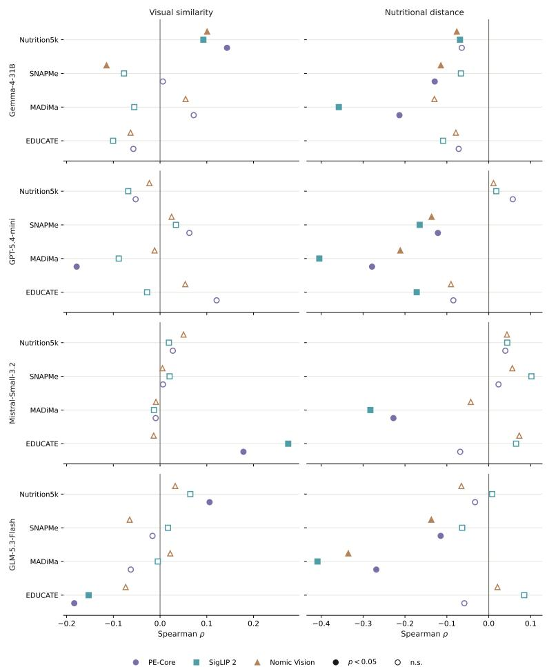  
Fig. S3: VLM-specific Spearman associations between retrieval benefit and mean visual similarity (left) or retrospective nutritional distance (right) under per-item prompting. Rows represent VLMs, and markers represent retrieval encoders. Filled markers indicate Benjamini–Hochberg-corrected $q < 0 . 0 5 ;$ open markers indicate nonsignificant associations.

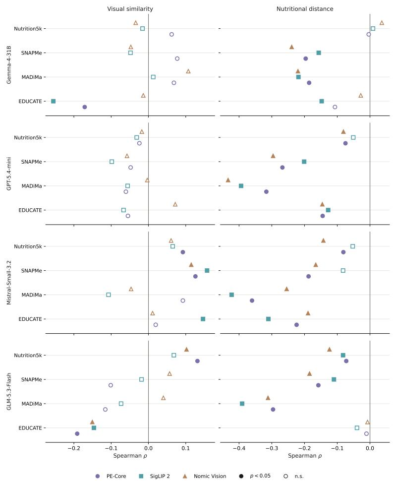  
Fig. S4: VLM-specific Spearman associations between retrieval benefit and mean visual similarity (left) or retrospective nutritional distance (right) under whole-meal prompting. Rows represent VLMs, and markers represent retrieval encoders. Filled markers indicate Benjamini–Hochberg-corrected $q < 0 . 0 5 ;$ open markers indicate nonsignificant associations.

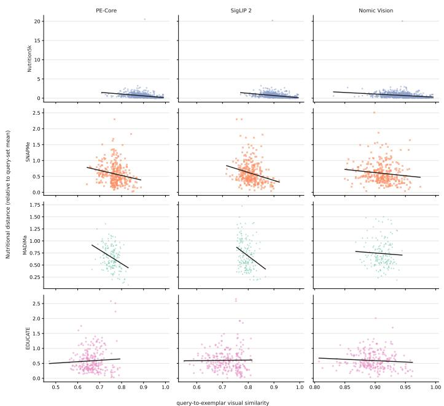  
Fig. S5: Mean visual similarity versus normalised nutritional distance between queries and retrieved exemplars. Rows represent query sets and columns represent PE-Core, SigLIP 2, and Nomic Vision. Lower nutritional distance indicates greater nutritional proximity.

s are logarithmic, with10−3 g added to all errors so that zero error GLM-5.3-Flash. Points below the diagonal favour NutriVisRAG, and each panel reports t O error for EDUCATE). Rows: query sets; columns: retrieval encoders, each with Gemm solute error of Vanilla versus NutriVisRAG under per-item prompting. Error is |∆CHO|  
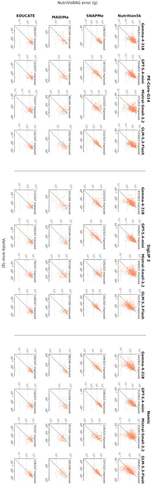

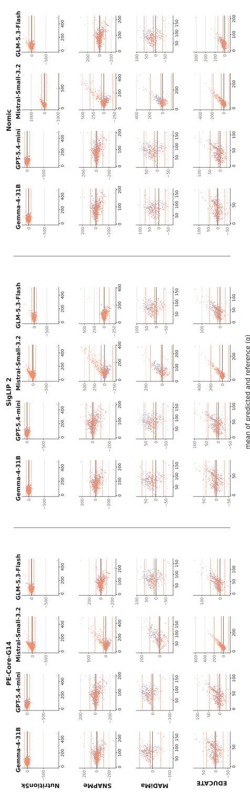  
n analysis of Vanilla and NutriVisRAG predictions under per-item prompting. The analy (CHO for EDUCATE); panel layout as in Fig. S6. Each point shows the diference (pred e two. For each condition, solid and dashed lines show the mean diference and±1.96S spectivel

s are logarithmic, with10−3 g added to all errors so that zero error GLM-5.3-Flash. Points below the diagonal favour NutriVisRAG, and each panel reports t O error for EDUCATE). Rows: query sets; columns: retrieval encoders, each with Gemm solute error of Vanilla versus NutriVisRAG under whole-meal prompting. Error is |∆CHO|  
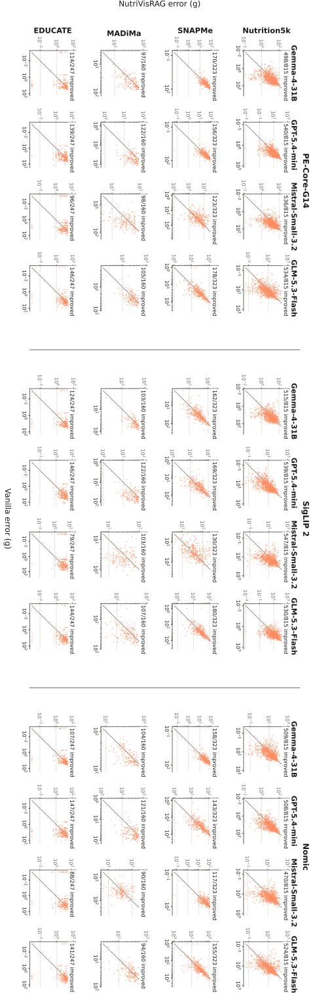

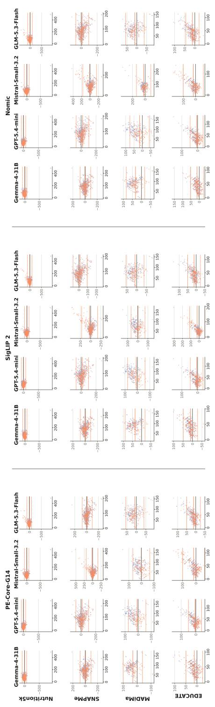  
n analysis of Vanilla and NutriVisRAG predictions under whole-meal prompting. Th in grams (CHO for EDUCATE); panel layout as in Fig. S8. Each point shows the difer mean of the two. For each condition, solid and dashed lines show the mean diference a ement, respectiv

Table S3: Post-hoc food-composition grounding under per-item prompting on the fixed 100-query subsets (%MAE, lower is better). NutriVisRAG denotes the original prediction; the other columns are the matching approaches defined in the text. Dashes indicate unavailable evaluation targets for the corresponding dataset. Bold indicates the lowest error per row and metric; ⋆/▼ indicate significant improvements/degradations relative to NutriVisRAG (paired Wilcoxon signed-rank test, Benjamini–Hochberg corrected, q < 0.05).
<table><tr><td rowspan="2">Query set Model</td><td rowspan="2"></td><td rowspan="2">Encoder</td><td colspan="5">Energy</td><td colspan="5">Micro CHO</td></tr><tr><td>NutriVisRAG Lexical Qwen3 Gemma Nomic Text NutriVisRAG Lexical Qwen3 Gemma Nomic Text</td><td></td><td></td><td></td><td></td><td></td><td></td><td></td><td></td><td></td></tr><tr><td rowspan="9">Nutrition5k GPT-5.4-mini</td><td rowspan="2"></td><td>PE-Core SigLIP2</td><td>32.8 30.2</td><td>96.0 147.3</td><td>57.9 48.2</td><td>90.6 82.7</td><td>78.3 77.7</td><td>40.0 35.6</td><td>131.9 172.7</td><td>61.5 54.3</td><td>132.9 126.8</td><td>83.4 86.0</td></tr><tr><td>Nomic Vision</td><td>29.9</td><td>127.7</td><td>54.5</td><td>90.4</td><td>80.8</td><td>37.6</td><td>161.2</td><td>57.6</td><td>137.4</td><td>81.5</td></tr><tr><td rowspan="2">Gemma-4-31B</td><td></td><td></td><td></td><td></td><td></td><td></td><td></td><td>176.2</td><td>84.5</td><td>164.5</td><td></td></tr><tr><td>PE-Core</td><td>50.1</td><td>144.4 128.7</td><td>70.1</td><td>117.9&#x27;</td><td>82.9 74.2</td><td>60.4</td><td>147.6</td><td>64.0</td><td>106.5</td><td>96.4 82.2</td></tr><tr><td rowspan="3"></td><td>SigLIP2</td><td>44.8</td><td></td><td>59.0</td><td>80.5</td><td></td><td>49.8 80.7</td><td>206.8</td><td>91.1</td><td>164.3</td><td>124.4</td></tr><tr><td>Nomic Vision</td><td>72.2</td><td>185.6</td><td>78.6</td><td>126.0</td><td>134.1</td><td></td><td></td><td></td><td></td><td></td></tr><tr><td>Mistral-Small-3.2 PE-Core</td><td>244.8</td><td>384.4</td><td>249.5</td><td>394.1</td><td>311.9</td><td>259.9</td><td>418.2</td><td>266.9</td><td>482.6</td><td>346.3</td></tr><tr><td rowspan="3"></td><td>SigLIP2</td><td>283.1</td><td>401.7</td><td>269.6</td><td>514.0</td><td>386.5</td><td>306.5</td><td>434.9 524.7</td><td>304.0 405.5</td><td>641.2 715.1</td><td>445.4</td></tr><tr><td>Nomic Vision</td><td>418.6</td><td>541.8</td><td>400.1</td><td>600.7*</td><td>489.3</td><td>410.9</td><td></td><td></td><td></td><td>491.8</td></tr><tr><td>GLM-5.3-Flash PE-Core</td><td>50.8</td><td>148.7</td><td>88.2</td><td>110.5</td><td>90.1</td><td>52.5</td><td>181.8 147.9</td><td>81.6 61.3</td><td>156.2 161.6</td><td>90.7 67.7</td></tr><tr><td rowspan="10">SNAPMe</td><td rowspan="2"></td><td>SigLIP2 Nomic Vision</td><td>36.5 36.3</td><td>112.4 101.6</td><td>59.1 42.2</td><td>108.6 99.5</td><td>61.2 62.3</td><td>40.7 42.0</td><td>134.3</td><td>56.8</td><td>139.1</td><td>69.4</td></tr><tr><td>PE-Core</td><td></td><td>84.0</td><td>71.2</td><td>58.3</td><td>69.3</td><td>42.0</td><td>109.4</td><td>82.3</td><td>78.7 81.7</td><td>78.6</td></tr><tr><td>GPT-5.4-mini SigLIP2</td><td></td><td>34.5 34.5</td><td>100.6</td><td>69.0</td><td>64.3</td><td></td><td>42.4</td><td>119.0</td><td>85.0</td><td></td><td>84.6</td></tr><tr><td></td><td>Nomic Vision</td><td>36.1</td><td>80.6</td><td>74.5</td><td>61.1</td><td>74.8 73.7</td><td>42.4</td><td>105.1</td><td>85.5 86.6</td><td>82.6 75.7</td><td>84.8</td></tr><tr><td rowspan="3">Gemma-4-31B</td><td>PE-Core</td><td>38.8</td><td>96.5</td><td>72.3</td><td>54.6</td><td>67.6</td><td>44.2</td><td>112.8 105.4</td><td>78.4</td><td>68.6</td><td>76.0</td></tr><tr><td>SigLIP2</td><td>37.9 39.3</td><td>86.0 95.0</td><td>65.7 74.2</td><td>51.8</td><td>66.2 79.1</td><td>44.4 46.4</td><td>113.5</td><td>88.9</td><td>77.7</td><td>74.5 92.4</td></tr><tr><td>Nomic Vision</td><td>90.9</td><td>157.6</td><td>139.2</td><td>60.7 131.0</td><td>131.0</td><td>99.3</td><td>157.9</td><td>141.1</td><td>149.6</td><td>145.9</td></tr><tr><td rowspan="3">Mistral-Small-3.2 PE-Core</td><td>SigLIP2 Nomic Vision</td><td>126.5 108.0</td><td>217.4 154.9</td><td>219.3 175.6</td><td>172.2</td><td>174.6</td><td>133.7 113.2</td><td>220.7 163.5</td><td>219.0 180.7</td><td>191.4 169.2</td><td>182.6</td></tr><tr><td></td><td></td><td>44.6</td><td>47.9</td><td>148.8</td><td>144.3 48.4</td><td></td><td>62.5</td><td>59.0</td><td>64.9</td><td>159.1</td></tr><tr><td>GLM-5.3-Flash PE-Core SigLIP2</td><td>32.5 35.8</td><td>49.9</td><td>52.2</td><td>47.8 50.2</td><td>53.6</td><td>38.0 41.9</td><td>62.8</td><td>66.7</td><td>66.1</td><td>57.8 62.3</td></tr><tr><td rowspan="10">MADiMa</td><td rowspan="2"></td><td>Nomic Vision</td><td>35.5</td><td>49.8</td><td>60.8</td><td>56.0</td><td>59.7</td><td>40.2</td><td>63.6</td><td>72.9</td><td>71.2</td><td>65.6</td></tr><tr><td>PE-Core</td><td>32.3</td><td>121.4</td><td>109.8</td><td>71.6</td><td>77.7</td><td>42.1</td><td>129.0</td><td>122.0</td><td>94.0</td><td>82.7</td></tr><tr><td>GPT-5.4-mini SigLIP2</td><td></td><td>32.0 140.5</td><td>111.5</td><td>72.9</td><td>85.7</td><td>43.1</td><td>133.0</td><td>128.8</td><td>100.5 104.0</td><td>85.4</td></tr><tr><td></td><td>Nomic Vision</td><td>33.2</td><td>114.5</td><td></td><td></td><td></td><td>42.3</td><td>115.9</td><td>132.1</td><td></td></tr><tr><td rowspan="10">Gemma-4-31B</td><td></td><td></td><td></td><td>119.4</td><td>75.7</td><td>90.8</td><td></td><td></td><td></td><td>102.5</td><td>92.0</td></tr><tr><td>PE-Core</td><td></td><td>157.6</td><td>125.2</td><td>82.2</td><td>91.1</td><td>46.2</td><td>147.6</td><td>128.5</td><td></td><td>90.1</td></tr><tr><td>SigLIP2</td><td>36.7 34.8</td><td>138.2</td><td>118.5</td><td>75.7</td><td>94.2</td><td>42.5</td><td>135.4</td><td>124.4</td><td>98.9</td><td>93.8</td></tr><tr><td>Nomic Vision</td><td>37.0</td><td>158.2</td><td>118.3</td><td>82.3</td><td>90.7</td><td>45.1</td><td>150.8</td><td>125.2</td><td>104.4</td><td>91.6</td></tr><tr><td>Mistral-Small-3.2 PE-Core</td><td></td><td>130.3</td><td>109.9</td><td>72.6</td><td>98.3</td><td>63.5</td><td>143.9</td><td>114.4</td><td>87.5</td><td>101.3</td></tr><tr><td rowspan="9"></td><td></td><td>48.6</td><td></td><td>135.6</td><td>85.7</td><td>95.0</td><td></td><td>120.1</td><td>137.0</td><td>105.8</td><td>98.6</td></tr><tr><td>SigLIP2</td><td>59.8</td><td>118.4</td><td></td><td></td><td></td><td>74.1 67.5</td><td>105.7</td><td>128.0</td><td>111.5</td><td>102.7</td></tr><tr><td>Nomic Vision</td><td>53.6</td><td>93.2</td><td>115.4</td><td>83.5</td><td>90.1 48.8</td></table>

Table S4: Multimodal reranking on the fixed 100-query subsets, with per-item and whole-meal prompting side by side (%MAE, lower is better); 50 candidates are reranked to five exemplars. NutriVisRAG denotes the default configuration without reranking. Dashes indicate unavailable evaluation targets for the corresponding dataset. Bold indicates the lowest error per row and metric; ⋆/▼ indicate significant improvements/degradations relative to NutriVisRAG (paired Wilcoxon signed-rank test, Benjamini–Hochberg corrected, q < 0.05).
<table><tr><td rowspan="3" colspan="2"></td><td rowspan="3"></td><td colspan="7">Per-item</td><td colspan="7">Whole-meal</td></tr><tr><td colspan="3">Energy</td><td colspan="4">Micro / CHO</td><td colspan="3">Energy</td><td colspan="4">Micro</td></tr><tr><td>Default</td><td>29.9</td><td>Jina Qwen3 28.7</td><td>Nem. Default 38.5</td><td>40.0</td><td>35.2</td><td>Jina Qwen3 Nem. 35.6</td><td>Default 43.5</td><td>Jina Qwen3 Nem. 34.7 31.5</td><td>36.8</td><td>47.4</td><td>Default 40.4</td><td>Jina 36.9</td><td>Qwen3 Nem. 40.9</td><td>49.8</td></tr><tr><td rowspan="6"></td><td></td><td>SigLIP2 Nomic Vision</td><td>30.2 29.9</td><td>33.0 30.5</td><td>30.6 27.6</td><td>30.2 37.6</td><td>35.6 41.7 37.6 38.2</td><td>34.2 36.6</td><td>36.7 45.1</td><td>36.6 40.1</td><td>33.1 38.5 50.4</td><td>34.6 36.6 50.5</td><td>37.6 39.6</td><td>39.9 46.8 50.0</td><td>39.7 44.1</td><td>40.5 41.6 40.3 47.6</td></tr><tr><td>Gemma-4-31B</td><td>PE-Core SigLIP2 Nomic Vision</td><td>50.1 44.8 72.2</td><td>57.1 65.7 77.7</td><td>51.5 71.9 60.4 72.9 67.8 69.9</td><td>60.4 49.8 80.7</td><td>63.9 71.3 84.9</td><td>55.3 65.9 76.2</td><td>77.8 79.2 77.3</td><td>44.0 44.3 50.4 55.7 66.9</td><td>55.6 56.2</td><td>65.5 69.7 57.6</td><td>48.4 62.5</td><td>57.1 60.6 71.1</td><td>57.3 60.7 61.0</td><td>68.5 75.6 62.4</td></tr><tr><td>Mistral-Small-3.2 PE-Core</td><td>SigLIP2 Nomic Vision</td><td>244.8 283.1 418.6 154.3*</td><td>89.0* 94.7</td><td>109.1* 136.5* 158.1* 233.3*</td><td>186.7 231.6 306.5 410.9</td><td>259.9 107.3* 108.5 174.1*</td><td>126.9* 147.2* 169.0*</td><td>200.6 224.1 237.4*</td><td>70.0 78.5 117.6 108.9</td><td>79.2 84.0</td><td>85.4 88.5 88.0 107.5 92.5 118.4</td><td></td><td>82.3 89.5 86.6 93.1 124.0 110.2</td><td>94.0 101.2 109.7</td><td>100.9 119.7 127.3</td></tr><tr><td>GLM-5.3-Flash</td><td>PE-Core SigLIP2 Nomic Vision</td><td>50.8 36.5 36.3</td><td>38.1 42.5 45.1</td><td>41.1 36.3 35.3</td><td>53.7 52.5 55.4 40.7 39.0 42.0</td><td>41.4 44.8 48.0</td><td>42.9 40.8 37.5</td><td>53.9 57.4 44.8</td><td>38.4 30.5 36.2</td><td>36.5 38.1 33.3</td><td>44.3 53.2 31.3 46.9 39.0 38.2</td><td></td><td>39.8 39.1 33.5 40.5 40.9 37.8</td><td>44.7 35.6 41.6</td><td>54.9 51.8* 41.0</td></tr><tr><td>SNAPMe GPT-5.4-mini</td><td>PE-Core SigLIP2 Nomic Vision</td><td>34.5 34.5 36.1</td><td>37.4 34.6 34.2</td><td>35.3 36.2 36.0</td><td>37.7 42.0 35.2 42.4 34.9 42.4</td><td>42.9 42.2 42.3</td><td>43.3 42.7 43.5</td><td>42.8 42.0 42.6</td><td>33.0 33.6 36.3</td><td>39.1 34.9 35.4</td><td>37.5 34.5 36.2 36.9</td><td></td><td>41.3 43.8 41.5 41.6 42.7</td><td>44.0 42.4 43.9</td><td>42.0 43.7 44.8</td></tr><tr><td colspan="10"></td><td colspan="7">36.6 38.6 43.1</td></tr><tr><td rowspan="5"></td><td>Gemma-4-31B</td><td>PE-Core SigLIP2 Nomic Vision</td><td>38.8 37.9 39.3</td><td>39.3 45.8 37.3</td><td>42.9 36.2 35.8 37.2</td><td>42.9 44.2 42.4 44.4 46.4</td><td>45.6 51.1 42.7</td><td>48.2 43.0 42.6</td><td>46.5 49.5 44.9</td><td>38.1 36.8 36.3</td><td>38.6 36.9 34.8</td><td>38.6 37.1 37.1</td><td>37.9 36.6 35.3</td><td>42.5 41.2 41.5</td><td>41.6 41.1 40.2</td><td>43.4 40.8 41.6</td><td>41.4 41.0 41.4</td></tr><tr><td>Mistral-Small-3.2 PE-Core</td><td>SigLIP2 Nomic Vision</td><td>90.9 126.5 108.0</td><td>120.2 116.8 138.5</td><td>90.6 98.3 113.9 142.8 95.9 110.5</td><td>99.3 133.7 113.2</td><td>123.6 125.2 145.4</td><td>95.3 123.0 100.0</td><td>105.1 146.3 115.1</td><td>57.5 66.3 59.5</td><td>59.8 60.2 61.7</td><td>53.2 54.2 51.7</td><td>59.4 57.5 49.2</td><td>66.6 76.0 67.4</td><td>66.5 70.9 69.5</td><td>58.9 66.4 66.8 65.9 60.3 61.1</td></tr><tr><td>GLM-5.3-Flash</td><td>PE-Core SigLIP2 Nomic Vision</td><td>32.5 35.8 35.5</td><td>34.9 34.8 35.5</td><td>32.8 34.2 39.4 32.8 44.1 39.5</td><td>38.0 41.9 40.2</td><td>40.6 39.8</td><td>38.5 44.5</td><td>39.1 38.8</td><td>30.8 33.7</td><td>32.8 33.4</td><td>34.7 33.0</td><td>34.2 38.4</td><td>35.8 39.0</td><td>38.0 38.7 38.4</td><td>39.0 39.0 43.4</td></tr><tr><td>GPT-5.4-mini</td><td>PE-Core SigLIP2 Nomic Vision</td><td>32.3 32.0</td><td>31.2 30.4</td><td>33.4 32.7 31.0 33.5</td><td>42.1 43.1</td><td>40.9 41.7 40.5</td><td>47.1 41.7 40.7</td><td>43.9 42.8 43.4</td><td>32.4 37.6 45.2</td><td>36.3 37.0 38.4</td><td>33.2 39.2 38.1</td><td>33.6 33.9 38.6</td><td>38.5 40.5 44.6 44.9 53.0 46.3</td><td>37.4 45.5</td><td>38.6 42.4 49.1</td></tr><tr><td>Gemma-4-31B</td><td>PE-Core SigLIP2</td><td>33.2 36.7 34.8</td><td>32.4 38.6 38.4</td><td>35.2 35.8 35.2</td><td>31.9 35.7 36.6</td><td>42.3 40.5 46.2 46.2 42.5</td><td>44.4</td><td>42.8 42.1 44.8</td><td>41.8 57.4</td><td>37.9 54.0 55.9</td><td>41.9 53.3</td><td>36.9 53.0</td><td>47.9 59.3</td><td>46.0 56.7</td><td>48.1 44.8 55.5 55.2</td></tr><tr><td colspan="10"></td><td colspan="7"></td></tr><tr><td rowspan="2"></td><td>Mistral-Small-3.2 PE-Core</td><td>Nomic Vision</td><td>37.0 35.0 42.8</td><td>34.8</td><td>37.2</td><td>45.1</td><td>46.1 43.8</td><td>42.4 41.6</td><td>46.3 45.2</td><td>56.6 52.2</td><td>47.4</td><td>51.4 45.1</td><td>51.4* 48.5</td><td>58.2 55.3</td><td>57.7 52.2</td><td>53.8 51.6</td><td>53.6* 53.4</td></tr><tr><td>SigLIP2 Nomic Vision GLM-5.3-Flash PE-Core SigLIP2</td><td>48.6 59.8 53.6 30.4 29.5</td><td>47.5 48.0 30.2 31.1</td><td>48.7 48.7 58.1 29.4</td><td>44.2 45.5 50.8 30.0</td><td>63.5 74.1 67.5 37.3</td><td>57.8 58.7 59.7 38.7</td><td>59.1 59.3 72.9</td><td>55.3 52.8 61.3</td><td>40.7 40.8 38.7 39.4 50.7 37.5</td><td></td><td>41.8 36.4 41.1 42.8 40.5</td><td>42.1</td><td>49.5 49.9 54.0 50.2 66.0 46.4</td><td>54.0 52.2 55.0</td><td>49.2 49.8 51.4 37.7</td></tr><tr><td colspan="10">GPT-5.4-mini</td><td colspan="7"></td></tr><tr><td colspan="10">EDUCATE</td><td colspan="7">31.1 30.2 31.2</td></tr><tr><td></td><td>PE-Core SigLIP2 Nomic Vision</td><td>31.7</td><td>32.8</td><td>28.7</td><td>31.5</td><td>37.6 36.1 38.0</td><td>41.4 46.0 42.6</td><td>36.4 36.4 40.1</td><td>38.3 43.8 36.5</td><td>31.2 30.4</td><td>29.2</td><td>29.4</td><td></td><td>37.5 37.5 41.1 42.4 41.6 47.5</td><td>37.0 49.2 43.9</td><td>36.7 41.5 45.0 49.2</td></tr><tr><td colspan="7">Gemma-4-31B</td><td colspan="7">42.9 40.8 32.1</td><td colspan="3">43.3 53.7 45.4</td></tr><tr><td></td><td>PE-Core SigLIP2 Nomic Vision</td><td></td><td></td><td></td><td></td><td>38.5 41.9 40.4</td><td>29.8* 40.7</td><td>38.0 39.4 41.0</td><td>34.4 37.4 39.0</td><td></td><td></td><td></td><td>46.8</td><td>39.5 48.3 33.0* 50.5 37.8*</td><td>42.0 47.7 45.5 47.1 41.5</td></tr><tr><td colspan="10">Mistral-Small-3.2 PE-Core</td><td colspan="7"></td></tr><tr><td></td><td>SigLIP2</td><td></td><td></td><td></td><td></td><td>118.0</td><td>110.8</td><td>98.2 120.5</td><td></td><td></td><td></td><td></td><td>91.0</td><td>56.5 65.9</td><td>55.9</td></tr><tr><td colspan="10">GLM-5.3-Flash</td><td colspan="7"></td></tr><tr><td></td><td>Nomic Vision PE-Core</td><td></td><td></td><td></td><td></td><td>134.5 140.3 51.9 57.2</td><td>116.7 111.7 53.9</td><td>119.3 115.1 126.8 147.8</td><td></td><td></td><td></td><td></td><td>96.8 62.2* 90.7 60.0</td><td>58.9* 66.1</td><td>58.4 77.5 56.3</td></tr></table>