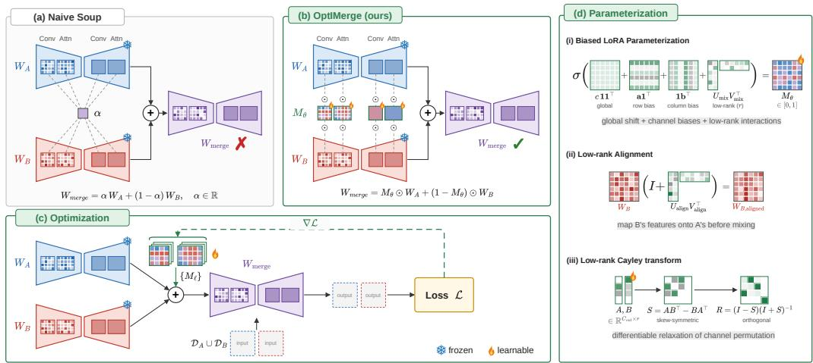
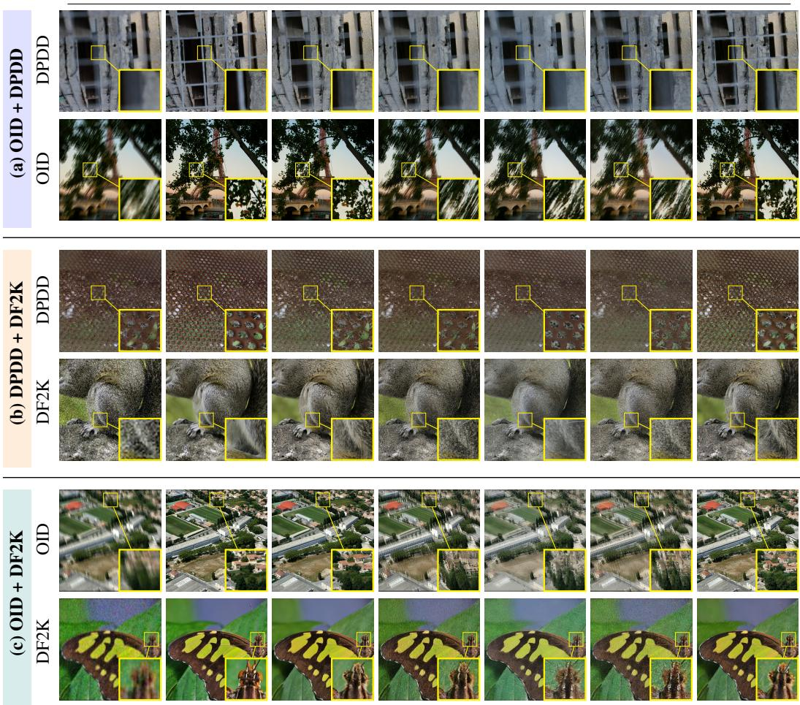
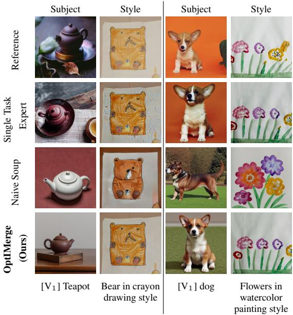
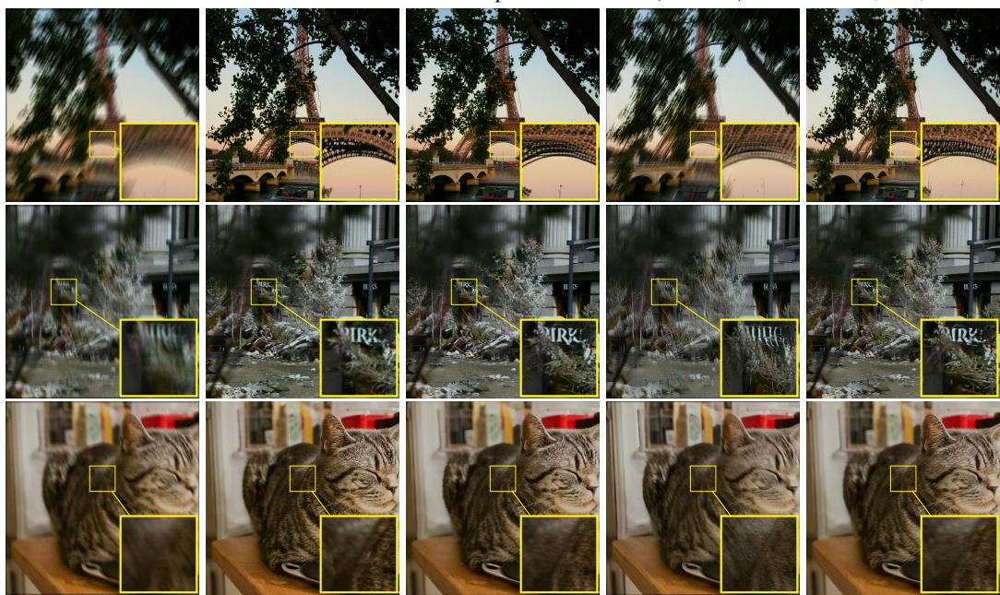
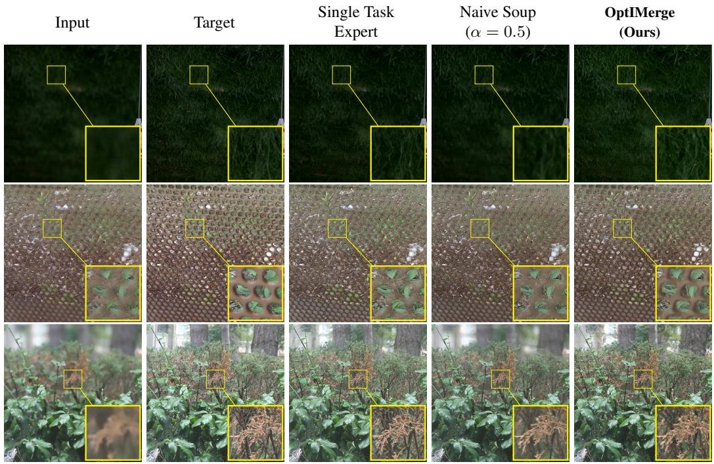
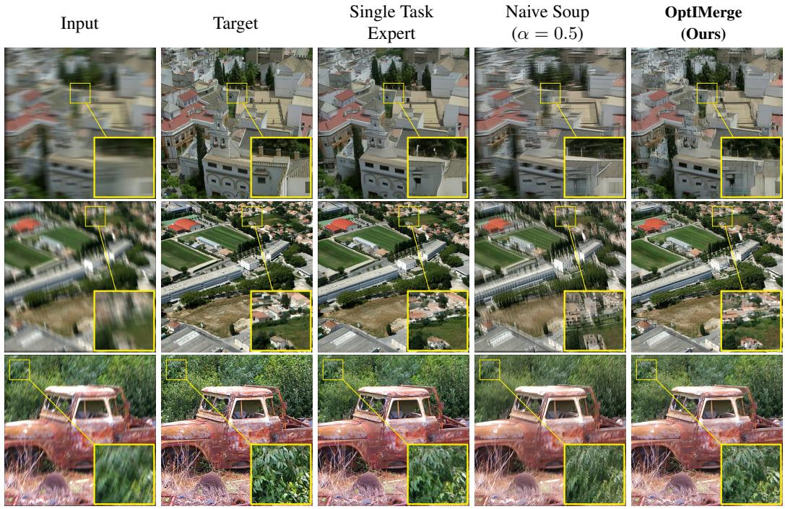
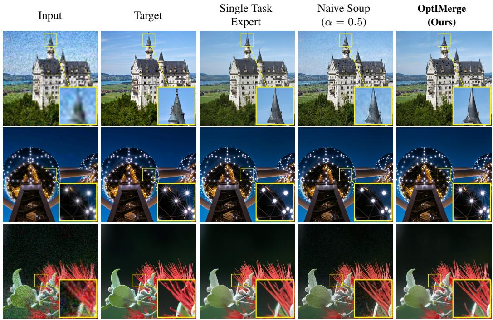
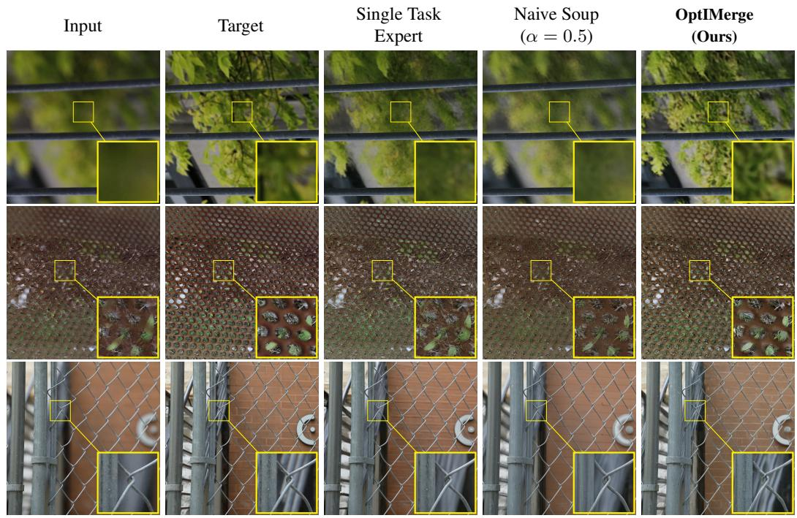
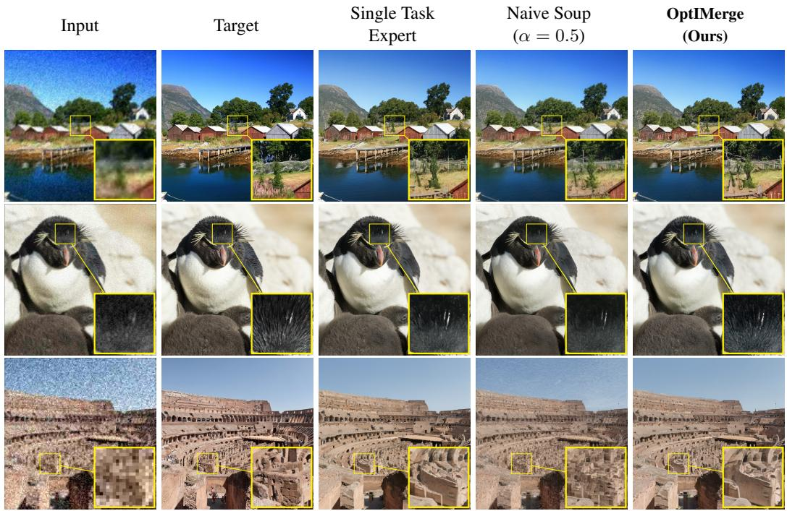

# OPTIMERGE: OPTIMIZATION-BASED MERGING OF DIFFUSION MODELS

Viraj Shah∗ Ashwini Pokle∗ Peyman Milanfar Mauricio Delbracio Hossein Talebi Google

{virajshah, apokle, milanfar, mdelbra, htalebi}@google.com

## ABSTRACT

The arithmetic merging of weights from multiple task-specific models fine-tuned from a shared base model, commonly known as model souping, has emerged as a popular strategy for multi-task learning without the computational overhead of joint retraining. However, naive scalar weight averaging frequently leads to severe performance degradation when the constituent models learn structurally divergent feature representations, leading to destructive parameter interference. We study this problem in a largely unexplored setting: merging image-to-image (I2I) diffusion models fine-tuned for dense, pixel-accurate tasks such as image restoration. Unlike the large language models (LLMs) and text-to-image (T2I) diffusion models for which most merging methods were developed, I2I experts encode conflicting spatial priors (e.g., anisotropic motion-blur vs. isotropic defocus-blur) in their convolutional filters, where both naive soup and LLM-style element-wise merging introduce visible artifacts. We introduce OptIMerge, a gradient-based optimization framework: instead of relying on heuristic scalars, OptIMerge learns highly expressive, yet parameter-efficient merger coefficients by minimizing a multi-task diffusion loss over a small set of 100–500 images. OptIMerge parameterizes the merge with architecture-aware transformations: for attention layers, a structured low-rank feature alignment with explicit channel biases; for convolutional layers, per-kernel merger coefficients, and a low-rank Cayley transform that aligns channels by orthogonal rotation without distorting the filters. By keeping the experts frozen and optimizing only these lightweight merger parameters (equivalent to < 0.4% of the network footprint), OptIMerge achieves simultaneous multi-task capabilities that rival computationally expensive joint training and decisively outperform zero-shot model soups.

## 1 INTRODUCTION

Large-scale image diffusion models have become widely adopted for high-quality visual synthesis such as generating photorealistic images from open-ended text prompts (Dhariwal & Nichol, 2021; Ho et al., 2020; Song et al., 2021; Rombach et al., 2022). Beyond standalone generation, the rich structural and semantic representations embedded within these networks function as powerful generative priors. Consequently, to harness these priors for specific downstream applications, a single pre-trained base model is frequently fine-tuned to master specific downstream domains,yielding specialized expert models tailored to distinct tasks. While these individual experts achieve excellent single-task performance, deploying a separate multi-gigabyte backbone, such as a U-Net, for every distinct capability incurs a prohibitive memory and computational footprint.

Model merging (Wortsman et al., 2022; Ilharco et al., 2023) presents a practical solution to this inefficiency, allowing the unification of weights from multiple fine-tuned experts into a single, multitask architecture without the extensive overhead of joint retraining. While model merging has seen significant success in standard text-to-image (T2I) generation (Biggs et al., 2024), its application to dense image-to-image (I2I) translation tasks, such as image restoration, remains relatively underexplored. To adapt a base T2I model for I2I applications, the input image is incorporated as an additional conditioning signal to the base model (Rombach et al., 2022; Brooks et al., 2023; Lin et al., 2024) which is then independently fine-tuned to resolve distinct physical degradations. This process yields specialized restoration experts—such as one model tailored for anisotropic motion deblurring, and another for isotropic defocus deblurring.

  
Figure 1: Overview of OptIMerge. (a) Naive souping merges experts $W _ { A }$ and $W _ { B }$ with one scalar α shared by all layers. (b) OptIMerge learns a merger coefficient matrix M per layer, as large as that layer’s weights. (c) The coefficients are optimized with the diffusion loss on a small calibration set while the experts stay frozen. (d) Architecture-aware parameterizations keep this under 0.4% of the U-Net parameters: a biased LoRA mask with low-rank alignment for attention layers, and a low-rank Cayley rotation for convolutional layers.

One of the prevailing methods for unifying such experts is zero-shot weight averaging (Wortsman et al., 2022; Biggs et al., 2024), also known as souping (Fig. 1(a)), which interpolates the constituent network weights using a single, heuristically chosen global scalar (e.g., α = 0.5). Such uniform scalar approach rests on two assumptions: all layers contribute equally to the merged multi-task objective, and the experts’ features are aligned. However, diffusion U-Net is a deeply heterogeneous architecture: attention modules govern global semantics and cross-channel interactions, while convolutional filters dictate continuous spatial geometry and high-frequency edge detection (Tumanyan et al., 2023; Zhang et al., 2023; Frenkel et al., 2024). Secondly, I2I experts are obtained by independent, full-parameter fine-tuning of the entire U-Net, which can misalign their representations throughout the network and store physically conflicting spatial priors (e.g., anisotropic motion-blur versus isotropic defocus kernels) in the same convolutional filters. Uniformly averaging such experts therefore causes severe destructive interference. Merging methods from other domains do not resolve this: LLM merging algorithms (Yadav et al., 2023; Yu et al., 2024) rely on element-wise pruning, or random dropout that fracture the spatial filters, while T2I merging methods (Shah et al., 2024; Shenaj et al., 2025; Wu et al., 2024) compose concept-specific LoRAs that typically modify only the attention layers. Consequently, there is critical need to transition from manually guessing a single heuristic scalar to systematically learning expressive, architecture-aware merging parameters.

Motivated by this need for structural granularity, we introduce OptIMerge, an optimization-based model merging framework tailored specifically for I2I diffusion models. By utilizing a small calibration dataset (100–500 images) and keeping the constituent expert networks strictly frozen, OptIMerge optimizes highly expressive multi-task merger parameters via standard gradient descent (Figure 1(c)).

To ensure that this merging process remains lightweight, stable, and expressive, we propose architecture-aware parameterizations that update less than 0.4% of the network footprint. As attention and convolutional layers have distinct functional roles, we parameterize their merging distinctly (Fig. 1(b,d)). For attention layers, we propose a modified low-rank parameterization, which we refer to as biased LoRA, to smoothly blend semantic features. For convolutional layers, preserving spatial integrity requires a kernel-centric approach that merges filters as indivisible units. However, because this dense filter-level fusion incurs a prohibitive parameter overhead, we introduce a novel low-rank Cayley transform to efficiently align divergent feature spaces prior to interpolation.

We comprehensively evaluate OptIMerge with a primary focus on complex, structurally conflicting I2I restoration tasks $( \mathrm { e . g . }$ ., reconciling Motion and Defocus deblurring, and Super-Resolution). Our empirical evaluations demonstrate that learning structured, geometry-aware coefficients successfully resolves clashing spatial priors to achieve Pareto-optimal multi-task retention, vastly outperforming heuristic souping. Finally, as a proof of concept beyond our primary I2I setting, we show that OptIMerge can also be applied to merge subject- and style-personalized T2I models such that both concepts are retained in resulting merged model.

## 2 RELATED WORK

LLM Task Arithmetic and Model Merging. Wortsman et al. (2022) introduced “model souping” via uniform weight averaging $( \alpha = 0 . 5 )$ , which Ilharco et al. (2023) and Ortiz-Jimenez et al. (2023) extended to task arithmetic, and Diffusion Soup (Biggs et al., 2024) adapted for zero-shot style mixing in text-to-image generation. While model merging has matured rapidly for Large Language Models (LLMs)—producing numerous zero-shot routing, weighting, and pruning algorithms (Matena & Raffel, 2022; Yadav et al., 2023; Yu et al., 2024)—merging strategies for dense Image-to-Image (I2I) diffusion models remain significantly under-explored. Unlike text generation, I2I tasks ingest concatenated high-dimensional image latents and rely heavily on the continuous 2D spatial geometry of convolutional filters to reconstruct high-fidelity pixels. Consequently, adapting state-of-the-art LLM merging algorithms presents fundamental architectural roadblocks. Leading LLM methods such as TIES-Merging (Yadav et al., 2023) and DARE (Yu et al., 2024) rely on aggressive element-wise operations: magnitude thresholding, sign-consensus voting, and unconstrained random parameter dropout $( { \mathrm { e . g . , } } p = 0 . 9 )$ . While effective for massively redundant 1D linear layers in Transformers, these operations are fundamentally incompatible with physical $K \times K$ spatial filters. Applying unconstrained element-wise pruning or random dropout to a 4D vision U-Net tensor treats a $3 \times 3$ convolutional kernel as an unorganized bag of independent scalars, destroying the continuous 2D geometry required to represent visual features like edge detectors or directional blurs and inducing severe high-frequency artifacts. Recent methods for concept composition, such as MoLE (Wu et al., 2024), ZipLoRA (Shah et al., 2024), and LoRA.rar (Shenaj et al., 2025) explore the T2I tasks focusing specifically on merging Low-Rank Adaptations (LoRAs). Because LoRA fine-tuning in diffusion models is conventionally applied only to attention layers, these merging techniques naturally do not account for spatial convolutions, and cannot address the clashing 2D priors in I2I mergers.

Feature Alignment and Optimization-Based Merging. Computer vision alignment algorithms such as Git Re-Basin (Ainsworth et al., 2023) and ZipIt! (Stoica et al., 2024) attempt to resolve interference by matching unaligned channels, but introduce severe architectural and computationa bottlenecks for diffusion models. Designed primarily for discriminative classification networks preserving lower-dimensional decision boundaries, they fail to preserve the sensitive, continuous spatial image manifold of generative models. Specifically, $Z i p I t !$ merges unaligned channels by altering intermediate layer dimensionalities, natively breaking the strict symmetrical channel-matching required by the dense skip-connections of a U-Net, whereas Git Re-Basin relies on discrete bipartite matching and optimal transport that are prohibitively expensive to scale to an 890M-parameter generative U-Net. Meanwhile, existing optimization-based merging frameworks such as AdaMerging (Yang et al., 2024) and evolutionary recipe search (Akiba et al., 2025) optimize coarse layeror block-wise scalars, struggling to scale to high-dimensional matrices. In contrast, OptIMerge directly parameterizes structured low-rank channel routing and exact orthogonal rotations (via the Cayley transform) within a fast, differentiable gradient-descent loop to dynamically align and merge diverging feature spaces.

## 3 METHODOLOGY: THE OPTIMERGE FRAMEWORK

Let $W _ { A }$ and $W _ { B }$ represent the frozen parameter tensors of two expert diffusion models, independently fine-tuned for Task A and Task B. Our objective is to construct a unified weight tensor, $W _ { \mathrm { { m e r g e } } } ,$ that achieves high performance on both tasks without the overhead of joint retraining. To achieve this, we introduce a set of learnable parameters θ that formulate a dense merger coefficient matrix $M _ { \theta } \in [ 0 , 1 ]$ . The merged weights are computed via an element-wise convex combination:

$$
W _ { \mathrm { m e r g e } } ( \theta ) = M _ { \theta } \odot W _ { A } + ( { \bf 1 } - M _ { \theta } ) \odot W _ { B }\tag{1}
$$

where $\odot$ denotes the Hadamard product. We optimize the parameters $\theta$ by minimizing the standard conditional diffusion denoising loss over a combined calibration dataset $\mathcal { D } = \mathcal { D } _ { A } \cup \mathcal { D } _ { B }$ . Keeping the base expert weights strictly frozen, the optimization objective is defined as:

$$
\operatorname* { m i n } _ { \theta } \mathbb { E } _ { z , c \sim D , \epsilon \sim \mathcal { N } ( \mathbf { 0 } , \mathbf { I } ) , t } \left[ \big \| \epsilon - \epsilon _ { \phi } \left( z _ { t } , t , c ; W _ { m e r g e } ( \theta ) \right) \big \| _ { 2 } ^ { 2 } \right]\tag{2}
$$

where $z _ { t }$ is the noisy latent at timestep $t ,$ c represents the task-specific conditioning $( \mathrm { e . g . }$ , text prompts or conditioning images), and $\epsilon _ { \phi }$ is the denoising network parameterized by the dynamically merged weights $\bar { W } _ { m e r g e } ( \theta )$ . Here, $\mathcal { D } _ { A }$ and $\mathcal { D } _ { B }$ represent small, held-out in-domain datasets $( \mathrm { e . g . , \sim } 1 0 0 { - } 5 0 0$ samples) for Task A and Task B, respectively.

To provide a stable optimization landscape and ground our method against standard task arithmetic baselines, we carefully initialize θ such that $\bar { M _ { \theta } } = 0 . 5 \cdot { \bf 1 }$ . Consequently, the optimization trajectory begins exactly at the naive arithmetic model soup, allowing the network to learn continuous, structure-aware deviations from the uniform average.

## 3.1 THE INADEQUACY OF SCALAR INTERPOLATION

The most constrained formulation of the merging objective limits $M _ { \theta }$ to a single global scalar, functionally equivalent to optimizing the interpolation coefficient in standard task arithmetic. Relaxing this constraint to intermediate dimensionalities, such as learning a distinct scalar per architectural block (e.g., U-Net down-blocks, mid-block, and up-blocks) or a distinct scalar per layer, expands the hypothesis space but fundamentally restricts the routing mechanism to uniform interpolation across all feature channels simultaneously.

Empirically, we observe that optimizing such low-dimensional scalar coefficients yields a highly constrained optimization landscape. Gradient descent frequently drives these scalar parameters to binary extremes (0 or 1), effectively inducing a hard routing between experts rather than discovering a complementary blend. More critically, scalar interpolation implicitly assumes that the learned feature manifolds of both models are perfectly aligned and independently composable. It inherently lacks the representational capacity to resolve permutation drift or facilitate complex cross-channel feature compositions. These limitations necessitated a shift from uniform scalar routing to structured, high-dimensional matrix parameterizations.

To effectively route information across a latent diffusion U-Net, we must recognize that the architecture relies on two fundamentally different mathematical topologies: dense attention projections and localized spatial convolutions. Applying a uniform matrix parameterization across both layer types is suboptimal and prone to failure.

• Attention modules (e.g. $W _ { Q } , W _ { K } , W _ { V }$ projections) govern global context and cross-channel feature interactions. Because they lack a physical spatial dimension, they are highly sensitive to representation misalignment and permutation symmetries. Therefore, they demand parameterizations that can explicitly shift global channel distributions and apply unconstrained low-rank projections to reconcile misaligned feature spaces.

• Convolutional modules (e.g. $K \times K$ spatial filters) govern the physical geometry, edges, and localized textures of the generated image. Applying unconstrained alignments here risks compounding magnitude scaling and fracturing the physical shape of the kernels. Therefore, they strictly require parameterizations that treat spatial filters as atomic units and leverage (orthogo nal) transformations to align feature spaces without distorting weight magnitudes.

Motivated by these two distinct requirements, we introduce tailored matrix parameterizations for attention and convolutional modules in the next section.

## 3.2 DIFFUSION MODEL MERGING WITH OPTIMERGE

## 3.2.1 PARAMETERIZING ATTENTION MODULES

Attention modules $( W _ { Q } , W _ { K } , W _ { V } , W _ { O } \in \mathbb { R } ^ { d _ { o u t } \times d _ { i n } } )$ represent dense, high-dimensional parameter spaces that require fine-grained routing. While a standard Low-Rank Adaptation (LoRA) formulation, $M _ { \theta } = \sigma ( \ ' U _ { m i x } V _ { m i x } ^ { T } )$ , offers parameter efficiency, it is topologically restrictive for model merging. Optimal merger matrices are rarely strictly low-rank; they typically require a global baseline shift (e.g., anchoring near 0.5) coupled with high-frequency, localized cross-channel perturbations. Forcing a strictly low-rank factorization to simultaneously encapsulate both the global shift and the local interactions is mathematically inefficient and empirically smears the routing coefficients.

To decouple these objectives, we introduce a biased LoRA strategy for the mixing mask:

$$
M _ { \theta } = \sigma ( c + \mathbf { a 1 } ^ { T } + \mathbf { 1 6 } ^ { T } + U _ { m i x } V _ { m i x } ^ { T } )\tag{3}
$$

where $c \in \mathbb { R }$ is a global scalar, $\mathbf { a } \in \mathbb { R } ^ { d _ { o u t } }$ is a row bias vector, b $\in \mathbb { R } ^ { d _ { i n } }$ is a column bias vector, and $U _ { m i x } \in \mathbb { R } ^ { d _ { o u t } \times r } , V _ { m i x } \in \mathbb { R } ^ { d _ { i n } \times r }$ are trainable low-rank matrices. The sigmoid function σ bounds the elements to $[ 0 , 1 ]$ . The explicit bias vectors a and b act as a powerful architectural inductive bias, enabling the optimizer to independently shift or scale entire feature channels, thereby reserving the capacity of $U _ { m i x } ^ { \phantom { \dagger } } V _ { m i x } ^ { T }$ exclusively for modeling complex cross-channel interactions.

Furthermore, independent fine-tuning often induces representation misalignment, rendering element-wise blending of unaligned attention spaces fundamentally flawed. To correct this prior to interpolation, we introduce an unconstrained low-rank projection adapter to dynamically align Model B’s feature space to Model A:

$$
W _ { B , a l i g n e d } = W _ { B } ( I + U _ { a l i g n } V _ { a l i g n } ^ { T } )\tag{4}
$$

where $U _ { a l i g n }$ and $V _ { a l i g n }$ are trainable low-rank matrices. By learning this adapter simultaneously, the network can smoothly reconcile misaligned representations before mixing. The final merged attention weights are thus computed as:

$$
W _ { m e r g e } = M _ { \theta } \odot W _ { A } + ( \mathbf { 1 } - M _ { \theta } ) \odot W _ { B , a l i g n e d }\tag{5}
$$

## 3.2.2 PARAMETERIZING CONVOLUTIONAL MODULES

The core representational capacity of an Unet in LDM lies in its 4D convolutional tensors $W \in$ $\mathbb { R } ^ { K \times K \times C _ { i n } \times C _ { o u t } }$ . Applying unconstrained element-wise mixing destroys the structural integrity of the $K \times K$ spatial filters and fractures the useful anisotropic and isotropic priors. We propose two geometry-aware strategies to resolve this:

Kernel-Centric Merging (Spatial Broadcasting). To construct a spatial routing mechanism that preserves the integrity of the filters, we enforce a single learnable coefficient per input-output channel path. Treating the $K \times K$ kernel as an atomic unit, we learn a matrix $P \in \dot { \mathbb { R } } ^ { C _ { i n } \times C _ { o u t } }$ , apply the sigmoid to obtain $M = \sigma ( P )$ , and reshape it to $( 1 , 1 , C _ { i n } , C _ { o u t } )$ . We then broadcast it across the spatial dimensions:

$$
W _ { m e r g e } = M \odot W _ { A } + ( 1 - M ) \odot W _ { B }\tag{6}
$$

By treating the kernel as an indivisible structural unit, the optimizer can seamlessly scale entire directional or radial filters without fracturing them. However, while empirically effective, this dense parameterization incurs a massive memory overhead of $\mathcal { O } ( C _ { i n } C _ { o u t } )$ for the convolutional layers.

Low-Rank Cayley Transform (Orthogonal Alignment). To achieve feature alignment with high parameter efficiency, we transition from dense scalar routing to structural basis alignment. Independent fine-tuning of models often induces permutation drift, where models learn to store similar visual features (e.g., edge detectors) in unaligned channels. Standard weight matching algorithms treat this as a discrete permutation problem, requiring non-differentiable and computationally expensive bipartite matching heuristics. Because permutation matrices are a discrete subgroup of orthogonal matrices, we propose a continuous, differentiable relaxation: dynamically rotating Model B’s feature space into alignment with Model A using an orthogonal rotation matrix $R \in \breve { \mathbb { R } } ^ { C _ { o u t } \times C _ { o u t } }$

To learn R without parameter explosion $( \cal { O } ( C _ { o u t } ^ { 2 } ) )$ , we parameterize the Cayley Transform via a low-rank bottleneck. We learn two matrices $A , \bar { B } \in \mathbb { R } ^ { C _ { o u t } \times r }$ to construct a skew-symmetric matrix $S = A B ^ { T } - B A ^ { T }$ . The exact orthogonal rotation matrix is computed as:

$$
R = ( I - S ) ( I + S ) ^ { - 1 }\tag{7}
$$

Model $\mathbf { B } ^ { \prime } \mathbf { s }$ filters are orthogonally rotated along the output channel dimension. For a filter tensor $W _ { B } \in \mathbb { R } ^ { K \times K \times C _ { i n } \times C _ { o u t } }$ , the rotated weights are computed as:

$$
( W _ { B , r o t a t e d } ) _ { x , y , c , i } = \sum _ { j = 1 } ^ { C _ { o u t } } ( W _ { B } ) _ { x , y , c , j } R _ { j , i }\tag{8}
$$

where x, y are spatial indices, c is the input channel, and i, j index the output channels. Finally, we blend the aligned weights using a layer-wise interpolation coefficient α. To ensure α remains strictly bounded within (0, 1) during unconstrained gradient descent, we parameterize it as $\alpha = \sigma ( p )$ , where $p \in \mathbb R$ is a learnable scalar parameter for that specific layer (initialized to 0 such that $\alpha = 0 . 5 )$ , and σ is the sigmoid function:

$$
W _ { m e r g e } = \alpha W _ { A } + ( 1 - \alpha ) W _ { B , r o t a t e d }\tag{9}
$$

This mathematically guarantees an isometric transformation, perfectly preserving the $L _ { 2 }$ norm and spatial geometry of the filters while smoothly swapping misaligned channels. By aligning the feature channels directly rather than relying on dense matrix parameterization, this approach reduces the convolutional parameter footprint from ∼ 109M down to roughly ∼ 2.4M.

We initialize the low-rank matrices A and B near zero. Consequently, the skew-symmetric matrix S initializes at the zero matrix, yielding $R = I$ . The optimization trajectory begins without any feature rotation, defaulting exactly to the naive arithmetic blend. The optimizer only deviates from the identity matrix if an orthogonal rotation minimizes the multi-task objective, ensuring that the transformation resolves representation misalignment without scrambling already aligned features.

Auxiliary Layers. To maximize parameter efficiency, OptIMerge parameterizes only the highimpact components of the U-Net: the attention projections $\dot { ( } W _ { Q } , \tilde { W } _ { K } , \mathbf { \bar { W } } _ { V } , W _ { O } )$ and the 4D spatial convolutions. Auxiliary parameters (e.g. normalization layers, time embeddings) are interpolated using a uniform scalar average $( \alpha = 0 . 5 )$ .

## 4 EXPERIMENTS

## 4.1 EXPERIMENTAL SETUP

Task & Datasets. We evaluate OptIMerge on pairs of image restoration tasks whose experts learn conflicting spatial priors: (1) super-resolution (DF2K dataset (Lim et al., 2017; Agustsson & Timofte, 2017; Zhou et al., 2025)) paired with motion deblurring (Open Images Dataset (OID) with motion deblurring, (Kuznetsova et al., 2020)); (2) super-resolution (DF2K) paired with defocus deblurring (DPDD dataset (Abuolaim & Brown, 2020)); and (3) motion deblurring (OID) paired with defocus deblurring (DPDD). The first two pairs test merging a shared anchor task against two different degradation physics, while the third is the most challenging setting for our spatial parameterizations: the merged network must reconcile strictly anisotropic (directional) motion-blur filters with strictly isotropic (radial) defocus filters. We also report a proof-of-concept experiment on T2I personalization in Section 4.3.

Optimization. For the restoration tasks, we construct unseen held-out validation sets of 100-500 images per task. To mitigate gradient and loss imbalance (e.g., heavy motion blur loss vastly eclipsing defocus blur loss), we dynamically compute loss normalizing factors calculated over the first 30 steps (e.g., OID: 0.70, DPDD: 0.55). We optimize for ∼10k steps.

Architecture. For the image restoration case, we build our framework upon a large-scale Image-Conditioned Latent Diffusion Model (LDM) (Rombach et al., 2022) parameterized for vprediction (Salimans & Ho, 2022). The base Text-to-Image (T2I) diffusion model is adapted into Image-to-Image (I2I) expert models by modifying the first convolutional layer to accept concatenated conditioning latents (expanding input channels to $C _ { i n } = 1 6$ and output channels to $C _ { o u t } = 8 )$ All expert models operate at a high-fidelity 1024×1024 spatial resolution, which is compressed into $1 2 8 \times 1 2 8$ latent representations by the variational autoencoder.

Inference and Evaluation. During inference on the held-out validation sets, we utilize a DDIM sampler (Song et al., 2021) executed over 32 inference steps. For checkpoint selection, we evaluate models periodically during their respective training or optimization phases. For the Single-Task Experts, we select the checkpoint that achieves peak performance on its corresponding task-specific validation set. For all OptIMerge configurations, we select the checkpoint that achieves the best simultaneous multi-task performance on a validation sets of each of the tasks. We report standard pixel-wise and perceptual metrics: Peak Signal-to-Noise Ratio (PSNR), Structural Similarity Index Measure (SSIM), and Learned Perceptual Image Patch Similarity (LPIPS) on 300 test images for image restoration tasks.

Table 1: Quantitative comparison of model merging strategies on pairwise merger across three restoration tasks: Motion Deblur (OID), Defocus Deblur (DPDD), and Super-Resolution (DF2K). [best, second-best].
<table><tr><td colspan="2">(a) Motion Deblur (OID) + Defocus Deblur (DPDD)</td><td colspan="3">OID (300 samples)</td><td colspan="3">DPDD (300 samples)</td></tr><tr><td>Method / Strategy</td><td>Trainable Params</td><td>LPIPS ↓</td><td>PSNR ↑</td><td>SSIM ↑</td><td>LPIPS ↓</td><td>PSNR ↑</td><td>SSIM ↑</td></tr><tr><td>Single-Task Experts</td><td></td><td>0.2113</td><td>22.92</td><td>0.6266</td><td>0.2023</td><td>23.39</td><td>0.6392</td></tr><tr><td>Joint Multi-Task Training</td><td>890M (100%)</td><td>0.2154</td><td>22.59</td><td>0.6173</td><td>0.2091</td><td>23.37</td><td>0.6404</td></tr><tr><td>Naive Arithmetic Soup (α = 0.5)</td><td>0 (0%)</td><td>0.2899</td><td>20.88</td><td>0.5601</td><td>0.2641</td><td>23.15</td><td>0.6398</td></tr><tr><td>TIES-Merging (Yadav et al., 2023)</td><td>0 (0%)</td><td>0.3252</td><td>19.86</td><td>0.5367</td><td>0.3898</td><td>21.59</td><td>0.6062</td></tr><tr><td>DARE (Yu et al., 2024)</td><td>0 (0%)</td><td>0.3042</td><td>20.25</td><td>0.5364</td><td>0.3032</td><td>22.30</td><td>0.6156</td></tr><tr><td>OptIMergeAttn</td><td>~1.9M</td><td>0.2265</td><td>22.43</td><td>0.6049</td><td>0.2213</td><td>23.59</td><td>0.6423</td></tr><tr><td>OptIMergeConv-KC</td><td>~109.2M</td><td>0.2297</td><td>22.41</td><td>0.6051</td><td>0.2334</td><td>23.34</td><td>0.6368</td></tr><tr><td>OptIMergeConv-Cayley</td><td>~2.4M</td><td>0.2171</td><td>22.66</td><td>0.6165</td><td>0.2186</td><td>23.86</td><td>0.6540</td></tr><tr><td>OptIMerge (Ours)</td><td>~3.2M (&lt; 0.4%)</td><td>0.2168</td><td>22.72</td><td>0.6190</td><td>0.2191</td><td>23.91</td><td>0.6561</td></tr></table>

<table><tr><td colspan="2">(b) Defocus Deblur (DPDD) + Super-Resolution (DF2K)</td><td colspan="3">DPDD</td><td colspan="3">DF2K SR</td></tr><tr><td>Method / Strategy</td><td>Trainable Params</td><td>LPIPS ↓</td><td>PSNR ↑</td><td>SSIM ↑</td><td>LPIPS ↓</td><td>PSNR ↑</td><td>SSIM ↑</td></tr><tr><td>Single-Task Experts</td><td></td><td>0.2023</td><td>23.39</td><td>0.6392</td><td>0.3131</td><td>21.26</td><td>0.5323</td></tr><tr><td>Joint Multi-Task Training</td><td>890M (100%)</td><td>0.2185</td><td>23.11</td><td>0.6293</td><td>0.3160</td><td>21.24</td><td>0.5255</td></tr><tr><td>Naive Arithmetic Soup (α = 0.5)</td><td>0 (0%)</td><td>0.2774</td><td>22.57</td><td>0.6121</td><td>0.3447</td><td>21.10</td><td>0.5259</td></tr><tr><td>TIES-Merging (Yadav et al., 2023)</td><td>0 (0%)</td><td>0.3744</td><td>21.55</td><td>0.5986</td><td>0.3761</td><td>19.76</td><td>0.5032</td></tr><tr><td>DARE (Yu et al., 2024)</td><td>0 (0%)</td><td>0.3064</td><td>21.92</td><td>0.5978</td><td>0.3777</td><td>20.35</td><td>0.4860</td></tr><tr><td>OptIMergeAttn</td><td>~1.9M</td><td>0.2506</td><td>22.66</td><td>0.6113</td><td>0.3208</td><td>20.88</td><td>0.5193</td></tr><tr><td>OptIMergeConv-KC</td><td>~109.2M</td><td>0.2814</td><td>22.37</td><td>0.6038</td><td>0.3501</td><td>20.50</td><td>0.4949</td></tr><tr><td>OptIMergeConv-Cayley</td><td>~2.4M</td><td>0.2606</td><td>22.55</td><td>0.6121</td><td>0.3143</td><td>21.38</td><td>0.5333</td></tr><tr><td>OptIMerge (Ours)</td><td>~3.2M (&lt; 0.4%)</td><td>0.2365</td><td>23.13</td><td>0.6258</td><td>0.3210</td><td>21.12</td><td>0.5231</td></tr></table>

<table><tr><td colspan="2">(c) Motion Deblur (OID) + Super-Resolution (DF2K)</td><td colspan="3">OID (300 samples)</td><td colspan="3">DF2K SR (300 samples)</td></tr><tr><td>Method / Strategy</td><td>Trainable Params</td><td>LPIPS↓</td><td>PSNR ↑</td><td>SSIM ↑</td><td>LPIPS ↓</td><td>PSNR ↑</td><td>SSIM ↑</td></tr><tr><td>Single-Task Experts</td><td></td><td>0.2113</td><td>22.92</td><td>0.6266</td><td>0.3131</td><td>21.26</td><td>0.5323</td></tr><tr><td>Joint Multi-Task Training</td><td>890M (100%)</td><td>0.2386</td><td>22.03</td><td>0.5867</td><td>0.2993</td><td>21.49</td><td>0.5407</td></tr><tr><td>Naive Arithmetic Soup (α = 0.5)</td><td>0 (0%)</td><td>0.2938</td><td>20.31</td><td>0.5292</td><td>0.3501</td><td>20.99</td><td>0.4970</td></tr><tr><td>TIES-Merging (Yadav et al., 2023)</td><td>0 (0%)</td><td>0.3480</td><td>19.34</td><td>0.5025</td><td>0.3805</td><td>19.44</td><td>0.4797</td></tr><tr><td>DARE (Yu et al., 2024)</td><td>0 (0%)</td><td>0.3023</td><td>20.02</td><td>0.5175</td><td>0.3949</td><td>20.14</td><td>0.4548</td></tr><tr><td>OptIMergeAttn</td><td>~1.9M</td><td>0.2454</td><td>21.93</td><td>0.5821</td><td>0.3191</td><td>21.42</td><td>0.5271</td></tr><tr><td>OptIMergeConv-KC</td><td>~109.2M</td><td>0.2428</td><td>22.16</td><td>0.5907</td><td>0.3087</td><td>21.43</td><td>0.5327</td></tr><tr><td>OptIMergeConv-Cayley</td><td>~2.4M</td><td>0.2428</td><td>21.63</td><td>0.5742</td><td>0.3175</td><td>21.27</td><td>0.5283</td></tr><tr><td>OptIMerge (Ours)</td><td>~3.2M (&lt; 0.4%)</td><td>0.2298</td><td>22.16</td><td>0.5980</td><td>0.3207</td><td>21.45</td><td>0.5338</td></tr></table>

## 4.2 RESULTS: MULTI-TASK IMAGE RESTORATION

## 4.2.1 BASELINES AND OPTIMERGE VARIANTS

To isolate the efficacy of our proposed parameterizations, we benchmark against three standard training paradigms:

• Single-Task Experts: The original independently fine-tuned models. This serves as the reference for single-task performance.

• Joint Multi-Task Training: A model fine-tuned on a unified dataset $( { \mathcal { D } } _ { A } \cup { \mathcal { D } } _ { B } )$ , updating all 890M parameters. This is the traditional, computationally expensive target bound for multi-task learning.

• Naive Arithmetic Soup: The baseline $W _ { m e r g e } = 0 . 5 W _ { A } + 0 . 5 W _ { B }$ configuration, requiring zero trainable parameters.

To ablate the specific contributions of our geometric and semantic alignment strategies, we evaluate three distinct OptIMerge configurations.

• OptIMerge : Applies biased LoRA strategy to the attention modules, utilizing both the unconstrained feature alignment projection (Equation (4)) and the biased LoRA routing mask (Equation (3)). All convolutional modules are left at a uniform α = 0.5 average.

$\mathbf { O p t I M e r g e } _ { \mathbf { C o n v - K C } } ;$ Applies Kernel-Centric spatial broadcasting to the convolutional modules. For the attention modules, it applies the base biased LoRA routing mask (Equation (3)) but omits the unconstrained feature alignment projection (Equation (4)).

TIES

DARE

  
Figure 2: Qualitative comparison of pairwise model merging across restoration tasks: Each two-row block evaluates a single merged model on both of its constituent tasks: (a) Motion Deblur (OID) + Defocus Deblur (DPDD), (b) Defocus Deblur (DPDD) + Super-Resolution (DF2K), and (c) Motion Deblur (OID) + Super-Resolution (DF2K). While heuristic scalar averaging and element-wise LLM pruning methods introduce ringing and spatial artifacts, OptIMerge preserves structural fidelity and high-frequency details across all pairwise combinations.

• OptIMergeConv-Cayley: Applies the Low-Rank Cayley Transform for orthogonal alignment to the convolutional modules. For the attention modules, it applies the base biased LoRA routing mask but strictly omits the unconstrained feature alignment projection.

• OptIMerge (Ours): The complete framework. Simultaneously applies the Cayley Transform to orthogonally align convolutional modules, and the full biased LoRA (Equation (5)) to attention modules.

Our quantitative findings, assessed via the standard metrics such as LPIPS, PSNR, and SSIM (Table 1), indicate that the naive arithmetic soup strategy generally has subpar performance. As hypothesized, a rigid global scalar significantly degrades the performance of both restoration tasks due to severe interference in the convolutional filters and unaligned attention bases. We provide additional ablations and experiments in Section B.

By applying OptIMerge, we observe improvements in representation fidelity. The explicit preservation of spatial geometries via rotational alignment (Cayley Transforms) combined with crosschannel semantic routing (Biased LoRA) effectively mitigates the destructive interference inherent to naive weight averaging. Notably, in the highly constrained OID + DPDD stress test, OptIMerge successfully reconciles the conflicting isotropic and anisotropic spatial priors without fracturing the underlying features. Across all evaluated pairs, our merged model consistently recovers most of

  
⇐ Figure 3: Qualitative results for merging subject- and style-personalization models. Naive arithmetic merging dilutes subject identity and style fidelity, whereas OptIMerge preserves the ability to produce both the concepts individually.

Table 2: Quantitative results for merging subject- and style-personalization models Sub ject/Style alignment is the average CLIP-I image similarity to the subject/style references. Scores are averaged across 16 merger combinations (4 subjects × 4 styles). [best, second-best]
<table><tr><td>Method / Strategy</td><td>Trainable Params</td><td>Subject alignment ↑</td><td>Style alignment ↑</td></tr><tr><td>Single-Task Experts</td><td></td><td>0.8245</td><td>0.7983</td></tr><tr><td>Naive Soup (α = 0.5)</td><td>0 (0%)</td><td>0.5781</td><td>0.5374</td></tr><tr><td>OptIMergeAttn</td><td>~1.9M</td><td>0.6721</td><td>0.6434</td></tr><tr><td>OptIMergeConv-KC</td><td>~109.2M</td><td>0.7384</td><td>0.7256</td></tr><tr><td>OptIMergeConv-Cayley</td><td>~2.4M</td><td>0.7520</td><td>0.7186</td></tr><tr><td>OptIMerge (Ours)</td><td>~3.2M</td><td>0.8174</td><td>0.7801</td></tr></table>

the gap between the naive soup and the single-task experts, and matches or exceeds joint multi-task training on the majority of metrics, while optimizing < 0.4% of the parameters.

## 4.3 MERGING PERSONALIZED T2I MODELS

While OptIMerge is designed for I2I experts, as a proof of concept, we also extend it to T2I subject/style personalization models fine-tuned from Stable Diffusion v1.5. Specifically, a subject expert is fine-tuned on 4–5 images of a specific subject (e.g. coorgi dog) using a trigger prompt “A $[ \mathrm { V } _ { 1 } ]$ dog” (where $[ \mathrm { V } _ { 1 } ]$ is unique token) (Ruiz et al., 2023). The style expert is fine-tuned on a single reference image of a style (e.g. watercolor painting) using the trigger prompt “Image in <style description> style” (Sohn et al., 2023). Because only a handful of images is available, we run OptIMerge on the experts’ own training images for 100 steps, using with rank $r = 4$ . For more details, see Section A.2.

Mirroring the multi-task restoration setting, the goal of this experiment is concept retention: after merging, a single model should reproduce each concept as faithfully as its dedicated expert when prompted with that concept’s trigger prompt, i.e., $\mathrm { ^ { 6 6 } A [ \bar { V } _ { 1 } ] }$ dog” or a style prompt such as ${ } ^ { \bar { \iota } _ { 6 } } \mathrm { \bar { A } }$ bear in <style description> style”. As shown in Figure 3, the naive soup dilutes both concepts: the subject loses its identity and the style is washed out. OptIMerge retains both. In Table 2, it raises subject alignment from 0.578 to 0.817 and style alignment from 0.537 to 0.780, close to the single-task experts (0.825 and 0.798).

## 5 CONCLUSION

In this work, we introduced OptIMerge, a parameter-efficient framework that formalizes diffusion model merging as a optimization-based alignment problem rather than a static, heuristic averaging process. We demonstrated that naive arithmetic model soups systematically fail on dense pixelprediction and synthesis tasks due to severe representation misalignment and the fracturing of clashing spatial geometries (e.g., isotropic versus anisotropic physical filters). To overcome these limitations without incurring the massive computational cost of joint multi-task training, OptIMerge introduces parameterizations tailored to the distinct roles of the U-Net architecture. For attention modules, we proposed Biased LoRA parameterization, which effectively decouples feature space alignment from highly expressive, factored merging masks. For spatial convolutions, we introduced Kernel-Centric Merging and the Low-Rank Cayley Transform. By learning an orthogonal rotation matrix, the Cayley formulation allows an isometric transformation that resolves representation clashing while preserving weight norms. Empirically, our evaluations on pairwise mergers of restoration experts confirm that OptIMerge mitigates destructive interference, and a proof-of-concept experiment shows that the same framework also retains both concepts when merging personalized T2I models.

Limitations and Future Work. While our method extends to three experts (Appendix B), the residual gap to the experts grows with the number of tasks, and scaling to large ensembles introduces combinatorial complexity in the alignment pathways. Future work will explore adapting the Cayley parameterization to the emerging class of Diffusion Transformers (DiTs). Ultimately, OptIMerge provides a highly scalable and mathematically grounded foundation for consolidating specialized generative experts into unified, versatile foundation models.

## AI USE STATEMENT

In this work, we used generative AI tools to design and provide feedback on research methodology or experiments, and we used coding agents to implement and verify methods. We have not used generative AI tools to support qualitative and thematic data analysis, interpret results. Additional tasks that require disclosure such as generation of synthetic data sets, cleaning and reformatting the datasets, formulation and proving of mathematical claims, and assistance in writing proofs are not applicable to this work as this is empirical work. Additionally, we used generative AI tools to draft parts of this research paper. We have reviewed all AI-assisted work. We have carefully verified LLM-generated code for correctness. We have also proofread this work to ensure its correctness. We take responsibility for the final content of this work, including text, claims or artifacts produced with the aid of generative AI.

## ACKNOWLEDGMENTS

We thank Jack Paparian and Mojtaba Ardakani, our colleagues at Google, for insightful discussions, valuable feedback, and manuscript review.

## REFERENCES

Abdullah Abuolaim and Michael S Brown. Defocus deblurring using dual-pixel data. In European conference on computer vision, pp. 111–126. Springer, 2020. 6, 14

Eirikur Agustsson and Radu Timofte. Ntire 2017 challenge on single image super-resolution: Dataset and study. In 2017 IEEE conference on computer vision and pattern recognition workshops (CVPRW), pp. 1122–1131. IEEE, 2017. 6, 13

Samuel K Ainsworth, Jonathan Hayase, and Siddhartha Srinivasa. Git re-basin: Merging models modulo permutation symmetries. International Conference on Learning Representations (ICLR), 2023. 3

Takuya Akiba, Makoto Shing, Yujin Tang, Qi Sun, and David Ha. Evolutionary optimization of model merging recipes. Nature Machine Intelligence, 7(2):195–204, 2025. 3

Benjamin Biggs, Arjun Seshadri, Yang Zou, Achin Jain, Aditya Golatkar, Yusheng Xie, Alessandro Achille, Ashwin Swaminathan, and Stefano Soatto. Diffusion soup: Model merging for text-toimage diffusion models. In European Conference on Computer Vision, pp. 257–274. Springer, 2024. 1, 2, 3

Tim Brooks, Aleksander Holynski, and Alexei A Efros. InstructPix2Pix: Learning to follow image editing instructions. In 2023 IEEE/CVF Conference on Computer Vision and Pattern Recognition (CVPR), pp. 18392–18402. IEEE, 2023. 2

Prafulla Dhariwal and Alexander Nichol. Diffusion models beat gans on image synthesis. Advances in neural information processing systems, 34:8780–8794, 2021. 1

Yarden Frenkel, Yael Vinker, Ariel Shamir, and Daniel Cohen-Or. Implicit style-content separation using b-lora. In European Conference on Computer Vision, pp. 181–198. Springer, 2024. 2

Jonathan Ho, Ajay Jain, and Pieter Abbeel. Denoising diffusion probabilistic models. Advances in neural information processing systems, 33:6840–6851, 2020. 1

Gabriel Ilharco, Marco Tulio Ribeiro, Mitchell Wortsman, Suchin Gururangan, Ludwig Schmidt, Hannaneh Hajishirzi, and Ali Farhadi. Editing models with task arithmetic. International Conference on Learning Representations (ICLR), 2023. 1, 3

Alina Kuznetsova, Hassan Rom, Neil Alldrin, Jasper Uijlings, Ivan Krasin, Jordi Pont-Tuset, Shahab Kamali, Stefan Popov, Matteo Malloci, Alexander Kolesnikov, et al. The open images dataset v4: Unified image classification, object detection, and visual relationship detection at scale. International journal ofcomputer vision, 128(7):1956–1981, 2020. 6, 13

Bee Lim, Sanghyun Son, Heewon Kim, Seungjun Nah, and Kyoung Mu Lee. Enhanced deep residual networks for single image super-resolution. In 2017 IEEE conference on computer vision and pattern recognition workshops (CVPRW), pp. 1132–1140. IEEE, 2017. 6, 13

Xinqi Lin, Jingwen He, Ziyan Chen, Zhaoyang Lyu, Bo Dai, Fanghua Yu, Yu Qiao, Wanli Ouyang, and Chao Dong. DiffBIR: Toward blind image restoration with generative diffusion prior. In European conference on computer vision, pp. 430–448. Springer, 2024. 2

Michael S Matena and Colin Raffel. Merging models with fisher-weighted averaging. Advances in Neural Information Processing Systems, 35:17703–17716, 2022. 3

Guillermo Ortiz-Jimenez, Alessandro Favero, and Pascal Frossard. Task arithmetic in the tangent space: Improved editing of pre-trained models. Advances in Neural Information Processing Systems, 36:66727–66754, 2023. 3

Robin Rombach, Andreas Blattmann, Dominik Lorenz, Patrick Esser, and Bjorn Ommer. High-¨ resolution image synthesis with latent diffusion models. In 2022 IEEE/CVF conference on computer vision and pattern recognition (CVPR), pp. 10674–10685. ieee, 2022. 1, 2, 6

Nataniel Ruiz, Yuanzhen Li, Varun Jampani, Yael Pritch, Michael Rubinstein, and Kfir Aberman. DreamBooth: Fine tuning text-to-image diffusion models for subject-driven generation. In 2023 IEEE/CVF Conference on Computer Vision and Pattern Recognition (CVPR), pp. 22500–22510. IEEE, 2023. 9

Tim Salimans and Jonathan Ho. Progressive distillation for fast sampling of diffusion models. arXiv preprint arXiv:2202.00512, 2022. 6

Viraj Shah, Nataniel Ruiz, Forrester Cole, Erika Lu, Svetlana Lazebnik, Yuanzhen Li, and Varun Jampani. ZipLoRA: Any subject in any style by effectively merging LoRAs. In European Con ference on Computer Vision, pp. 422–438. Springer, 2024. 2, 3

Donald Shenaj, Ondrej Bohdal, Mete Ozay, Pietro Zanuttigh, and Umberto Michieli. LoRA.rar: Learning to merge loras via hypernetworks for subject-style conditioned image generation. In 2025 IEEE/CVF International Conference on Computer Vision (ICCV), pp. 16132–16142. IEEE, 2025. 2, 3

Kihyuk Sohn, Lu Jiang, Jarred Barber, Kimin Lee, Nataniel Ruiz, Dilip Krishnan, Huiwen Chang, Yuanzhen Li, Irfan Essa, Michael Rubinstein, et al. Styledrop: Text-to-image synthesis of any style. Advances in Neural Information Processing Systems, 36:66860–66889, 2023. 9

Jiaming Song, Chenlin Meng, and Stefano Ermon. Denoising diffusion implicit models. International Conference on Learning Representations (ICLR), 2021. 1, 6

George Stoica, Daniel Bolya, Jakob Bjorner, Pratik Ramesh, Taylor Hearn, and Judy Hoffman. ZipIt! merging models from different tasks without training. In International Conference on Learning Representations, volume 2024, pp. 29215–29237, 2024. 3

Narek Tumanyan, Michal Geyer, Shai Bagon, and Tali Dekel. Plug-and-play diffusion features for text-driven image-to-image translation. In 2023 IEEE/CVF Conference on Computer Vision and Pattern Recognition (CVPR), pp. 1921–1930. IEEE, 2023. 2

Xintao Wang, Liangbin Xie, Chao Dong, and Ying Shan. Real-esrgan: Training real-world blind super-resolution with pure synthetic data. In 2021 IEEE/CVF International Conference on Computer Vision Workshops (ICCVW), pp. 1905–1914. IEEE, 2021. 13

Mitchell Wortsman, Gabriel Ilharco, Samir Ya Gadre, Rebecca Roelofs, Raphael Gontijo-Lopes, Ari S Morcos, Hongseok Namkoong, Ali Farhadi, Yair Carmon, Simon Kornblith, et al. Model soups: averaging weights of multiple fine-tuned models improves accuracy without increasing inference time. In International conference on machine learning, pp. 23965–23998. Pmlr, 2022. 1, 2, 3

Xun Wu, Shaohan Huang, and Furu Wei. Mixture of lora experts. International Conference on Learning Representations (ICLR), 2024. 2, 3

Prateek Yadav, Derek Tam, Leshem Choshen, Colin A Raffel, and Mohit Bansal. Ties-merging: Resolving interference when merging models. Advances in neural information processing systems, 36:7093–7115, 2023. 2, 3, 7

Enneng Yang, Zhenyi Wang, Li Shen, Shiwei Liu, Guibing Guo, Xingwei Wang, and Dacheng Tao. Adamerging: Adaptive model merging for multi-task learning. In International Conference on Learning Representations, volume 2024, pp. 22743–22763, 2024. 3

Le Yu, Bowen Yu, Haiyang Yu, Fei Huang, and Yongbin Li. Language models are super mario: Absorbing abilities from homologous models as a free lunch. In ICML, 2024. 2, 3, 7

Junyi Zhang, Charles Herrmann, Junhwa Hur, Luisa Polania Cabrera, Varun Jampani, Deqing Sun, and Ming-Hsuan Yang. A tale of two features: Stable diffusion complements DINO for zero-shot semantic correspondence. Advances in Neural Information Processing Systems, 36:45533–45547, 2023. 2

Mo Zhou, Keren Ye, Mauricio Delbracio, Peyman Milanfar, Vishal M Patel, and Hossein Talebi. UniRes: Universal image restoration for complex degradations. In 2025 IEEE/CVF International Conference on Computer Vision (ICCV), pp. 13237–13247. IEEE, 2025. 6, 13

## APPENDIX

## TABLE OF CONTENTS

A Implementation Details 13   
A.1 Image Restoration tasks . . 13   
A.2 Text-to-Image Subject-Style Personalization Tasks 14   
B Additional Ablations and Experiments for OptIMerge 14   
B.1 Ablation on parametrization of Attention Module 14   
B.2 Ablation over low rank r in Attention Modules and Conv Modules 14   
B.3 Generalizing to three component model merge . 14   
C Additional Qualitative Results for OptIMerge 16   
A IMPLEMENTATION DETAILS   
A.1 IMAGE RESTORATION TASKS A 1 IMAGE RESTORATION TASKS

##

Expert Fine-Tuning and Joint Training Baselines. Both our Single-Task Experts and the Joint Multi-Task baseline are fine-tuned from the same adapted base text-to-image checkpoint for the specific image restoration task. We utilize the AdamW optimizer $( \beta _ { 1 } = 0 . 9 , \beta _ { 2 } = 0 . 9 9 9$ , weight de-$\mathrm { c a y } = 0 . 0 1 $ ) with a constant learning rate of $8 \times 1 0 ^ { - 5 }$ , batch size of 128, and maintain an Exponential Moving Average (EMA) of the weights with a decay rate of 0.999 for stability.

• Single-Task Experts: Fine-tuned exclusively on their respective singular datasets (e.g., DPDD for defocus or OID for motion blur).

• Joint Multi-Task Training: Fine-tuned on a unified dataset where batches are constructed by sampling equally (0.5 : 0.5 ratio) from both constituent task datasets. This baseline updates all 890M U-Net parameters simultaneously.

OptIMerge Optimization Setup. In stark contrast to full fine-tuning, during the OptIMerge phase, the weights of the constituent expert models are kept strictly frozen, and gradient descent is applied exclusively to the structural alignment and routing parameterizations. For all low-rank formulations (both biased LoRA in the attention layers and the Cayley Transforms in the convolutional layers), we set the rank bottleneck to $r = 4$ . The merging coefficients are optimized for 15, 000 steps using AdamW using a peak learning rate of 0.1, paired with a 500-step linear warmup and subsequent linear decay schedule. To ensure stable and diverse gradient updates when sampling from the constituent multi-task calibration datasets (mixed at a 0.5 : 0.5 sampling ratio), we utilize a per-device batch size of 4 combined with 64 gradient accumulation steps. For experiments requiring explicit task balancing, loss normalization factors are dynamically calibrated over the initial 30 optimization steps to prevent gradient domination by high-magnitude tasks. Parameter Efficiency and Auxiliary Layers. To maximize parameter efficiency, OptIMerge parameterizes only the high-impact components of the U-Net: the attention projections $( \mathbf { \bar { \it W } } _ { Q } , \mathbf { \bar { \it W } } _ { K } , \mathbf { \bar { \it W } } _ { V } , \mathbf { \it W } _ { O } )$ and the 4D spatial convolutions. Auxiliary parameters (e.g. Fully connected layers (MLPs), normalization layers, GroupNorm, time embeddings etc.) are interpolated using a uniform scalar average $( \alpha = 0 . 5 )$ . This selective parameterization is what restricts the total optimization footprint to less than 0.4% of the network size while still resolving geometric and cross-channel interference.

Details of Image-restoration Datasets. For super-resolution task, we use the degradation pipeline from RealESRGAN (Wang et al., 2021) on a combination of DIV2K (Agustsson & Timofte, 2017) and Flickr2K (Lim et al., 2017) datasets which we refer to as DF2K following Zhou et al. (2025). For motion-deblur task, we simulate camera shake blur by applying random blur kernels of different intensities and sizes to individual object within an image, mimicking the blur that occurs due to motion movement using images from Open Image Dataset (Kuznetsova et al., 2020). For defocus deblur task, we use images from DPDD dataset (Abuolaim & Brown, 2020). The expert models are trained on entire training splits. For calibration dataset that are used to train merger parameters used in OptIMerge, we use a small subset of 100-500 indistribution images from these datasets.

## A.2 TEXT-TO-IMAGE SUBJECT-STYLE PERSONALIZATION TASKS

Obtaining Personalized Subject/Style Models.We independently fine-tune a Stable Diffusion v1.5 model on subject and style reference images using the DreamBooth method to obtain subject/style personalized expert models. During the fine-tuning, we update the U-net weights using Adam optimizer for 600 steps with batch size of 1 and learning rate of 0.00005 while keeping the text encoder frozen. We choose the subject images from DreamBooth dataset, where each dataset contains 4 − 5 images along with its unique token ([V], e.g. “monadikos”) and “subject category” (e.g. dog, stuffed animal etc.). For example, for the coorgi dog in Fig. 3, the subject prompt becomes “A photo of [V] dog”. Similarly, for the style-learning, we use StyleDrop dataset which offers one reference image of each style along with the corresponding style descriptor phrase ([S], e.g. “watercolor $\mathrm { \ p a i n t i n g ^ { \prime } ) }$ $\mathbf { \ddot { \delta } } _ { \mathrm { A n } }$ image in <style description> $\mathrm { s t y l e } ^ { , , i }$ prompt that uses only a style descriptor phrase but does not use unique token as advocated in StyleDrop paper.

OptIMerge Optimization Setup. Since the personalization is data-scarce setup where only a handful subject/style reference images are available, we use the images from the original subject/style training set for performing the OptIMerge. We set the rank bottleneck for all low-rank parameterizations to $r = 4$ , and optimize the merger coefficients only for 100 steps with the batch size of 2 and learning rate of 0.001. The rest of the setup remains similar to image restoration tasks.

## B ADDITIONAL ABLATIONS AND EXPERIMENTS FOR OPTIMERGE

## B.1 ABLATION ON PARAMETRIZATION OF ATTENTION MODULE

We evaluate the impact of our attention module parameterizations in Table 3, keeping the convolutional layers frozen at a naive arithmetic average $( \alpha = 0 . 5 )$ to isolate the role of semantic alignment. While standard low-rank routing $( \mathrm { O p t I M e r g e } _ { \mathrm { L o R A } } )$ yields limited improvements over the zeroshot baseline, explicitly factoring global blending shifts into dedicated biases $( { \mathrm { O p t I M e r g e } } _ { \mathrm { B i a s e d . L o R A } } ,$ eq. (3)) provides consistent, measurable gains across all task pairs and metrics, justifying the adop tion of this factored architectural variant. However, optimizing interpolation weights alone remains insufficient when constituent expert models have drifted into misaligned permutation spaces. Introducing the unconstrained projection adapter $\mathrm { ( O p t I M e r g e _ { A t t n } ) }$ to dynamically align these feature bases prior to routing triggers substantial performance leaps. For instance, in the heavily misaligned OID + DF2K configuration, $\mathrm { O p t I M e r g e } _ { \mathrm { A t t } \mathrm { n } }$ improves OID PSNR by 1.47 dB and reduces LPIPS by 0.044 compared to unaligned biased routing. These results empirically validate that dynamic feature alignment is a strict prerequisite for resolving destructive interference and bridging the performance gap toward the joint-training upper bound.

## B.2 ABLATION OVER LOW RANK r IN ATTENTION MODULES AND CONV MODULES

We investigate the sensitivity of our framework to the low-rank bottleneck capacity by evaluating $\mathrm { O p t I M e r g e } _ { \mathrm { A t t } \mathrm { n } }$ and OptIMerge across ranks $r \in \{ 4 , 1 6 , 3 2 \}$ on the combined OID and DPDD restoration tasks. We summarize our results in Table 4. For the attention-only formulation, expanding the rank capacity from $r = 4 \mathrm { t o } r = 1 6$ yields performance gains, improving OID PSNR from $2 2 . 4 3$ to 22.63 and DPDD PSNR from 23.59 to 24.00. Conversely, the complete framework incorporating convolutional spatial alignment (OptIMerge) exhibits remarkable parameter efficiency. The highly constrained $r = 4$ configuration, utilizing only 3.2M trainable parameters, already achieves peak performance on the OID dataset with a PSNR of 22.72 and maintains strong fidelity on DPDD, rendering higher ranks largely redundant.

## B.3 GENERALIZING TO THREE COMPONENT MODEL MERGE

To evaluate the scalability of our framework beyond pairwise unification, Table 6 presents the quantitative results of a three-way model merge across Super-Resolution (DF2K), Motion Deblurring (OID), and Defocus Deblurring (DPDD). As expected, scaling the merging process to three distinct physical restoration tasks severely exacerbates destructive interference. The Naive Soup baseline suffers massive performance degradation across all three datasets, dropping to a PSNR of 20.24 on OID and 20.90 on DF2K. The introduction of semantic alignment via OptIMerge $\mathrm { { \dot { A } t t m } }$ is critical, recovering the majority of the lost performance and establishing strong second-best results. Ulti mately, our complete formulation, $\mathbf { O p t I M e r g e } _ { \mathrm { F u l l } }$ , achieves the highest simultaneous multi-task performance across all evaluated metrics. For instance, on the DPDD dataset, $\mathrm { O p t I M e r g e } _ { \mathrm { O u r s } }$ reaches a PSNR of 23.00 and an SSIM of 0.6233. This demonstrates that our method scales to $N = 3$ experts, substantially narrowing the gap to the single-task experts, although a gap remains (e.g., 1.4 dB on OID), indicating that interference grows with the number of merged experts.

<table><tr><td rowspan="2">Method / Strategy</td><td rowspan="2">Trainable Params</td><td colspan="3">OID</td><td colspan="3">DPDD</td></tr><tr><td>LPIPS↓</td><td>PSNR ↑</td><td>SSIM ↑</td><td>LPIPS↓</td><td>PSNR ↑</td><td>SSIM ↑</td></tr><tr><td>Single-Task Experts</td><td></td><td>0.2113</td><td>22.92</td><td>0.6266</td><td>0.2023</td><td>23.39</td><td>0.6392</td></tr><tr><td>Joint Multi-Task Training</td><td>890M (100%)</td><td>0.2154</td><td>22.59</td><td>0.6173</td><td>0.2091</td><td>23.37</td><td>0.6404</td></tr><tr><td>Naive Arithmetic Soup (α = 0.5)</td><td>0 (0%)</td><td>0.2899</td><td>20.88</td><td>0.5601</td><td>0.2641</td><td>23.15</td><td>0.6398</td></tr><tr><td> $\mathrm { O p t I M e r g e } _ { \mathrm { L o R A } }$ </td><td>887.7K</td><td>0.2647</td><td>21.68</td><td>0.5774</td><td>0.2562</td><td>23.13</td><td>0.6289</td></tr><tr><td>OptIMergeBiased.LoRA</td><td>1.1M</td><td>0.2609</td><td>21.78</td><td>0.5808</td><td>0.2551</td><td>23.16</td><td>0.6301</td></tr><tr><td> $\mathrm { O p t I M e r g e } _ { \mathrm { A t t } \mathrm { n } }$ </td><td>~1.9M</td><td>0.2265</td><td>22.43</td><td>0.6049</td><td>0.2213</td><td>23.59</td><td>0.6423</td></tr></table>

<table><tr><td rowspan="2">Method / Strategy</td><td rowspan="2">Trainable Params</td><td colspan="3">DPDD</td><td colspan="3">DF2K SR</td></tr><tr><td>LPIPS ↓</td><td>PSNR ↑</td><td>SSIM ↑</td><td>LPIPS ↓</td><td>PSNR ↑</td><td>SSIM ↑</td></tr><tr><td>Single-Task Experts</td><td></td><td>0.2023</td><td>23.39</td><td>0.6392</td><td>0.3131</td><td>21.26</td><td>0.5323</td></tr><tr><td>Joint Multi-Task Training</td><td>890M (100%)</td><td>0.2185</td><td>23.11</td><td>0.6293</td><td>0.3160</td><td>21.24</td><td>0.5255</td></tr><tr><td>Naive Arithmetic Soup  $( \alpha = 0 . 5 )$ </td><td>0 (0%)</td><td>0.2774</td><td>22.57</td><td>0.6121</td><td>0.3447</td><td>21.10</td><td>0.5259</td></tr><tr><td> $\mathrm { O p t I M e r g e } _ { \mathrm { L o R A } }$ </td><td>887.7K</td><td>0.2806</td><td>22.72</td><td>0.6028</td><td>0.3608</td><td>20.43</td><td>0.4872</td></tr><tr><td>OptIMergeBiased LoRA</td><td>1.1M</td><td>0.2791</td><td>22.34</td><td>0.6041</td><td>0.3529</td><td>20.57</td><td>0.4964</td></tr><tr><td> $\mathrm { O p t I M e r g e } _ { \mathrm { A t t n } }$ </td><td>~1.9M</td><td>0.2506</td><td>22.66</td><td>0.6113</td><td>0.3208</td><td>20.88</td><td>0.5193</td></tr></table>

<table><tr><td rowspan="2">Method / Strategy</td><td rowspan="2">Trainable Params</td><td colspan="3">OID</td><td colspan="3">DF2K SR</td></tr><tr><td>LPIPS↓</td><td>PSNR ↑</td><td>SSIM ↑</td><td>LPIPS↓</td><td>PSNR ↑</td><td>SSIM ↑</td></tr><tr><td>Single-Task Experts</td><td></td><td>0.2113</td><td>22.92</td><td>0.6266</td><td>0.3131</td><td>21.26</td><td>0.5323</td></tr><tr><td>Joint Multi-Task Training</td><td>890M (100%)</td><td>0.2386</td><td>22.03</td><td>0.5867</td><td>0.2993</td><td>21.49</td><td>0.5407</td></tr><tr><td>Naive Arithmetic Soup (α = 0.5)</td><td>0 (0%)</td><td>0.2938</td><td>20.31</td><td>0.5292</td><td>0.3501</td><td>20.99</td><td>0.4970</td></tr><tr><td> $\mathrm { O p t I M e r g e } _ { \mathrm { L o R A } }$ </td><td>887.7K</td><td>0.293</td><td>20.37</td><td>0.5286</td><td>0.3468</td><td>21.01</td><td>0.4986</td></tr><tr><td>OptIMergeBiased.LoRA</td><td>1.1M</td><td>0.2897</td><td>20.46</td><td>0.531</td><td>0.3476</td><td>21.06</td><td>0.5</td></tr><tr><td> $\mathrm { O p t I M e r g e } _ { \mathrm { A t t n } }$ </td><td>~1.9M</td><td>0.2454</td><td>21.93</td><td>0.5821</td><td>0.3191</td><td>21.42</td><td>0.5271</td></tr></table>

Table 3: Ablation over model merge parametrization of Attention module on (a) Motion Deblurring (OID) + Defocus Deblurring (DPDD), (b) Defocus Deblurring (DPDD) + Super-Resolution (DF2K), and (c) Motion Deblurring (OID) + Super-Resolution (DF2K). Best merging performance is in bold, second best is underlined.

<table><tr><td rowspan="2">Method / Strategy</td><td rowspan="2">Trainable Params</td><td colspan="3">OID</td><td colspan="3">DPDD</td></tr><tr><td>LPIPS ↓</td><td>PSNR ↑</td><td>SSIM↑</td><td>LPIPS ↓</td><td>PSNR ↑</td><td>SSIM ↑</td></tr><tr><td>Single-Task Experts</td><td></td><td>0.2113</td><td>22.92</td><td>0.6266</td><td>0.2023</td><td>23.39</td><td>0.6392</td></tr><tr><td>Joint Multi-Task Training</td><td>890M (100%)</td><td>0.2154</td><td>22.59</td><td>0.6173</td><td>0.2091</td><td>23.37</td><td>0.6404</td></tr><tr><td>Naive Arithmetic Soup (α = 0.5)</td><td>0 (0%)</td><td>0.2899</td><td>20.88</td><td>0.5601</td><td>0.2641</td><td>23.15</td><td>0.6398</td></tr><tr><td> $\mathrm { O p t I M e r g e } _ { \mathrm { A t t n } } ( r = 4 )$ </td><td>1.9M</td><td>0.2265</td><td>22.43</td><td>0.6049</td><td>0.2213</td><td>23.59</td><td>0.6423</td></tr><tr><td> $\mathrm { O p t I M e r g e } _ { \mathrm { A t t n } } ( r = 1 6 )$ </td><td>6.7M</td><td>0.2193</td><td>22.63</td><td>0.6169</td><td>0.2154</td><td>24.00</td><td>0.6549</td></tr><tr><td> $\mathrm { O p t I M e r g e } _ { \mathrm { A t t n } } ( r = 3 2 )$ </td><td>13.3M</td><td>0.2197</td><td>22.63</td><td>0.6162</td><td>0.2147</td><td>23.93</td><td>0.6560</td></tr><tr><td> $\mathrm { O p t I M e r g e } \left( r = 4 \right)$ </td><td>3.2M</td><td>0.2168</td><td>22.72</td><td>0.6190</td><td>0.2191</td><td>23.91</td><td>0.6561</td></tr><tr><td>OptIMerge (r = 16)</td><td>8.1M</td><td>0.2189</td><td>22.50</td><td>0.6118</td><td>0.2158</td><td>23.88</td><td>0.6536</td></tr><tr><td>OptIMerge (r = 32)</td><td>14.6M</td><td>0.2181</td><td>22.60</td><td>0.6145</td><td>0.214</td><td>23.89</td><td>0.6529</td></tr></table>

Table 4: Ablation over low-rank bottleneck capacity r: Comparison of $\mathrm { O p t I M e r g e } _ { \mathrm { A t t } \mathrm { n } }$ and OptIMerge across varying bottleneck capacities. By successfully aligning spatial and semantic representations, the complete OptIMerge framework requires only 3.2M trainable parameters $( r = 4 )$ to achieve peak multi-task fidelity.

<table><tr><td colspan="2">Soup Weights</td><td colspan="3">OID</td><td colspan="3">DPDD</td></tr><tr><td>DPDD  $( w _ { 1 } )$ </td><td>OID (w2)</td><td>LPIPS (↓)</td><td>PSNR (↑)</td><td>SSIM (↑)</td><td>LPIPS (↓)</td><td>PSNR (↑)</td><td>SSIM (↑)</td></tr><tr><td>0.10</td><td>0.90</td><td>0.2132</td><td>22.71</td><td>0.6216</td><td>0.3627</td><td>23.30</td><td>0.6461</td></tr><tr><td>0.25</td><td>0.75</td><td>0.2305</td><td>22.08</td><td>0.6036</td><td>0.3229</td><td>23.17</td><td>0.6434</td></tr><tr><td>0.50</td><td>0.50</td><td>0.2900</td><td>20.88</td><td>0.5601</td><td>0.2641</td><td>23.15</td><td>0.6398</td></tr><tr><td>0.75</td><td>0.25</td><td>0.3319</td><td>20.34</td><td>0.5374</td><td>0.2227</td><td>23.43</td><td>0.6446</td></tr><tr><td>0.90</td><td>0.10</td><td>0.3498</td><td>20.00</td><td>0.5234</td><td>0.2111</td><td>23.50</td><td>0.6440</td></tr></table>

Table 5: Performance metrics of naive model soup for various DPDD and OID weight configurations. Soup weights of $w _ { 1 } = 0 . 5$ and $w _ { 2 } = 0 . 5$ offers good balance in performance on both the datasets.
<table><tr><td></td><td colspan="3">DF2K</td><td colspan="3">OID</td><td colspan="3">DPDD</td></tr><tr><td>Method/Strategy</td><td>LPIPS↓</td><td>PSNR↑</td><td>SSIM↑</td><td>LPIPS↓</td><td>PSNR↑</td><td>SSIM↑</td><td>LPIPS↓</td><td>PSNR↑</td><td>SSIM↑</td></tr><tr><td>Single-Task Experts</td><td>0.3131</td><td>21.26</td><td>0.5323</td><td>0.2113</td><td>22.92</td><td>0.6266</td><td>0.2023</td><td>23.39</td><td>0.6392</td></tr><tr><td>Joint-Task Experts</td><td>0.2989</td><td>21.53</td><td>0.5378</td><td>0.2180</td><td>22.48</td><td>0.6046</td><td>0.2158</td><td>23.19</td><td>0.6319</td></tr><tr><td>Naive Soup</td><td>0.3527</td><td>20.90</td><td>0.5013</td><td>0.3021</td><td>20.24</td><td>0.5235</td><td>0.3043</td><td>22.45</td><td>0.6118</td></tr><tr><td> $\operatorname * { O p t I M e r g e } _ { \mathrm { c o n v - K C } }$ </td><td>0.3376</td><td>20.96</td><td>0.5098</td><td>0.2898</td><td>20.74</td><td>0.5420</td><td>0.2749</td><td>22.64</td><td>0.6108</td></tr><tr><td>OptIMerge Attn</td><td>0.3196</td><td>21.10</td><td>0.5218</td><td>0.2563</td><td>21.44</td><td>0.5696</td><td>0.2470</td><td>22.95</td><td>0.6231</td></tr><tr><td>OptIMerge</td><td>0.3192</td><td>21.12</td><td>0.5237</td><td>0.2548</td><td>21.48</td><td>0.5699</td><td>0.2469</td><td>23.00</td><td>0.6233</td></tr></table>

Table 6: Performance of three-way model merge: Quantitative evaluation of model soup merge strategies across DF2K, OID, and DPDD datasets. Best results are in bold, and second best are underlined.

## C ADDITIONAL QUALITATIVE RESULTS FOR OPTIMERGE

Input  
Target  
Single Task  
Expert  
  
Naive Soup (α = 0.5)  
OptIMerge  
(Ours)  
Figure 4: OID-DPDD model soup results with OptIMerge on OID data. (left-to-right) We provide input, target, and images generated from the expert model, naive model soup, and OptIMerge.

  
Figure 5: OID-DPDD model soup results with OptIMerge on DPDD data. (left-to-right) We provide input, target, and images generated from the expert model, naive model soup, and OptIMerge.

  
Figure 6: OID-SR model soup results with OptIMerge on OID data. (left-to-right) We provide input, target, and images generated from the expert model, naive model soup, and OptIMerge

  
Figure 7: OID-SR model soup results with OptIMerge on DF2K (SR) data. (left-to-right) We provide input, target, and images generated from the expert model, naive model soup, and OptI Merge.

  
Figure 8: DPDD-SR model soup results with OptIMerge on DPDD data. (left-to-right) We provide input, target, and images generated from the expert model, naive model soup, and OptIMerge

  
Figure 9: DPDD-SR model soup results with OptIMerge on DF2K (SR) data. (left-to-right) We provide input, target, and images generated from the expert model, naive model soup, and OptI-Merge