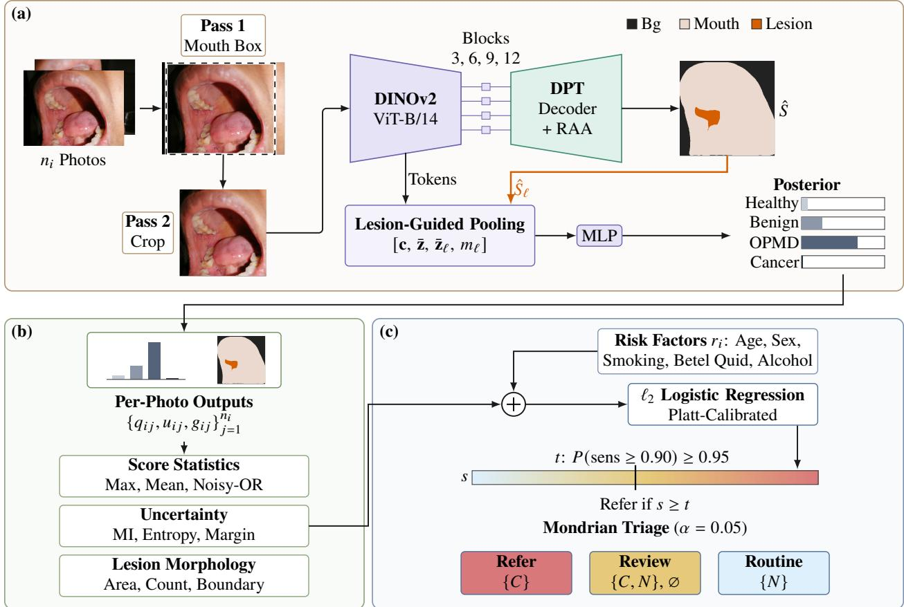
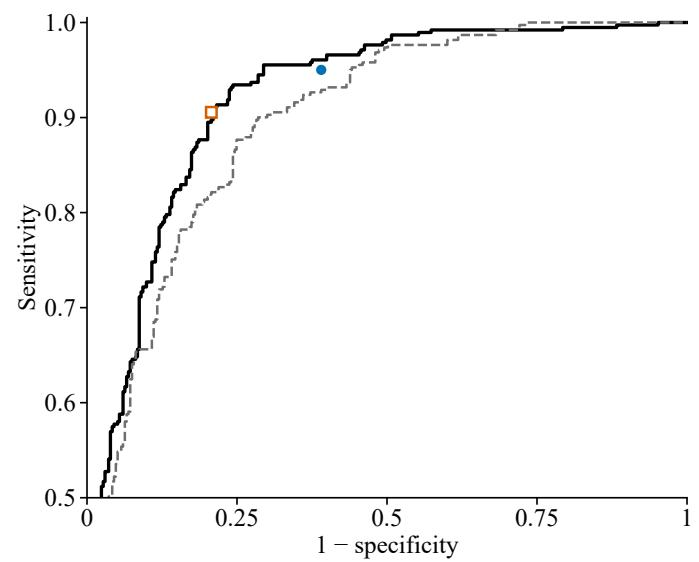
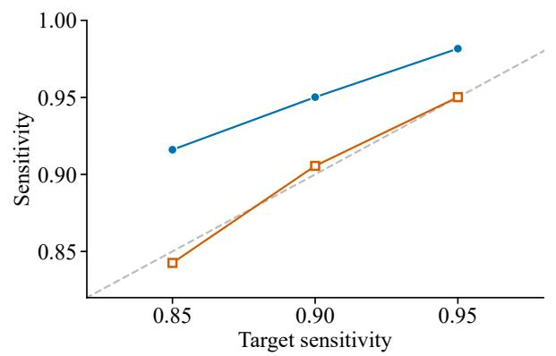
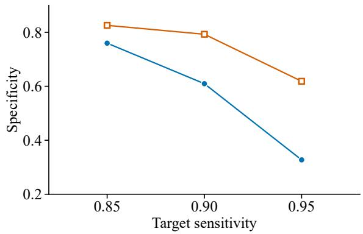
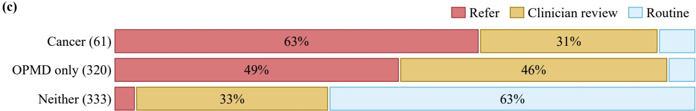

# OraRefer: Segmentation-Guided Multi-Photograph Fusion for Oral Cancer Screening with Guaranteed Patient-Level Sensitivity

Rupam Mukherjee1† Mehakdeep Singh1† Shirin Dasgupta2 Subhamoy Mandal1

1Department of Medical Science and Technology 2Dr. B. C. Roy Multi-Speciality Medical Research Centre Indian Institute of Technology Kharagpur, India

## Abstract

Oral cancer and the oral potentially malignant disorders (OPMD) that can precede it are visible on the oral mucosa, which makes smartphone photographs a promising tool for screening. Deep learning models for this task classify individual photographs. However, screening refers patients, not photographs: a patient is usually photographed several times, and the referral decision must miss no more than a set share of patients with disease. We propose OraRefer, a patient-level screening model that reads each photograph with a segmentation-guided foundation model that conditions its class decision on the predicted lesion, combines all photographs of a patient with risk factors, and refers through a threshold with a finite-sample sensitivity guarantee. The model localizes the mouth itself, so inference needs no annotation. On 3000 photographs of 714 patients, patient-level fusion reaches an AUROC of 0.919 and outperforms attention-based multiple-instance learning. At a 90% sensitivity target, OraRefer detects 95% of patients with OPMD or cancer and misses 3 of 61 patients with cancer, at a specificity of 0.610. Because the threshold is calibrated without retraining, each clinic can set its own guaranteed operating point on a local calibration sample.

Keywords: Conformal prediction, multiple-instance learning, oral cancer, patient-level fusion, smartphone photographs

## 1 Introduction

Cancers of the lip and oral cavity caused 389485 new cases and 188230 deaths worldwide in 2022 [1]. They can be preceded by oral potentially malignant disorders (OPMD), visible mucosal abnormalities with an increased risk of cancer [2]. A photograph of the mouth can therefore show the disease that screening must find, and smartphones bring such photographs within reach of primary care. The screening decision, however, concerns a patient, not a photograph. A patient is often photographed several times, carries risk factors such as tobacco and betel quid use [3], and must be referred if any lesion is suspicious [4]. This calls for a patient-level model whose sensitivity holds on the next patients it sees, not only on average.

With the release of public datasets, deep learning on oral photographs has advanced. The dataset of Piyarathne et al. [5] provides 3000 smartphone photographs of 714 patients with lesion polygons and risk factors. On these data, classifiers have used convolutional and transformer backbones [6], oral-cavity segmentation followed by image–metadata fusion [7], embedding-level fusion with clinical data [8], and stacked ensembles with per-patient posterior smoothing [9]. Two of these studies [6, 8] split the data by image, which places photographs of one patient in both the training and the test set. More importantly, none of them turns all photographs of a patient into one referral decision with controlled sensitivity. General tools exist for each half of the problem: attention-based multiple-instance learning pools instances into a bag label [10], including patients in oral cytology [11], and conformal and Neyman–Pearson thresholds bound the errors of a fixed classifier [12, 13], with conformal triage applied to medical imaging [14]. A patient-level bound, however, requires out-of-sample patient scores at both stages of the model.

  
Fig. 1. OraRefer needs no annotation at inference, fuses a patient’s photographs with risk factors, and refers with guaranteed sensitivity. (a) Pass 1 predicts the mouth box (dashed); pass 2 segments the crop (�ˆ) and pools its tokens with the lesion map �ˆℓ. Shown: a held-out patient with OPMD [15]. (b) Per-photograph outputs are aggregated per patient. (c) The threshold � on the patient score � and Mondrian triage (�: OPMD or cancer, �: neither) are calibrated on held-out patients without refitting.

We propose OraRefer, a screening model that goes from a patient’s raw photographs to a referral with guaranteed sensitivity (Fig. 1). First, we introduce a segmentation-guided image model: one network, trained jointly to segment the mouth and the lesion and to classify the photograph, that conditions its class decision on the predicted lesion. Where earlier work segments the oral cavity in a separate preprocessing network [7], our segmentation training shapes the features the classifier reads, and the same network crops the mouth from the full frame, so no annotation is needed at test time. Second, we introduce a patient-level referral layer that fuses all photographs of a patient with risk factors and refers through a distribution-free sensitivity threshold and Mondrian conformal triage, both calibrated on held-out patients without retraining. Third, we show on 714 patients that OraRefer outperforms frozen foundation-model probes, untrained aggregation, and attention-based multiple-instance learning, and detects 95% of patients with OPMD or cancer, including 58 of 61 with cancer, against a 90% target.

## 2 Method

OraRefer has three parts (Fig. 1). An image model reads each photograph in two passes and returns class probabilities, a lesion mask, and an uncertainty estimate. A fusion model turns the outputs for all photographs of a patient, together with the patient’s risk factors, into one score. A threshold calibrated on held-out patients then turns the score into a referral. We call a patient referable if any of their photographs shows OPMD or cancer.

## 2.1 Segmentation-Guided Image Model

The encoder is DINOv2 ViT-B/14 [16], fine-tuned end to end with layer-wise learning-rate decay. A DPT decoder [17] reassembles four encoder blocks into a dense map that segments background, mouth, and lesion. Within the decoder, region-afinity attention [11] aggregates each reassembled token over its $3 \times 3$ neighborhood with learned afinity weights. The decoder guides the classifier: the head receives the class token c, the mean token z¯, the lesion-weighted token mean $\bar { \mathbf { z } } _ { \ell }$ , and the predicted lesion mass $m _ { \ell }$ . The model is trained with

$$
\mathcal { L } = \mathcal { L } _ { \mathrm { s e g } } + \lambda _ { \mathrm { c l s } } \mathcal { L } _ { \mathrm { c l s } } + \lambda _ { \mathrm { c o n } } \mathcal { L } _ { \mathrm { c o n } } + \lambda _ { \mathrm { r a a } } \mathcal { L } _ { \mathrm { r a a } } + \mathcal { L } _ { \mathrm { a u x } } ,\tag{1}
$$

where $\mathcal { L } _ { \mathrm { s e g } }$ combines cross-entropy, Tversky $( \alpha _ { \mathrm { T } } = 0 . 3 , \beta _ { \mathrm { T } } = 0 . 7 )$ , and boundary losses, $\mathcal { L } _ { \mathrm { c l s } }$ is labelsmoothed cross-entropy, $\mathcal { L } _ { \mathrm { c o n } }$ is supervised contrastive learning [18] on projected pooled features, and $\mathcal { L } _ { \mathrm { r a a } }$ penalizes afinity across annotated lesion boundaries $( \lambda _ { \mathrm { c l s } } = 0 . 5 , \lambda _ { \mathrm { c o n } } = 0 . 1 , \lambda _ { \mathrm { r a a } } = 0 . 0 5 )$ $\mathcal { L } _ { \mathrm { a u x } }$ holds decaying auxiliary losses on an intermediate decoder output and a second classifier head, and a term that ties the healthy-class probability to the predicted lesion area.

## 2.2 Self-Localization at Test Time

Training mixes full frames with mouth crops, so the model also reads uncropped photographs. At test time, a first pass on the full frame predicts the mouth mask, whose bounding box, padded by 8%, is the crop for the second pass. Inference therefore needs no annotation.

## 2.3 Patient-Level Fusion

Each photograph yields the four-class posterior, the lesion area, the number of lesion components and their boundary complexity, and the mutual information of 30 Monte Carlo dropout samples, plus the entropy and top-two margin of the posterior. Training samples the classes evenly, with cancer twice as often, so for fusion we correct the posterior from these sampling frequencies to the training class frequencies [19] and temperature-scale it on internal validation patients [20]. For patient � with photographs $j = 1 , \dots , n _ { i }$ , let $q _ { i j }$ be the corrected probability of OPMD or cancer. We summarize the photographs by the maximum, mean, and top-two mean of $q _ { i j } .$ , the fraction with $q _ { i j } > 0 . 5 $ , and the noisy-OR $\textstyle 1 - \prod _ { j } ( 1 - q _ { i j } )$ . We add the maximum and mean cancer probability and lesion area, the lesion morphology $g _ { i j }$ and the uncertainty $u _ { i j }$ , and the risk factors $r _ { i }$ (age, sex, smoking, betel quid, and alcohol use). An ℓ2-regularized logistic regression with inner cross-validated penalty and Platt calibration maps these features to the patient score $s _ { i }$

The fusion model must see out-of-sample image outputs in training, as at test time, so we cross-fit the image model at two levels. With $K$ patient folds, the model $M _ { - \{ f , f ^ { \prime } \} }$ is trained without folds $f$ and $f ^ { \prime }$ . For held-out fold $f ,$ fusion training features of fold $f ^ { \prime } \neq f$ come from $M _ { - \{ f , f ^ { \prime } \} }$ , and test patients in fold $f$ are scored through each of the $K - 1$ models $M _ { - \{ f , f ^ { \prime } \} }$ and averaged in logit space. This way, no image or fusion model sees fold � before it is scored.

## 2.4 Referral with Guaranteed Sensitivity

Let $s _ { ( 1 ) } \leq \cdots \leq s _ { ( n ) }$ be the scores of � referable calibration patients, and let � be the target sensitivity. For exchangeable patients with continuous scores, the miss probability of the threshold $s _ { ( k ) }$ , the probability that a new referable patient scores below it, follows Beta $( k , n - k + 1 )$ over calibration sets. The guaranteed-sensitivity threshold is $t = s _ { ( k ^ { * } ) }$ with

$$
k ^ { * } = \operatorname* { m a x } \{ k : \operatorname* { P r } [ \mathrm { B i n } ( n , 1 - \tau ) \geq k ] \geq 1 - \delta \} ,\tag{2}
$$

so that Pr sensitivity $\ge \tau ] \ge 1 - \delta$ for new patients, an order-statistic bound as in Neyman–Pearson classification [12]. This threshold exists for $n \geq \lceil \ln \delta / \ln \tau \rceil$ , that is $n \geq 2 9$ for $\tau = 0 . 9 0$ and $\delta = 0 . 0 5$ . The conformal threshold $t = s _ { \left( \lfloor \left( n + 1 \right) \left( 1 - \tau \right) \rfloor \right) }$ instead guarantees sensitivity $\geq \tau$ in expectation [13] and refers fewer patients.

Mondrian conformal triage [21] adds a third option. For each class, referable or not, a new patient’s p-value ranks its non-conformity, 1 � for referable and � for not, among the calibration patients of that class, and the prediction set keeps every class with p-value above �. A set with only the referable class means referral; with only the other class, routine care; with both or neither, clinician review. Coverage per class is at least $1 - \alpha$ in expectation, so on average at most a share � of referable patients is sent to routine care.

Both thresholds are calibrated inside the held-out fold. Each fold is split into five label-stratified parts, and each part is scored with the threshold calibrated on the other four. Calibration thus spends no training patient and needs no further model fit.

## 3 Experiments

## 3.1 Data and Protocol

We use the dataset of Piyarathne et al. [5]: 3000 photographs of 714 patients, taken with mobile phones by dental surgeons at a teaching hospital in Sri Lanka. Under the supervision of oral medicine specialists, each photograph is labeled healthy (729), benign (748), OPMD (1394), or cancer (129) and annotated with mouth and lesion polygons. Histopathology confirmed all cancer and 56.4% of OPMD diagnoses [5]. Each patient has a median of four photographs (range 1–18) and records of age, sex, and three binary risk factors. 381 patients are referable, 61 of them with cancer, and 333 are not.

All results come from patient-level five-fold cross-validation stratified by patient category and risk factors. Two patient pairs share an identical photograph; each pair stays in one fold and one calibration part. All model selection happens inside the training folds. The image model uses one configuration for all folds; inside each training set, 17% of patients are held out to select the checkpoint, the temperature, and the lesion-mask threshold, and the fusion penalty is chosen by inner cross-validation. The image model trains for 20 epochs at 448 px with batch size 16, AdamW, and base learning rate $3 \times 1 0 ^ { - 4 }$ , on a 16 GB V100. Thresholds target $\tau = 0 . 9 0$ with $\delta = 0 . 0 5$ , and triage uses $\alpha = 0 . 0 5$ . The 25 calibration sets hold 60–62 referable patients each, 8–12 of them with cancer, and triage shares are averaged over 20 random calibration re-splits of each fold.

## 3.2 Comparisons and Metrics

At the image level, removing segmentation guidance yields a DINOv2 classifier fine-tuned on the same predicted crops with the same schedule, without segmentation losses, lesion-guided pooling, or region-afinity attention. We also remove lesion-guided pooling, region-afinity attention, or supervised contrastive learning alone, give the second pass the annotated mouth box, and train linear probes on frozen full-photograph DINOv2-B, DINOv2-L, and SigLIP2 [22].

Patient-level baselines form three groups: logistic regression on image features or risk factors alone; untrained aggregation by the maximum, mean, and noisy-OR of $q _ { i j }$ ; and trained learners: gradient boosting, late-fusion networks with and without gating by image uncertainty, and ABMIL [10] and CAR-MIL [23]. The attention models receive the same per-photograph outputs and risk factors plus the first 32 principal components of frozen DINOv2-B embeddings of the full photograph, and CAR-MIL adds a counterfactual attention regularizer to ABMIL. Like OraRefer, every trained baseline is Platt-calibrated, and the neural ones stop early on internal validation patients.

Table 1. Segmentation guidance drives the image model, and self-localization matches annotated crops. Δ: change in macro AUROC from OraRefer; folds lower: number of the five folds in which it falls. A second training seed changes macro AUROC by 0.005.
<table><tr><td></td><td>Macro AUROC</td><td>Δ [95% interval]</td><td>Folds lower</td><td>Cancer AUROC</td><td>Macro-F1</td><td>Lesion Dice</td></tr><tr><td>OraRefer</td><td>0.893</td><td></td><td>一</td><td>0.942</td><td>0.704</td><td>0.580</td></tr><tr><td>w/o segmentation guidance</td><td>0.869</td><td>-0.023 [-0.033, -0.015]</td><td>5</td><td>0.923</td><td>0.688</td><td></td></tr><tr><td>w/o lesion-guided pooling</td><td>0.884</td><td>-0.009 [-0.016, -0.002]</td><td>4</td><td>0.919</td><td>0.703</td><td>0.587</td></tr><tr><td>w/o region-affinity attention</td><td>0.893</td><td>0.001 [-0.005, 0.007]</td><td>1</td><td>0.943</td><td>0.703</td><td>0.561</td></tr><tr><td>w/o supervised contrastive loss</td><td>0.885</td><td>-0.007 [-0.014, -0.002]</td><td>4</td><td>0.934</td><td>0.705</td><td>0.581</td></tr><tr><td>with annotated mouth box</td><td>0.891</td><td>-0.001 [-0.003, 0.000]</td><td>3</td><td>0.940</td><td>0.707</td><td>0.583</td></tr><tr><td>Linear probe, frozen DINOv2-B</td><td>0.809</td><td>-0.084</td><td></td><td></td><td></td><td></td></tr><tr><td>Linear probe, frozen DINOv2-L</td><td>0.823</td><td>-0.069</td><td></td><td></td><td></td><td></td></tr><tr><td>Linear probe, frozen SigLIP2</td><td>0.817</td><td>-0.076</td><td></td><td></td><td></td><td></td></tr></table>

Table 2. OraRefer has the highest patient-level AUROC. Guaranteed-sensitivity operating points $( \tau = 0 . 9 0 , \delta = 0 . 0 5 ) \mathrm { ; }$ Ref.: referral rate. ABMIL and CAR-MIL AUROCs difer only in the fourth decimal.
<table><tr><td></td><td>AUROC</td><td>Sens.</td><td>Spec.</td><td>Ref.</td></tr><tr><td>Risk factors only</td><td>0.760 [0.724, 0.795]</td><td>0.958</td><td>0.201</td><td>88%</td></tr><tr><td>Image only</td><td>0.909 [0.888, 0.930]</td><td>0.958</td><td>0.562</td><td>72%</td></tr><tr><td>Max of  $q _ { i j }$ </td><td>0.878 [0.853, 0.903]</td><td>0.950</td><td>0.538</td><td>72%</td></tr><tr><td>Mean of  $q _ { i j }$ </td><td>0.889 [0.865, 0.914]</td><td>0.958</td><td>0.502</td><td>74%</td></tr><tr><td>Noisy-OR</td><td>0.851 [0.824, 0.879]</td><td>0.961</td><td>0.387</td><td>80%</td></tr><tr><td>ABMIL</td><td>0.890 [0.867, 0.914]</td><td>0.953</td><td>0.508</td><td>74%</td></tr><tr><td>CAR-MIL</td><td>0.890 [0.867, 0.914]</td><td>0.953</td><td>0.517</td><td>73%</td></tr><tr><td>Gradient boosting</td><td>0.916 [0.895, 0.936]</td><td>0.953</td><td>0.556</td><td>72%</td></tr><tr><td>Late fusion</td><td>0.915 [0.895, 0.935]</td><td>0.942</td><td>0.592</td><td>69%</td></tr><tr><td>+ gating</td><td>0.909 [0.887, 0.930]</td><td>0.950</td><td>0.574</td><td>71%</td></tr><tr><td>OraRefer</td><td>0.919 [0.899, 0.939]</td><td>0.950</td><td>0.610</td><td>69%</td></tr></table>

We report four-class macro AUROC and macro-F1 of the classifier posterior, lesion Dice on photographs with a lesion, and predicted mouth-box IoU, all from out-of-fold predictions of the five-fold image models. Patient-level results give AUROC and the sensitivity, specificity, and referral rate of the guaranteed-sensitivity threshold. Brackets are 95% intervals: 2000 patient-cluster bootstrap resamples for image metrics, DeLong [24] for patient AUROC, and a bootstrap recalibrating the thresholds in each resample for operating points.

## 4 Results

## 4.1 Image Model

Segmentation guidance drives the image model (Table 1). OraRefer reaches a four-class macro AUROC of 0.893 and a macro-F1 of 0.704. This exceeds the best published four-class result under patient-grouped evaluation, a macro-F1 of 0.662 on a curated subset of 2438 photographs cropped to the lesion [9], whereas OraRefer reads all 3000 photographs uncropped. OraRefer also outperforms the frozen foundation-model probes by 0.069–0.084 in macro AUROC. Without segmentation guidance, macro AUROC falls by 0.023 on the same crops. The drop is consistent across all five folds, at five times the seed-to-seed change. Lesion-guided pooling accounts for 0.009 of this drop and the segmentation training for the rest, and supervised contrastive learning adds a further 0.007; pooling and contrastive learning each help in four of five folds. Region-afinity attention raises lesion Dice from 0.561 to 0.580. The gain from segmentation guidance carries through to the referral decision. For each ablated image model, we refit the fusion model on its out-of-fold outputs, a single level of cross-fitting under which the full model reaches 0.913 instead of 0.919. Removing segmentation guidance lowers patient AUROC to 0.894 (DeLong $p = 0 . 0 0 5 )$ , four times the patient-level seed-to-seed change (0.005), whereas no other component changes it by more than 0.008.

Self-localization costs no classification accuracy. The predicted mouth box has a median IoU of 0.981 with the annotated box, and an IoU of at least 0.5 on 2998 of 3000 photographs. Replacing it with the annotated box changes macro AUROC by only 0.001.

## 4.2 Patient-Level Fusion

Learned fusion outperforms untrained pooling of the photograph scores (Table 2). Even without risk factors, the image-only model reaches an AUROC of 0.909, above the untrained aggregates (DeLong $p \leq 0 . 0 0 5 )$ Risk factors add information beyond the photographs, which a likelihood-ratio test of adding them to a logistic model of the image-only score confirms $( \chi ^ { 2 } ( 5 ) = 3 4 . 4 , p < 0 . 0 0 1 )$ , and with them OraRefer reaches 0.919, the highest AUROC in Table 2, above each untrained aggregate (DeLong $p < 0 . 0 0 1 )$ . It outperforms ABMIL and CAR-MIL by 0.029 $( p = 0 . 0 0 1$ each, Holm-adjusted over 13 comparisons with the other trained models in Table 2 and six variants of OraRefer), although both attention models also receive frozen DINOv2 embeddings, and at the guaranteed sensitivity it reaches a specificity of 0.610, compared with 0.562 for image evidence alone and 0.508 for ABMIL. More flexible learners do not improve on the calibrated logistic regression: gradient boosting reaches 0.916, and the late-fusion network 0.915, or 0.909 when gated by image uncertainty. Neither photograph counts nor the four-model test scoring drive these results: count-free summaries (means and fractions) give 0.912, and scoring each test patient, like each training patient, with a single image model (trained on the four training folds) gives 0.917, both above every untrained aggregate and attention model.

## 4.3 Referral

The guaranteed-sensitivity threshold detects 0.950 [0.934, 0.966] of referable patients against a target of 0.90, at a specificity of 0.610 [0.470, 0.710]. It exceeds every target (Fig. 2(b)), by the margin that a guarantee at $1 - \delta = 0 . 9 5$ requires with 60–62 referable calibration patients. Patients with cancer are detected at the same rate as all referable patients, for whom the threshold is calibrated: 58 of 61, a sensitivity of 0.951 [0.866, 0.986], and 304 of 320 with OPMD only. The conformal threshold, by contrast, lands on its target (0.906 at 0.90) and trades sensitivity for a higher specificity of 0.793 (Fig. 2(b)). Mondrian triage refers 29% of patients directly, sends 39% to clinician review, and returns 32% to routine care, which receives 5.1% of referable patients (4.3%–6.3% over re-splits), consistent with $\alpha = 0 . 0 5$ (Fig. 2(c)).

The missed cancers are classification errors, not localization errors. All three were localized and segmented well, with a best-photograph lesion Dice of at least 0.825, yet the classifier gave none of their photographs a $q _ { i j }$ above 0.380. Missed patients with OPMD only, in contrast, show small predicted lesions: their largest covers a median 0.04 of the predicted mouth, against 0.32 for detected ones.

(a)  

(b)  

(c)  
  
Fig. 2. The guaranteed-sensitivity threshold exceeds every target, and Mondrian triage sends few referable patients to routine care. (a) Patient-level ROC curves (AUROC) with the operating points of both thresholds at $\tau = 0 . 9 0$ (b) Sensitivity (left; dashed: sensitivity = �) and specificity (right) of both thresholds against the target �. (c) Triage (� = 0.05) of patients grouped by their most severe photograph label, mean over 20 calibration re-splits.

## 5 Conclusion

OraRefer turns a patient’s raw smartphone photographs into a referral with guaranteed sensitivity. Segmentation guidance drives its image model, and self-localization removes the need for test-time annotation. Patient-level fusion with risk factors outperforms untrained aggregation and attention-based multiple-instance learning. Since the thresholds are calibrated without retraining, a new clinic can set its own guaranteed operating point from a representative local sample of patients with OPMD or cancer. These retrospective results motivate prospective evaluation in community screening.

## Code Availability

The code of OraRefer is available at https://github.com/ZenAesthete/OraRefer.

## Compliance with Ethical Standards

This study was conducted using human subject data, available on request [15]. Ethical approval was not required.

## Acknowledgments

The authors have no relevant financial or non-financial interests to disclose.

## References

[1] F. Bray et al., “Global cancer statistics 2022: GLOBOCAN estimates of incidence and mortality worldwide for 36 cancers in 185 countries,” CA Cancer J. Clin., vol. 74, no. 3, pp. 229–263, 2024.

[2] S. Warnakulasuriya et al., “Oral potentially malignant disorders: A consensus report from an international seminar on nomenclature and classification, convened by the WHO Collaborating Centre for Oral Cancer,” Oral Dis., vol. 27, no. 8, pp. 1862–1880, 2021.

[3] B. Secretan et al., “A review of human carcinogens—Part E: Tobacco, areca nut, alcohol, coal smoke, and salted fish,” Lancet Oncol., vol. 10, no. 11, pp. 1033–1034, 2009.

[4] National Institute for Health and Care Excellence, “Suspected cancer: Recognition and referral,” NICE guideline NG12, 2015.

[5] N. S. Piyarathne et al., “A comprehensive dataset of annotated oral cavity images for diagnosis of oral cancer and oral potentially malignant disorders,” Oral Oncol., vol. 156, 2024, Art. no. 106946.

[6] P. Ormeño-Arriagada et al., “Improving diagnostic sensitivity in imbalanced oral cancer image classification: A comparative study of CNN and transformer architectures,” Cancers, vol. 18, no. 18, 2026, Art. no. 2926.

[7] G. A. I. Devindi et al., “Multimodal deep convolutional neural network pipeline for AI-assisted early detection of oral cancer,” IEEE Access, vol. 12, pp. 124375–124390, 2024.

[8] P. Ormeño-Arriagada et al., “Multimodal oral cancer detection with embedding-level oversampling of fused image and clinical data,” Sci. Rep., vol. 16, 2026, Art. no. 28557.

[9] S. Hazra et al., “Uncertainty-aware multimodal fusion for oral lesion classification,” in Proc. MICCAI Workshops (MultiTab), 2026, vol. 17263 of LNCS.

[10] M. Ilse, J. Tomczak, and M. Welling, “Attention-based deep multiple instance learning,” in Proc. ICML, 2018, pp. 2127–2136.

[11] R. Mukherjee et al., “RAA-MIL: A novel framework for classification of oral cytology,” in Proc. IEEE ISBI, 2026, pp. 1–4.

[12] X. Tong, Y. Feng, and J. J. Li, “Neyman–Pearson classification algorithms and NP receiver operating characteristics,” Sci. Adv., vol. 4, no. 2, 2018, Art. no. eaao1659.

[13] A. N. Angelopoulos and S. Bates, “Conformal prediction: A gentle introduction,” Found. Trends Mach. Learn., vol. 16, no. 4, pp. 494–591, 2023.

[14] A. N. Angelopoulos et al., “Conformal triage for medical imaging AI deployment,” medRxiv, 2024.

[15] N. S. Piyarathne et al., “Dataset of annotated oral cavity images for oral cancer detection,” Zenodo, 2024.

[16] M. Oquab et al., “DINOv2: Learning robust visual features without supervision,” Trans. Mach. Learn. Res., 2024.

[17] R. Ranftl, A. Bochkovskiy, and V. Koltun, “Vision transformers for dense prediction,” in Proc. IEEE/CVF ICCV, 2021, pp. 12159–12168.

[18] P. Khosla et al., “Supervised contrastive learning,” in Proc. NeurIPS, 2020, pp. 18661–18673.

[19] M. Saerens, P. Latinne, and C. Decaestecker, “Adjusting the outputs of a classifier to new a priori probabilities: A simple procedure,” Neural Comput., vol. 14, no. 1, pp. 21–41, 2002.

[20] C. Guo et al., “On calibration of modern neural networks,” in Proc. ICML, 2017, pp. 1321–1330.

[21] V. Vovk, “Conditional validity of inductive conformal predictors,” in Proc. ACML, 2012, pp. 475–490.

[22] M. Tschannen et al., “SigLIP 2: Multilingual vision-language encoders with improved semantic understanding, localization, and dense features,” arXiv:2502.14786, 2025.

[23] I. Chraki et al., “CAR-MIL: Counterfactual attention regularization for multiple instance learning,” in Proc. ECCV, 2026.

[24] E. R. DeLong, D. M. DeLong, and D. L. Clarke-Pearson, “Comparing the areas under two or more correlated receiver operating characteristic curves: A nonparametric approach,” Biometrics, vol. 44, no. 3, pp. 837–845, 1988.