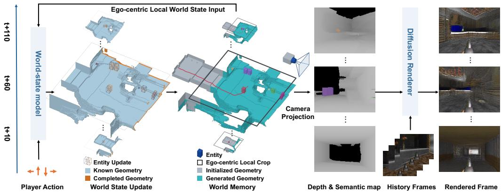
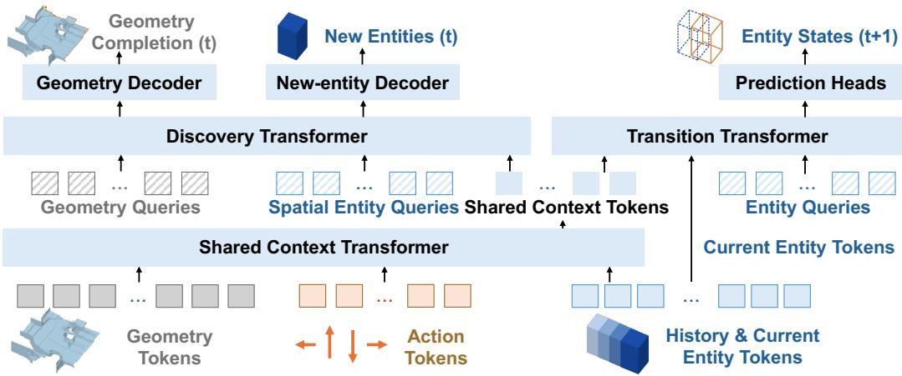
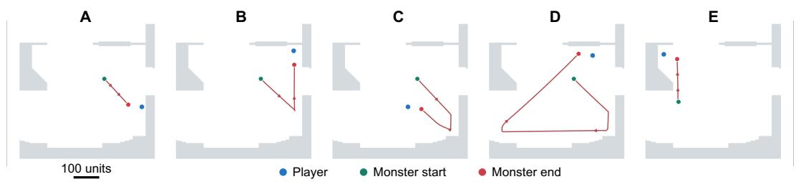
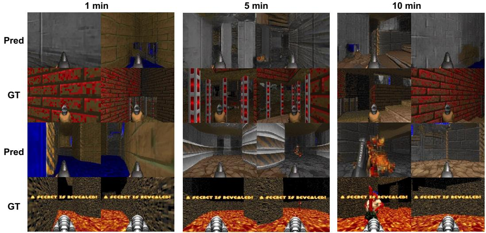
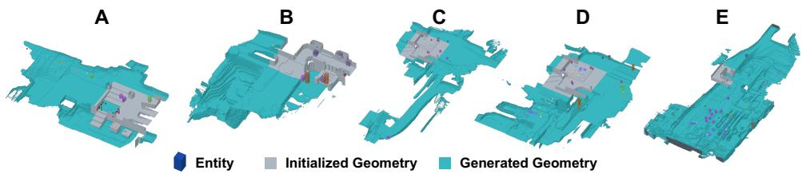
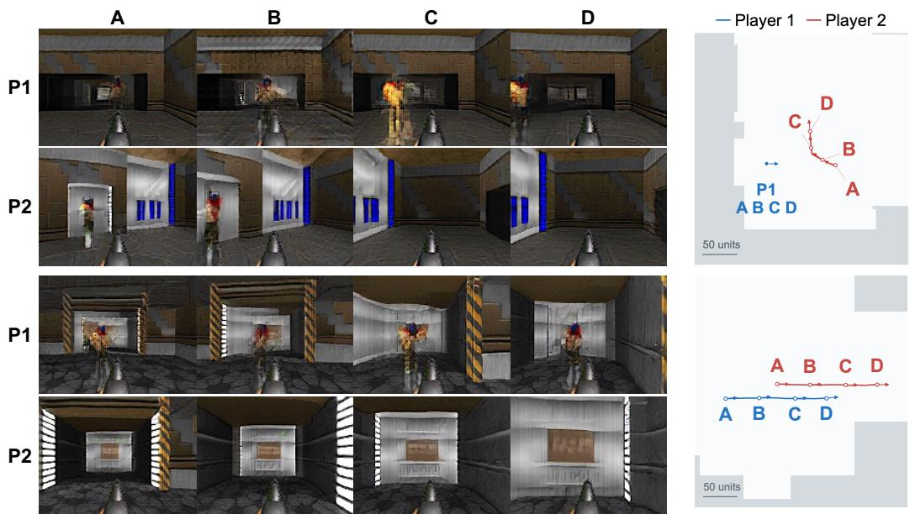
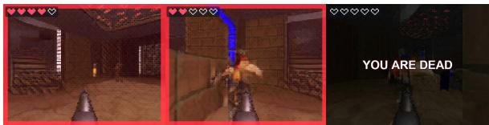
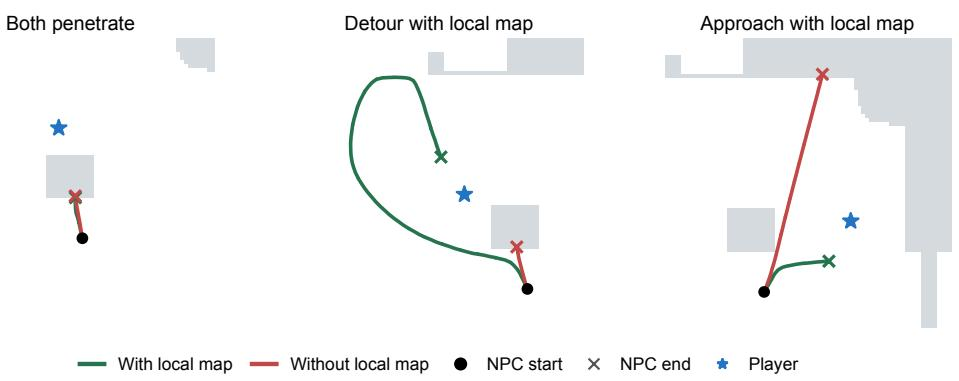
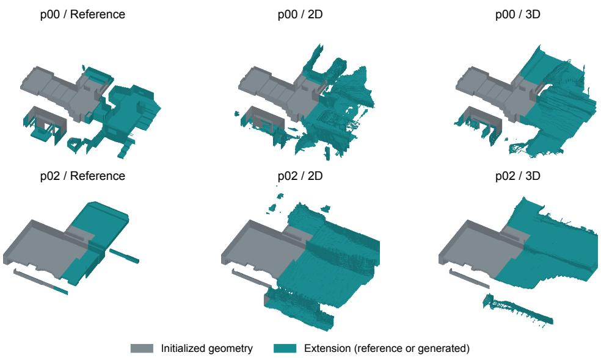

# PLAYGEN2: LEARNING REAL-TIME PLAYABLE WORLDS WITH EXPLICIT 3D STATE

Jihai Zhang1∗, Yuhan Zhou2∗, Junyou Li3, Deheng Ye3, Qi Dou1, Yu Cheng4 1The Chinese University of Hong Kong 2Wellington College 3Tencent 4Nanyang Technological University

  
Figure 1: PlayGen2 overview. An action-conditioned world-state model updates an ego-centric region of persistent world memory. A separate diffusion renderer synthesizes observations from projected depth and semantics, actions, and visual history.

## ABSTRACT

Building a playable world requires more than generating plausible video: it demands responsive control, persistent spatial structure, and coherent interactions with dynamic entities. Using generated frames as the sole recurrent world representation ties these requirements to view-dependent appearance synthesis, making it difficult to maintain long-term spatial and temporal consistency in generation and interaction. We present PlayGen2, a real-time interactive world model that separates learned 3D state evolution from neural rendering. PlayGen2 maintains a persistent world memory comprising static geometry represented by a volumetric occupancy grid and identity-indexed 3D states for the player and other entities. Within a fixed-size local region, its world-state model jointly learns actionconditioned entity dynamics, geometry completion, and entity discovery, committing updates to a persistent world memory. A separate neural renderer synthesizes first-person observations from depth and semantic projections of the world state, without feeding generated images back into state prediction. Using Doom as a testbed, we demonstrate that the model successfully learns world dynamics including geometry-aware player motion and player–NPC interactions. The framework is computationally efficient, enabling the complete simulation and rendering pipeline to achieve approximately 160 ms backend latency on a MacBook Pro with an M4 Pro chip. Beyond single-player interaction, we demonstrate zero-shot deployment on unseen Doom maps, multiplayer interaction through the composition of single-player models, and programmable gameplay through rule-based state interventions. These capabilities demonstrate the transferability and extensibility of the learned game-world model. Code and pretrained model weights are publicly available.

## 1 INTRODUCTION

Playing in a generated world requires more than a sequence of plausible images. A player expects a corridor to remain in place after turning away, a wall to constrain movement, and nearby entities to evolve while controls remain responsive. These expectations concern a world that persists and changes under interaction, not merely the appearance of its next frame. Building a playable world model therefore requires bringing together low-latency control, persistent spatial structure, and coherent interactions (Yang et al., 2024; Garcin et al., 2026; Duan et al., 2026).

Action-conditioned video generation offers a compelling route toward this goal (Bruce et al., 2024). Systems such as GameNGen (Valevski et al., 2025) and PlayGen (Yang et al., 2024) demonstrate that neural models can simulate gameplay and support real-time interaction directly from visual histories. However, when generated frames serve as the sole recurrent world representation, the model must use the same view-dependent signal to preserve geometry, track entities, predict their interactions, and synthesize appearance. Information outside the current view must be recovered from visual memory (Garcin et al., 2026; Qian et al., 2026), and errors in generated visual histories can propagate through autoregressive prediction (Valevski et al., 2025). Moreover, a pixel-based interface does not directly expose entity states for editing, participant composition, or rule-based interventions (Po et al., 2026; Huang et al., 2026). To address these problems, recent work has begun to separate simulation from rendering (Garcin et al., 2026; Duan et al., 2026; Po et al., 2026; Zhao et al., 2026). This separation, however, does not by itself determine how to learn a persistent game world that both evolves under interaction and expands through exploration.

Inspired by the explicit world state maintained by traditional game engines, we organize learned game-world simulation around two complementary processes. State transition predicts how the player and other existing entities evolve, conditioned on player actions and the current world state. Incremental world generation completes previously unknown geometry and introduces newly encountered entities. These processes are coupled through a shared, persistent 3D state: newly generated geometry provides context for subsequent state transitions, while the resulting player motion determines which previously unknown regions need to be generated next. We therefore seek to jointly learn incremental world generation and action-conditioned state transitions, while keeping appearance synthesis separate.

We present PlayGen2, a real-time playable world model that combines a learned world-state model with a neural renderer (Figure 1). Inspired by traditional game engines, we organize the world state into static geometry and dynamic entities. Static geometry is represented as a volumetric occupancy grid, while dynamic entities have identity-indexed states describing their 3D bounding volumes, semantic classes, and motion attributes. These entities include the player, monsters, projectiles, and items: their states can change even when they are not moving, as when an item is collected. Together, geometry and entities form a complete world state. We maintain this state in a persistent world memory that retains geometry and identity-indexed entity records beyond the model’s local processing region.

The world-state model is trained on structured game data collected from the game engine, including 3D geometry, entity states, and player actions. To keep neural computation efficient, it operates on a fixed-size, player-centered 3D volume read from world memory. Within this volume, it advances existing entities, completes previously unknown geometry, and discovers newly encountered entities. State transitions are conditioned on user actions, entity histories, and geometric context. The resulting updates are written back to world memory, so generated regions remain available on revisits and entity records remain stored outside the active volume.

The neural renderer converts the predicted world state into RGB video. We project the occupancy grid and entity geometry into depth and semantic maps from the player’s camera viewpoint, providing explicit spatial conditions for frame generation. The separately trained renderer combines these conditions with recent RGB history to synthesize appearance and maintain visual continuity. Generated frames update only this RGB history and never feed back into world-state prediction.

We use Doom as a controlled testbed. On a MacBook Pro with an M4 Pro chip, our Doom prototype achieves approximately 160 ms backend latency, supporting interactive exploration with dynamic entities. The model learns general world dynamics including collision-aware player navigation and player-NPC interaction. We further evaluate transfer to unseen Doom maps and training-free extensions to multiplayer and programmable gameplay. Our contributions are threefold:

• A unified framework for learned 3D worlds. We introduce a framework for learning world evolution in an explicit 3D representation space comprising volumetric geometry and identityindexed entity states. The world-state model jointly learns geometry completion, entity discovery, and action-conditioned dynamics within a fixed-size local region, committing updates to persistent world memory while remaining decoupled from neural rendering.

• Learned game dynamics for real-time play. Using Doom as a testbed, we demonstrate that the model successfully learns world dynamics including geometry-aware player motion and player– NPC interactions. Our proposed framework is computationally efficient, enabling the complete simulation and rendering pipeline to run in real time on a consumer laptop with low end-to-end latency.

• Generalization and composition for extensible gameplay. We illustrate the generalizability and extensibility of the framework through three applications: zero-shot continuation on unseen Doom maps, multiplayer interaction through the composition of single-player models, and programmable gameplay through state-level interventions. These examples demonstrate how the learned game-world dynamics can be reused and composed beyond the original training setting.

## 2 RELATED WORK

## 2.1 VIDEO-BASED INTERACTIVE WORLD MODELS

Video-based game world models have progressed from demonstrating learned gameplay to improving controllability, efficiency, and long-horizon consistency. GameNGen and PlayGen show that action-conditioned video prediction can support real-time gameplay and interactive mechanics (Valevski et al., 2025; Yang et al., 2024). Matrix-Game extends image-conditioned generation with keyboard and mouse control (Zhang et al., 2025), while few-step streaming generation and causal distillation improve interactive efficiency in Matrix-Game 2.0 and LingBot-World (He et al., 2025; Robbyant Team et al., 2026). Beyond speed, recent work addresses what the model remembers and how users interact: Matrix-Game 3.0 retrieves camera-relevant history (Wang et al., 2026b), Matrix-Game 3.5 adds geometry-aligned patch memory and dynamic-subject references (Qian et al., 2026), and LingBot-World 2.0 introduces agent-mediated interactions beyond navigation (Gao et al., 2026). However, improved local visual quality does not necessarily imply persistent world consistency. WorldProbe finds that recent video world models remain vulnerable to long-range revisit inconsistencies, entity drift, and incoherent scene evolution under closed-loop spatial exploration (Wang et al., 2026a). These findings motivate maintaining world state independently of generated observations, rather than relying on visual history alone to preserve the evolving environment.

## 2.2 EXPLICIT-STATE WORLD MODELS AND GENERATIVE RENDERING

Explicit-state approaches separate world evolution from observation synthesis, but differ in how the world is advanced. PERSIST learns voxel-world evolution and camera dynamics, while Live-World advances out-of-sight entities through local videos lifted into dynamic point clouds (Garcin et al., 2026; Duan et al., 2026). Shared state also supports editable multiplayer worlds in MultiGen, population-scalable simulation in Khora, and learned joint-action transitions in multiplayer Snake in MASS (Po et al., 2026; Zhao et al., 2026; Cai et al., 2026). A rapidly growing branch instead uses code-defined worlds rendered by video models: executable programs maintain state and determine interaction outcomes, while video models synthesize their appearance. Code World Model, CoDeR, and Programmable World Model construct executable worlds through agents and programs (Chen et al., 2026; Fang et al., 2026; Huang et al., 2026). Magpie, Matrix-Game 4.0, and StreamRender-H3 couple game execution with neural rendering for interactive play (Zhan et al., 2026; Zhang et al., 2026; Lu et al., 2026), while AgentGarten uses simulator-backed neural-rendered environments for agent learning (Chi et al., 2026). In this code-driven branch, executable state provides a persistent interface for rendering, while programs determine the underlying world evolution.

PlayGen2 explores a complementary route: the structured world state itself is generated and advanced by a learned world-state model, rather than by executing code-defined dynamics. The model jointly learns geometry completion, entity discovery, and action-conditioned state transitions from structured game data; a separate renderer synthesizes observations from depth and semantic projections of the predicted state. Fixed-size local updates and persistent world memory support efficient exploration, while the explicit state remains accessible for composition and intervention. Optional rules extend this learned simulation rather than supplying its base dynamics. Thus, PlayGen2 learns game-world evolution as well as its visual realization, while retaining the explicit interface used by code-driven systems.

## 3 METHOD

PlayGen2 maintains a learned simulation loop over explicit 3D state and a separate rendering loop conditioned on projected world state and RGB history (Figure 1). The two models are trained separately using structured game-state and action sequences for simulation, and aligned state projections and RGB observations for rendering.

## 3.1 WORLD STATE AND SYSTEM OVERVIEW

The simulation state comprises a volumetric occupancy map $M _ { t }$ , an availability mask $K _ { t }$ , player state $e _ { t } ,$ , and an identity-indexed object table ${ \mathcal { O } } _ { t }$ :

$$
{ \mathcal { S } } _ { t } = ( M _ { t } , K _ { t } , e _ { t } , { \mathcal { O } } _ { t } ) , \qquad o _ { t } ^ { i } = ( c _ { t } ^ { i } , \mathbf { p } _ { t } ^ { i } , h _ { t } ^ { i } , r _ { t } ^ { i } , \mathbf { v } _ { t } ^ { i } ) .\tag{1}
$$

Here, i indexes an object in $\mathcal { O } _ { t } , c _ { t } ^ { i }$ is its semantic class, $\mathbf { p } _ { t } ^ { i } \in \mathbb { R } ^ { 3 }$ is its base position, $h _ { t } ^ { i }$ and $r _ { t } ^ { i }$ are its height and horizontal radius, and $\mathbf { v } _ { t } ^ { i } \in \mathbb { R } ^ { 3 }$ is its velocity. The player state $e _ { t }$ contains the corresponding continuous attributes together with its orientation. The player action $a _ { t }$ controls the transition from t to $t + 1$ The availability mask $K _ { t }$ indicates whether a voxel has an assigned occupancy value, supplied at initialization or committed from an earlier prediction; unavailable voxels are not treated as empty space.

Persistent world memory retains committed geometry and entity records, while the network processes a player-centered 3D crop and a sliding window of identity-aligned history. Objects outside this volume are stored but not continuously simulated. Before encoding, all historical positions are expressed relative to the same current crop origin. The world-state model uses the current state and its history to predict state updates. For rendering, the updated state is projected into depth and semantic maps that condition RGB generation. RGB history is used only by the renderer; generated images never enter the world-state prediction loop.

## 3.2 GEOMETRY-AWARE WORLD EVOLUTION

Figure 2 outlines the world-state model. A 3D convolutional encoder processes the local occupancy map, availability mask, and a per-voxel vertical coordinate relative to the player. The Shared Context Transformer combines geometry tokens with player and object histories, and action information to produce shared context $\mathcal { C } _ { t } ,$ which supports incremental world generation at time t and state tran sitions from t to $t + 1$

Incremental world generation. The Discovery Transformer processes two types of queries conditioned on $\mathcal { C } _ { t }$ . Geometry Queries are associated with spatial locations in the coarse feature volume. Their outputs pass through the Geometry Decoder, which reconstructs voxel occupancy using 3D upsampling and encoder skip connections. Spatial Entity Queries propose new entities around candidate 3D reference positions, or anchors, derived from the available world state. Each query combines a learned embedding with encodings of its anchor position and proposal metadata. The New-entity Decoder uses the resulting query features and geometry encoder features to predict objectness, semantic class, anchor-relative position, size, and velocity. Anchor construction, matching, and proposal filtering are detailed in Appendix A.

Geometry-conditioned state transitions. Entity Queries predict the next states of the player and active objects. For each non-player object, query conditioning combines its current state, position differences between consecutive available history frames, and local geometry sampled from the encoder. Attention over the sampled geometry features provides object-specific spatial context. Player motion accesses geometry, actions, and history through the shared context. The Transition

  
Figure 2: World-state model architecture. The Shared Context Transformer encodes geometry, entity histories, and actions. The Discovery Transformer processes Geometry Queries and Spatial Entity Queries to complete geometry and generate new entities at time t. The Transition Transformer predicts player and entity states at $t + 1$ , additionally attending to Current Entity Tokens that include newly accepted entities. The state-commit and re-embedding path is omitted for clarity.

Transformer updates Entity Queries through self-attention and cross-attention to the shared context $\mathcal { C } _ { t }$ concatenated with Current Entity Tokens. These current-state tokens include newly accepted entities, making them available to state prediction without recomputing the shared context. The updated queries are passed to prediction heads to produce the next player and object states. Positions are predicted as residual updates:

$$
\hat { \mathbf { p } } _ { t + 1 } ^ { i } = \mathbf { p } _ { t } ^ { i } + f _ { \mathrm { x y z } } ( \mathbf { h } _ { t , \mathrm { t r a n s } } ^ { i } ) ,\tag{2}
$$

where $\mathbf { h } _ { t , \mathrm { t r a n s } } ^ { i }$ is the output feature of the Transition Transformer for entity $i ,$ and $f _ { \mathrm { x y z } }$ maps this feature to a predicted 3D displacement. The player uses the same residual-position form. Separate heads predict class, size, velocity, and player orientation. No runtime collision correction is applied.

Update order and persistent memory. Incremental world generation completes the local region at the current, already committed player pose before state transition predicts the next player and object states. Let $D _ { \theta }$ and $T _ { \theta }$ denote the generation and transition branches, including their respective output decoders and heads. Both reuse the shared context $\mathcal { C } _ { t }$ and geometry encoder features $\mathcal { F } _ { t } .$ Here, $\boldsymbol { A } _ { t }$ denotes the anchors and metadata used to construct Spatial Entity Queries. $\mathcal { H } _ { t } ^ { + }$ denotes entity histories updated with accepted new entities. These histories provide the current-state and motion features used to encode Current Entity Tokens and condition Entity Queries. Using − and + for states before and after incremental world generation:

$$
\begin{array} { r } {  { \mathcal { S } } _ { t } ^ { + } = \operatorname { C o m m i t } \bigl (  { \mathcal { S } } _ { t } ^ { - } , D _ { \theta } (  { \mathcal { C } } _ { t } ,  { \mathcal { F } } _ { t } ,  { \mathcal { A } } _ { t } ) \bigr ) , \qquad ( \hat { e } _ { t + 1 } , \hat {  { \mathcal { O } } } _ { t + 1 } ) = T _ { \theta } (  { \mathcal { C } } _ { t } ,  { \mathcal { F } } _ { t } ,  { \mathcal { H } } _ { t } ^ { + } ) . } \end{array}\tag{3}
$$

Generated occupancy is written only to unavailable voxels, using the same crop origin as the input geometry. This ordering decouples current-region generation and memory commitment from same-step player-position prediction, avoiding misalignment between generated voxels and their writeback locations. The predicted player pose determines the local region processed at the next step instead. Accepted entities enter history and become eligible for state transition. The original context and geometry features are reused without re-encoding the completed map. The next state retains the committed geometry and incorporates the predicted player and object updates. Newly introduced entity states are teacher-forced during training and supplied by accepted predictions during rollout.

Training and robustness. We jointly supervise incremental world generation at time t and entity state transitions from t to $t + 1 .$ . Newly introduced entities are excluded from the shared context, while their ground-truth current states are supplied to the transition branch during training. Unknown geometry receives focal and volumetric Dice losses (Milletari et $\mathrm { a l . , } 2 0 1 6 )$ , with a separate reconstruction loss on known regions. New-entity losses separate sparse objectness prediction from semantic classification. For non-item objects, phase-balanced position losses balance the contributions of moving, stopping, and stationary examples.

Random history truncation trains the model to handle incomplete histories, including entities with only one available frame. Temporally correlated position perturbations are applied to stationary item histories, with clean targets, to train recovery from accumulated drift. Architecture, assignment, objectives, and rollout details appear in Appendix A.

## 3.3 STATE-CONDITIONED NEURAL RENDERING

Let $x _ { t }$ denote the RGB observation at time t. The renderer generates the next observation conditioned on the projected world state, an L-frame RGB history, and the player action:

$$
\begin{array} { r } { x _ { t + 1 } \sim p _ { \phi } \big ( x \mid c _ { t + 1 } , x _ { t - L + 1 : t } , a _ { t } \big ) , \qquad c _ { t + 1 } = \Pi ( S _ { t + 1 } ^ { - } ) . } \end{array}\tag{4}
$$

Here, Π uses occupancy ray casting and entity bounding-box projection to produce semantic and normalized depth maps from the player’s viewpoint, together with validity masks (Appendix B.1). These scene conditions specify the visible structure, while RGB history provides appearance information and supports temporal continuity.

We use a latent diffusion Transformer with a frozen, domain-trained variational autoencoder. Separate encoders transform the latent representations of RGB history and the scene conditions into RGB-history tokens and scene-condition tokens, respectively. Each denoising block cross-attends to both sets of tokens. Diffusion noise is applied only to the target latent.

After training with ground-truth RGB history, we fine-tune the renderer by mixing ground-truth and cached autoregressively generated RGB histories and applying RGB-history dropout. Generated histories are collected offline from a frozen renderer checkpoint; the target remains the recorded next frame. RGB-history dropout masks out the entire history for a subset of training examples while retaining scene conditions and actions. This training exposes the renderer to imperfect or absent RGB history while retaining supervision for temporal continuity from ground-truth RGB history. Architecture, training objectives, history construction, and sampling details are provided in Appendix B.

## 4 EXPERIMENTS

We evaluate learned game dynamics through player–geometry and player–NPC interactions, assess long-horizon rendering and world generation on seen and unseen maps, and measure end-to-end inference efficiency. We also demonstrate multiplayer composition and programmable gameplay without retraining. Together, these experiments show that PlayGen2 supports real-time interactive world simulation with transferable dynamics and an extensible state interface.

Training data and compute. We train on approximately 500 hours of gameplay automatically collected exclusively on Freedoom2 MAP01 using a rule-based controller in ViZDoom (Kempka et al., 2016). The dataset totals roughly 500 GB. The world-state model and rendering model contain 41.2 M and 29.1 M parameters, respectively; the latter excludes the fixed 55.3 M-parameter VAE. RGB frame resolution is 160 × 120. All models are trained from scratch. The total training budget is approximately three days on four NVIDIA A100 GPUs (288 GPU-hours).

Evaluation setting. Seen-map evaluation uses Freedoom2 MAP01. Unseen-map evaluation uses seven levels from Scythe, a community-created Doom II map pack. Starting positions are fixed before evaluation, and the same starting configurations and controller settings are used across global and local initialization. For learned-world rollout, global initialization supplies the full static map, whereas local initialization supplies only the initial neighborhood and requires learned completion during exploration. Both initialization modes provide local entity histories only at the start of rollout; subsequent entity states and newly discovered entities are predicted by the model. We evaluate each map from multiple predefined starting positions using a rule-based stochastic exploration controller to select actions. A failure occurs when more than half of the player’s bounding box overlaps occupied geometry. The player respawns after a failure. We evaluate 64 exploration trajectories for each combination of map familiarity (seen/unseen) and map initialization (global/local). Each trajectory lasts 10 simulated minutes, yielding 256 trajectories in total. Visual-quality evaluation uses BF16 inference and eight renderer denoising steps by default. Each simulation step corresponds to three engine tics at 35 Hz, yielding 700 steps per simulated minute. The 1-, 5-, and 10-minute stages below refer to simulated time rather than wall-clock duration. Checkpoints and detailed protocols are provided in Appendix C.

## 4.1 LEARNED GAME DYNAMICS AND CONTROL

We measure player–geometry interaction using contact error rate (CER), the fraction of resolved obstacle encounters and landings that end in severe penetration. CER aggregates resolved encounters across respawns up to each evaluation horizon. RGB action accuracy (ActAcc) (Yang et al., 2024) measures agreement between commanded actions and actions recognized from generated RGB, assessing control through both dynamics and rendering.

Table 1: Interaction over time. CER is cumulative through each time horizon; ActAcc measures action recognition from generated RGB. Global/local denotes map initialization.
<table><tr><td></td><td colspan="3">CER (%) ↓</td><td colspan="3">ActAcc (%) ↑</td></tr><tr><td>Setting</td><td>1 min</td><td>5 min</td><td>10 min</td><td>1 min</td><td>5 min</td><td>10 min</td></tr><tr><td>Seen/global</td><td>2.0</td><td>4.8</td><td>5.3</td><td>93.7</td><td>85.4</td><td>83.9</td></tr><tr><td>Seen/local</td><td>3.1</td><td>4.3</td><td>6.7</td><td>91.2</td><td>87.8</td><td>82.1</td></tr><tr><td>Unseen/global</td><td>3.7</td><td>4.4</td><td>5.2</td><td>94.6</td><td>84.1</td><td>85.0</td></tr><tr><td>Unseen/ocal</td><td>3.6</td><td>5.6</td><td>6.8</td><td>93.3</td><td>88.2</td><td>85.6</td></tr></table>

Table 1 demonstrates sustained action-conditioned control over ten-minute rollouts, achieving ActAcc of 82.1–85.6% and cumulative CER of 5.2–6.8%. Comparable performance on seen and unseen maps shows that the model learns transferable player dynamics rather than memorizing interactions within the training map. Both CER and ActAcc remain relatively stable between five and ten minutes, indicating sustained control and physical interaction over long-horizon rollouts. Together, these results demonstrate the framework’s ability to maintain controllable, geometry-aware interaction over long horizons and across new environments.

## Monster–player interaction.

In Doom, monsters pursue the player as part of their combat behavior. We evaluate randomly sampled player locations around an observed Zombieman initialization, keeping the player stationary during each rollout. Pursuit is considered successful when the monster reaches a horizontal bodysurface distance less than 30 world units from the player. The model achieves a 55% pursuit success rate within 200 steps. Figure 3 illustrates successful model-generated approaches toward different player locations, demonstrating that our model learns game world dynamics that encompass player– NCP interactions and reasonable NPC behavior.

Importantly, these interactions extend beyond the camera’s field of view. PlayGen2 updates NPC states throughout its active 3D simulation volume, regardless of whether they are currently visible. A monster can therefore continue pursuing the player and approach from behind even while the player is looking elsewhere. By decoupling entity dynamics from visual observation, our framework allows off-screen entities to remain active participants in gameplay: turning away changes what the player sees, not whether the surrounding world continues to evolve. This capability supports a more coherent and engaging interactive experience.

## 4.2 LONG-HORIZON RENDERING AND WORLD GENERATION

We evaluate long-horizon visual quality under global and local initialization on seen and unseen maps. For each trajectory, we sample three 32-frame clips from a one-minute window near each evaluated horizon. All horizons refer to simulated time. Under global initialization, the explicit player state allows us to extract camera trajectories from rollouts driven by a rule-based stochastic exploration policy and replay them in the ViZDoom engine to obtain pose-aligned reference videos. Under local initialization, the model generates previously unknown geometry, so no unique aligned engine reference exists. We therefore report only FID and FVD for this setting, using a fixed Freedoom2 reference pool.

  
Figure 3: Learned monster motion toward a stationary player. Blue marks the player; green and red mark the monster’s start and end. Arrows indicate temporal direction. These selected successful proximity trajectories use a 300-step budget, distinct from the 200-step success statistic in the text: D reaches the threshold at step 211, and E is a separately initialized wall-side example. The model updates monster states without scripted pursuit or runtime collision correction.

We compare with PlayGen (Yang et al., 2024) on Freedoom2 MAP01, the training map shared by both systems. We convert the exploration trajectories into action sequences and use them to drive PlayGen. Notice that PlayGen do not have the capabilities to generalize on unseen maps. We report PlayGen results at one and five minutes; by five minutes, its generated videos exhibit substantial visual degradation.

  
Figure 4: Long-run rendering on unseen maps.Two trajectories sampled at 1, 5, and 10 simulated minutes. Each cell shows the first and last frames of a 32-frame clip, with generated images above pose-aligned engine references.

Seen-map comparison. The two systems achieve comparable visual quality at one minute. By five minutes, however, PlayGen’s quality deteriorates substantially, whereas PlayGen2 retains substantially more stable scores and performs better on all five metrics. Across the one-, five-, and tenminute stages, PlayGen2’s LPIPS remains within 0.41–0.44. These results support the framework’s ability to sustain visual quality during long-horizon generation.

Unseen maps. Figure 4 shows zero-shot rendering on unseen Scythe maps. The examples illustrate that PlayGen2 follows the supplied spatial structure while synthesizing appearance in its learned Freedoom2 style. Because depth and semantic conditions do not specify the native Scythe textures, reference-based metrics reflect both structural discrepancies and appearance differences; we therefore interpret them alongside qualitative results and their variation over time. PSNR remains within 16.1–16.6 dB and LPIPS within 0.63–0.66 across the sampled stages, showing limited variation over ten simulated minutes and supporting transfer to layouts absent from training.

Table 2: Visual quality over time. Global and Local denote PlayGen2’s world-memory initialization. PlayGen receives trajectory-derived actions and is compared only on seen maps. Local initialized generation is evaluated against unpaired references. Times denote simulated minutes; N/A indicates an inapplicable setting.
<table><tr><td></td><td></td><td></td><td colspan="5">Global</td><td colspan="2">Local</td></tr><tr><td>Setting</td><td>Method</td><td>Min</td><td>PSNR ↑</td><td>SSIM↑</td><td>LPIPS↓</td><td>FID↓</td><td>FVD↓</td><td>FID↓</td><td>FVD↓</td></tr><tr><td rowspan="5">Seen</td><td></td><td>1</td><td>18.3</td><td>0.40</td><td>0.41</td><td>223.1</td><td>1302.7</td><td>233.4</td><td>1720.6</td></tr><tr><td>PlayGen2</td><td>5</td><td>19.4</td><td>0.39</td><td>0.42</td><td>237.4</td><td>1298.3</td><td>253.2</td><td>1638.5</td></tr><tr><td></td><td>10</td><td>17.3</td><td>0.39</td><td>0.44</td><td>250.3</td><td>1261.9</td><td>243.6</td><td>1673.1</td></tr><tr><td rowspan="2">PlayGen</td><td>1</td><td>19.3</td><td>0.39</td><td>0.38</td><td>210.9</td><td>1097.5</td><td rowspan="2"></td><td rowspan="2">N/A</td></tr><tr><td>5</td><td>16.1</td><td>0.29</td><td>0.69</td><td>373.4</td><td>2386.9</td></tr><tr><td rowspan="3">Unseen</td><td rowspan="3">PlayGen2</td><td>1</td><td>16.6</td><td>0.28</td><td>0.65</td><td>249.4</td><td>1747.8</td><td>247.7</td><td>1744.4</td></tr><tr><td>5</td><td>16.5</td><td>0.29</td><td>0.63</td><td>240.5</td><td>1605.3</td><td>240.8</td><td>1736.3</td></tr><tr><td>10</td><td>16.1</td><td>0.26</td><td>0.66</td><td>246.1</td><td>1713.5</td><td>239.0</td><td>1688.0</td></tr></table>

Generating local worlds. Starting from a local neighborhood, PlayGen2 incrementally generates geometry and introduces entities as the player explores. FID and FVD remain broadly stable across the evaluated horizons, supporting sustained visual quality as the generated world expands. Figure 5 shows the resulting spatial layouts, distinguishing initialized geometry from generated extensions and newly introduced entities. Despite training on a single map, the model generates plausible geometry and entity configurations from both seen- and unseen-map initializations. These results indicate that PlayGen2 learns transferable spatial priors for game-world structure: the learned regularities support world expansion beyond the specific training layout and can be applied to new spatial contexts without retraining.

  
Figure 5: World maps generated from local initialization. Five rollout snapshots at 1 minute (A– C) and 10 minutes (D–E). A starts from a local neighborhood of the training map; B–E start from unseen maps. Cutaway views distinguish initialized geometry (gray), generated extensions (cyan), and class-colored entity boxes. The player is omitted.

## 4.3 EXTENSIBLE GAMEPLAY

PlayGen2’s explicit state interface enables participant synchronization and programmable rules on top of learned dynamics. We demonstrate multiplayer composition and programmable interaction using models trained exclusively on single-player gameplay, without updating their weights.

Multiplayer composition. We compose single-player model instances by exchanging player states and representing the other participant as a Zombieman. Each player supplies independent actions and maintains a separate RGB history. Both players’ motion is predicted by learned actionconditioned transitions without runtime collision correction. Following the opponent-presence evaluation of MultiGen (Po et al., 2026) as closely as possible, we assess whether generated observations depict the opponent consistently with reference visibility. PlayGen2 achieves 96.3% accuracy, 90.5% precision, and 95.0% recall, with opponent visibility as the positive class (Table 3). Synchronized views and trajectories for approach, departure, and following are shown in Figure 6; setup details are provided in Appendix C.1. These results demonstrate that models trained for single-player interaction can be composed into a multiplayer experience through their shared state interface, without multiplayer-specific training.

  
Figure 6: Paired multiplayer rollouts in Freedoom2. Synchronized views and trajectories (P1: blue; P2: red); A–D mark displayed times. Top: P1 receives idle actions as P2 approaches and leaves its view. Bottom: P1 follows P2. Both players use learned transitions and separate rendering histories, with no runtime collision correction. Setup details are in Appendix C.1.

Programmable interaction. Figure 7 demonstrates rule-based health loss and death implemented through explicit state interventions, with feedback overlaid on generated observations. The state interface allows these rules to be specified and modified directly, rather than requiring the neural models to learn each rule from additional examples. The learned dynamics and renderer are reused, while selected gameplay events are governed by explicit code. This combination supports precise control over chosen mechanics without replacing the learned simulation, allowing the same trained system to accommodate new interaction rules.

Table 3: Multiplayer opponentpresence consistency (%). Opponent visible is the positive class.
<table><tr><td>Method</td><td>Acc. ↑</td><td>Prec. ↑</td><td>Recall ↑</td></tr><tr><td>MultiGen</td><td>75.4</td><td>88.1</td><td>65.1</td></tr><tr><td>PlayGen2</td><td>96.3</td><td>90.5</td><td>95.0</td></tr></table>

  
Figure 7: Programmable health and death. Rulebased damage reduces player health and triggers death.

## 4.4 INTERACTIVE EFFICIENCY

The complete simulation–rendering pipeline is able to run locally on a MacBook Pro (M4 Pro). With 8 denoising steps, serial execution achieves 4.98 FPS at 200.6 ms mean per-frame backend latency.Separate profiling measures approximately 75/90/30 ms for world-state updates, latent rendering, and VAE decoding, respectively. Overlapping world updates and rendering on the same device raises throughput to 7.16 FPS (+44%), at 275.7 ms latency. These results demonstrate that our world-state modeling makes a complete learned 3D simulation and rendering loop computationally tractable at interactive rates on consumer hardware.

## 5 CONCLUSION

We presented PlayGen2, a playable world model that decouples learned 3D world-state evolution from neural rendering. By explicitly representing static geometry and dynamic entities, the framework integrates geometry completion, entity discovery, and action-conditioned dynamics within persistent world memory. Our Doom experiments demonstrate learned player–geometry and player– NPC interactions, sustained visual quality over long-horizon rollouts, and interactive execution on a consumer laptop. Beyond the training environment, the same framework supports zero-shot deployment on unseen maps, multiplayer composition, and programmable gameplay without retraining. Together, these results establish explicit 3D world state as a practical foundation for unifying learned simulation, neural rendering, and flexible interaction in efficient, extensible, and playable game worlds.

## REFERENCES

Jake Bruce, Michael D Dennis, Ashley Edwards, Jack Parker-Holder, Yuge Shi, Edward Hughes, Matthew Lai, Aditi Mavalankar, Richie Steigerwald, Chris Apps, Yusuf Aytar, Sarah Maria Elis abeth Bechtle, Feryal Behbahani, Stephanie C.Y. Chan, Nicolas Heess, Lucy Gonzalez, Simon Osindero, Sherjil Ozair, Scott Reed, Jingwei Zhang, Konrad Zolna, Jeff Clune, Nando De Freitas, Satinder Singh, and Tim Rocktaschel. Genie: Generative interactive environments. In¨ Proceedings of the 41st International Conference on Machine Learning, volume 235 of Proceedings of Machine Learning Research, pp. 4603–4623. PMLR, 2024. URL https://proceedings. mlr.press/v235/bruce24a.html.

Ziqi Cai, Siqi Yang, Yimu Wang, Zixian Gao, Yunheng Liu, Shuchen Weng, Erwin Wu, Kaipeng Zhang, and Boxin Shi. MASS: Multiplayer world models with authoritative shared state. arXiv preprint arXiv:2608.06257, 2026. URL https://arxiv.org/abs/2608.06257.

Yiwen Chen, Guosheng Lin, and Chi Zhang. Code World Model: Coding agent as world brain. arXiv preprint arXiv:2608.25927, 2026. URL https://arxiv.org/abs/2608.25927v1.

Jiawei Chi, Shangchen Miao, Zhiyuan Shi, Kailu Wu, Hanyang Wang, Weiliang Chen, Qiyu Dai, Chengyang Li, Jinshan Ren, Jun Gao, Mingsheng Long, Yueqi Duan, Jiangran Lyu, Jialong Wu, and Fangfu Liu. AgentGarten: Code worlds for evolving agents. arXiv preprint arXiv:2610.12374, 2026. URL https://arxiv.org/abs/2610.12374v2.

Zicheng Duan, Jiatong Xia, Zeyu Zhang, Wenbo Zhang, Gengze Zhou, Chenhui Gou, Yefei He, Feng Chen, Xinyu Zhang, and Lingqiao Liu. LiveWorld: Simulating out-of-sight dynamics in generative video world models. arXiv preprint arXiv:2603.07145, 2026. URL https: //arxiv.org/abs/2603.07145.

Zixun Fang, Yawen Shao, Kai Zhu, Jie Xiao, Shihan Chen, Yu Liu, Xueyang Fu, Yang Cao, Wei Zhai, and Zheng-Jun Zha. Code plans, diffusion renders: Open-ended generative world modeling. arXiv preprint arXiv:2609.26458, 2026. URL https://arxiv.org/abs/2609. 26458v1.

Zelin Gao, Qiuyu Wang, Jiapeng Zhu, Jingye Chen, Zichen Liu, Qingyan Bai, Jiahao Wang, Yufeng Yuan, Hanlin Wang, Yichong Lu, Ka Leong Cheng, Haojie Zhang, Jian Gao, Tianrui Feng, Yuzheng Liu, Yao Yao, Yinghao Xu, Xing Zhu, Yujun Shen, and Hao Ouyang. Infinite worlds with versatile interactions. arXiv preprint arXiv:2607.07534, 2026. URL https: //arxiv.org/abs/2607.07534v1.

Samuel Garcin, Thomas Walker, Steven McDonagh, Tim Pearce, Hakan Bilen, Tianyu He, Kaixin Wang, and Jiang Bian. Beyond pixel histories: World models with persistent 3D state. In Fortythird International Conference on Machine Learning, 2026. URL https://arxiv.org/ abs/2603.03482.

Xianglong He, Chunli Peng, Zexiang Liu, Boyang Wang, Yifan Zhang, Qi Cui, Fei Kang, Biao Jiang, Mengyin An, Yangyang Ren, Baixin Xu, Hao-Xiang Guo, Kaixiong Gong, Size Wu, Wei Li, Xuchen Song, Yang Liu, Yangguang Li, and Yahui Zhou. Matrix-Game 2.0: An open-source real-time and streaming interactive world model. arXiv preprint arXiv:2508.13009, 2025. URL https://arxiv.org/abs/2508.13009v4.

Zheng-Hui Huang, Guixu Lin, Jiacheng Lin, Yi-Chuan Huang, Ruihan Yu, Muyao Niu, Siqi Yang, Yu-Lun Liu, Yung-Yu Chuang, Kaipeng Zhang, and Zhixiang Wang. Programmable world model. arXiv preprint arXiv:2609.10540, 2026. URL https://arxiv.org/abs/2609.10540.

Michał Kempka, Marek Wydmuch, Grzegorz Runc, Jakub Toczek, and Wojciech Jaskowski. ViZ-´ Doom: A Doom-based AI research platform for visual reinforcement learning. In IEEE Conference on Computational Intelligence and Games, pp. 341–348. IEEE, 2016. doi: 10.1109/CIG. 2016.7860433. URL https://arxiv.org/abs/1605.02097.

Yanzuo Lu, Tian Ye, Yitong Li, Shuchen Xue, Haozhe Liu, Song Han, and Enze Xie. StreamRender-H3: Interactive coding worlds with real-time streaming diffusion render. NVIDIA Research project page, 2026. URL https://nvlabs.github.io/Sana/Sol-Engine/ StreamRender-H3/. Accessed November 2, 2026.

Fausto Milletari, Nassir Navab, and Seyed-Ahmad Ahmadi. V-Net: Fully convolutional neural networks for volumetric medical image segmentation. In 2016 Fourth International Conference on 3D Vision (3DV), pp. 565–571. IEEE, 2016. doi: 10.1109/3DV.2016.79. URL https: //arxiv.org/abs/1606.04797v1.

Ryan Po, David Junhao Zhang, Amir Hertz, Gordon Wetzstein, Neal Wadhwa, and Nataniel Ruiz. MultiGen: Level-design for editable multiplayer worlds in diffusion game engines. arXiv preprint arXiv:2603.06679, 2026. URL https://arxiv.org/abs/2603.06679.

Runjia Qian, Zile Wang, Jihai Zhang, Kai Zou, Wei Yu, Jiaxing Li, Zexiang Liu, Yaokun Li, Fei Kang, Kaichen Huang, Mengyin An, Haobo Zhang, Biao Jiang, Jiahua Wang, Haofeng Sun, Yang Liu, and Yangguang Li. Matrix-Game 3.5: Enhancing real-time streaming interactive world models with patch memory. arXiv preprint arXiv:2608.29910, 2026. URL https://arxiv. org/abs/2608.29910v1.

Robbyant Team, Zelin Gao, Qiuyu Wang, Yanhong Zeng, Jiapeng Zhu, Ka Leong Cheng, Yixuan Li, Hanlin Wang, Yinghao Xu, Shuailei Ma, Yihang Chen, Jie Liu, Yansong Cheng, Yao Yao, Jiayi Zhu, Yihao Meng, Kecheng Zheng, Qingyan Bai, Jingye Chen, Zehong Shen, Yue Yu, Xing Zhu, Yujun Shen, and Hao Ouyang. Advancing open-source world models. arXiv preprint arXiv:2601.20540, 2026. URL https://arxiv.org/abs/2601.20540v1.

Dani Valevski, Yaniv Leviathan, Moab Arar, and Shlomi Fruchter. Diffusion models are real-time game engines. In International Conference on Learning Representations, 2025. URL https: //arxiv.org/abs/2408.14837.

Minqi Wang, Jie Peng, Hejun Dong, Ruchang Yao, Puyi Wang, Siyuan Huang, Jihai Zhang, Yafu Li, Qi Dou, Xiaoye Qu, and Yu Cheng. WorldProbe: When video world models fall apart under long-horizon spatial exploration. arXiv preprint arXiv:2610.39721, 2026a. URL https:// arxiv.org/abs/2610.39721v1.

Zile Wang, Zexiang Liu, Jiaxing Li, Kaichen Huang, Baixin Xu, Fei Kang, Mengyin An, Peiyu Wang, Biao Jiang, Yichen Wei, Yidan Xietian, Jiangbo Pei, Liang Hu, Boyi Jiang, Hua Xue, Zidong Wang, Haofeng Sun, Wei Li, Wanli Ouyang, Xianglong He, Yang Liu, Yangguang Li, and Yahui Zhou. Matrix-Game 3.0: Real-time and streaming interactive world model with longhorizon memory. arXiv preprint arXiv:2604.08995, 2026b. URL https://arxiv.org/ abs/2604.08995v2.

Mingyu Yang, Junyou Li, Zhongbin Fang, Sheng Chen, Yangbin Yu, Qiang Fu, Wei Yang, and Deheng Ye. Playable game generation. arXiv preprint arXiv:2412.00887, 2024. URL https: //arxiv.org/abs/2412.00887.

Xiaoyu Zhan, Xinyu Wang, Xiaohong Zhang, Huanjie Zhu, Tengjiao Sun, Pengcheng Fang, Jiaxing Yu, Yanwen Guo, and Dongjie Fu. Magpie: Real-time world renderer for interactive games. arXiv preprint arXiv:2608.27168, 2026. URL https://arxiv.org/abs/2608.27168.

Jihai Zhang, Runjia Qian, Kaiqin Kong, Biao Jiang, Puyi Wang, Siru Chen, Tianle Li, Guanjie Chen, Junyi Wu, Chubin Chen, Yuanhang Li, Kaichen Huang, Haobo Zhang, Yangguang Li, Wei Yu, Guibin Chen, Yu Cheng, and Yahui Zhou. Matrix-Game 4.0: Harnessing video models for real-time playable game worlds. arXiv preprint arXiv:2610.27999, 2026. URL https: //arxiv.org/abs/2610.27999v1.

Yifan Zhang, Chunli Peng, Boyang Wang, Puyi Wang, Qingcheng Zhu, Fei Kang, Biao Jiang, Zedong Gao, Eric Li, Yang Liu, and Yahui Zhou. Matrix-Game: Interactive world foundation model. arXiv preprint arXiv:2506.18701, 2025. URL https://arxiv.org/abs/2506. 18701v1.

Renjie Zhao, Yuxiang Wu, Mingyu Zhang, Jiaxin Li, Sisi Li, He Li, Yimin Sheng, Tianxi Tan, Zhenkai Zhang, Jiao Liang, Jianyi Zhu, and Yong-Lu Li. Population-scalable multi-agent world modeling. arXivpreprint arXiv:2608.08600, 2026. URL https://arxiv.org/abs/2608. 08600.

## A WORLD-STATE MODEL DETAILS

This appendix specifies the representation, architecture, supervision, and memory operations underlying Section 3.2.

## A.1 PERSISTENT WORLD STATE

We use the world state defined in Equation 1. Entity positions refer to their bases, and player orientation is encoded as (sin $\theta _ { t } , \cos \theta _ { t } )$ . The object table includes moving entities and stationary interactable items. Identity-aligned slots and validity masks distinguish missing observations from observed stationary states.

The network operates on an axis-aligned crop centered approximately on the current player position, without rotating the map into the viewing direction. The crop covers $8 0 0 \times 8 0 0 \times 2 0 0$ world units with a voxel width of five units, giving a $4 0 \times 1 6 0 \times 1 6 0$ volume in $Z , Y , X$ order. Let $V _ { t } ^ { - }$ and $K _ { t } ^ { - }$ denote its occupancy and availability before scene completion. A zero in $K _ { t } ^ { - }$ denotes unknown geometry, not empty space. At inference, available voxels can come from initialization or earlier predictions.

We retain four history frames and at most 24 active object slots. Historical positions share the current crop origin. For continuous attributes $\mathbf { x } = ( x , y , z , h , r , v _ { x } , v _ { y } , v _ { z } )$ , network inputs use the elementwise transform

$$
\bar { \mathbf { x } } = 2 \frac { \mathbf { x } - 1 } { \mathbf { u } - 1 } - 1 ,\tag{5}
$$

where $1 = \left( - 8 0 , - 8 0 , - 1 2 0 , 5 , 5 , - 1 5 , - 1 5 , - 1 5 \right)$ and $\textbf { u } = ~ ( 9 0 0 , 9 0 0 , 3 0 0 , 1 2 8 , 3 2 , 1 5 , 1 5 , 1 5 )$ are fixed normalization constants, not clipping bounds. World-space memory, transition reference positions, and displacement composition retain FP32 physical coordinates.

## A.2 JOINT GEOMETRY AND HISTORY ENCODING

Volumetric geometry. The geometry encoder receives $K _ { t } ^ { - } \odot V _ { t } ^ { - } , K _ { t } ^ { - }$ , and voxel-center height relative to the player divided by 100. Residual blocks combine horizontal $1 \times 3 \times 3$ and vertical $3 \times$ $1 \times 1$ convolutions, GroupNorm, and GELU. Table 4 specifies the feature pyramid and Transformer sizes. The coarsest volume is projected to width 512 and flattened into 500 tokens with 3D sinusoidal position encodings. Finer levels support reconstruction and entity-local geometry conditioning.

Table 4: World-state architecture. Volume dimensions follow $Z , Y , X$ order. Main Transformer blocks use width 512 and feed-forward width 2048; entity-local attention uses width 128.
<table><tr><td>Level</td><td>Resolution</td><td>Channels</td></tr><tr><td>Encoder 1</td><td> $4 0 \times 1 6 0 \times 1 6 0$ </td><td>8</td></tr><tr><td>Encoder 2</td><td> $4 0 \times 8 0 \times 8 0$ </td><td>16</td></tr><tr><td>Encoder 3</td><td> $2 0 \times 4 0 \times 4 0$ </td><td>32</td></tr><tr><td>Encoder 4</td><td> $1 0 \times 2 0 \times 2 0$ </td><td>64</td></tr><tr><td>Encoder 5</td><td> $5 \times 1 0 \times 1 0$ </td><td>128</td></tr></table>

<table><tr><td>Attention module</td><td>Layers</td><td>Heads</td></tr><tr><td>Shared Context Transformer</td><td>4</td><td>8</td></tr><tr><td>Discovery Transformer</td><td>2</td><td>8</td></tr><tr><td>New-entity Decoder</td><td>2</td><td>8</td></tr><tr><td>Transition Transformer</td><td>2</td><td>8</td></tr><tr><td>Entity-local attention</td><td>1</td><td>4</td></tr></table>

Player and object histories. Player tokens combine normalized state, orientation, and an action embedding; object tokens combine normalized state and a class embedding. For incomplete histories, adjacent-frame position differences carry identity-aware validity:

$$
b _ { \tau } ^ { i } = { \bf 1 } [ \mathrm { s a m e ~ o b j e c t ~ v a l i d ~ a t } \tau - 1 , \tau ] , \qquad { \bf d } _ { \tau } ^ { i } = b _ { \tau } ^ { i } ( { \bf p } _ { \tau } ^ { i } - { \bf p } _ { \tau - 1 } ^ { i } ) .\tag{6}
$$

A learned projection of $[ { \bf d } _ { \tau } ^ { i } / 1 0 , b _ { \tau } ^ { i } ]$ is added to the corresponding object token. A missing pair has $b = 0$ , whereas an observed stationary pair has $b = 1$ and $\mathbf { d } = 0$ . Single-frame histories therefore remain distinguishable from observed stationary histories.

Temporal, slot, and token-type embeddings identify history tokens. The Shared Context Transformer jointly encodes geometry, player history, and masked object history into $\mathcal { C } _ { t } .$ , excluding current-frame entrants and future states.

## A.3 SCENE DISCOVERY AT A COMMITTED POSE

Discovery completes the scene at the committed player pose at t; transition then advances its entities to t + 1. The crop origin thus remains independent of the same-step predicted pose. The Discovery Transformer processes Geometry Queries and Spatial Entity Queries jointly, with cross-attention to $\mathcal { C } _ { t }$

Geometry completion. The Geometry Decoder reshapes the 500 Geometry Query outputs into a coarse volume and reconstructs occupancy using trilinear upsampling and encoder skip connections. Separate voxel heads predict occupancy and an auxiliary new-entity heatmap. Only unavailable voxels receive occupancy updates. The heatmap provides training supervision, not query selection.

Spatial entity proposals. Training and inference share deterministic anchor rules (Table 5), using only available state. After clipping and deduplication, anchors occupy up to 128 query slots; unused slots are masked. For player displacement exceeding 0.5 units on any axis, 44 boundary samples favor motion-leading faces and 20 retain six-face safety coverage. Otherwise all 64 use six-face coverage, with horizontal faces weighted twice as strongly as top and bottom. Each Spatial Entity Query combines a learned embedding with anchor, family, and applicable source-slot embeddings.

Table 5: Candidate construction. Budgets precede clipping and deduplication. Matching uses a 100-unit Euclidean radius. The default objectness and occupancy probability thresholds are both 0.5.
<table><tr><td>Family</td><td>Sampling pattern</td><td>Maximum count</td></tr><tr><td>Boundary</td><td>Motion-leading faces and six-face safety</td><td>64</td></tr><tr><td>Active entity</td><td>Base, center, top, and nearby offsets</td><td>32</td></tr><tr><td>Viewing ray</td><td>4 depths from 40 to 400; height offsets —20, 0, 20</td><td>12</td></tr><tr><td>Interior</td><td> $3 \times 3 \times 2$  grid within the crop</td><td>18</td></tr></table>

After the Discovery Transformer, Spatial Entity Queries attend to local features from the encoder’s $4 0 \times 8 0 \times 8 0$ level and to a global memory of $1 0 \times 2 0 \times 2 0$ encoder features through the New-entity Decoder. They predict objectness, foreground class, and continuous attributes. New-entity position are bounded residuals relative to their anchors:

$$
\hat { \mathbf { p } } _ { t } ^ { j } = \mathbf { a } _ { t } ^ { j } + 1 0 0 \operatorname { t a n h } ( \mathbf { u } _ { t } ^ { j } ) .\tag{7}
$$

Height and radius use scaled sigmoid outputs, and velocity uses scaled tanh outputs. Objectness is predicted separately from foreground identity, separating existence prediction from semantic classification.

Supervision uses a coordinate-only Hungarian assignment restricted to reachable anchor–target pairs, maximizing the number of distinct matched objects before minimizing normalized position cost. Reachability requires distance at most 100 world units and per-axis offsets within the output range. Additional nearby anchors regress to their nearest reachable target, while primary assignments preserve distinct target coverage; unreachable targets remain unmatched. At inference, proposals above the objectness threshold are ranked by objectness times foreground-class probability. Class-aware non-maximum suppression treats two proposals as duplicates when their vertical intervals overlap and their horizontal distance is at most max(5, $( r _ { i } + r _ { j } ) / 2 )$ . Filtering against existing same-class entities additionally requires positive vertical overlap of at least half the smaller height. Accepted entities enter free slots with one valid history frame.

## A.4 GEOMETRY-CONDITIONED STATE TRANSITIONS

The Transition Transformer attends to shared context concatenated with Current Entity Tokens, including newly committed entities, while reusing the original encoder features. Each non-player Entity Query is conditioned through an MLP on its current class and state, three history differences, and their validity bits.

To supply finer geometry, we trilinearly sample a $5 \times 5 \times 5$ neighborhood from the encoder’s $4 0 \times$ $8 0 \times 8 0$ feature volume. For persistent objects, the samples span ±20 world units horizontally and extend from ten units below the object’s base to ten units above its top. Relative sample positions are embedded, and entity-local attention produces an additive query condition:

$$
\begin{array} { r l } & { \bar { q } _ { t } ^ { i } = q ^ { i } + e _ { \mathrm { s l o t } } ^ { i } + F _ { \mathrm { s t a t e } } \big ( o _ { t } ^ { i } , \mathbf { d } _ { t - 2 : t } ^ { i } , b _ { t - 2 : t } ^ { i } \big ) , } \\ & { q _ { t , \mathrm { c o n d } } ^ { i } = \bar { q } _ { t } ^ { i } + F _ { \mathrm { l o c a l } } \big ( \bar { q } _ { t } ^ { i } , \mathcal { P } _ { t } ^ { i } \big ) , } \end{array}\tag{8}
$$

where $\mathcal { P } _ { t } ^ { i }$ contains sampled geometry features. Conditioning is applied once before the Transition Transformer. Both the new-entity and persistent-entity geometry paths backpropagate into the encoder; neither reads newly decoded occupancy. The player query accesses geometry and action history through the shared context.

Separate heads predict object XYZ displacement, height/radius, velocity, and class; the player additionally predicts a normalized orientation vector. Positions follow Equation 2: the learned displacement is added to the current position, with no prescribed velocity integration. A background class permits object retirement. State transitions are deterministic given their inputs.

## A.5 TRAINING OBJECTIVES AND HISTORY AUGMENTATION

We train on reset-safe five-frame windows: four context frames and one next-state target. Static targets and newly discovered objects belong to the last context frame t, whereas player and persistentobject targets belong to $t + 1$ The static input is the preceding crop reprojected to the origin at t; its overlap defines the known mask. Current-frame entrants are hidden from discovery and teacher-forced into the transition input with a single valid frame. Instance identities define persistent supervision, and crop exits are distinguished from actual disappearances. Training uses one-step supervision.

Static geometry. Unknown-voxel completion combines focal and volumetric Dice losses, with a smaller reconstruction term on known voxels:

$$
\mathcal { L } _ { \mathrm { s t a t i c } } = 1 0 \mathcal { L } _ { \mathrm { f o c a l } } ^ { \mathrm { u n k n o w n } } + \mathcal { L } _ { \mathrm { D i c e } } ^ { \mathrm { u n k n o w n } } + 0 . 1 \mathcal { L } _ { \mathrm { B C E } } ^ { \mathrm { k n o w n } } .\tag{9}
$$

Known and unknown terms have independent denominators. Dice is computed over each full 3D crop rather than independently per height slice, excluding crops with no unknown voxels. The focal loss uses $\alpha = 0 . 2 5$ and $\gamma = 2$ . A Gaussian focal objective supervises the auxiliary new-object heatmap.

Player and persistent entities. The player objective is $\mathcal { L } _ { \mathrm { e g o } } = 5 \mathcal { L } _ { \mathrm { e g o , g e o m } } + \mathcal { L } _ { \mathrm { e g o , v e l } }$ , using mean L1 errors on $( x , y , z , h , r )$ and velocity, respectively. Orientation has a separate L1 term $\mathcal { L } _ { \mathrm { a n g l e } }$ on (sin θ, cos θ). Persistent entities use focal classification $( \gamma = 2 )$ and L1 attribute regression, with separate classification and regression counts. Attribute errors sum over channels and average over valid entities. Their objective is

$$
\mathcal { L } _ { \mathrm { p e r s } } = \mathcal { L } _ { \mathrm { p e r s , c l s } } + 5 \mathcal { L } _ { \mathrm { p e r s , h r } } + \mathcal { L } _ { \mathrm { p e r s , v e l } } + \mathcal { L } _ { \mathrm { m o t i o n } } + \mathcal { L } _ { \mathrm { i t e m } } .\tag{10}
$$

Non-item XYZ supervision uses the six phases in Table 6. Within each phase, we average summed per-axis Smooth L1 errors between predicted and target displacements, both divided by 10, with $\beta = 0 . 1$ . Let $\bar { \ell } _ { \mathrm { m o v e } }$ average the nonempty continue, start, and unknown-moving phase means, and let $\bar { \ell } _ { \mathrm { s t a y } }$ average the nonempty stay and unknown-stationary means. Then

$$
\mathcal { L } _ { \mathrm { m o t i o n } } = 5 \bar { \ell } _ { \mathrm { m o v e } } + \bar { \ell } _ { \mathrm { s t a y } } + 2 \ell _ { \mathrm { s t o p } } .\tag{11}
$$

Empty groups contribute zero; phase counts are aggregated across devices. Separately normalized phases balance motion against frequent stationary examples. Stationary interactable item classes are excluded from these groups; $\mathcal { L } _ { \mathrm { i t e m } }$ averages their summed XYZ L1 errors divided by 10.

New entities and joint objective. New entities use sigmoid focal objectness $( \alpha = 0 . 2 5 , \gamma = 2 )$ foreground focal classification $( \gamma = 2 )$ on positive anchors, and Smooth L1 regression on normalized attributes, weighted $5 : 1 : 1$ for XYZ, height/radius, and velocity. Objectness weight increases linearly from 0.1 to 1 over the first 500 training steps. These terms form ${ \mathcal { L } } _ { \mathrm { n e w } }$ and share a normalizer equal to the global positive-query count divided by device count, or one if there are no positives. GIoU is monitored only. The joint objective is

$$
\begin{array} { r l } & { { \mathcal { L } } _ { \mathrm { s t a t e } } = 5 { \mathcal { L } } _ { \mathrm { s t a t i c } } + 1 0 { \mathcal { L } } _ { \mathrm { h e a t } } + 2 0 { \mathcal { L } } _ { \mathrm { e g o } } + 1 0 { \mathcal { L } } _ { \mathrm { a n g l e } } } \\ & { \qquad + { \mathcal { L } } _ { \mathrm { p e r s } } + { \mathcal { L } } _ { \mathrm { n e w } } . } \end{array}\tag{12}
$$

Table 6: Motion phases. Moving means a 3D displacement norm greater than one world unit. Previous motion uses clean history with the post-truncation validity mask; target motion uses clean $t \to t + 1 \mathrm { s t a t e s } .$
<table><tr><td>Phase</td><td>Previous pair valid</td><td>Previous motion</td><td>Target motion</td></tr><tr><td>Continue</td><td>Yes</td><td>Moving</td><td>Moving</td></tr><tr><td>Start</td><td>Yes</td><td>Stationary</td><td>Moving</td></tr><tr><td>Stop</td><td>Yes</td><td>Moving</td><td>Stationary</td></tr><tr><td>Stay</td><td>Yes</td><td>Stationary</td><td>Stationary</td></tr><tr><td>Unknown-moving</td><td>No</td><td>Unavailable</td><td>Moving</td></tr><tr><td>Unknown-stationary</td><td>No</td><td>Unavailable</td><td>Stationary</td></tr></table>

Robustness to imperfect histories. We randomly permute object slots and truncate history prefixes with probability 0.3 per object, preserving the latest valid frame and allowing single-frame histories. Player and non-item positions receive independent uniform noise with horizontal bounds $\pm \rho r$ and vertical bounds $\pm \rho h ,$ , using $\rho = 0 . 0 0 2$ and 0.02, respectively. For stationary items, 30% of sequences instead receive temporally correlated drift after history truncation. For $m \geq 2$ surviving observations, the kth valid position is perturbed by

$$
\tilde { \mathbf { p } } _ { k } ^ { i } = \mathbf { p } _ { k } ^ { i } + \frac { k } { m - 1 } \pmb { \eta } ^ { i } , \qquad k = 0 , \dots , m - 1 ,\tag{13}
$$

where horizontal components of $\eta ^ { i }$ are uniform in [−1, 1] and its vertical component is uniform in $[ - 2 , 2 ]$ world units. The first surviving observation stays clean, and one-frame histories are not corrupted. Targets remain clean; conditioning differences are recomputed from the perturbed histories, while motion-phase labels use clean differences with the updated validity masks. Static inputs remain unperturbed.

## A.6 ROLLOUT AND MEMORY MANAGEMENT

Given the current committed player pose, retained histories, and action $a _ { t } ,$ one simulator step proceeds as follows:

1. Crop the global occupancy and availability caches at the current pose. Express the retained object and player histories in this crop’s coordinate frame and construct state-derived candidate anchors.

2. Encode the pre-discovery histories and crop once. Retain the shared context tokens and the multiscale geometry features.

3. Run the Discovery Transformer and New-entity Decoder. Run the Geometry Decoder when the crop contains unavailable voxels.

4. Commit geometry at the current crop origin, preserving known voxels. Restore eligible dormant entities, then threshold and deduplicate discovered objects. Allocate clean slots and insert each accepted object into the current history frame.

5. Concatenate Current Entity Tokens with the retained context and run the Transition Transformer without re-encoding completed occupancy.

6. Convert predictions to world coordinates. Retire background-class entities, store out-ofvolume entities as dormant, and append the next player and active-object states to history.

7. Project available geometry and updated entities into depth and semantic conditions at the new viewpoint. Generated RGB updates only visual history; the next simulator step completes newly exposed map regions.

The map cache preserves both occupied and empty committed voxels on revisits. Dormant entities retain their last state outside the local volume and resume updates on re-entry; reallocated slots have their histories cleared. Skipping the Geometry Decoder leaves both entity branches active because they obtain spatial features from the encoder.

## B RENDERER DETAILS

This appendix specifies world-state projection, renderer architecture, training stages, and cached inference described in Section 3.3.

## B.1 WORLD-STATE PROJECTION

The deterministic operator Π converts occupancy and entity states into aligned $1 6 0 \times 1 2 0$ semantic and depth conditions. Camera rays use the player’s position and yaw, the configured pitch, and $\mathbf { a } 9 0 ^ { \circ }$ horizontal field of view, following Doom’s 320/200 projection aspect ratio. Rays march through the local occupancy grid in 2.5-unit increments, stopping at the first occupied voxel, the crop boundary, or a 400-unit range limit. Surface hits provide camera-forward depth and a shared static-geometry label (255). Each non-player entity is represented by an axis-aligned box of size $2 r \times 2 r \times h$ at its base position. Box faces are clipped at a one-unit near plane and rasterized from far to near. A face’s mean camera depth is checked against static depth at its projected polygon center before filling the polygon with that depth and the entity’s class ID. The same lightweight projection convention is used for data generation and learned-world rollout; surface textures are supplied by the neural renderer.

For a projected surface with camera-forward depth $D _ { t } ( u , v )$ , the normalized depth condition is

$$
d _ { t } ( u , v ) = Q _ { 8 } \biggl ( 1 - \exp \left( \frac { D _ { t } ( u , v ) } { 4 0 0 } , 0 , 1 \right) \biggr ) , \qquad Q _ { 8 } ( q ) = \frac { \lfloor 2 5 5 q \rfloor } { 2 5 5 } .\tag{14}
$$

This encoding gives larger values to nearer surfaces and preserves the 8-bit quantization used in the training data. Pixels with no projected surface have semantic label $s _ { t } = 0$ and depth value $d _ { t } = 0$ The renderer receives separate validity masks $m _ { t } ^ { s } = \mathbf { 1 } [ s _ { t } \neq 0 ]$ and $m _ { t } ^ { d } = \mathbf { 1 } [ d _ { t } > \dot { 0 } ]$ alongside these maps.

## B.2 ARCHITECTURE

The renderer predicts frame $x _ { t }$ from four preceding RGB frames, target-view conditions $c _ { t } =$ $( s _ { t } , d _ { t } , m _ { t } ^ { s } , m _ { t } ^ { \hat { d } } )$ , and action $a _ { t - 1 }$ . Here $s _ { t }$ and $d _ { t }$ are semantic labels and normalized depth as defined above, with validity masks $m _ { t } ^ { s } , m _ { t } ^ { d } .$ A frozen, domain-trained VAE encodes each $1 2 0 \times 1 6 0$ image into ${ \textrm { a 4 } } \times 3 0 \times 4 0$ latent using its posterior mean. Latents are standardized channel-wise before diffusion and unstandardized before decoding. The history and scene-condition encoders are separate from target denoising.

RGB-history encoding. Each latent is divided into $2 \times 2$ patches, producing 300 tokens per frame and 1,200 for a complete four-frame history. Learned spatial and relative frame-position embeddings identify location and time. A two-block Transformer attends over valid history tokens to produce $H _ { t } ;$ all history frames precede the target.

Scene-condition encoding. Categorical semantic embeddings are concatenated with normalized depth and both validity masks. A convolutional encoder reduces them to latent resolution; patch projection and spatial/type embeddings produce scene-condition tokens $C _ { t }$ . Token validity follows the input masks. Keeping $C _ { t }$ separate from $H _ { t }$ gives each denoising block direct access to current geometry and semantics alongside historical appearance.

Target denoiser. The noisy target uses the same latent patch projection, with spatial and target-type embeddings. Each of eight blocks applies target self-attention, cross-attention to $H _ { t } ,$ cross-attention to $C _ { t }$ , and a feed-forward network, using pre-normalization and residual connections. Summed noise-index and action embeddings are projected in each block and added before query and feedforward normalizations. A linear output head reconstructs the latent grid. Both Transformers use width 384, six attention heads, feed-forward width 1,536, and zero dropout.

## B.3 TRAINING STAGES AND HISTORY CONSTRUCTION

Denoising objective. Diffusion perturbs only the target latent; history and scene conditions are held fixed. For standardized target $z _ { t }$ and $\epsilon \sim \mathcal { N } ( 0 , I )$ ,

$$
z _ { t } ^ { ( n ) } = \alpha _ { n } z _ { t } + \sigma _ { n } \epsilon , \qquad v _ { t } ^ { ( n ) } = \alpha _ { n } \epsilon - \sigma _ { n } z _ { t } ,\tag{15}
$$

where $\alpha _ { n } ^ { 2 } + \sigma _ { n } ^ { 2 } = 1$ . We use 1,000 diffusion indices with linearly spaced variances from $1 0 ^ { - 4 }$ to 0.02. The base objective is v-prediction MSE:

$$
\begin{array} { r } { \mathcal { L } _ { \mathrm { d i f f } } = \mathbb { E } \Big [ \| v _ { \theta } \big ( z _ { t } ^ { ( n ) } , H _ { t } , C _ { t } , a _ { t - 1 } , n \big ) - v _ { t } ^ { ( n ) } \| _ { 2 } ^ { 2 } \Big ] , } \end{array}\tag{16}
$$

averaged over latent elements. Table 7 distinguishes the training stages. The final 90,000 updates use this MSE with uniformly sampled diffusion indices and a mixture of 50% ground-truth history, 40% generated history, and 10% history dropout. Ground-truth examples supply the four recorded frames preceding the target. The VAE stays frozen throughout.

Table 7: Renderer training stages. Intermediate refinement adds clean-latent value and spatialgradient L1 terms for $n \leq 2 0 0$ , averaged over eligible samples. Gradient error averages horizontal and vertical finite differences. Both auxiliary terms are disabled for the final stage.
<table><tr><td>Stage</td><td>RGB history</td><td>Objective</td></tr><tr><td>Base training</td><td>Ground-truth</td><td> ${ \mathcal { L } } _ { \mathrm { d i f f } }$ </td></tr><tr><td>Refinement</td><td>Ground-truth</td><td> ${ \mathcal { L } } _ { \mathrm { d i f f } }$  + value L1 (0.25) + gradient L1 (0.1)</td></tr><tr><td>Mixed-history</td><td>50% ground-truth, 40% generated, 10% none</td><td> ${ \mathcal { L } } _ { \mathrm { d i f f } }$ </td></tr></table>

Generated RGB history. We cache short autoregressive rollouts from the frozen step-102,500 renderer. Each anchor contains four recorded initial frames followed by four generated frames, using recorded scene conditions and actions. We uniformly sample a depth $k \in \{ 1 , 2 , 3 , 4 \}$ and take the last four frames after k generated frames as history. The target is the next recordedframe, with its aligned scene conditions and preceding action. Thus histories contain one to four generated frames while targets stay clean. Anchors use non-overlapping nine-frame windows within reset-safe trajectory segments. The offline cache remains fixed during fine-tuning, so each update requires one target-denoising evaluation per example rather than an online rollout.

RGB-history dropout. All RGB-history slots are marked invalid while scene conditions and action remain available. The history encoder supplies a content-free fallback. This trains condition-only synthesis and supports initialization without reference RGB frames.

## B.4 EFFICIENT SAMPLING

Each frame starts from Gaussian latent noise and uses eight denoising steps by default, with indices evenly spaced from 999 to 0 and rounded to integers. Updates combine the predicted clean latent and noise at the next index without injecting additional noise. The final clean prediction is unstandardized, decoded to RGB, and retained directly as a latent history entry, replacing the oldest frame without re-encoding the generated image.

History and scene conditions are encoded once per frame. Their tokens and per-block cross-attention keys and values are cached across all denoising steps; only target-dependent computation is repeated. The cache is rebuilt for the next frame, keeping the history length and per-frame computation independent of total rollout duration.

## C EVALUATION DETAILS

World-state and renderer checkpoints are at steps 200,000 and 192,500. Unseen levels are Scythe MAP01–05, MAP07, and MAP10; engine references use ViZDoom 1.3.0 and $9 0 °$ horizontal field of view. Other shared settings are given in Section 4.

## C.1 INTERACTION AND CONTROL

Contact counting. CER is $1 0 0 N _ { \mathrm { f a i l e d } } / N _ { \mathrm { r e s o l v e d } }$ , counting successful and failed obstacle contacts and landings up to each horizon. Overlapping categories count once; unfinished or unassessable encounters are excluded. Counts persist across respawns, excluding teleportation. Contact tests use supplied geometry in Global and generated memory in Local.

Monster pursuit. Trials reset one four-frame Zombieman history in the full map, remove other entities, and disable discovery. We sample 20 stationary player locations on a 20-unit grid, five per quadrant, 100–220 units from the monster (seed 1234), requiring support, empty body volume, and a sampled supported straight path. Success requires body-surface gap ≤ 30, feet-height difference $\leq 1 0$ , and vertical overlap ≥ 28 units, using initial body dimensions. All trials count toward the 200-step statistic. Figure 3A–D use 300 steps; E uses a separate wall-side initialization.

Multiplayer and interventions. Examples use full-map initialization with other entities removed. Players exchange states, representing peers as Zombiemen, with independent actions and RGB histories and no collision correction. Opponent-presence scores follow the VLM protocol of Po et al. (2026), with visible as positive; MultiGen values are quoted from that paper. Programmed health loss and death modify explicit state with fixed weights; health feedback is overlaid on rendered observations.

## C.2 VISUAL QUALITY

Frame and distribution metrics. PSNR, SSIM, and VGG LPIPS v0.1 use full 160 × 120 frames, including weapons, averaged within clips and equally across episodes. SSIM uses an $1 1 \times 1 1$ Gaussian window $( \sigma = 1 . 5 )$ , population covariance, and valid centers. FID uses Inception-v3 pool3 (2048-D); FVD uses TF-Hub Kinetics-400 I3D pre-softmax logits (400-D). Both sides use lossless RGB, resized identically to 299 × 299 for FID and 224 × 224 for FVD. Each 32-frame clip supplies eight FID frames at offsets 0, 4, . . . , 28 and one FVD sample. Distribution scores pool samples per setting and horizon, using FP32 features and FP64 statistics (sample covariance for FID; population covariance for FVD).

References and recovery. Global frame metrics use pose-aligned engine references with native map textures. Local FID/FVD share an unpaired Freedoom2 reference pool. Recovery retains world memory but resets RGB history. Clips overlapping failure, recovery, or 32 post-recovery warmup steps are excluded from visual scores, but failures remain in CER. PlayGen receives actions rather than explicit states; its paired scores include trajectory divergence as well as appearance differences.

## C.3 INTERACTIVE EFFICIENCY

Both models share one M4 Pro device (MPS FP32), with one process and one Torch CPU thread per model. Pipelining overlaps world update t + 1 with rendering t. Table 8 uses two 60-frame repeats, after 12 warmup frames and reset, with matched actions and noise. Throughput includes pipeline fill/drain and inter-process transport, excluding initialization, network, and display.

Table 8: M4 Pro backend efficiency. Steps denotes renderer denoising steps. Times are mean milliseconds; latency spans world-update start to completed RGB encoding. World includes projection and state handling; Render includes VAE decoding and output encoding.
<table><tr><td>Schedule</td><td>Steps</td><td>FPS</td><td>Latency</td><td>World</td><td>Render</td></tr><tr><td>Serial</td><td>4</td><td>6.19</td><td>161.2</td><td>82.8</td><td>77.9</td></tr><tr><td>Pipeline</td><td>4</td><td>8.97</td><td>212.5</td><td>104.7</td><td>102.3</td></tr><tr><td>Serial</td><td>8</td><td>4.98</td><td>200.6</td><td>83.3</td><td>116.7</td></tr><tr><td>Pipeline</td><td>8</td><td>7.16</td><td>275.7</td><td>91.7</td><td>137.8</td></tr></table>

## D DESIGN COMPARISONS

We examine local geometry conditioning, volumetric map modeling, and renderer training. Comparisons use trained checkpoints with differing training budgets and settings rather than budget-matched retraining.

## D.1 LOCAL GEOMETRY CONDITIONING

We compare 2D world-state models trained without and with encoder-side local-map conditioning, retaining each model’s trained inputs. Both use the same 28 player placements from three NPC histories: 16 obstructed and twelve clear initial directions. Each rollout keeps one Zombieman and a stationary player in the full reference map for at most 300 steps, without collision correction or ground-truth NPC feedback. Rollouts end at severe penetration, target proximity, entity loss, or timeout. Penetration requires more than half of 125 torso samples to overlap occupied voxels; proximity uses a 30-unit body-surface gap with vertical compatibility. Contact counting follows Appendix C.1.

Table 9: Local-map conditioning on challenging NPC placements. Penetration and proximity count episodes; CER counts failed/resolved horizontal encounters.
<table><tr><td>Model</td><td>Penetration ↓</td><td>CER↓</td><td>Proximity ↑</td></tr><tr><td>Without local map</td><td>24/28</td><td>24/27 (88.9%)</td><td>4/28</td></tr><tr><td>With local map</td><td>12/28</td><td>12/22 (54.5%)</td><td>15/28</td></tr></table>

The local-map model halves penetration episodes and increases successful approaches from 4/28 to 15/28 (Table 9). Both variants move by more than one unit in approximately 77% of audited steps, so the improvement is not explained by stationary predictions. Figure 8 shows paired trajectories, including a remaining failure.

  
Figure 8: Local-map conditioning and NPC trajectories. Paired predictions from identical initial states, with matched spatial scales. Both models fail in the first example; local conditioning improves approach in the other two.

## D.2 GEOMETRY REPRESENTATION

We compare the 2D encoder-local-map model with the 3D model at step 200,000 along eight fixed Freedoom2 engine trajectories, each lasting 700 transitions (60 seconds). Poses, actions, and initial local geometry are identical; predicted map updates are committed to memory and fed back without future reference geometry. Dynamic entities and learned player updates are excluded to isolate map generation from trajectory drift.

The 3D model produces 79.5% fewer small isolated components (919 versus 188), with reductions on all eight paths and the same trend under alternative connectivity and size thresholds. Aggregate

Table 10: Geometry quality after 60-second rollouts. Scores pool generated reference voxels over eight paths. Fragment density counts isolated six-connected components of at most 27 voxels per million generated voxels, excluding components touching initialization or unknown/crop boundaries.
<table><tr><td>Metric</td><td>2D</td><td>3D</td></tr><tr><td>Occupancy IoU (%) ↑</td><td>61.66</td><td>64.30</td></tr><tr><td>Precision  $( \% ) \uparrow$ </td><td>92.32</td><td>89.57</td></tr><tr><td>Recall (%) ↑</td><td>64.99</td><td>69.50</td></tr><tr><td>Fragment density ↓</td><td>48.61</td><td>9.94</td></tr></table>

IoU and recall increase, with a modest decrease in precision (Table 10). Figure 9 compares generated geometry along matched paths.

  
Figure 9: Geometry after continuous generation. Two matched trajectories, with identical framing within each row. Gray denotes initialized geometry; teal denotes reference or generated extensions.

## D.3 RENDERER TRAINING

We report one-minute rendering quality on Freedoom2 MAP01 with condition-only initialization: no real RGB history is supplied, and subsequent RGB histories are generated autoregressively. The earlier checkpoint (step 102,500) is evaluated using fixed engine conditions, eight denoising steps, BF16, and full-frame metrics at $1 6 0 \times 1 2 0$ The final checkpoint (step 192,500) follows mixedhistory training (Appendix B.3). Table 11 reproduces its Seen/Global scores from Table 2; the two rows come from separate evaluation runs.

Table 11: Reported renderer quality with condition-only startup. Seen map at one simulated minute. After reproduces the main-evaluation result; Before is from a separate checkpoint evaluation.
<table><tr><td>Training stage</td><td>PSNR ↑</td><td>SSIM↑</td><td>LPIPS↓</td></tr><tr><td>Before</td><td>17.1</td><td>0.31</td><td>0.62</td></tr><tr><td>After (Table 2)</td><td>18.3</td><td>0.40</td><td>0.41</td></tr></table>