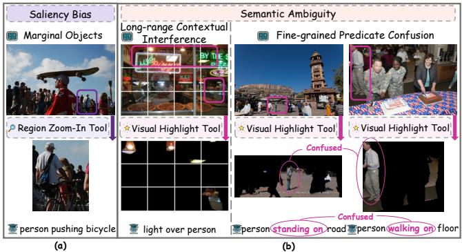
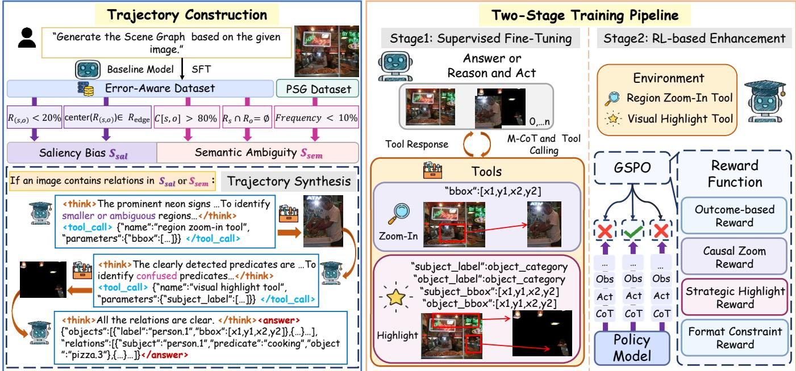
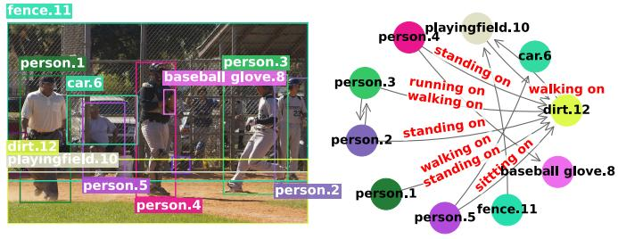
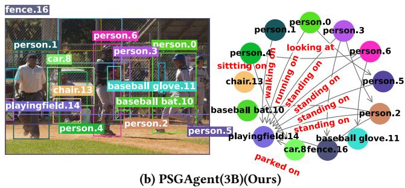
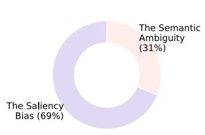
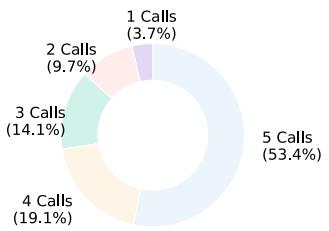
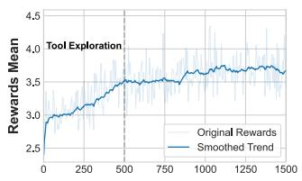
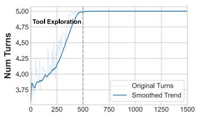

# PSGAgent: Enhancing MLLMs’ Dynamic Visual Perception for Panoptic Scene Graph Generation via Agentic Reasoning

Qingyun Liu liuqingyun25@stu.pku.edu.cn Peking University Beijing, China

Jie Huang   
huangjie25@stu.pku.edu.cn   
Peking University   
Beijing, China

Jingkun Wang wjk@pku.edu.cn AlignBase Beijing, China

Yuankun Liu   
liuyk@stu.pku.edu.cn   
Peking University   
Beijing, China   
Zonghong Dai   
zhdai23@m.fudan.edu.cn   
AlignBase   
Beijing, China   
Weiping Li   
wpli@ss.pku.edu.cn   
Peking University   
Beijing, China   
Jiaye Feng   
jyfeng25@stu.pku.edu.cn   
Peking University   
Beijing, China

Haochen Li lihaochen@jidianqiyuan.com AlignBase Beijing, China

Tong Mo✉   
motong@ss.pku.edu.cn   
Peking University   
Beijing, China

## Abstract

Panoptic Scene Graph generation (PSG) requires holistic yet finegrained reasoning over complex relations among objects. However, current Multimodal Large Language Models (MLLMs) applied to PSG sufer from a perception bottleneck: they function as static observers limited by fixed-resolution views. As a result, models often overlook critical relations involving small or peripheral objects and struggle to diferentiate ambiguous predicates in complex scenes. To address these limitations, we propose PSGAgent, an agentic framework that enhances visual perception for PSG through a think–act–observe loop. PSGAgent allows MLLMs to dynamically refine their visual perception using two tools: a Region Zoom-In Tool for local exploration of small or boundary relations and a Visual Highlight Tool for relation-focused segmentation that filters out irrelevant contextual noise. To optimize decision-making, we construct a two-stage training pipeline. First, we create a high-quality, error-aware Multimodal Chain-of-Thought (M-CoT) dataset that provides robust supervision for cold-start learning. Then, we design a novel hierarchical reward mechanism integrated with Group Sequence Policy Optimization (GSPO) to enable strategic and adaptive tool usage. Extensive experiments on the PSG benchmark show that PSGAgent achieves SOTA performance, demonstrating strong capability in both holistic and fine-grained scene understanding.

## CCS Concepts

• Computing methodologies → Scene understanding.

## Keywords

Panoptic Scene Graph, Agentic Reasoning, Multimodal Large Language Models, Reinforcement Learning

This work is licensed under a Creative Commons Attribution 4.0 International License. MM ’26, Rio de Janeiro, Brazil   
© 2026 Copyright held by the owner/author(s).   
ACM ISBN 979-8-4007-2213-4/2026/11   
https://doi.org/10.1145/3767308.3835827

ACM Reference Format: Qingyun Liu, Yuankun Liu, Jiaye Feng, Jie Huang, Zonghong Dai, Haochen Li, Jingkun Wang, Weiping Li, and Tong Mo. 2026. PSGAgent: Enhancing MLLMs’ Dynamic Visual Perception for Panoptic Scene Graph Generation via Agentic Reasoning. In Proceedings ofthe 34th ACM International Conference on Multimedia (MM ’26), November 10–14, 2026, Rio de Janeiro, Brazil. ACM, New York, NY, USA, 10 pages. https://doi.org/10.1145/3767308.3835827

## 1 Introduction

Panoptic Scene Graph generation (PSG) serves as a critical bridge between low-level visual perception and high-level semantic reasoning. It abstracts complex scenes into structured representations of objects and their relations based on panoptic segmentation masks [46]. This granular understanding is essential for downstream applications, including embodied AI [12, 16, 61], image-text retrieval [28, 30, 37], and detailed image captioning [29, 48].

With the development of Multimodal Large Language Models (MLLMs) [1, 25, 36, 50], recent works have increasingly leveraged their powerful reasoning capabilities to advance scene and relation understanding [39]. For example, training-free methods [9, 22] construct structured representations through multimodal prompting, but often yield suboptimal performance due to a lack oftask-specific adaptation. To bridge this gap, some methods introduce visual instruction tuning [45] or RL-based architectures [2, 11, 19] with rule-based rewards and textual chain-of-thought reasoning. Despite these advances, existing methods still face perceptual challenges stemming from their reliance on fixed-resolution views, introducing two fundamental limitations. First, they sufer from saliency bias. MLLMs tend to prioritize visually dominant regions, often neglecting relations involving small or peripheral objects [53, 54, 59]. For instance, the relation “person pushing bicycle” in Fig. 1(a) appears near the image boundary and occupies only a small portion of the scene, causing the relations between the two entities to be easily overlooked. Second, they struggle with semantic ambiguity. Accurate relation prediction is often hindered by irrelevant contextual noise, which typically manifests in two scenarios: (i) Long-range contextual interference: MLLMs often rely on Vision Transformers (ViTs) that serialize images into 1D sequences of patch tokens [8]. When two interacting entities are spatially distant (e.g., “light” and “person”), their corresponding tokens are separated by a vast number of intervening background patches. Under a fixed global view, this dense visual noise dominates the self-attention mechanism, severely obscuring the cross-patch relational cues necessary to bridge the spatial gap. (ii) Fine-grained predicate confusion: subtle actions such as “standing on” versus “walking on” often exhibit highly similar global appearances, making them dificult to distinguish without examining local visual details. Current MLLM-based frameworks [2, 9, 11, 19, 22, 39, 45] process visual inputs at a fixed, global granularity. They inherently lack the mechanism to adaptively re-examine localized visual details, which leaves both saliency bias and semantic ambiguities unresolved.

  
Figure 1: The perception bottleneck in PSG. (a) Saliency bias: static models are biased toward dominant regions, while neglecting small-scale or of-center relations. (b) Semantic ambiguity: long-range contextual interference and fine-grained predicate confusion lead to relational uncertainty.

To address these limitations, we propose PSGAgent, an agentic MLLM framework for PSG. Instead of focusing on fixed-resolution views, PSGAgent follows a think–act–observe loop: the model gen erates reasoning thoughts and selectively invokes perception tools to obtain visual observations. Specifically, PSGAgent employs two complementary tools: a Region Zoom-In Tool to mitigate saliency bias, which helps recover relations involving small or peripheral objects, and a Visual Highlight Tool to reduce semantic ambiguity by suppressing long-range contextual interference and emphasizing interaction regions. Through iterative interactions with these tools, PSGAgent progressively refines its understanding of the scene and produces more accurate relational predictions. Training such an agent raises a key challenge: learning when and how to invoke tools efectively. Standard RL is hindered by sparse rewards and unstable training, while large-scale trajectory annotation is prohibitively costly. We address this with a two-stage training strategy. First, we construct error-aware Multimodal Chain-of-Thought (M-CoT) trajectories from hard PSG samples, which provide structured supervision for tool-use behavior during SFT. Second, we employ Group Sequence Policy Optimization (GSPO) [56] with hierarchical rewards to stabilize RL training. Our contributions are as follows:

• We identify the perception bottleneck (saliency bias and semantic ambiguity) in existing methods, and alleviate it by reformulating PSG as a multi-turn reasoning process.

• We propose PSGAgent, an agentic framework featuring task-specific tools and a hierarchical reward mechanism optimized via RL to enable adaptive agentic reasoning.

• We introduce a high-quality error-aware M-CoT dataset tailored for agent training, which enables eficient cold-start learning and improves training stability.

• PSGAgent achieves SOTA performance on the PSG benchmark, demonstrating improved capabilities in holistic and fine-grained relation understanding.

## 2 Related Work

## 2.1 Panoptic Scene Graph Generation

PSG represents complex scenes as structured object–relation graphs based on panoptic segmentation masks [46]. Traditional research includes two-stage pipelines like MOTIFS [51] and VCTree [35] or one-stage frameworks such as PSGTR and PSGFormer [46]. Building upon these methods, CAFE [31] incorporates shape-aware features via curriculum learning. ADTrans [20] utilizes semanticsprototype learning to transfer biased annotations into informative targets. Nevertheless, the generalization capacity of these models is severely constrained by the limited diversity of manual annotations.

Recognizing the constraints of closed-set vocabularies, recent research leverages MLLMs for open-vocabulary relation comprehension. OwSGG [9] proposes a training-free framework relying on multimodal prompting, whereas OvSGTR [3] employs transformer decoders to predict open-set relations. With recent advances in RL [7, 34], frameworks increasingly combine SFT with RL to enhance reasoning. Relation-R1 [19] utilizes cognitive CoT guidance, SGG-R3 [11] adopts a three-stage structured reasoning pipeline and R1-SGG [2] applies rule-based rewards to enforce structural schema consistency. However, both traditional and MLLM-based methods largely rely on fixed views, which limits their ability to address the perception bottleneck targeted in this work.

## 2.2 Thinking with Images in MLLMs

Recent MLLMs increasingly integrate visual evidence into reasoning, a paradigm termed Thinking with Images [5, 6, 26, 32, 41– 43, 52, 57]. Specifically, DeepEyes [58] and Pixel Reasoner [33] employ intrinsic rewards to incentivize active perception operations. VisionThink [47] and VisionReasoner [27] leverage RL to optimize visual resolution and unified perception tasks, respectively. For more complex scenarios, WebWatcher [13] interleaves text with visual steps to solve deep-research problems and VTool-R1 [40] uses Python-based tool-calling to enhance multimodal reasoning.

However, directly applying these agentic frameworks to PSG remains dificult, as existing methods struggle to simultaneously address two critical challenges. First, existing methods [13, 33, 40] are primarily query-driven, where visual exploration is guided by specific prompts. In contrast, PSG is a proactive task that requires exhaustive discovery of valid relations across the scene, including dense stuf–thing interactions and long-tail predicates, without explicit query supervision. Second, prior tool-use approaches [10, 27, 58] mainly focus on individual entities (e.g., region cropping for object recognition) or coarse-grained predicates (e.g., left, right), whereas PSG demands reasoning over the fine-grained interaction between objects to resolve semantic ambiguity.

  
Figure 2: Overview of PSGAgent. We reformulate PSG as a multi-turn, tool-augmented decision-making process. (Left) Trajectory Construction. We perform error-aware data mining to identify challenging cases caused by saliency bias (relations occupying small regions or located near image boundaries) and semantic ambiguity (long-range contextual interference, high predicate confusion, or tail relations). These identified cases are used to synthesize error-aware Multimodal Chain-of-Thought (M-CoT) trajectories through a structured generation pipeline. (Right) Cold-start SFT and RL-based Enhancement. The agent is first initialized via SFT to learn basic tool usage, and then optimized with GSPO for strategic reasoning. Through a think–act–observe interaction loop guided by a hybrid reward function $( R _ { \mathbf { o u t c o m e } } , R _ { \mathbf { c a u s a l } } , R _ { \mathbf { h i g h l i g h t } } ,$ and $R _ { \mathbf { f o r m a t } } )$ , the agent learns to autonomously invoke tools (Region Zoom-In Tool and Visual Highlight Tool) to achieve holistic and fine-grained scene understanding.

## 3 Method

We introduce PSGAgent, formulating PSG as a multi-turn agentic reasoning process (Fig. 2). Given an image $\mathcal { I } \in \mathbb { R } ^ { H \times W \times 3 }$ , the agent models the distribution $P ( { \mathcal { G } } | { \mathcal { I } } )$ to generate a panoptic scene graph ${ \mathcal G } = ( O , { \mathcal R } )$ . The object set $O = \bar { \{ } o _ { i } = ( c _ { i } , \bar { m } _ { i } ) \bar  \} _ { i = 1 } ^ { \bar { N } }$ encapsulates both thing and stuf entities, each grounded by a category �� and a non-overlapping binary mask $\bar { m _ { i } } \in \{ 0 , 1 \} ^ { H \times }$ . The relation set $\mathcal { R } = \{ r _ { i , j } \}$ captures the set of pairwise relationships, denoting the predicate category $r _ { i , j }$ between the �-th subject and �-th object.

Our framework features three core components: custom perception tools (Region Zoom-In Tool and Visual Highlight Tool) (Sec. 3.1), error-aware SFT (Sec. 3.2) and GSPO with hierarchical rewards (Sec. 3.3). Through this design, the agent dynamically invokes tools to resolve ambiguities, and iteratively generates relational triplets until the full scene graph is completed.

## 3.1 Agentic Active Perception Tools

We equip the agent with two tools that modify the observation to resolve perceptual uncertainty. Each tool is formulated as a visual operator: $\begin{array} { r } { J ^ { \prime } = \mathcal { T } ( \bar { J } ; \phi ) } \end{array}$ , where $\phi$ denotes tool-specific parameters.

3.1.1 Region Zoom-In Tool. Given a bounding box �, the tool crops the specified region to mitigate saliency bias:

$$
\begin{array} { r } { \boldsymbol { { \mathcal { I } } } _ { \mathrm { z o o m } } = \mathcal { T } _ { \mathrm { z o o m } } ( \boldsymbol { { \mathcal { I } } } ; \boldsymbol { b } ) = \mathrm { C r o p } ( \boldsymbol { { \mathcal { I } } } , \boldsymbol { b } ) . } \end{array}\tag{1}
$$

3.1.2 Visual Highlight Tool. Given subject and object masks $\mathcal { M } _ { s }$ and $M _ { o } ,$ the highlight tool suppresses irrelevant regions:

$$
\begin{array} { r } { \mathcal { I } _ { \mathrm { h i g h l i g h t } } = \mathcal { T } _ { \mathrm { h i g h l i g h t } } ( \boldsymbol { J } ; \boldsymbol { s } , \boldsymbol { o } ) = \boldsymbol { J } \odot ( M _ { s } \cup \mathcal { M } _ { o } ) , } \end{array}\tag{2}
$$

where ⊙ denotes the Hadamard product and ∪ denotes the union of subject and object masks. Unlike entity-centric cropping [10, 27, 58], our Visual Highlight Tool suppresses task-irrelevant visual noise, allowing the agent to focus purely on inter-object interactions, efectively resolving semantic ambiguity in complex scenes.

## 3.2 Trajectory Construction and Cold-Start Supervised Fine-tuning

Pure RL struggles with sparse rewards for complex tool-use behaviors. To provide a stable initialization, we construct an M-CoT dataset $\mathcal { D } _ { \mathrm { S F T } }$ through error-aware data mining, focusing on samples where fixed perception typically fails.

3.2.1 Error-Aware Data Mining. We first train a vanilla MLLM $( \mathrm { e . g . }$ Qwen2.5-VL-3B [1] or LLaVA v1.5 [24]) on the PSG training set and collect mispredicted triplets to form an error-aware dataset. From this set, we further identify two types of challenging cases that can be addressed by our perception tools:

• Saliency Bias $( S _ { \mathrm { s a l } } ) .$ . Triplets are considered saliency-biased if the union region of the subject and object bounding boxes, $\mathcal { R } _ { ( s , o ) }$ , occupies less than 20% of the image area or the center of the union region, center $( \mathcal { R } _ { ( s , o ) } )$ , lies near the image boundary. These small-scale or edge-located relations are prone to be overlooked by fixed perception and therefore trigger the Region Zoom-In Tool.

• Semantic Ambiguity $( S _ { \mathbf { s e m } } )$ . We first select triplets whose subject and object bounding boxes do not overlap as candi dates. Predicates are then considered ambiguous if they (i) exhibit high confusion in the normalized confusion matrix $C \ ( \mathrm { i . e . , } \ C [ i , j ] \ > \ \mu$ for some $j \neq i )$ where �[�, �] denotes the proportion of samples with ground-truth relation � but predicted as $j , \mathrm { o r ( i i ) }$ belong to the low-frequency tail of the predicate distribution. Specifically, we categorize predicates into head and tail groups based on their training frequency to analyze long-tail relation recognition. Triplets satisfying these conditions are assigned to $\boldsymbol { S } _ { \mathrm { s e m } }$ and handled by the Visual Highlight Tool to isolate the interacting pair from cluttered backgrounds.

3.2.2 Trajectory Synthesis. As illustrated in the bottom-left of Fig. 2, we synthesize a multi-turn M-CoT trajectory for each identified hard sample to simulate a dynamic perception process. Instead of producing a direct prediction, the trajectory follows a think–act– observe paradigm similar to ReAct [49].

At each step �, the assistant follows a structured interaction loop consisting of three components: (i) a thought, the agent’s intermediate reasoning used to analyze perceptual limitations (e.g., saliency bias or semantic ambiguity), enclosed in <think> . . . </think>; (ii) an action, where the agent invokes a perception tool (e.g., Region Zoom-In Tool or Visual Highlight Tool) wrapped in <tool\_call> $\ldots { < } / \mathrm { t o o l }$ \_call>, or produces the final prediction; and (iii) an observation, the environment feedback containing the enhanced visual input, returned within <tool\_response> $\ldots { < } / \mathrm { t o o l }$ \_response>. This think–act–observe process iterates until the agent outputs the scene graph G or reaches the maximum number of iterations �iter.

Formally, a trajectory of length � is represented as

$$
\tau = \{ ( t _ { 1 } , a _ { 1 } , o _ { 1 } ) , ( t _ { 2 } , a _ { 2 } , o _ { 2 } ) , . . . , ( t _ { L } , a _ { L } , o _ { L } ) \} \quad L \leq u _ { \mathrm { i t e r } } ,\tag{3}
$$

where $t _ { i }$ denotes the thought at step �, �� denotes the action and $o _ { i }$ denotes the returned observation. By fine-tuning MLLMs $( \mathrm { e . g . }$ Qwen2.5-VL-3B [1]) on these trajectories, the agent learns to navigate complex scenes and execute strategic tool calls.

## 3.3 Agentic Reinforcement Learning

3.3.1 Agentic RL with GSPO. We employ GSPO [56], which mitigates the high-variance noise inherent in long-form generation by shifting optimization to the sequence level. Given an input state � (comprising the image I and interaction history), we sample � reasoning trajectories $\{ y _ { i } \} _ { i = 1 } ^ { G } \sim \pi _ { \theta _ { o l d } } ( \cdot | x )$ and optimize:

$$
\begin{array} { c l l } { \displaystyle { J _ { G S P O } ( \theta ) = \mathbb { E } _ { x , \{ y _ { i } \} \sim \pi _ { \theta _ { o l d } } } \Bigg [ \frac { 1 } { G } \sum _ { i = 1 } ^ { G } \operatorname* { m i n } \Big ( s _ { i } ( \theta ) A _ { i } , } } \\ { \displaystyle { \mathrm { c l i p } ( s _ { i } ( \theta ) , 1 - \epsilon , 1 + \epsilon ) A _ { i } \Big ) \Bigg ] , } } \end{array}\tag{4}
$$

where $\begin{array} { r } { A _ { i } = \frac { r _ { i } - \mathrm { m e a n } \left( \{ r _ { i } \} \right) } { \mathrm { s t d } \left( \{ r _ { i } \} \right) + \sigma } } \end{array}$ is the group-normalized advantage and $r _ { i } = r ( x , y _ { i } )$ . The sequence-level importance ratio is the geometric

mean of token-level policy ratios:

$$
s _ { i } ( \theta ) = \exp \left( \frac { 1 } { | y _ { i } | } \sum _ { t = 1 } ^ { | y _ { i } | } \log \frac { \pi _ { \theta } ( y _ { i , t } | x , y _ { i , < t } ) } { \pi _ { \theta _ { o l d } } ( y _ { i , t } | x , y _ { i , < t } ) } \right) .\tag{5}
$$

3.3.2 Outcome-Based Reward $( R _ { o u t c o m e } ) .$ We define an outcomebased reward that jointly encourages accuracy and tool usage:

$$
R _ { \mathrm { o u t c o m e } } = \mathbb { I } _ { \mathrm { v a l i d } } \left[ 4 \mathcal { A } + \mathbb { I } _ { N _ { \mathrm { i m g } } > 1 } \left( 0 . 5 + 1 . 5 \mathcal { A } \right) \right] ,\tag{6}
$$

where $\mathbb { I } _ { \mathrm { v a l i d } }$ indicates JSON format validity and $\mathbb { I } _ { N _ { \mathrm { i m g } } > 1 }$ denotes successful tool invocation. The triplet accuracy is defined as

$$
\mathcal { A } = \frac { 1 } { \vert \mathcal { G } _ { \mathrm { G T } } \vert } \sum _ { ( s _ { i } , p _ { i } , o _ { i } ) \in \hat { \mathcal { G } } _ { p } } \mathbb { I } \left[ ( s _ { i } , p _ { i } , o _ { i } ) \approx \mathcal { G } _ { \mathrm { G T } } \right] ,\tag{7}
$$

where $\mathcal { G } _ { \mathrm { G T } }$ denotes the ground-truth triplet set and $\hat { G } _ { p }$ the predicted set. A match $( s _ { i } , p _ { i } , o _ { i } ) \approx \mathcal { G } _ { \mathrm { G T } }$ requires (i) exact category alignment of subject, predicate, and object, and (ii) $\mathrm { I o U } \geq 0 . 5$ between the predicted entities and the ground-truth bounding boxes.

3.3.3 Causal Zoom Reward $( R _ { c a u s a l } ) .$ . We assign a reward only when the zoomed region actively helps recover valid relations. For a zoom action at step � producing region $\mathcal { R } _ { t }$ , the reward is defined as:

$$
\begin{array} { r l } & { r _ { t } ^ { \mathrm { 2 o o m } } = \underbrace { \mathbb { I } \Big [ \exists ( s _ { i } , \mathcal { P } _ { i } , o _ { i } ) \in \oint _ { \ b { \hat { Q } } } \boldsymbol { \mathrm { \cap } } \mathcal { G } \mathrm { G r } \mathrm { \setminus } \mathrm { A } , \mathcal { R } _ { ( s _ { i } , o _ { i } ) } \subset \mathcal { R } _ { t } \Big ] } _ { \mathrm { r e l a t i o n ~ r e c o v e r y } } \cdot \underbrace { \mathbb { I } \Bigg [ \frac { | \mathcal { R } _ { t } | } { | T | } < \tau _ { \mathrm { r a t i o n } } \Bigg ] } _ { \mathrm { s c a l e c o n s t r a i n t } } } \\ & { \quad \quad + \underbrace { \left( 1 + \lambda _ { \mathrm { e l g e } } \mathbb { I } [ \mathrm { c e n t e r } ( \mathcal { R } _ { t } ) \in \mathcal { R } _ { \mathrm { e d g e } } ] \right) } _ { \mathrm { b o u n d a r y ~ b o u s } } } \\ & { \quad - \underbrace { \lambda _ { \mathrm { r e d } } \operatorname* { m a x } _ { k < t } \mathbb { I } [ \mathrm { I o U } ( \mathcal { R } _ { t } , \mathcal { R } _ { k } ) > \tau _ { \mathrm { i o u } } ] } _ { \mathrm { r e d u n d a r e p e n a l t y } } . } \end{array}\tag{8}
$$

Here, $\mathcal { R } _ { ( s _ { i } , o _ { i } ) }$ denotes the union of the subject and object bounding boxes. The first two terms reward zoom actions only if the cropped region is suficiently small (bounded by $\tau _ { \mathrm { r a t i o } } )$ and successfully encapsulates at least one correctly predicted ground-truth triplet. The boundary bonus encourages the exploration of peripheral areas $( \mathcal { R } _ { \mathrm { e d g e } } )$ , while the redundancy penalty discourages repeated observations $\mathrm { ( I o U > \tau _ { i o u } ) }$ . Unlike traditional query-driven agents [13, 33, 40] that terminate upon finding a single localized target, the combination of boundary bonus and redundancy penalties encourages our agent to adopt a proactive exploration paradigm, promoting a more comprehensive exploration of the scene.

3.3.4 Strategic Highlight Reward $( R _ { h i g h l i g h t } ) .$ When the agent invokes the Visual Highlight Tool for a subject-object pair $( s _ { i } , o _ { i } )$ at time step �, the reward is defined as:

$$
\begin{array} { r l } & { r _ { t } ^ { \mathrm { h i g h l i g h t } } = \underbrace { \mathbb { I } \left[ \left( s _ { i } , p _ { i } , o _ { i } \right) \in \hat { { \mathcal { G } } } _ { P } \cap { \mathcal { G } } _ { \mathrm { G T } } \right] } _ { \mathrm { t r i p l e t ~ c o r r e c t n e s s } } + \underbrace { \left( 1 + \lambda _ { \mathrm { d i f f } } \mathbb { I } [ p _ { i } \in S _ { \mathrm { s e m } } ] \right) } _ { \mathrm { d i f f c u l t y ~ b o n u s } } . } \end{array}\tag{9}
$$

The first term rewards the agent when the highlighted triplet is both predicted by the agent and accurately matches a ground-truth relation. The second term assigns an additional bonus when the predicted predicate $\mathbf { \nabla } \mathcal { P } i$ belongs to the semantically ambiguous set $ { s _ { \mathrm { s e m } } }$ . Overall, this reward design encourages the agent to strategically employ the highlight operation to disambiguate challenging predicates and alleviate the long-tail problem.

3.3.5 Format Constraint Reward $( R _ { f o r m a t } ) .$ We penalize outputs that violate syntactic or grounded constraints, including: (i) syntax errors, such as invalid JSON or mismatched M-CoT tags (<think>, <tool\_call>); and (ii) visual hallucinations, where the agent predicts object identifiers or categories not present in the visual observation. The total reward is a weighted sum:

$$
R _ { \mathrm { t o t a l } } = R _ { \mathrm { o u t c o m e } } + \alpha _ { \mathrm { c a u s a l } } R _ { \mathrm { c a u s a l } } + \alpha _ { \mathrm { h i g h l i g h t } } R _ { \mathrm { h i g h l i g h t } } + \gamma _ { \mathrm { f o r m a t } } R _ { \mathrm { f o r m a t } } ,\tag{10}
$$

where $\alpha _ { \mathrm { c a u s a l } } , \alpha _ { \mathrm { h i g h l i g h t } } ,$ and $\gamma _ { \mathrm { f o r m a t } }$ control the trade-of between perception strategy and output stability.

## 4 Experiments

## 4.1 Experimental Settings

4.1.1 Datasets. We evaluate our model on the PSG dataset [46], which contains 48,749 images with 133 object categories and 56 predicate categories. It provides high-quality panoptic segmentation masks for grounded relationship triplets.

4.1.2 Tasks. Following standard scene graph generation protocols [46], we evaluate our model on two primary tasks: (i) Predicate Classification (PredCls): Given all ground-truth object boxes and labels, the model predicts the pairwise predicate categories. This task isolates the model’s relational reasoning ability from its perception accuracy. (ii) Scene Graph Detection (SGDet): Given an input image, the model detects all objects (predicting both bounding boxes and categories) and infers their pairwise predicates from scratch.

4.1.3 Metrics. To evaluate performance, we adopt several standard metrics. We report Recall@100 (Recall), mean Recall@100 (mRecall) and their average (Mean). Recall@100 measures the proportion of ground-truth triplets retrieved among the top-100 predictions, while mean Recall@100 averages class-wise recall across predicate categories to reduce bias toward frequent relations. We further report AP@50 for entity localization and classification quality, and zero-shot Recall@100 (zs-Recall) to assess generalization to unseen triplets. Following prior work [3, 15, 22], we evaluate Open-Vocabulary Relation (OvR) prediction by splitting object and relation categories into base and novel groups at a 7:3 ratio.

4.1.4 Implementation Details. We use Qwen2.5-VL-3B-Instruct [1] as the backbone and obtain subject and object masks for the Visual Highlight Tool using a pretrained Mask2Former [4]. Training con sists of cold-start SFT followed by RL. During SFT, we train on the constructed 8K M-CoT dataset for 5 epochs with a batch size of 32 using the AdamW optimizer with a learning rate of $1 \times 1 0 ^ { - 5 } .$ . For RL, GSPO samples � = 3 trajectories per query. We set $\tau _ { \mathrm { r a t i o } } = 0 . 2$ $\tau _ { \mathrm { i o u } } = 0 . 8 , \lambda _ { \mathrm { e d g e } } = \lambda _ { \mathrm { r e d } } = \lambda _ { \mathrm { d i f f } } = 0 . 5 , \alpha _ { \mathrm { c a u s a l } } = \alpha _ { \mathrm { h i g h l i g h t } } = 0 . 8 ,$ and �format = 0.5. During inference, the agent performs up to $u _ { \mathrm { i t e r } } = 5$ think–act–observe interaction steps, with temperature set to 0.7. All experiments are conducted on four A6000 GPUs, and GSPO training converges in approximately 7 days.

## 4.2 Main Results

4.2.1 Comparison under SGDet. As Table 1 shows, our method achieves SOTA among all MLLM-based frameworks. Specifically, the standard PSGAgent(3B) obtains 50.27% Recall, 42.88% mRecall and 46.58% Mean, efectively alleviating the perception bottleneck in MLLMs. When leveraging predefined category prompts, PSGAgent\* further pushes the performance to 51.81% Recall, 44.19% mRecall and 48.00% Mean. Notably, PSGAgent\* successfully surpasses the strongest specialized model, DSGG [14] (Mean 47.20%). While DSGG’s explicit long-tail optimizations for closed-set distributions yield a marginal edge in mRecall (44.40% vs. 44.19%), these slight gains come at the expense of broader applicability. In contrast, PSGAgent achieves higher Recall and Mean scores, demonstrating that an agentic MLLM framework can surpass architectures heavily engineered for specific, narrow scenarios.

Table 1: Comparison with state-of-the-art methods on the PSG benchmark under the SGDet setting. \* denotes using predefined object classes and relation categories in prompts. Zm. T. and Hl. T. denote Region Zoom-In Tool and Visual Highlight Tool, respectively. Bold and underline results highlight the best and second-best.
<table><tr><td rowspan="2">Model</td><td rowspan="2">Params</td><td colspan="4">SGDet</td></tr><tr><td>AP@50↑</td><td>Recall↑</td><td>mRecall↑</td><td>Mean↑</td></tr><tr><td colspan="6">Specialized PSG Models</td></tr><tr><td>IMP [44]</td><td></td><td></td><td>18.60</td><td>7.23</td><td>12.92</td></tr><tr><td>MOTIFS [51]</td><td></td><td></td><td>22.00</td><td>9.69</td><td>15.85</td></tr><tr><td>VCTree [35]</td><td></td><td></td><td>22.50</td><td>10.20</td><td>16.35</td></tr><tr><td>GPSNet [23]</td><td></td><td></td><td>20.10</td><td>7.69</td><td>13.90</td></tr><tr><td>PSGFormer [46]</td><td></td><td></td><td>20.20</td><td>18.70</td><td>19.45</td></tr><tr><td>HiLo[60]</td><td></td><td></td><td>43.00</td><td>33.10</td><td>38.05</td></tr><tr><td>PairNet[38]</td><td>1</td><td></td><td>39.60</td><td>30.60</td><td>35.10</td></tr><tr><td>DSGG[14]</td><td></td><td>一</td><td>50.00</td><td>44.40</td><td>47.20</td></tr><tr><td colspan="6">MLLM-based Methods</td></tr><tr><td>TextPSG [55]</td><td>1</td><td></td><td>4.82</td><td></td><td></td></tr><tr><td>LLaVA v1.5 [24]</td><td>7B</td><td>0.07</td><td>0.00</td><td>0.00</td><td>0.00</td></tr><tr><td>ASMv2 [39]</td><td>13B</td><td>21.45</td><td>14.77</td><td>11.82</td><td>13.30</td></tr><tr><td>OvSGTR [3]</td><td>1</td><td>一</td><td>41.40</td><td>28.30</td><td>34.90</td></tr><tr><td>PGSG [22]</td><td>13B</td><td>一</td><td>33.40</td><td>22.10</td><td>27.75</td></tr><tr><td>LLaVA-SpaceSGG [45]</td><td>13B</td><td>=</td><td>15.43</td><td>13.23</td><td>14.33</td></tr><tr><td>OwSGG [9]</td><td>72B</td><td></td><td>13.98</td><td>13.67</td><td>13.83</td></tr><tr><td>R1-SGG* [2]</td><td>2B</td><td>39.28</td><td>38.49</td><td>31.21</td><td>34.85</td></tr><tr><td>R1-SGG* [2]</td><td>7B</td><td>42.05</td><td>43.48</td><td>33.71</td><td>38.60</td></tr><tr><td>Relation-R1 [19]</td><td>3B</td><td>25.87</td><td>21.32</td><td>23.60</td><td>22.46</td></tr><tr><td>SGG-R3 [11]</td><td>3B</td><td>38.82</td><td>47.63</td><td>38.33</td><td>42.98</td></tr><tr><td>Qwen2.5-VL-3B-Instruct</td><td>3B</td><td>5.12</td><td>0.57</td><td>0.31</td><td>0.44</td></tr><tr><td>+ SFT</td><td>3B</td><td>30.10</td><td>21.67</td><td>10.37</td><td>14.76</td></tr><tr><td>Qwen2.5-VL-72B-Instruct*</td><td>72B</td><td>28.32</td><td>12.37</td><td>9.91</td><td>11.14</td></tr><tr><td>+ ZM.T. HL.T*</td><td>72B</td><td>27.57</td><td>14.48</td><td>14.17</td><td>14.33</td></tr><tr><td colspan="6">Thinking With Images Methods</td></tr><tr><td>DeepEyes [58]</td><td>3B</td><td>44.52</td><td>43.18</td><td>30.10</td><td>36.64</td></tr><tr><td>Pixel Reasoner [33]</td><td>3B</td><td>44.19</td><td>43.73</td><td>29.67</td><td>36.70</td></tr><tr><td>VisionReasoner [27]</td><td>3B</td><td>40.13</td><td>38.27</td><td>24.22</td><td>31.25</td></tr><tr><td>VisionThink [47]</td><td>3B</td><td>35.63</td><td>35.64</td><td>20.02</td><td>27.83</td></tr><tr><td>PSGAgent (Ours)</td><td>3B</td><td>49.91</td><td>50.27</td><td>42.88</td><td>46.58</td></tr><tr><td>PSGAgent* (Ours)</td><td>3B</td><td>50.41</td><td>51.81</td><td>44.19</td><td>48.00</td></tr></table>

Compared to recent MLLMs, PSGAgent demonstrates clear advantages. While standard reasoning models like R1-SGG [2] require scaling up to 7B parameters to achieve a 38.60% Mean, our 3B PSGAgent outperforms it by a significant margin (+7.98% Mean). Furthermore, when compared to the baseline model (Qwen2.5-VL-3B-Instruct + SFT, Mean 14.76%), our agentic framework yields a substantial performance improvement. This highlights that simply fine-tuning an MLLM is insuficient, whereas our think–act–observe loop efectively captures both dominant and long-tail relations.

To validate our tools’ efectiveness, we evaluate the Qwen2.5-VL-72B-Instruct in a zero-shot setting. Despite its scale, the vanilla 72B model achieves an mRecall of 9.91%, showing that parameter scaling alone cannot fully address the perception bottleneck. However, simply equipping the frozen 72B model with our Region Zoom-In Tool and Visual Highlight Tool improves the mRecall to 14.17%. This confirms the plug-and-play utility of our dynamic refinement tools. More crucially, our 3B PSGAgent\* (Mean 48.00%) significantly out performs the tool-augmented 72B model, suggesting that strategic tool-use learning via our agentic framework is more critical for PSG than raw model scaling.

Table 2: Comparison with state-of-the-art methods on the PSG benchmark under the PredCls setting.
<table><tr><td rowspan="2">Model</td><td rowspan="2">Params</td><td colspan="3">PredCls</td></tr><tr><td>Recall↑</td><td>mRecall↑</td><td>Mean↑</td></tr><tr><td colspan="6">Specialized PSG Models</td></tr><tr><td>IMP [44]</td><td></td><td>38.90</td><td>11.60</td><td>25.25</td></tr><tr><td>GPSNet [23]</td><td></td><td>44.70</td><td>18.30</td><td>31.50</td></tr><tr><td>C-SCC [18]</td><td></td><td>46.50</td><td>36.40</td><td>41.45</td></tr><tr><td>MOTIFS [51]</td><td></td><td>52.40</td><td>22.90</td><td>37.65</td></tr><tr><td>MOTIFS + CAFE [31]</td><td></td><td>47.20</td><td>36.90</td><td>42.05</td></tr><tr><td>VCTree [35]</td><td></td><td>52.70</td><td>23.30</td><td>38.00</td></tr><tr><td>VCTree + CAFE [31]</td><td></td><td>48.10</td><td>37.60</td><td>42.85</td></tr><tr><td colspan="5">MLLM-based Methods</td></tr><tr><td>TextPSG [55]</td><td></td><td></td><td>12.24</td><td>1</td></tr><tr><td>PSGAgent (Ours)</td><td>3B</td><td>73.04</td><td>67.75</td><td>70.40</td></tr></table>

We also evaluate thinking with images methods. Since these methods [27, 33, 47, 58] were not originally designed for PSG, we retrain them on the PSG dataset for cold-start SFT and use the same outcome-based reward for RL. Although Pixel Reasoner [33] performs best among these adapted baselines, PSGAgent still improves the Mean score from 36.70% to 46.58%. This gap suggests that query-driven or object-centric agentic frameworks are insuficient for exhaustive structured relation discovery, while our PSGAgent better supports holistic PSG reasoning.

4.2.2 Results under PredCls. Table 2 presents the evaluation under the PredCls setting, which isolates relation prediction by providing ground-truth object regions. In this idealized setting, PSGAgent achieves 73.04% Recall and 67.75% mRecall, establishing a substantial lead over all previous specialized PSG models. Specifically, PS-GAgent improves the Mean performance from 42.85% (VCTree + CAFE) to 70.40%, an absolute gain of 27.55%. This result indicates that PSGAgent is particularly efective at relation reasoning once reliable object regions are available. The strong mRecall also suggests that our framework better handles long-tail predicate distributions, which remain challenging in scene graph generation.

4.2.3 Zero-shot and Open-set Evaluation. To evaluate generalization ability, Table 3 reports zero-shot Recall and open-set performance under the OvR setting. PSGAgent achieves a competitive zs-Recall of8.19%, significantly outperforming specialized PSG models and rivaling the PGSG [22] despite its 13B parameter size. This underscores the model’s superior parameter eficiency and zeroshot generalization capabilities. Regarding the more challenging open-set evaluation, PSGAgent achieves the best results across all OvR metrics, with 27.52% Recall, 20.20% mRecall, and 23.86% Mean, significantly outperforming prior MLLM-based methods such as

Table 3: Results of zs-Recall and Open-Set (OvR) on PSG under the SGDet setting.
<table><tr><td rowspan="2">Model</td><td rowspan="2">Params</td><td rowspan="2">zs-</td><td colspan="3">Open-Set (OvR)</td></tr><tr><td>Recall↑</td><td>mRecall↑ Mean↑</td><td></td></tr><tr><td colspan="6">Specialized PSG Models</td></tr><tr><td>PSGFormer [46]</td><td></td><td>4.90</td><td>3.10</td><td>2.70</td><td>2.90</td></tr><tr><td>PSGTR [46]</td><td></td><td>6.40</td><td>3.30</td><td>2.00</td><td>2.65</td></tr><tr><td>SGTR [21]</td><td></td><td>5.80</td><td></td><td></td><td></td></tr><tr><td>PairNet [38]</td><td>一</td><td>一</td><td>6.50</td><td>5.10</td><td>5.80</td></tr><tr><td>HiLo [60]</td><td></td><td>一</td><td>4.80</td><td>3.60</td><td>4.20</td></tr><tr><td>DSGG [14]</td><td>=</td><td>-</td><td>5.60</td><td>5.00</td><td>5.30</td></tr><tr><td colspan="6">MLLM-based Methods</td></tr><tr><td>OvSGTR [3]</td><td></td><td>1</td><td>22.80</td><td>14.00</td><td>18.40</td></tr><tr><td>PGSG [22]</td><td>13B</td><td>8.90</td><td>17.70</td><td>11.50</td><td>14.60</td></tr><tr><td>OwSGG [9]</td><td>72B</td><td>6.44</td><td>13.54</td><td>13.35</td><td>13.45</td></tr><tr><td>R1-SGG [2]</td><td>7B</td><td>7.70</td><td>一</td><td>1</td><td>=</td></tr><tr><td>SGG-R3 [11]</td><td>3B</td><td>7.70</td><td>=</td><td>=</td><td>一</td></tr><tr><td>PSGAgent (Ours)</td><td>3B</td><td>8.19</td><td>27.52</td><td>20.20</td><td>23.86</td></tr></table>

Table 4: Recall@100 of each predicate group under the SGDet setting. $\boldsymbol { S _ { \mathrm { s a l } } }$ and $\mathcal { S } _ { \mathbf { s e m } }$ denote the subsets of samples sufering from saliency bias and semantic ambiguity, respectively. Head and Tail indicate splits based on predicate frequency. All denotes the overall performance.
<table><tr><td rowspan="2">Model</td><td rowspan="2">Params</td><td colspan="2">Bottleneck Sets</td><td colspan="2">Frequency Sets</td><td rowspan="2">All↑</td></tr><tr><td> $ { S _ { \mathrm { s a l } } } \uparrow$ </td><td> $S _ { \mathrm { s e m } } \uparrow$ </td><td>Head↑</td><td>Tail↑</td></tr><tr><td rowspan="2">Qwen2.5-VL-3B-Instruct + SFT</td><td>3B</td><td>0.27</td><td>0.03</td><td>0.58</td><td>0.41</td><td>0.57</td></tr><tr><td>3B</td><td>7.91</td><td>6.58</td><td>21.90</td><td>5.93</td><td>21.67</td></tr><tr><td rowspan="2">Qwen2.5-VL-72B-Instruct* + ZM.T. HL.T.*</td><td>72B</td><td>5.89</td><td>3.69</td><td>12.39</td><td>11.01</td><td>12.37</td></tr><tr><td>72B</td><td>8.98</td><td>6.26</td><td>14.50</td><td>13.23</td><td>14.48</td></tr><tr><td>R1-SGG[2]</td><td>7B</td><td>28.53</td><td>24.82</td><td>43.72</td><td>26.85</td><td>43.48</td></tr><tr><td>PSGAgent (Ours)</td><td>3B</td><td>40.06</td><td>37.45</td><td>50.49</td><td>34.85</td><td>50.27</td></tr></table>

PGSG [22] and OwSGG [9]. The strong open-set performance indicates that PSGAgent efectively generalizes relational reasoning to unseen predicate categories.

4.2.4 Results under diferent predicate groups. As Table 4 shows, zero-shot evaluations of the 3B and 72B models reveal severe performance degradation on the saliency bias $( S _ { \mathrm { s a l } } )$ and semantic ambiguity $( S _ { \mathrm { s e m } } )$ subsets (e.g., 5.89%, 3.69% for 72B model). In contrast, their performance across head and tail categories remains relatively balanced (e.g., 12.39% vs. 11.01% for the 72B model). This demonstrates that saliency and semantic ambiguities are fundamental perception bottlenecks inherent to MLLMs and the long-tail imbalance is substantially amplified by task-specific fine-tuning. Furthermore, equipping the zero-shot 72B model with active visual tools yields larger relative improvements on the $\quad S _ { \mathrm { s a l } } , S _ { \mathrm { s e m } } ,$ and Tail subsets compared to the overall gain (All). This trend is further amplified when comparing our PSGAgent against the 3B SFT baseline: it achieves gains of +32.15% on $\begin{array} { r } { { \cal { S } } _ { \mathrm { { s a l } } } , } \end{array}$ +30.87% on $\begin{array} { r } { { \cal S } _ { \mathrm { s e m } } , } \end{array}$ and +28.92% on Tail, all outpacing the overall improvement (+28.60% on All). These disproportionate gains confirm that our dynamic tool-use and training strategy simultaneously alleviate both fundamental perception bottlenecks and dataset-induced long-tail issues. Finally, our 3B PSGAgent demonstrates comprehensive superiority over the recent 7B R1-SGG model across all metrics, firmly establishing the eficiency and robustness of our agentic framework.

## 4.3 Ablation Study

To better understand the contribution of each component, we conduct ablations on the PSG benchmark under the SGDet setting.

4.3.1 Efect of perception tools. Table 5 evaluates the contributions of the Region Zoom-In Tool and the Visual Highlight Tool. Under SFT-only training, enabling either tool individually improves performance and reduces failure rates, demonstrating that both tools provide complementary perceptual cues. However, simply combin ing both tools leads to a slight performance drop. This suggests that the imitation-based objective of SFT constrains the model to a fixed output distribution, resulting in suboptimal tool-use strategies. After introducing RL, the model learns a more efective tool-use policy, leading to consistent improvements across all metrics. The full model, PSGAgent, achieves the best performance with zero failure rate, demonstrating that RL is critical for learning coordinated and reliable tool invocation strategies.

4.3.2 Efect ofGSPO. As Table 5 shows, our GSPO variant shows a clear advantage over standard GRPO training, bringing an absolute gain of +2.35% in Recall performance. This demonstrates that GSPO is more efective in aligning the agent’s reasoning capabilities.

4.3.3 Efect of reward design. Table 6 studies the impact of different reward signals. Removing tool-specific rewards results in clear performance degradation, suggesting that generic rewards are insuficient for guiding fine-grained perception behaviors. Introducing either strategic highlight or causal zoom rewards individually improves performance, as each reward provides targeted supervision for a specific type of perception action. When both rewards are applied, the model achieves the best performance, indicating that the proposed hierarchical reward design provides complementary and synergistic supervision. This facilitates more efective credit assignment during RL training, enabling the agent to learn when and how to invoke diferent tools.

4.3.4 Efect of M-CoT Dataset. As shown in Table 7, the incorporation of our high-quality M-CoT dataset yields a substantial performance leap under the SGDet setting, notably boosting mRecall from 13.67% to 18.51% (+4.84%) in the SFT stage and 38.64% to 42.88% (+4.24%) in the GSPO stage. Compared to random-sampling baselines in cold-start scenarios, M-CoT provides richer, more precise structural priors that enhance open-world generalization.

4.3.5 Robustness ofMask Segmenter. We further examine whether PSGAgent’s gains mainly come from a specific external segmenter. As shown in Table 8, the zoom-only variant, which uses no segmentation masks and relies only on the agent’s own boxes, already reaches 43.99% Mean, surpassing the prior MLLM SOTA (SGG-R3 [11], 42.98%). Adding the highlight tool improves Mean by 2.59 points, and replacing Mask2Former with the weaker One-Former [17] still achieves 45.24% Mean, only 1.34 below the default setting. Moreover, PSGAgent remains stable under synthetic mask noise: even dropping 30% of masks causes only a 1.99 Mean decrease, retaining 95.7% of the default performance. These results indicate that the performance gain is not tied to a particular segmenter, but mainly comes from adaptive tool use and robust relation reasoning.

Overall, these results highlight that efective PSG requires not only access to perception tools but also the ability to strategically coordinate them. The combination of M-CoT dataset, tool design and hierarchical reward learning is essential for overcoming the perception bottleneck and achieving robust performance.

Table 5: Ablation of tool-use and training strategies on PSG benchmarks under the SGDet setting.
<table><tr><td rowspan="2">Model</td><td rowspan="2">Pre- train</td><td rowspan="2">Zm.</td><td rowspan="2">Hl.</td><td rowspan="2">Failure T. Rate↓</td><td colspan="3">PSG Metrics</td></tr><tr><td>AP@50↑</td><td>Recall↑</td><td>mRecall↑</td></tr><tr><td>SFT</td><td></td><td>x</td><td>x</td><td>0.82</td><td>30.10</td><td>21.67</td><td>10.37</td></tr><tr><td>SFT</td><td></td><td>x</td><td>✓</td><td>0.22</td><td>38.49</td><td>25.26</td><td>18.70</td></tr><tr><td>SFT</td><td>1</td><td>✓</td><td>x</td><td>0.20</td><td>38.95</td><td>25.47</td><td>19.74</td></tr><tr><td>SFT</td><td>1</td><td>✓</td><td>✓</td><td>0.41</td><td>38.26</td><td>24.79</td><td>18.51</td></tr><tr><td>GSPO</td><td>SFT</td><td>x</td><td>x</td><td>0.01</td><td>39.73</td><td>39.31</td><td>27.71</td></tr><tr><td>GSPO</td><td>SFT</td><td>x</td><td>✓</td><td>0.00</td><td>46.00</td><td>48.47</td><td>40.39</td></tr><tr><td>GSPO</td><td>SFT</td><td>✓</td><td>x</td><td>0.00</td><td>46.70</td><td>48.43</td><td>39.54</td></tr><tr><td>GRPO</td><td>SFT</td><td>✓</td><td>✓</td><td>0.00</td><td>46.86</td><td>47.92</td><td>41.79</td></tr><tr><td>GSPO</td><td>SFT</td><td>V</td><td>✓</td><td>0.00</td><td>49.91</td><td>50.27</td><td>42.88</td></tr></table>

Table 6: Ablation of GSPO reward strategies under the SGDet setting. Hl. Rwd and Zm.Rwd denote Highlight and Zoom rewards for tool invocation.
<table><tr><td rowspan="2">Model</td><td rowspan="2">Pre- train</td><td rowspan="2">Zm.</td><td rowspan="2">Hl. Rwd.</td><td rowspan="2">Failure Rate↓</td><td colspan="3">PSG Metrics</td></tr><tr><td>AP@50↑</td><td>Recall↑</td><td>mRecall↑</td></tr><tr><td>GSPO</td><td>SFT</td><td>x</td><td>x</td><td>0.02</td><td>34.15</td><td>43.63</td><td>35.72</td></tr><tr><td>GSPO</td><td>SFT</td><td>✓</td><td>x</td><td>0.04</td><td>38.92</td><td>45.72</td><td>41.17</td></tr><tr><td>GSPO</td><td>SFT</td><td>x</td><td>✓</td><td>0.03</td><td>40.07</td><td>48.49</td><td>37.83</td></tr><tr><td>GSPO</td><td>SFT</td><td>✓</td><td>V</td><td>0.00</td><td>49.91</td><td>50.27</td><td>42.88</td></tr></table>

Table 7: Ablation of the M-CoT dataset under the SGDet setting. w/o M-CoT denotes randomly sampled data used for trajectory synthesis during the initial cold-start phase.
<table><tr><td rowspan="2">Model</td><td rowspan="2">Pre- train</td><td rowspan="2">M-CoT</td><td rowspan="2">Failure Rate↓</td><td colspan="3">PSG Metrics</td></tr><tr><td>AP@50↑</td><td>Recall↑</td><td>mRecall↑</td></tr><tr><td>SFT</td><td>-</td><td>x</td><td>0.42</td><td>36.98</td><td>21.51</td><td>13.67</td></tr><tr><td>SFT</td><td>=</td><td>✓</td><td>0.41</td><td>38.26</td><td>24.79</td><td>18.51</td></tr><tr><td>GSPO</td><td>SFT</td><td>x</td><td>0.00</td><td>49.27</td><td>48.99</td><td>38.64</td></tr><tr><td>GSPO</td><td>SFT</td><td>✓</td><td>0.00</td><td>49.91</td><td>50.27</td><td>42.88</td></tr></table>

Table 8: Ablation of mask sources.
<table><tr><td>Setting</td><td>AP@50 Recall mRecall Mean</td><td></td><td></td><td></td></tr><tr><td colspan="5">Highlight mask source</td></tr><tr><td>No Highlight (zoom only)</td><td>46.70</td><td>48.43</td><td>39.54</td><td>43.99</td></tr><tr><td>OneFormer (weaker segmenter)</td><td>49.60</td><td>49.67</td><td>40.87</td><td>45.24</td></tr><tr><td>GT panoptic masks (upper bound)</td><td>49.12</td><td>50.44</td><td>46.03</td><td>48.24</td></tr><tr><td colspan="5">Mask degradation based on Mask2Former</td></tr><tr><td>Clean Mask2Former</td><td>一</td><td>50.27</td><td>42.88</td><td>46.58</td></tr><tr><td>+ dilation/erosion (±3px)</td><td>-</td><td>49.11</td><td>40.27</td><td>44.69</td></tr><tr><td>+ 30% masks dropped</td><td>1</td><td>48.71</td><td>40.47</td><td>44.59</td></tr><tr><td>Mask2Former (default)</td><td>49.91</td><td>50.27</td><td>42.88</td><td>46.58</td></tr></table>

## 5 Analysis

## 5.1 Qualitative Results

As illustrated in Figure 3, PSGAgent demonstrates clear advantages in mitigating saliency bias, resolving fine-grained semantic ambiguities, and generating more comprehensive scene graphs.

  
(a) R1-SGG(7B)

  
Figure 3: Qualitative comparison of PSGAgent with existing methods. (a) R1-SGG (7B); (b) PSGAgent (3B, ours).

  
(a) Distribution of error types  
(b) Rounds of tool calls  
Figure 4: Analysis of the M-CoT dataset. (a) Classification of error types; (b) Rounds of tool calls.

5.1.1 Alleviating Saliency Bias and Semantic Ambiguity. Current fixed perception models often sufer from saliency bias. For instance, R1-SGG [2] misses the less prominent interaction of <person.4 sitting on chair.13> and <car.8 parked on playingfield.14>, whereas PSGA gent accurately captures these subtle relations. Furthermore, our model efectively resolves semantic ambiguity. While competitors like R1-SGG output contradictory predicates for the same subject (e.g., predicting a person is simultaneously walking on and standing on the dirt), PSGAgent instead assigns mutually exclusive, precise predicates (e.g., accurately distinguishing <person.0 running on, person.1 walking on, and person.2 standing on the playingfield.14>).

5.1.2 Generating Denser and More Applicable Scene Graphs. Human annotations often sufer from severe missing label issues (e.g., 20 objects but only 5 annotated relations in Fig. 3). Instead of overfitting to such sparse ground truth, PSGAgent proactively discov ers numerous unannotated yet semantically plausible triplets (e.g., <person.4, looking at, person.6>). This demonstrates its strong openworld reasoning capability, yielding more holistic scene graphs.

5.1.3 Superior Structural Logic and Reduced Hallucination. Beyond density, PSGAgent demonstrates superior structural logic. While R1-SGG sufers from severe multimodal hallucinations—fabricating illogical relationships like <dirt.12, walking on, dirt.12>— PSGAgent strictly adheres to semantic and physical constraints, ensuring the generated scene graphs are both rich and logically reliable.

## 5.2 Analysis of the M-CoT Dataset

To better understand the challenges in PSG, we analyze the error types in the M-CoT dataset (Figure 4a). The error distribution is dominated by saliency bias (69%), followed by semantic ambiguity (31%). This confirms that current models primarily struggle with fine-grained relation distinction and balanced attention across relations. Additionally, Figure 4b reveals that most tasks demand extensive iterative reasoning: over 72% of instances require 4 or 5 rounds of tool calls. This distribution underscores the complexity of the dataset and the necessity of multi-step generation capabilities.

  
(a) Rewards Curve

  
(b) Tool-Call Curve  
Figure 5: Training dynamics of GSPO. (a) Rewards curve; (b) Tool-Call Curve.

## 5.3 Training Dynamics

Figure 5 illustrates the training dynamics ofthe agent, which consist of two phases. The early tool exploration phase shows a steady reward increase alongside rapid growth in tool calls, indicating that the agent is learning to efectively invoke tools. Subsequently, both curves stabilize, while the number of tool calls converges to approximately five per episode. This stable reward curve and calling frequency demonstrate that PSGAgent successfully masters a coordinated tool-use strategy for complex reasoning.

## 6 Conclusion

In this paper, we propose PSGAgent, a novel agentic MLLM framework that addresses the perception bottleneck in existing PSG methods. By reformulating PSG as a multi-turn reasoning process, our framework empowers the model to dynamically refine its visual observations via a think–act–observe loop. We equip the agent with the Region Zoom-In Tool and the Visual Highlight Tool and optimize it through a robust two-stage pipeline: cold-start SFT on a novel error-aware M-CoT dataset, followed by GSPO with hierarchical rewards. Extensive experiments demonstrate that PSGAgent achieves SOTA performance on the PSG benchmark, autonomously resolving saliency bias and semantic ambiguity to generate denser, more logical and highly accurate scene graphs. Future work will extend this dynamic perception paradigm to Video Scene Graph Generation (VidSGG) and embodied agents.

## Acknowledgments

This work was supported by the industry–academia–research collaboration project between Peking University and Industrial and Commercial Bank of China Limited under Grant No. 8430104168.

## References

[1] Shuai Bai, Keqin Chen, Xuejing Liu, Jialin Wang, Wenbin Ge, Sibo Song, Kai Dang, Peng Wang, Shijie Wang, Jun Tang, Humen Zhong, Yuanzhi Zhu, Ming-Hsuan Yang, Zhaohai Li, Jianqiang Wan, Pengfei Wang, Wei Ding, Zheren Fu, Yiheng Xu, Jiabo Ye, Xi Zhang, Tianbao Xie, Zesen Cheng, Hang Zhang, Zhibo Yang, Haiyang Xu, and Junyang Lin. 2025. Qwen2.5-VL Technical Report. CoRR abs/2502.13923 (2025). arXiv:2502.13923 doi:10.48550/ARXIV.2502.13923

[2] Zuyao Chen, Jinlin Wu, Zhen Lei, Marc Pollefeys, and Chang Wen Chen. 2025. Compile Scene Graphs with Reinforcement Learning. CoRR abs/2504.13617 (2025). arXiv:2504.13617 doi:10.48550/ARXIV.2504.13617

[3] Zuyao Chen, Jinlin Wu, Zhen Lei, Zhaoxiang Zhang, and Chang Wen Chen. 2024. Expanding Scene Graph Boundaries: Fully Open-Vocabulary Scene Graph Generation via Visual-Concept Alignment and Retention. In Computer Vision - ECCV 2024 - 18th European Conference, Milan, Italy, September 29-October 4, 2024, Proceedings, Part LXVI (Lecture Notes in Computer Science), Ales Leonardis, Elisa Ricci, Stefan Roth, Olga Russakovsky, Torsten Sattler, and Gül Varol (Eds.). Springer, 108–124. doi:10.1007/978-3-031-72848-8\_7

[4] Bowen Cheng, Ishan Misra, Alexander G. Schwing, Alexander Kirillov, and Ro hit Girdhar. 2022. Masked-attention Mask Transformer for Universal Image Segmentation. In IEEE/CVF Conference on Computer Vision and Pattern Recognition, CVPR 2022, New Orleans, LA, USA, June 18-24, 2022. IEEE, 1280–1289. doi:10.1109/CVPR52688.2022.00135

[5] Chuanqi Cheng, Jian Guan, Wei Wu, and Rui Yan. 2024. From the Least to the Most: Building a Plug-and-Play Visual Reasoner via Data Synthesis. In Proceedings of the 2024 Conference on Empirical Methods in Natural Language Processing, EMNLP 2024, Miami, FL, USA, November 12-16, 2024, Yaser Al-Onaizan, Mohit Bansal, and Yun-Nung Chen (Eds.). Association for Computational Linguistics, 4941–4957. doi:10.18653/V1/2024.EMNLP-MAIN.284

[6] Xu Chu, Xinrong Chen, Guanyu Wang, Zhijie Tan, Kui Huang, Wenyu Lv, Tong Mo, and Weiping Li. 2025. Qwen Look Again: Guiding Vision-Language Rea soning Models to Re-attention Visual Information. CoRR abs/2505.23558 (2025). arXiv:2505.23558 doi:10.48550/ARXIV.2505.23558

[7] Xu Chu, Guanyu Wang, Zhijie Tan, Xinrong Chen, Ziyu Li, Tong Mo, and Weiping Li. 2026. Towards Order Fairness: Mitigating LLMs Order Sensitivity through Dual Group Advantage Optimization. In Proceedings of the 64th Annual Meeting of the Association for Computational Linguistics (Volume 1: Long Papers). 4790–4805.

[8] Alexey Dosovitskiy, Lucas Beyer, Alexander Kolesnikov, Dirk Weissenborn, Xiaohua Zhai, Thomas Unterthiner, Mostafa Dehghani, Matthias Minderer, Georg Heigold, Sylvain Gelly, Jakob Uszkoreit, and Neil Houlsby. 2021. An Image is Worth 16x16 Words: Transformers for Image Recognition at Scale. In 9th International Conference on Learning Representations, ICLR 2021, Virtual Event, Austria, May 3-7, 2021. OpenReview.net. https://openreview.net/forum?id=YicbFdNTTy

[9] Amartya Dutta, Kazi Sajeed Mehrab, Medha Sawhney, Abhilash Neog, Mridul Khurana, Sepideh Fatemi Khorasgani, Aanish Pradhan, M. Maruf, Ismini Lourent zou, Arka Daw, and Anuj Karpatne. 2025. Open World Scene Graph Generation using Vision Language Models. CoRR abs/2506.08189 (2025). arXiv:2506.08189 doi:10.48550/ARXIV.2506.08189

[10] Yue Fan, Xuehai He, Diji Yang, Kaizhi Zheng, Ching-Chen Kuo, Yuting Zheng, Xinze Guan, and Xin Eric Wang. 2025. GRIT: Teaching MLLMs to Think with Images. In The Thirty-ninth Annual Conference on Neural Information Processing Systems. https://openreview.net/forum?id=RW3cHh3HgY

[11] Jiaye Feng, Qixiang Yin, Yuankun Liu, Tong Mo, and Weiping Li. 2026. SGG-R 3: From Next-Token Prediction to End-to-End Unbiased Scene Graph Generation. In Findings ofthe Association for Computational Linguistics: ACL 2026. 19811–19830.

[12] Samir Yitzhak Gadre, Kiana Ehsani, Shuran Song, and Roozbeh Mottaghi. 2022. Continuous Scene Representations for Embodied AI. In IEEE/CVF Conference on Computer Vision and Pattern Recognition, CVPR 2022, New Orleans, LA, USA, June 18-24, 2022. IEEE, 14829–14839. doi:10.1109/CVPR52688.2022.01443

[13] Xinyu Geng, Peng Xia, Zhen Zhang, Xinyu Wang, Qiuchen Wang, Ruixue Ding, Chenxi Wang, Jialong Wu, Kuan Li, Yida Zhao, Huifeng Yin, Yong Jiang, Pengjun Xie, Fei Huang, Huaxiu Yao, Yi R. Fung, and Jingren Zhou. 2026. Web Watcher: Breaking New Frontiers of Vision-Language Deep Research Agent. In The Fourteenth International Conference on Learning Representations. https: //openreview.net/forum?id=8jsaazdAb3

[14] Zeeshan Hayder and Xuming He. 2024. DSGG: Dense Relation Transformer for an End-to-End Scene Graph Generation. In IEEE/CVF Conference on Computer Vision and Pattern Recognition, CVPR 2024, Seattle, WA, USA, June 16-22, 2024. IEEE, 28317–28326. doi:10.1109/CVPR52733.2024.02675

[15] Tao He, Lianli Gao, Jingkuan Song, and Yuan-Fang Li. 2022. Towards Open-Vocabulary Scene Graph Generation with Prompt-Based Finetuning. In Computer

Vision - ECCV 2022 - 17th European Conference, Tel Aviv, Israel, October 23-27, 2022, Proceedings, Part XXVIII (Lecture Notes in Computer Science), Shai Avidan, Gabriel J. Brostow, Moustapha Cissé, Giovanni Maria Farinella, and Tal Hassner (Eds.). Springer, 56–73. doi:10.1007/978-3-031-19815-1\_4

[16] Jiani Huang, Amish Sethi, Matthew Kuo, Mayank Keoliya, Neelay Velingker, JungHo Jung, Ser-Nam Lim, Ziyang Li, and Mayur Naik. 2025. ESCA: Contextualizing Embodied Agents via Scene-Graph Generation. CoRR abs/2510.15963 (2025). arXiv:2510.15963 doi:10.48550/ARXIV.2510.15963

[17] Jitesh Jain, Jiachen Li, MangTik Chiu, Ali Hassani, Nikita Orlov, and Humphrey Shi. 2023. OneFormer: One Transformer to Rule Universal Image Segmentation. In IEEE/CVF Conference on Computer Vision and Pattern Recognition, CVPR 2023, Vancouver, BC, Canada, June 17-24, 2023. IEEE, 2989–2998. doi:10.1109/CVPR52729. 2023.00292

[18] Tianlei Jin, Fangtai Guo, Qiwei Meng, Shiqiang Zhu, Xiangming Xi, Wen Wang, Zonghao Mu, and Wei Song. 2023. Fast Contextual Scene Graph Generation with Unbiased Context Augmentation. In IEEE/CVFConference on Computer Vision and Pattern Recognition, CVPR 2023, Vancouver, BC, Canada, June 17-24, 2023. IEEE, 6302–6311. doi:10.1109/CVPR52729.2023.00610

[19] Lin Li, Wei Chen, Jiahui Li, Kwang-Ting Cheng, and Long Chen. 2026. Relationr1: Progressively cognitive chain-of-thought guided reinforcement learning for unified relation comprehension. In Proceedings ofthe AAAIConference on Artificial Intelligence, Vol. 40. 6306–6314.

[20] Li Li, Wei Ji, Yiming Wu, Mengze Li, You Qin, Lina Wei, and Roger Zimmermann. 2024. Panoptic scene graph generation with semantics-prototype learning. In Proceedings of the Thirty-Eighth AAAI Conference on Artificial Intelligence and Thirty-Sixth Conference on Innovative Applications of Artificial Intelligence and Fourteenth Symposium on Educational Advances in Artificial Intelligence (AAAI’24/IAAI’24/EAAI’24). AAAI Press, Article 350, 9 pages. doi:10.1609/aaai.v38i4.28098

[21] Rongjie Li, Songyang Zhang, and Xuming He. 2022. SGTR: End-to-end Scene Graph Generation with Transformer. In IEEE/CVF Conference on Computer Vision and Pattern Recognition, CVPR 2022, New Orleans, LA, USA, June 18-24, 2022. IEEE, 19464–19474. doi:10.1109/CVPR52688.2022.01888

[22] Rongjie Li, Songyang Zhang, Dahua Lin, Kai Chen, and Xuming He. 2024. From Pixels to Graphs: Open-Vocabulary Scene Graph Generation with Vision-Language Models. In IEEE/CVF Conference on Computer Vision and Pattern Recognition, CVPR 2024, Seattle, WA, USA, June 16-22, 2024. IEEE, 28076–28086. doi:10.1109/CVPR52733.2024.02652

[23] Xin Lin, Changxing Ding, Jinquan Zeng, and Dacheng Tao. 2020. GPS-Net: Graph Property Sensing Network for Scene Graph Generation. In 2020 IEEE/CVF Conference on Computer Vision and Pattern Recognition, CVPR 2020, Seattle, WA, USA, June 13-19, 2020. Computer Vision Foundation / IEEE, 3743–3752. doi:10. 1109/CVPR42600.2020.00380

[24] Haotian Liu, Chunyuan Li, Yuheng Li, and Yong Jae Lee. 2024. Improved Baselines with Visual Instruction Tuning. In IEEE/CVF Conference on Computer Vision and Pattern Recognition, CVPR 2024, Seattle, WA, USA, June 16-22, 2024. IEEE, 26286– 26296. doi:10.1109/CVPR52733.2024.02484

[25] Haotian Liu, Chunyuan Li, Qingyang Wu, and Yong Jae Lee. 2023. Visual Instruction Tuning. In Advances in Neural Information Processing Systems 36: Annual Conference on Neural Information Processing Systems 2023, NeurIPS 2023, New Orleans, LA, USA, December 10 - 16, 2023, Alice Oh, Tristan Naumann, Amir Globerson, Kate Saenko, Moritz Hardt, and Sergey Levine (Eds.). http://papers.nips.cc/paper\_files/paper/2023/hash 6dcf277ea32ce3288914faf369fe6de0-Abstract-Conference.html

[26] Shilong Liu, Hao Cheng, Haotian Liu, Hao Zhang, Feng Li, Tianhe Ren, Xueyan Zou, Jianwei Yang, Hang Su, Jun Zhu, Lei Zhang, Jianfeng Gao, and Chunyuan Li. 2024. LLaVA-Plus: Learning to Use Tools for Creating Multimodal Agents. In Computer Vision - ECCV 2024 - 18th European Conference, Milan, Italy, September 29-October 4, 2024, Proceedings, Part XLVII (Lecture Notes in Computer Science), Ales Leonardis, Elisa Ricci, Stefan Roth, Olga Russakovsky, Torsten Sattler, and Gül Varol (Eds.). Springer, 126–142. doi:10.1007/978-3-031-72970-6\_8

[27] Yuqi Liu, Tianyuan Qu, Zhisheng Zhong, Bohao PENG, Shu Liu, Bei Yu, and Jiaya Jia. 2026. VisionReasoner: Unified Reasoning-Integrated Visual Perception via Reinforcement Learning. In The Fourteenth International Conference on Learning Representations. https://openreview.net/forum?id=QoDOwjsbAq

[28] Yuankun Liu, Xiang Yuan, Haochen Li, Zhijie Tan, Jinsong Huang, Jingjie Xiao, Weiping Li, and Tong Mo. 2024. SEMScene: Semantic-Consistency Enhanced Multi-Level Scene Graph Matching for Image-Text Retrieval. ACM Trans. Multim. Comput. Commun. Appl. 20, 8 (2024), 261:1–261:28. doi:10.1145/3664816

[29] Fan Lu, Wei Wu, Kecheng Zheng, Shuailei Ma, Biao Gong, Jiawei Liu, Wei Zhai, Yang Cao, Yujun Shen, and Zheng-Jun Zha. 2025. Benchmarking Large Vision Language Models via Directed Scene Graph for Comprehensive Image Captioning. In IEEE/CVF Conference on Computer Vision and Pattern Recognition, CVPR 2025, Nashville, TN, USA, June 11-15, 2025. Computer Vision Foundation / IEEE, 19618– 19627. doi:10.1109/CVPR52734.2025.01827

[30] Brigit Schroeder and Subarna Tripathi. 2020. Structured Query-Based Image Retrieval Using Scene Graphs. In 2020 IEEE/CVF Conference on Computer Vision and Pattern Recognition, CVPR Workshops 2020, Seattle, WA, USA, June 14-19, 2020.

Computer Vision Foundation / IEEE, 680–684. doi:10.1109/CVPRW50498.2020. 00097

[31] Hanrong Shi, Lin Li, Jun Xiao, Yueting Zhuang, and Long Chen. 2025. From Easy to Hard: Learning Curricular Shape-Aware Features for Robust Panoptic Scene Graph Generation. Int. J. Comput. Vis. 133, 1 (2025), 489–508. doi:10.1007/S11263- 024-02190-9

[32] Aleksandar Shtedritski, Christian Rupprecht, and Andrea Vedaldi. 2023. What does CLIP know about a red circle? Visual prompt engineering for VLMs. In IEEE/CVF International Conference on Computer Vision, ICCV 2023, Paris, France, October 1-6, 2023. IEEE, 11953–11963. doi:10.1109/ICCV51070.2023.01101

[33] Alex Su, Haozhe Wang, Weiming Ren, Fangzhen Lin, and Wenhu Chen. 2025. Pixel Reasoner: Incentivizing Pixel Space Reasoning via Curiosity-Driven Rein forcement Learning. In The Thirty-ninth Annual Conference on Neural Information Processing Systems. https://openreview.net/forum?id=VeZkY3JjWV

[34] Zhijie Tan, Xu Chu, Guanyu Wang, Ziyu Li, Weiping Li, and Tong Mo. 2026. RADO: Reasoning Audit-Driven Optimization for Rigorous Reasoning in High-Stakes Domains. In Proceedings ofthe 64th Annual Meeting ofthe Association for Computational Linguistics (Volume 1: Long Papers). 4659–4683.

[35] Kaihua Tang, Hanwang Zhang, Baoyuan Wu, Wenhan Luo, and Wei Liu. 2019. Learning to Compose Dynamic Tree Structures for Visual Contexts. In IEEE Conference on Computer Vision and Pattern Recognition, CVPR 2019, Long Beach, CA, USA, June 16-20, 2019. Computer Vision Foundation / IEEE, 6619–6628. doi:10. 1109/CVPR.2019.00678

[36] Guanyu Wang, Xu Chu, Zhijie Tan, Xinrong Chen, Tong Mo, and Weiping Li. 2026. MuSe: Multi-Stage Graph Reasoning via Vision-Language Models. In Proceedings of the 64th Annual Meeting of the Association for Computational Linguistics (Volume 1: Long Papers). 10442–10462.

[37] Guoliang Wang, Yanlei Shang, Yong Chen, Chaoqi Zhen, and Dequan Cheng. 2023. Scene Graph based Fusion Network for Image-Text Retrieval. In IEEE International Conference on Multimedia and Expo, ICME 2023, Brisbane, Australia, July 10-14, 2023. IEEE, 138–143. doi:10.1109/ICME55011.2023.00032

[38] Jinghao Wang, Zhengyu Wen, Xiangtai Li, Zujin Guo, Jingkang Yang, and Ziwei Liu. 2024. Pair Then Relation: Pair-Net for Panoptic Scene Graph Generation. IEEE Trans. Pattern Anal. Mach. Intell. 46, 12 (2024), 10452–10465. doi:10.1109/ TPAMI.2024.3442301

[39] Weiyun Wang, Yiming Ren, Haowen Luo, Tiantong Li, Chenxiang Yan, Zhe Chen, Wenhai Wang, Qingyun Li, Lewei Lu, Xizhou Zhu, Yu Qiao, and Jifeng Dai. 2024. The All-Seeing Project V2: Towards General Relation Comprehension ofthe Open World. In Computer Vision - ECCV 2024 - 18th European Conference, Milan, Italy, September 29-October 4, 2024, Proceedings, Part XXXIII (Lecture Notes in Computer Science), Ales Leonardis, Elisa Ricci, Stefan Roth, Olga Russakovsky, Torsten Sattler, and Gül Varol (Eds.). Springer, 471–490. doi:10.1007/978-3-031-73414-4\_27

[40] Mingyuan Wu, Jingcheng Yang, Jize Jiang, Meitang Li, Kaizhuo Yan, Hanchao Yu, Minjia Zhang, ChengXiang Zhai, and Klara Nahrstedt. 2026. VTool-R1: VLMs Learn to Think with Images via Reinforcement Learning on Multimoda Tool Use. In The Fourteenth International Conference on Learning Representations. https://openreview.net/forum?id=Idst6X6gmy

[41] Penghao Wu and Saining Xie. 2024. V\*: Guided Visual Search as a Core Mechanism in Multimodal LLMs. In IEEE/CVFConference on ComputerVision and Pattern Recognition, CVPR 2024, Seattle, WA, USA, June 16-22, 2024. IEEE, 13084–13094. doi:10.1109/CVPR52733.2024.01243

[42] Wenshan Wu, Shaoguang Mao, Yadong Zhang, Yan Xia, Li Dong, Lei Cui, and Furu Wei. 2024. Mind’s Eye of LLMs: Visualization-of-Thought Elicits Spatia Reasoning in Large Language Models. In Advances in Neural Information Processing Systems 38: Annual Conference on Neural Information Processing Systems 2024, NeurIPS 2024, Vancouver, BC, Canada, December 10 - 15, 2024, Amir Globersons, Lester Mackey, Danielle Belgrave, Angela Fan, Ulrich Paquet, Jakub M. Tomczak, and Cheng Zhang (Eds.). http://papers.nips.cc/paper\_files/paper/2024/hash a45296e83b19f656392e0130d9e53cb1-Abstract-Conference.html

[43] Yixuan Wu, Yizhou Wang, Shixiang Tang, Wenhao Wu, Tong He, Wanli Ouyang, Philip Torr, and Jian Wu. 2024. DetToolChain: A New Prompting Paradigm to Unleash Detection Ability of MLLM. In Computer Vision - ECCV2024 - 18th European Conference, Milan, Italy, September 29-October 4, 2024, Proceedings, Part XXXII (Lecture Notes in Computer Science), Ales Leonardis, Elisa Ricci, Stefan Roth, Olga Russakovsky, Torsten Sattler, and Gül Varol (Eds.). Springer, 164–182. doi:10.1007/978-3-031-73411-3\_10

[44] Danfei Xu, Yuke Zhu, Christopher B. Choy, and Li Fei-Fei. 2017. Scene Graph Generation by Iterative Message Passing. In 2017 IEEE Conference on Computer Vision and Pattern Recognition, CVPR 2017, Honolulu, HI, USA, July 21-26, 2017. IEEE Computer Society, 3097–3106. doi:10.1109/CVPR.2017.330

[45] Mingjie Xu, Mengyang Wu, Yuzhi Zhao, Jason Chun Lok Li, and Weifeng Ou. 2025. LLaVA-SpaceSGG: Visual Instruct Tuning for Open-Vocabulary Scene Graph Generation with Enhanced Spatial Relations. In IEEE/CVF Winter Conference on Applications of Computer Vision, WACV 2025, Tucson, AZ, USA, February 26 - March 6, 2025. IEEE, 6362–6372. doi:10.1109/WACV61041.2025.00620

[46] Jingkang Yang, Yi Zhe Ang, Zujin Guo, Kaiyang Zhou, Wayne Zhang, and Ziwei Liu. 2022. Panoptic Scene Graph Generation. In Computer Vision - ECCV 2022 - 17th European Conference, Tel Aviv, Israel, October 23-27, 2022, Proceedings,

Part XXVII (Lecture Notes in Computer Science), Shai Avidan, Gabriel J. Brostow, Moustapha Cissé, Giovanni Maria Farinella, and Tal Hassner (Eds.). Springer, 178–196. doi:10.1007/978-3-031-19812-0\_11

[47] Senqiao Yang, Junyi Li, Xin Lai, Jinming Wu, Wei Li, Zejun MA, Bei Yu, Hengshuang Zhao, and Jiaya Jia. 2025. VisionThink: Smart and Eficient Vision Language Model via Reinforcement Learning. In The Thirty-ninth Annual Conference on Neural Information Processing Systems. https://openreview.net/forum?id= R6m6bNnmWm

[48] Xu Yang, Jiawei Peng, Zihua Wang, Haiyang Xu, Qinghao Ye, Chenliang Li, Songfang Huang, Fei Huang, Zhangzikang Li, and Yu Zhang. 2023. Transforming Visual Scene Graphs to Image Captions. In Proceedings of the 61st Annual Meeting ofthe Association for Computational Linguistics (Volume 1: Long Papers), ACL 2023, Toronto, Canada, July 9-14, 2023, Anna Rogers, Jordan L. Boyd-Graber, and Naoaki Okazaki (Eds.). Association for Computational Linguistics, 12427–12440. doi:10.18653/V1/2023.ACL-LONG.694

[49] Shunyu Yao,Jefrey Zhao, Dian Yu, Nan Du, Izhak Shafran, Karthik R. Narasimhan, and Yuan Cao. 2023. ReAct: Synergizing Reasoning and Acting in Language Models. In The Eleventh International Conference on Learning Representations, ICLR 2023, Kigali, Rwanda, May 1-5, 2023. OpenReview.net. https://openreview. net/forum?id=WE\_vluYUL-X

[50] Xiang Yuan, Xu Chu, Xinrong Chen, Haochen Li, Zonghong Dai, Hongcheng Fan, Xiaoyue Yuan, Weiping Li, and Tong Mo. 2026. MORE-R1: Guiding LVLM for multimodal object-entity relation extraction via stepwise reasoning with reinforcement learning. In International Conference on Database Systems for Advanced Applications. Springer, 3–19.

[51] Rowan Zellers, Mark Yatskar, Sam Thomson, and Yejin Choi. 2018. Neural Motifs: Scene Graph Parsing With Global Context. In 2018 IEEE Conference on Computer Vision and Pattern Recognition, CVPR 2018, Salt Lake City, UT, USA, June 18-22, 2018. Computer Vision Foundation / IEEE Computer Society, 5831–5840. doi:10.1109/CVPR.2018.00611

[52] Andy Zeng, Maria Attarian, Brian Ichter, Krzysztof Marcin Choromanski, Adrian Wong, Stefan Welker, Federico Tombari, Aveek Purohit, Michael S. Ryoo, Vikas Sindhwani, Johnny Lee, Vincent Vanhoucke, and Pete Florence. 2023. Socratic Models: Composing Zero-Shot Multimodal Reasoning with Language. In The Eleventh International Conference on Learning Representations, ICLR 2023, Kigali, Rwanda, May 1-5, 2023. OpenReview.net. https://openreview.net/forum?id= G2Q2Mh3avow

[53] Jiarui Zhang, Jinyi Hu, Mahyar Khayatkhoei, Filip Ilievski, and Maosong Sun. 2026. Exploring Perceptual Limitations of Multimodal LLMs on Small Visual Objects. Transactions on Machine Learning Research (2026). https://openreview. net/forum?id=D8MjYW8m35

[54] Jiarui Zhang, Mahyar Khayatkhoei, Prateek Chhikara, and Filip Ilievski. 2025. MLLMs Know Where to Look: Training-free Perception of Small Visual Details with Multimodal LLMs. In The Thirteenth International Conference on Learning Representations, ICLR 2025, Singapore, April 24-28, 2025. OpenReview.net. https: //openreview.net/forum?id=DgaY5mDdmT

[55] Chengyang Zhao, Yikang Shen, Zhenfang Chen, Mingyu Ding, and Chuang Gan. 2023. TextPSG: Panoptic Scene Graph Generation from Textual Descriptions. In IEEE/CVF International Conference on Computer Vision, ICCV 2023, Paris, France, October 1-6, 2023. IEEE, 2827–2838. doi:10.1109/ICCV51070.2023.00266

[56] Chujie Zheng, Shixuan Liu, Mingze Li, Xiong-Hui Chen, Bowen Yu, Chang Gao, Kai Dang, Yuqiong Liu, Rui Men, An Yang, Jingren Zhou, and Junyang Lin. 2025. Group Sequence Policy Optimization. CoRR abs/2507.18071 (2025). arXiv:2507.18071 doi:10.48550/ARXIV.2507.18071

[57] Jinliang Zheng, Jianxiong Li, Sijie Cheng, Yinan Zheng, Jiaming Li, Jihao Liu, Yu Liu, Jingjing Liu, and Xianyuan Zhan. 2024. Instruction-Guided Visual Masking. In Advances in Neural Information Processing Systems 38: Annual Conference on Neural Information Processing Systems 2024, NeurIPS 2024, Vancouver, BC, Canada, December 10 - 15, 2024, Amir Globersons, Lester Mackey, Danielle Belgrave, Angela Fan, Ulrich Paquet, Jakub M. Tomczak, and Cheng Zhang (Eds.). http://papers.nips.cc/paper\_files/paper/2024/hash/ e4165c96702bac5f4962b70f3cf2f136-Abstract-Conference.html

[58] Ziwei Zheng, Michael Yang, Jack Hong, Chenxiao Zhao, Guohai Xu, Le Yang, Chao Shen, and XingYu. 2026. DeepEyes: Incentivizing “Thinking with Images” via Reinforcement Learning. In The Fourteenth International Conference on Learning Representations. https://openreview.net/forum?id=xUyMXkI958

[59] Sai Zhou, Meiqin Liu, Jing Zhou, and Ronghao Zheng. 2026. Vision transformer with salience self-attention for underwater and aerial object recognition and tracking. Neurocomputing 670 (2026), 132631. doi:10.1016/J.NEUCOM.2026.132631

[60] Zijian Zhou, Miaojing Shi, and Holger Caesar. 2023. HiLo: Exploiting High Low Frequency Relations for Unbiased Panoptic Scene Graph Generation. In IEEE/CVF International Conference on Computer Vision, ICCV 2023, Paris, France, October 1-6, 2023. IEEE, 21580–21591. doi:10.1109/ICCV51070.2023.01978

[61] Yifeng Zhu, Jonathan Tremblay, Stan Birchfield, and Yuke Zhu. 2021. Hierarchical Planning for Long-Horizon Manipulation with Geometric and Symbolic Scene Graphs. In IEEE International Conference on Robotics and Automation, ICRA 2021, Xi’an, China, May 30 - June 5, 2021. IEEE, 6541–6548. doi:10.1109/ICRA48506. 2021.9561548