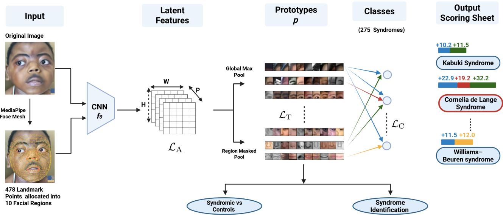
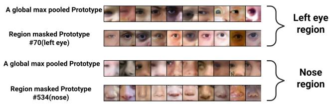
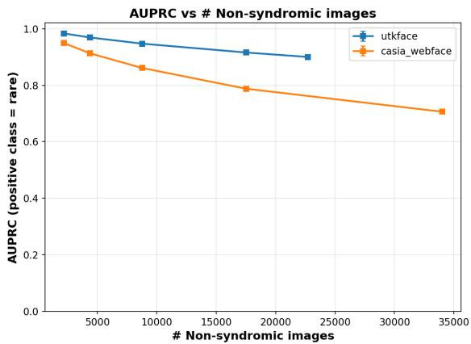
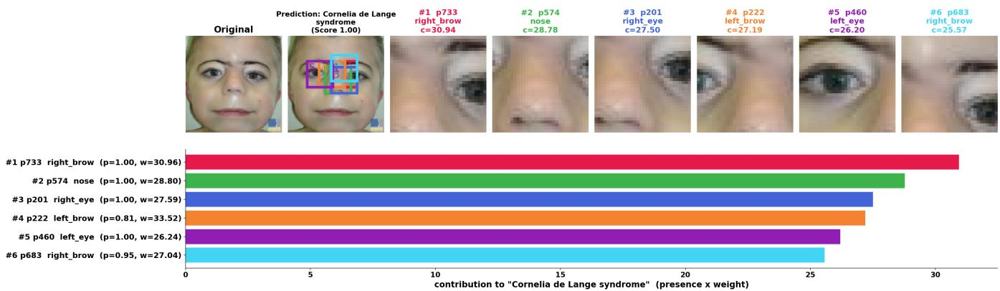

# ProtoGestalt: Interpretable Prototypes for Facial Phenotyping and Diagnosis of Rare Genetic Disorders

Ranga Baminiwatte1,2, Alexander Hustinx3, Fabio Hellmann4, Aaron J. Masino1,2∗

1School of Computing, Clemson University, USA

2Institute for Human Genetics, Clemson University, USA

3Institute for Genomic Statistics and Bioinformatics, Rheinische Friedrich-Wilhelms Universität Bonn, Germany 4Human-centered Artificial Intelligence Lab, Augsburg University, Germany

## Abstract

Rare genetic disorders are dificult to diagnose due to their diversity and overlapping clinical features. Facial morphology can provide diagnostic clues, yet most diagnostic models ofer limited interpretability and are not designed to support broad screening for undiagnosed disease. We present Proto-Gestalt, an interpretable prototype-based framework for facial phenotyping, rare-disease screening, and syndrome identification. The method extends prototype learning by constraining learned visual features to select facial regions, allowing predictions to be explained through localized and additive evidence. We assess ProtoGestalt’s ability to distinguish syndromic from unafected faces on multiple control datasets and class prevalence values. We further evaluate it’s diagnostic performance on syndromes observed during training. The learned prototype-based representations provide significant separation between syndromic and case-matched control images and retain useful performance as the proportion of controls increases. The framework also demonstrates the ability to diferentiate among syndromes. Although reasonably accurate specialized models for facial classification of rare disorders already exist, ProtoGestalt ofers an interpretable alternative that links predictions to anatomically meaningful facial regions, potentially supporting clinical decision-making and the discovery of phenotype–gene associations.

## Introduction

Rare genetic disorders afect more than 6% of the global population. There are an estimated 7,000–10,000 known rare diseases, approximately 80% of which have a genetic etiology (Marwaha, Knowles, and Ashley 2022), while fewer than 10% have an approved therapy (Halley et al. 2022). Due to the large number of disorders, extensive phenotypic heterogeneity, and overlapping clinical presentations, the median time to diagnosis is 4-7 years (Heuyer, Pavan, and Vicard 2017; Molster et al. 2016).

A necessary step toward a rare disease diagnosis is referral for genetic testing by a front-line clinician. This referral, however, is usually substantially delayed relative to symptom onset because clinicians do not consider rare diseases in their initial assessments. This is partly because two-thirds of clinicians significantly underestimate the prevalence of rare diseases, considering them to be 50 to 500 times rarer than the standard definitions used in the U.S. and Europe (Rohani-Montez et al. 2023). Additionally, rare diseases exhibit complex, variable phenotypic presentations that may overlap with those of more common conditions, further delaying evaluation. Indeed, prior studies indicate that many clinicians may not recognize rare disease phenotypes and report a lack ofknowledge ofrare disease symptoms as a barrier to diagnosis (Rohani-Montez et al. 2023; Budych, Helms, and Schultz 2012). Even after rare conditions are considered, the existence of thousands of phenotypically complex rare conditions, many with overlapping features, presents a significant challenge to determining a specific diagnosis.

Computational methods could assist with early recognition of individuals with undiagnosed rare disease (i.e., those for whom rare disease has yet to be considered in diagnostic planning) and subsequent disease specific diagnosis. Surprisingly, there has been only limited work on identifying patients with undiagnosed rare diseases, with most existing studies focusing on screening for a single disease. For example, Bhasuran et al. developed a machine learning pipeline to identify patients with acute hepatic porphyria (Bhasuran et al. 2025). While potentially useful, this approach would require a separate model for each rare disease, making this paradigm impractical as a general screening strategy. In contrast, the ThinkRare model uses a rule-based approach applied to structured EHR data to identify pediatric patients with any undiagnosed multisystem rare genetic disease who are eligible for exome sequencing (Ediae et al. 2025). However, the rulebased design encodes fixed expert-defined clinical eligibility criteria, limiting adaptability across institutions with diferent documentation conventions or patient populations.

Many algorithmic models, including Xrare (Li et al. 2019), LIRICAL (Robinson et al. 2020), PhenoBrain (Mao et al. 2025), and SHEPHERD (Alsentzer et al. 2025), have been developed to infer a patient’s specific rare disease diagnosis. These methods rely on detailed phenotypic information about the patient, typically using a controlled vocabulary such as the Human Phenotype Ontology (Köhler et al. 2021), and, optionally, genetic sequence data. This phenotype labeling requirement poses a substantial challenge as ontologies such as the HPO are complex. Indeed, the current HPO version (v2026-06-23) contains over 20,000 terms. Additionally, it includes many subjective terms that are dificult for nonexperts to apply in practice. For example, the term midline nasal groove is described as “an abnormal groove on the midline of the nose that may extend to the nasal tip.” Finally, none of these systems have been adapted to the problem of identifying individuals with an undiagnosed rare disease.

To address these limitations, DeepGestalt (Gurovich et al. 2019) and GestaltMatcher (Hsieh et al. 2022) use deep learning methods on facial images for rare disease diagnosis. The facial gestalt, or overall facial morphology, is often a characteristic clinical feature indicating presence of an undiagnosed rare disease, with certain features associated with specific diagnoses (Kirchhof et al. 2025). Approximately 30–40% of genetic disorders include facial dysmorphology features (Ferry et al. 2014). Both DeepGestalt and GestaltMatcher are end-to-end models and neither provides a mechanism for ascribing specific, clinically interpretable phenotypic features to individual patients or diseases. As with the aforementioned rare disease diagnostic models, these models have not been adapted to support undiagnosed rare disease screening.

In this paper, we introduce ProtoGestalt, a prototype learning model to support both identification of individuals with undiagnosed rare diseases and disease diagnosis for individuals suspected of having a rare disease. ProtoGestalt is an extension of PIP-Net (Nauta et al. 2023b) which learns latent-space prototypes that represent characteristic portions of objects, in our case facial regions. We extend this approach by enforcing anatomical constraints on the prototype learning process using facial landmarks. The primary advantage of our approach is that the model predictions are inherently explainable through visualization of the matching prototypes for a given input. Additionally, prototypes that are consistently present across individuals with the same condition can potentially be used to objectively characterize the disease, which may help support rare disease research. We make the following contributions: (1) develop ProtoGestalt, an anatomy constrained extension of the PIP-Net model that learns prototypic facial dysmorphology characteristics associated with rare disease and performs disease diagnosis for common rare disorders; (2) present the novel task of determining if an individual has an undiagnosed rare disease or is unafected by a rare disease based on prototypical representations for a given input facial image ; (3) extend ProtoGestalt to infer if an input image is of an individual afected or not afected by a rare disease.

## Related Work

## Rare Disease Diagnosis via Facial Images

Automated facial analysis systems have demonstrated strong performance for rare disease diagnosis. DeepGestalt is a convolutional neural network trained on over 17,000 patient images spanning 216 syndromes. It achieved 91% top-10 accuracy in syndrome identification. This approach was extended with GestaltMatcher, which encodes facial images into a 320-dimensional Clinical Face Phenotype Space and enables patient-to-patient matching, supporting recognition of ultrarare syndromes not represented in the training set. It was later improved with updated CNN backbone models, model ensembles, and test time augmentation, ultimately achieving top-1 and top-5 disease diagnostic performances of 49% and 72%, respectively, across 204 disorders (Hustinx et al. 2022). The internal representations learned by these models are not interpretable, limiting their utility for objective phenotype characterization independent of a diagnostic label.

## Synthetic Rare Disease Facial Image Generation

To address data scarcity and privacy constraints that impede training AI systems, some studies have explored generative AI to produce synthetic facial images with disorderspecific dysmorphology. Kirchhof et al. used a conditional StyleGAN architecture to generate portraits for 20 disorders (Kirchhof et al. 2025). Benichou et al. applied difusion models with syndrome-specific model fine-tuning to produce ethnically balanced synthetic faces for 10 syndromes, demonstrating improved classifier performance when synthetic images supplemented real training data (Benichou et al. 2025). However, both approaches generate whole-face images intended to augment training data for diagnostic models and do not produce structured, reusable phenotypic descriptors.

## Prototypical Networks

Prototype-based interpretable networks are designed to explain predictions by comparing image regions with learned representative patches. For instance, ProtoPNet (Chen et al. 2019) classifies images by comparing parts of the input to learned "prototypes" (e.g., specific features like a bird’s beak), to provide understandable class-based explanations. PIP-Net (Nauta et al. 2023b) improved prototype organization and interpretability by learning sparse, human-aligned prototypes through self-supervision and a non-negative classifier. These models have also been explored in explaining medical imaging tasks (Yazdani et al. 2025), (Wei et al. 2024), (Nauta et al. 2023a). However, prototype-based networks have not been applied to rare-disease facial phenotyping, and existing methods do not enforce anatomically consistent prototype locations.

## Data & Methodology

The Clemson University Institutional Review Board (IRB) reviewed and approved the study under expedited review (IRB2025-1191), and a waiver of informed consent was granted.

## Data

Facial images of rare disorders We used the Gestalt-Matcher Database (GMDB) (Hsieh et al. 2022) version 1.1.0 for model training and evaluation. GMDB contains 10,980 frontal images of 8,346 unique patients with 581 diferent syndromes. We followed the data splitting strategy proposed in (Hustinx et al. 2022) and split the data across syndromes into two sets: GMDB-Frequent (syndromes with more than six patients) and GMDB-Rare (syndromes with six or fewer patients). There are 9,671 images of 7,294 patients with 275 syndromes in GMDB-Frequent. GMDB-Rare contains 1,309 images of 1,052 patients with 306 syndromes.

  
Figure 1: Overview of the ProtoGestalt framework. Given an input facial image x, a CNN backbone $f _ { \theta }$ produces P spatial prototype activation maps of size H ×W. Pooling generates prototype similarity scores which are passed to a prediction head, $h _ { \phi }$ for output inference. MediaPipe Face Mesh detects 478 facial landmarks, which define ten anatomical regions. Each prototype is assigned to one region, and its presence score is obtained using region-masked max pooling; global max pooling is used when the required landmarks are unavailable. The synthetic image shown in the illustration was generated with GestaltGAN (Kirchhof et al. 2025) for use in this publication.

<table><tr><td>Dataset</td><td>Images</td><td>Patients</td><td>Syndromes</td></tr><tr><td>GMDB-Frequent</td><td>9671</td><td>7294</td><td>275</td></tr><tr><td>Training</td><td>7787</td><td>5855</td><td>275</td></tr><tr><td>Validation</td><td>1002</td><td>778</td><td>275</td></tr><tr><td>Test</td><td>882</td><td>661</td><td>275</td></tr><tr><td>GMDB-Rare</td><td>1309</td><td>1052</td><td>306</td></tr><tr><td>GMDB-Total</td><td>10980</td><td>8346</td><td>581</td></tr></table>

Table 1: Overview of GMDB (v. 1.1.0) dataset. Training and validation sets of GMDB-Frequent are used for training and fine-tuning prototypes. Test set of GMDB-Frequent and GMDB-Rare sets are used for evaluation.

We further split GMDB-Frequent into training, validation and test sets and used it to train, fine-tune and evaluate ProtoGestalt. We used GMDB-Rare only for evaluation as it provides a syndrome-disjoint test set for assessing whether the learned prototypes generalize to facial images from syndromes that were not observed during training. This evaluation setting reflects clinical diagnosis of ultra rare conditions, where the underlying disorder may not be represented in training data. An overview of the dataset and experimental partitions is provided in Table 1.

Control datasets To evaluate the utility of the prototypes for distinguishing individuals with rare disorders from unaffected individuals (controls), we used two open facial-image datasets: CASIA-WebFace (Yi et al. 2014) and UTKFace (Zhang, Song, and Qi 2017). These datasets contain 494,414 and 23,708 images, respectively. UTKFace provides annotations for age, sex, and ethnicity. The GMDB dataset predominantly contains images of children (92.4% < 18 years of age). In contrast, only 17.9% of the images in UTKFace depict individuals under 18. To account for this imbalance and further evaluate our method, we constructed a matched control cohort from UTKFace following the approach described by Pantel et al. (Pantel et al. 2020). Each test image from GMDB was matched with an image of an individual without a rare disorder based on age, sex, and ethnicity. We cropped and aligned all images based on image-preprocessing method proposed in (Hsieh et al. 2024).

## Methods

PIP-Net We based our model on PIP-Net (Nauta et al. 2023b), a prototype-based classifier in which prototypes are learned through self-supervision. Given an input image x ∈ R3×S×S, a backbone CNN $f _ { \theta }$ followed by a softmax-based prototype head $h _ { \phi } ,$ the model produces $\check { P }$ spatial prototype activation maps:

$$
\mathbf { z } = h _ { \phi } \big ( f _ { \theta } ( \mathbf { x } ) \big ) \in \mathbb { R } ^ { P \times H \times W } ,\tag{1}
$$

The softmax, $\begin{array} { r } { \sum _ { d = 1 } ^ { P } z _ { d , i , j } = 1 } \end{array}$ , is applied across the prototype dimension so that at each spatial location $z _ { d , i , j } \in [ 0 , 1 ]$ represents the probability that the local image patch corresponds to prototype d.

PIP-Net converts each activation map into a scalar presence score using global max pooling over $z _ { d , : , : }$ for each d such that:

$$
p _ { d } = \operatorname* { m a x } _ { ( i , j ) } z _ { d , i , j } .\tag{2}
$$

The score $p _ { d }$ therefore represents the maximum probability that prototype d matches some portion of the image. The resulting prototype presence vector, $\mathbf { p } = ( p _ { 1 } , \dotsc , p _ { P } )$ , is passed to a sparse, non-negative linear classifier. As the classifier weights are non-negative, each class score is an additive combination of the detected prototypes. The combination of class scores acts as a scoring sheet to interpret the prediction.

Region-Masked Prototypes A limitation of the global max pooling used in PIP-Net is that it ignores spatial location. A prototype can contribute to the prediction regardless of where its strongest activation occurs, and the maximizing location may change across images. This is problematic for facial phenotyping, where a prototype should represent a feature from a consistent anatomical region. For example, a prototype intended to capture a periorbital feature should only activate on that region.

To enforce anatomically consistent prototype evidence, we replace global max pooling with a max-pooling operator restricted to a predefined facial region. Each prototype is assigned to one of ten $( R = 1 0 )$ semantic regions, such as the $l e f t$ eye, nose, or mouth. The regions are listed in Table 2 and are defined using fixed sets of MediaPipe Face Mesh(Grishchenko et al. 2020) landmark indices $\mathcal { T } _ { g }$ where g indexes facial regions.

For a given image, let $\ell ^ { m } \in [ 0 , 1 ] ^ { 2 }$ denote the normalized coordinate of landmark $m ,$ and let $v _ { m } \in \{ 0 , 1 \}$ indicate whether that landmark is valid $( \ell ^ { m }$ is not missing and lies inside the image). We create a binary mask for region g at the resolution of the prototype activation maps:

$$
M _ { i , j } ^ { g } = \Im \left[ \exists m \in \mathbb { Z } _ { g } : v _ { m } = 1 \land \lVert \mathbf { c } _ { i , j } - \boldsymbol { \ell } ^ { m } \rVert _ { 2 } \leq \rho \right]\tag{3}
$$

where $\mathbf { c } _ { i , j } \in [ 0 , 1 ] ^ { 2 }$ is the normalized center coordinate of grid cell $( i , j )$ . Thus, a cell belongs to the mask if it lies within radius $\rho$ of at least one valid landmark assigned to that region.

The radius $\rho ,$ expressed as a fraction of the image side length, controls the spatial extent of each mask. Small values produce tightly localized masks around the landmarks, whereas suficiently large values cause the masks to cover the full activation grid. In the latter case, the method reduces to standard global max pooling.

We distribute prototypes approximately evenly across the R regions using a round-robin assignment:

$$
r ( d ) = 1 + { \big ( } ( d - 1 ) { \bmod { R } } { \big ) } , \qquad d \in \{ 1 , \ldots , P \} ,\tag{4}
$$

where $r ( d )$ denotes the region assigned to prototype d. Regions are indexed from 1 to R in the order shown in Table 2.

The presence score of prototype d is then computed only within its assigned region:

$$
p _ { d } = \left\{ \begin{array} { l l } { \underset { ( i , j ) : M _ { i , j } ^ { r ( d ) } = 1 } { \operatorname* { m a x } } z _ { d , i , j } , } & { \mathrm { i f ~ } \sum _ { i , j } M _ { i , j } ^ { r ( d ) } > 0 , } \\ { \underset { ( i , j ) } { \operatorname* { m a x } } z _ { d , i , j } , } & { \mathrm { o t h e r w i s e } . } \end{array} \right.\tag{5}
$$

The second case provides a fallback to global pooling when the assigned region has an empty mask, for example because the required landmarks were not detected. Whenever a valid regional mask is available, activations outside that mask cannot afect $p _ { d } ,$ even if they are larger than every activation inside the region. Consequently, prototype d can contribute evidence only from its assigned anatomical region. This is a hard structural constraint, in contrast to soft regularization terms that merely penalize of-region activations without preventing them from contributing to the prediction. The masking operation introduces no learnable parameters and changes only the pooling stage. A backbone pretrained using standard PIP-Net pooling can therefore be fine-tuned directly with region-Masked pooling.

<table><tr><td>Region g</td><td>Landmark indices  $\mathcal { T } _ { g }$ </td></tr><tr><td>left eye</td><td>468, 469, 470, 471, 472, 33, 133, 159, 145</td></tr><tr><td>right eye</td><td>473, 474, 475, 476, 477, 263, 362, 386, 374</td></tr><tr><td>left brow</td><td>105, 66, 107, 55, 65</td></tr><tr><td>right brow</td><td>334, 296, 336, 285, 295</td></tr><tr><td>nose</td><td>1, 2, 4, 5, 6, 19, 94</td></tr><tr><td>left cheek</td><td>50, 116, 117, 118, 205</td></tr><tr><td>right cheek</td><td>280, 345, 346, 347, 425</td></tr><tr><td>mouth</td><td>13, 14, 61, 291, 0, 17, 78, 308</td></tr><tr><td>chin</td><td>152, 175, 199, 148, 377</td></tr><tr><td>forehead</td><td>10,9, 151, 8, 107</td></tr></table>

Table 2: The ten facial regions and their defining MediaPipe Face Mesh landmark sets ${ \bar { \boldsymbol { \mathcal { I } } } } _ { g } .$ MediaPipe provides 468 facialmesh landmarks and 10 additional iris landmarks, for a total of 478 points. Regions are indexed in the order shown, and each prototype is assigned to one region according to Eq. (4).  
  
Figure 2: Visualizations of a global Max Pooled prototype and a region Masked prototype at a specific region. Fixing prototypes to specific regions mitigates the potential mirror efect of CNNs (Example: recognizing the right eye as a left eye). Furthermore, region Masked prototypes allow us to track which prototype corresponds to which facial region.

Training Objective We retain PIP-Net’s self-supervised alignment and diversity objectives. The main training objective is

$$
\begin{array} { r } { \mathcal { L } = \lambda _ { \mathrm { A } } \mathcal { L } _ { \mathrm { A } } + \lambda _ { \mathrm { T } } \mathcal { L } _ { \mathrm { T } } + \lambda _ { \mathrm { C } } \mathcal { L } _ { \mathrm { C } } , } \end{array}\tag{6}
$$

The alignment loss $\mathcal { L } _ { \mathrm { A } }$ encourages corresponding patches from two augmented views of the same image to select the same prototype. The diversity loss $\mathcal { L } _ { \mathrm { T } }$ encourages all prototypes to be used within a training batch. Their definitions are unchanged; region-Masked pooling replaces global pooling wherever a pooled prototype score is required.

For classification, the pooled prototype scores are passed

to a non-negative linear layer:

$$
\begin{array} { r } { \begin{array} { r l } & { \mathbf { o } = \mathbf { W } \mathbf { p } , \qquad \mathbf { W } \in \mathbb { R } _ { \ge 0 } ^ { C \times P } , } \\ & { { \mathcal { L } } _ { \mathrm { C } } = \mathrm { N L L } ( \log \operatorname { s o f t m a x } ( \log ( 1 + \mathbf { o } ^ { \tau } ) ) , y ) , } \end{array} } \end{array}\tag{7}
$$

where $\mathbf { o } \in \mathbb { R } ^ { C }$ contains the class scores, C is the number of classes, $\tau \geq 1$ is a learnable scalar parameter, and y is the ground-truth label. The exponentiation and logarithms are applied elementwise.

To obtain the prototypes, we trained PIPnet to classify 275 syndromes using GMDB-Frequent training data. We then used the prototypes (both self-supervised and region-Masked) to represent test images in the evaluations.

We obtain $M = 4 7 8$ landmarks per image using MediaPipe Face Mesh and construct the regional masks at the backbone feature-map resolution, $H = \mathbf { \bar { W } } = 1 4$ . At inference time, region-masked pooling is used whenever valid landmarks are available; if the relevant landmarks are unavailable, the fallback in Eq. (5) reduces the operation to standard PIP-Net global max pooling. Every image had an input resolution of $S \ = \ 1 1 2$ . We set the mask radius to $\rho = 0 . 1$ , expressed as a fraction of the normalized image, which defines the disk drawn around each landmark when forming the binary region masks. All model hyperparameters were tuned using Optuna (Akiba et al. 2019) hyper parameter tuning framework.

Evaluation For each image x, we used the prototypepresence vector $\mathbf { g } ( \mathbf { x } ) \in \mathbb { R } ^ { P }$ as its representation, computed using either global max pooling (Eq. (2)) or region-Masked pooling (Eq. (5)).

We evaluated whether these representations could distinguish images of individuals with genetic syndromes from control facial images. A binary logistic-regression (LR) classifier modeled the probability that an image belonged to the syndromic class as

$$
P ( y = 1 \mid \mathbf { x } ) = \sigma \left( \beta ^ { \top } \mathbf { g } ( \mathbf { x } ) + b \right) ,\tag{8}
$$

where $y = 1$ denotes a GMDB image, $y = 0$ denotes a control image, σ is the sigmoid function, $\check { \boldsymbol { \beta } } \in \mathbb { R } ^ { P }$ contains one learned coeficient per prototype, and b is the intercept.

For each pooling method, we trained two LR classifiers: one using CASIA-WebFace controls and one using UTKFace controls, resulting in four classifiers in total. Each classifier was trained on 2,000 randomly selected GMDB-Frequent training images and 2,000 images from the corresponding control dataset. The GMDB-Frequent images were sampled independently for the CASIA-WebFace and UTKFace training configurations. Control images used for evaluation were excluded from training.

The syndromic evaluation cohort combined the GMDB-Frequent test set (n = 882) and GMDB-Rare $( n = 1 , 3 0 9 )$ yielding 2,191 images. We constructed three evaluation sets by pairing this cohort with approximately the same number of held-out controls from CASIA-WebFace, UTKFace, and the matched UTKFace cohort. The CASIA-WebFace-trained classifiers were evaluated using CASIA-WebFace controls, whereas the UTKFace-trained classifiers were evaluated separately using the general and matched UTKFace controls.

To more closely approximate a clinical screening setting, in which controls are expected to substantially outnumber afected individuals, we also evaluated robustness to class prevalence. We held the 2,191 syndromic images fixed while progressively increasing the number of control images in the test set, and reported Area Under the Precision-Recall Curve (AUPRC) as a function of the resulting class imbalance.

As a secondary task We evaluated the ability of the prototype representations to distinguish among syndromes that were observed during training(GMDB-Frequent). We directly used the trained PIP-Net classification head for this purpose. For an image x with class-score vector ${ \mathbf o } ( { \mathbf x } ) \in \mathbb { R } ^ { C }$ the predicted class is

$$
\hat { y } ( \mathbf x ) = \arg \operatorname* { m a x } _ { c } { { o _ { c } } ( \mathbf x ) } ,
$$

For N test images, top-k accuracy is

$$
\operatorname { A c c } _ { k } = \frac { 1 } { N } \sum _ { i = 1 } ^ { N } \mathbb { I } [ y _ { i } \in T _ { k } ( \mathbf { x } _ { i } ) ] .
$$

where $T _ { k } ( { \mathbf x } )$ denotes the k classes with the highest scores. We present results for $k \in [ 1 , 5 , 1 0 ]$

## Results

## Syndromic-versus-control classification performance

Under demographically matched controls, which isolate dysmorphology from age and dataset biases, prototype representations separated syndromic from unafected faces at 0.85 accuracy(GMP) and 0.73(RM). Against unmatched UTKFace controls both rise sharply (0.94, 0.86), a gap we attribute to the age imbalance between cohorts. Region masking produced higher precision and specificity for CASIA-WebFace and general UTKFace controls, but lower recall and F1. As the number of controls increased, AUPRC declined, yet remained above 0.70 at all evaluated imbalance levels (Figure 3). All model variants were deployed using ConvNeXt26 (Gao et al. 2025) as the backbone $\operatorname { C N N } ( f _ { \theta } )$

## Syndrome identification performance

We evaluated five CNN backbones(ResNet50, ResNet101 (He et al. 2016), IResNet100 (Deng et al. 2019), ConvNeXt13, ConvNeXt26) to determine whether syndromeidentification performance and the efects of region masking were consistent across diferent feature extractors rather than specific to a single architecture. The number of prototypes (P) are each backbone’s output channel count. Using the trained classification heads, IResNet100 achieved the strongest overall performance: region masking produced the highest Top-1 accuracy (33.56%), whereas global max pooling produced the highest Top-5 and Top-10 accuracies (52.27% and 59.86%). Region masking improved Top-1 accuracy for four of the five backbones, although its efect on higher-rank accuracy varied.

<table><tr><td>Pooling</td><td>Controls</td><td>Acc</td><td>PPV</td><td>Sen</td><td>Spec</td><td>F1</td></tr><tr><td>GMP</td><td>C-WF UTKF</td><td>0.89 0.94</td><td>0.93 0.96</td><td>0.86 0.91</td><td>0.93 0.96</td><td>0.89 0.93</td></tr><tr><td>RM</td><td>UTKF-MC C-WF UTKF</td><td>0.85 0.87 0.86</td><td>0.82 0.97 0.96</td><td>0.91 0.76 0.75</td><td>0.80 0.98 0.97</td><td>0.86 0.85 0.84</td></tr></table>

Table 3: Performance of prototype-based representations for distinguishing syndromic facial images from controls. For each pooling method, logistic-regression classifiers were trained using 2,000 GMDB-Frequent images and 2,000 control images from either CASIA-WebFace or UTKFace. Performance was evaluated on a fixed syndromic cohort comprising the GMDB-Frequent test set and GMDB-Rare dataset (n=2,191), paired with held-out controls from CASIA-WebFace, UTKFace, UTKFace match controls. Legend: Acc - Accuracy, PPV - Positive Predictive Value (aka precision), Sen - Sensitivity (aka recall), Spec - Specificity, GMP - Global Max Pooled, RM - Region Masked, C-WF - CASIA-WebFace, UTKF - UTKFace, UTKF-MC - UTK-Face Mactched Controls

## Case study: Prototype consistency in Cornelia de Lange syndrome

To assess the anatomical and clinical relevance of the learned prototypes, we selected Cornelia de Lange syndrome (CdLS) as a case study and examined the consistency of the prototypes driving its classification. The model (RM) correctly classified 30 of the 43 CdLS test images, corresponding to a top-1 accuracy of 69.8%. For each image, we identified the ten prototypes that contributed most strongly to the CdLS prediction. These decision-driving prototypes were consistent across patients, with a mean pairwise Jaccard similarity of 0.335, compared with a random-subset baseline of 0.007. The most frequently recurring prototypes localized to the eyebrows, eyes, nose, and cheeks (Table 5), which correspond to facial regions containing features that are clinically relevant to the diagnosis of CdLS (Rohatgi et al. 2010).

Qualitative analysis of the local explanations further showed that image patches associated with the highestcontributing prototypes appear to capture characteristic known CdLS facial phenotypes (Figure 4). Specifically, prototype #p683 appears to corresponded to synophrys (HP:0000664), #p733 to thick eyebrows (HP:0000574), #p460 to long eyelashes (HP:0000343), and #p574 to a short nose (HP:0003196) (Kline et al. 2018), though we note these are qualitative assessments. Together, these findings suggest that the model’s predictions are reproducible across patients and grounded in clinically meaningful facial features rather than patient-specific or idiosyncratic image characteristics.

We extended this analysis to the 20 most frequent syndromes, for which the mean top-1 accuracy was 50.1%. Across these syndromes, the decision-driving prototypes also remained consistent among patients, with a mean pairwise Jaccard similarity of 0.27, compared with a random-subset baseline of 0.007.

  
Figure 3: AUPRC values as the number of control images increases while the syndromic cohort remains fixed, evaluating LR model’s (Global max pooled) robustness under increasing control-to-syndromic class imbalance and decreasing syndrome prevalence.AUPRC declined progressively yet remained above 0.70 at all evaluated imbalance levels.

## Discussion

ProtoGestalt addresses a clinically broader task than models optimized solely for syndrome classification: it supports both syndromic-versus-control screening and syndrome identification while providing anatomically localized, additive prototype-based explanations. To situate this second capability against prior work, we additionally evaluated the prototype representations under the retrieval protocol of Hustinx et al. (2022), covering both syndromes seen during training (GMDB-Frequent) and ultra-rare syndromes absent from training (GMDB-Rare); full results are reported in Technical Supplement: Appendix A. ProtoGestalt did not match the syndrome-identification performance of specialized facialphenotype embedding models, but its representations retained discriminative information for both seen and unseen syndromes while also separating syndromic images from controls. This trade-of may be valuable in front-line settings, where the initial clinical question is often whether a patient warrants genetic evaluation rather than which specific syndrome is present.

Region masking improved anatomical consistency and interpretability but reduced recall or overall predictive performance in several experiments. This finding suggests that strict spatial constraints may exclude informative global facial cues or interactions among facial regions. A further limitation is that individuals in CASIA-WebFace and UTKFace were assumed not to have rare disorders because their clinical status was unavailable. These datasets may therefore include undiagnosed individuals, potentially biasing estimates of screening performance. We also trained a simple logistic regression (LR) model using region-masked (RM) prototype representations from equal subsets of CASIA-WebFace and UTKFace to predict the source dataset of each image. The model achieved an AUPRC of 0.8, suggesting the presence of detectable dataset-specific signals among the control images.

  
Figure 4: Local explanation of a prediction for a case of Cornelia de Lange syndrome. Prototypes are ranked by their contribution to the predicted class (contribution(c) = prototype presence value(p) × its classifier weight(w)). For each top prototype, the patches show the region of the image where it was most strongly activated, and the bar chart shows the corresponding contribution scores. The synthetic image shown in the illustration was generated with GestaltGAN for use in this publication.

<table><tr><td rowspan="2">Model</td><td rowspan="2">Number of prototypes</td><td colspan="3">GMDB-Frequent</td></tr><tr><td>Top-1</td><td>Top-5</td><td>Top-10</td></tr><tr><td>RN50:GMP RN50:RM</td><td>2048</td><td>21.8 23.0</td><td>34.1 31.2</td><td>40.9 37.9</td></tr><tr><td>RN101:GMP RN101:RM</td><td>2048</td><td>7.0 4.8</td><td>17.1 14.5</td><td>25.2 20.3</td></tr><tr><td>IRN100:GMP IRN100:RM</td><td>512</td><td>33.3 33.6</td><td>52.3 51.0</td><td>59.9 58.2</td></tr><tr><td>CNX13:GMP CNX13:RM</td><td>768</td><td>28.0 32.0</td><td>44.1</td><td>50.3</td></tr><tr><td>CNX26:GMP CNX26:RM</td><td>768</td><td>30.6 30.8</td><td>45.7 45.8 47.4</td><td>52.6 52.0 53.7</td></tr></table>

Table 4: Syndrome-identification performance on the GMDB-Frequent test set (n = 882) using the trained PIP-Net classification head (all values are percents). The number of prototypes is reported for each CNN backbone (fθ). Top-1, Top-5, and Top-10 accuracies (Acck) are reported for global max-pooled and region-masked prototype representations across five CNN backbones. Legend: RN50 - ResNet50, RN101 - ResNet101, IRN100 - IResNet100, CNX13 - ConvNeXt13, CNX26 - ConvNeXt26, GMP - Global Max Pooled, RM - Region Masked

Consequently, the use of unmatched or naively assembled control datasets may inflate apparent screening performance by allowing models to exploit domain diferences rather than clinically meaningful phenotypic features. Finally, prototype consistency and clinical relevance were evaluated only for Cornelia de Lange syndrome because of the scope of this study, limiting the generalizability of these findings to other disorders. Future work should therefore include a comprehensive cross-syndrome evaluation of prototype consistency and clinical relevance. It should also investigate graph neural networks applied to landmark-based facial graphs to model relationships among anatomical regions, with the goal of improving prototype quality, consistency, and diagnostic performance.

<table><tr><td>Prototype</td><td>Region</td><td>Patients (of 43)</td><td>Fraction</td></tr><tr><td>p683</td><td>right_brow</td><td>27</td><td>0.63</td></tr><tr><td>p733</td><td>right_brow</td><td>27</td><td>0.63</td></tr><tr><td>p574</td><td>nose</td><td>27</td><td>0.63</td></tr><tr><td>p222</td><td>left_brow</td><td>26</td><td>0.60</td></tr><tr><td>p201</td><td>right_eye</td><td>25</td><td>0.58</td></tr><tr><td>p20</td><td>left_eye</td><td>24</td><td>0.56</td></tr><tr><td>p212</td><td>left_brow</td><td>24</td><td>0.56</td></tr><tr><td>p460</td><td>left_eye</td><td>23</td><td>0.53</td></tr><tr><td>p185</td><td>left_cheek</td><td>23</td><td>0.53</td></tr><tr><td>p755</td><td>left_cheek</td><td>21</td><td>0.49</td></tr></table>

Table 5: Prototypes most consistently driving the Cornelia de Lange syndrome prediction, ranked by the fraction of the 43 patients in whose top-10 contribution they appear.

## Conclusion

ProtoGestalt demonstrates that anatomically constrained prototypes can support interpretable facial phenotyping of rare genetic disorders. Its prototype-based representations also support identification of disorders while providing localized facial evidence that can be inspected alongside model outputs. Unlike methods that rely primarily on post-hoc explanations, ProtoGestalt provides intrinsic, anatomically grounded evidence for its predictions. This framework may therefore serve as a foundation for more transparent and clinically useful facial-phenotyping systems.

C.; Betz, R. C.; Bender, T.; Grundmann-Hauser, K.; Haack,

Köhler, S.; Gargano, M.; Matentzoglu, N.; Carmody, L. C.; Lewis-Smith, D.; Vasilevsky, N. A.; Danis, D.; Balagura, G.; Baynam, G.; Brower, A. M.; Callahan, T. J.; Chute, C. G.; Est, J. L.; Galer, P. D.; Ganesan, S.; Griese, M.; Haimel, M.; Pazmandi, J.; Hanauer, M.; Harris, N. L.; Hartnett, M. J.; Hastreiter, M.; Hauck, F.; He, Y.; Jeske, T.; Kearney, H.; Kindle, G.; Klein, C.; Knoflach, K.; Krause, R.; Lagorce, D.; McMurry, J. A.; Miller, J. A.; Munoz-Torres, M. C.; Peters,

## References

Akiba, T.; Sano, S.; Yanase, T.; Ohta, T.; and Koyama, M. 2019. Optuna: A Next-generation Hyperparameter Optimization Framework. In Proceedings of the 25th ACM SIGKDD International Conference on Knowledge Discovery and Data Mining.

Alsentzer, E.; Li, M. M.; Kobren, S. N.; Noori, A.; Kohane, I. S.; and Zitnik, M. 2025. Few shot learning for phenotypedriven diagnosis of patients with rare genetic diseases. npj Digital Medicine 2025 8:1, 8: 380–.

Benichou, L.; Breton, L.; Garcelon, N.; Benichou, B.; Lienhard, O.; Amiel, J.; Bongibault, T.; Hidalgo, A. J. B.; Cormier-Daire, V.; Lyonnet, S.; Picard, A.; Rio, M.; Zaiter, A.; Khonsari, R. H.; and Hennocq, Q. 2025. Evaluation of a New Inclusive Next-Generation Synthetic Face Tool for Dysmorphology. American Journal of Medical Genetics, Part A, 200: 685–694.

Bhasuran, B.; Schmolly, K.; Kapoor, Y.; Jayakumar, N. L.; Doan, R.; Amin, J.; Meninger, S.; Cheng, N.; Deering, R.; Anderson, K.; Beaven, S. W.; Wang, B.; and Rudrapatna, V. A. 2025. Reducing diagnostic delays in acute hepatic porphyria using health records data and machine learning. Journal of the American Medical Informatics Association, 32: 63–70.

Budych, K.; Helms, T. M.; and Schultz, C. 2012. How do patients with rare diseases experience the medical encounter? Exploring role behavior and its impact on patient–physician interaction. Health Policy, 105: 154–164.

Chen, X.; Garcelon, N.; Neuraz, A.; Billot, K.; Lelarge, M.; Bonald, T.; Garcia, H.; Martin, Y.; Benoit, V.; Vincent, M.; Faour, H.; Douillet, M.; Lyonnet, S.; Saunier, S.; and Burgun, A. 2019. Phenotypic similarity for rare disease: Ciliopathy diagnoses and subtyping. Journal ofBiomedical Informatics, 100.

Deng, J.; Guo, J.; Xue, N.; and Zafeiriou, S. 2019. Arcface: Additive angular margin loss for deep face recognition. In Proceedings of the IEEE/CVF conference on computer vision and pattern recognition, 4690–4698.

Ediae, G. U.; White-Brown, A.; Chisholm, C.; Terekhov, I.; Seymour, J.; Guo, J.; Mitsakakis, N.; Sawyer, S. L.; and Boycott, K. M. 2025. ThinkRare: A search algorithm to identify patients with undiagnosed rare genetic disease in an electronic medical record. Genetics in Medicine, 27: 101570.

Ferry, Q.; Steinberg, J.; Webber, C.; FitzPatrick, D. R.; Ponting, C. P.; Zisserman, A.; and Nellåker, C. 2014. Diagnostically relevant facial gestalt information from ordinary photos. eLife, 3.

Gao, Y.; Su, J.; Li, J.; Wang, S.; and Li, C. 2025. A neural network framework based on ConvNeXt for side-channel hardware Trojan detection. ETRI Journal, 47(2): 338–349.

Grishchenko, I.; Ablavatski, A.; Kartynnik, Y.; Raveendran, K.; and Grundmann, M. 2020. Attention mesh: High-fidelity face mesh prediction in real-time.

Gurovich, Y.; Hanani, Y.; Bar, O.; Nadav, G.; Fleischer, N.; Gelbman, D.; Basel-Salmon, L.; Krawitz, P. M.; Kamphausen, S. B.; Zenker, M.; Bird, L. M.; and Gripp, K. W.

2019. Identifying facial phenotypes of genetic disorders using deep learning. Nature Medicine, 25: 60–64.

Halley, M. C.; Smith, H. S.; Ashley, E. A.; Goldenberg, A. J.; and Tabor, H. K. 2022. A call for an integrated approach to improve eficiency, equity and sustainability in rare disease research in the United States. Nature genetics, 54: 219.

He, K.; Zhang, X.; Ren, S.; and Sun, J. 2016. Deep residual learning for image recognition. In Proceedings of the IEEE conference on computer vision and pattern recognition, 770– 778.

Heuyer, T.; Pavan, S.; and Vicard, C. 2017. The health and life path of rare disease patients: results of the 2015 French barometer. Patient Related Outcome Measures, Volume 8: 97–110.

Hsieh, T. C.; Bar-Haim, A.; Moosa, S.; Ehmke, N.; Gripp, K. W.; Pantel, J. T.; Danyel, M.; Mensah, M. A.; Horn, D.;

A.; Knaus, A.; Javanmardi, B.; Klinkhammer, H.; Lesmann,

H.; Sivalingam, S.; Kamphans, T.; Meiswinkel, W.; Ebstein,

F.; Krüger, E.; Küry, S.; Bézieau, S.; Schmidt, A.; Peters,

S.; Engels, H.; Mangold, E.; Kreiß, M.; Cremer, K.; Perne,

T. B.; Wagner, M.; Brunet, T.; Bentzen, H. B.; Averdunk, L.; Coetzer, K. C.; Lyon, G. J.; Spielmann, M.; Schaaf, C. P.; Mundlos, S.; Nöthen, M. M.; and Krawitz, P. M. 2022. GestaltMatcher facilitates rare disease matching using facial phenotype descriptors. Nature Genetics, 54: 349–357.

Hsieh, T.-C.; Lesmann, H.; Hustinx, A.; Moosa, S.; Marchi, E.; Caro Martin, M. d. P.; Abdelrazek, I.; Pantel, J. T.; Klinkhammer, H.; ten Hagen, M.; et al. 2024. GestaltMatcher Database—A global reference for facial phenotypic variability in rare human diseases. Nature Medicine / Research Square (Preprint/Network Reference).

Hustinx, A.; Hellmann, F.; Ömer Sümer; Javanmardi, B.; André, E.; Krawitz, P.; and Hsieh, T.-C. 2022. Improving Deep Facial Phenotyping for Ultra-rare Disorder Verification Using Model Ensembles. Proceedings - 2023 IEEE Winter Conference on Applications of Computer Vision, WACV 2023, 5007–5017.

Kirchhof, A.; Hustinx, A.; Javanmardi, B.; Hsieh, T. C.; Brand, F.; Hellmann, F.; Mertes, S.; André, E.; Moosa, S.; Schultz, T.; Solomon, B. D.; and Krawitz, P. 2025. Gestalt-GAN: synthetic photorealistic portraits of individuals with rare genetic disorders. European Journal of Human Genetics, 33: 377–382.

Kline, A. D.; Classic, M.; Deardorf, M. A.; Krantz, I. D.; et al. 2018. Diagnosis and management of Cornelia de Lange syndrome: first international consensus statement. Nature Reviews Genetics, 19(10): 649–666.

R. L.; Rapp, C. K.; Rath, A. M.; Rind, S. A.; Rosenberg, A. Z.; Segal, M. M.; Seidel, M. G.; Smedley, D.; Talmy, T.; Thomas, Y.; Wiafe, S. A.; Xian, J.; Yüksel, Z.; Helbig, I.; Mungall, C. J.; Haendel, M. A.; and Robinson, P. N. 2021. The Human Phenotype Ontology in 2021. Nucleic acids research, 49: D1207–D1217.

Li, Q.; Zhao, K.; Bustamante, C. D.; Ma, X.; and Wong, W. H. 2019. Xrare: a machine learning method jointly modeling phenotypes and genetic evidence for rare disease diagnosis. Genetics in Medicine 2019 21:9, 21: 2126–2134.

Mao, X.; Huang, Y.; Jin, Y.; Wang, L.; Chen, X.; Liu, H.; Yang, X.; Xu, H.; Luan, X.; Xiao, Y.; Feng, S.; Zhu, J.; Zhang, X.; Jiang, R.; Zhang, S.; and Chen, T. 2025. A phenotype-based AI pipeline outperforms human experts in diferentially diagnosing rare diseases using EHRs. npj Digital Medicine, 8: 1–15.

Marwaha, S.; Knowles, J. W.; and Ashley, E. A. 2022. A guide for the diagnosis of rare and undiagnosed disease: beyond the exome. Genome medicine, 14: 23.

Molster, C.; Urwin, D.; Pietro, L. D.; Fookes, M.; Petrie, D.; Laan, S. V. D.; and Dawkins, H. 2016. Survey of healthcare experiences of Australian adults living with rare diseases. Orphanet Journal ofRare Diseases, 11: 1–12.

Nauta, M.; Hegeman, J. H.; Geerdink, J.; Schlötterer, J.; van Keulen, M.; and Seifert, C. 2023a. Interpreting and Correcting Medical Image Classification with PIP-Net. arXiv:2307.10404.

Nauta, M.; Schlötterer, J.; van Keulen, M.; and Seifert, C. 2023b. PIP-Net: Patch-Based Intuitive Prototypes for Interpretable Image Classification. In Proceedings of the IEEE/CVF Conference on Computer Vision and Pattern Recognition (CVPR), 2744–2753.

Pantel, J. T.; Hajjir, N.; Danyel, M.; Elsner, J.; Abad-Perez, A. T.; Hansen, P.; Mundlos, S.; Spielmann, M.; Horn, D.; Ott, C.-E.; and Mensah, M. A. 2020. Eficiency of Computer-Aided Facial Phenotyping (DeepGestalt) in Individuals With and Without a Genetic Syndrome: Diagnostic Accuracy Study. J Med Internet Res, 22(10): e19263.

Robinson, P. N.; Ravanmehr, V.; Jacobsen, J. O.; Danis, D.; Zhang, X. A.; Carmody, L. C.; Gargano, M. A.; Thaxton, C. L.; Karlebach, G.; Reese, J.; Holtgrewe, M.; Köhler, S.; McMurry, J. A.; Haendel, M. A.; and Smedley, D. 2020. Interpretable Clinical Genomics with a Likelihood Ratio Paradigm. American Journal ofHuman Genetics, 107: 403– 417.

Rohani-Montez, S. C.; Bomberger, J.; Zhang, C.; Cohen, J.; McKay, L.; and Evans, W. R. 2023. Educational needs in diagnosing rare diseases: A multinational, multispecialty clinician survey. Genetics in Medicine Open, 1.

Rohatgi, S.; Clark, D.; Kline, A. D.; Jackson, L. G.; Pie, J.; Siu, V.; Ramos, F. J.; Krantz, I. D.; and Deardorf, M. A. 2010. Facial Diagnosis of Mild and Variant CdLS: Insights From a Dysmorphologist Survey. American journal of medical genetics. Part A, 152A(7): 1641 – 1653. Is peer reviewed.

Wei, H.; Gao, L.; Wu, S.; Jiang, Y.; and Liu, B. 2024. DiS-MVC: a multi-view graph collaborative learning framework for measuring disease similarity. Bioinformatics, 40.

Yazdani, E.; Neizehbaz, A.; Karamzade-Ziarati, N.; and Kheradpisheh, S. R. 2025. Explainable artificial intelligence for pneumonia classification: Clinical insights into deformable prototypical part network in pediatric chest x-ray images. Journal ofMedical Imaging and Radiation Sciences, 56(5): 102023.

Yi, D.; Lei, Z.; Liao, S.; and Li, S. Z. 2014. Learning Face Representation from Scratch.

Zhang, Z.; Song, Y.; and Qi, H. 2017. Age Progression/Regression by Conditional Adversarial Autoencoder. Proceedings - 30th IEEE Conference on Computer Vision and Pattern Recognition, CVPR 2017, 2017-January: 4352– 4360.