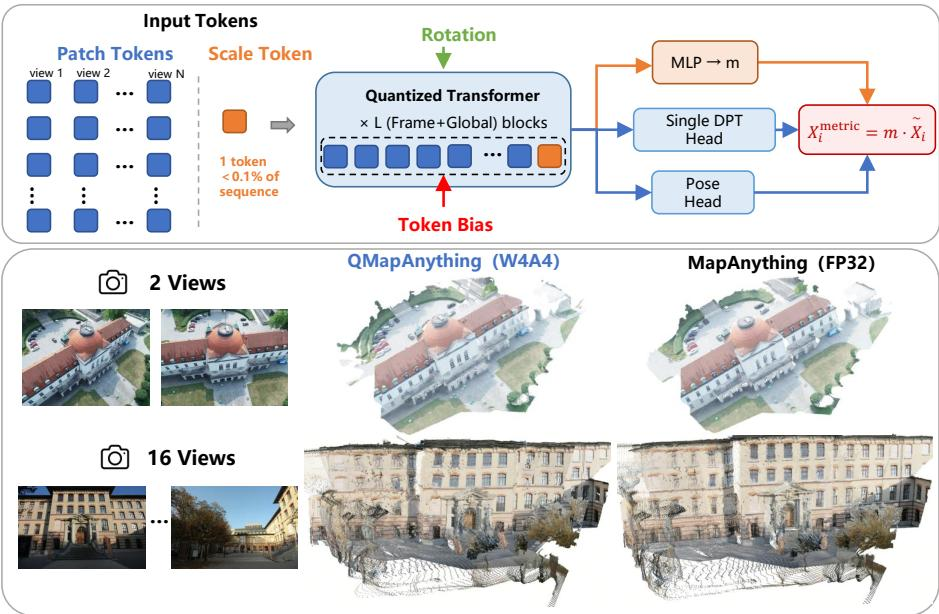
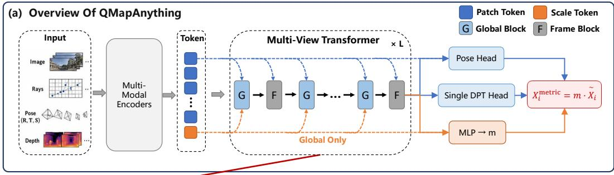
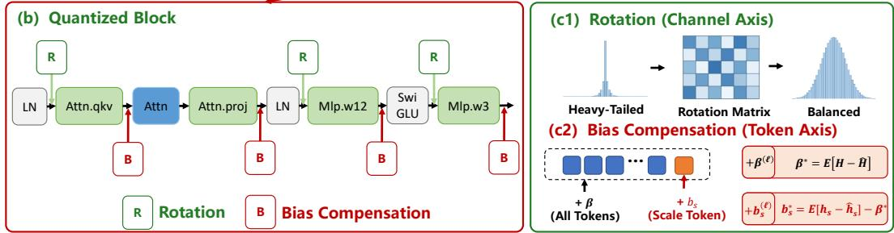
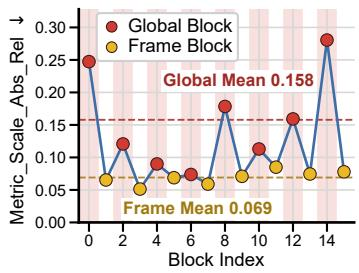
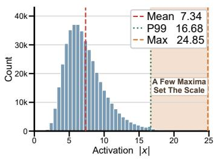
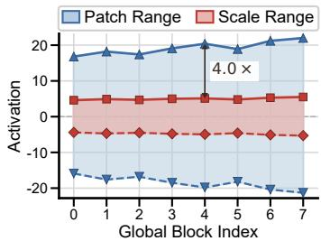
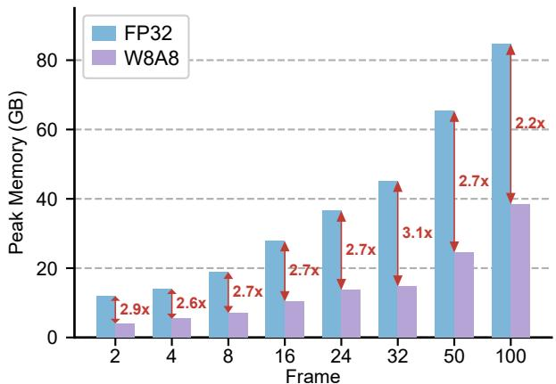
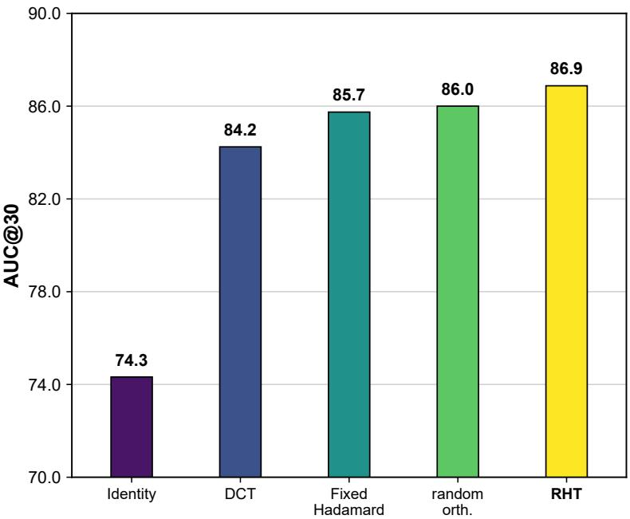
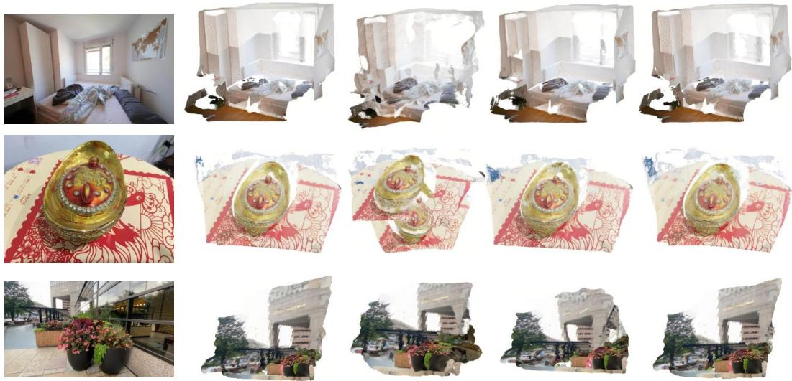

# ROTATION IS TOKEN-BLIND: A STRUCTURAL CRITE-RION FOR POST-TRAINING QUANTIZATION OF FEED-FORWARD GEOMETRY TRANSFORMERS

Huanfei He1,2,\*, Bohao Zhang2,\*, Jiaxin Zhang1, Wei Sui2,†, John See4, Zeyd Boukhers3, and Cong Yang1,B

1School of Future Science and Engineering, Soochow University, Suzhou, China 2D-Robotics, Beijing, China

3Fraunhofer Institute for Applied Information Technology, Sankt Augustin, Germany

4School of Mathematical and Computing Sciences, Heriot-Watt University Malaysia, Putrajaya, Malaysia

hfhe@stu.suda.edu.cn, wei.sui@d-robotics.cc, cong.yang@suda.edu.cn

  
Figure 1: QMapAnything overview. MapAnything’s scale token occupies <0.1% of the sequence yet shares one activation grid with Nn patch tokens, from N images with n patches each. We pair a rotation matrix with a row-selective affine correction. Bottom: W4A4 reconstructions at 2 and 16 views remain visually close to the corresponding FP32 results.

## ABSTRACT

Feed-forward 3D models use Transformers to predict camera poses, depth, and structure in one pass, avoiding iterative multi-view optimization. Long sequences and deep attention incur high compute and memory costs, motivating Post-Training Quantization (PTQ) for deployment. Existing PTQ methods mainly suppress channel-wise outliers by smoothing or orthogonal rotation. Geometry Transformers introduce a different challenge: heterogeneous token types share one activation quantization grid. A few special tokens may exert high leverage over global outputs and be updated by only a subset of blocks. Token-blind transforms, which apply the same transformation to every token, reduce overall quantization error but cannot remove differentiated degradation across token types. We pro-

pose QMapAnything, a structure-aware PTQ framework. We cast floating-pointpreserving rotation and smoothing as a token-blind reparameterization group, and prove that they yield common-mode gains while leaving relative token SNR unchanged. We introduce a statistic Γ that combines a special token’s quantization disadvantage and output leverage to predict whether differentiated bias correction is needed beyond rotation. Experiments on geometric benchmarks show that W4A8 closely matches full-precision performance. Under W8A8, peak memory falls by 2.2–3.1× versus FP32, with up to 3.1× speedup on real hardware. These results provide a principled and efficient approach to deploying feed-forward 3D reconstruction models in resource-constrained edges.

## 1 INTRODUCTION

Classical multi-view reconstruction combines geometric priors with iterative optimization (Mur-Artal & Tardos, 2017; Sch´ onberger & Frahm, 2016; Sch¨ onberger et al., 2016). Learning-based¨ systems first moved dense matching and point-map prediction into neural networks (Wang et al., 2024; Leroy et al., 2024), and recent feed-forward Transformers now recover camera pose, depth, and 3D structure jointly in a single forward pass (Wang et al., 2025; Keetha et al., 2026). This paradigm offers strong generalization without per-scene optimization, but its long token sequences and deep attention stacks impose substantial memory and computation costs, making post-training quantization (PTQ) attractive for deployment.

Recent PTQ methods suppress outliers through scaling, smoothing, or orthogonal rotation (Xiao et al., 2023; Ashkboos et al., 2024; Tseng et al., 2024; Liu et al., 2025). Related recipes have been extended to visual geometry Transformers (Feng et al., 2026; Pan et al., 2026; Zhang et al., 2026). These methods act along the channel axis, whereas feed-forward geometry models can be asymmetric along the token axis. We identify four properties that characterize this mismatch: (S1) heterogeneous token types share one activation grid. (S2) A single token has multiplicative, outputwide leverage. (S3) Channel energy is heavy-tailed. (S4) The special token is updated by only a subset of blocks. Rotation addresses S3, but its token-blind action cannot remove the differentiated error created by S1–S2. Consequently, metric outputs may fail even when scale-aligned geometry remains plausible, and a recipe successful on an up-to-scale model need not transfer to a metric one.

We present QMapAnything, a structure-aware PTQ framework that uses these properties to select mechanisms. We first characterize all floating-point-preserving rotation and smoothing transformations as a token-blind reparameterization group. Orthogonal transformations provide a commonmode signal-to-noise ratio (SNR) gain but leave relative token SNR unchanged. More general transformations face a conditioning ceiling and a potential weight-side quantization trade-off. We then introduce Γ, a screening statistic that combines a token’s grid disadvantage with its output leverage. It requires only one forward and backward pass per scene and screens for the need for tokenselective treatment. A residual statistic measured during calibration determines affine correctability. Guided by this analysis, QMapAnything pairs a rotation matrix for S3 with standard bias correction and, where warranted, a row-selective affine correction for S1–S2, inserted only where S4 makes it necessary. MapAnything provides the primary stress test, while Visual Geometry Grounded Transformer (VGGT) and Depth Anything 3 (DA3) provide complementary transfer cases. VGGT has high gradient leverage on its special token without a grid disadvantage, whereas DA3 has a grid disadvantage without effective output leverage. Our contributions are summarized as follows:

1. We identify four structural properties (S1–S4) that explain when channel-oriented PTQ transfers to a geometry Transformer and when it does not, separating metric predictors from up-to-scale ones.

2. We prove that floating-point-preserving rotation and smoothing form a token-blind group. They act identically on every token, so they have common-mode strength but no rowindexed freedom. QMapAnything keeps a rotation inside this group and adds a rowselective affine correction outside it, inserted only where S4 indicates.

3. We introduce a screening statistic for that need and a residual statistic to test affine correctability. The former distinguishes MapAnything from VGGT and DA3, and QMap-Anything attains near-lossless low-bit accuracy with 3.1× lower peak memory.

  
Figure 2: Overview of QMapAnything on a quantized Transformer block. attn.qkv, mlp.w12 and mlp.w3 apply a rotation matrix transform R to their input, the matching inverse folded offline into the weights. attn.proj needs no input-side transform, since its rotation is absorbed entirely into $W _ { \mathrm { p r o j } }$ . R is the group element addressing S3. The standard token-uniform correction removes a shared systematic offset and can be folded into a layer bias. The group-external term $b _ { \mathrm { s } }$ targets the S1–S2 interaction by correcting only the special-token row.

## 2 RELATED WORK

Learning-based 3D reconstruction. Classical pipelines separate structure-from-motion and multi-view stereo (MVS) (Mur-Artal & Tardos, 2017; Sch´ onberger & Frahm, 2016; Sch¨ onberger¨ et al., 2016). Learned MVS (Yao et al., 2018) and cross-view pretraining (Weinzaepfel et al., 2022) move geometry into networks. DUSt3R and MASt3R predict pairwise geometry (Wang et al., 2024; Leroy et al., 2024), VGGT jointly predicts pose and dense geometry (Wang et al., 2025), and Map-Anything factors metric geometry into an up-to-scale representation and one global scale (Keetha et al., 2026). Beyond their differing prediction targets, these models also differ in whether a special token is routed through every block and whether it multiplies rather than merely summarizes the output. Those differences drive our analysis.

Quantization, viewed as reparameterization. Second-order compensation (Frantar et al., 2023) is one PTQ line. Rounding and reconstruction (Nagel et al., 2020; Li et al., 2021; Hubara et al., 2021; Wei et al., 2022), Transformer scaling (Yao et al., 2022; Dettmers et al., 2022; Xiao et al., 2023; Lin et al., 2024; Shao et al., 2024; Yuan et al., 2023; Wei et al., 2023; Ma et al., 2024), rotation or structured codebooks (Chee et al., 2023; Tseng et al., 2024; Ashkboos et al., 2024; Liu et al., 2025; Zhao et al., 2024; Kim et al., 2024; Egiazarian et al., 2024), and Vision Transformer (ViT) calibration with nonlinear operators (Liu et al., 2021; Yuan et al., 2022; Lin et al., 2022; Ding et al., 2022; Li et al., 2023; Liu et al., 2023; Wu et al., 2024; Yang et al., 2024; Wu et al., 2025a;b) are others. For geometry Transformers, QuantVGGT combines rotation, smoothing, and fine-grained activations (Feng et al., 2026). QVGGT uses mixed precision, token filtering, and principal component analysis (PCA) compensation (Pan et al., 2026). FGQ instead uses diagonal Fisher information for affine calibration (Zhang et al., 2026). Diagonal (Xiao et al., 2023; Lin et al., 2024; Ma et al., 2024) and orthogonal (Tseng et al., 2024; Ashkboos et al., 2024; Liu et al., 2025; Feng et al., 2026) reparameterizations reduce common-mode error but provide no criterion for when a token-blind recipe suffices. We add a pre-quantization criterion Γ that keeps in-group rotation and inserts a special-row term only when needed, so the same rule transfers. Standard bias correction (Banner et al., 2019; Nagel et al., 2019) is token-uniform and misses that residual.

## 3 METHOD

This section first fixes the host model and the shared-grid PTQ setting, then states four prequantization properties. We next characterize the token-blind reparameterization group, decide whether a row-selective term is needed, and assign rotation, token-uniform correction, and a special row term accordingly (Fig. 2).

## 3.1 PRELIMINARIES

MapAnything. Given N RGB images $I _ { i }$ and optional geometric inputs $g _ { i }$ , MapAnything predicts a factored representation $\{ m , ( R _ { i } , \tilde { D } _ { i } , \tilde { P } _ { i } ) _ { i = 1 } ^ { N } \}$ , where $R _ { i }$ is the camera pose, $\tilde { D } _ { i }$ and $\tilde { P } _ { i }$ are the up-to-scale depth and point map, and m is a single global metric scale. A frozen DINOv2 backbone (Oquab et al., 2024) converts each image into n patch tokens of width $d ,$ which are combined with encoded geometric cues by ϕ. A learnable scale token $h _ { \mathrm { s } } \in \mathbb { R } ^ { 1 \times d }$ , the distinguished token in MapAnything, is then appended:

$$
H ^ { ( 0 ) } = [ \phi ( I _ { 1 } , g _ { 1 } ) ; \ldots ; \phi ( I _ { N } , g _ { N } ) ; h _ { \mathrm { s } } ] , \qquad X _ { i } ^ { \mathrm { m e t r i c } } = m \widetilde { X } _ { i } ,\tag{1}
$$

where $H ^ { ( 0 ) }$ is the initial token matrix and $\widetilde { X } _ { i }$ denotes the up-to-scale geometry $( R _ { i } , \tilde { D } _ { i } , \tilde { P } _ { i } )$ . Xmetric is its metric counterpart. A 16-layer alternating-attention Transformer interleaves frame blocks, which act within a single view, and global blocks, which exchange information across views. Dense Prediction Transformer (DPT) (Ranftl et al., 2021) and pose heads decode the patch tokens into $\widetilde { X } _ { i }$ whereas a two-layer multilayer perceptron (MLP) on the final scale token regresses m.

Post-training quantization. PTQ maps tensors to low-bit integers using a small calibration set $\mathcal { D } _ { \mathrm { c a l i b } }$ and no end-to-end fine-tuning. Quantizing a tensor x at b bits (step $\bar { \Delta }$ , bound $Q _ { b } )$ gives

$$
\widehat { x } = \Delta \mathrm { ~ c l a m p } ( \mathrm { r o u n d } ( x / \Delta ) , - Q _ { b } , Q _ { b } ) , \qquad Q _ { b } = 2 ^ { b - 1 } - 1 , \quad \Delta = \| x \| _ { \infty } / Q _ { b } .\tag{2}
$$

We quantize the four linear maps of each block, the query–key–value (QKV) projection, the attention output projection, and the two projections of the gated feed-forward network (FFN) (Fig. 2), while the multi-modal encoders, LayerNorm, softmax, the DPT head, pose heads, and scale MLP stay in floating point, following common practice (Xiao et al., 2023; Ashkboos et al., 2024). Weights use per-output-channel scales. Activations use a per-tensor static scale calibrated offline, so all token rows of a layer share one activation grid. Following block-wise PTQ (Nagel et al., 2020; Li et al., 2021; Wei et al., 2022; Shao et al., 2024), calibration minimizes

$$
\mathcal { L } _ { \mathrm { q u a n t } } = \mathbb { E } _ { { x } \sim \mathcal { D } _ { \mathrm { c a l i b } } } \big \| F ( W , X ) - F ( \widehat { W } , \widehat { X } ) \big \| _ { 2 } ^ { 2 } ,\tag{3}
$$

over floating-point and quantized outputs of a module F with weights W and activations X.

## 3.2 FOUR STRUCTURAL PROPERTIES

We state each property for a generic Transformer processing tokens $H \in \mathbb { R } ^ { T \times d }$ of sequence length T and width d, with a distinguished row $h _ { \mathrm { s } }$ , and indicate the measurement that certifies it. All such measurements precede quantization, and the values obtained on the three models we study are collected in Sec. 4.6.

(S1) Shared grid across heterogeneous token types. One step $\Delta$ is shared by tokens whose dynamic ranges differ by type rather than content. With occupancy $\rho _ { t } = \operatorname* { m a x } _ { c } | x _ { t , c } | /$ max $\mathbf { \Psi } _ { t ^ { \prime } , c } \left| x _ { t ^ { \prime } , c } \right| ,$ where $x _ { t , c }$ is channel c of token t, token t reaches only $\rho _ { t } ( 2 ^ { b - 1 } - 1 )$ of the available levels, i.e. the effective bit-width

$$
b _ { \mathrm { e f f } } ( t ) = b - \log _ { 2 } \bigl ( 1 / \rho _ { t } \bigr ) .\tag{4}
$$

The property is certified by the type-level range ratio max $\rho _ { t } / \rho _ { \mathrm { s } }$ , which in MapAnything grows by two orders of magnitude with depth and leaves the scale token a fraction of a bit at deployment precision (Fig. 3(c)). Eq. (4) is a descriptive statistic of the grid. Sec. 3.3 instead analyzes the limits of token-uniform reparameterizations.

  
(a)

  
(b)

  
(c)  
Figure 3: Structural properties of MapAnything that guide the PTQ recipe. (a): block-wise relative scale error. Global blocks (red) are more sensitive than frame blocks, consistent with S4. (b): histogram of flattened activation magnitudes |x| in attn.qkv. A few maxima set the per-tensor scale (S3). (c): patch vs. scale activation ranges. The type-level gap supports the shared-grid mismatch in S1. S2 follows from the multiplicative role of the scale token.

(S2) Single token with multiplicative leverage. Although the distinguished token occupies only $1 / T$ of the sequence, its perturbation propagates to the whole output. In MapAnything, $h _ { \mathrm { s } }$ is the sole carrier of $m$ . Holding $\widetilde { X } _ { i }$ fixed and isolating perturbations along the metric-scale pathway, Eq. (1) gives $\| \hat { X } _ { i } ^ { \mathrm { m e t r i c } } - X _ { i } ^ { \mathrm { m e t r i c } } \| / \| X _ { i } ^ { \mathrm { m e t r i c } } \| = | \hat { m } - m | / m$ for every i, whereas a patch token’s error is local and averaged by the dense head. Two distinctions matter when auditing other models. First, S2 is multiplicative, output-wide leverage, not mere gradient concentration. A token consumed by a dedicated head carries most of the task gradient by construction, in floating-point as much as in integer arithmetic, while its error stays confined to one output branch. Second, S1 characterizes vulnerability, whereas S2 characterizes consequence. The two are independent and Sec. 3.4 requires both. Jointly they produce differentiated degradation, which single-metric evaluation cannot detect. S2 is also the property up-to-scale predictors lack; hence, a recipe tuned on them need not transfer.

(S3) Heavy-tailed channel energy. Activation energy concentrates in a few coordinates, so an axis-aligned per-tensor grid is set by rare peaks. Fig. 3(b) histograms the flattened magnitudes |x| at attn.qkv. Most mass lies well below the 99th percentile, while a few maxima determine the shared absmax. S3 is what rotation was designed for, and is shared by essentially all Transformers, so it cannot by itself distinguish models.

(S4) Sparse routing of the distinguished token. The special token is written by a strict subset $B _ { \mathrm { g } }$ of blocks, certified by $\| h _ { \mathrm { s } } ^ { ( \ell + 1 ) } - h _ { \mathrm { s } } ^ { ( \ell ) } \| > 0$ , where ℓ indexes the block. In MapAnything, the frame blocks pass the scale token through unchanged, so only the global blocks update it, as in Fig. 3(a). This halves the insertion points.

S3 acts along the channel axis of H, while S1–S2 act along the token axis. S4 then restricts where that token-axis correction is applied.

## 3.3 WHAT THE REPARAMETERIZATION GROUP CAN AND CANNOT DO

At a linear layer $y = x W + b$ with layer bias b (not the bit-width), the transformations leaving the floating-point map invariant are

$$
\begin{array} { r } { x ^ { \prime } = ( x + a ) M , \quad W ^ { \prime } = M ^ { - 1 } W , \quad b ^ { \prime } = b - a W , \qquad M \in \operatorname { G L } ( d ) , \ a \in \mathbb { R } ^ { 1 \times d } . } \end{array}\tag{5}
$$

Every PTQ method based on rotation or smoothing is an element of Eq. (5). Two facts drive everything below. First, M acts by right multiplication, so the same linear operator is applied to every token row. Second, a is a single row vector broadcast across tokens, so every row receives the same offset. Hence, the group has no row-indexed degree of freedom. To compare tokens under a shared step ∆, we use the high-resolution quantization-noise proxy $\mathrm { S N R } _ { \Delta } ( t ) \triangleq \| h _ { t } \| _ { 2 } ^ { 2 } / ( d \Delta ^ { 2 } / 1 2 )$ , whose denominator is the standard uniform-rounding model. The proposition concerns this proxy, not any token’s realized error.

Proposition 1 (Common-mode rescaling of the SNR proxy). Let R be an orthogonal rotation and $\Delta , \Delta _ { R }$ the shared steps before and after $H \mapsto H R .$ Then $\mathrm { S N R } _ { \Delta _ { R } } ( t ) = ( \Delta / \breve { \Delta } _ { R } ) ^ { 2 } \mathrm { S N R } _ { \Delta } ( t )$ for every t, and $( \Delta / \Delta _ { R } ) ^ { 2 } \leq d .$ In particular,for all token indices $i , j ,$

$$
\frac { \mathrm { S N R } _ { \Delta _ { R } } ( i ) } { \mathrm { S N R } _ { \Delta _ { R } } ( j ) } = \frac { \mathrm { S N R } _ { \Delta } ( i ) } { \mathrm { S N R } _ { \Delta } ( j ) } = \frac { \| h _ { i } \| _ { 2 } ^ { 2 } } { \| h _ { j } \| _ { 2 } ^ { 2 } } .\tag{6}
$$

Reducing the shared step therefore gives every token the same multiplicative proxy gain while leaving all pairwise ratios unchanged, so $\kappa _ { \mathrm { s } } \triangleq \| h _ { \mathrm { s } } \| _ { 2 } / \operatorname* { m a x } _ { t } \| h _ { t } \| _ { 2 }$ is a property of the learned represen tation, not of the orthogonal basis. The proxy is not exact in the sub-step regime. When $\rho _ { t } Q _ { b } < 1$ a token occupies fewer than one level and may be partly or entirely rounded to zero. We therefore measure realized residuals directly when estimating affine correctability below.

Proposition 2 (Conditioning ceiling for general elements). Let $M \in \operatorname { G L } ( d )$ with condition number cond $( M ) = \sigma _ { \mathrm { m a x } } / \sigma _ { \mathrm { m i n } }$ . Then for all $i , j , \| h _ { i } M \| _ { 2 } / \| h _ { j } M \| _ { 2 } \ \in \ [ \mathrm { c o n d } ( M ) ^ { - 1 }$ , cond(M)] · $\| h _ { i } \| _ { 2 } / \| h _ { j } \| _ { 2 } ,$ , so M can change any pairwise token-norm ratio by at most afactor ofcond(M).

An ill-conditioned M also changes the dynamic range of $W ^ { \prime } = M ^ { - 1 } W$ and can increase its quantization error. We treat this as a practical trade-off rather than claiming that weight-side quantization error must increase at a matching rate, since the realized error depends on the weight distribution and granularity.

Lemma 1 (Absence of row-selective freedom). cond $( M ) = 1$ recovers Prop. 1 with zero tokenratio improvement. A general M can move that ratio within Prop. 2’s ceiling, but every element of Eq. (5) is row-uniform, so none can implement a correction on token identity. The minimal additive row-selective extension is $u _ { \mathrm { s } } b _ { \mathrm { s } } ^ { \top }$ , with u the special-row indicator.

Per-token activation scaling is a second row-dependent option outside Eq. (5). It changes the quantizer rather than reparameterizing the linear map, assigning token-specific steps that improve grid occupancy. In contrast, $u _ { \mathrm { s } } b _ { \mathrm { s } } ^ { \top }$ leaves the grid unchanged and removes the special row’s systematic residual. The two address different aspects of the error and entail different backend trade-offs.

Proposition 3 (Exact value of an affine correction). $\boldsymbol { L e t e = \hat { h } - h }$ be the quantization error at an insertion point, $e = { \bar { e } } + \varepsilon$ with $\bar { e } = \mathbb { E } _ { \mathcal { D } _ { \mathrm { c a l i b } } } [ e ]$ and $\mathbb { E } [ \varepsilon ] = 0$ . Then mi $\mathbf { 1 } _ { c } \mathbb { E } \| e - c \| _ { 2 } ^ { 2 }$ is attained at $c = \bar { e }$ with value $( 1 - \eta ) \mathbb { E } \| e \| _ { 2 } ^ { 2 } , \eta = \| \bar { e } \| _ { 2 } ^ { 2 } / \mathbb { E } \| e \| _ { 2 } ^ { 2 } \in [ 0 , \bar { 1 } ] .$ . A token-uniform correction removes only $\| \mathbb { E } _ { t } [ \bar { e } _ { t } ] \| _ { 2 } ^ { 2 }$ , leaving the type-specific residual $\bar { e } _ { \mathrm { s } } - \mathbb { E } _ { t } [ \bar { e } _ { t } ]$ intact.

An affine correction therefore helps only to the extent that the error has a systematic component e¯, of which η is the fraction. Proofs are in App. A.

## 3.4 Γ: DIAGNOSING NEED AND AFFINE CORRECTABILITY

The first-order loss perturbation from token t is bounded by $| \langle \partial \mathcal { L } / \partial h _ { t } , e _ { t } \rangle | \leq \lambda _ { t } \| e _ { t } \| _ { 2 }$ . Here, $\mathcal { L }$ is the task loss and $\lambda _ { t } \dot { = } \lVert \partial \mathcal { L } / \partial h _ { t } \rVert _ { 2 }$ measures the token’s output leverage. Under the high-resolution proxy, all tokens share the same quantization-noise denominator, so $\bar { \lambda } _ { t } / \lVert h _ { t } \rVert _ { 2 }$ is a relative vulnerability score. Rotation reduces the common step but leaves the norm-ratio component unchanged (Prop. 1). For a distinguished token that passes the S2 audit, we therefore define

$$
\begin{array} { r l } { \Gamma = } & { \underbrace { \frac { \lambda _ { \mathrm { s } } } { \bar { \lambda } _ { \mathrm { p a t c h } } } } _ { \mathrm { o u t p u t \ c r i t i c a l i t y } } \cdot \underbrace { \left( \frac { \operatorname* { m a x } _ { t } \| h _ { t } \| _ { 2 } } { \| h _ { \mathrm { s } } \| _ { 2 } } - 1 \right) _ { + } } _ { \mathrm { d i f f e r e n t i a l \ g r i d \ d e f i c i t } } , } \end{array}\tag{7}
$$

where $( x ) _ { + } = \operatorname* { m a x } ( x , 0 )$ and $\bar { \lambda } _ { \mathrm { { p a t c h } } }$ is the mean patch leverage. Γ needs one forward and one backward pass per scene, without quantizing the model or running a benchmark. It is a screening statistic, not a calibrated error bound. In the sub-step regime, the realized error can depart from the proxy, so Γ is used only to screen, and the affine remedy is checked on calibration residuals.

Neither factor suffices alone. High leverage may merely reflect dedicated-head routing with no grid disadvantage, while a small token is irrelevant if the output path does not read it (Sec. 4.6). Γ ≈ 0 thus predicts little need beyond the common-mode treatment, whereas $\Gamma \gg 0$ identifies a token that is both quantization-disadvantaged and output-critical. It does not by itself imply an affine correction suffices. After fitting the token-uniform term $\beta ,$ let $r _ { \mathrm { s } } = e _ { \mathrm { s } } - \bar { \mathbb { E } } _ { t } [ \bar { e } _ { t } ]$ be the leftover residual and $\eta _ { \mathrm { s } | \beta } = \| \mathbb { E } [ r _ { \mathrm { s } } ] \| _ { 2 } ^ { 2 } / \mathbb { E } \| r _ { \mathrm { s } } \| _ { 2 } ^ { 2 }$ , the share recoverable by $b _ { \mathrm { s } } \left( \operatorname { P r o p } . 3 \right)$ .

## 3.5 QMAPANYTHING: STRUCTURE-GUIDED MECHANISMS

For S3, we take an orthogonal rotation R as the group element in Eq. (5). Among standard constructions, App. C shows that a randomized Hadamard transform (RHT) attains the strongest commonmode gain, so we instantiate $R = D \mathcal { H }$ with head-sized blocks as in Ashkboos et al. (2024) and a full transform on the FFN hidden axis, where H is a Hadamard matrix and D a random sign diagonal. For a block of width $p ,$ concentration gives $\| x D \mathcal { H } \| _ { \infty } = O ( \| x \| _ { 2 } \sqrt { \log p / p } )$ w.h.p. The realized reduction in $\Delta$ additionally depends on the input’s pre-rotation coherence and, for block-diagonal transforms, its energy across blocks. $R ^ { \top } W$ is folded offline. The online transform remains only at QKV and the two FFN projections.

The token-uniform term $\beta$ is standard bias correction. It removes the mean error shared across tokens but changes neither the shared grid nor its type-level range mismatch. It can be folded into an existing layer bias. Otherwise, it is stored as one output-width vector. The row-selective term $b _ { \mathrm { s } }$ addresses the S1–S2 interaction by removing the remaining systematic error on the distinguished row and lies outside the reparameterization group (Lemma 1):

$$
\begin{array} { r } { \beta ^ { ( \ell ) \star } = - \mathbb { E } _ { t } \big [ \bar { e } _ { t } ^ { ( \ell ) } \big ] , \qquad b _ { \mathrm { s } } ^ { ( \ell ) \star } = \mathbb { E } _ { \mathcal { D } _ { \mathrm { c a l i b } } } \big [ h _ { \mathrm { s } } ^ { ( \ell ) } - \hat { h } _ { \mathrm { s } } ^ { ( \ell ) } \big ] - \beta ^ { ( \ell ) \star } . } \end{array}\tag{8}
$$

It is omitted when $\Gamma \approx 0 . \ \eta _ { \mathrm { s } | \beta }$ quantifies whether this affine form provides material recovery. With $U$ the all-ones vector, the combined correction is $B ^ { ( \ell ) } ( H ) = U ( \beta ^ { ( \ell ) } ) ^ { \top } + u _ { \mathrm { s } } ( b _ { \mathrm { s } } ^ { ( \ell ) } ) ^ { \top }$ , applied as $\widetilde { H } ^ { ( \ell ) } = \hat { H } ^ { ( \ell ) } + B ^ { ( \ell ) } ( H )$

Following S4, at width $m _ { \ell }$ (not scale $m ) , b _ { \mathrm { s } } ^ { ( \ell ) }$ is a single-row $O ( m _ { \ell } )$ addition that leaves integer general matrix-matrix multiplication (GEMM) unchanged. We apply $\beta$ after all four linear maps and, by $S 4 , b _ { \mathrm { s } }$ only in $B _ { \mathrm { g } }$ . The four output widths are 3d, d, $2 d _ { \mathrm { H } }$ and $d ,$ , with $d _ { \mathrm { f } }$ the FFN width, so each block holds 5d+2d correction scalars and the explicit row-selective storage is $| \mathcal { B } _ { \mathrm { g } } | ( 5 d + 2 d _ { \mathrm { f f } } )$ Both terms are calibrated after rotation.

## 4 EXPERIMENTS

## 4.1 EXPERIMENTAL SETUP

Evaluation settings. We evaluate on ETH3D (Schops et al., 2017), ScanNet++v2 (SN++v2) (Yesh-¨ wanth et al., 2023), and TartanAirV2-WB (TAV2) (Wang et al., 2020; Zhang et al., 2025), covering indoor, outdoor, and synthetic geometry. Results are macro-averaged across the three datasets under N = 2 and $N \in \{ 8 , 1 \dot { 6 } \}$ with the official MapAnything sampling (Keetha et al., 2026). Main tables use images only. Because S2 predicts differentiated degradation, we report a metric family (scale rel. error, absolute trajectory error (ATE)) and an up-to-scale family (point and depth rel. error and τ , area under the pose-accuracy curve (AUC@30◦), ray error), so a collapse of m is not masked by scale-aligned scores. Bit-widths are W4A8 and W4A4. The component ablation and the checks on VGGT and DA3 use W4A4, where the gap between mechanisms is largest. We measure accuracy, latency, and peak memory consumption on a single NVIDIA H20 GPU (96 GB). Calibration uses 64 samples at 518×518 from the MegaTrain mixture (Keetha et al., 2026) and contains no ETH3D data, so that set also probes cross-dataset generalization. Further details are in App. D.

Baselines. We re-implement round-to-nearest (RTN), SmoothQuant (Xiao et al., 2023), and QuaRot (Ashkboos et al., 2024) on MapAnything, using the same quantized layers and calibration data as QMapAnything. By Sec. 3.3 they are elements of Eq. (5), so the comparison tests the group ceiling rather than implementation quality. Rotation and smoothing can recover commonmode error, but not a token-selective residual.

## 4.2 CAMERA POSE ESTIMATION

We conduct camera pose estimation experiments on ETH3D, SN++v2, and TAV2 using 2, 8, and 16 input views, and report AUC@30◦ macro-averaged over the three datasets. This metric jointly measures relative rotation and translation accuracy. Notably, ETH3D is excluded from calibration and therefore also evaluates cross-dataset generalization. Under the relatively moderate W4A8 setting, QMapAnything preserves camera pose accuracy with nearlossless performance. Under the more aggressive W4A4 setting, its gap to full precision grows progres-

Table 1: Camera pose estimation, averaged over ETH3D, SN++v2 and TAV2.
<table><tr><td rowspan="2">Method</td><td rowspan="2">W/A</td><td>frames=2</td><td>frames=8</td><td>frames=16</td></tr><tr><td>AUC@30°</td><td> $\mathbf { A U C } @ 3 0 ^ { \circ }$ </td><td> $\mathbf { A U C @ 3 0 ^ { \circ } }$ </td></tr><tr><td>Full Prec.</td><td>16/16</td><td>98.9</td><td>99.2</td><td>98.8</td></tr><tr><td>RTN</td><td>4/8</td><td>91.8</td><td>89.2</td><td>88.1</td></tr><tr><td>SmoothQuant</td><td>4/8</td><td>96.9</td><td>94.9</td><td>94.1</td></tr><tr><td>QuaRot</td><td>4/8</td><td>98.5</td><td>98.5</td><td>98.1</td></tr><tr><td>QMapAnything</td><td>4/8</td><td>98.6</td><td>98.6</td><td>98.1</td></tr><tr><td>RTN</td><td>4/4</td><td>71.8</td><td>55.3</td><td>51.0</td></tr><tr><td>SmoothQuant</td><td>4/4</td><td>73.5</td><td>56.2</td><td>51.4</td></tr><tr><td>QuaRot</td><td>4/4</td><td>88.0</td><td>84.8</td><td>83.7</td></tr><tr><td>QMapAnything</td><td>4/4</td><td>92.8</td><td>87.4</td><td>86.5</td></tr></table>

sively with the number of input views. This trend agrees with S1. As the view count increases, more patch tokens compete to determine the shared absmax, further reducing the effective quantization resolution of the distinguished pathway. The ordering among baselines further validates our mechanism analysis. RTN and SmoothQuant do not adequately address the heavy-tailed channel distri bution in S3 and therefore fail to recover the dominant common-mode loss. QuaRot substantially reduces the overall quantization error through orthogonal rotation, but its token-blind transformation cannot alter the relative SNR between special and patch tokens. The additional improvement of QMapAnything thus stems from explicitly correcting differentiated errors along the token axis, rather than from dataset-specific tuning or mismatched quantization settings.

## 4.3 TWO-VIEW RECONSTRUCTION: TESTING FOR DIFFERENTIATED DEGRADATION

Table 2: Two-view reconstruction, averaged over ETH3D, SN++v2 and TAV2.

We evaluate two-view reconstruction to test whether the quantized model preserves the full geometric output. Scale relative error and ATE measure the metric path, while point maps, pose, depth, and rays are scored after scale alignment. Lower relative error, ATE, and ray error indicate better quality. Higher inlier ratio τ and pose AUC indicate more accurate reconstruction. Under W4A8, QMapAnything attains the best quantized results on every metric and stays near full

<table><tr><td rowspan="2">Method</td><td rowspan="2">W/A</td><td rowspan="2">Scale</td><td colspan="2">Points</td><td colspan="2">Pose</td><td colspan="2">Depth</td><td rowspan="2">Rays</td></tr><tr><td>rel↓</td><td>rel↓  $\tau \uparrow$ </td><td>ATE↓</td><td>AUC↑</td><td>rel↓</td><td> $\tau \uparrow$   $\operatorname { e r r } ^ { \circ } \downarrow$ </td></tr><tr><td>Full Prec.</td><td>16/16</td><td>0.05</td><td>0.06</td><td>60.3</td><td>0.01</td><td>98.9</td><td>0.06 57.3</td><td></td><td>0.19</td></tr><tr><td>RTN</td><td>4/8</td><td>0.10</td><td>0.09</td><td>43.1</td><td>0.02</td><td>91.8</td><td>0.08 37.4</td><td></td><td>0.57</td></tr><tr><td>SmoothQuant</td><td>4/8</td><td>0.06</td><td>0.07</td><td>52.5</td><td>0.02</td><td>96.9</td><td>0.0648.1</td><td></td><td>0.34</td></tr><tr><td>QuaRot</td><td>4/8</td><td>0.05</td><td>0.06</td><td>59.1</td><td>0.01</td><td>98.5</td><td>0.06 55.2</td><td></td><td>0.22</td></tr><tr><td>QMapAnything</td><td>4/8</td><td>0.05</td><td>0.06 59.2</td><td></td><td>0.01</td><td>98.6</td><td>0.06 56.0</td><td></td><td>0.19</td></tr><tr><td>RTN</td><td>4/4</td><td>0.48</td><td>0.30</td><td>13.0</td><td>0.11</td><td>73.3</td><td>0.29</td><td>9.2</td><td>5.86</td></tr><tr><td>SmoothQuant</td><td>4/4</td><td>0.35</td><td>0.32</td><td>10.1</td><td>0.09</td><td>73.5</td><td>0.29</td><td>8.7</td><td>3.05</td></tr><tr><td>QuaRot</td><td>4/4</td><td>0.20</td><td>0.18</td><td>33.2</td><td>0.05</td><td>83.1</td><td></td><td>0.15 34.5</td><td>0.71</td></tr><tr><td>QMapAnything</td><td>4/4</td><td>0.12</td><td>0.09</td><td>43.4</td><td>0.02</td><td>92.7</td><td></td><td>0.07 41.0</td><td>0.45</td></tr></table>

precision on pose, dense geometry, and rays. Under W4A4, metric errors grow faster than up-toscale scores, as S2 predicts. Relative to QuaRot, QMapAnything still reduces scale error from 0.20 to 0.12 and raises point inliers from 33.2 to 43.4.

  
Figure 4: Peak GPU memory versus the number of input frames on TAV2, comparing FP32 with W8A8.

Table 4: End-to-end latency (relative to the FP32 baseline) and pose AUC@30 on two-view TAV2 at 518×518 image resolution. Automatic mixed precision (AMP) uses bfloat16 (BF16), while the quantized rows use W8A8.
<table><tr><td>Method</td><td>W/A</td><td>Latency ↓ AUC@30</td><td>↑</td></tr><tr><td>Baseline</td><td>32/32</td><td>1.00×</td><td>98.9</td></tr><tr><td>AMP</td><td>16/16</td><td>0.52×</td><td>98.7</td></tr><tr><td>Naive</td><td>8/8</td><td>0.32×</td><td>91.9</td></tr><tr><td>Ours</td><td>8/8</td><td>0.32×</td><td>98.9</td></tr></table>

Table 5: Audit columns are measured on FP checkpoints before quantization. Accuracy columns use W4A4, two-view ETH3D pose AUC@30◦ ↑.
<table><tr><td rowspan="2">Model</td><td colspan="4">Structural audit</td><td colspan="4">Criterion</td><td colspan="4">W4A4 pose AUC@30°</td></tr><tr><td>(S1) (S2) (S3) (S4)</td><td></td><td></td><td></td><td> $1 / \kappa _ { \mathrm { s } }$ </td><td> $\lambda _ { \mathrm { s } } / \bar { \lambda } _ { \mathrm { p a t c h } }$ </td><td>Γ</td><td>FP</td><td>naive</td><td>+R</td><td></td><td> $+ R + \beta ~ + R + \beta + b \mathrm { s }$ </td></tr><tr><td>VGGT</td><td>√</td><td>X</td><td>√</td><td>X</td><td>0.94</td><td> $8 . 3 \times 1 0 ^ { 3 }$ </td><td>0</td><td>88.36</td><td>68.42</td><td>75.9</td><td>79.01</td><td>78.99</td></tr><tr><td>DA3</td><td>√</td><td>X</td><td>√</td><td>X</td><td>2.68</td><td>0</td><td>0</td><td>90.33</td><td>71.1</td><td>77.12</td><td>81.21</td><td>81.25</td></tr><tr><td>MapAnything</td><td>√</td><td>√</td><td>√</td><td>√</td><td>6.02</td><td> $2 . 6 9 \times 1 0 ^ { 4 }$ </td><td> $\mathbf { 1 . 3 5 \times 1 0 ^ { 5 } }$ </td><td>98.9</td><td>77.0</td><td>83.7</td><td>88.2</td><td>91.4</td></tr></table>

## 4.4 ABLATION: REMOVING ONE MECHANISM AT A TIME

Mechanism ablation. We conduct W4A4 twoview ablations to isolate the three components of QMapAnything (Table 3). Rotation provides the largest first-stage recovery over naive PTQ, consistent with its treatment of the heavy-tailed channel distribution in S3. With R fixed, either the standard token-uniform correction $\beta$ or the proposed row-selective correction $b _ { \mathrm { s } }$ improves all three datasets, showing that they remove distinct residual components. Adding $b _ { \mathrm { s } }$ on top of $R + \beta$ yields a further 3.2–3.8 AUC@30◦ and produces the best result on every benchmark. The full configuration reaches 91.4, 93.7, and 93.2, confirming that common bias correction does not subsume the special-row residual targeted by $b _ { \mathrm { s } }$

Table 3: Component ablation under W4A4. R: rotation, $\beta \colon$ token-uniform bias correction, $\pmb { b _ { \mathrm { s } } } \mathrm { : }$ row-selective correction.
<table><tr><td>Rβbs</td><td>ETH3D</td><td> $\mathsf { S N } { + } { + } \mathsf { v } 2$  AUC@30↑ AUC@30↑ AUC@30↑</td></tr><tr><td>× × ×</td><td>77.0</td></tr><tr><td>83.7</td><td>74.3 86.9</td></tr><tr><td> $ { \mathcal { A } } _ { \mathbf { \lambda } } \times  { \mathbf { \lambda } } \times  { \mathbf { \lambda } }$   $\checkmark \ \times \ \checkmark$ </td><td>86.1 89.1</td></tr><tr><td>87.3</td><td>88.5</td></tr><tr><td> $\sqrt { \mathrm { ~ \bf ~ \Omega ~ } } \sqrt { \mathrm { ~ \bf ~ \Omega ~ } } \times \mathrm { ~ \bf ~ \Omega ~ }$  88.2  $\sqrt { \mathrm { ~ { ~ \bf ~ \psi ~ } ~ } } \sqrt { \mathrm { ~ { ~ \bf ~ \psi ~ } ~ } } \sqrt { \mathrm { ~ { ~ \bf ~ \psi ~ } ~ } }$  91.4</td><td>90.4 89.4 93.7 93.2</td></tr></table>

## 4.5 EFFICIENCY ANALYSIS

Efficiency is evaluated under W8A8 because TensorRT provides fused INT8 kernels. W4 configurations use fake quantization for accuracy evaluation.

Peak memory. Relative to FP32, W8A8 cuts peak memory by up to 3.1× and by 2.2× at 100 frames (Fig. 4). The ratio contracts because floating-point components, normalization, softmax, prediction heads, and intermediate buffers grow with $N n + 1$ and occupy an increasing share of the footprint, while the absolute saving still grows with the number of frames. At 100 frames, FP32 occupies 88% of the H20, whereas W8A8 leaves substantial head-room.

Latency. Under fused W8A8 kernels, QMapAnything matches naive PTQ at 0.32× FP32 latency while restoring full-precision AUC (Table 4). These results show that low-bit quantization eases memory-bandwidth pressure while improving inference efficiency.

## 4.6 GENERALITY: DOES THE AUDIT PREDICT WHAT EACH MODEL NEEDS?

To test generality, we further audit VGGT (Wang et al., 2025) and DA3 (Lin et al., 2026), neither of which informed our method design, against S1–S4 and compute Γ on their full-precision checkpoints. All three models share the same signed quantizer, weight and activation granularity, rotation construction, calibration data source, and W4A4 evaluation setting. MapAnything additionally uses a staged 40-step refinement, whereas VGGT and DA3 use closed-form correction without gradient refinement. No accuracy-driven tuning is performed on either transfer model. Although the audit prescribes omitting $b _ { \mathrm { s } }$ on VGGT and DA3, we deliberately instantiate the full B as a conservative falsification test. All three models satisfy S1 and S3. They use per-tensor activation scales, and their within-token max /99th-percentile (P99) ratios at the final residual are substantially above the reference value for a Gaussian of the same width. Rotation is therefore expected to benefit all three. Both transfer models fail S2 and S4. VGGT is an up-to-scale predictor with no multiplicative scalar controlling the global output. Its camera token is read by a dedicated head from the first layer of every block, so it is neither multiplicatively load-bearing nor sparsely routed. DA3 introduces a camera token, but its intermediate-layer interface removes that token before the dense head. The evaluated pose pathway instead regresses from dense rays, leaving the token with no effective output leverage.

VGGT’s camera token is output-critical but not quantization-disadvantaged. Although its dedicated head concentrates the pose gradient on that token, $1 / \kappa _ { \mathrm { s } } = 0 . 9 4$ shows that its norm matches the strongest patch token, so the shared grid does not disadvantage it. DA3 is the mirror image. Its camera token is disadvantaged but not critical $( 1 / \kappa _ { \mathrm { s } } = 2 . 6 8 , \lambda _ { \mathrm { s } } = 0 )$ . Consequently, both yield $\Gamma = 0$ This distinction shows that gradient concentration induced by dedicated-head routing exists in both floating-point and quantized models and is not itself a quantization pathology.

Rotation restores VGGT and DA3 to 85.9% and 85.4% of full-precision AUC@30, as S3 predicts. Standard correction β adds 3.11 and 4.09 points, whereas $b _ { \mathrm { s } }$ is negligible (−0.02 and +0.04), versus +3.2 on MapAnything. Thus, Γ predicts the materiality of row-selective correction rather than generic bias correction. The models separate the two axes. VGGT has high gradient leverage but no grid disadvantage, DA3 has a grid disadvantage but no effective output leverage, and MapAnything exhibits both, supporting S1–S4 as family-level properties.

## 5 CONCLUSION

We identify four structural properties that determine when rotation-based PTQ needs token-selective treatment beyond common-mode rotation, and prove that FP-preserving reparameterizations lack row-indexed freedom. Guided by this analysis, we propose Γ to screen this need and $\eta _ { \mathrm { s } | \beta }$ to test affine correctability. The resulting framework, QMapAnything, achieves near-lossless W4A8 quantization with a substantially reduced memory footprint. The row-selective term helps high-Γ models and is negligible when $\Gamma \approx 0$

## AI USE STATEMENT

In this work, we used generative AI tools for drafting and editing manuscript text, improving clarity of exposition, and assisting with LAT X formatting. We have not used generative AI tools to generate synthetic experimental data, fabricate results, or produce unverified mathematical claims. Additionally, we used generative AI tools for literature search suggestions and for drafting boilerplate code related to plotting and table formatting. We have reviewed all AI-assisted text and code. All experimental results, claims, and figures were verified by the authors. We take responsibility for the final content of this work.

## ETHICS STATEMENT

This work studies post-training quantization for feed-forward 3D reconstruction and does not involve human subjects or personally identifiable information. Publicly available geometric benchmarks are used for evaluation. We do not foresee direct harmful applications beyond those already associated with generic 3D reconstruction systems. All authors adhere to the ICLR Code of Ethics.

## REPRODUCIBILITY STATEMENT

Implementation and evaluation details are in Sec. 4 and App. D. The measurement protocol for Γ and the structural audit is in App. B. Proofs and rotation controls are in Apps. A, C. Upon acceptance, we will release code and configuration files to reproduce the reported pipeline and main tables.

## REFERENCES

Saleh Ashkboos, Amirkeivan Mohtashami, Maximilian L. Croci, Bo Li, Pashmina Cameron, Martin Jaggi, Dan Alistarh, Torsten Hoefler, and James Hensman. QuaRot: Outlier-free 4-bit inference in rotated LLMs. In Advances in Neural Information Processing Systems, volume 37, pp. 100213– 100240, 2024.

Ron Banner, Yury Nahshan, and Daniel Soudry. Post training 4-bit quantization of convolutional networks for rapid-deployment. In Advances in Neural Information Processing Systems, volume 32, pp. 7950–7958, 2019.

Jerry Chee, Yaohui Cai, Volodymyr Kuleshov, and Christopher De Sa. QuIP: 2-bit quantization of large language models with guarantees. In Advances in Neural Information Processing Systems, volume 36, 2023.

Tim Dettmers, Mike Lewis, Younes Belkada, and Luke Zettlemoyer. LLM.int8(): 8-bit matrix multiplication for transformers at scale. In Advances in Neural Information Processing Systems, volume 35, pp. 30318–30332, 2022.

Yifu Ding, Haotong Qin, Qinghua Yan, Zhenhua Chai, Junjie Liu, Xiaolin Wei, and Xianglong Liu. Towards accurate post-training quantization for vision transformer. In Proceedings of the 30th ACM International Conference on Multimedia, pp. 5380–5388, 2022. doi: 10.1145/3503161. 3547826.

Vage Egiazarian, Andrei Panferov, Denis Kuznedelev, Elias Frantar, Artem Babenko, and Dan Alistarh. Extreme compression of large language models via additive quantization. In Proceedings of the 41st International Conference on Machine Learning, volume 235, pp. 12284–12303. PMLR, 2024.

Weilun Feng, Haotong Qin, Mingqiang Wu, Chuanguang Yang, Yuqi Li, Xiangqi Li, Zhulin An, Libo Huang, Yulun Zhang, Michele Magno, and Yongjun Xu. Quantized visual geometry grounded transformer. In International Conference on Learning Representations, 2026. URL https://openreview.net/forum?id=Xzcllrc6gb.

Elias Frantar, Saleh Ashkboos, Torsten Hoefler, and Dan Alistarh. GPTQ: Accurate post-training quantization for generative pre-trained transformers. In International Conference on Learning Representations, 2023.

Itay Hubara, Yury Nahshan, Yair Hanani, Ron Banner, and Daniel Soudry. Accurate post training quantization with small calibration sets. In Proceedings of the 38th International Conference on Machine Learning, volume 139, pp. 4466–4475. PMLR, 2021.

Nikhil Keetha, Norman Muller, Johannes Sch¨ onberger, Lorenzo Porzi, Yuchen Zhang, Tobias Fis-¨ cher, Arno Knapitsch, Duncan Zauss, Ethan Weber, Nelson Antunes, Jonathon Luiten, Manuel Lopez-Antequera, Samuel Rota Bulo, Christian Richardt, Deva Ramanan, Sebastian Scherer, and\` Peter Kontschieder. MapAnything: Universal feed-forward metric 3D reconstruction. In International Conference on 3D Vision, pp. 499–509, 2026. doi: 10.1109/3DV69130.2026.00054.

Sehoon Kim, Coleman Richard Charles Hooper, Amir Gholami, Zhen Dong, Xiuyu Li, Sheng Shen, Michael W. Mahoney, and Kurt Keutzer. SqueezeLLM: Dense-and-sparse quantization. In Proceedings of the 41st International Conference on Machine Learning, volume 235, pp. 23901– 23923. PMLR, 2024.

Vincent Leroy, Yohann Cabon, and Jerome Revaud. Grounding image matching in 3d with MASt3R. In Computer Vision – ECCV 2024, volume 15130, pp. 71–91, 2024. doi: 10.1007/ 978-3-031-73220-1 5.

Yuhang Li, Ruihao Gong, Xu Tan, Yang Yang, Peng Hu, Qi Zhang, Fengwei Yu, Wei Wang, and Shi Gu. BRECQ: Pushing the limit of post-training quantization by block reconstruction. In International Conference on Learning Representations, 2021. URL https://openreview. net/forum?id=POWv6hDd9XH.

Zhikai Li, Junrui Xiao, Lianwei Yang, and Qingyi Gu. RepQ-ViT: Scale reparameterization for post-training quantization of vision transformers. In Proceedings of the IEEE/CVF International Conference on Computer Vision, pp. 17227–17236, 2023.

Haotong Lin, Sili Chen, Jun Hao Liew, Donny Y. Chen, Zhenyu Li, Yang Zhao, Sida Peng, Hengkai Guo, Xiaowei Zhou, Guang Shi, Jiashi Feng, and Bingyi Kang. Depth anything 3: Recovering the visual space from any views. 2026.

Ji Lin, Jiaming Tang, Haotian Tang, Shang Yang, Wei-Ming Chen, Wei-Chen Wang, Guangxuan Xiao, Xingyu Dang, Chuang Gan, and Song Han. AWQ: Activation-aware weight quantization for on-device LLM compression and acceleration. In Proceedings of Machine Learning and Systems, volume 6, 2024.

Yang Lin, Tianyu Zhang, Peiqin Sun, Zheng Li, and Shuchang Zhou. FQ-ViT: Post-training quantization for fully quantized vision transformer. In Proceedings of the Thirty-First International Joint Conference on Artificial Intelligence, pp. 1173–1179, 2022. doi: 10.24963/ijcai.2022/164.

Yijiang Liu, Huanrui Yang, Zhen Dong, Kurt Keutzer, Li Du, and Shanghang Zhang. NoisyQuant: Noisy bias-enhanced post-training activation quantization for vision transformers. In Proceedings of the IEEE/CVF Conference on Computer Vision and Pattern Recognition, pp. 20321–20330, 2023.

Zechun Liu, Changsheng Zhao, Igor Fedorov, Bilge Soran, Dhruv Choudhary, Raghuraman Krishnamoorthi, Vikas Chandra, Yuandong Tian, and Tijmen Blankevoort. SpinQuant: LLM quantization with learned rotations. In International Conference on Learning Representations, 2025.

Zhenhua Liu, Yunhe Wang, Kai Han, Wei Zhang, Siwei Ma, and Wen Gao. Post-training quantization for vision transformer. In Advances in Neural Information Processing Systems, volume 34, pp. 28092–28103, 2021.

Manuel Lopez-Antequera, Pau Gargallo, Markus Hofinger, Samuel Rota Bul ´ o, Yubin Kuang, and \` Peter Kontschieder. Mapillary planet-scale depth dataset. In Computer Vision – ECCV 2020, volume 12347, pp. 589–604, 2020. doi: 10.1007/978-3-030-58536-5 35.

Yuexiao Ma, Huixia Li, Xiawu Zheng, Feng Ling, Xuefeng Xiao, Rui Wang, Shilei Wen, Fei Chao, and Rongrong Ji. AffineQuant: Affine transformation quantization for large language models. In International Conference on Learning Representations, 2024.

Lukas Mehl, Jenny Schmalfuss, Azin Jahedi, Yaroslava Nalivayko, and Andres Bruhn. Spring: A´ high-resolution high-detail dataset and benchmark for scene flow, optical flow and stereo. In Proceedings of the IEEE/CVF Conference on Computer Vision and Pattern Recognition, pp. 4981– 4991, 2023.

Raul Mur-Artal and Juan D. Tardos. ORB-SLAM2: An open-source SLAM system for monocular,´ stereo, and RGB-D cameras. IEEE Transactions on Robotics, 33(5):1255–1262, 2017. doi: 10.1109/TRO.2017.2705103.

Markus Nagel, Mart van Baalen, Tijmen Blankevoort, and Max Welling. Data-free quantization through weight equalization and bias correction. In Proceedings of the IEEE/CVF International Conference on Computer Vision, pp. 1325–1334, 2019. doi: 10.1109/ICCV.2019.00141.

Markus Nagel, Rana Ali Amjad, Mart Van Baalen, Christos Louizos, and Tijmen Blankevoort. Up or down? adaptive rounding for post-training quantization. In Proceedings of the 37th International Conference on Machine Learning, volume 119, pp. 7197–7206. PMLR, 2020.

Maxime Oquab, Timothee Darcet, Th´ eo Moutakanni, Huy V. Vo, Marc Szafraniec, Vasil Khalidov,´ Pierre Fernandez, Daniel Haziza, Francisco Massa, Alaaeldin El-Nouby, Mido Assran, Nicolas Ballas, Wojciech Galuba, Russell Howes, Po-Yao Huang, Shang-Wen Li, Ishan Misra, Michael Rabbat, Vasu Sharma, Gabriel Synnaeve, Hu Xu, Herve J´ egou, Julien Mairal, Patrick Labatut,´ Armand Joulin, and Piotr Bojanowski. DINOv2: Learning robust visual features without supervision. Transactions on Machine Learning Research, 2024. URL https://openreview. net/forum?id=a68SUt6zFt.

Zhizhen Pan, Hesong Wang, and Huan Wang. QVGGT: Post-training quantized visual geometry grounded transformer. In Proceedings of the IEEE/CVF Conference on Computer Vision and Pattern Recognition, 2026.

Rene Ranftl, Alexey Bochkovskiy, and Vladlen Koltun. Vision transformers for dense prediction. In´ Proceedings of the IEEE/CVF International Conference on Computer Vision, pp. 12179–12188, 2021. doi: 10.1109/ICCV48922.2021.01196.

Johannes L. Schonberger and Jan-Michael Frahm. Structure-from-motion revisited. In ¨ Proceedings of the IEEE Conference on Computer Vision and Pattern Recognition, pp. 4104–4113, 2016. doi: 10.1109/CVPR.2016.445.

Johannes L. Schonberger, Enliang Zheng, Jan-Michael Frahm, and Marc Pollefeys. Pixelwise view¨ selection for unstructured multi-view stereo. In Computer Vision – ECCV 2016, pp. 501–518, 2016. doi: 10.1007/978-3-319-46487-9 31.

Thomas Schops, Johannes L. Sch ¨ onberger, Silvano Galliani, Torsten Sattler, Konrad Schindler, Marc ¨ Pollefeys, and Andreas Geiger. A multi-view stereo benchmark with high-resolution images and multi-camera videos. In Proceedings of the IEEE Conference on Computer Vision and Pattern Recognition, pp. 3260–3269, 2017.

Wenqi Shao, Mengzhao Chen, Zhaoyang Zhang, Peng Xu, Lirui Zhao, Zhiqian Li, Kaipeng Zhang, Peng Gao, Yu Qiao, and Ping Luo. OmniQuant: Omnidirectionally calibrated quantization for large language models. In International Conference on Learning Representations, 2024.

Fabio Tosi, Yiyi Liao, Carolin Schmitt, and Andreas Geiger. SMD-Nets: Stereo mixture density networks. In Proceedings of the IEEE/CVF Conference on Computer Vision and Pattern Recognition, pp. 8942–8952, 2021.

Albert Tseng, Jerry Chee, Qingyao Sun, Volodymyr Kuleshov, and Christopher De Sa. QuIP#: Even better LLM quantization with hadamard incoherence and lattice codebooks. In Proceedings of the 41st International Conference on Machine Learning, volume 235, pp. 48630–48656. PMLR, 2024.

Jianyuan Wang, Minghao Chen, Nikita Karaev, Andrea Vedaldi, Christian Rupprecht, and David Novotny. VGGT: Visual geometry grounded transformer. In Proceedings of the IEEE/CVF Conference on Computer Vision and Pattern Recognition, pp. 5294–5306, 2025. doi: 10.1109/ CVPR52734.2025.00499.

Shuzhe Wang, Vincent Leroy, Yohann Cabon, Boris Chidlovskii, and Jerome Revaud. DUSt3R: Geometric 3d vision made easy. In Proceedings ofthe IEEE/CVF Conference on Computer Vision and Pattern Recognition, pp. 20697–20709, 2024. doi: 10.1109/CVPR52733.2024.01956.

Wenshan Wang, Delong Zhu, Xiangwei Wang, Yaoyu Hu, Yuheng Qiu, Chen Wang, Yafei Hu, Ashish Kapoor, and Sebastian Scherer. TartanAir: A dataset to push the limits of visual SLAM. In IEEE/RSJ International Conference on Intelligent Robots and Systems, pp. 4909–4916, 2020. doi: 10.1109/IROS45743.2020.9341801.

Xiuying Wei, Ruihao Gong, Yuhang Li, Xianglong Liu, and Fengwei Yu. QDrop: Randomly dropping quantization for extremely low-bit post-training quantization. In International Conference on Learning Representations, 2022. URL https://openreview.net/forum?id= ySQH0oDyp7.

Xiuying Wei, Yunchen Zhang, Yuhang Li, Xiangguo Zhang, Ruihao Gong, Jinyang Guo, and Xianglong Liu. Outlier suppression+: Accurate quantization of large language models by equivalent and effective shifting and scaling. In Proceedings of the 2023 Conference on Empirical Methods in Natural Language Processing, pp. 1648–1665, 2023. doi: 10.18653/v1/2023.emnlp-main.102.

Philippe Weinzaepfel, Vincent Leroy, Thomas Lucas, Romain Bregier, Yohann Cabon, Vaibhav´ Arora, Leonid Antsfeld, Boris Chidlovskii, Gabriela Csurka, and Jer´ ome Revaud. CroCo: Self-ˆ supervised pre-training for 3d vision tasks by cross-view completion. In Advances in Neural Information Processing Systems, volume 35, pp. 3502–3516, 2022.

Zhuguanyu Wu, Jiaxin Chen, Hanwen Zhong, Di Huang, and Yunhong Wang. AdaLog: Posttraining quantization for vision transformers with adaptive logarithm quantizer. In European Conference on Computer Vision, pp. 411–427, 2024.

Zhuguanyu Wu, Shihe Wang, Jiayi Zhang, Jiaxin Chen, and Yunhong Wang. FIMA-Q: Post-training quantization for vision transformers by fisher information matrix approximation. In Proceedings of the IEEE/CVF Conference on Computer Vision and Pattern Recognition, pp. 14891–14900, 2025a.

Zhuguanyu Wu, Jiayi Zhang, Jiaxin Chen, Jinyang Guo, Di Huang, and Yunhong Wang. APHQ-ViT: Post-training quantization with average perturbation hessian based reconstruction for vision transformers. In Proceedings of the IEEE/CVF Conference on Computer Vision and Pattern Recognition, pp. 9686–9695, 2025b.

Guangxuan Xiao, Ji Lin, Mickael Seznec, Hao Wu, Julien Demouth, and Song Han. SmoothQuant: Accurate and efficient post-training quantization for large language models. In Proceedings of the 40th International Conference on Machine Learning, volume 202, pp. 38087–38099. PMLR, 2023.

Lianwei Yang, Haisong Gong, Haokun Lin, Yichen Wu, Caifeng Shan, Zhenan Sun, and Qingyi Gu. DopQ-ViT: Towards distribution-friendly and outlier-aware post-training quantization for vision transformers, 2024.

Yao Yao, Zixin Luo, Shiwei Li, Tian Fang, and Long Quan. MVSNet: Depth inference for unstructured multi-view stereo. In Computer Vision – ECCV 2018, pp. 785–801, 2018. doi: 10.1007/978-3-030-01237-3 47.

Yao Yao, Zixin Luo, Shiwei Li, Jingyang Zhang, Yufan Ren, Lei Zhou, Tian Fang, and Long Quan. BlendedMVS: A large-scale dataset for generalized multi-view stereo networks. In Proceedings of the IEEE/CVF Conference on Computer Vision and Pattern Recognition, pp. 1787–1796, 2020. doi: 10.1109/CVPR42600.2020.00186.

Zhewei Yao, Reza Yazdani Aminabadi, Minjia Zhang, Xiaoxia Wu, Conglong Li, and Yuxiong He. ZeroQuant: Efficient and affordable post-training quantization for large-scale transformers. In Advances in Neural Information Processing Systems, volume 35, pp. 27168–27183, 2022.

Chandan Yeshwanth, Yueh-Cheng Liu, Matthias Nießner, and Angela Dai. ScanNet++: A highfidelity dataset of 3d indoor scenes. In Proceedings of the IEEE/CVF International Conference on Computer Vision, pp. 12–22, 2023. doi: 10.1109/ICCV51070.2023.00008.

Zhihang Yuan, Chenhao Xue, Yiqi Chen, Qiang Wu, and Guangyu Sun. PTQ4ViT: Post-training quantization for vision transformers with twin uniform quantization. In European Conference on Computer Vision, pp. 191–207, 2022. doi: 10.1007/978-3-031-19775-8 12.

Zhihang Yuan, Lin Niu, Jiawei Liu, Wenyu Liu, Xinggang Wang, Yuzhang Shang, Guangyu Sun, Qiang Wu, Jiaxiang Wu, and Bingzhe Wu. RPTQ: Reorder-based post-training quantization for large language models, 2023.

Yipu Zhang, Jintao Cheng, Weilun Feng, Jiehao Luo, Chuanguang Yang, Zhulin An, Yongjun Xu, and Wei Zhang. Not all tasks quantize equally: Fisher-guided quantization for visual geometry transformer, 2026.

Yuchen Zhang, Nikhil Keetha, Chenwei Lyu, Bhuvan Jhamb, Yutian Chen, Yuheng Qiu, Jay Karhade, Shreyas Jha, Yaoyu Hu, Deva Ramanan, Sebastian Scherer, and Wenshan Wang. UFM: A simple path towards unified dense correspondence with flow. In Advances in Neural Information Processing Systems, 2025.

Yilong Zhao, Chien-Yu Lin, Kan Zhu, Zihao Ye, Lequn Chen, Size Zheng, Luis Ceze, Arvind Krishnamurthy, Tianqi Chen, and Baris Kasikci. Atom: Low-bit quantization for efficient and accurate LLM serving. In Proceedings of Machine Learning and Systems, volume 6, 2024.

## A PROOFS

Proof of Prop. 1. Orthogonality gives $\lVert h _ { t } R \rVert _ { 2 } = \lVert h _ { t } \rVert _ { 2 }$ for every t. Substitution into the definition of the high-resolution proxy gives $\mathrm { \tilde { S } N R } _ { \Delta _ { R } } ^ { \ \cdot } ( t ) / \mathrm { S N R } _ { \Delta } ( t ) = ( \Delta / \dot { \Delta } _ { R } ) ^ { 2 }$ for every t. Eq. (6) follows by division. For the bound, $\| x \| _ { \infty } \geq \| x \| _ { 2 } / \sqrt { d }$ gives $\begin{array} { r } { \Delta _ { R } \geq \operatorname* { m a x } _ { t } \| h _ { t } \| _ { 2 } / ( \sqrt { d } ( 2 ^ { b - 1 } - 1 ) ) } \end{array}$ while $\bar { \Delta } \leq \operatorname* { m a x } _ { t } \| h _ { t } \| _ { 2 } / ( 2 ^ { b - 1 } - 1 )$ , so $( \Delta / \Delta _ { R } ) ^ { 2 } \leq d .$ The lower bound for randomized Hadamard used in Sec. 3.5 is the width-p concentration bound $\| x D \mathcal { H } \| _ { \infty } = O ( \| x \| _ { 2 } \sqrt { \log p / p } )$ w.h.p. (Tseng et al., 2024). Converting it into a step-size gain additionally depends on the pre-rotation $\ell _ { \infty } / \ell _ { 2 }$ ratio and, for block-diagonal transforms, the distribution of energy across blocks. □

Proof of Prop. 2. For invertible M and any $h , \sigma _ { \operatorname* { m i n } } ( M ) \| h \| _ { 2 } \leq \| h M \| _ { 2 } \leq \sigma _ { \operatorname* { m a x } } ( M ) \| h \| _ { 2 } . \mathrm { ~ A p } -$ plying these bounds separately to the numerator and denominator gives cond $\begin{array} { r } { ( M ) ^ { - 1 } \| h _ { i } \| _ { 2 } / \| h _ { j } \| _ { 2 } \leq } \end{array}$ $\| \dot { h } _ { i } \tilde { M } \| _ { 2 } / \| h _ { j } M \| _ { 2 } \leq \mathrm { \dot { c o n d } } ( \tilde { M } ) \| h _ { i } \| _ { 2 } / \| h _ { j } \| _ { 2 }$ □

Proof of Lemma 1. If cond(M) = 1, then M is a scalar multiple of an orthogonal matrix and the bound of Prop. 2 collapses to equality, i.e. zero improvement. The additive part maps $H \mapsto H +$ $U a ^ { \top }$ , which adds the same vector to every row and therefore commutes with any relabelling of the rows. Right multiplication by M also commutes with row relabelling. Therefore their composition has no parameter conditioned on row identity, even though a non-orthogonal M may change the norms of differently oriented rows. Any prescribed row-dependent correction must have the form $\begin{array} { r } { H + \sum _ { t } { u _ { t } c _ { t } ^ { \top } } } \end{array}$ with at least two distinct $c _ { t }$ , the minimal instance being a single indicator row.

Proof of Prop. 3. $\mathbb { E } \| e - c \| _ { 2 } ^ { 2 } = \mathbb { E } \| e \| _ { 2 } ^ { 2 } - 2 \langle c , \bar { e } \rangle + \| c \| _ { 2 } ^ { 2 }$ is strictly convex in c with minimizer $c = \bar { e }$ and minimum $\mathbb { E } \Vert e \Vert _ { 2 } ^ { 2 } - \Vert \bar { e } \Vert _ { 2 } ^ { 2 } = ( 1 - \bar { \eta } ) \mathbb { E } \Vert e \Vert _ { 2 } ^ { 2 }$ . If c is constrained to be identical across tokens, the same computation with e¯ replaced by $\mathbb { E } _ { t } [ \ddot { e } _ { t } ]$ gives minimum $\mathbb { E } \| e \| _ { 2 } ^ { 2 } - \| \mathbb { E } _ { t } [ \bar { e } _ { t } ] \| _ { 2 } ^ { 2 }$ , so the unremoved part on row s is $\bar { e } _ { \mathrm { s } } - \mathbb { E } _ { t } [ \bar { e } _ { t } ]$ □

## B MEASURING THE STRUCTURAL AUDIT AND Γ

All audit quantities in Table 5 are measured on FP checkpoints. (S1) is read off the deployment configuration (per-tensor activation scaling) and certified by the type-level range ratio max $\rho _ { t } / \rho _ { \mathrm { s } }$ at each linear layer. (S2) requires a token whose perturbation propagates multiplicatively to the entire output. We certify it from the model’s output factorization, not from gradient magnitude, and then quantify its consequence by the leverage ratio $\lambda _ { \mathrm { s } } / \bar { \lambda } _ { \mathrm { p a t c h } }$ with $\lambda _ { t } = \lVert \bar { \partial } \mathcal { L } / \partial h _ { t } \rVert _ { 2 }$ accumulated over calibration scenes and evaluated on the same output path used at test time (for DA3 this is the denseray pose path, on which the camera token is not read). (S3) is certified by the per-token max /P99 channel ratio, (S4) by checking which blocks change the distinguished token, i.e. $\| h _ { \mathrm { s } } ^ { ( \ell + 1 ) } - h _ { \mathrm { s } } ^ { ( \bar { \ell } ) } \| >$ 0. Finally $\kappa _ { \mathrm { s } } = \| h _ { \mathrm { s } } \| _ { 2 } / \operatorname* { m a x } _ { t } \| h _ { t } \| _ { 2 }$ is averaged over insertion points and scenes. For models with one distinguished token per view, we take $h _ { \mathrm { s } }$ to be that token. Total cost is one forward and one backward pass per scene over a handful of scenes. No quantization is performed.

## C CLASSICAL ROTATIONS AS CONTROLS

For a data-independent, non-learned rotation, we isolate three factors. (A) Orthogonality. Exact cancellation by $\bar { \boldsymbol { R } } ^ { \top }$ , so the substitution is lossless in FP. (B) Block-wise flatness. $| R _ { i j } | = 1 / \sqrt { p }$ for all non-zero entries of a block of size p. (C) Random de-alignment. Random signs break alignment between a fixed basis and the model’s persistent outlier channels. Randomness is not cosmetic. For any fixed orthogonal R there exists an input aligned with a row of $R ^ { \top }$ whose image is one-hot, so (C) is necessary for a distribution-free guarantee. All five rows of Table 6 are elements of Eq. (5) with cond $( M ) ^ { \dot { } } = 1$ , so by Lemma 1 they differ only in how much of the common-mode gain they realize, never in the token-norm ratio they leave behind.

Locating the group ceiling. Prop. 1 says the achievable common-mode gain depends on how well the transform flattens $\| \cdot \| _ { \infty } . \ \mathrm { F i g } . 5$ measures how much of it each classical choice realizes, with the quantizer and calibration set fixed and the bias disabled, so the endpoints reproduce the naive and rotation-only rows of Table 3 (74.3 and 86.9). Orthogonality alone accounts for most of the gain (DCT, $7 4 . { \dot { 3 } }  8 4 . 2 )$ , confirming that the axis-aligned basis rather than the magnitude of the activations is what costs bits. Exact flatness adds 1.5 points (fixed Hadamard, 85.7) and random de-alignment 1.8 (Haar, 86.0), each worth little alone since a flat but fixed basis can still align with persistent outlier channels. Only RHT provides all three and is best (86.9), consistent with the concentration argument in Sec. 3.5. The important reading is the gap that remains. 86.9 is where the best group element saturates, and the +6.8 points the combined correction B then adds show that additive correction remains complementary to maximal rotation.

Table 6: Classical rotations as controls for factors (A)–(C).
<table><tr><td>Rotation</td><td>(A) Orth.</td><td>(B) Flat</td><td>(C) Rand.</td></tr><tr><td>Identity</td><td>×</td><td>X</td><td>X</td></tr><tr><td>Discrete cosine transform (DCT)</td><td>√</td><td>×</td><td>×</td></tr><tr><td>Fixed Hadamard (H)</td><td>√</td><td>√</td><td>X</td></tr><tr><td>Haar random orthogonal</td><td>√</td><td>X</td><td>√</td></tr><tr><td>Randomized Hadamard (DH)</td><td>√</td><td>√</td><td>√</td></tr></table>

  
Figure 5: How far the group ceiling can be pushed: transform ablation on SN++v2 (W4A4, bias disabled).

## D IMPLEMENTATION DETAILS

Software and backend. Our accuracy environment uses Python 3.10.12, PyTorch 2.6.0+cu126, CUDA 12.6 (nvcc 12.6.85), cuDNN 9.5.1, NVIDIA driver 550.127.05, and horizon plugin pytorch 3.1.3+cu126.torch260. Accuracy tables use PyTorch fake quantization with outer AMP disabled. Runtime and peak memory measurements use TensorRT 10.8.0.43 on one NVIDIA H20 (96 GB). Its internal INT GEMMs provide the low-bit kernels. No standalone CUTLASS or fast hadamard transform package is used.

Quantization and rotation. We use symmetric signed absmax quantization with $q _ { \mathrm { m a x } } = 2 ^ { b - 1 } - 1$ (INT4: [−7, 7], INT8: [−127, 127]). Weight scales are static per-output-channel and activation scales are static per-tensor. Main accuracy tables use W4A8 and W4A4. The quantized scope comprises the four linear maps in each Transformer block. There are 64 modules for MapAnything, 192 for VGGT, and 160 for DA3. We instantiate the rotation as an independent per-layer Walsh– Hadamard matrix preceded by a random sign diagonal D, with seed 0. The signs are applied first. It is folded into weights offline. Accuracy evaluation applies the remaining online xDH in PyTorch, while TensorRT executes the exported efficiency model.

Calibration and bias refinement. Calibration uses 64 two-view samples at 518×518 from megatrain 6d 518 many ar 36ipg 64g, comprising BlendedMVS (Yao et al., 2020), MPSD (Lopez-Antequera et al., 2020), ScanNet++v2 (Yeshwanth et al., 2023), Spring (Mehl et al.,´ 2023), TAV2-WB (Wang et al., 2020; Zhang et al., 2025), and UnrealStereo4K (Tosi et al., 2021) training data, with no ETH3D scenes. The closed-form biases use one forward pass with damping 1. For MapAnything W4A4, we further optimize each stage with Adam (learning rate $1 0 ^ { - 4 }$ , no weight decay, gradient clipping at 1.0) for 40 steps over three stages (blocks $0 { - } 7 , \bar { 8 } { - } 1 1$ , and 12–15). On VGGT and DA3, both terms of B are estimated in closed form over three rounds of 32 samples from the same loader, without gradient refinement.

Held-out systematic residual diagnostic. For W4A4 with rotation, we split the 64 calibration scenes in half, fit $( \beta , b _ { \mathrm { { s } } } )$ on one half, evaluate on the other, and swap the halves. At each of 32 global insertion points (eight blocks, four linear maps), let $\mu _ { \beta } = \mathbb { E } _ { t } [ \bar { e } _ { t } ] = - \beta ^ { \star }$ and $r _ { \mathrm { s } } = e _ { \mathrm { s } } - \mu _ { \beta }$ The conditional systematic fraction $\eta _ { \mathrm { s } | \beta } = \| \mathbb { E } [ r _ { \mathrm { s } } ] \| _ { 2 } ^ { 2 } / \mathbb { E } \| r _ { \mathrm { s } } \| _ { 2 } ^ { 2 }$ has median 0.311 (interquartile range (IQR) 0.187). Its energy-weighted value across insertion points is 0.387. Applying the bias fit on the opposite fold reduces held-out scale-token mean squared error (MSE) by 34.2%, yet directly measured whole-block MSE by only 0.010%. Thus, a substantial predictable residual on the output critical row is nearly invisible to a token-averaged reconstruction loss.

## E ADDITIONAL VISUAL COMPARISONS

Fig. 6 compares reconstructions on three scenes. The first column is the input image. MapAnything is the FP32 reference. RTN, QuaRot, and QMapAnything use W4A4, the setting where the gap between mechanisms is largest.

Ground Truth  
MapAnything  
RTN  
QuaRot  
QMapAnything  
  
Figure 6: Qualitative comparison on three scenes. MapAnything is the FP32 reconstruction. RTN, QuaRot, and QMapAnything are W4A4.