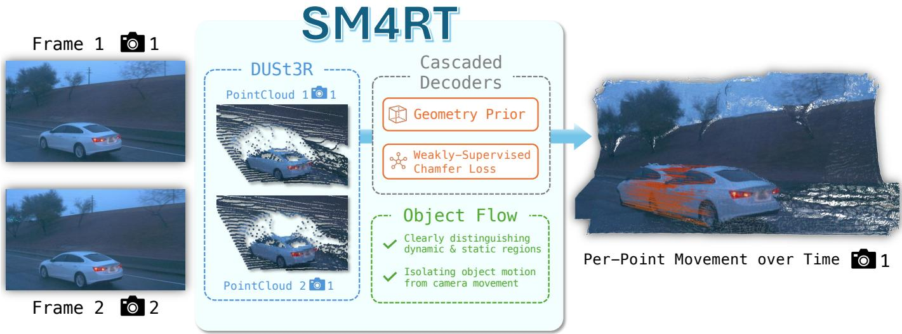
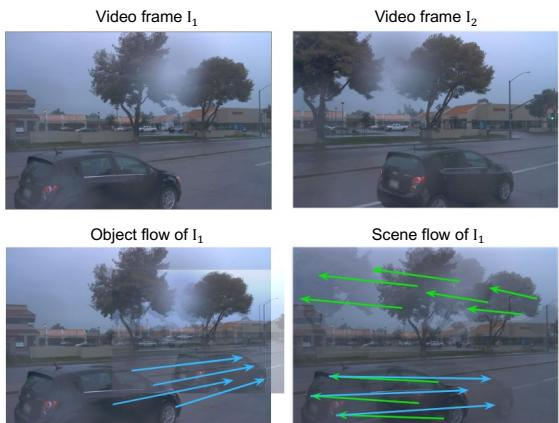
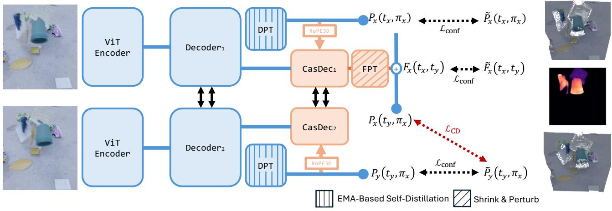
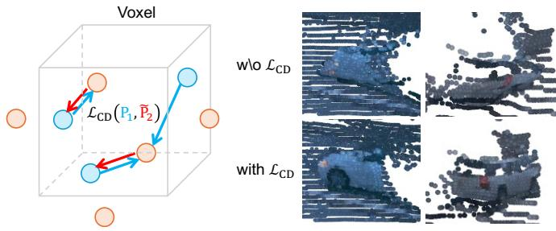
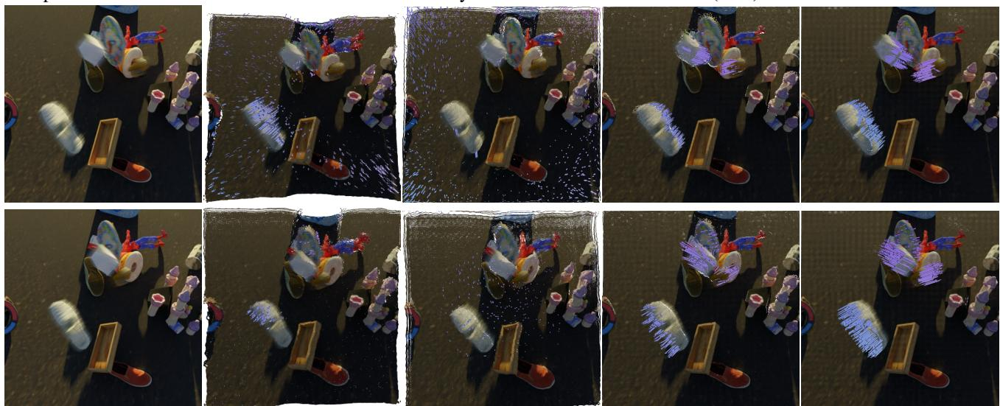
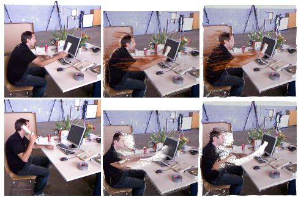
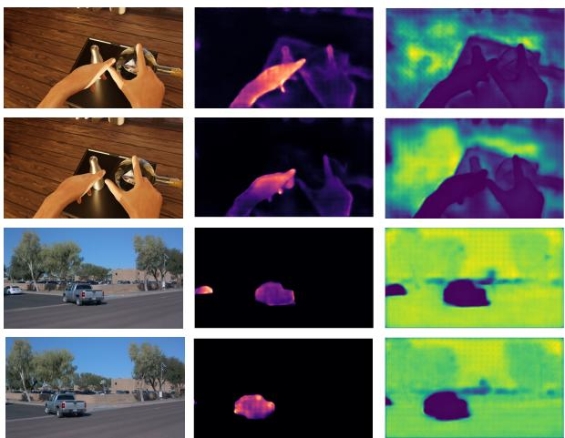
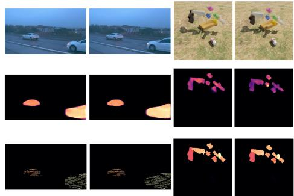
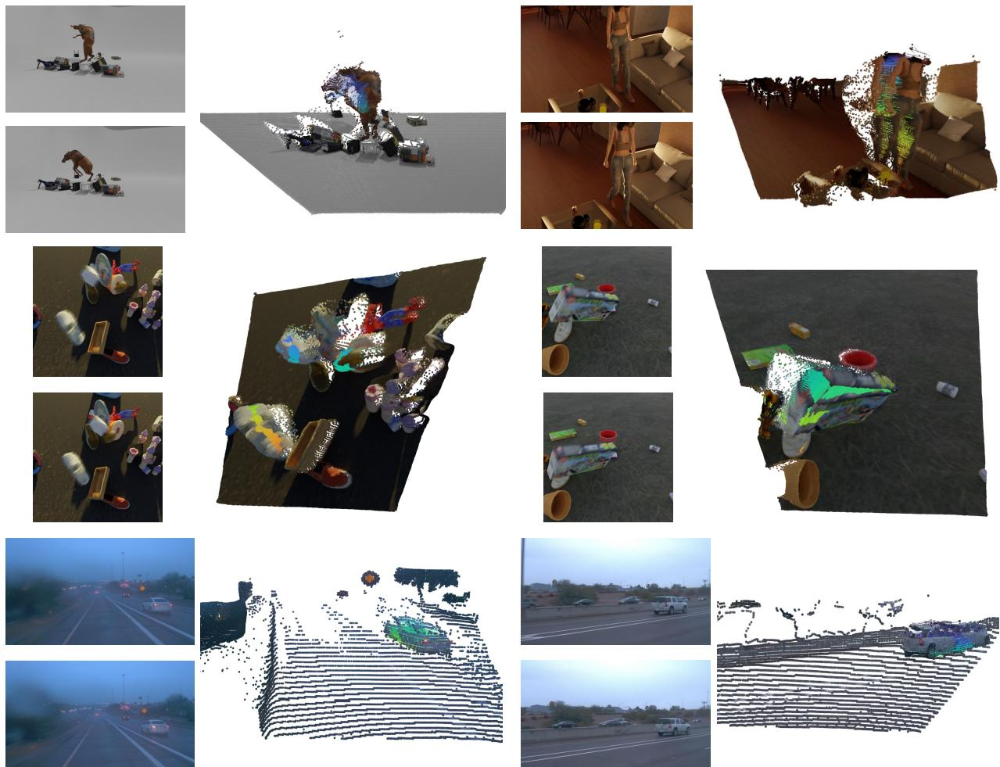

# SM4RT: Cascaded Feed-forward Model for 4D Reconstruction

Pang-Chi Lo1 Jhao-Syun Lai2 Tsung-Wei Ke2

1 Carnegie Mellon University 2 National Taiwan University

  
Figure 1. SM4RT is a multi-task cascade feed-forward model that outputs a 3D point map for geometry reconstruction and object flow for motion estimation from two video frames. SM4RT first reconstructs 3D geometry and then bootstraps motion estimation from the predicted structure, achieving state-of-the-art results on multiple dynamic-scene benchmarks.

## Abstract

We introduce SM4RT, a multi-task cascadefeed-forward model for dynamic scene reconstruction from RGB videos. While existing feed-forward approaches typically address geometry reconstruction and motion estimation separately–and often predict motions in a single coordinate frame that must accountfor camera movement–SM4RT solves these tasks sequentially by first reconstructing 3D geometry and then bootstrapping motion estimation from the predicted structure. By expressing each pixel’s 3D motion in its corresponding camera frame, SM4RT reduces ambiguity arisingfrom camera motion. To address the sparsity of real-world motion labels, SM4RT further incorporates a weakly supervised loss that regularizes unlabeled point motions using labeled point positions at the other time step. We evaluate motion estimation on three dynamic-scene datasets–Kubric, Waymo, and Point Odyssey– and SM4RT achieves the best performance on most metrics compared with prior baselines. We additionally benchmark geometry reconstruction on five dynamic scene datasets and show that SM4RT achieves competitive performance with state-ofthe-art methods. Overall, our unifiedframework demonstrates that combining geometry reconstruction and motion estimation in a cascade not only avoids performance trade-ofs but also enhances motion estimation through improved geometric reasoning.

Project page sm4rt-eailab.github.io

## 1 Introduction

Dynamic 3D scene reconstruction is fundamental to spatial understanding of the visual world. The goal is to recover fine-grained scene geometry and motion from RGB videos, enabling a wide range of applications. In robotics, it supports precise estimation of object pose, part articulation or point deformation; in computer vision, it facilitates simulating, novel-view rendering or editing dynamic scenes.

Simultaneously solving geometry reconstruction and motion estimation from RGB videos remains a substantial challenge, largely due to the strong coupling between these two tasks. Accurate motion estimation requires reliable 3D point locations at each time step [16], while geometry reconstruction depends on consistent multi-view correspondences between 3D points and their 2D projections. However, in dynamic scenes this consistency breaks down, as dynamic motion violates the static assumptions underlying traditional multi-view geometry [10, 18]. Consequently, geometry reconstruction and motion estimation are often addressed separately: the former through Structure from Motion [1, 38] and Simultaneous Localization and Mapping [7], which assume static environments and ignore modeling dynamic content; and the latter through scene flow estimation [16, 19, 36, 45] or 3D point tracking [55, 60], leveraging estimated or sensed depth maps to provide 3D information for video inputs.

Feed-forward frameworks [23, 28, 48, 49, 51] have recently emerged as efective solutions for static 3D geometry reconstruction. These models bypass explicit triangulation by directly predicting 3D point positions from multi-view images, typically centered at a single camera’s coordinate frame to handle varying camera poses. The same architectures have been extended to dynamic scene reconstruction [10, 17, 21, 25, 41, 57], estimating 3D positions of every observed points across time to jointly model geometry and motion. While conceptually simple, such direct extensions are suboptimal: predicting future or past 3D point locations in another camera’s coordinate frame needs to jointly account for both global camera motion and local object motion, which is ambiguous, and therefore increasing the complexity of dynamic scene reconstruction task.

To address this limitation, our key insight is to disentangle camera motion from object motion in dynamic scenes. We make three observations: (1) motion estimation becomes simpler when camera motion is excluded, (2) accurately estimating object motion helps identify static points, and (3) camera motion naturally emerges from the multi-view geometry of these static points. Building on these insights, we focus solely on modeling object motion by predicting 3D point positions across time within each input camera’s coordinate frame. This formulation produces motion patterns that distinctly separate static and dynamic points, enabling robust camera motion estimation from static-point geometry predicted by existing feed-forward models. By defining motion in this disentangled space, we simplify dynamic scene reconstruction and improve the accuracy and coherence of its constituent tasks.

We introduce Structured Motion 4D Reconstruction (SM4RT), a multi-task cascade feed-forward model [5] that bootstraps motion estimation from geometry reconstruction for dynamic scene reconstruction (see Fig. 1). Built on the DUSt3R [51] architecture, SM4RT first predicts 3D point positions from two input video frames and then estimates their 3D motion as positional ofsets. To enhance motion estimation, SM4RT modulates attention [46] between visual tokens based on predicted 3D locations. By ignoring global camera motion, SM4RT predicts per-frame 3D point motion within each camera coordinate frame, producing zero motion for static points. To address the sparsity of real-world point motion annotations, we introduce a weakly-supervised loss that regularizes unlabeled point motion based on labeled point positions from the other time step. Together, these designs enable SM4RT to reconstruct dynamic scenes more accurately and coherently.

We extensively evaluate SM4RT under multiple established setups. Following [41], we evaluate the efectiveness of dynamic scene reconstruction on Kubric-F [15] and Waymo [42] dataset. Our SM4RT outperforms previous state-of-the-arts in terms of estimating object flow on both datasets. Meanwhile, we evaluate the efectiveness of geometry reconstruction on 5 datasets: Sintel [4], Point Odyssey [62], Bonn [35], Kubric-F [15], and KITTI [12]. Our SM4RT achieves competitive performance than previous methods in terms of two-view depth estimation. Our results demonstrate that our unified framework for geometry reconstruction and motion estimation does not compromise the performance of either task. Instead, our cascade design enhances motion estimation with geometry reconstruction. We believe this technical insight would facilitate the development of more advanced feed-forward model architecture for dynamic scene reconstruction.

## 2 Preliminary

  
Figure 2. Visualization of object flow and scene flow. Given two video frames $I _ { 1 }$ and $I _ { 2 } ,$ , we compare two motion representations: object flow and scene flow. The bottom-left panel shows the object flow of frame $I _ { 1 } ,$ , where blue arrows indicate object motion. The bottomright panel shows the scene flow of $I _ { 1 } ,$ , which additionally includes camera motion, indicated by green arrows. Object flow is less ambiguous than scene flow.

Dynamic scene reconstruction involves reconstructing 3D scene geometry and estimating motion from RGB videos. In this section, we briefly introduce the definition of these tasks and review the seminal feed-forward model–DUSt3R [51].

## 2.1 3D Geometry Reconstruction

The goal of 3D geometry reconstruction is to recover scene structure and estimate camera parameters from a set of input images. Following [51], we represent scene structure using a point map–the 3D positions of all image pixels. Let $I \in \mathbb { R } ^ { H \times W }$ denote an RGB image with height � and width �, and $P ( \pi ) \in$ $\mathbb { R } ^ { H \times W \times 3 }$ denote its per-pixel 3D point map expressed in coordinate frame $\pi .$ This formulation allows flexible representation of 3D points in diferent coordinate frames. In practice, point maps are expressed in camera coordinate frames defined by the corresponding camera poses, which describe transformations between the world frame and the camera frame.

Feed-forward geometry reconstruction model. DUSt3R is a transformer-based [46] feed-forward model that takes as input two images, $I _ { 1 }$ and $I _ { 2 } ,$ with corresponding camera poses $\pi _ { 1 }$ and $\pi _ { 2 } .$ It predicts point maps $P _ { 1 } ( \pi _ { 1 } )$ and $P _ { 2 } ( \pi _ { 1 } )$ –the 3D positions of pixels in both images, expressed in $I _ { 1 }$ ’s camera frame. When the input order is reversed, DUSt3R produces $P _ { 2 } ( \pi _ { 2 } )$ and $P _ { 1 } ( \pi _ { 2 } )$ , expressed in $I _ { 2 } ^ { \mathbf { \Omega } , \ }$ s camera frame. This dual prediction enables correspondence between the same scene points expressed in diferent frames, such as $P _ { 1 } ( \pi _ { 1 } )$ vs. $P _ { 1 } ( \pi _ { 2 } )$ or $P _ { 2 } ( \pi _ { 2 } ) \ \mathrm { v s . } \ P _ { 2 } ( \pi _ { 1 } )$ . The relative camera pose can be directly estimated via Procrustes alignment [32] or the Perspective-n-Point (PnP) algorithm [26].

## 2.2 3D Motion Estimation

The goal of motion estimation is to measure the 3D point motion from an input RGB video. Following prior work [21, 41], we define point motion as the residual between pixel-wise 3D positions across time. Let $P _ { n } ( t , \pi )$ denote the 3D positions of pixels from the �-th video frame, as observed at time � and expressed in coordinate frame �. This formulation generalizes that of static-scene reconstruction, where only the current frame is considered $\mathbf { \Psi } ( n \mathbf { \Psi } = \mathbf { \Psi } t )$ , to also describe future and past point maps when $\textit { n } \prec \textit { t }$ and $n \ > \ t .$ . Therefore, we refer to $P _ { n } ( t , \pi )$ as dynamic point maps [41].

Let $I _ { 1 }$ and $I _ { 2 }$ denote two video frames captured at times $t _ { 1 }$ and $t _ { 2 }$ , with corresponding camera poses $\pi _ { 1 }$ and $\pi _ { 2 }$ . The 3D motion of pixels from $I _ { 1 }$ can be defined in three ways, depending on how camera motion is included. The first is scene flow: $P _ { 1 } ( t _ { 2 } , \pi _ { 2 } ) - P _ { 1 } ( t _ { 1 } , \pi _ { 1 } )$ , which captures both object and camera motion. The second is cross-frame object flow: $P _ { 1 } ( t _ { 2 } , \pi _ { 2 } ) - P _ { 1 } ( t _ { 1 } , \pi _ { 2 } )$ , which describes object motion expressed in the second camera’s coordinate frame, and thus requires inferring the relative camera pose. The last is object flow: $P _ { 1 } ( t _ { 2 } , \pi _ { 1 } ) ~ - ~ P _ { 1 } ( t _ { 1 } , \pi _ { 1 } )$ , which ignores camera motion entirely and represents object motion in the first camera’s coordinate frame. Among these, object flow is the least ambiguous representation, since static points yield zero motion values by construction. Fig. 2 illustrates the diference between object flow and scene flow.

Feed-forward dynamic scene reconstruction model. Existing methods [10, 17, 21, 41] extend the DUSt3R architecture for dynamic scene reconstruction by adding independent decoders and dense prediction (DPT) heads [37]. Given two input frames, $I _ { 1 }$ and $I _ { 2 } ,$ , these models predict per-frame dynamic point maps– $\cdot P _ { 1 } ( t _ { 1 } , \pi _ { 1 } ) , P _ { 1 } ( t _ { 2 } , \pi _ { 1 } ) , P _ { 2 } ( t _ { 2 } , \pi _ { 1 } )$ , and $P _ { 2 } ( t _ { 1 } , \pi _ { 1 } ) -$ all expressed in the first camera’s coordinate frame, resulting in a mixture of cross-frame object flow and object flow representation.

However, such direct extensions are suboptimal. To obtain cross-frame object flow $( P _ { 2 } ( t _ { 1 } , \pi _ { 1 } ) ~ - ~ P _ { 2 } ( t _ { 2 } , \pi _ { 1 } ) )$ for image $I _ { 2 } ,$ these models must implicitly infer the relative camera pose between frames. Moreover, future and past point maps $( P _ { 1 } ( t _ { 2 } , \pi _ { 1 } )$ and $P _ { 2 } ( t _ { 1 } , \pi _ { 1 } ) )$ are predicted independently from the current ones, which leads to spatio-temporal inconsistencies in dynamic scene reconstruction.

## 3 Method

SM4RT is a multi-task cascade feed-forward model for dynamic scene reconstruction from RGB videos. As illustrated in Fig. 3, it adopts a geometry-first cascade: dense 3D geometry is reconstructed first and then used to bootstrap motion estimation. To reduce ambiguity from camera motion, SM4RT represents dynamics with object flow rather than motion in a camera-entangled coordinate frame. We further introduce a weakly supervised loss that regularizes unlabeled point motions, enabling the model to better leverage sparsely annotated real-world data.

## 3.1 Multi-task Cascade Feed-Forward Model

SM4RT addresses geometry reconstruction and motion estimation within a cascaded multi-task framework. It first performs geometry reconstruction using a DUSt3R backbone, then feeds the predicted 3D geometry into a transformer-based decoder followed by a DPT head to estimate motion.

For geometry reconstruction, the DUSt3R backbone takes as input an ordered pair of video frames $I _ { 1 }$ and $I _ { 2 }$ with camera pose $\pi _ { 1 }$ and $\pi _ { 2 } .$ , captured at time $t _ { 1 }$ and $t _ { 2 }$ . It extracts visual tokens $G _ { 1 }$ and $G _ { 2 }$ from input images with ViT encoder [6], contextualizes these tokens via cross attention, and projects them to point map $P _ { 1 } ( t _ { 1 } , \pi _ { 1 } )$ and $P _ { 2 } \left( t _ { 2 } , \pi _ { 1 } \right)$ observed at the corresponding time step while expressed in the $I _ { 1 }$ ’s camera frame.

For motion estimation, we feed the updated tokens $G _ { 1 }$ and $G _ { 2 }$ into a transformer decoder, where they cross-attend to enhance spatio-temporal feature representations. Because motion estimation depends on precise 3D localization of each pixel, we inject 3D positional information into the decoder. Specifically, since each token corresponds to an image patch, we compute its 3D position by averaging the predicted 3D coordinates of pixels within that patch. Following prior work in visual correspondence [30] and robotic manipulation [22], we incorporate 3D information by modulating the attention mechanism– encouraging tokens to attend more strongly to spatially nearby ones in 3D. We implement this via rotary positional embeddings [40], encoding relative 3D positions directly in the attention layers (see [40] for details).

Finally, SM4RT predicts the object flow $P _ { 1 } ( t _ { 2 } , \pi _ { 1 } ) ~ -$ $P _ { 1 } ( t _ { 1 } , \pi _ { 1 } )$ of $I _ { 1 } \ ' _ { \mathrm { s } }$ pixels, describing their motion from time $t _ { 1 }$ to $t _ { 2 } ,$ , by projecting token $G _ { 1 }$ through a DPT head. The token $G _ { 1 }$ has been progressively updated through multiple transformer decoder layers. To obtain the reverse object flow of $I _ { 2 } ^ { \mathbf { \Gamma } } { } ^ { \ \ \mathbf { s } }$ pixels: $P _ { 2 } ( t _ { 1 } , \pi _ { 2 } ) \ : - \ : P _ { 2 } ( t _ { 2 } , \pi _ { 2 } )$ , we simply swap the input frame order and perform another feed-forward pass. For brevity, we denote the predicted object flows of $I _ { 1 }$ and $I _ { 2 }$ as $F _ { 1 } ( t _ { 1 } , t _ { 2 } )$ and $F _ { 2 } ( t _ { 2 } , t _ { 1 } )$ , respectively.

## 3.2 Training Objective

For network optimization, SM4RT incorporates two loss functions: a fully supervised regression loss and a weakly supervised Chamfer loss. Together, these objectives jointly supervise both the predicted point maps and object flows. In the following, we describe these loss functions using an ordered input pair $( I _ { 1 } , I _ { 2 } )$ ; the extension to the reversed input order is straightforward.

Scale normalization. Similar to DUSt3R, SM4RT produces relative, not metric, point map and object flows. Normalizing the scale of these outputs is needed during training and inference. We enforce spatio-temporal consistent scales of predicted point maps and object flow by scaling them with the same factor � during training. This scaling factor is:

$$
g = \frac { \mathrm { n o r m } ( \tilde { P } _ { 1 } ( t _ { 1 } , \pi _ { 1 } ) , \tilde { P } _ { 2 } ( t _ { 1 } , \pi _ { 1 } ) ) } { \mathrm { n o r m } ( P _ { 1 } ( t _ { 1 } , \pi _ { 1 } ) , P _ { 2 } ( t _ { 1 } , \pi _ { 1 } ) ) }\tag{1}
$$

where norm(�, �) denotes the average distance between all points from point map � and � and their center, while $\tilde { X }$ is the ground truth of point map �.

Fully-supervised regression loss. We adopt the same loss function as DUSt3R [51] to regress both point map and object flow. First, we define a pixel-wise regression loss:

$$
\mathcal { L } _ { \mathrm { r e g r } } ( X , \tilde { X } , i ) = \| g ^ { i } X ^ { i } - \tilde { X } ^ { i } \| _ { 2 } ^ { 2 }\tag{2}
$$

  
Figure 3. Overview of the framework. SM4RT is a multi-task cascade feed-forward model for dynamic scene reconstruction. It first performs geometry reconstruction using a DUSt3R backbone (blue modules), then feeds the predicted 3D geometry into a transformer-based decoder followed by a DPT head to estimate motion (red modules). SM4RT trains the network with a fully-supervised regression loss ${ \mathcal { L } } _ { \mathsf { c o n f } }$ based on ground-truth dynamic point maps and object flow; at the same time, it incorporates a weakly-supervised Chamfer loss $\mathcal { L } _ { \mathrm { C D } }$ that regularizes unlabeled point motion based on labeled point positions from the other time step, to handle the sparsity of motion labels.

where � denotes a dense map like the point map or object flow, �˜ is the ground truth of �, and superscript � refers to the �-th pixel in �. However, the ground-truth point maps and object flow of real-world data are often sparse and noisy. To handle the sparsity, this fully-supervised loss is only applied to labeled pixels. To address label noise, the DUSt3R backbone is jointly supervised to predict pixel-wise confidence score, which weights the pixel-wise regression loss $\scriptstyle { \mathcal { L } } _ { \mathrm { r e g r } }$ . Let $M ( X )$ denote the set of labeled pixel indices in dense map �, which may correspond to the point map or object flow. The confidence-weighted regression loss is:

$$
\mathcal { L } _ { \mathrm { c o n f } } ( X , \tilde { X } ) = \sum _ { i \in M ( X ) } C ^ { i } \mathcal { L } _ { \mathrm { r e g r } } ( X , \tilde { X } , i ) - \alpha C ^ { i }\tag{3}
$$

where $C ^ { i }$ denotes the confidence score of pixel �, and � encourages high confidence at each pixel.

Weakly-supervised Chamfer loss. Due to the sparsity of motion labels, training models with only the fully-supervised regression loss often leads to inconsistent object flow estimation within the same object. Motivated by this observation, we propose a weakly-supervised loss that regularizes motion output of unlabeled points based on positions of labeled points from the other time steps. In other words, we transform point positions of one frame based on the predicted object flow, and enforce them staying close to those in the other frame. Let �(�) denote the set of pixel indices in dense prediction �. We define Chamfer distance $d _ { \mathsf { C D } }$ [9] as:

$$
\begin{array} { r l r } & { } & { d _ { \mathsf { C D } } ( X _ { 1 } , \tilde { X } _ { 2 } ) = \displaystyle \sum _ { i \in S ( X _ { 1 } ) } \operatorname* { m i n } _ { j \in M ( \tilde { X } _ { 2 } ) } \| X _ { 1 } ^ { i } - \tilde { X } _ { 2 } ^ { j } \| _ { 2 } ^ { 2 } } \\ & { } & { \quad \quad \quad \quad \quad \quad \quad + \displaystyle \sum _ { j \in M ( \tilde { X } _ { 2 } ) } \operatorname* { m i n } _ { i \in S ( X _ { 1 } ) } \| X _ { 1 } ^ { i } - \tilde { X } _ { 2 } ^ { j } \| _ { 2 } ^ { 2 } } \end{array}\tag{4}
$$

where $d _ { \mathsf { C D } } ( X _ { 1 } , \tilde { X } _ { 2 } )$ equals 0 if either $X _ { 1 }$ or ${ \tilde { X } } _ { 2 }$ is empty. Notably, calculating �CD requires searching the nearest neighbor from all points in $\tilde { X } _ { 2 }$ , which is computationally ineficient. Meanwhile, due to occlusion, objects observed in one frame may be invisible in the other frame. We propose to approximate nearest neighbor search while filtering invalid matches through voxelization. As shown in Fig. 4, we discretize the 3D Euclidean space into � voxels, and define the weaklysupervised loss $\mathcal { L } _ { \mathsf { C D } }$ as the accumulation of Chamfer distance across all voxels:

$$
\mathcal { L } _ { \mathrm { C D } } ( X _ { 1 } , \tilde { X } _ { 2 } ) = \sum _ { i = 1 } ^ { N } d _ { \mathrm { C D } } ( V ( X _ { 1 } , i ) , V ( \tilde { X } _ { 2 } , i ) )\tag{5}
$$

where �(�, �) denotes the set of points within the �-th voxel, gathered from dense map �.

EMA-based static geometry distillation loss. During dynamic fine-tuning, SM4RT must learn motion prediction without forgetting the static 3D reconstruction ability inherited from pretraining. We address this with EMA-based static self-distillation [43]. Specifically, we maintain an exponential moving average copy of the online model as a detached teacher and encourage the student to match the teacher’s predicted 3D pointmaps on valid static pixels. The loss is applied to both point predictions in the reference view and points expressed in the other view. Restricting this distillation to static regions preserves geometric reconstruction behavior while avoiding conflict with supervised motion learning on dynamic regions.

$$
\begin{array} { r l r } & { } & { \mathcal { L } _ { \sf S D } ( X _ { 1 } , X _ { 2 } ) = M _ { 1 } ^ { \mathrm { s t a t i c } } \| X _ { 1 } - X _ { 1 } ^ { E M A } \| _ { 2 } ^ { 2 } } \\ & { } & { + M _ { 2 } ^ { \mathrm { s t a t i c } } \| X _ { 2 } - X _ { 2 } ^ { E M A } \| _ { 2 } ^ { 2 } } \end{array}\tag{6}
$$

Total loss. Given an ordered pair of video frames $I _ { 1 }$ and $I _ { 2 } ,$ our SM4RT predicts two point maps $P _ { 1 } ( t _ { 1 } , \pi _ { 1 } ) , P _ { 2 } ( t _ { 2 } , \pi _ { 1 } )$ , a confidence score map $C ,$ and an object flow map $F _ { 1 } ( t _ { 1 } , t _ { 2 } )$ . The total loss of this input pair is as follows:

$$
\begin{array} { r l } & { \mathcal { L } _ { \mathrm { t o t a l } } = \mathcal { L } _ { \mathrm { c o n f } } \left( P _ { 1 } ( t _ { 1 } , \pi _ { 1 } ) , \tilde { P } _ { 1 } ( t _ { 1 } , \pi _ { 1 } ) \right) } \\ & { \qquad + \mathcal { L } _ { \mathrm { c o n f } } \left( P _ { 2 } ( t _ { 2 } , \pi _ { 1 } ) , \tilde { P } _ { 2 } ( t _ { 2 } , \pi _ { 1 } ) \right) } \\ & { \qquad + \mathcal { L } _ { \mathrm { c o n f } } \left( F _ { 1 } ( t _ { 1 } , t _ { 2 } ) , \tilde { F } _ { 1 } ( t _ { 1 } , t _ { 2 } ) \right) } \\ & { \qquad + \mathcal { L } _ { \mathrm { S D } } ( P _ { 1 } ( t _ { 1 } , \pi _ { 1 } ) , P _ { 2 } ( t _ { 2 } , \pi _ { 1 } ) ) } \\ & { \qquad + \lambda \mathcal { L } _ { \mathrm { C D } } \left( P _ { 1 } ( t _ { 1 } , \pi _ { 1 } ) + F _ { 1 } ( t _ { 1 } , t _ { 2 } ) , \tilde { P } _ { 2 } ( t _ { 2 } , \pi _ { 1 } ) \right) } \end{array}\tag{7}
$$

where � weights Chamfer loss $\mathcal { L } _ { \mathsf { C D } }$ . In practice, adopting this weakly-supervised loss in the early stage of training would sabotage the model performance. It ofers better supervision when predicted point map $P _ { 1 } ( t _ { 1 } , \pi _ { 1 } )$ becomes accurate. Therefore, we adopt a sigmoid scheduler to gradually increase � during training.

Plasticity injection on flow prediction heads. The motion heads in SM4RT are initialized from pretrained depth heads, providing a useful geometric prior but also introducing a bias toward static pointmap prediction. To help these reused heads adapt to motion estimation, we apply shrink-and-perturb [3] during fine-tuning. At scheduled steps, the flow-head parameters are interpolated with freshly initialized weights,

$$
\theta  \lambda \theta + ( 1 - \lambda ) \theta _ { \mathrm { i n i t } } ,
$$

with � annealed toward 1 over training. This periodically injects a diminishing amount of plasticity into the motion heads, encouraging adaptation beyond the pretrained static reconstruction prior while preserving the advantages of depth-head initialization.

  
Figure 4. Weakly-supervised Chamfer loss with voxelization. Left: We propose a weakly-supervised Chamfer loss, $\mathcal { L } _ { \mathsf { C D } } .$ , to supervise a point set $P _ { 1 }$ using another point set ${ \tilde { P } } _ { 2 }$ without requiring point correspondences. By voxelizing the 3D Euclidean space, we compute the Chamfer loss within each voxel, approximating nearest-neighbor search while filtering invalid matches. Right: The top row shows outputs from a model trained without the Chamfer loss, while the bottom row shows outputs when it is used. The proposed weakly-supervised loss significantly improves dynamic scene reconstruction.

## 4 Experiments

## 4.1 Experimental Setup

Training dataset. We train SM4RT on a diverse mixture of static (WildRGBD [54], BlendedMVS [58]) and dynamic (Waymo [42], Kubric-F [15], Spring [33] and Point Odyssey [62]) datasets. This collection provides a wide range of real-world, synthetic, indoor, and outdoor scenes. We closely follow prior work [41, 51] to prepare ground-truth point position and motion annotations. For Point Odyssey, we annotate 2D pixels using the corresponding 3D point trajectories provided by the simulator. For Waymo and Kubric-F, motion labels are derived from the 3D bounding box poses of each object, while 3D position labels are obtained from Lidar measurements in Waymo and from unprojected rendered depth maps in Kubric-F. Spring provides ground-truth disparity and flow in adjacent frames. We extend these labels to aggregate for long-time diference flow with consistency filtering to avoid mismatches. For WildRGBD and BlendedMVS, position labels are derived from unprojected depth maps, and motion labels are set to zero.

Testing dataset. We evaluate SM4RT under the setup of motion estimation and geometry reconstruction.

For motion estimation, we consider three dynamic scene datasets–Waymo, Kubric-F and Point Odyssey, where models are evaluated on a held-out testing set. Following [41], we adopt three metrics to evaluate the model performance, including (1) end-point error (EPE) of object flow, that measures the average Euclidean distance between the predicted and ground-truth object flow, (2) relative point cloud error $L _ { \mathrm { r e l } }$ , that measures the relative L2 error of the predicted and ground-truth point map, and (3) relative pose transformation, that calculates the spatial transformation needed to align the predicted and ground-truth point map. We calculate the relative pose via PnP over point maps $P _ { 1 } ( \pi _ { 1 } ) , P _ { 2 } ( \pi _ { 1 } )$ .

For geometry reconstruction, we extensively evaluate on the held-out testing set of 5 datasets: Sintel [4], Point Odyssey [62], Bonn [35], Kubric-F [15], and KITTI [12]. Depth estimation is typically considered as the proxy task for evaluating the performance of geometry reconstruction. We adopt two established depth metrics: absolute relative error (Abs Rel) and $\delta < 1 . 2 5$ accuracy [56]. See the Appendix for detailed formulation of each metric.

Baseline methods. We consider the following baseline methods: (1) MonST3R [61], that directly extends DUSt3R to dynamic scenes. It predicts two point maps $P _ { 1 } ( t _ { 1 } , \pi _ { 1 } )$ and $P _ { 2 } \left( t _ { 2 } , \pi _ { 1 } \right)$ , associates pixels between image $I _ { 1 }$ and $I _ { 2 }$ through estimated optical flow, and calculates object flow by subtracting 3D positions of associated pixels across time. (2) DPM [41], that learns to predict dynamic point map $P _ { 1 } ( t _ { 1 } , \pi _ { 1 } ) , P _ { 1 } ( t _ { 2 } , \pi _ { 1 } ) , P _ { 2 } ( t _ { 2 } , \pi _ { 1 } ) , P _ { 2 } ( t _ { 1 } , \pi _ { 1 } )$ and estimates motion by subtracting a pair of point maps. (3) DynaDUSt3R [21], that learns to predict object flow $P _ { 1 } ( t _ { 2 } , \pi _ { 1 } ) ~ - ~ P _ { 1 } ( t _ { 2 } , \pi _ { 1 } )$ of $I _ { 1 } { ' } s$ pixels from $t _ { 1 }$ to $t _ { 2 } .$ , and cross-frame object flow $P _ { 2 } ( t _ { 1 } , \pi _ { 1 } ) - P _ { 2 } ( t _ { 1 } , \pi _ { 1 } )$ of $I _ { 2 } ^ { \mathbf { \Gamma } } { } ^ { \ \ \mathbf { s } }$ pixels reversely from $t _ { 2 }$ to $t _ { 1 }$ For DPM, we report their results based on the paper as there is no publicly available code. For DynaDUSt3R, we use its publicly released code base1 to train the model. We strictly follow the same hyperparameter configuration as the original paper and train a separate model for each evaluation dataset.

<table><tr><td rowspan="2">Dataset</td><td rowspan="2">Method</td><td colspan="4"> $L _ { \mathsf { r e l } }$ </td><td colspan="2">Object Flow</td><td colspan="2">Relative Pose Error</td></tr><tr><td> $P _ { 1 } ( t _ { 1 } )$ </td><td> $P _ { 2 } ( t _ { 1 } )$ </td><td> $P _ { 1 } ( t _ { 2 } )$ </td><td> $P _ { 2 } ( t _ { 2 } )$ </td><td> $t _ { 1 }  t _ { 2 }$ </td><td> $t _ { 2 }  t _ { 1 }$ </td><td>rot</td><td>trans</td></tr><tr><td rowspan="4">Kub.-F</td><td>MonST3R [61]</td><td>0.291</td><td>0.286</td><td>0.286</td><td>0.284</td><td>0.050</td><td>0.049</td><td>0.873</td><td>0.181</td></tr><tr><td>DPM [41]</td><td>0.041</td><td>0.047</td><td>0.049</td><td>0.035</td><td>0.033</td><td>0.029</td><td></td><td></td></tr><tr><td>DynaDUSt3R [21]</td><td>0.108</td><td>0.122</td><td>0.104</td><td>0.112</td><td>0.054</td><td>0.053</td><td>3.507</td><td>0.357</td></tr><tr><td>SM4RT (ours)</td><td>0.045</td><td>0.044</td><td>0.045</td><td>0.046</td><td>0.018</td><td>0.017</td><td>0.193</td><td>0.085</td></tr><tr><td rowspan="4">Waymo</td><td>MonST3R [61]</td><td>0.170</td><td>0.241</td><td>0.332</td><td>0.128</td><td>0.096</td><td>0.100</td><td>0.787</td><td>1.048</td></tr><tr><td>DPM [41]</td><td>0.068</td><td>0.065</td><td>0.067</td><td>0.065</td><td>0.020</td><td>0.020</td><td></td><td></td></tr><tr><td>DynaDUSt3R [21]</td><td>0.224</td><td>0.192</td><td>0.225</td><td>0.187</td><td>0.103</td><td>0.096</td><td>2.898</td><td>1.145</td></tr><tr><td>SM4RT (ours)</td><td>0.079</td><td>0.078</td><td>0.079</td><td>0.078</td><td>0.013</td><td>0.015</td><td>0.193</td><td>0.168</td></tr><tr><td rowspan="3">Point Odyssey</td><td>MonST3R [61]</td><td>0.047</td><td>0.183</td><td>0.173</td><td>0.048</td><td>0.640</td><td>0.626</td><td>0.436</td><td>0.024</td></tr><tr><td>DynaDUSt3R [21]</td><td>0.215</td><td>0.162</td><td>0.159</td><td>0.214</td><td>0.097</td><td>0.094</td><td>0.895</td><td>0.040</td></tr><tr><td>SM4RT (ours)</td><td>0.050</td><td>0.049</td><td>0.049</td><td>0.048</td><td>0.072</td><td>0.074</td><td>0.393</td><td>0.053</td></tr></table>

Table 1. Evaluation of motion estimation. We test on 3 dynamic scene datasets: Kubric-F [14], Waymo [42] and Point Odyssey [62]. We adopt three metrics: end-point error of object flow, relative point cloud err $\mathcal { L } _ { \mathrm { r e l } } ,$ , and relative pose transformation. SM4RT matches top performance in dynamic point map estimation, and outperforms state of the art methods in other metrics.
<table><tr><td></td><td colspan="2">Sintel</td><td colspan="2">Point Odyssey</td><td colspan="2">Bonn</td><td colspan="2">Kubric</td><td colspan="2">KITTI</td></tr><tr><td></td><td>Abs Rel</td><td> $\sigma < 1 . 2 5$ </td><td>Abs Rel</td><td> $\sigma < 1 . 2 5$ </td><td>Abs Rel</td><td> $\sigma < 1 . 2 5$ </td><td>Abs Rel</td><td> $\sigma < 1 . 2 5$ </td><td>Abs Rel</td><td> $\sigma < 1 . 2 5$ </td></tr><tr><td>MonST3R [61]</td><td>0.347</td><td>0.573</td><td>0.065</td><td>0.953</td><td>0.071</td><td>0.941</td><td>0.166</td><td>0.779</td><td>0.069</td><td>0.945</td></tr><tr><td>DPM [41]</td><td>0.321</td><td>0.564</td><td>0.059</td><td>0.957</td><td>0.082</td><td>0.919</td><td>0.078</td><td>0.950</td><td>0.052</td><td>0.968</td></tr><tr><td>SM4RT (ours)</td><td>0.367</td><td>0.482</td><td>0.064</td><td>0.937</td><td>0.082</td><td>0.937</td><td>0.044</td><td>0.963</td><td>0.089</td><td>0.951</td></tr></table>

Table 2. Depth Evaluation from 2-View Input. We test on 5 established datasets: Sintel [4], Point Odyssey [62], Bonn [34], Kubric [14], and KITTI [12]. Our method maintains comparable performance on depth estimation meanwhile excels on dynamic motion estimation.

Training details. During training, we randomly sample image pairs within � ∈ [1, 15] frames from a video (depending on the dataset), and resize them to a resolution randomly selected from $\{ 5 1 2 \times 2 8 8 , 5 1 2 \times 3 3 6 , 5 1 2 \times 3 8 4 , 5 1 2 \times 5 1 2 \}$ We train the model for 200 epochs based on an adaptive learning rate schedule, with an initial learning $5 e ^ { - 5 }$ . Our model is trained on four NVIDIA ADA 6000 GPUs for 40 hours.

## 4.2 Evaluating Motion Estimation

We evaluate on the held-out test split of Waymo, Kubric-F and Point Odyssey dataset. On Waymo, we sample 1000 adjacent pairs of frames from unseen clips. On Kubric, we sample 1000 image pairs of adjacent frames from the 1470 testing scenes. On Point Odyssey, we sample 1000 image pairs within 10 frames from 109 unseen video sections.

In this experiment, we evaluate the quality of the predicted dynamic point maps, object flows, and pose estimation. A key distinction is that all baseline methods express the 3D positions and motions of pixels from both $I _ { 1 }$ and $I _ { 2 }$ in the camera frame of $I _ { 1 } \left( \pi _ { 1 } \right)$ . In contrast, SM4RT expresses pixels from $I _ { 1 }$ and $I _ { 2 }$ in their respective camera frames (�1 and �2). For a fair comparison, we transform each baseline’s predictions for pixels of

$I _ { 2 }$ into its own camera frame (�2) using the ground-truth relative camera pose. This transformation has no efect on their quantitative metrics, as rigid spatial transformations preserve Euclidean distances.

We summarize our results in Table 1. Our method SM4RT demonstrates consistently strong performance across all three dynamic scene datasets. While achieving competitive results in point map estimation $\left( L _ { r e l } \right)$ against leading methods, our approach significantly outperforms all baselines in the more challenging tasks of object flow and relative pose estimation. On the Waymo dataset, SM4RT reduces object flow error by nearly 33% improvement compared to the next-best method (0.014 EPE vs. 0.020 EPE). Similarly, on Kubric-F, our model achieves a competitive state-of-the-art object flow EPE and the lowest relative pose error. This trend holds on Point Odyssey, confirming that our model’s cascaded design and motion representation lead to a superior estimation of dynamic motion. We also present qualitative results in Fig. 5.

## 4.3 Evaluating Geometry Reconstruction

We test on the held-out testing set of Sintel, Point Odyssey, Bonn, Kubric-F and KITTI. The evaluation procedure strictly follows prior work [41], considering two-view depth estimation as the proxy task. We randomly sample pairs of images $I _ { 1 }$ and $I _ { 2 }$ from videos, extracting the depth map as the z-coordinates of the predicted point map of image $I _ { 1 }$ and calculates Abs Rel and $\delta \ < \ 1 . 2 5$ accuracy with regard to the ground-truth depth map. To obtain the depth map of image $I _ { 2 } ,$ , we simply swap the input order of these two images. See [41, 51] for more details.

Our results are presented in Table 2. Our method maintains comparable performance across datasets, proving that our cascaded design does not compromise the performance of geometry reconstruction.

<table><tr><td rowspan="2">Dataset: Waymo</td><td colspan="2"> $L _ { r e l }$ </td><td colspan="2">Object Flow</td></tr><tr><td> $P _ { 1 } ( \pi _ { 1 } )$ </td><td> $P _ { 2 } ( \pi _ { 2 } )$ </td><td>Forward</td><td>Backward</td></tr><tr><td>SM4RT (ours)</td><td>0.075</td><td>0.075</td><td>0.006</td><td>0.007</td></tr><tr><td>w/o Chamfer loss</td><td>0.151</td><td>0.151</td><td>0.038</td><td>0.037</td></tr><tr><td>w/o 3D RoPE</td><td>0.147</td><td>0.146</td><td>0.039</td><td>0.038</td></tr></table>

Table 3. Ablation studies on model components. We train and evaluate each component of our model on the Waymo dataset. Both the proposed weakly-supervised Chamfer loss and the injection of predicted 3D point positions into the motion estimator using RoPE [40] are essential for strong performance.

## 4.4 Ablation study

We perform extensive ablation studies to assess the contribution of each model component of our SM4RT. The experiments are conducted on the Waymo dataset, where all models are trained for 200 epochs. We summarize the results in Table 3 and discuss them as follows.

Enhancing motion estimation with geometry reconstruction. We validate the contribution of predicted 3D point positions to motion estimation by removing their injection into the motion estimator’s transformer decoder. Specifically, we replace each token’s 3D position with its corresponding 2D pixel coordinates. As in DUSt3R, RoPE is applied to encode relative positional information in the attention layers. This modification leads to a substantial performance drop. The model without 3D point positions exhibits 0.072 and 0.071 higher $L _ { \mathrm { r e l } }$ for the predicted point maps of $I _ { 1 }$ and $I _ { 2 } .$ respectively. It also shows 0.033 and 0.031 higher EPE for the corresponding object flows. These results confirm that the predicted 3D point positions are essential for accurate motion estimation.

Weakly-supervised Chamfer loss. We evaluate the efectiveness of the weakly-supervised loss $\mathcal { L } _ { C D }$ under sparse motion annotations by removing it from the total loss (Eqn. 7). The model trained without $\mathcal { L } _ { C D }$ shows a substantial degradation in performance: $L _ { \mathrm { r e l } }$ for the predicted point maps of $I _ { 1 }$ and $I _ { 2 }$ increases from 0.075 to 0.151, and the EPE of object flow increases by 0.032 and 0.030, respectively. These results indicate that the sparsity of real-world motion labels forms a major performance bottleneck, and incorporating the weaklysupervised loss helps alleviate this limitation by efectively regularizing unlabeled points.

## 4.5 Qualitative analysis

We perform qualitative analysis on selected samples from the testing sets of Kubric-F to demonstrate the efectiveness of our approach. Fig. 5 shows an example image pair extracted from a video clip in Kubric. MonSt3R has some success in recognizing object flows with 2D optical flow methods, but struggles on smaller objects and clearly static points in the background. DynaDUSt3R fails to detect any significant motion, which may be due to the lack of incorporating the predicted point maps during motion prediction. SM4RT shows the most resemblance to the ground truth, correctly predicting several diferent directions for multiple objects. This shows that SM4RT performs well even during scenes with complex object motion. In Fig. $^ { 6 , }$ we also demonstrate motion prediction performance on human hand and body movement in real-world unseen examples from TUM RGB-D SLAM [39] dataset.

## 5 Related Work

Learning based 3D reconstruction. The field of 3D scene reconstruction has explored diverse 3D representations, including implicit methods, meshes [2], and 3D Gaussian Splatting [13, 53]. Parallel to these, explicit point cloud reconstruction has seen significant advances. Foundational models like DUSt3R [51] have revolutionized the field by creating a unified framework for estimating depth, camera intrinsics, and extrinsics from stereo views. Subsequent works such as MASt3R[28] further enable robust 3D image matching, and several other works based on DUSt3R [47, 49, 50] extend the model to perform global scene reconstruction from video. Our work harnesses DUSt3R’s proven strengths in 3D scene reconstruction and alignment as a foundation, allowing our model to perform 4D sceneflow estimation with point cloud reconstructions.

4D reconstruction. Beyond static 3D, 4D reconstruction aims to model temporal dynamics. While some methods extend 3D Gaussian Splatting (3D-GS) [52], a key approach is tracking point correspondences over time. Earlier methods such as MonST3R[61] combined depth with optical flow trackers, such as RAFT [44, 45], to reconstruct 3D point movement. More recently, end-to-end networks inspired by DUSt3R [51] directly predict point clouds and their motion.

A critical challenge in this area is the disentanglement of object motion from camera motion. Several works have addressed this: Monst3R [61] introduced static mask prediction, integrating RAFT to enhance static background matching. DynaDUSt3R [21] attempts to directly predict object motion while keeping 3D reconstruction unchanged. Dynamic Point Maps (DPM) [41] address this by introducing time invariance as well as viewpoint invariance. However, by predicting motion into a single coordinate frame, these methods often struggle to fully separate object motion from camera motion. Instead, our model guarantees that object flow is predicted from the same frame as the point map. Additionally, we leverage positional information from predicted point maps to aid downstream decoder blocks in predicting displacement from the original point cloud, simplifying the motion estimation task.

Input video frames  
MonST3R  
DynaDUSt3R  
SM4RT (ours)  
Ground-truth  
  
Figure 5. Visual results of motion estimation. From left to right, we present the input image, object flow predicted by MonST3R [61], Dy naDUSt3R [21], SM4RT, and the ground-truth object flow. The top and bottom row show the input image pair at two time steps. The experiment is conducted on Kubric-F dataset. The output motions of MonST3R and DynaDUSt3R are noisy and incorrect. In contrast, SM4RT is the best among all models for dynamic scene reconstruction.

Input video frames  
DynaDUSt3R  
SM4RT  
  
Figure 6. Visualization on TUM RGB-D SLAM Benchmark. The top image shows the first frame with object flow, while the bottom image shows the point map obtained by moving the first point map with the predicted object flow $P _ { 1 } ( t _ { 2 } , \pi _ { 1 } )$

## 6 Summary

This paper introduces SM4RT, a multi-task cascade feedforward model for dynamic scene reconstruction from RGB videos. The model first reconstructs 3D geometry and subsequently bootstraps motion estimation from the predicted structure. By expressing 3D motion within each pixel’s corresponding camera frame, SM4RT efectively disentangles object motion from the ambiguity of camera movement. The framework also incorporates a weakly-supervised loss to address the common challenge of sparse motion labels in real-world data.

We evaluated SM4RT on multiple dynamic-scene datasets, where it consistently outperformed all baselines for motion estimation tasks. Furthermore, it achieved competitive performance with state-of-the-art methods for geometry reconstruction. These results demonstrate that a cascaded, geometry-informed approach enhances motion estimation accuracy without compromising the performance of either task, leading to improved overall geometric reasoning.

Limitation & Future work. Our SM4RT operates on a pair of video frames and predicts the motion between them, but extending this framework to long-horizon videos remains a significant challenge. In addition, SM4RT currently relies on the DUSt3R backbone for geometry reconstruction, which can degrade in the presence of dynamic object motion. Developing methods that maintain robust geometry reconstruction in dy namic scenes is an important direction for future work. We agree that multi-frame reconstruction is an important extension. We deliberately study the two-frame setting to isolate the contribution of geometry priors to dynamic reconstruction. Importantly, our cascaded design is not tied to a specific backbone or temporal window, and can serve as a plug-and-play dynamic module for multi-frame models such as VGGT [49] and DA3 [31]. Their temporally aggregated geometry can provide stronger correspondence priors, while our object-flow module separates camera-induced motion from independently moving regions. Moreover, the 3D RoPE formulation encodes geometry in a spatially consistent coordinate system and can be extended with temporal indexing to support correspondence reasoning across longer sequences.

## Acknowledgments

This work was also supported by the AMD University Program AI & HPC Cluster. We further acknowledge Kuo-Guang Tsai for his technical support on the AMD system cluster infrastructure. This research was also supported by the National Science and Technology Council (NSTC), Taiwan, under Grants 115- 2634-F-002 -012 - and 115-2634-F-002 -001 -

## References

[1] Sameer Agarwal, Yasutaka Furukawa, Noah Snavely, Ian Simon, Brian Curless, Steven M Seitz, and Richard Szeliski. Building rome in a day. Communications ofthe ACM, 54(10):105–112, 2011.

[2] Titas Anciukevičius, Zexiang Xu, Matthew Fisher, Paul Henderson, Hakan Bilen, Niloy J Mitra, and Paul Guerrero. Renderdifusion: Image difusion for 3d reconstruction, inpainting and generation. In Proceedings of the IEEE/CVF conference on computer vision and pattern recognition, pages 12608–12618, 2023.

[3] Jordan T. Ash and Ryan P. Adams. On warm-starting neural network training, 2020. URL https://arxiv. org/abs/1910.08475.

[4] D. J. Butler, J. Wulf, G. B. Stanley, and M. J. Black. A naturalistic open source movie for optical flow evaluation. In A. Fitzgibbon et al. (Eds.), editor, European Conf. on Computer Vision (ECCV), Part IV, LNCS 7577, pages 611–625. Springer-Verlag, October 2012.

[5] Jifeng Dai, Kaiming He, and Jian Sun. Instance-aware semantic segmentation via multi-task network cascades. In Proceedings of the IEEE conference on computer vision and pattern recognition, pages 3150–3158, 2016.

[6] Alexey Dosovitskiy. An image is worth 16x16 words: Transformers for image recognition at scale. arXiv preprint arXiv:2010.11929, 2020.

[7] Hugh Durrant-Whyte and Tim Bailey. Simultaneous localization and mapping: part i. IEEE robotics & automation magazine, 13(2):99–110, 2006.

[8] Ben Eisner, Harry Zhang, and David Held. Flowbot3d: Learning 3d articulation flow to manipulate articulated objects, 2024. URL https://arxiv.org/abs/2205. 04382.

[9] Haoqiang Fan, Hao Su, and Leonidas J Guibas. A point set generation network for 3d object reconstruction from a single image. In Proceedings of the IEEE conference on computer vision and pattern recognition, pages 605–613, 2017.

[10] Haiwen Feng, Junyi Zhang, Qianqian Wang, Yufei Ye, Pengcheng Yu, Michael J Black, Trevor Darrell, and Angjoo Kanazawa. St4rtrack: Simultaneous 4d reconstruction and tracking in the world. arXiv preprint arXiv:2504.13152, 2025.

[11] Martin A Fischler and Robert C Bolles. Random sample consensus: A paradigm for model fitting with applications to image analysis and automated cartography. Communications ofthe ACM, 24(6):381–395, 1981.

[12] Andreas Geiger, Philip Lenz, Christoph Stiller, and Raquel Urtasun. Vision meets robotics: The kitti dataset. International Journal ofRobotics Research (IJRR), 2013.

[13] Jia Gong, Lin Geng Foo, Zhipeng Fan, Qiuhong Ke, Hossein Rahmani, and Jun Liu. Difpose: Toward more reliable 3d pose estimation. In Proceedings ofthe IEEE/CVF Conference on Computer Vision and Pattern Recognition, pages 13041–13051, 2023.

[14] Klaus Gref, Francois Belletti, Lucas Beyer, Carl Doersch, Yilun Du, Daniel Duckworth, David J Fleet, Dan Gnanapragasam, Florian Golemo, Charles Herrmann, Thomas Kipf, Abhijit Kundu, Dmitry Lagun, Issam Laradji, Hsueh-Ti (Derek) Liu, Henning Meyer, Yishu Miao, Derek Nowrouzezahrai, Cengiz Oztireli, Etienne Pot, Noha Radwan, Daniel Rebain, Sara Sabour, Mehdi S. M. Sajjadi, Matan Sela, Vincent Sitzmann, Austin Stone, Deqing Sun, Suhani Vora, Ziyu Wang, Tianhao Wu, Kwang Moo Yi, Fangcheng Zhong, and Andrea Tagliasacchi. Kubric: a scalable dataset generator. 2022.

[15] Klaus Gref, Francois Belletti, Lucas Beyer, Carl Doersch, Yilun Du, Daniel Duckworth, David J Fleet, Dan Gnanapragasam, Florian Golemo, Charles Herrmann, et al. Kubric: A scalable dataset generator. In Proceedings ofthe IEEE/CVF conference on computer vision and pattern recognition, pages 3749–3761, 2022.

[16] Simon Hadfield and Richard Bowden. Kinecting the dots: Particle based scene flow from depth sensors. In 2011 International Conference on Computer Vision, pages 2290– 2295. IEEE, 2011.

[17] Jisang Han, Honggyu An, Jaewoo Jung, Takuya Narihira, Junyoung Seo, Kazumi Fukuda, Chaehyun Kim, Sunghwan Hong, Yuki Mitsufuji, and Seungryong Kim. D^ 2ust3r: Enhancing 3d reconstruction with 4d pointmaps for dynamic scenes. arXiv preprint arXiv:2504.06264, 2025.

[18] Richard Hartley and Andrew Zisserman. Multiple view geometry in computer vision. Cambridge university press, 2003.

[19] Michael Hornacek, Andrew Fitzgibbon, and Carsten Rother. Sphereflow: 6 dof scene flow from rgb-d pairs. In Proceedings ofthe IEEE Conference on Computer Vision and Pattern Recognition, pages 3526–3533, 2014.

[20] Wenbo Hu, Xiangjun Gao, Xiaoyu Li, Sijie Zhao, Xiaodong Cun, Yong Zhang, Long Quan, and Ying Shan. Depthcrafter: Generating consistent long depth sequences for open-world videos. In CVPR, 2025.

[21] Linyi Jin, Richard Tucker, Zhengqi Li, David Fouhey, Noah Snavely, and Aleksander Holynski. Stereo4d: Learning how things move in 3d from internet stereo videos. arXiv preprint arXiv:2412.09621, 2024.

[22] Tsung-Wei Ke, Nikolaos Gkanatsios, and Katerina Fragkiadaki. 3d difuser actor: Policy difusion with 3d scene representations. arXiv preprint arXiv:2402.10885, 2024.

[23] Nikhil Keetha, Norman Müller, Johannes Schönberger, Lorenzo Porzi, Yuchen Zhang, Tobias Fischer, Arno Knapitsch, Duncan Zauss, Ethan Weber, Nelson Antunes, et al. Mapanything: Universal feed-forward metric 3d reconstruction. arXiv preprint arXiv:2509.13414, 2025.

[24] Skanda Koppula, Ignacio Rocco, Yi Yang, Joe Heyward, João Carreira, Andrew Zisserman, Gabriel Brostow, and Carl Doersch. Tapvid-3d: A benchmark for tracking any point in 3d. In NeurIPS, 2024.

[25] Jiahui Lei, Yijia Weng, Adam W Harley, Leonidas Guibas, and Kostas Daniilidis. Mosca: Dynamic gaussian fusion from casual videos via 4d motion scafolds. In Proceedings ofthe Computer Vision and Pattern Recognition Conference, pages 6165–6177, 2025.

[26] Vincent Lepetit, Francesc Moreno-Noguer, and Pascal Fua. Ep n p: An accurate o (n) solution to the p n p problem. International journal of computer vision, 81 (2):155–166, 2009.

[27] Vincent Lepetit, Francesc Moreno-Noguer, and Pascal Fua. Epnp: An accurate o(n) solution to the pnp problem. International Journal of Computer Vision, 81(2): 155, 2009.

[28] Vincent Leroy, Yohann Cabon, and Jérôme Revaud. Grounding image matching in 3d with mast3r. In European Conference on Computer Vision, pages 71–91. Springer, 2024.

[29] Vincent Leroy, Yohann Cabon, and Jerome Revaud. Grounding image matching in 3d with mast3r, 2024.

[30] Yang Li and Tatsuya Harada. Lepard: Learning partial point cloud matching in rigid and deformable scenes. In Proceedings of the IEEE/CVF conference on computer vision and pattern recognition, pages 5554–5564, 2022.

[31] Haotong Lin, Sili Chen, Junhao Liew, Donny Y. Chen, Zhenyu Li, Guang Shi, Jiashi Feng, and Bingyi Kang. Depth anything 3: Recovering the visual space from any views, 2025. URL https://arxiv.org/abs/2511. 10647.

[32] Bin Luo and Edwin R Hancock. Procrustes alignment with the em algorithm. In International Conference on Computer Analysis of Images and Patterns, pages 623– 631. Springer, 1999.

[33] Lukas Mehl, Jenny Schmalfuss, Azin Jahedi, Yaroslava Nalivayko, and Andrés Bruhn. Spring: A high-resolution high-detail dataset and benchmark for scene flow, optical flow and stereo. In Proc. IEEE/CVF Conference on Computer Vision and Pattern Recognition (CVPR), pages 4981–4991, 2023.

[34] E. Palazzolo, J. Behley, P. Lottes, P. Giguère, and C. Stachniss. ReFusion: 3D Reconstruction in Dynamic Environments for RGB-D Cameras Exploiting Residuals. 2019. URL https://www.ipb.uni-bonn.de/pdfs/ palazzolo2019iros.pdf.

[35] Emanuele Palazzolo, Jens Behley, Philipp Lottes, Philippe Giguere, and Cyrill Stachniss. Refusion: 3d reconstruction in dynamic environments for rgb-d cameras exploiting residuals. In 2019 IEEE/RSJ International Conference on Intelligent Robots and Systems (IROS), pages 7855–7862. IEEE, 2019.

[36] Julian Quiroga, Thomas Brox, Frédéric Devernay, and James Crowley. Dense semi-rigid scene flow estimation from rgbd images. In European Conference on Computer Vision, pages 567–582. Springer, 2014.

[37] René Ranftl, Alexey Bochkovskiy, and Vladlen Koltun. Vision transformers for dense prediction. In Proceedings of the IEEE/CVF international conference on computer vision, pages 12179–12188, 2021.

[38] Johannes L Schonberger and Jan-Michael Frahm. Structure-from-motion revisited. In Proceedings of the IEEE conference on computer vision and pattern recognition, pages 4104–4113, 2016.

[39] J. Sturm, N. Engelhard, F. Endres, W. Burgard, and D. Cremers. A benchmark for the evaluation of rgb-d slam systems. In Proc. of the International Conference on Intelligent Robot Systems (IROS), Oct. 2012.

[40] Jianlin Su, Murtadha Ahmed, Yu Lu, Shengfeng Pan, Wen Bo, and Yunfeng Liu. Roformer: Enhanced transformer with rotary position embedding. Neurocomputing, 568:127063, 2024.

[41] Edgar Sucar, Zihang Lai, Eldar Insafutdinov, and Andrea Vedaldi. Dynamic point maps: A versatile representation for dynamic 3d reconstruction. arXiv preprint arXiv:2503.16318, 2025.

[42] Pei Sun, Henrik Kretzschmar, Xerxes Dotiwalla, Aurelien Chouard, Vijaysai Patnaik, Paul Tsui, James Guo, Yin Zhou, Yuning Chai, Benjamin Caine, et al. Scalability in perception for autonomous driving: Waymo open dataset. In Proceedings of the IEEE/CVF conference on computer vision and pattern recognition, pages 2446– 2454, 2020.

[43] Antti Tarvainen and Harri Valpola. Mean teachers are better role models: Weight-averaged consistency targets improve semi-supervised deep learning results, 2018. URL https://arxiv.org/abs/1703.01780.

[44] Zachary Teed and Jia Deng. Raft: Recurrent all-pairs field transforms for optical flow. In European conference on computer vision, pages 402–419. Springer, 2020.

[45] Zachary Teed and Jia Deng. Raft-3d: Scene flow using rigid-motion embeddings. In Proceedings of the IEEE/CVF conference on computer vision and pattern recognition, pages 8375–8384, 2021.

[46] Ashish Vaswani, Noam Shazeer, Niki Parmar, Jakob Uszkoreit, Llion Jones, Aidan N Gomez, Łukasz Kaiser, and Illia Polosukhin. Attention is all you need. Advances in neural information processing systems, 30, 2017.

[47] Hengyi Wang and Lourdes Agapito. 3d reconstruction with spatial memory. In 2025 International Conference on 3D Vision (3DV), pages 78–89. IEEE, 2025.

[48] Jianyuan Wang, Nikita Karaev, Christian Rupprecht, and David Novotny. Vggsfm: Visual geometry grounded deep structure from motion. In Proceedings ofthe IEEE/CVF conference on computer vision and pattern recognition, pages 21686–21697, 2024.

[49] Jianyuan Wang, Minghao Chen, Nikita Karaev, Andrea Vedaldi, Christian Rupprecht, and David Novotny. Vggt: Visual geometry grounded transformer. In Proceedings of the Computer Vision and Pattern Recognition Conference, pages 5294–5306, 2025.

[50] Qianqian Wang, Yifei Zhang, Aleksander Holynski, Alexei A Efros, and Angjoo Kanazawa. Continuous 3d perception model with persistent state. In Proceedings of the Computer Vision and Pattern Recognition Conference, pages 10510–10522, 2025.

[51] Shuzhe Wang, Vincent Leroy, Yohann Cabon, Boris Chidlovskii, and Jerome Revaud. Dust3r: Geometric 3d vision made easy. In Proceedings of the IEEE/CVF Conference on Computer Vision and Pattern Recognition, pages 20697–20709, 2024.

[52] Guanjun Wu, Taoran Yi, Jiemin Fang, Lingxi Xie, Xiaopeng Zhang, Wei Wei, Wenyu Liu, Qi Tian, and Xinggang Wang. 4d gaussian splatting for real-time dynamic scene rendering. In Proceedings ofthe IEEE/CVF conference on computer vision and pattern recognition, pages 20310–20320, 2024.

[53] Tong Wu, Yu-Jie Yuan, Ling-Xiao Zhang, Jie Yang, Yan-Pei Cao, Ling-Qi Yan, and Lin Gao. Recent advances in 3d gaussian splatting. Computational Visual Media, 10 (4):613–642, 2024. doi: 10.1007/s41095-024-0436-y.

[54] Hongchi Xia, Yang Fu, Sifei Liu, and Xiaolong Wang. Rgbd objects in the wild: Scaling real-world 3d object learning from rgb-d videos. In Proceedings of the IEEE/CVF Conference on Computer Vision and Pattern Recognition, pages 22378–22389, 2024.

[55] Yuxi Xiao, Qianqian Wang, Shangzhan Zhang, Nan Xue, Sida Peng, Yujun Shen, and Xiaowei Zhou. Spatialtracker: Tracking any 2d pixels in 3d space. In Proceedings of the IEEE/CVF Conference on Computer Vision and Pattern Recognition, pages 20406–20417, 2024.

[56] Lihe Yang, Bingyi Kang, Zilong Huang, Xiaogang Xu, Jiashi Feng, and Hengshuang Zhao. Depth anything: Unleashing the power of large-scale unlabeled data. In Proceedings ofthe IEEE/CVF conference on computer vision and pattern recognition, pages 10371–10381, 2024.

[57] David Yifan Yao, Albert J Zhai, and Shenlong Wang. Uni4d: Unifying visual foundation models for 4d modeling from a single video. In Proceedings of the Computer Vision and Pattern Recognition Conference, pages 1116– 1126, 2025.

[58] Yao Yao, Zixin Luo, Shiwei Li, Jingyang Zhang, Yufan Ren, Lei Zhou, Tian Fang, and Long Quan. Blendedmvs: A large-scale dataset for generalized multi-view stereo networks, 2020. URL https://arxiv.org/abs/1911. 10127.

[59] Chengbo Yuan, Chuan Wen, Tong Zhang, and Yang Gao. General flow as foundation afordance for scalable robot learning, 2024. URL https://arxiv.org/abs/2401. 11439.

[60] Bowei Zhang, Lei Ke, Adam W Harley, and Katerina Fragkiadaki. Tapip3d: Tracking any point in persistent 3d geometry. arXiv preprint arXiv:2504.14717, 2025.

[61] Junyi Zhang, Charles Herrmann, Junhwa Hur, Varun Jampani, Trevor Darrell, Forrester Cole, Deqing Sun, and Ming-Hsuan Yang. Monst3r: A simple approach for estimating geometry in the presence of motion. arXiv preprint arXiv:2410.03825, 2024.

[62] Yang Zheng, Adam W. Harley, Bokui Shen, Gordon Wetzstein, and Leonidas J. Guibas. Pointodyssey: A largescale synthetic dataset for long-term point tracking. In ICCV, 2023.

## A Appendix

## A.1 Depth Evaluation Metrics

For the depth evaluation metrics, we adopt the single-frame scale and shift-invariant evaluation protocol from Monst3r [61]. We report the Abs Rel ↓ and $\delta \ < \ 1 . 2 5 \ \uparrow$ , consistent with prior works [20, 56]. To enable scale-shift invariant evaluation, we adapt the optimization method from Monst3r to align the estimated depth $d$ with the ground truth depth $\hat { d } .$ The evaluation metrics are defined as follows:

$$
{ \mathrm { A b s o l u t e ~ R e l a t i v e ~ E r r o r ~ ( A b s ~ R e l ) : } } { \frac { | { \hat { d } } - d | } { \hat { d } } }\tag{8}
$$

$$
\mathrm { P e r c e n t a g e ~ o f ~ i n l i e r } \delta < 1 . 2 5 : \operatorname* { m a x } \left( \frac { d } { \hat { d } } , \frac { \hat { d } } { d } \right) < 1 . 2 5\tag{9}
$$

## A.2 Pose Estimation

To retrieve the relative pose between two frames, we perform PnP RANSAC [11, 27] between the reconstructed point clouds $P _ { i } \big ( t _ { i } , \pi _ { i } \big )$ and $P _ { i } ( t _ { i } , \pi _ { j } )$ . A critical factor for accurate pose estimation is reference point selection, as static points yield more robust and precise camera motion estimates. We derive a static object mask from the confidence scores of the flow prediction head, based on the observation that confidence scores in static regions (where the flow head is expected to output zero) are significantly higher than in dynamic regions. Specifically, we generate the static mask by applying a threshold to the confidence score map; in this work, we set the threshold as conf $\geq 7$ Finally, we apply RANSAC within this masked static region to obtain the relative pose between the two frames.

  
Figure 7. Visualizations on scale of pixel-wise scene flow and static confidence map. Left: Input images. Middle: Visualization of the predicted object flow’s $L _ { 2 }$ norm. This heatmap highlights motion magnitude, allowing for a clear distinction between dynamic and static regions. Right: Confidence maps generated by the flow prediction head. As static areas exhibit significantly higher confidence scores compared to dynamic ones, we further leverage this property to identify stable regions for relative pose estimation.

## A.3 Object-flow representation.

We additionally compare object-flow and scene-flow training on PointOdyssey under identical settings. All values are EPE, with errors also reported separately for dynamic and static regions.

<table><tr><td></td><td></td><td></td><td>Object Flow ↓ Scene Flow ↓ Dynamic Scene Flow ↓ Static Scene Flow ↓</td><td></td></tr><tr><td>SM4RT (object flow)</td><td>0.088</td><td>0.108</td><td>0.129</td><td>0.053</td></tr><tr><td>SM4RT (scene flow)</td><td>0.106</td><td>0.128</td><td>0.147</td><td>0.112</td></tr></table>

Object-flow training improves all metrics, directly supporting our design. Conceptually, object flow factors out camera motion and provides a structured target: static regions should have near-zero motion, while independently moving objects retain coherent motion. This is also consistent with robotics works using object-centric 3D motion or articulation flow as action-relevant representations [8, 59].

## A.4 Voxelization for Chamfer Distance Loss

To balance accurate nearest neighbor search with computational eficiency, we discretize the coordinate space into grids with a resolution of 1000 per axis, resulting in $N ~ = ~ 1 0 0 0 ^ { 3 }$ voxels. Since camera movement results in partial overlap between input point clouds, we restrict the Chamfer distance loss to be computer only on intersecting regions. These are eficiently identified via voxel occupancy intersection. Finally, we employ a sigmoid scheduler to gradually increase the weight of the Chamfer distance loss ${ \mathcal { L } } _ { \mathrm { C D } }$ from 0 to 4.

## A.5 Pretrained Weight Setup

Instead of training from scratch, SM4RT is fine-tuned from the MASt3R [29] checkpoint. We initialize the encoder, decoders, and depth prediction heads with their respective pretrained weights. Furthermore, we initialize the flow prediction head using the pretrained weights of the depth prediction head. During training, the weights of the encoder are frozen, while all other components remain trainable.

## A.6 Details about Training Datasets

Obtaining ground truth object flow labels across arbitrary frame intervals is challenging when point trajectories in world coordinates are unavailable. For Kubric, we modify the preprocessing pipeline in TapVid3D [24] to transform ground truth object poses into relative poses across diferent timestamps, thereby generating pseudo ground truth data for flow supervision. For Waymo, we derive the relative object pose by aligning the eight vertices of the ground truth bounding boxes. Finally, for Spring, we aggregated the optical flow on consecutive frames with a cycle consistency filtering on selected clips where the cameras stay still. The estimated pose is then applied to points within the corresponding bounding boxes to generate object flow data. The properties of the datasets used for training are listed in Table 4.

## A.7 Experiments on extracting dynamic regions

In Fig. 8, we visualize the predicted flow magnitudes on each image. By applying a simple threshold to the predicted flow, SM4RT reliably isolates dynamic object regions, highlighting its potential for automated dynamic mask extraction.

<table><tr><td>Dataset Name</td><td>Object Flow Source</td><td>Camera Movement</td></tr><tr><td>Kubric-F [15]</td><td>Seg. Mask + Object Pose</td><td>√</td></tr><tr><td>Waymo [42]</td><td>Object-wise Bounding Box</td><td>√</td></tr><tr><td>Point Odyssey [62]</td><td>Ground Truth Point Trajectory</td><td>√</td></tr><tr><td>Spring [33]</td><td>Aggregated Optical Flow</td><td>X</td></tr><tr><td>BlendedMVS [58]</td><td></td><td>√</td></tr><tr><td>WildRGBD [54]</td><td></td><td>√</td></tr></table>

Table 4. Training dataset overview. We utilize various ground truth annotations to derive both ground truth and pseudo-ground truth object flow, enabling the training of our dynamic model.  
  
Figure 8. Visualization of the flow magnitude. The second row shows the predicted flow with the ground-truth in the third row.

## A.8 More visualizations

We provide more visualization of SM4RT on Fig. 9.

  
Figure 9. Visualizations of predicted point clouds and object flow from SM4RT.