Output : 3DGS Generalizes to Arbitrary Scene Scales and Viewpoints

# SPLATANYTHING: GAUSSIAN SPACING NORMALIZATION FOR FEED-FORWARD 3DGS ACROSS ARBITRARY SCENES

Hao Yu1,2 Zhenwei Wang2 Yongzhen Hu1 Yuning Gong2 Junta Wu2   
Xiaowei Zhou1 Hujun Bao1 Tengfei Wang2,† Chunchao Guo2,† Sida Peng1,3   
1Zhejiang University 2Tencent Hunyuan 3Causa Robotics   
†Corresponding author

Input: Any Number of Images (Optional Camera Poses)

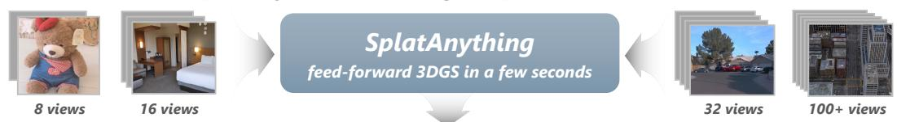

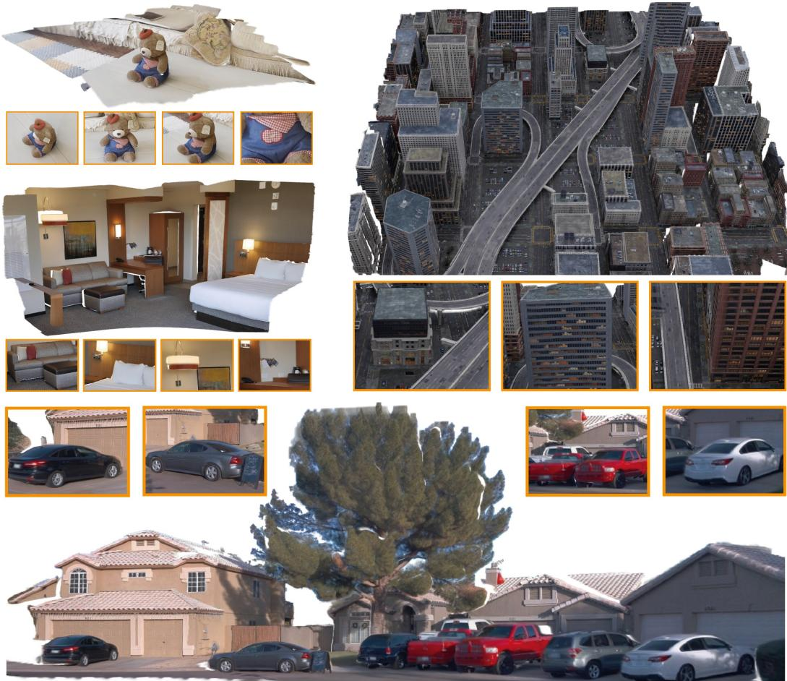  
Figure 1: Given any number of input images and optional camera poses, SplatAnything reconstructs a 3D Gaussian Splatting (3DGS) representation within seconds. It generalizes across arbitrary scene scales and camera configurations, while supporting challenging extrapolated viewpoints. Compared with prior feed-forward 3DGS methods, SplatAnything achieves substantially stronger cross-scene generalization and novel-view rendering quality.

## ABSTRACT

We identify a key limitation of existing feed-forward 3DGS methods: Gaussian attributes are typically predicted in a radial-distance-normalized space that canonicalizes a global radial statistic of the reconstructed geometry, while the spacing between neighboring Gaussian centers can still vary substantially across scene scales and camera configurations. This mismatch induces systematic shifts in Gaussian-scale targets, leading to ambiguous supervision. To address this, we propose SplatAnything with Gaussian Spacing Normalization (GSNorm), which canonicalizes a robust scene-level statistic of Gaussian spacing to provide a more consistent spatial reference for Gaussian prediction. To rigorously assess our method, we further establish a systematic benchmark spanning diverse datasets, input sparsity levels, and challenging extrapolated viewpoints. Extensive experiments demonstrate that SplatAnything achieves state-of-the-art performance, with particularly strong gains under substantial variations in scene scale and viewpoint.

## 1 INTRODUCTION

Feed-forward 3D Gaussian Splatting (3DGS) directly predicts a 3D Gaussian representation (Kerbl et al., 2023) from input images, avoiding the costly per-scene optimization of conventional 3DGS. This efficiency makes it attractive for large-scale 3D reconstruction and digital content creation. The ultimate goal is a single model that generalizes reliably across arbitrary scene scales, camera configurations, and target viewpoints, yet such broad generalization remains challenging.

A prevailing paradigm is to first predict per-pixel depth using a geometry foundation model (Wang et al., 2025; Lin et al., 2025; Team et al., 2026; Jiang et al., 2026; Yu et al., 2026), and then predict per-pixel Gaussian attributes based on the resulting geometry in its radial-distance-normalized coordinate space. Radial Distance Normalization (RDNorm) uses the mean radial distance of reconstructed 3D points to the reference-camera origin as a scene-level scale, and globally rescales the scene to canonicalize this statistic. However, RDNorm does not directly canonicalize the spacing between neighboring Gaussian centers, which we refer to as Gaussian spacing. Since adequate surface coverage requires the Gaussian scale to match the local Gaussian spacing, variations in this quantity directly induce shifts in the corresponding learning targets.

As illustrated in Fig. 2, visually similar regions can exhibit substantially different Gaussian spacings after RDNorm under different scene scales and camera configurations. Consequently, similar local observations may correspond to different Gaussian-scale targets across scenes, introducing ambiguity in scale supervision. A predictor biased toward smaller Gaussian scales may under-cover regions with large Gaussian spacing and produce holes, whereas one biased toward larger scales may cause excessive overlap in densely sampled regions and lead to over-smoothing, as shown in Fig. 7. This ambiguity in Gaussian-scale supervision poses a major bottleneck to robust feed-forward 3DGS generalization across varying scene scales and camera configurations.

To address this issue, we introduce SplatAnything, a feed-forward 3DGS framework equipped with Gaussian Spacing Normalization (GSNorm). The key idea of GSNorm is to derive the scene-level normalization factor from a representative statistic of Gaussian spacing, rather than from a global radial statistic. Under the per-pixel Gaussian prediction paradigm, where each valid image pixel corresponds to a Gaussian center, perspective projection relates Gaussian spacing to scene depth and camera intrinsics. Based on this relation, GSNorm computes Gaussian spacing over all valid observations and uses its median as a robust scene-level normalization factor. The reconstructed geometry is then rescaled accordingly, canonicalizing the representative Gaussian spacing across scenes. This provides a more consistent spatial reference for Gaussian-scale prediction, alleviating ambiguity in supervision caused by variations in scene scale and camera configuration and thereby improving generalization across diverse scenes and viewpoints.

To rigorously assess SplatAnything and prior methods, we further introduce a cross-dataset benchmark for in-the-wild evaluation. Unlike conventional protocols (Wang et al., 2026a; Xu et al., 2025b;a; Ye et al., 2026; Ren et al., 2026), which often focus on training-related domains and interpolated target views, our benchmark covers diverse datasets, scene scales, image resolutions, and camera configurations, while explicitly varying input-view sparsity and emphasizing challenging

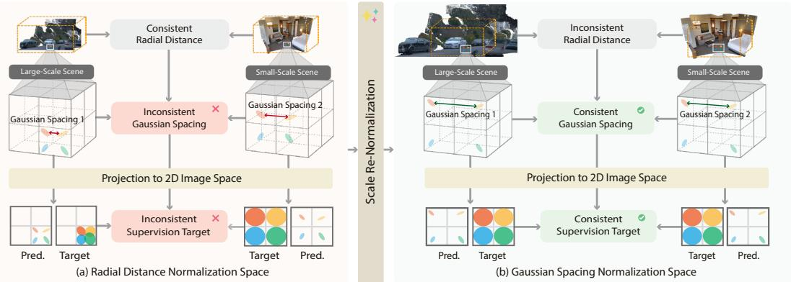  
Figure 2: Normalization space. (a) Radial Distance Normalization canonicalizes a global radial statistic but leaves Gaussian spacing varying across scenes and camera configurations, resulting in inconsistent supervision targets. (b) Gaussian Spacing Normalization canonicalizes a representative statistic of Gaussian spacing, providing a more consistent spatial reference for Gaussian prediction. extrapolated viewpoints. Extensive experiments show that SplatAnything achieves state-of-the-art performance, with particularly strong gains under large scene and viewpoint shifts.

In summary, our contributions are:

• We identify ambiguity in Gaussian-scale supervision across varying scene scales and camera configurations induced by RDNorm. To address this issue, we propose Gaussian Spacing Normalization (GSNorm), which canonicalizes a robust scene-level statistic of Gaussian spacing to provide a more consistent spatial reference for Gaussian prediction.

• We establish a systematic cross-dataset evaluation benchmark for feed-forward 3DGS, spanning diverse scene categories, image resolutions, camera configurations, input-view sparsity levels, and challenging extrapolated viewpoints. This benchmark enables a controlled evaluation of cross-scene and cross-view generalization.

## 2 RELATED WORK

Geometry foundation models. Recent feed-forward geometry foundation models (Wang et al., 2024; 2025; Lin et al., 2025; Liu et al., 2025; Jiang et al., 2026) directly recover depth, point maps, and camera poses from RGB observations, providing strong geometric priors across diverse scenes. These models typically employ radial distance normalization to keep reconstructed geometry within a numerically stable range. While effective for geometry prediction, such normalization does not ensure consistent Gaussian spacing across scenes, cameras, and image resolutions. This becomes critical when the normalized geometry is reused for per-pixel Gaussian prediction, since Gaussian scales are defined in the same 3D coordinate system.

Feed-forward 3D Gaussian Splatting. Feed-forward 3DGS methods directly infer Gaussian representations from image observations, often by first estimating per-pixel depth and then predicting Gaussian attributes. pixelSplat (Charatan et al., 2024) reconstructs 3D Gaussians from image pairs by learning a 3D probability distribution over Gaussian centers. DepthSplat (Xu et al., 2025b) combines monocular depth priors with multi-view matching, while ReSplat (Xu et al., 2025a) further refines predicted Gaussians through rendering-based optimization. However, limited geometric accuracy can become a bottleneck under large viewpoint extrapolation. More recent methods (Jiang et al., 2025; Lin et al., 2025; Team et al., 2026; Anonymous, 2027) leverage strong geometry foundation models to initialize Gaussian centers and predict the remaining attributes. Although this substantially improves reconstruction quality, these methods still inherit the radial-distance-normalized space of their geometry backbones, in which Gaussian spacing can vary substantially across scene scales and camera configurations, leading to ambiguity in Gaussian-scale supervision. Such supervision ambiguity makes it difficult to learn a single Gaussian predictor that generalizes reliably across diverse input settings. Other approaches (An et al., 2025; Li et al., 2026) do not rely on explicit geometric priors. While they can achieve strong rendering quality at interpolated viewpoints, the learned Gaussian geometry can become less reliable under large viewpoint extrapolation.

## 3 SPLATANYTHING

## 3.1 FORMULATION

Given N input images $\mathcal { T } = \{ I _ { i } \} _ { i = 1 } ^ { N }$ , together with optional camera intrinsics $\mathcal { K } = \{ K _ { i } \} _ { i = } ^ { N }$ =1 and extrinsics $\mathcal { T } = \{ ( R _ { i } , t _ { i } ) \} _ { i = 1 } ^ { N }$ , our goal is to predict a 3D Gaussian scene representation

$$
\mathcal { G } = \{ ( \mu _ { j } , \alpha _ { j } , \Sigma _ { j } , \mathrm { s h } _ { j } ) \} _ { j = 1 } ^ { M } ,\tag{1}
$$

where $\mu _ { j } , \alpha _ { j } , \Sigma _ { j }$ , and $\mathrm { s h } _ { j }$ denotethe Gaussian center, opacity, covariance, and SH coefficients.

## 3.2 PRELIMINARIES

Gaussian spacing. For per-pixel Gaussian prediction, each valid image pixel defines a Gaussian center at its back-projected 3D point. We refer to the spatial spacing between Gaussian centers induced by neighboring image pixels as Gaussian spacing. This quantity is particularly relevant to Gaussian-scale prediction, since adequate surface coverage requires the Gaussian scale to be commensurate with the local Gaussian spacing.

For the i-th view, let $D _ { i } ( \mathbf { u } )$ denote the depth at pixel $\mathbf { u } = ( u , v )$ , and let $( f _ { x , i } , f _ { y , i } )$ and $( c _ { x , i } , c _ { y , i } )$ denote the focal lengths and principal point in pixels. Under the pinhole camera model, the backprojected point ${ { \bf P } _ { i } ^ { c } } { { \bf ( u ) } }$ in the local camera frame is

$$
\mathbf P _ { i } ^ { c } ( \mathbf u ) = D _ { i } ( \mathbf u ) \left[ \begin{array} { c } { ( u - c _ { x , i } ) / f _ { x , i } } \\ { ( v - c _ { y , i } ) / f _ { y , i } } \\ { 1 } \end{array} \right] .\tag{2}
$$

Consider two horizontally adjacent pixels u and $\mathbf { u } + \mathbf { e } _ { x }$ . Under a locally constant-depth approximation, $D _ { i } ( \mathbf { u } + \mathbf { e } _ { x } ) \approx D _ { i } ( \mathbf { \dot { u } } )$ , their horizontal Gaussian spacing is

$$
d _ { x , i } ( \mathbf { u } ) = \| \mathbf { P } _ { i } ^ { c } ( \mathbf { u } + \mathbf { e } _ { x } ) - \mathbf { P } _ { i } ^ { c } ( \mathbf { u } ) \| _ { 2 } \approx \frac { D _ { i } ( \mathbf { u } ) } { f _ { x , i } } .\tag{3}
$$

Similarly, the vertical spacing is $d _ { y , i } ( \mathbf { u } ) \approx D _ { i } ( \mathbf { u } ) / f _ { y , i }$ . We summarize the two directions using their geometric mean,

$$
d _ { i } ( \mathbf { u } ) = \sqrt { d _ { x , i } ( \mathbf { u } ) d _ { y , i } ( \mathbf { u } ) } \approx \frac { D _ { i } ( \mathbf { u } ) } { \sqrt { f _ { x , i } f _ { y , i } } } ,\tag{4}
$$

which we use as a first-order scalar characterization of local Gaussian spacing.

## 3.3 NORMALIZATION SPACE FOR GAUSSIAN PREDICTION

Limitation of radial distance normalization. Feed-forward 3DGS methods built on geometry foundation models typically predict Gaussian attributes in the normalized coordinate space inherited from their geometry backbones. These models commonly normalize a reconstructed scene using the mean radial distance of 3D points to the reference-camera origin, which we refer to as Radial Distance Normalization (RDNorm). Let ${ { \bf { P } } _ { i } } ( { \bf { u } } )$ denote the reconstructed 3D point at pixel u in view i, expressed in the reference-camera coordinate system before scene-level normalization, and let $\Omega _ { i }$ denote the set of valid pixels in view i. The normalization factor $s _ { r }$ under RDNorm is computed as

$$
s _ { r } = \frac { 1 } { N _ { p } } \sum _ { i = 1 } ^ { N } \sum _ { \mathbf { u } \in \Omega _ { i } } \Vert \mathbf { P } _ { i } ( \mathbf { u } ) \Vert _ { 2 } , \qquad N _ { p } = \sum _ { i = 1 } ^ { N } | \Omega _ { i } | .\tag{5}
$$

The geometry, depth, and camera translations are then rescaled as

$$
{ \bf P } _ { i } ^ { r } = \frac { { \bf P } _ { i } } { s _ { r } } , \qquad D _ { i } ^ { r } = \frac { D _ { i } } { s _ { r } } , \qquad { \bf t } _ { i } ^ { r } = \frac { { \bf t } _ { i } } { s _ { r } } ,\tag{6}
$$

From Eq. 4, the Gaussian spacing after RDNorm is approximately

$$
d _ { i } ^ { r } ( \mathbf { u } ) \approx \frac { D _ { i } ^ { r } ( \mathbf { u } ) } { \sqrt { f _ { x , i } f _ { y , i } } } = \frac { D _ { i } ( \mathbf { u } ) } { \sqrt { f _ { x , i } f _ { y , i } } s _ { r } } .\tag{7}
$$

RDNorm canonicalizes a scene-level radial statistic of the reconstructed geometry, but does not directly canonicalize a scene-level statistic of Gaussian spacing.

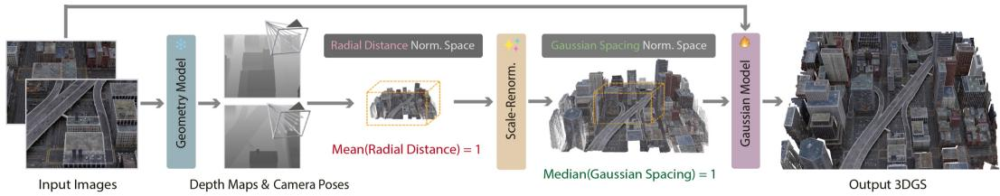  
Figure 3: Architecture of SplatAnything. Given N input images and optional camera parameters, a frozen geometry foundation model first estimates multi-view geometry. We convert the geometry from its native radial-distance-normalized space to the proposed Gaussian-spacing-normalized space and predict per-pixel Gaussian attribute through a Gaussian backbone and a lightweight GShead.

Consequently, the spacing between neighboring Gaussian centers can still vary substantially across different scene scales and camera configurations, as shown in Fig. 4. This variation is particularly important for Gaussian prediction because the Gaussian scale required for adequate surface coverage should be commensurate with the local Gaussian spacing. Therefore, similar local observations can correspond to different Gaussianscale targets after RDNorm, introducing ambiguity in scale supervision across scenes. This motivates us to define the normalization space directly from a representative statistic of Gaussian spacing.

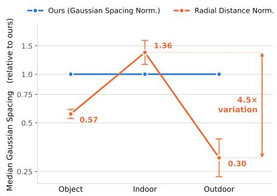  
Figure 4: Median Gaussian spacing across scene types. RDNorm leaves up to 4.5× variation in median Gaussian spacing across scene categories, whereas GSNorm canonicalizes it by construction.

Gaussian spacing normalization. We propose Gaussian Spacing Normalization (GSNorm), which defines the coordinate scale for Gaussian prediction using Gaussian spacing rather than a global radial statistic. Because the reconstruction is rescaled by a single scene-level factor, we use the median characteristic Gaussian spacing as a robust representative scale. Specifically, for a generic scene-level scale $s > 0 ,$ , the characteristic Gaussian spacing becomes

$$
d _ { i } ^ { s } ( \mathbf { u } ) \approx \frac { D _ { i } ( \mathbf { u } ) } { \sqrt { f _ { x , i } f _ { y , i } } s } .\tag{8}
$$

GSNorm chooses s such that the scene-level median Gaussian spacing is canonicalized:

$$
\underset { i , \mathbf { u } \in \Omega _ { i } } { \mathrm { m e d i a n } } \left( d _ { i } ^ { s } ( \mathbf { u } ) \right) \approx \underset { i , \mathbf { u } \in \Omega _ { i } } { \mathrm { m e d i a n } } \left( \frac { D _ { i } ( \mathbf { u } ) } { \sqrt { f _ { x , i } f _ { y , i } } s } \right) = 1 .\tag{9}
$$

Since the median is equivariant to positive scaling, Eq. 9 directly yields the normalization factor $s _ { g } \colon$

$$
s _ { g } = \underset { i , \mathbf { u } \in \Omega _ { i } } { \mathrm { m e d i a n } } \left( \frac { D _ { i } ( \mathbf { u } ) } { \sqrt { f _ { x , i } f _ { y , i } } } \right) .\tag{10}
$$

Using $s _ { g } ,$ we rescale the geometry, depth, and camera translations as

$$
{ \bf P } _ { i } ^ { g } = \frac { { \bf P } _ { i } } { s _ { g } } , \qquad { \cal D } _ { i } ^ { g } = \frac { { \cal D } _ { i } } { s _ { g } } , \qquad { \bf t } _ { i } ^ { g } = \frac { { \bf t } _ { i } } { s _ { g } } .\tag{11}
$$

GSNorm canonicalizes the scene-level median Gaussian spacing while preserving the relative variation of local Gaussian spacing. This aligns the representative Gaussian spacing scale across scenes and camera configurations without suppressing meaningful local geometric variation. Compared with RDNorm, GSNorm therefore provides a more consistent scale reference for Gaussian prediction that is directly related to Gaussian surface coverage. This alleviates ambiguity in Gaussian-scale supervision across different input settings, facilitating the learning of a feed-forward Gaussian model with robust cross-scene and cross-view generalization.

## 3.4 SPLATANYTHING ARCHITECTURE

The overall architecture is illustrated in Fig. 3. More details are provided in the appendix.

Geometry prediction and rescaling. Given N input images and optional camera parameters, we employ the frozen WorldMirror 2.0 (Team et al., 2026) geometry model to estimate multi-view depths, intrinsics, and camera poses. The predicted depths and camera translations are initially represented in the radial-distance-normalized coordinate space of the geometry model. We then use GSNorm (Eq. 11) to rescale these scale-dependent quantities into the proposed Gaussian-spacingnormalized space, obtaining $D ^ { g } = \{ D _ { i } ^ { g } \} _ { i = 1 } ^ { \bar { N } }$ and $T ^ { \hat { g } } = \{ ( R _ { i } , t _ { i } ^ { g } ) \} _ { i = 1 } ^ { N }$ . We unproject the rescaled depth maps using the corresponding camera parameters to obtain $\mathbf { P } ^ { g } = \{ \mathbf { P } _ { i } ^ { g } \} _ { i = 1 } ^ { N }$ , where each valid per-pixel 3D point serves as the center of a Gaussian primitive.

Gaussian attribute prediction. We initialize a Gaussian Backbone from the geometry backbone of WorldMirror 2.0 and fine-tune it for Gaussian prediction. A lightweight GSHead, trained from scratch, predicts per-pixel Gaussian attributes for all input views:

$$
\{ \mathcal { G } _ { i } ^ { g } \} _ { i = 1 } ^ { N } = \mathrm { G S H e a d } \left( \mathrm { G a u s s i a n B a c k b o n e } ( \mathcal { T } , O p t i o n a l ( K , \mathcal { T } ) ) \right) .\tag{12}
$$

For each pixel, the network predicts opacity, rotation, scale, and spherical-harmonic appearance coefficients. Together with the corresponding center from $\mathbf { P } ^ { p }$ , these quantities define the per-pixel Gaussian primitives in the Gaussian-spacing-normalized coordinate space.

## 3.5 TRAINING SPLATANYTHING

The training datasets and view-sampling strategies are detailed in the appendix.

Given a rendered target-view image $\hat { I } _ { t }$ and its ground-truth image $I _ { t } ,$ we supervise the model using a pixel-wise MSE loss and an LPIPS perceptual loss:

$$
\mathcal { L } _ { \mathrm { M S E } } = \frac { 1 } { 3 H W } \left. \hat { I } _ { t } - I _ { t } \right. _ { 2 } ^ { 2 } , \qquad \mathcal { L } _ { \mathrm { L P I P S } } = \mathrm { L P I P S } \left( \hat { I } _ { t } , I _ { t } \right) .\tag{13}
$$

The overall objective is

$$
\begin{array} { r } { \mathcal { L } = \lambda _ { \mathrm { M S E } } \mathcal { L } _ { \mathrm { M S E } } + \lambda _ { \mathrm { L P I P S } } \mathcal { L } _ { \mathrm { L P I P S } } , } \end{array}\tag{14}
$$

where $\lambda _ { \mathrm { M S E } } = \lambda _ { \mathrm { L P I P S } } = 1$ in our implementation.

SplatAnything is trained for 20,000 iterations on 64 NVIDIA H20 GPUs, using 4 to 32 input views and dynamically varying the input resolution from 504 to 1024. We use a 500-step warm-up and learning rates of $5 \times \mathrm { { \dot { 1 } 0 ^ { - 6 } } / 2 \times \mathrm { { \dot { 1 } 0 ^ { - 5 } } } }$ for the Gaussian Backbone and GSHead.

## 4 EXPERIMENTS

## 4.1 EVALUATION BENCHMARK

Existing benchmarks are typically concentrated on a small set of datasets and evaluate interpolated target views, making it difficult to assess cross-domain and viewpoint generalization. To provide a more comprehensive evaluation, we design a new benchmark with the following properties:

Cross-domain and cross-scale coverage. We evaluate on seven datasets: ScanNet (Dai et al., 2017), NRGBD (Azinovic et al., 2022), DL3DV (Ling et al., 2024), Tanks and Temples (Knapitsch´ et al., 2017), Mip-NeRF 360 (Barron et al., 2022), ETH3D (Schops et al., 2017), and DTU (Jensen et al., 2014). These datasets span a wide range of physical scene scales, providing a substantially broader test of cross-domain and cross-scale generalization.

Controlled extrapolation and observation sparsity. We sample context views from a compact trajectory span and select target views using an occlusion-aware symmetric co-visibility criterion. The input–target overlap is controlled within 0.2–0.6, with lower overlap corresponding to more challenging extrapolation. We further evaluate 1/4/8/16/32/64 input views under a fixed context span to isolate the effect of observation density. More details are provided in the appendix.

Table 1: Quantitative comparison across seven benchmark datasets, averaged over 4–64 input views. The top-3 results are highlighted as first , second , and third
<table><tr><td rowspan="2" colspan="2">Input Method</td><td colspan="2">ScanNet</td><td colspan="2">NRGBD</td><td colspan="2">DL3DV</td><td colspan="2">Tanks &amp; Temples Mip-NeRF 360</td><td colspan="2"></td><td colspan="2">ETH3D</td><td colspan="2">DTU</td></tr><tr><td>DISTS↓ LPIPS↓ DISTS↓ LPIPS↓ DISTS↓ LPIPS↓ DISTS↓ LPIPS↓</td><td></td><td></td><td></td><td></td><td></td><td></td><td></td><td></td><td></td><td>DISTS↓ LPIPS↓ DISTS↓ LPIPS↓ DISTS↓ LPIPS↓</td><td></td><td></td><td></td></tr><tr><td rowspan="5">W/se</td><td>AnySplat</td><td>0.278</td><td>0.414</td><td>0.236</td><td>0.352</td><td>0.371</td><td>0.327</td><td>0.593</td><td>0.737</td><td>0.538</td><td>0.787</td><td>0.278</td><td>0.154</td><td>0.520</td><td>0.810</td></tr><tr><td>YoNoSplat</td><td>0.265</td><td>0.236</td><td>0.285</td><td>0.240</td><td>0.375</td><td>0.219</td><td>0.424</td><td>0.338</td><td>0.405</td><td>0.586</td><td>0.321</td><td>0.033</td><td>0.484</td><td>0.729</td></tr><tr><td>DA3-GS</td><td>0.286</td><td>0.305</td><td>0.233</td><td>0.217</td><td>0.337</td><td>0.228</td><td>0.414</td><td>0.380</td><td>0.371</td><td>0.565</td><td>0.228</td><td>0.087</td><td>0.365</td><td>0.582</td></tr><tr><td>Mirror2-GS</td><td>0.193</td><td>0.222</td><td>0.235</td><td>0.237</td><td>0.246</td><td>0.188</td><td>0.306</td><td>0.351</td><td>0.283</td><td>0.528</td><td>0.205</td><td>0.070</td><td>0.347</td><td>0.617</td></tr><tr><td>QuerySplat</td><td>0.236</td><td>0.242</td><td>0.261</td><td>0.216</td><td>0.343</td><td>0.291</td><td>0.425</td><td>0.393</td><td>0.412</td><td>0.652</td><td>0.290</td><td>0.031</td><td>0.424</td><td>0.676</td></tr><tr><td rowspan="7">W/ se</td><td>Ours</td><td>0.184</td><td>0.207</td><td>0.195</td><td>0.183</td><td>0.221</td><td>0.156</td><td>0.252</td><td>0.299</td><td>0.233</td><td>0.463</td><td>0.147</td><td>0.049</td><td>0.229</td><td>0.483</td></tr><tr><td>DepthSplat</td><td>0.288</td><td>0.278</td><td>0.323</td><td>0.272</td><td>0.329</td><td>0.191</td><td>0.397</td><td>0.353</td><td>0.561</td><td>0.656</td><td>0.445</td><td>0.068</td><td>0.370</td><td>0.598</td></tr><tr><td>TokenGS</td><td>0.369</td><td>0.272</td><td>0.333</td><td>0.277</td><td>0.375</td><td>0.211</td><td>0.515</td><td>0.346</td><td>0.502</td><td>0.716</td><td>0.400</td><td>0.042</td><td>0.593</td><td>0.828</td></tr><tr><td>tttLRM</td><td>0.292</td><td>0.300</td><td>0.320</td><td>0.292</td><td>0.323</td><td>0.196</td><td>0.390</td><td>0.342</td><td>0.350</td><td>0.531</td><td>0.225</td><td>0.063</td><td>0.382</td><td>0.599</td></tr><tr><td>ReSplat</td><td>0.272</td><td>0.240</td><td>0.284</td><td>0.232</td><td>0.304</td><td>0.159</td><td>0.396</td><td>0.275</td><td>0.349</td><td>0.525</td><td>0.219</td><td>0.027</td><td>0.441</td><td>0.664</td></tr><tr><td>DA3-GS (Pose Cond.)</td><td>0.274</td><td>0.291</td><td>0.238</td><td>0.227</td><td>0.311</td><td>0.219</td><td>0.425</td><td>0.368</td><td>0.362</td><td>0.556</td><td>0.223</td><td>0.089</td><td>0.368</td><td>0.596</td></tr><tr><td>Mirror2-GS (Pose Cond.)</td><td>0.195</td><td>0.223 0.206</td><td>0.231</td><td>0.226 0.162</td><td>0.239 0.215</td><td>0.180 0.148</td><td>0.304 0.251</td><td>0.346 0.290</td><td>0.272 0.219</td><td>0.506 0.440</td><td>0.201 0.133</td><td>0.062</td><td>0.315</td><td>0.532</td></tr><tr><td>Ours (Pose Cond.)</td><td></td><td>0.185</td><td>0.186</td><td></td><td></td><td></td><td></td><td></td><td></td><td></td><td></td><td></td><td>0.037</td><td>0.184</td><td>0.364</td></tr></table>

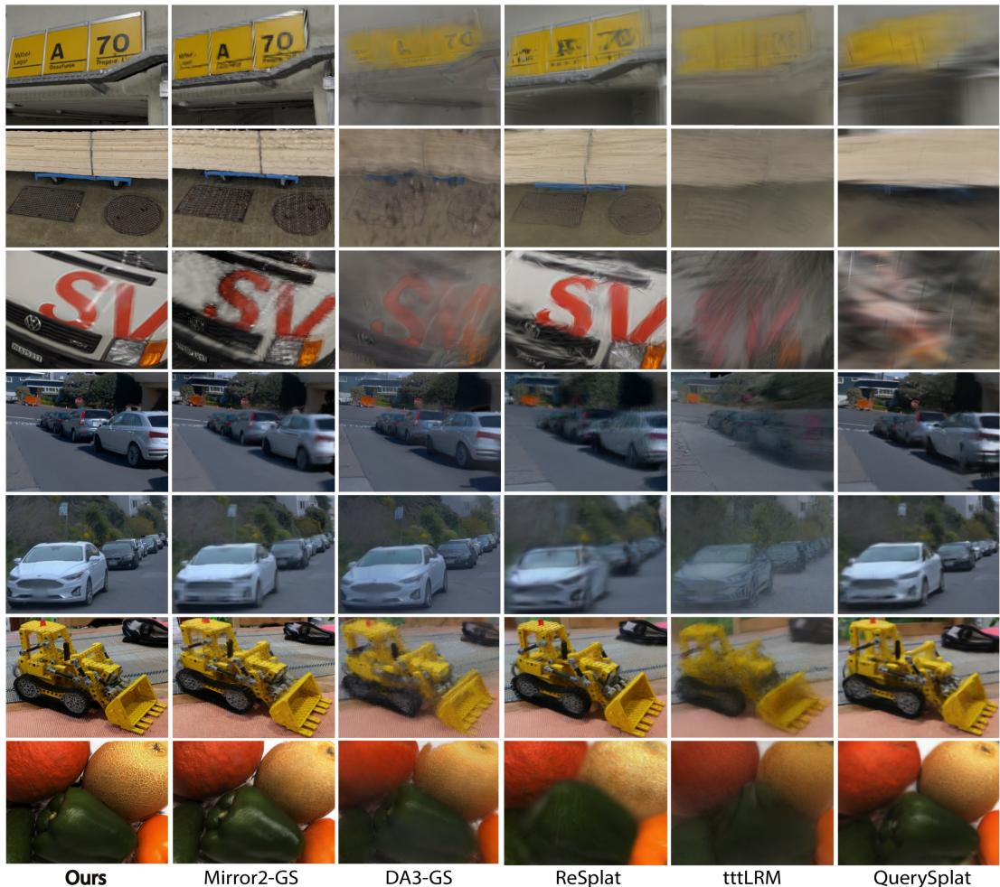  
Figure 5: Qualitative comparisons across diverse scenes and viewpoints with multi-view input.  
Multi-resolution. Our benchmark covers a broad resolution range, from approximately 480p to 1K, enabling evaluation under both low- and high-resolution settings.  
Compared methods. We evaluate two categories methods according to whether camera poses are provided. In the w/o Pose setting, methods reconstruct the scene directly from RGB observations, including AnySplat (Jiang et al., 2025), YoNoSplat (Ye et al., 2026), DA3-GS (Lin et al., 2025), Mirror2-GS (Team et al., 2026), and QuerySplat (Li et al., 2026).

In the w/ Pose setting, camera poses are additionally provided for model input. We compare against DepthSplat (Xu et al., 2025b), TokenGS (Ren et al., 2026), tttLRM (Wang et al., 2026a), ReSplat (Xu et al., 2025a), as well as pose-conditioned variants of DA3- GS (Lin et al., 2025) and Mirror2-GS (Team et al., 2026). Additionally, we compare against SHARP (Mescheder et al., 2026) and InfiniSplat (Wang et al., 2026b), which target for monocular view synthesis.

## 4.2 QUANTITATIVE COMPARISONS

We report the average metrics over 4/8/16/32/64 input views in Table 1, specific results under different input-view settings are provided in the appendix. Following SHARP (Mescheder et al., 2026), we primarily report LPIPS and DISTS in the main paper, as they better reflect rendering quality and

Table 2: Quantitative comparison of feed-forward 3DGS methods using a single input view. The top-3 results are highlighted as first , second , and third .
<table><tr><td rowspan="2">Method</td><td colspan="2">ScanNet</td><td colspan="2">NRGBD</td><td colspan="2">DL3DV</td><td colspan="2">Tanks &amp; Temples</td><td colspan="2">Mip-NeRF 360</td><td colspan="2">ETH3D</td><td colspan="2">DTU</td></tr><tr><td>DISTS↓</td><td>LPIPS↓</td><td>DISTS↓</td><td>LPIPS↓</td><td>DISTS↓</td><td>LPIPS↓</td><td>DISTS↓</td><td>LPIPS↓</td><td>DISTS↓</td><td>LPIPS↓</td><td>DISTS↓</td><td>LPIPS↓</td><td>DISTS↓</td><td>LPIPS↓</td></tr><tr><td>SHARP</td><td>0.223</td><td>0.244</td><td>0.238</td><td>0.174</td><td>0.335</td><td>0.280</td><td>0.374</td><td>0.470</td><td>0.328</td><td>0.505</td><td>0.200</td><td>0.133</td><td>0.433</td><td>0.724</td></tr><tr><td>InfiniSplat</td><td>0.266</td><td>0.280</td><td>0.336</td><td>0.345</td><td>0.527</td><td>0.596</td><td>0.452</td><td>0.531</td><td>0.505</td><td>0.654</td><td>0.367</td><td>0.376</td><td>0.562</td><td>0.754</td></tr><tr><td>Ours</td><td>0.238</td><td>0.274</td><td>0.265</td><td>0.284</td><td>0.279</td><td>0.220</td><td>0.342</td><td>0.430</td><td>0.410</td><td>0.599</td><td>0.195</td><td>0.104</td><td>0.327</td><td>0.657</td></tr></table>

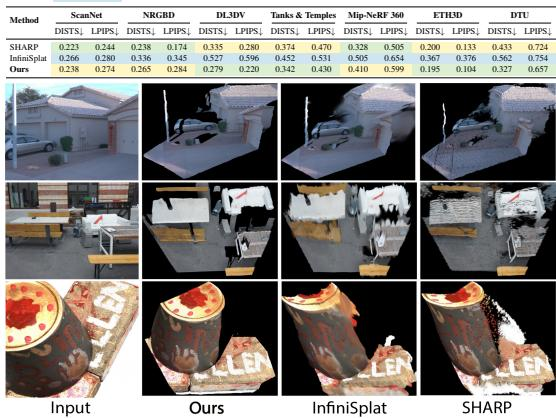  
Figure 6: Qualitative comparisons across diverse scenes and viewpoints with monocular input.

higher-frequency details. We also report the results in the monocular setting in Table 2. Overall, SplatAnything achieves the strongest performance across most datasets and evaluation settings, demonstrating its superior generalization capabilities.

## 4.3 QUALITATIVE COMPARISONS

Figs. 5 and 6 present qualitative comparisons across diverse scenes and extrapolated viewpoints under multi-view and monocular input settings, covering object-centric captures, indoor environments, and large-scale outdoor scenes. SplatAnything demonstrates a significant advantage in rendering quality: it generalizes robustly across a wide range of scene types and spatial scales, maintains geometric consistency under challenging large viewpoint extrapolation, and produces sharp, detailed renderings that faithfully recover fine local structures. More results are provided in the appendix.

## 4.4 EFFICIENCY ANALYSIS

We evaluate the inference efficiency of SplatAnything and other methods under different input-view settings. Detailed timing results are provided in the appendix.

## 4.5 ABLATION STUDIES

Effect of Gaussian spacing normalization. We ablate the normalization space for Gaussian prediction in Table 3, comparing RDNorm, RDNorm with scale calibration, and GSNorm under the same architecture and training settings. For RDNorm with scale calibration, Gaussian prediction remains in the RDNorm space, while the predicted Gaussian scales are uniformly rescaled to match the scene’s median Gaussian spacing. Both RDNorm variants remain consistently inferior to GSNorm. Qualitatively, RDNorm tends to produce holes in small object-centric scenes and over-smoothed results in large outdoor scenes (Fig. 7). Scale calibration alleviates the holes on object-centric scenes, but often turns them into over-smoothed reconstructions, while outdoor scenes remain blurry. These results indicate that post-prediction scale correction cannot resolve the ambiguity in scale supervision introduced by RDNorm. By canonicalizing the representative Gaussian spacing scale before Gaussian prediction, GSNorm provides a better-aligned prediction space and yields more complete and sharper reconstructions across diverse scenes. Additional results are provided in the appendix.

Training design choices We also analyze several architecture and training design choices, including fine-tuning the pretrained geometry backbone, fixing Gaussian centers, scaling the amount of training data, and using mixed sampling strategies for Gaussian supervision. Please refer to the appendix for more analysis and results.

Table 3: Normalization-space ablation across different numbers of input views.
<table><tr><td rowspan="2">Norm. Space</td><td colspan="2">Num. Views=1</td><td colspan="2">Num. Views=4</td><td colspan="2">Num. Views=8</td><td colspan="2">Num. Views=16</td><td colspan="2">Num. Views=32</td><td colspan="2">Num. Views=64</td></tr><tr><td>DISTS↓</td><td>LPIPS↓</td><td>DISTS↓</td><td>LPIPS↓</td><td>DISTS↓</td><td>LPIPS↓</td><td>DISTS↓</td><td>LPIPS↓</td><td>DISTS↓</td><td>LPIPS↓</td><td>DISTS↓</td><td>LPIPS↓</td></tr><tr><td>Radial Distance Norm.</td><td>0.308</td><td>0.394</td><td>0.223</td><td>0.278</td><td>0.223</td><td>0.272</td><td>0.218</td><td>0.268</td><td>0.225</td><td>0.277</td><td>0.224</td><td>0.250</td></tr><tr><td>Radial Distance Norm + Scale Calibration.</td><td>0.323</td><td>0.400</td><td>0.249</td><td>0.309</td><td>0.252</td><td>0.308</td><td>0.245</td><td>0.300</td><td>0.253</td><td>0.305</td><td>0.234</td><td>0.265</td></tr><tr><td>Gaussian Spacing Norm. (Ours)</td><td>0.294</td><td>0.367</td><td>0.198</td><td>0.245</td><td>0.196</td><td>0.237</td><td>0.190</td><td>0.232</td><td>0.197</td><td>0.241</td><td>0.217</td><td>0.229</td></tr></table>

Large-Scale Scenes (e.g. Streets)  
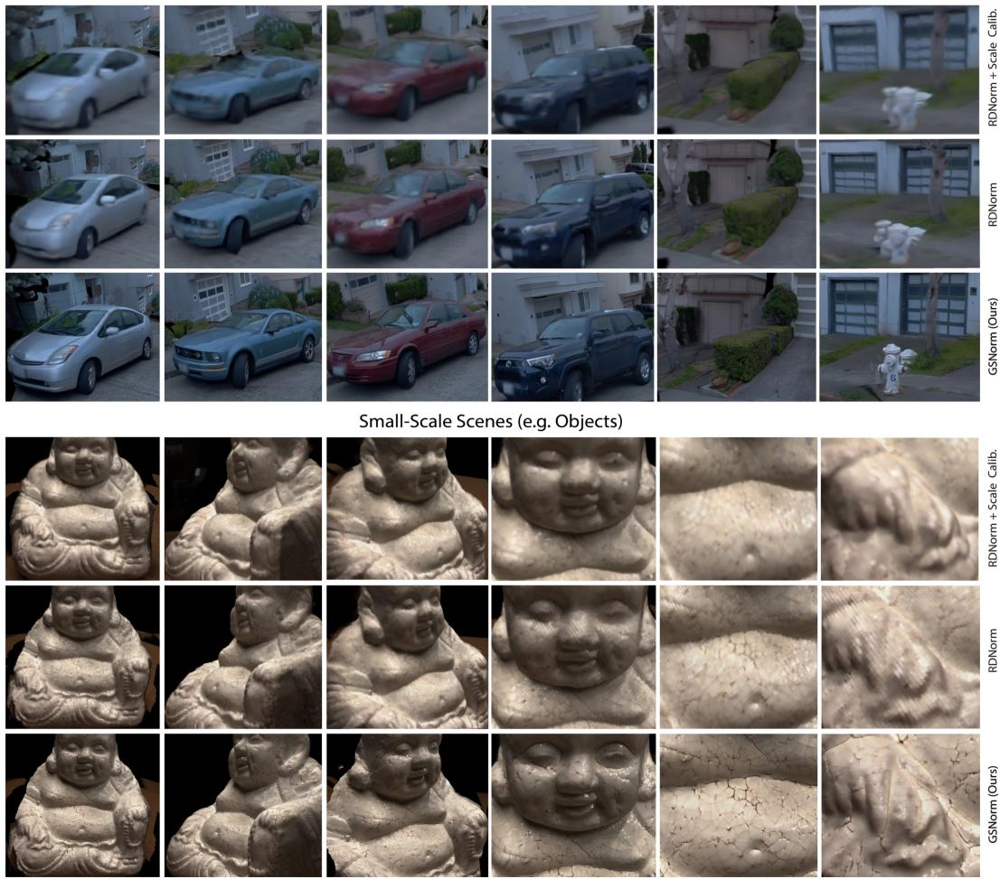  
Figure 7: Ablation studies on the effect of GSNorm across different scene types.

## 5 CONCLUSION

We identified a key limitation of existing methods: Radial Distance Normalization (RDNorm) does not directly normalize Gaussian spacing, leading to ambiguity in Gaussian-scale supervision across scene scales and camera configurations. To address this issue, we introduced SplatAnything with Gaussian Spacing Normalization (GSNorm), which derives a scene-level normalization factor from a representative statistic of Gaussian spacing and provides a more consistent spatial reference for Gaussian prediction. We further established a systematic cross-dataset benchmark covering differ ent input sparsity levels and challenging extrapolated viewpoints. Experiments demonstrate that SplatAnything achieves the strongest performance across most evaluation settings, highlighting the effectiveness of GSNorm and marking a substantial step toward feed-forward 3DGS.

Limitations and Future Work. SplatAnything relies on geometric priors from a geometry foundation model and may degrade when reliable geometry cannot be recovered from extremely sparse or challenging inputs. It also primarily reconstructs regions visible in the input views, which can leave holes in unobserved areas. Future work will explore more robust geometry estimation and generative priors for completing unobserved regions.

## AI USE STATEMENT

In this work, we used generative AI tools to assist with writing, language polishing, and code development. In particular, generative AI was used to improve the clarity, grammar, and presentation of the manuscript, and to assist with parts of code implementation and debugging under the authors direction. All AI-assisted text was carefully reviewed and revised by the authors, and all AI-assisted code was manually inspected, tested, and verified for correctness. Generative AI was not used to independently originate the research ideas, formulate the research questions, or design the core tech nical contributions of this work. We also did not use generative AI tools to generate experimental or training data, or to independently search for, select, or determine the references used in the paper. The authors take full responsibility for the final content of this work, including all text, technical claims, experimental results, and code produced with the assistance of generative AI.

## REFERENCES

Honggyu An, Jaewoo Jung, Mungyeom Kim, Chaehyun Kim, Minkyeong Jeon, Jisang Han, Kazumi Fukuda, Takuya Narihira, Hyuna Ko, Junsu Kim, et al. C3g: Learning compact 3d representations with 2k gaussians. arXiv preprint arXiv:2512.04021, 2025.

Anonymous. Infinisplat v2: Analyzing and improving feed-forward 3dgs from any views, 2027. Manuscript under review at ICLR 2027.

Eduardo Arnold, Jamie Wynn, Sara Vicente, Guillermo Garcia-Hernando, Aron Monszpart, Victor Prisacariu, Daniyar Turmukhambetov, and Eric Brachmann. Map-free visual relocalization: Metric pose relative to a single image. In European Conference on Computer Vision, pp. 690–708. Springer, 2022.

Dejan Azinovic, Ricardo Martin-Brualla, Dan B Goldman, Matthias Nießner, and Justus Thies.´ Neural rgb-d surface reconstruction. In 2022 IEEE/CVF Conference on Computer Vision and Pattern Recognition (CVPR), pp. 6280–6291. IEEE, 2022.

Jonathan T Barron, Ben Mildenhall, Dor Verbin, Pratul P Srinivasan, and Peter Hedman. Mip-nerf 360: Unbounded anti-aliased neural radiance fields. In 2022 IEEE/CVF Conference on Computer Vision and Pattern Recognition (CVPR), pp. 5460–5469. IEEE, 2022.

Gilad Baruch, Zhuoyuan Chen, Afshin Dehghan, Tal Dimry, Yuri Feigin, Peter Fu, Thomas Gebauer, Brandon Joffe, Daniel Kurz, Arik Schwartz, et al. Arkitscenes: A diverse real-world dataset for 3d indoor scene understanding using mobile rgb-d data. arXiv preprint arXiv:2111.08897, 2021.

Angel Chang, Angela Dai, Thomas Funkhouser, Maciej Halber, Matthias Niessner, Manolis Savva, Shuran Song, Andy Zeng, and Yinda Zhang. Matterport3d: Learning from rgb-d data in indoor environments. arXiv preprint arXiv:1709.06158, 2017.

David Charatan, Sizhe Lester Li, Andrea Tagliasacchi, and Vincent Sitzmann. pixelsplat: 3d gaussian splats from image pairs for scalable generalizable 3d reconstruction. In 2024 IEEE/CVF Conference on Computer Vision and Pattern Recognition (CVPR), pp. 19457–19467. IEEE, 2024.

Angela Dai, Angel X Chang, Manolis Savva, Maciej Halber, Thomas Funkhouser, and Matthias Nießner. Scannet: Richly-annotated 3d reconstructions of indoor scenes. In 2017 IEEE conference on computer vision and pattern recognition (CVPR), pp. 2432–2443. IEEE, 2017.

Rasmus Jensen, Anders Dahl, George Vogiatzis, Engin Tola, and Henrik Aanæs. Large scale multiview stereopsis evaluation. In Proceedings of the IEEE conference on computer vision and pattern recognition, pp. 406–413, 2014.

Lihan Jiang, Yucheng Mao, Linning Xu, Tao Lu, Kerui Ren, Yichen Jin, Xudong Xu, Mulin Yu, Jiangmiao Pang, Feng Zhao, et al. Anysplat: Feed-forward 3d gaussian splatting from unconstrained views. ACM Transactions on Graphics (TOG), 44(6):1–16, 2025.

Yanqin Jiang, Tengfei Wang, Zhengwei Wang, Chenjie Cao, Junta Wu, Wenhan Luo, Weiming Hu, Jin Gao, and Chunchao Guo. Omnix: Any-view and any-time 4d reconstruction via feed-forward trajectory fields. In European Conference on Computer Vision, pp. 313–331. Springer, 2026.

Bernhard Kerbl, Georgios Kopanas, Thomas Leimkuhler, George Drettakis, et al. 3d gaussian splat-¨ ting for real-time radiance field rendering. ACM Trans. Graph., 42(4):139–1, 2023.

Arno Knapitsch, Jaesik Park, Qian-Yi Zhou, and Vladlen Koltun. Tanks and temples: Benchmarking large-scale scene reconstruction. ACM Transactions on Graphics (ToG), 36(4):1–13, 2017.

Yinglong Li, Donghui Shen, Xiaoyu Zhang, Zhichao Ye, Hongyu Wu, Aimin Hao, Guofeng Zhang, and Haomin Liu. Querysplat: Decoupling geometry and appearance representations in 3dgs prediction. arXiv preprint arXiv:2608.01186, 2026.

Yixuan Li, Lihan Jiang, Linning Xu, Yuanbo Xiangli, Zhenzhi Wang, Dahua Lin, and Bo Dai. Matrixcity: A large-scale city dataset for city-scale neural rendering and beyond. In 2023 IEEE/CVF International Conference on Computer Vision (ICCV), pp. 3182–3192. IEEE, 2023.

Haotong Lin, Sili Chen, Junhao Liew, Donny Y Chen, Zhenyu Li, Guang Shi, Jiashi Feng, and Bingyi Kang. Depth anything 3: Recovering the visual space from any views. arXiv preprint arXiv:2511.10647, 2025.

Lu Ling, Yichen Sheng, Zhi Tu, Wentian Zhao, Cheng Xin, Kun Wan, Lantao Yu, Qianyu Guo, Zixun Yu, Yawen Lu, et al. Dl3dv-10k: A large-scale scene dataset for deep learning-based 3d vision. In 2024 IEEE/CVF Conference on Computer Vision and Pattern Recognition (CVPR), pp. 22160–22169. IEEE, 2024.

Yifan Liu, Zhiyuan Min, Zhenwei Wang, Junta Wu, Tengfei Wang, Yixuan Yuan, Yawei Luo, and Chunchao Guo. Worldmirror: Universal 3d world reconstruction with any-prior prompting. arXiv preprint arXiv:2510.10726, 2025.

Lars Mescheder, Wei Dong, Shiwei Li, Xuyang Bai, Marcel Santos, Peiyun Hu, Bruno Lecouat, Mingmin Zhen, Amael Delaunoy, Tian Fang, et al. Sharp monocular view synthesis in less than¨ a second. In International Conference on Learning Representations, volume 2026, pp. 24192– 24230, 2026.

Manthan Patel, Fan Yang, Yuheng Qiu, Cesar Cadena, Sebastian Scherer, Marco Hutter, and Wenshan Wang. Tartanground: A large-scale dataset for ground robot perception and navigation. In 2025 IEEE/RSJ International Conference on Intelligent Robots and Systems (IROS), pp. 20524– 20531. IEEE, 2025.

Jiawei Ren, Michal Jan Tyszkiewicz, Jiahui Huang, and Zan Gojcic. Tokengs: Decoupling 3d gaussian prediction from pixels with learnable tokens. arXiv preprint arXiv:2604.15239, 2026.

Mike Roberts, Jason Ramapuram, Anurag Ranjan, Atulit Kumar, Miguel Angel Bautista, Nathan Paczan, Russ Webb, and Joshua M Susskind. Hypersim: A photorealistic synthetic dataset for holistic indoor scene understanding. In 2021 IEEE/CVF International Conference on Computer Vision (ICCV), pp. 10892–10902. IEEE, 2021.

Thomas Schops, Johannes L Schonberger, Silvano Galliani, Torsten Sattler, Konrad Schindler, Marc Pollefeys, and Andreas Geiger. A multi-view stereo benchmark with high-resolution images and multi-camera videos. In Proceedings of the IEEE conference on computer vision and pattern recognition, pp. 3260–3269, 2017.

HunyuanWorld Team, Zhenwei Wang, Yuhao Liu, Junta Wu, Zixiao Gu, Haoyuan Wang, Xuhui Zuo, Tianyu Huang, Wenhuan Li, Sheng Zhang, et al. Hunyuanworld 1.0: Generating immersive, explorable, and interactive 3d worlds from words or pixels. arXiv preprint arXiv:2507.21809, 2025.

HY Team, Chenjie Cao, Xuhui Zuo, Zhenwei Wang, Yisu Zhang, Junta Wu, Zhenyang Liu, Yuning Gong, Yang Liu, Bo Yuan, et al. Hy-world 2.0: A multi-modal world model for reconstructing, generating, and simulating 3d worlds. arXiv e-prints, pp. arXiv–2604, 2026.

Rawmantic Team. Rawmantic 3d training field: From the real world, for the real world. Rawmantic, 2026.

Fabio Tosi, Yiyi Liao, Carolin Schmitt, and Andreas Geiger. Smd-nets: Stereo mixture density networks. In 2021 IEEE/CVF Conference on Computer Vision and Pattern Recognition (CVPR), pp. 8938–8948. IEEE, 2021.

Chen Wang, Hao Tan, Wang Yifan, Zhiqin Chen, Yuheng Liu, Kalyan Sunkavalli, Sai Bi, Lingjie Liu, and Yiwei Hu. tttlrm: Test-time training for long context and autoregressive 3d reconstruction. arXiv preprint arXiv:2602.20160, 2026a.

Jianyuan Wang, Minghao Chen, Nikita Karaev, Andrea Vedaldi, Christian Rupprecht, and David Novotny. Vggt: Visual geometry grounded transformer. In 2025 IEEE/CVF Conference on Computer Vision and Pattern Recognition (CVPR), pp. 5294–5306. IEEE, 2025.

Jiawei Wang, Hao Yu, Yongzhen Hu, Xinyi Yang, Tao Ni, Xin Zhan, Junbo Chen, Xiaowei Zhou, Ruizhen Hu, and Sida Peng. Infinisplat: Implicit gaussian decoding for large-baseline monocular view synthesis. arXiv preprint arXiv:2608.02437, 2026b.

Kaixuan Wang and Shaojie Shen. Flow-motion and depth network for monocular stereo and beyond. IEEE Robotics and Automation Letters, 5(2):3307–3314, 2020.

Shuzhe Wang, Vincent Leroy, Yohann Cabon, Boris Chidlovskii, and Jerome Revaud. Dust3r: Geometric 3d vision made easy. In 2024 IEEE/CVF Conference on Computer Vision and Pattern Recognition (CVPR), pp. 20697–20709. IEEE, 2024.

Weijie Wang, Yeqing Chen, Zeyu Zhang, Hengyu Liu, Haoxiao Wang, Zhiyuan Feng, Wenkang Qin, Feng Chen, Jia-Wang Bian, Zheng Zhu, et al. Volsplat: Rethinking feed-forward 3d gaussian splatting with voxel-aligned prediction. In European Conference on Computer Vision, pp. 1–19. Springer, 2026c.

Tong Wu, Jiarui Zhang, Xiao Fu, Yuxin Wang, Jiawei Ren, Liang Pan, Wayne Wu, Lei Yang, Jiaqi Wang, Chen Qian, et al. Omniobject3d: Large-vocabulary 3d object dataset for realistic perception, reconstruction and generation. In 2023 IEEE/CVF Conference on Computer Vision and Pattern Recognition (CVPR), pp. 803–814. IEEE, 2023.

Haofei Xu, Daniel Barath, Andreas Geiger, and Marc Pollefeys. Resplat: Learning recurrent gaussian splatting. arXiv preprint arXiv:2510.08575, 2025a.

Haofei Xu, Songyou Peng, Fangjinhua Wang, Hermann Blum, Daniel Barath, Andreas Geiger, and Marc Pollefeys. Depthsplat: Connecting gaussian splatting and depth. In 2025 IEEE/CVF Conference on Computer Vision and Pattern Recognition (CVPR), pp. 16453–16463. IEEE, 2025b.

Yao Yao, Zixin Luo, Shiwei Li, Jingyang Zhang, Yufan Ren, Lei Zhou, Tian Fang, and Long Quan. Blendedmvs: A large-scale dataset for generalized multi-view stereo networks. In 2020 IEEE/CVF Conference on Computer Vision and Pattern Recognition (CVPR), pp. 1787–1796. IEEE, 2020.

Botao Ye, Boqi Chen, Haofei Xu, Daniel Barath, and Marc Pollefeys. Yonosplat: You only need one model for feedforward 3d gaussian splatting. In International Conference on Learning Representations, volume 2026, pp. 39852–39871, 2026.

Chandan Yeshwanth, Yueh-Cheng Liu, Matthias Nießner, and Angela Dai. Scannet++: A highfidelity dataset of 3d indoor scenes. In 2023 IEEE/CVF International Conference on Computer Vision (ICCV), pp. 12–22. IEEE, 2023.

Hao Yu, Haotong Lin, Jiawei Wang, Jiaxin Li, Yida Wang, Xueyang Zhang, Yue Wang, Xiaowei Zhou, Ruizhen Hu, and Sida Peng. Infinidepth: Arbitrary-resolution and fine-grained depth estimation with neural implicit fields. arXiv preprint arXiv:2601.03252, 2026.

Amir R Zamir, Alexander Sax, William Shen, Leonidas J Guibas, Jitendra Malik, and Silvio Savarese. Taskonomy: Disentangling task transfer learning. In Proceedings of the IEEE conference on computer vision and pattern recognition, pp. 3712–3722, 2018.

Tinghui Zhou, Richard Tucker, John Flynn, Graham Fyffe, and Noah Snavely. Stereo magnification: Learning view synthesis using multiplane images. arXiv preprint arXiv:1805.09817, 2018.

Yang Zhou, Yifan Wang, Jianjun Zhou, Wenzheng Chang, Haoyu Guo, Zizun Li, Kaijing Ma, Xinyue Li, Yating Wang, Haoyi Zhu, et al. Omniworld: A multi-domain and multi-modal dataset for 4d world modeling. arXiv preprint arXiv:2509.12201, 2025.

## A APPENDIX

## A.1 TRAINING DATA.

The training data used for SplatAnything is listed in Table 4.

Table 4: Details of the training datasets used by SplatAnything.
<table><tr><td>Data Type</td><td>Dataset</td><td># Scenes</td><td>Resolution (H × W)</td></tr><tr><td rowspan="5">Synthetic</td><td>HyperSim (Roberts et al., 2021) UnrealStereo4K (Tosi et al., 2021)</td><td>364 18</td><td>768×1024 1080×1920</td></tr><tr><td>OmniObject3D (Wu et al., 2023)</td><td>5914</td><td>800×800</td></tr><tr><td>Rawmantic3D (Team, 2026)</td><td>30</td><td>1080×1920</td></tr><tr><td>OmniWorld (Zhou et al., 2025)</td><td>10464</td><td></td></tr><tr><td>GTA-SfM (Wang &amp; Shen, 2020)</td><td>200</td><td>720×1280 480×640</td></tr><tr><td rowspan="5"></td><td>MatrixCity (Li et al., 2023)</td><td>8</td><td>1080×1920</td></tr><tr><td>TartanGround (Patel et al., 2025)</td><td>635</td><td>640×640</td></tr><tr><td>ScanNet++ (Yeshwanth et al., 2023)</td><td>936</td><td>696×1035</td></tr><tr><td>Matterport3D (Chang et al., 2017)</td><td>90</td><td>1024×1280</td></tr><tr><td>ARKitScenes (Baruch et al., 2021)</td><td>2501</td><td>480×640</td></tr><tr><td rowspan="4">Real-world</td><td>Taskonomy (Zamir et al., 2018)</td><td>537</td><td>512×512</td></tr><tr><td>MapFree (Arnold et al., 2022)</td><td>460</td><td>720×540</td></tr><tr><td>BlendedMVS (Yao et al., 2020)</td><td></td><td></td></tr><tr><td></td><td>502</td><td>384×504</td></tr></table>

## A.2 DATA CONSTRUCTION STRATEGIES.

We design multiple strategies to construct the training pairs for SplatAnything.

Source-View Sampling Strategy. We construct source views to cover diverse camera-motion patterns while maintaining sufficient geometric overlap for reliable reconstruction by the geometry foundation model. We consider four representative trajectory patterns: forward-traversal, where the camera moves primarily along the viewing direction; lateral-sweep, where the camera translates mainly sideways while maintaining a similar viewing direction; outward-looking, where the camera remains approximately stationary and rotates to observe different directions; and inward-orbit, where the camera moves around a local region while maintaining an inward-facing view toward that region. For trajectories with substantial translation, we further vary the sampling stride to produce either densely overlapping or wide-baseline source views, covering different levels of parallax and input sparsity. During training, the trajectory pattern and sampling stride are randomly selected from a dataset-specific mixture, with distance and stride budgets adapted to each dataset. Validation uses a fixed deterministic sampling configuration for reproducibility. Examples of the different source-view sampling patterns are shown in Fig. 8.

Sampling strategy for target views. Our target-view sampling aims to provide supervision across diverse viewpoint changes, ranging from interpolation to challenging extrapolation, in order to im prove the viewpoint generalization ability of our model. For interpolation views, we select a held-out view between the input views; for extrapolation views, we randomly sample diverse extrapolation patterns, including advancing along the camera trajectory to inspect local scene details at a closer range, as well as moving away from the observed trajectory to view the scene from novel positions and orientations. The visualization of different target-view sampling modes are shown in Fig. 9.

## A.3 EVALUATION BENCHMARK DETAILS

We provide additional details of the evaluation benchmark introduced in the main paper. Our benchmark spans seven datasets and evaluates different input-view counts of 4, 8, 16, 32, and 64. The protocol is designed to independently control input-view sparsity and target-view difficulty, while ensuring identical evaluation conditions across methods.

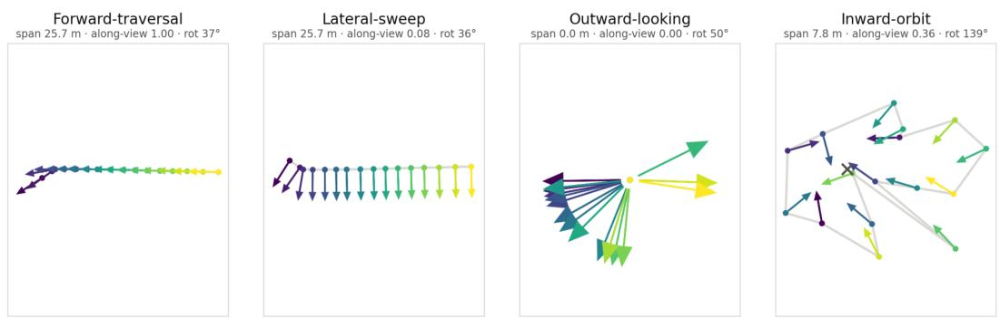  
Figure 8: Source-view trajectory patterns (16 views per panel), visualized in an approximately top-down projection. Dots and arrows denote camera centers and viewing directions, respectively; the gray polyline connects consecutive views, and color indicates capture order. For inward-orbit, × marks the approximate viewing center.

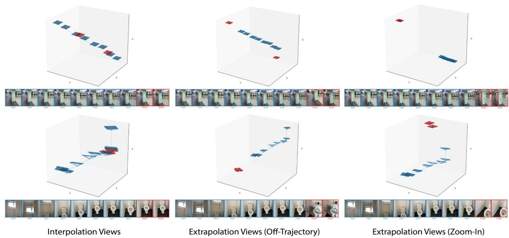  
Figure 9: Target-view sampling modes used during training. Blue cameras denote the source views provided as input, while red cameras denote the target views used for rendering supervision.

Source-view construction. Instead of distributing the source views uniformly over the entire capture, we sample them from a compact contiguous arc of the camera trajectory. This design leaves a meaningful portion of the capture outside the observed region, making it possible to evaluate genuinely extrapolated novel views rather than views that are always bracketed by the inputs. To make different input-view counts directly comparable, we adopt afixed-span strategy. For each scene, we first determine the trajectory span at the sparsest setting of 4 source views. We select the widest arc whose adjacent source-view pairs maintain sufficient geometric overlap, measured by symmetric co-visibility; specifically, the 20-th percentile of adjacent-pair co-visibility is required to be at least 0.35. The resulting span and offset are then reused for 8, 16, 32, and 64 views, with additional views inserted within the same trajectory range. Therefore, all view-count settings share the same spatial coverage, and only the observation density changes. This allows the effect of input sparsity to be evaluated without conflating it with changes in scene coverage.

Target-view selection. Target views are sampled from frames outside the source-view arc and are selected according to an occlusion-aware symmetric co-visibility measure. For each candidate target view, valid pixels are back-projected using ground-truth depth and projected into the source views. Pixels that are geometrically consistent with at least one source view are treated as observed, while occluded and out-of-frustum pixels reduce the overlap score; pixels for which visibility cannot be determined due to invalid depth are excluded from the statistic.

We compute co-visibility in both projection directions and define

$$
C _ { \mathrm { s y m } } = \operatorname* { m i n } \left( C _ { \mathrm { f w d } } , C _ { \mathrm { b w d } } \right) .\tag{15}
$$

The symmetric formulation is important for asymmetric camera motions, such as moving toward the scene, where a one-sided overlap measure can remain high even under a substantial viewpoint change. We evaluate up to 40 candidate target views per scene and retain those whose symmetric co-visibility lies in

$$
0 . 2 0 \leq C _ { \mathrm { s y m } } < 0 . 6 0 .\tag{16}
$$

Up to four target views are selected from this interval, prioritizing lower co-visibility and, when necessary, larger parallax. In this way, target-view difficulty is explicitly controlled by geometric overlap rather than by temporal or camera-index distance alone, providing a consistent extrapolation regime across datasets and methods.

Evaluation without input poses. For pose-free methods, we estimate a scene-level similarity transformation between the predicted source-camera poses and their ground-truth counterparts, and apply this transformation to the predicted Gaussian representation. The aligned Gaussians are then rendered from the ground-truth target-camera poses, and the resulting images are evaluated against the corresponding target views. Ground-truth source poses are used only for this post-hoc alignment and are not provided to the model during inference. This allows pose-free and pose-conditioned methods to be evaluated on identical target viewpoints in the same ground-truth coordinate system.

## A.4 IMPLEMENTATION DETAILS

GS Head Architecture. The architecture of the GS Head follows WorldMirror 2.0 (Team et al., 2026). For Gaussian attribute prediction, we parameterize the Gaussian scale in log space and apply an exponential activation, followed by clamping to a maximum value of 0.3:

$$
{ \bf s } = \mathrm { m i n } \left( \exp ( \hat { \bf s } ) , 0 . 3 \right) .\tag{17}
$$

Gaussian rotations are represented as quaternions and normalized to unit length,

$$
\mathbf { q } = \frac { \hat { \mathbf { q } } } { \vert \vert \hat { \mathbf { q } } \vert \vert _ { 2 } + \epsilon } .\tag{18}
$$

Opacity is activated using the sigmoid function, constraining them to [0, 1]. The spherical harmonic coefficients are used directly without an additional nonlinear activation.

Coordinate alignment. During training, the predicted Gaussians are rendered using the groundtruth target camera poses for supervision. However, the camera trajectory and depth predicted by the geometry model generally have an arbitrary global scale relative to the ground-truth trajectory. Directly combining the predicted depth with the ground-truth poses would therefore lead to inconsistent geometry and camera scales, resulting in misaligned rendering supervision. To resolve this scale ambiguity, we estimate a scene-level alignment factor from the predicted and ground-truth source-camera trajectories. Specifically, we compute the ratio between corresponding pairwise cam era baselines and use their median as a robust global scale factor. The predicted depth maps are then rescaled by this factor and back-projected using the ground-truth source-camera poses to construct Gaussian centers in the ground-truth coordinate system. The resulting Gaussians can therefore be rendered directly using the ground-truth target-camera poses for supervision. This alignment is applied to both the pose-free and pose-conditioned variants, since the predicted camera trajectory can exhibit a global scale discrepancy with respect to the ground truth in either setting.

Voxel Merge Strategy. GSNorm canonicalizes the representative single-view point spacing across scenes and camera configurations, but it does not by itself eliminate the variation in primitive density caused by multi-view accumulation. Since each valid pixel predicts a Gaussian primitive, increasing the number of input views over the same spatial region can introduce multiple Gaussians at nearby 3D locations, making the resulting primitive density dependent on the number of overlapping observations. To reduce such redundancy, we apply a spatial voxel merging strategy following AnySplat (Jiang et al., 2025). Specifically, we predict a per-pixel weight map $\mathbf { \bar { \Sigma } } w ^ { p } = \{ w _ { i } ^ { p } \} _ { i = 1 } ^ { N }$ and merge redundant per-view Gaussians within local voxels. This produces the final unified 3D Gaussian scene representation G. GSNorm and voxel merging therefore address two complementary sources of scale variation: GSNorm provides a consistent characteristic sampling scale for Gaussian prediction across scenes, whereas voxel merging regularizes the accumulation of primitives caused by overlapping multi-view observations. Together, they allow the model to operate robustly over varying numbers of input views.

Table 5: Quantitative comparison across seven benchmark datasets using 4 input views. The top-3 results are highlighted as first , second , and third
<table><tr><td rowspan="2" colspan="2">Input Method</td><td colspan="2">ScanNet</td><td colspan="2">NRGBD</td><td colspan="2">DL3DV</td><td colspan="2">Tanks &amp; Temples Mip-NeRF 360</td><td colspan="2"></td><td colspan="2">ETH3D</td><td colspan="2">DTU</td></tr><tr><td>DISTS↓ LPIPS↓ DISTS↓ LPIPS↓ DISTS↓ LPIPS↓ DISTS↓</td><td></td><td></td><td></td><td></td><td></td><td>LPIPS↓</td><td></td><td></td><td>DISTS↓ LPIPS↓ DISTS↓ LPIPS↓ DISTS↓ LPIPS↓</td><td></td><td></td><td></td><td></td></tr><tr><td rowspan="5">Wose</td><td>AnySplat</td><td>0.289</td><td>0.467</td><td>0.249</td><td>0.377</td><td>0.350</td><td>0.319</td><td>0.624</td><td>0.777</td><td>0.575</td><td>0.825</td><td>0.296</td><td>0.173</td><td>0.491</td><td>0.819</td></tr><tr><td>YoNoSplat</td><td>0.253</td><td>0.231</td><td>0.272</td><td>0.216</td><td>0.366</td><td>0.213</td><td>0.427</td><td>0.340</td><td>0.398</td><td>0.573</td><td>0.325</td><td>0.036</td><td>0.484</td><td>0.753</td></tr><tr><td>DA3-GS</td><td>0.291</td><td>0.322</td><td>0.243</td><td>0.219</td><td>0.320</td><td>0.222</td><td>0.441</td><td>0.417</td><td>0.388</td><td>0.582</td><td>0.249</td><td>0.090</td><td>0.386</td><td>0.662</td></tr><tr><td>Mirror2-GS</td><td>0.188</td><td>0.218</td><td>0.234</td><td>0.229</td><td>0.238</td><td>0.177</td><td>0.292</td><td>0.348</td><td>0.263</td><td>0.525</td><td>0.214</td><td>0.080</td><td>0.328</td><td>0.645</td></tr><tr><td>QuerySplat</td><td>0.241</td><td>0.237</td><td>0.258</td><td>0.206</td><td>0.349</td><td>0.285</td><td>0.438</td><td>0.396</td><td>0.427</td><td>0.652</td><td>0.296</td><td>0.031</td><td>0.438</td><td>0.716</td></tr><tr><td rowspan="8">W/se</td><td>Ours</td><td>0.185</td><td>0.212</td><td>0.199</td><td>0.185</td><td>0.221</td><td>0.150</td><td>0.240</td><td>0.301</td><td>0.226</td><td>0.472</td><td>0.151</td><td>0.047</td><td>0.229</td><td>0.526</td></tr><tr><td>DepthSplat</td><td>0.406</td><td>0.326</td><td>0.393</td><td>0.278</td><td>0.369</td><td>0.188</td><td>0.521</td><td>0.378</td><td>0.642</td><td>0.695</td><td>0.523</td><td>0.084</td><td>0.402</td><td>0.682</td></tr><tr><td>TokenGS</td><td>0.408</td><td>0.287</td><td>0.352</td><td>0.279</td><td>0.375</td><td>0.202</td><td>0.534</td><td>0.354</td><td>0.516</td><td>0.708</td><td>0.516</td><td>0.049</td><td>0.651</td><td>0.871</td></tr><tr><td>tttLRM</td><td>0.354</td><td>0.378</td><td>0.402</td><td>0.421</td><td>0.351</td><td>0.223</td><td>0.406</td><td>0.336</td><td>0.404</td><td>0.590</td><td>0.250</td><td>0.066</td><td>0.463</td><td>0.713</td></tr><tr><td>ReSplat</td><td>0.256</td><td>0.224</td><td>0.249</td><td>0.184</td><td>0.268</td><td>0.140</td><td>0.447</td><td>0.296</td><td>0.402</td><td>0.578</td><td>0.219</td><td>0.028</td><td>0.522</td><td>0.773</td></tr><tr><td>DA3-GS (Pose Cond.)</td><td>0.285</td><td>0.314</td><td>0.253</td><td>0.237</td><td>0.306</td><td>0.217</td><td>0.447</td><td>0.402</td><td>0.381</td><td>0.585</td><td>0.245</td><td>0.093</td><td>0.380</td><td>0.677</td></tr><tr><td>Mirror2-GS (Pose Cond.)</td><td>0.188</td><td>0.219</td><td>0.227</td><td>0.209</td><td>0.232</td><td>0.170</td><td>0.289</td><td>0.344</td><td>0.257</td><td>0.504</td><td>0.213</td><td>0.069</td><td>0.321</td><td>0.587</td></tr><tr><td>Ours (Pose Cond.)</td><td>0.185</td><td>0.210</td><td>0.189</td><td>0.161</td><td>0.216</td><td>0.142</td><td>0.238</td><td>0.291</td><td>0.217</td><td>0.448</td><td>0.134</td><td>0.031</td><td>0.209</td><td>0.432</td></tr></table>

Table 6: Quantitative comparison across seven benchmark datasets using 8 input views. The top-3 results are highlighted as first , second , and third
<table><tr><td rowspan="2" colspan="2">Input Method</td><td colspan="2">ScanNet</td><td colspan="2">NRGBD</td><td colspan="2">DL3DV</td><td colspan="2">Tanks &amp; Temples Mip-NeRF 360</td><td colspan="2"></td><td colspan="2">ETH3D</td><td colspan="2">DTU</td></tr><tr><td>DISTS↓ LPIPS↓ DISTS↓ LPIPS↓ DISTS↓ LPIPS↓ DISTS↓</td><td></td><td></td><td></td><td></td><td></td><td>LPIPS↓</td><td></td><td></td><td></td><td>DISTS↓ LPIPS↓ DISTS↓ LPIPS↓ DISTS↓ LPIPS↓</td><td></td><td></td><td></td></tr><tr><td rowspan="6">W/lose</td><td>AnySplat</td><td>0.291</td><td>0.447</td><td>0.238</td><td>0.356</td><td>0.364</td><td>0.322</td><td>0.635</td><td>0.801</td><td>0.538</td><td>0.806</td><td>0.287</td><td>0.143</td><td>0.476</td><td>0.808</td></tr><tr><td>YoNoSplat</td><td>0.262</td><td>0.234</td><td>0.280</td><td>0.226</td><td>0.374</td><td>0.219</td><td>0.423</td><td>0.343</td><td>0.406</td><td>0.592</td><td>0.330</td><td>0.027</td><td>0.453</td><td>0.727</td></tr><tr><td>DA3-GS</td><td>0.302</td><td>0.326</td><td>0.237</td><td>0.219</td><td>0.329</td><td>0.226</td><td>0.442</td><td>0.409</td><td>0.393</td><td>0.591</td><td>0.241</td><td>0.075</td><td>0.365</td><td>0.604</td></tr><tr><td>Mirror2-GS</td><td>0.190</td><td>0.225</td><td>0.232</td><td>0.226</td><td>0.246</td><td>0.191</td><td>0.302</td><td>0.356</td><td>0.283</td><td>0.543</td><td>0.219</td><td>0.072</td><td>0.334</td><td>0.600</td></tr><tr><td>QuerySplat</td><td>0.236</td><td>0.241</td><td>0.259</td><td>0.211</td><td>0.344</td><td>0.299</td><td>0.431</td><td>0.398</td><td>0.424</td><td>0.664</td><td>0.294</td><td>0.025</td><td>0.444</td><td>0.710</td></tr><tr><td>Ours</td><td>0.185</td><td>0.218</td><td>0.197</td><td>0.184</td><td>0.221</td><td>0.159</td><td>0.246</td><td>0.306</td><td>0.235</td><td>0.482</td><td>0.156</td><td>0.040</td><td>0.216</td><td>0.467</td></tr><tr><td rowspan="7">W/ se</td><td>DepthSplat</td><td>0.301</td><td>0.281</td><td>0.293</td><td>0.221</td><td>0.308</td><td>0.181</td><td>0.414</td><td>0.348</td><td>0.616</td><td>0.701</td><td>0.509</td><td>0.066</td><td>0.366</td><td>0.632</td></tr><tr><td>TokenGS</td><td>0.387</td><td>0.277</td><td>0.330</td><td>0.268</td><td>0.378</td><td>0.208</td><td>0.528</td><td>0.355</td><td>0.517</td><td>0.734</td><td>0.382</td><td>0.041</td><td>0.606</td><td>0.863</td></tr><tr><td>tttLRM</td><td>0.270</td><td>0.283</td><td>0.326</td><td>0.290</td><td>0.314</td><td>0.192</td><td>0.394</td><td>0.345</td><td>0.356</td><td>0.560</td><td>0.246</td><td>0.071</td><td>0.369</td><td>0.611</td></tr><tr><td>ReSplat</td><td>0.267</td><td>0.237</td><td>0.253</td><td>0.186</td><td>0.288</td><td>0.152</td><td>0.415</td><td>0.290</td><td>0.372</td><td>0.565</td><td>0.220</td><td>0.023</td><td>0.466</td><td>0.715</td></tr><tr><td>DA3-GS (Pose Cond.)</td><td>0.292</td><td>0.317</td><td>0.240</td><td>0.226</td><td>0.306</td><td>0.217</td><td>0.459</td><td>0.386</td><td>0.389</td><td>0.595</td><td>0.239</td><td>0.079</td><td>0.377</td><td>0.632</td></tr><tr><td>Mirror2-GS (Pose Cond.)</td><td>0.193</td><td>0.230</td><td>0.226</td><td>0.211</td><td>0.239</td><td>0.183</td><td>0.300</td><td>0.350</td><td>0.274</td><td>0.526</td><td>0.219</td><td>0.063</td><td>0.301</td><td>0.516</td></tr><tr><td>Ours (Pose Cond.)</td><td>0.186</td><td>0.217</td><td>0.186</td><td>0.162</td><td>0.217</td><td>0.152</td><td>0.245</td><td>0.294</td><td>0.221</td><td>0.457</td><td>0.145</td><td>0.030</td><td>0.170</td><td>0.349</td></tr></table>

Table 7: Quantitative comparison across seven benchmark datasets using 16 input views. The top-3 results are highlighted as first , second , and third .
<table><tr><td rowspan="2" colspan="2">Input Method</td><td colspan="2">ScanNet</td><td colspan="2">NRGBD</td><td colspan="2">DL3DV</td><td colspan="2">Tanks &amp; Temples Mip-NeRF 360</td><td colspan="2"></td><td colspan="2">ETH3D</td><td colspan="2">DTU</td></tr><tr><td>DISTS↓ LPIPS↓ DISTS↓ LPIPS↓ DISTS↓ LPIPS↓ DISTS↓</td><td></td><td></td><td></td><td></td><td></td><td></td><td>LPIPS↓</td><td></td><td>DISTS↓ LPIPS↓ DISTS↓ LPIPS↓ DISTS↓ LPIPS↓</td><td></td><td></td><td></td><td></td></tr><tr><td rowspan="5">W/ se</td><td>AnySplat</td><td>0.294</td><td>0.438</td><td>0.234</td><td>0.348</td><td>0.370</td><td>0.322</td><td>0.656</td><td>0.811</td><td>0.570</td><td>0.812</td><td>0.286</td><td>0.195</td><td>0.534</td><td>0.806</td></tr><tr><td>YoNoSplat</td><td>0.268</td><td>0.238</td><td>0.287</td><td>0.242</td><td>0.381</td><td>0.222</td><td>0.429</td><td>0.342</td><td>0.400</td><td>0.576</td><td>0.313</td><td>0.029</td><td>0.503</td><td>0.729</td></tr><tr><td>DA3-GS</td><td>0.298</td><td>0.328</td><td>0.227</td><td>0.211</td><td>0.341</td><td>0.228</td><td>0.464</td><td>0.407</td><td>0.392</td><td>0.582</td><td>0.209</td><td>0.092</td><td>0.393</td><td>0.601</td></tr><tr><td>Mirror2-GS</td><td>0.190</td><td>0.232</td><td>0.233</td><td>0.235</td><td>0.247</td><td>0.185</td><td>0.308</td><td>0.354</td><td>0.274</td><td>0.531</td><td>0.181</td><td>0.047</td><td>0.353</td><td>0.599</td></tr><tr><td>QuerySplat</td><td>0.234</td><td>0.250</td><td>0.263</td><td>0.217</td><td>0.344</td><td>0.297</td><td>0.428</td><td>0.400</td><td>0.410</td><td>0.654</td><td>0.285</td><td>0.026</td><td>0.409</td><td>0.651</td></tr><tr><td rowspan="7">W/ se</td><td>Ours</td><td>0.180</td><td>0.217</td><td>0.191</td><td>0.183</td><td>0.219</td><td>0.155</td><td>0.252</td><td>0.315</td><td>0.227</td><td>0.467</td><td>0.121</td><td>0.037</td><td>0.238</td><td>0.484</td></tr><tr><td>DepthSplat</td><td>0.248</td><td>0.264</td><td>0.302</td><td>0.247</td><td>0.305</td><td>0.177</td><td>0.351</td><td>0.345</td><td>0.528</td><td>0.634</td><td>0.516</td><td>0.087</td><td>0.337</td><td>0.519</td></tr><tr><td>TokenGS</td><td>0.381</td><td>0.281</td><td>0.329</td><td>0.276</td><td>0.377</td><td>0.207</td><td>0.535</td><td>0.354</td><td>0.514</td><td>0.728</td><td>0.354</td><td>0.035</td><td>0.562</td><td>0.805</td></tr><tr><td>tttLRM</td><td>0.274</td><td>0.282</td><td>0.304</td><td>0.260</td><td>0.310</td><td>0.184</td><td>0.388</td><td>0.347</td><td>0.336</td><td>0.529</td><td>0.205</td><td>0.048</td><td>0.346</td><td>0.544</td></tr><tr><td>ReSplat</td><td>0.277</td><td>0.246</td><td>0.266</td><td>0.207</td><td>0.307</td><td>0.161</td><td>0.398</td><td>0.282</td><td>0.355</td><td>0.537</td><td>0.196</td><td>0.022</td><td>0.434</td><td>0.657</td></tr><tr><td>DA3-GS (Pose Cond.)</td><td>0.288</td><td>0.318</td><td>0.229</td><td>0.219</td><td>0.299</td><td>0.212</td><td>0.480</td><td>0.384</td><td>0.389</td><td>0.584</td><td>0.207</td><td>0.094</td><td>0.391</td><td>0.603</td></tr><tr><td>Mirror2-GS (Pose Cond.)</td><td>0.192</td><td>0.232</td><td>0.231</td><td>0.229</td><td>0.239</td><td>0.174</td><td>0.306</td><td>0.348</td><td>0.264</td><td>0.515</td><td>0.180</td><td>0.044</td><td>0.314</td><td>0.502</td></tr><tr><td></td><td>Ours (Pose Cond.)</td><td>0.181</td><td>0.214</td><td>0.185</td><td>0.164</td><td>0.212</td><td>0.143</td><td>0.251</td><td>0.304</td><td>0.212</td><td>0.447</td><td>0.114</td><td>0.031</td><td>0.172</td><td>0.318</td></tr></table>

## A.5 ADDITIONAL QUANTITATIVE RESULTS

More quantitative comparisons. We report the full comparisons using 4, 8, 16, 32, and 64 input views, as shown in Table 5, Table 6, Table 7, Table 8, and Table 9.

PSNR metric results. Table 10 reports the average PSNR of different methods. However, PSNR does not always faithfully reflect perceptual rendering quality, as it can favor overly smooth predictions that achieve low pixel-wise errors while losing high-frequency details. Although ReSplat achieves the highest PSNR in several settings, its extrapolation capability remains limited. Under large viewpoint changes, the reconstructed Gaussians often produce severe artifacts, leading to noticeable degradation in rendering quality, as shown in Fig. 5 and Fig. 11. In contrast, our method delivers substantially higher rendering quality under extrapolated viewpoints.

Table 8: Quantitative comparison across seven benchmark datasets using 32 input views. The top-3 results are highlighted as first , second , and third
<table><tr><td rowspan="2" colspan="2">Input Method</td><td colspan="2">ScanNet</td><td colspan="2">NRGBD</td><td colspan="2">DL3DV</td><td colspan="2">Tanks &amp; Temples Mip-NeRF 360</td><td colspan="2"></td><td colspan="2">ETH3D</td><td colspan="2">DTU</td></tr><tr><td>DISTS↓ LPIPS↓ DISTS↓ LPIPS↓ DISTS↓ LPIPS↓ DISTS↓</td><td></td><td></td><td></td><td></td><td></td><td></td><td>LPIPS↓</td><td></td><td></td><td>DISTS↓ LPIPS↓ DISTS↓ LPIPS↓ DISTS↓ LPIPS↓</td><td></td><td></td><td></td></tr><tr><td rowspan="6">Wse</td><td>AnySplat</td><td>0.300</td><td>0.430</td><td>0.232</td><td>0.342</td><td>0.380</td><td>0.338</td><td>0.655</td><td>0.811</td><td>0.618</td><td>0.833</td><td>0.241</td><td>0.106</td><td>0.577</td><td>0.805</td></tr><tr><td>YoNoSplat</td><td>0.268</td><td>0.238</td><td>0.296</td><td>0.253</td><td>0.382</td><td>0.225</td><td>0.430</td><td>0.342</td><td>0.400</td><td>0.581</td><td>0.316</td><td>0.039</td><td>0.497</td><td>0.706</td></tr><tr><td>DA3-GS</td><td>0.270</td><td>0.282</td><td>0.249</td><td>0.233</td><td>0.355</td><td>0.234</td><td>0.379</td><td>0.358</td><td>0.352</td><td>0.557</td><td>0.211</td><td>0.091</td><td>0.314</td><td>0.462</td></tr><tr><td>Mirror2-GS</td><td>0.192</td><td>0.229</td><td>0.238</td><td>0.247</td><td>0.249</td><td>0.195</td><td>0.312</td><td>0.352</td><td>0.288</td><td>0.544</td><td>0.204</td><td>0.082</td><td>0.371</td><td>0.623</td></tr><tr><td>QuerySplat</td><td>0.231</td><td>0.253</td><td>0.263</td><td>0.223</td><td>0.343</td><td>0.301</td><td>0.428</td><td>0.400</td><td>0.408</td><td>0.658</td><td>0.286</td><td>0.043</td><td>0.403</td><td>0.627</td></tr><tr><td>Ours</td><td>0.181</td><td>0.205</td><td>0.199</td><td>0.182</td><td>0.223</td><td>0.154</td><td>0.253</td><td>0.300</td><td>0.231</td><td>0.460</td><td>0.161</td><td>0.071</td><td>0.234</td><td>0.455</td></tr><tr><td rowspan="7">W/se</td><td>DepthSplat</td><td>0.238</td><td>0.265</td><td>0.313</td><td>0.277</td><td>0.316</td><td>0.189</td><td>0.340</td><td>0.341</td><td>0.530</td><td>0.646</td><td>0.232</td><td>0.035</td><td>0.373</td><td>0.560</td></tr><tr><td>TokenGS</td><td>0.374</td><td>0.277</td><td>0.332</td><td>0.282</td><td>0.378</td><td>0.213</td><td>0.534</td><td>0.354</td><td>0.519</td><td>0.740</td><td>0.347</td><td>0.043</td><td>0.554</td><td>0.772</td></tr><tr><td>tttLRM</td><td>0.281</td><td>0.286</td><td>0.292</td><td>0.250</td><td>0.316</td><td>0.190</td><td>0.386</td><td>0.346</td><td>0.334</td><td>0.525</td><td>0.199</td><td>0.066</td><td>0.349</td><td>0.528</td></tr><tr><td>ReSplat</td><td>0.271</td><td>0.245</td><td>0.302</td><td>0.249</td><td>0.328</td><td>0.170</td><td>0.368</td><td>0.263</td><td>0.323</td><td>0.517</td><td>0.242</td><td>0.035</td><td>0.343</td><td>0.512</td></tr><tr><td>DA3-GS (Pose Cond.)</td><td>0.254</td><td>0.259</td><td>0.255</td><td>0.244</td><td>0.336</td><td>0.235</td><td>0.397</td><td>0.354</td><td>0.340</td><td>0.537</td><td>0.202</td><td>0.088</td><td>0.324</td><td>0.473</td></tr><tr><td>Mirror2-GS (Pose Cond.)</td><td>0.194</td><td>0.230</td><td>0.237</td><td>0.241</td><td>0.241</td><td>0.185</td><td>0.309</td><td>0.346</td><td>0.277</td><td>0.523</td><td>0.193</td><td>0.070</td><td>0.322</td><td>0.521</td></tr><tr><td>Ours (Pose Cond.)</td><td>0.184</td><td>0.212</td><td>0.186</td><td>0.161</td><td>0.213</td><td>0.147</td><td>0.254</td><td>0.303</td><td>0.219</td><td>0.452</td><td>0.139</td><td>0.057</td><td>0.185</td><td>0.357</td></tr></table>

Table 9: Quantitative comparison across seven benchmark datasets using 64 input views. ETH3D and DTU results are unavailable and denoted by “–”. The top-3 available results are highlighted as first , second , and third .
<table><tr><td rowspan=1 colspan=12>ScanNet    NRGBD     DL3DV  Tanks &amp; Temples Mip-NeRF 360  ETH3D      DTUInput MethodDISTS↓ LPIPS↓ DISTS↓ LPIPS↓ DISTS↓ LPIPS↓ DISTS↓LPIPS↓DISTS↓ LPIPS↓ DISTS↓ LPIPS↓ DISTS↓ LPIPS↓</td></tr><tr><td rowspan=1 colspan=1>AnySplat</td><td rowspan=1 colspan=1>0.215</td><td rowspan=1 colspan=1>0.287</td><td rowspan=1 colspan=1>0.227</td><td rowspan=1 colspan=1>0.337</td><td rowspan=1 colspan=1>0.393</td><td rowspan=1 colspan=2>0.333 0.397</td><td rowspan=1 colspan=1>0.483</td><td rowspan=1 colspan=2>0.3880.658</td><td rowspan=1 colspan=1>=     1</td></tr><tr><td rowspan=1 colspan=1>YoNoSplat</td><td rowspan=1 colspan=1>0.272</td><td rowspan=1 colspan=1>0.237</td><td rowspan=1 colspan=1>0.292</td><td rowspan=1 colspan=1>0.261</td><td rowspan=1 colspan=1>0.373</td><td rowspan=1 colspan=1>0.215</td><td rowspan=1 colspan=1>0.413</td><td rowspan=1 colspan=1>0.321</td><td rowspan=1 colspan=1>0.422</td><td rowspan=1 colspan=1>0.608</td><td rowspan=1 colspan=1>I</td></tr><tr><td rowspan=1 colspan=1>DA3-GS</td><td rowspan=1 colspan=1>0.268</td><td rowspan=1 colspan=1>0.268</td><td rowspan=1 colspan=2>0.211 0.201</td><td rowspan=1 colspan=1>0.339</td><td rowspan=1 colspan=1>0.231</td><td rowspan=1 colspan=1>0.343</td><td rowspan=1 colspan=1>0.311</td><td rowspan=1 colspan=1>0.331</td><td rowspan=1 colspan=1>0.512</td><td rowspan=1 colspan=1>1</td></tr><tr><td rowspan=1 colspan=1>Mirror2-GS</td><td rowspan=1 colspan=1>0.205</td><td rowspan=1 colspan=1>0.208</td><td rowspan=1 colspan=1>0.236</td><td rowspan=1 colspan=1>0.250</td><td rowspan=1 colspan=1>0.249</td><td rowspan=1 colspan=1>0.194</td><td rowspan=1 colspan=1>0.315</td><td rowspan=1 colspan=1>0.346</td><td rowspan=1 colspan=1>0.305</td><td rowspan=1 colspan=1>0.495</td><td rowspan=1 colspan=1>一</td></tr><tr><td rowspan=1 colspan=1>QuerySplat</td><td rowspan=1 colspan=1>0.237</td><td rowspan=1 colspan=1>0.228</td><td rowspan=1 colspan=1>0.261</td><td rowspan=1 colspan=1>0.223</td><td rowspan=1 colspan=1>0.334</td><td rowspan=1 colspan=1>0.274</td><td rowspan=1 colspan=1>0.400</td><td rowspan=1 colspan=1>0.370</td><td rowspan=1 colspan=1>0.390</td><td rowspan=1 colspan=1>0.634</td><td rowspan=1 colspan=1></td></tr><tr><td rowspan=1 colspan=1>Ours</td><td rowspan=1 colspan=1>0.190</td><td rowspan=1 colspan=1>0.182</td><td rowspan=1 colspan=2>0.1870.183</td><td rowspan=1 colspan=1>0.222</td><td rowspan=1 colspan=2>0.161 0.271</td><td rowspan=1 colspan=1>0.271</td><td rowspan=1 colspan=1>0.248</td><td rowspan=1 colspan=1>0.434</td><td rowspan=1 colspan=1></td></tr><tr><td rowspan=1 colspan=1>DepthSplat</td><td rowspan=1 colspan=1>0.249</td><td rowspan=1 colspan=1>0.256</td><td rowspan=1 colspan=1>0.313</td><td rowspan=1 colspan=1>0.335</td><td rowspan=1 colspan=1>0.349</td><td rowspan=1 colspan=2>0.2190.359</td><td rowspan=1 colspan=1>0.355</td><td rowspan=1 colspan=1>0.489</td><td rowspan=1 colspan=1>0.604</td><td rowspan=1 colspan=1>一</td></tr><tr><td rowspan=1 colspan=1>TokenGS</td><td rowspan=1 colspan=1>0.294</td><td rowspan=1 colspan=1>0.239</td><td rowspan=1 colspan=1>0.323</td><td rowspan=1 colspan=1>0.281</td><td rowspan=1 colspan=1>0.368</td><td rowspan=1 colspan=1>0.223</td><td rowspan=1 colspan=1>0.445</td><td rowspan=1 colspan=1>0.314</td><td rowspan=1 colspan=1>0.444</td><td rowspan=1 colspan=1>0.671</td><td rowspan=1 colspan=1></td></tr><tr><td rowspan=1 colspan=1>tttLRM</td><td rowspan=1 colspan=1>0.280</td><td rowspan=1 colspan=1>0.270</td><td rowspan=1 colspan=1>0.276</td><td rowspan=1 colspan=1>0.238</td><td rowspan=1 colspan=1>0.323</td><td rowspan=1 colspan=1>0.193</td><td rowspan=1 colspan=1>0.375</td><td rowspan=1 colspan=1>0.336</td><td rowspan=1 colspan=1>0.322</td><td rowspan=1 colspan=1>0.451</td><td rowspan=1 colspan=1></td></tr><tr><td rowspan=1 colspan=1>ReSplat</td><td rowspan=1 colspan=1>0.287</td><td rowspan=1 colspan=1>0.250</td><td rowspan=1 colspan=1>0.348</td><td rowspan=1 colspan=1>0.336</td><td rowspan=1 colspan=1>0.329</td><td rowspan=1 colspan=1>0.173</td><td rowspan=1 colspan=1>0.352</td><td rowspan=1 colspan=1>0.244</td><td rowspan=1 colspan=1>0.292</td><td rowspan=1 colspan=1>0.429</td><td rowspan=1 colspan=1></td></tr><tr><td rowspan=1 colspan=1>DA3-GS (Pose Cond.)</td><td rowspan=1 colspan=1>0.253</td><td rowspan=1 colspan=1>0.247</td><td rowspan=1 colspan=1>0.213</td><td rowspan=1 colspan=1>0.208</td><td rowspan=1 colspan=1>0.306</td><td rowspan=1 colspan=1>0.213</td><td rowspan=1 colspan=1>0.342</td><td rowspan=1 colspan=1>0.312</td><td rowspan=1 colspan=1>0.313</td><td rowspan=1 colspan=1>0.481</td><td rowspan=1 colspan=1></td></tr><tr><td rowspan=1 colspan=1>Mirror2-GS (Pose Cond.)</td><td rowspan=1 colspan=1>0.208</td><td rowspan=1 colspan=1>0.205</td><td rowspan=1 colspan=1>0.233</td><td rowspan=1 colspan=1>0.238</td><td rowspan=1 colspan=1>0.242</td><td rowspan=1 colspan=1>0.188</td><td rowspan=1 colspan=1>0.316</td><td rowspan=1 colspan=1>0.340</td><td rowspan=1 colspan=1>0.286</td><td rowspan=1 colspan=1>0.463</td><td rowspan=1 colspan=1></td></tr><tr><td rowspan=1 colspan=1>Ours (Pose Cond.)</td><td rowspan=1 colspan=1>0.191</td><td rowspan=1 colspan=1>0.177</td><td rowspan=1 colspan=1>0.182</td><td rowspan=1 colspan=1>0.160</td><td rowspan=1 colspan=1>0.217</td><td rowspan=1 colspan=1>0.155</td><td rowspan=1 colspan=1>0.267</td><td rowspan=1 colspan=1>0.256</td><td rowspan=1 colspan=1>0.228</td><td rowspan=1 colspan=1>0.395</td><td rowspan=1 colspan=1>1</td></tr></table>

Table 10: Average PSNR comparison under different numbers of input views. Results are averaged across the different datasets. The top-3 results are highlighted as first , second , and third .
<table><tr><td>Input</td><td>Method</td><td>4 Views PSNR↑</td><td>8 Views PSNR↑</td><td>16 Views PSNR↑</td><td>32 Views PSNR↑</td><td>64 Views PSNR↑</td></tr><tr><td rowspan="6">W/se</td><td>AnySplat</td><td>12.68</td><td>13.20</td><td>12.83</td><td>13.12</td><td>14.26</td></tr><tr><td>YoNoSplat</td><td>18.23</td><td>18.64</td><td>18.73</td><td>18.34</td><td>15.79</td></tr><tr><td>DA3-GS</td><td>16.32</td><td>16.94</td><td>16.73</td><td>17.17</td><td>17.26</td></tr><tr><td>Mirror2-GS</td><td>17.20</td><td>17.60</td><td>17.98</td><td>17.04</td><td>17.09</td></tr><tr><td>QuerySplat</td><td>17.77</td><td>18.26</td><td>18.33</td><td>17.84</td><td>16.90</td></tr><tr><td>Ours</td><td>17.85</td><td>18.28</td><td>18.61</td><td>17.85</td><td>17.98</td></tr><tr><td rowspan="6">W/oose</td><td>DepthSplat</td><td>15.60</td><td>16.89</td><td>17.24</td><td>17.68</td><td>16.35</td></tr><tr><td>TokenGS</td><td>17.65</td><td>18.42</td><td>18.77</td><td>18.33</td><td>17.95</td></tr><tr><td>tttLRM</td><td>15.35</td><td>16.68</td><td>17.61</td><td>17.13</td><td>16.94</td></tr><tr><td>ReSplat</td><td>19.03</td><td>19.52</td><td>19.67</td><td>19.44</td><td>18.23</td></tr><tr><td>DA3-GS (Pose Cond.) Mirror2-GS (Pose Cond.)</td><td>16.18 17.53</td><td>16.96 18.00</td><td>16.99 18.36</td><td>17.32</td><td>17.55</td></tr><tr><td>Ours (Pose Cond.)</td><td>18.39</td><td>18.82</td><td>19.12</td><td>17.56 18.39</td><td>17.43 18.50</td></tr></table>

## A.6 ADDITIONAL QUALITATIVE RESULTS

More qualitative comparisons. We provide more comparisons of SplatAnything with other methods under multi-view and monocular input settings. Fig. 11 and Fig. 12 demonstrate the perfor-

Table 11: Median forward-pass latency per scene (ms) of different methods under different numbers of input views. The fastest method within each pose setting is highlighted in bold.
<table><tr><td>Input</td><td>Method</td><td> $N = 4$ </td><td> $N = 8$ </td><td> $N = 1 6$ </td><td> $N = 3 2$ </td><td> $N = 6 4$ </td></tr><tr><td rowspan="5">W/se</td><td>AnySplat</td><td>250</td><td>487</td><td>1,089</td><td>2,743</td><td>7,798</td></tr><tr><td>DA3-GS</td><td>709</td><td>1,513</td><td>3,783</td><td>10,950</td><td>35,904</td></tr><tr><td>Mirror2-GS</td><td>246</td><td>448</td><td>959</td><td>2,268</td><td>6,060</td></tr><tr><td>QuerySplat</td><td>2,324</td><td>3,398</td><td>6,092</td><td>14,009</td><td>39,583</td></tr><tr><td>Ours</td><td>411</td><td>761</td><td>1,649</td><td>3,991</td><td>11,037</td></tr><tr><td rowspan="7">W//oe</td><td>DepthSplat</td><td>158</td><td>287</td><td>541</td><td>1,045</td><td>2,087</td></tr><tr><td>TokenGS</td><td>541</td><td>1,225</td><td>3,460</td><td>11,447</td><td>41,480</td></tr><tr><td>tttLRM</td><td>487</td><td>886</td><td>1,681</td><td>3,271</td><td>6,465</td></tr><tr><td>ReSplat</td><td>199</td><td>376</td><td>855</td><td>2,041</td><td>5,568</td></tr><tr><td>DA3-GS (Pose Cond.)</td><td>711</td><td>1,515</td><td>3,791</td><td>10,953</td><td>35,892</td></tr><tr><td>Mirror2-GS (Pose Cond.)</td><td>250</td><td>454</td><td>968</td><td>2,288</td><td>6,131</td></tr><tr><td>Ours (Pose Cond.)</td><td>413</td><td>764</td><td>1,651</td><td>4,007</td><td>11,045</td></tr></table>

mance of SplatAnything under multi-view and monocular input settings, respectively. SplatAnything demonstrates superior performance over other methods under large viewpoint shifts.

More qualitative results of SplatAnything. We provide more qualitative results of SplatAnything, including objects, indoor scenes, and large-scale outdoor scenes. Results are shown in Fig. 14.

## A.7 INFERENCE EFFICIENCY

We measure the median forward-pass latency per scene for producing Gaussian attributes under different numbers of input views. As shown in Table 11, the runtime of all methods increases with the number of input views. SplatAnything remains substantially faster than computationally heavier baselines such as DA3-GS, QuerySplat, and TokenGS. All methods are infered on a single NVIDIA H20 GPU. Inference uses BF16 precision and a batch size of 1. All input images are resized to the same resolution of $4 4 8 \times 8 9 6 ( H \times W )$ to match the input constraints of all methods.

## A.8 ADDITIONAL ABLATION STUDIES

Normalization Space for Gaussian Prediction. The effect of Gaussian Spacing Normalization is evaluated in the main paper. Here, we provide a more comprehensive comparison of different normalization spaces, including Radial Distance Normalization (RDNorm), Camera Distance Normalization (CDNorm), Depth Normalization (DNorm), and our proposed Gaussian Spacing Normalization (GSNorm). RDNorm is described in the main paper. CDNorm uses the median distance from all camera centers to a reference camera as the scene-level normalization factor, whereas DNorm uses the median depth over all frames. Quantitative results are reported in Table 12.

CDNorm is highly sensitive to camera trajectory: a small camera baseline yields a small normalization factor and excessively large Gaussian spacing in the normalized space, whereas larger camera displacement induces stronger rescaling. DNorm is less sensitive to camera motion, but normalizes only by scene depth and therefore ignores the pixel-space focal length and image sampling that directly affect Gaussian spacing. Consequently, changes in field of view or image resolution can still induce substantial variation in Gaussian-scale targets.

To further illustrate the failure modes of CDNorm and DNorm, we examine a challenging scene with a small camera baseline and a wide field of view (∼ 100◦). As shown in Fig. 10, both methods produce excessively large Gaussian spacing, but for different reasons: CDNorm is dominated by the small camera displacement, whereas DNorm fails to account for the spacing increase induced by the wide field of view. This shifts the Gaussian-spacing distribution away from that seen during training, causing the predicted Gaussian scales to be too small for adequate surface coverage and resulting in severe holes. In contrast, GSNorm canonicalizes a robust scene-level statistic of Gaussian spacing, providing a more consistent spatial reference across varying camera trajectories and intrinsics.

Table 12: Ablation study of different normalization spaces across different numbers of input views.
<table><tr><td rowspan="2">Norm. Space</td><td colspan="2">Num. Views=1</td><td colspan="2">Num. Views=4</td><td colspan="2"></td><td colspan="2">Num. Views=8 Num. Views=16 Num. Views=32 Num. Views=64</td><td colspan="2"></td><td colspan="2"></td></tr><tr><td>DISTS↓ LPIPS↓ DISTS↓ LPIPS↓ DISTS↓ LPIPS↓ DISTS↓ LPIPS↓ DISTS↓ LPIPS↓ DISTS↓ LPIPS↓</td><td></td><td></td><td></td><td></td><td></td><td></td><td></td><td></td><td></td><td></td><td></td></tr><tr><td>Radial Distance Norm.</td><td>0.308</td><td>0.394</td><td>0.223</td><td>0.278</td><td>0.223</td><td>0.272</td><td>0.218</td><td>0.268</td><td>0.225</td><td>0.277</td><td>0.224</td><td>0.250</td></tr><tr><td>Camera Distance Norm.</td><td>0.793</td><td>1.027</td><td>0.217</td><td>0.284</td><td>0.216</td><td>0.280</td><td>0.214</td><td>0.280</td><td>0.221</td><td>0.291</td><td>0.224</td><td>0.260</td></tr><tr><td>Depth Norm.</td><td>0.307</td><td>0.413</td><td>0.224</td><td>0.284</td><td>0.225</td><td>0.278</td><td>0.218</td><td>0.273</td><td>0.224</td><td>0.282</td><td>0.224</td><td>0.254</td></tr><tr><td>Gaussian Spacing Norm. (Ours)</td><td>0.294</td><td>0.367</td><td>0.198</td><td>0.245</td><td>0.196</td><td>0.237</td><td>0.190</td><td>0.232</td><td>0.197</td><td>0.241</td><td>0.217</td><td>0.229</td></tr></table>

Table 13: Ablation study of the training design choices across different numbers of input views.
<table><tr><td rowspan="2">Methods</td><td colspan="2">Num. Views=1 Num. Views=4 Num. Views=8 Num. Views=16 Num. Views=32 Num. Views=64</td><td colspan="2"></td><td colspan="2"></td><td colspan="2"></td><td colspan="4"></td></tr><tr><td>DISTS↓ LPIPS↓ DISTS↓ LPIPS↓ DISTS↓ LPIPS↓ DISTS↓ LPIPS↓ DISTS↓ LPIPS↓ DISTS↓ LPIPS↓</td><td></td><td></td><td></td><td></td><td></td><td></td><td></td><td></td><td></td><td></td><td></td></tr><tr><td>Ours w/o Fine-tuning Gaussian Backbone 0.2952</td><td></td><td>0.3809 0.2026</td><td></td><td>0.2503</td><td>0.2006</td><td>0.2421</td><td>0.1948</td><td>0.2379</td><td>0.2038</td><td>0.2467</td><td>0.2239</td><td>0.2387</td></tr><tr><td>Ours w/o Fixed Gaussian Centers</td><td>0.2989 0.4010</td><td></td><td>0.2063</td><td>0.2591</td><td>0.2040</td><td>0.2512</td><td>0.1981</td><td>0.2463</td><td>0.2079</td><td>0.2584</td><td>0.2259</td><td>0.2507</td></tr><tr><td>Ours w/o Data Scaling</td><td>0.2948 0.3755</td><td>0.2045</td><td>0.2499</td><td></td><td>0.2027</td><td>0.2434</td><td>0.1960</td><td>0.2389</td><td>0.2041</td><td>0.2489</td><td>0.2229</td><td>0.2385</td></tr><tr><td>Ours w/o View Sampling Strategy</td><td>0.2974 0.3996 0.20260.2536</td><td></td><td></td><td></td><td>0.2001</td><td>0.2472</td><td>0.1928</td><td>0.2392</td><td>0.1995</td><td>0.2475</td><td>0.2231</td><td>0.2448</td></tr><tr><td>Ours</td><td>0.2937 0.36670.1981 0.2450 0.19560.2374 0.1895</td><td></td><td></td><td></td><td></td><td></td><td></td><td>0.2315</td><td>0.19700.2412</td><td></td><td></td><td>0.2170 0.2285</td></tr></table>

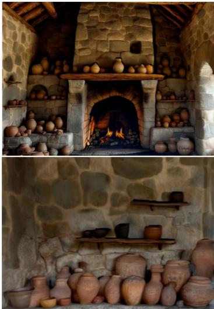  
Gaussian Spacing Norm.

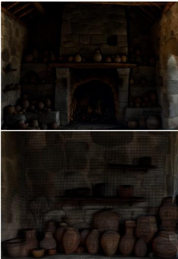  
Camera Distance Norm.

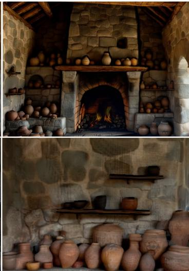  
Depth Norm.  
Figure 10: Qualitative comparisons of different normalization spaces.

Training Design Choices. We further ablate four design choices: fine-tuning the pretrained geometry backbone, fixing the Gaussian centers, scaling the training data, and adopting diverse viewsampling strategies. Results are reported in Table 13. All variants follow the same training settings. The upstream WorldMirror 2.0 geometry estimator remains frozen in all experiments.

For w/o Fine-tuning Gaussian Backbone, the Gaussian Backbone is also frozen at its WorldMirror 2.0 initialization, and only GSHead is optimized. For w/o Fixed Gaussian Centers, GSHead additionally predicts a per-pixel 3D center offset, instead of fixing the centers to the unprojected geometry. For w/o Data Scaling, we train on Hypersim, while keeping the number of training iterations unchanged. For w/o View Sampling Strategy, we randomly select n views and then partition them into source views and target views, while retaining the same numbers of source and target views. We find that fixing Gaussian centers produces the largest and most consistent gain across different inputview counts. When the centers are optimized only through rendering losses, the model can reduce image-space errors by moving primitives away from the geometry prior, resulting in geometric drift and poorer generalization to extrapolated viewpoints. Fine-tuning the Gaussian Backbone adapts the pretrained geometric features to appearance and Gaussian-attribute prediction, whereas scaling the training data improves cross-domain robustness. The mixed view-sampling strategy exposes the model to diverse camera motions and viewpoint changes, leading to more reliable reconstruction under sparse inputs and large extrapolation.

Figure 11: Qualitative comparisons across diverse scenes and viewpoints with multi-view input. A.9 APPLICATION TO PANORAMIC 3D CONTENT GENERATION.  
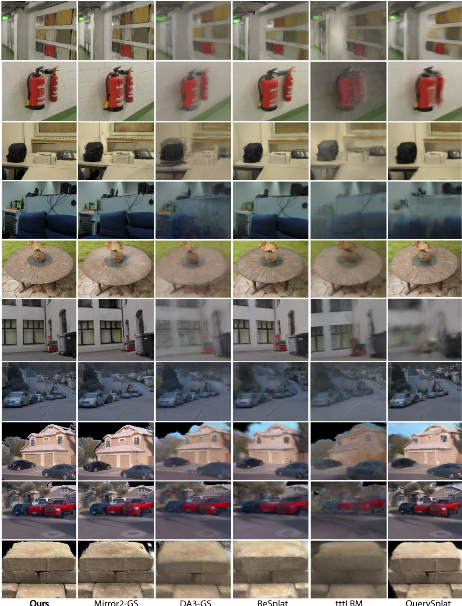

We explore SplatAnything for panoramic-image-based 3D content generation. We use World-Pano (Team et al., 2026) to generate a panoramic image and convert it into cubemap perspective views with a $. 9 5 ^ { \circ } \times 1 0 0 ^ { \circ }$ FoV, which remains substantially wider than typical perspective inputs. These views are fed directly into SplatAnything for 3D Gaussian reconstruction. As shown in Fig. 13, SplatAnything produces high-quality novel-view synthesis under this challenging wide-FoV setting. These results demonstrate its robustness to substantially different camera configurations and further highlight the potential of SplatAnything as a general feed-forward 3DGS framework.

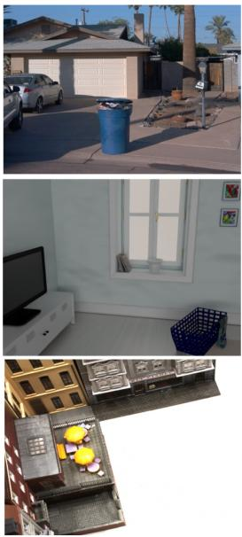  
Input

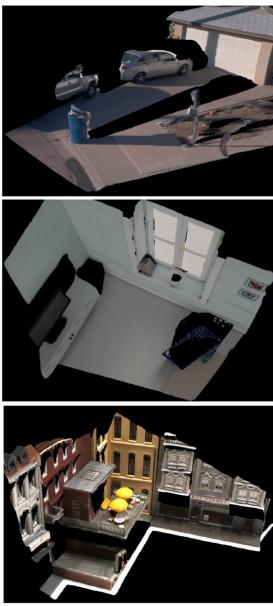  
Ours

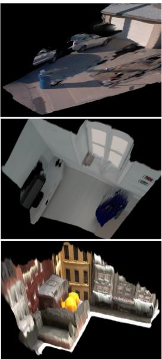  
InfiniSplat

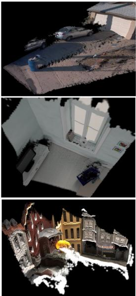  
SHARP

Figure 12: Qualitative comparisons across diverse scenes and viewpoints with monocular input.  
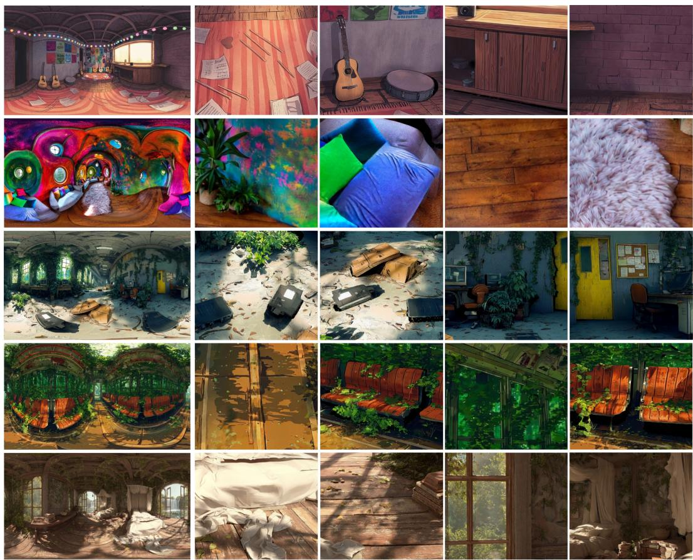  
Input Panoramic Image  
Novel View Synthesis by SplatAnything

Figure 13: Qualitative results of SplatAnything for panoramic images reconstruction. SplatAnything can reconstruct high-quality 3DGS representations from panoramic images with different field of view, demonstrating its strong generalization ability.

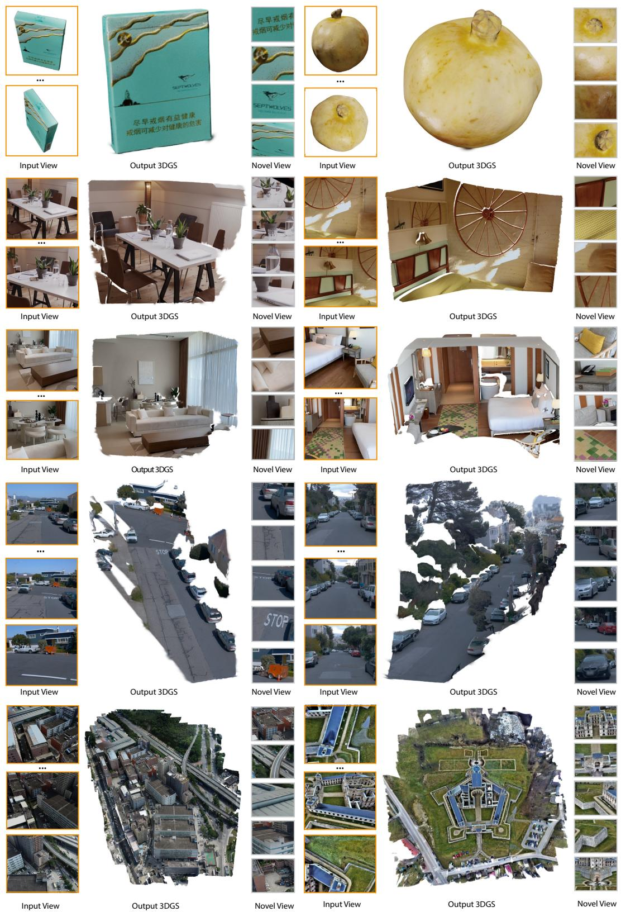  
Figure 14: More qualitative results of our method. SplatAnything feed-forward reconstructs high quality 3DGS representations generalizing to arbitrary scenes, scales, and viewpoints in a few seconds.