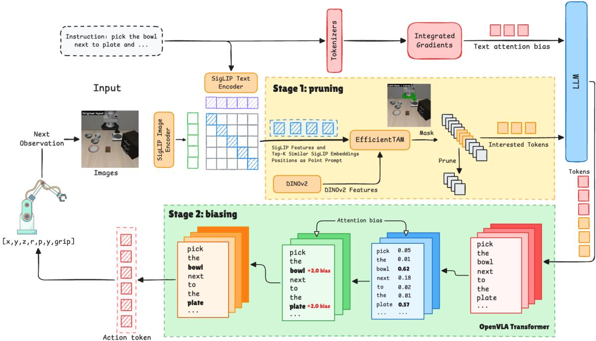
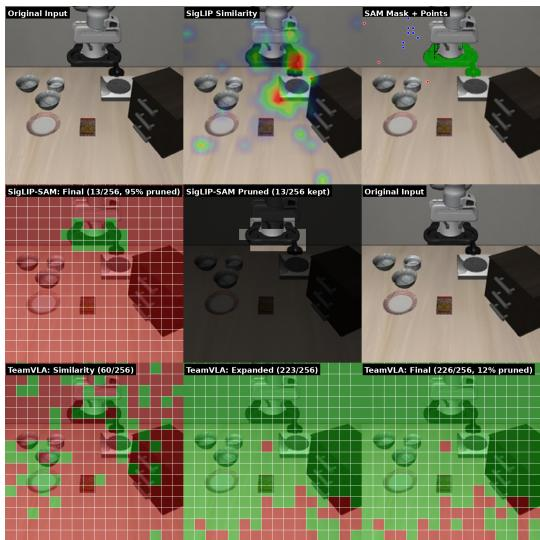
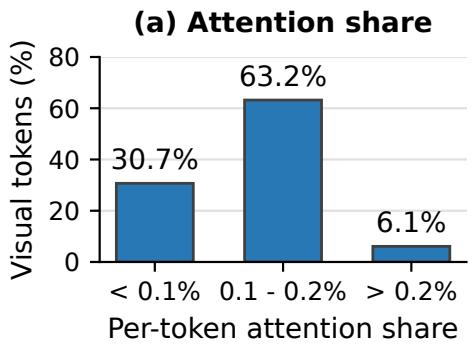
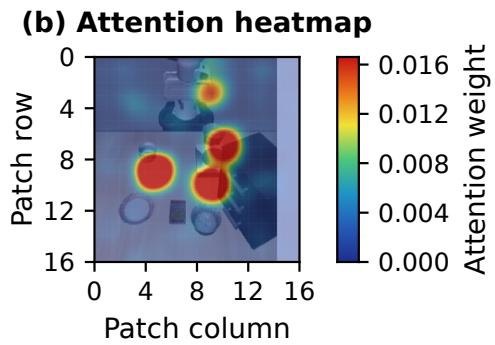
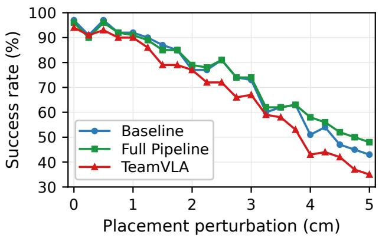

# T3R: Training-Free Two-Stage Token Refinement Towards Eficient and Robust VLA Models

Mohammed Hassan The University of Texas at Austin Austin, Texas, United States mohassan@utexas.edu

Zhenyang Chen   
Georgia Institute of   
Technology   
Atlanta, Georgia, United   
States   
chenzy086@gmail.com

Tianlong Chen University of North Carolina at Chapel Hill Chapel Hill, North Carolina, United States tianlong@cs.unc.edu

Zheng Wang   
University of Illinois Urbana-Champaign   
Urbana, Illinois, United States   
zhengw10@illinois.edu   
Yingyan (Celine) Lin Georgia Institute of Technology   
Atlanta, Georgia, United States   
celine.lin@gatech.edu Zhixin Zhu   
Hong Kong University of   
Science and Technology   
Hong Kong, Hong Kong cindy.zhu@live.cn Chaojian Li   
Hong Kong University of   
Science and Technology   
Hong Kong, Hong Kong chaojian@ust.hk

## Abstract

Vision-Language-Action (VLA) models enable end-to-end robot control, but inference is increasingly expensive: each decision pro-cesses hundreds of visual tokens, often across multiple cameras, leading to substantial computation while allowing irrelevant back- ground content to distract action prediction under distribution shift. We argue that these issues stem from two complementary forms of redundancy: many visual tokens are spatially irrelevant, while atten- tion over the remaining tokens is often misallocated. Based on this observation, we propose T3R, a Training-Free Two-Stage Token Re- finement framework. In the first stage, segmentation-guided token pruning removes irrelevant visual patches to reduce computation and eliminate distracting context. In the second stage, saliency- guided attention biasing reallocates attention toward action-critical visual regions and language instructions within the retained tokens. Together, pruning produces a cleaner candidate set, while attention biasing further emphasizes the most decision-relevant evidence, yielding a better accuracy-eficiency frontier than either stage alone. On LIBERO-Spatial, T3R removes 85% ofscene-camera visual tokens while essentially matching the unpruned success rate, and improves success by up to 7 percentage points under out-of-distribution object-placement perturbations. The timing comparison attributes 7.8 ms per inference call to pruning and attention-bias application. As input resolution increases, LLM-forward profiling shows up to a 3.3× speedup over the unpruned baseline. Evaluations across LIBERO, SIMPLER, and RoboTwin with three VLA backbones show the strongest accuracy-eficiency benefits in multi-camera settings. These results demonstrate that training-free token refinement is a practical approach to eficient and robust VLA inference.

CCS Concepts

• Computing methodologies → Computer vision; Machine learning; Robotic planning.

## Keywords

Vision-Language-Action models, token pruning, attention biasing, eficient inference, embodied AI

## ACM Reference Format:

Mohammed Hassan, Zhenyang Chen, Zheng Wang, Zhixin Zhu, Tianlong Chen, Yingyan (Celine) Lin, and Chaojian Li. 2027. T3R: Training-Free Two-Stage Token Refinement Towards Eficient and Robust VLA Models. In 32nd Asia and South Pacific Design Automation Conference (ASPDAC ’27), January 25–28, 2027, Tokyo, Japan. ACM, New York, NY, USA, 8 pages. https://doi.org/10.1145/3840404.3848406

## 1 Introduction

Vision-Language-Action (VLA) models [2, 4, 10] provide a unified interface from pixels and language to robot actions, but this gen- erality carries a substantial inference burden. At every decision step, the model propagates a long visual sequence through a large language backbone. In a typical OpenVLA-style setup, a 224 × 224 image produces 256 visual patches [32], and multi-camera inputs multiply this token load before any action token is predicted. At- tending over such long sequences at every control step is expensive and increases latency, which is detrimental to real-time control and can further induce observation–action distribution shift through stale observations and delayed actuation [1].

Many visual tokens are weakly coupled to the language instruc- tion [6, 24]. These tokens can difuse attention and distract action prediction, especially under viewpoint or object-placement shifts. Efective refinement must both remove irrelevant tokens and rein- force instruction-relevant evidence among those retained.

Redundancy acts at two coupled stages: token-set construction and attention allocation. Pruning can discard critical cues, while attention steering retains the full token cost and noisy input. We therefore prune first and refine attention only over the retained sequence.

  
Figure 1: Two-stage T3R pipeline. Stage 1 (pruning): POS-weighted SigLIP text–patch similarity localizes the target; the top scoring patch positions (with SigLIP/DINOv2 features) prompt EficientTAM to produce an object mask, which is converted to a patch-level pruning decision while preserving original RoPE positions, so only the “interested tokens” enter the LLM. Stage 2 (biasing): Integrated Gradients over the instruction identifies salient words; an additive attention bias (�=2.0) is injected into the middle decoder layers for action-token queries, steering attention toward salient text tokens and retained visual patches before the action chunk is decoded.

Building on this view, we introduce T3R, a training-free two- stage token refinement framework. Stage 1 performs segmentation- guided token pruning with position preservation, so compression happens before the VLA decoder and every transformer layer benefits from a shorter input. Stage 2 compensates for pruning-induced information loss by injecting task relevance into the retained se-quence: saliency-guided attention biasing in intermediate layers steers action-token queries toward instruction-salient words and retained task-relevant regions.

We evaluate T3R on OpenVLA-OFT [9], CogACT [12], and �0 5 [20] across LIBERO [14], SIMPLER [13], and RoboTwin [15]. Across these systems, multi-camera settings show greater pruning headroom than the single-camera zero-shot setting. This trend suggests that overlapping visual evidence creates opportunities for token reduction.

Contributions.

• We propose T3R, a training-free two-stage framework that couples segmentation-guided, position-preserving token pruning with saliency-guided attention biasing, jointly optimizing token selection and attention allocation in a single infer-ence pass.

• On LIBERO-Spatial with OpenVLA-OFT, T3R removes 85% of scene-camera tokens while retaining 96% success, reduces VLA inference latency by 14%, and improves OOD success by up to 7 pp. Resolution-scaling profiling shows up to a 3.3× LLM-forward speedup over the unpruned baseline.

• We evaluate T3R across VLA backbones and camera setups. The observed accuracy-eficiency trends are consistent with greater sensor redundancy providing more headroom for token pruning.

## 2 Related Work

Vision-Language-Action models. VLA methods cast robot control as conditional sequence modeling over observations, instructions, and actions. RT-1/RT-2 [4, 5] established large-scale visionlanguage pretraining for manipulation, while OpenVLA and OpenVLA-OFT [9, 10] improved openness and adaptation eficiency. Parallel eforts including �0/�0 5 [2, 20], CogACT [12], and GR00T [17] scale model capacity and control fidelity. Inference still relies on propagat- ing long visual token sequences through heavy backbones, leaving eficiency and robustness under perturbation as open bottlenecks. Token-eficient inference. Token reduction has been studied in vision transformers and multimodal LLMs via pruning, merging, and routing [3, 6, 21, 24]. In embodied settings, EficientVLA, LightVLA, and TeamVLA [8, 29, 30] adapt these ideas with task-aware scoring and runtime compression; FastV [6] prunes visual tokens after an early decoder layer; ADP [19] performs action-aware dynamic pruning; and VLA-Cache [28] reuses KV-cache entries across frames. T3R targets the harder decoder-entry regime: tokens are removed

before any decoder layer, benefiting all layers, but selection is irre-versible and lacks internal attention guidance. T3R addresses this by coupling external vision-language grounding with post-pruning attention repair. T3R and VLA-Cache are complementary (spatial vs. temporal redundancy).

Segmentation priors and attribution steering. Promptable segmentation models such as SAM/SAM2 and eficient variants [11, 22, 27] provide a strong prior for locating instruction-relevant regions; we use segmentation as an intermediate computational prior rather than a perception output. Attribution methods, especially Integrated Gradients [26], estimate token contribution without parameter updates; since raw attention is not always a faithful importance indicator [7, 18], we use external relevance signals to bias middle-layer action-token attention, following the spirit of inference-time intervention [16].

Positioning. To our knowledge, T3R is the first training-free approach to prune 85% of scene-camera tokens before decoder entry while retaining success within 1 pp of the unpruned baseline on LIBERO-Spatial. External grounding and attention repair benefit every decoder layer without retraining.

## 3 Method

T3R follows a two-stage pipeline (Fig. 1): segmentation-guided token pruning (Sec. 3.1) removes spatially redundant tokens, then saliency-guided attention biasing (Sec. 3.2) sharpens attention on the most important tokens that remain.

## 3.1 Segmentation-Guided Token Pruning

We remove visually irrelevant patches before they reach the VLA backbone, reducing efective sequence length while preserving tokens that carry task-relevant evidence. We first estimate patch level relevance with the SigLIP vision-language encoder, which yields a text–patch similarity map, then refine it into an object mask with a SAM-based segmenter.

Task-guided patch scoring. Given an instruction ℓ and an image $I \in \mathbb { R } ^ { \hat { 2 } 2 4 \times 2 2 4 \times \hat { 3 } }$ , SigLIP partitions the image into �=256 patches with features $V \in \mathbb { R } ^ { N \times d }$ and tokenizes the instruction into $T \in$ $\mathbb { R } ^ { M \times d }$ . Natural-language instructions mix nouns, spatial relations, and function words that are not equally informative for ground- ing. We therefore compute a part-of-speech (POS)-weighted patch-relevance score

$$
s _ { i } = \frac { \sum _ { j = 1 } ^ { M } w _ { j } \cos ( v _ { i } , t _ { j } ) } { \sum _ { j = 1 } ^ { M } w _ { j } } ,\tag{1}
$$

where $t _ { j }$ is the embedding of token $j , w _ { j }$ its POS-dependent weight, and cos(·, ·) cosine similarity. This softly emphasizes object nouns and descriptive adjectives while down-weighting verbs and prepositions, without supervision or architectural changes.

Segmentation-based mask generation. Relevance scores localize the target coarsely but lack precise boundaries. We refine them with EficientTAM-S [27], which generates masks from sparse point prompts. Because nearly uniform similarity scores make top-� prompt selection unstable, we adopt an oversample-cluster-refine strategy: select the $K _ { \mathrm { i n i t } } { = } 5 0$ highest-scoring patches, apply DB-SCAN (�=2.0 in patch units) on their 2D grid coordinates, retain the largest spatial cluster, and take its �=8 top-scoring patches as positive prompts plus $K _ { \mathrm { n e g } } { = } 3$ lowest-scoring patches as negative prompts. This spatial coherence reduces mask flicker across frames. A patch is retained if the mask covers more than 30% of its pixels (�=0.3). SigLIP text embeddings are cached per instruction; masks are updated asynchronously every five VLA calls.

  
Figure 2: Qualitative pruning on a sparse LIBERO-Spatial scene (“pick up the bowl between the plate and the ramekin”). Top: input, POS-weighted SigLIP similarity, and the Eficient-TAM mask with its point prompts. Middle: T3R keeps only 13/256 patches (95% pruned), tightly localized on the target. Bottom: TeamVLA’s similarity+expansion+merge retains 226/256 (12% pruned), leaving most of the background in the sequence through the early decoder layers.

## Position-preserving pruning. The input layout is

$$
\left[ \mathrm { B O S } , \ v _ { 1 : 2 5 6 } , \ v _ { 1 : 2 5 6 } ^ { \prime } , \ q _ { \mathrm { p r o p r i o } } , \ t _ { 1 : L } \right]
$$

with sequential RoPE positions [25]. Naively re-indexing after pruning shifts downstream tokens to positions never seen in pretraining and collapses success to near zero in our tests. We instead assign each retained patch its original position ID: for the retained index set � the sequence becomes

$$
\big [ 0 , \big \{ i + 1 \big \} _ { i \in S } , 2 5 7 - 5 1 2 , 5 1 3 , 5 1 4 , . . . \big ] ,
$$

preserving the pretrained positional structure and visual–language relationships.

Scheduling. Segmentation runs asynchronously, with updates sched-uled every five VLA inference calls. Action inference reuses the latest completed mask without waiting for an update. On suites where segmentation is ambiguous, an optional similarity-union rule additionally retains patches above the 75th percentile of the similarity scores, trading a little compression for recall.

## 3.2 Saliency-Guided Attention Biasing

Pruning inevitably removes scene information. To mitigate the loss of task-relevant signal, we steer attention toward salient instruc- tion tokens and retained task-relevant patches within the reduced sequence.

Attribution via Integrated Gradients. We adopt Integrated Gradients (IG) [26], which attributes a prediction to input tokens by integrating gradients along a straight-line path from a neutral baseline to the actual input and satisfies the completeness axiom. At the start of each task we compute token-level IG on the embedding layer, interpolating between a pad-token baseline and the input in $n _ { \mathrm { s t e p s } } { = } 5$ steps; the normalized attribution $\boldsymbol { \alpha } \in \mathbb { R } ^ { L }$ designates the top 30% of tokens as salient. The attributions are cached and reused across all evaluation episodes of that task.

Attention-bias injection. We add the attribution as an additive bias to the attention logits of the middle decoder layers:

$$
a _ { i j } = \frac { q _ { i } \cdot k _ { j } } { \sqrt { d } } + \beta w _ { j } 1 \big [ j \in S _ { \mathrm { b i a s } } \big ] 1 \big [ i \in Q _ { \mathrm { a c t i o n } } \big ] ,\tag{2}
$$

where $\beta$ is a scalar strength, $w _ { j }$ the bias weight at key position $j ,$ $S _ { \mathrm { b i a s } }$ the union of salient text positions and retained visual patch po-sitions, and $Q \mathrm { a c t i o n }$ the action-prediction queries. The bias is applied only to action-token queries and restricted to middle layers (8–23), preserving early feature extraction and late output formatting. Biased positions are drawn from (i) salient text tokens weighted by their IG scores and (ii) retained visual patches weighted by SigLIP similarity scaled by 0.5. This forms a two-level funnel: pruning removes clearly irrelevant tokens; biasing further diferentiates among those that remain.

## 4 Experiments

We test three hypotheses: (H1) segmentation-guided pruning substantially reduces scene-camera tokens while maintaining success; (H2) fewer tokens lower inference cost; and (H3) the full T3R pipeline improves robustness under out-of-distribution object-placement shifts. We then examine cross-backbone generalization and sensor redundancy.

Setup. Our primary study uses OpenVLA-OFT [9] (SigLIP ViT-SO400M + LLaMA-2-7B, LoRA rank 32, chunk size 8, dual camera ⇒ 512 visual tokens/call) on LIBERO [14], a MuJoCo tabletop manipulation suite of four task families (Spatial, Object, Goal, Long). Spatial uses a 220-step horizon. Saliency uses IG with $n _ { \mathrm { s t e p s } } { = } 5 ,$ top-� ratio 0.3, �=2.0, layers 8–23, and a 0.5 visual scaling. Unless noted we evaluate 10 episodes/task (seed 7 nominal, seed 42 OOD) on a single NVIDIA L40S (48 GB). For generalization we additionally port T3R to CogACT [12] on SIMPLER [13] (single third-person camera) and to �0.5 [20] on RoboTwin [15] (three cameras), covering a 1×/2×/3× spread in camera count. Baselines are the unpruned model, TeamVLA [30], ADP [19], and FastV [6]; each baseline runs at its native operating point, and we additionally force ADP/FastV into T3R’s high-reduction regime where noted. Reported reductions refer to scene-camera tokens removed before decoder entry.

## 4.1 T3R Prunes Aggressively While Maintaining Success (H1)

Table 1 shows that T3R achieves approximately 5.7× the scenecamera token-reduction rate of TeamVLA (85% vs. ∼15%), while achieving a higher success rate (96% vs. 94%). At the same 85% reduction, ADP and FastV fall to 66% and 14%; native ADP preserves accuracy at only 33.5% reduction. The retained budget adapts to task dificulty: T3R keeps 9–15 patches in sparse scenes and up to 121 in clutter, versus TeamVLA’s fixed ∼203–233, avoiding a worst-case token count.

Table 1: LIBERO-Spatial (OpenVLA-OFT). “Reduction” is scene-camera tokens pruned before decoder execution; latency is per VLA inference call. ∗ADP native operating point (67% of steps × 50%/step ≈ 33.5% reduction).
<table><tr><td>Method</td><td>Reduction</td><td>SR (%)</td><td>Latency (ms)</td></tr><tr><td>Baseline (no pruning)</td><td>0%</td><td>97</td><td>107.5</td></tr><tr><td>TeamVLA [30]</td><td>~15%</td><td>94</td><td>102.6</td></tr><tr><td>FastV  $\left[ 6 \right] \left( k { = } 1 , r { = } 0 . 8 5 \right)$ </td><td>85%</td><td>14</td><td>一</td></tr><tr><td>ADP [19]</td><td>85%</td><td>66</td><td>1</td></tr><tr><td>ADP [19]*</td><td>33.5%</td><td>97</td><td></td></tr><tr><td>T3R (ours)</td><td>85%</td><td>96</td><td>92.5</td></tr></table>

Across all four LIBERO suites (10 tasks × 10 episodes each), T3R matches or beats TeamVLA on latency everywhere and on success on 3/4 suites, matching the unpruned baseline within 1 pp on Spatial (96 vs. 97) and Goal (98 vs. 99) at roughly 88–93 ms/call vs. the baseline’s 105–108 ms. The Object suite is the exception (82% vs. TeamVLA’s 86%), reflecting segmentation failures discussed in the failure analysis.

## 4.2 Most Visual Tokens Are Negligible

For each decoder layer we sum attention mass from every action- token query to every visual key and express each token’s share as a percentage of the total, averaging over 32 layers, 10 LIBERO-Spatial tasks, and 3 timesteps/task. 93.9% of visual tokens receive less than 0.2% of action-query attention each. In late layers (24–31), 50–75% of tokens fall below 0.1%. This shows most tokens are near- inert, but safe pre-decoder removal still depends on selecting the retained set well.

## 4.3 T3R Reduces Computational Cost (H2)

Profiling on an L40S across 11 token counts (8–256 patches) reveals an approximately linear trend, 0.040 ms/token + 53.3 ms (�=0.97). At 224 px, 85% scene-camera token reduction lowers VLA infer- ence latency from 107.5 to 92.5 ms per call: a 14% reduction or 1.16× speedup. Each call produces an eight-action chunk, not one environment step.

Comparing LLM-only savings (58.9 − 36.1 ms) with reported VLA-call savings (107.5 − 92.5 ms) yields a 7.8 ms residual per call, attributed to pruning and attention-bias application and already included in 92.5 ms. This accounting assumes comparable timing conditions; it does not isolate individual components. Segmentation (54 ms per update, every five VLA calls) runs asynchronously. IG is computed once per task and reused across its episodes; a 1 s cost corresponds to approximately 0.45 ms per environment step over ten full 220-step episodes.

Resolution scaling and hardware implications. The efective per-token marginal cost rises from 0.040 ms at sequence length ∼200 to 0.064 ms at ∼500, marking the transition from a bandwidthbound to a compute-bound attention regime. Because T3R fixes the pruning ratio rather than an absolute token count, its retained sequence stays in the cheaper bandwidth-bound regime as reso- lution grows, while the unpruned baseline enters the quadratic compute-bound regime. LLM-forward profiling shows up to a 3.3× speedup at 768 px. For accelerator co-design the implication is concrete: pre-decoder pruning shifts the operating point back toward the memory-bound regime that current LLM inference hardware handles most eficiently. Using the measured LLM cost on an L40S and adding a fixed 48.6 ms non-LLM cost, we project end-to-end inference latencies of 100/115/132 ms at 384/512/768 px for T3R, versus the baseline’s 144/182/327 ms and ADP’s 109/145/238 ms, a 2.47× projected speedup over baseline at 768 px, versus ADP’s 1.37×. These projections do not independently measure refinement overhead at each resolution.

  
Figure 3: Most visual tokens are near-inert. (a) Across all 32 decoder layers, 93.9% of visual tokens receive <0.2% of the action queries’ attention each. (b) Per-patch action-query attention concentrates on a few task-relevant patches (here the gripper and target bowls), while the background receives negligible weight

## 4.4 T3R Improves OOD Robustness (H3)

We apply Gaussian positional noise to object placements (0–5 cm; 21 levels, 10 ep/task). T3R tracks the baseline within 1–2 pp for small perturbations, matches or exceeds it at ≥2 cm, and leads by up to 7 pp at 4 cm (+4.8 pp average at ≥4 cm); TeamVLA degrades fastest (35% at 5 cm vs. our 48%). These full-pipeline gains are consistent with pruning reducing misleading background context and attention refinement emphasizing task-relevant evidence.

  
Figure 4: OOD robustness under object-placement perturbation (21 noise levels, 10 episodes/task). T3R (Full Pipeline) tracks the unpruned baseline for small shifts and pulls ahead beyond ∼2 cm, leading by up to 7 pp at 4 cm, while TeamVLA degrades fastest. The crossover is consistent with pruning reducing misleading background context.

## 4.5 Generalization and Sensor Redundancy

To test whether T3R’s benefit transfers across backbones and sensor suites, we port it to CogACT on SIMPLER (single third-person camera) and to $\pi _ { 0 . 5 }$ on RoboTwin (three cameras). Both evaluations are zero-shot with no fine-tuned checkpoint, so absolute success is low; we focus on relative behavior versus the unpruned base and competing pruners at matched budgets.

Single-camera (CogACT / SIMPLER). Table 2 (left) reports Co-gACT on the SIMPLER Google-Robot (11 tasks, 189 episodes per method) and WidowX/Bridge (4 tasks, 96 episodes per method) suites, each using one third-person view. Here T3R with a 60% keep ratio matches base on Bridge and trails by 5.5 pp on Google-Robot, while methods retaining more tokens (ADP, FastV) fare better. With one view, little cross-sensor redundancy remains, so aggressive pruning removes tokens the policy still needs.

Multi-camera $( \pi _ { 0 . 5 } \mathrm { ~ / ~ }$ RoboTwin). For $\pi _ { 0 . 5 }$ on RoboTwin (three cameras), we evaluate each method/budget on five tasks with 12 episodes each (60 total; Table 2, right). Success rates are computed from pooled counts and rounded once. T3R achieves the highest or joint-highest success among the evaluated pruners across the reported budgets. At a 50% keep ratio it matches baseline (both 33.3%); at 62.5% it reaches 38.3%, exceeding baseline by 5.0 pp and the best competing pruner by 10 pp. ADP, FastV, and TeamVLA remain below baseline at these two budgets.

Takeaway. Across the evaluated backbones and benchmarks, T3R shows greater pruning headroom in multi-camera settings. This cross-system trend suggests that overlapping visual evidence provides opportunities for token reduction.

## 4.6 Ablations

We isolate each component on LIBERO-Spatial (10 tasks × 10 episodes). Prune-only reaches 90% at 85% scene-camera token reduction, bias- only 98%, and full T3R 96%, versus a 97% baseline. Biasing recovers 6 pp of pruning loss; bias-only exceeding baseline indicates diffuse unpruned attention. In the bias-only layer sweep (no pruning),

Table 2: Cross-backbone generalization. Left: CogACT on SIMPLER (single camera), average SR (%); each keep ratio corresponds to the respective method’s native operating point. Right: $\pi _ { 0 . 5 }$ on RoboTwin (three cameras), SR (%) vs. per-camera token budget (base = 33.3). Best per column/row in bold.
<table><tr><td>Method (keep ratio)</td><td>Google Robot</td><td>WidowX/Bridge</td></tr><tr><td>Baseline (100%)</td><td>73.2</td><td>10.4</td></tr><tr><td>ADP [19] (75% / ~87%)</td><td>71.0</td><td>16.7</td></tr><tr><td>FastV [6] (~60%)</td><td>73.3</td><td>15.6</td></tr><tr><td>TeamVLA [30] (31.25%)</td><td>69.5</td><td>12.5</td></tr><tr><td>T3R (ours, 60%)</td><td>67.7</td><td>10.4</td></tr></table>

middle-layer biasing (8–23) reaches 98%, versus 95% for early, 92% for late, and 93% for all layers, consistent with early feature distor- tion and late output disruption.

Why T3R outperforms prior pruners. T3R prunes before all 32 decoder layers (∼37 scene tokens retained), while TeamVLA carries 512 tokens through layers 0–15, allowing irrelevant context into representations before merging. Segmentation preserves coherent object regions and RoPE geometry rather than disjoint similarity samples; IG-guided attention repair then ofsets pruning loss.

Hyperparameter robustness. One hyperparameter set served all 10 LIBERO-Spatial tasks and all four suites, without per-task tuning. Sweeping bias strength, active layers, saliency top-�, and pruning threshold changed SR by 1–6 pp; DBSCAN � and SAM point counts follow the fixed patch-grid geometry.

## 4.7 Design Study: When and How to Steer Attention

A pilot on ECoT-OpenVLA-7B [31] (30 ofline LIBERO-Spatial demos, L2 action error) crossed text-token IG with image-token Grad-CAM [23], reasoning with action phases, and positive with negative biasing. Action-phase biasing cuts error by 5.4% (�=0.062), while reasoning-phase biasing raises it by 9.3% (�=0.018). Text IG outperforms image Grad-CAM, and negative biasing never helps. These results support positive text-IG steering during action generation: the policy under-attends relevant tokens, so biasing can recover pruning loss.

## 4.8 Failure Analysis and Limitations

T3R underperforms TeamVLA on LIBERO-Object (82% vs. 86%). These tasks place a source object into a visually dominant destination (e.g., a basket), so SigLIP similarity splits between the two and EficientTAM segments the wrong region or produces an overly narrow mask. Multi-phase LIBERO-Long tasks (e.g., “put the bowl in the drawer and close it”) pose a related issue: the relevant region shifts mid-episode, but similarity is computed from the full instruc- tion and does not adapt to the current phase, so pruning may mask regions that become critical later. More broadly, (i) Stage 1 depends on promptable segmentation as an intermediate prior and inherits its failure modes on merged or coarse boundaries; (ii) IG adds a onetime per-task cost that may not amortize over short task runs or meet strict initialization deadlines; and (iii) our single-camera zeroshot results (Sec. 4.5) show the method ofers little benefit when the sensor suite carries little redundancy. Phase-aware re-prompting and camera-adaptive budgets are natural extensions.

<table><tr><td>tok/cam</td><td>keep</td><td>T3R</td><td>ADP</td><td>FastV</td><td>TeamVLA</td></tr><tr><td>64</td><td>25%</td><td>13.3</td><td>13.3</td><td>11.7</td><td>3.3</td></tr><tr><td>96</td><td>37.5%</td><td>25.0</td><td>13.3</td><td>23.3</td><td>11.7</td></tr><tr><td>128</td><td>50%</td><td>33.3</td><td>21.7</td><td>18.3</td><td>15.0</td></tr><tr><td>160</td><td>62.5%</td><td>38.3</td><td>25.0</td><td>28.3</td><td>15.0</td></tr></table>

All evaluations use simulation; physical-robot control and asyn- chronous execution with real sensor and actuation delays remain unvalidated. Hardware profiling uses only an NVIDIA L40S, with no energy measurements or edge-device tests. Latency improvements alone therefore do not establish energy savings or edge perfor- mance. Occlusion and lighting changes may degrade segmentation and discard task-relevant patches. We have not isolated these efects on task success or compared alternative segmenters.

## 5 Conclusion

We presented T3R, a training-free two-stage framework that couples segmentation-guided token pruning with saliency-guided attention biasing. On LIBERO-Spatial with OpenVLA-OFT, it removes 85% of scene-camera visual tokens while retaining success within 1 pp of baseline, reduces VLA inference latency, and improves OOD robustness by up to 7 pp. Evaluations on CogACT and $\pi _ { 0 . 5 }$ across SIMPLER and RoboTwin suggest that overlapping multi-camera evidence provides more headroom for token pruning. From a de- sign perspective, the value of T3R lies in where it acts. By dis-carding irrelevant tokens before decoder entry, every transformer layer operates on the shorter sequence, so the retained tokens stay in the cheaper bandwidth-bound regime even as resolution grows, yielding a projected speedup of up to 2.47× at 768 px. Mask updates run asynchronously, while IG computation is amortized across each task’s episodes. Because the pipeline is training-free and leaves the underlying VLA weights unchanged, it applies directly to existing pretrained policies. Together, these properties make task-conditioned, pre-decoder sparsification a practical, first- class knob for co-designing eficient embodied inference systems. Across scenes, its adaptive budget retains 9–15 patches in sparse cases and up to 121 in clutter, while middle-layer biasing recov- ers 6 pp of the prune-only accuracy loss. Together with the 93.9% attention-sparsity result, these measurements explain why aggres-sive pruning remains viable and when additional evidence must be retained.

## Acknowledgments

This research was supported by the NVIDIA Academic Grant Pro- gram using NVIDIA DGX Spark and NVIDIA Jetson AGX Thor.

## References

[1] Nadun Ranawaka Arachchige, Zhenyang Chen, Wonsuhk Jung, Woo Chul Shin, Rohan Bansal, Pierre Barroso, Yu Hang He, Yingyang Celine Lin, Benjamin Jofe, Shreyas Kousik, and Danfei Xu. 2025. SAIL: Faster-than-Demonstration Execution of Imitation Learning Policies. arXiv:2506.11948 [cs.RO] https://arxiv. org/abs/2506.11948

[2] Kevin Black, Noah Brown, Danny Driess, Adnan Esmail, Michael Equi, Chelsea Finn, Niccolo Fusai, Lachy Groom, Karol Hausman, Brian Ichter, Szymon Jakubczak, Tim Jones, Liyiming Ke, Sergey Levine, Adrian Li-Bell, Mohith Mothukuri, Suraj Nair, Karl Pertsch, Lucy Xiaoyang Shi, James Tanner, Quan Vuong, Anna Walling, Haohuan Wang, and Ury Zhilinsky. 2024. �0: A Vision-Language-Action Flow Model for General Robot Control. arXiv:2410.24164 [cs.LG] htt s://arxiv.or /abs/2410.24164

[3] Daniel Bolya, Cheng-Yang Fu, Xiaoliang Dai, Peizhao Zhang, Christoph Feichten hofer, and Judy Hofman. 2023. Token Merging: Your ViT But Faster. In International Conference on Learning Representations. https://arxiv.org/abs/2210.09461

[4] Anthony Brohan, Noah Brown, Justice Carbajal, Yevgen Chebotar, Xi Chen, Krz sztofChoromanski, Tianli Din , Dann Driess, Avinava Dube , Chelsea Finn, Pete Florence, Chu uan Fu, Montse Gonzalez Arenas, Keerthana Go alakrishnan, Kehan Han, Karol Hausman, Alexander Herzo , Jasmine Hsu, Brian Ichter, Alex Irpan, Nikhil Joshi, Ryan Julian, Dmitry Kalashnikov, Yuheng Kuang, Isabel Leal, Lisa Lee, Tsang-Wei Edward Lee, Serge Levine, Yao Lu, Henr k Michalewski, Igor Mordatch, Karl Pertsch, Kanishka Rao, Krista Reymann, Michael Ryoo, Grecia Salazar, Pannag Sanketi, Pierre Sermanet, Jaspiar Singh, Anikait Singh, Radu Soricut, Huong Tran, Vincent Vanhoucke, Quan Vuong, Ayzaan Wahid, Stefan Welker, Paul Wohlhart, Jialin Wu, Fei Xia, Ted Xiao, Peng Xu, Sichun Xu, Tianhe Yu, and Brianna Zitkovich. 2023. RT-2: Vision-Language-Action Models Transfer Web Knowledge to Robotic Control. arXiv:2307.15818 [cs.RO] https://arxiv.org/abs/2307.15818

[5] Anthony Brohan, Noah Brown, Justice Carbajal, Yevgen Chebotar, Joseph Dabis, Chelsea Finn, Keerthana Gopalakrishnan, Karol Hausman, Alex Herzog, Jasmine Hsu Julian Ibarz Brian Ichter Alex Ir an Tomas Jackson Sall Jesmonth Nikhil J. Joshi, Ryan Julian, Dmitry Kalashnikov, Yuheng Kuang, Isabel Leal, Kuang-Huei Lee, Sergey Levine, Yao Lu, Utsav Malla, Deeksha Manjunath, Igor Mordatch, Ofir Nachum Carolina Parada Jodil n Peralta Emil Perez Karl Pertsch Jornel Quiambao, Kanishka Rao, Michael Ryoo, Grecia Salazar, Pannag Sanketi, Kevin Sayed, Jaspiar Singh, Sumedh Sontakke, Austin Stone, Clayton Tan, Huong Tran, Vincent Vanhoucke, Steve Vega, Quan Vuong, Fei Xia, Ted Xiao, Peng Xu, Sichun Xu, Tianhe Yu, and Brianna Zitkovich. 2023. RT-1: Robotics Transformer for Real-World Control at Scale. In Proceedings of Robotics: Science and Systems. htt s://arxiv.or /abs/2212.06817

[6] Liang Chen, Haozhe Zhao, Tianyu Liu, Shuai Bai, Junyang Lin, Chang Zhou, and Baobao Chang. 2024. An Image Is Worth 1/2 Tokens After Layer 2: Plug and-Play Inference Acceleration for Large Vision-Language Models. In European Conference on Computer Vision. https://arxiv.org/abs/2403.06764

[7] Sarthak Jain and Byron C. Wallace. 2019. Attention Is Not Explanation. In Proceedings ofthe 2019Conference ofthe North American Chapter ofthe Association for Computational Linguistics: Human Language Technologies, Volume 1 (Long and Short Papers). Association for Computational Linguistics, 3543–3556. doi:10. 18653/v1/N19-1357

[8] Titong Jiang, Xuefeng Jiang, Yuan Ma, Xin Wen, Bailin Li, Kun Zhan, Peng Jia, Yahui Liu, Sheng Sun, and Xianpeng Lang. 2025. The Better You Learn, The Smarter You Prune: Towards Eficient Vision-Language-Action Models via Diferentiable Token Pruning. arXiv:2509.12594 [cs.RO] https://arxiv.org/abs 2509.12594

[9] Moo Jin Kim, Chelsea Finn, and Percy Liang. 2025. Fine-Tuning Vision-Language-Action Models: Optimizing Speed and Success. In Proceedings of Robotics: Science and Systems. Los Angeles, CA, USA. doi:10.15607/RSS.2025.XXI.017

[10] Moo Jin Kim, Karl Pertsch, Siddharth Karamcheti, Ted Xiao, Ashwin Balakrishna, Suraj Nair, Rafael Rafailov, Ethan Foster, Grace Lam, Pannag Sanketi, Quan Vuong, Thomas Kollar, Benjamin Burchfiel, Russ Tedrake, Dorsa Sadigh, Sergey Levine, Percy Liang, and Chelsea Finn. 2024. OpenVLA: An Open-Source Vision-Language-Action Model. In Conference on Robot Learning. https://arxiv.org/abs/ 2406.09246

[11] Alexander Kirillov, Eric Mintun, Nikhila Ravi, Hanzi Mao, Chloe Rolland, Laura Gustafson, Tete Xiao, Spencer Whitehead, Alexander C. Berg, Wan-Yen Lo, Piotr Dollár, and Ross Girshick. 2023. Segment Anything. In Proceedings of the IEEE/CVF International Conference on Computer Vision. https://arxiv.org/abs/2304.02643

[12] Qixiu Li, Yaobo Liang, Zeyu Wang, Lin Luo, Xi Chen, Mozheng Liao, Fangyun Wei, Yu Deng, Sicheng Xu, Yizhong Zhang, Xiaofan Wang, Bei Liu, Jianlong Fu, Jianmin Bao, Dong Chen, Yuanchun Shi, Jiaolong Yang, and Baining Guo. 2024. CogACT: A Foundational Vision-Language-Action Model for Synergizing Cognition and Action in Robotic Manipulation. arXiv:2411.19650 [cs.RO] https: //arxiv.or /abs/2411.19650

[13] Xuanlin Li, Kyle Hsu, Jiayuan Gu, Karl Pertsch, Oier Mees, Homer Rich Walke, Chuyuan Fu, Ishikaa Lunawat, Isabel Sieh, Sean Kirmani, Sergey Levine, Jiajun

Wu, Chelsea Finn, Hao Su, Quan Vuong, and Ted Xiao. 2024. Evaluating Real World Robot Manipulation Policies in Simulation. In Conference on Robot Learning. https://arxiv.org/abs/2405.05941

[14] Bo Liu, Yifeng Zhu, Chongkai Gao, Yihao Feng, Qiang Liu, Yuke Zhu, and Peter Stone. 2023. LIBERO: Benchmarking Knowledge Transfer for Lifelong Robot Learning. In Advances in Neural Information Processing Systems. https://proceedings.neurips.cc/paper\_files/paper/2023/hash/ 8c3c666820ea055a77726d66fc7d447f-Abstract-Datasets\_and\_Benchmarks.html

[15] Yao Mu, Tianxing Chen, Zanxin Chen, Shijia Peng, Zhiqian Lan, Zeyu Gao, Zhixuan Liang, Qiaojun Yu, Yude Zou, Mingkun Xu, Lunkai Lin, Zhiqiang Xie, Mingyu Ding, and Ping Luo. 2025. RoboTwin: Dual-Arm Robot Benchmark with Generative Digital Twins. In Proceedings of the IEEE/CVF Conference on Computer Vision and Pattern Recognition. 27649–27660. https: //openaccess.thecvf.com/content/CVPR2025/html/Mu\_RoboTwin\_Dual-Arm\_ Robot\_Benchmark\_with\_Generative\_Digital\_Twins\_CVPR\_2025\_paper.html

[16] Tuc Nguyen and Thai Le. 2026. ATLAS: Adaptive Test-Time Latent Steering with External Verifiers for Enhancing LLMs Reasoning. arXiv:2601.03093v1 [cs.LG] https://arxiv.org/abs/2601.03093v1

[17] NVIDIA, Johan Bjorck, Fernando Castañeda, Nikita Cherniadev, Xingye Da, Runyu Ding, Linxi “Jim” Fan, Yu Fang, Dieter Fox, Fengyuan Hu, Spencer Huang, Joel Jang, Zhenyu Jiang, Jan Kautz, Kaushil Kundalia, Lawrence Lao, Zhiqi Li, Zongyu Lin, Kevin Lin, Guilin Liu, Edith Llontop, Loic Magne, Ajay Mandlekar, Avnish Narayan, Soroush Nasiriany, Scott Reed, You Liang Tan, Guanzhi Wang, Zu Wan , Jin Wan , Qi Wan , Jiannan Xian , Yu i Xie, Yinzhen Xu, Zhenjia Xu, Seonghyeon Ye, Zhiding Yu, Ao Zhang, Hao Zhang, Yizhou Zhao, Ruijie Zheng, and Yuke Zhu. 2025. GR00T N1: An Open Foundation Model for Generalist Humanoid Robots. arXiv:2503.14734 [cs.RO] https://arxiv.org/abs/2503.14734

[18] Badri N. Patro, Anupriy, and Vinay P. Namboodiri. 2022. Explanation vs. Attention: A Two-Player Game to Obtain Attention for VQA and Visual Dialog. Pattern Recognition 132 (2022), 108898. doi:10.1016/j. atco .2022.108898

[19] Xiaohuan Pei, Yuxing Chen, Siyu Xu, Yunke Wang, Yuheng Shi, and Chang Xu. 2025. Action-Aware Dynamic Pruning for Eficient Vision-Language-Action Manipulation. arXiv:2509.22093 [cs.RO] https://arxiv.org/abs/2509.22093

[20] Physical Intelligence, Kevin Black, Noah Brown, James Darpinian, Karan Dhabalia, Danny Driess, Adnan Esmail, Michael Equi, Chelsea Finn, Niccolo Fusai, Manuel Y. Galliker, Dibya Ghosh, Lachy Groom, Karol Hausman, Brian Ichter, Szymon Jakubczak, Tim Jones, Liyiming Ke, Devin LeBlanc, Sergey Levine, Adrian Li-Bell, Mohith Mothukuri, Suraj Nair, Karl Pertsch, Allen Z. Ren, Lucy Xiaoyang Shi, Laura Smith, Jost Tobias Springenberg, Kyle Stachowicz, James Tanner, Quan Vuong, Homer Walke, Anna Walling, Haohuan Wang, Lili Yu, and Ury Zhilinsky. 2025. �0 5: A Vision-Language-Action Model with Open-World Generalization. arXiv:2504.16054 [cs.LG] https://arxiv.org/abs/2504.16054

[21] Yongming Rao, Wenliang Zhao, Benlin Liu, Jiwen Lu, Jie Zhou, and Cho-Jui Hsieh. 2021. DynamicViT: Eficient Vision Transformers with Dynamic Token Sparsification. In Advances in Neural Information Processing Systems. https: //arxiv.org/abs/2106.02034

[22] Nikhila Ravi, Valentin Gabeur, Yuan-Ting Hu, Ronghang Hu, Chaitanya Ryali, Tengyu Ma, Haitham Khedr, Roman Rädle, Chloe Rolland, Laura Gustafson, Eric Mintun, Junting Pan, Kalyan Vasudev Alwala, Nicolas Carion, Chao-Yuan Wu, Ross Girshick, Piotr Dollár, and Christoph Feichtenhofer. 2024. SAM 2: Segment Anything in Images and Videos. arXiv:2408.00714 [cs.CV] https://arxiv.org/abs 2408.00714

[23] Ramprasaath R. Selvaraju, Michael Cogswell, Abhishek Das, Ramakrishna Vedan tam, Devi Parikh, and Dhruv Batra. 2017. Grad-CAM: Visual Explanations from Deep Networks via Gradient-Based Localization. In Proceedings ofthe IEEE International Conference on Computer Vision. https://arxiv.org/abs/1610.02391

[24] Yuzhang Shang, Mu Cai, Bingxin Xu, Yong Jae Lee, and Yan Yan. 2024. LLaVA-PruMerge: Adaptive Token Reduction for Eficient Large Multimodal Models. arXiv:2403.15388 [cs.CV] htt s://arxiv.or /abs/2403.15388

[25] Jianlin Su, Murtadha Ahmed, Yu Lu, Shengfeng Pan, Wen Bo, and Yunfeng Liu. 2024. RoFormer: Enhanced Transformer with Rotary Position Embedding. Neurocomputing 568 (2024), 127063. doi:10.1016/j.neucom.2023.127063

[26] Mukund Sundararajan, Ankur Taly, and Qiqi Yan. 2017. Axiomatic Attribution for Deep Networks. In Proceedings of the 34th International Conference on Machine Learning (Proceedings of Machine Learning Research, Vol. 70). PMLR, 3319–3328. https://proceedings.mlr.press/v70/sundararajan17a.html

[27] Yunyang Xiong, Chong Zhou, Xiaoyu Xiang, Lemeng Wu, Chenchen Zhu, Zechun Liu, Saksham Suri, Balakrishnan Varadarajan, Ramya Akula, Forrest Iandola, Raghuraman Krishnamoorthi, Bilge Soran, and Vikas Chandra. 2024. Eficient Track Anything. arXiv:2411.18933 [cs.CV] https://arxiv.org/abs/2411.18933

[28] Siyu Xu, Yunke Wang, Chenghao Xia, Dihao Zhu, Tao Huang, and Chang Xu. 2025. VLA-Cache: Eficient Vision-Language-Action Manipulation via Adaptive Token Caching. In Advances in Neural Information Processing Systems. https: //arxiv.org/abs/2502.02175

[29] Yantai Yang, Yuhao Wang, Zichen Wen, Luo Zhongwei, Chang Zou, Zhipeng Zhang, Chuan Wen, and Linfeng Zhang. 2025. EficientVLA: Training-Free Acceleration and Compression for Vision-Language-Action Models. In Advances in Neural Information Processing Systems. https://arxiv.org/abs/2506.10100

[30] Yifan Ye, Jiaqi Ma, Jun Cen, and Zhihe Lu. 2025. Token Expand-Merge: Training-Free Token Compression for Vision-Language-Action Models. arXiv:2512.09927 [cs.RO] https://arxiv.org/abs/2512.09927

[31] Michał Zawalski, William Chen, Karl Pertsch, Oier Mees, Chelsea Finn, and Sergey Levine. 2025. Robotic Control via Embodied Chain-of-Thought Reasoning. In Proceedings of the 8th Conference on Robot Learning (Proceedings of Machine

Learning Research, Vol. 270). PMLR, 3157–3181. https://proceedings.mlr.press/ v270/zawalski25a.html

[32] Xiaohua Zhai, Basil Mustafa, Alexander Kolesnikov, and Lucas Beyer. 2023. Sig- moid Loss for Language Image Pre-Training. In Proceedings of the IEEE/CVF International Conference on Computer Vision. https://arxiv.org/abs/2303.15343