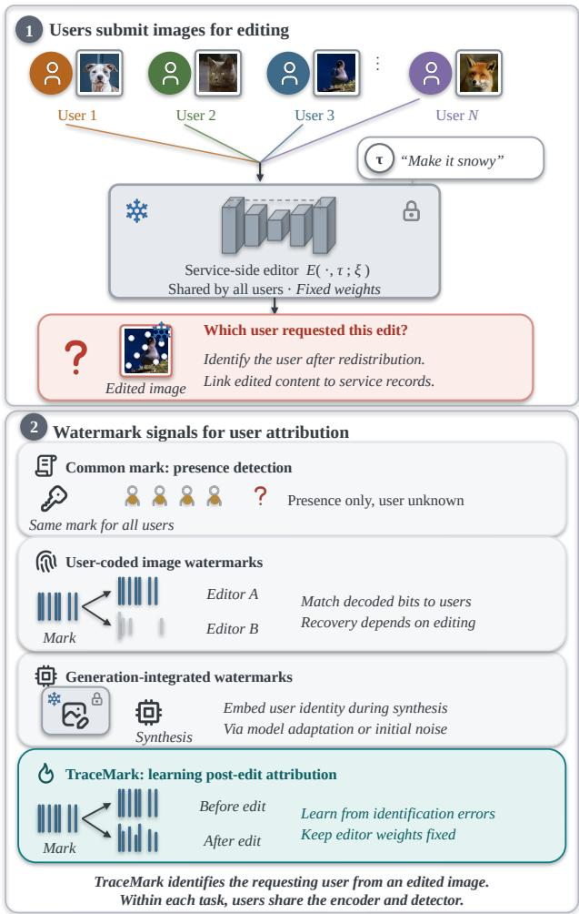
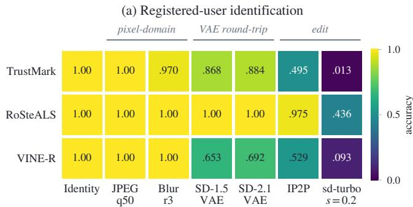
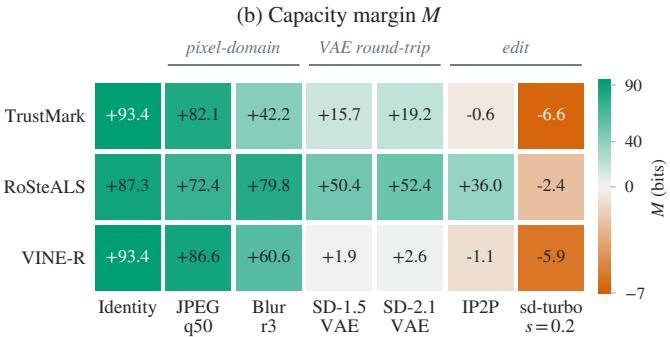
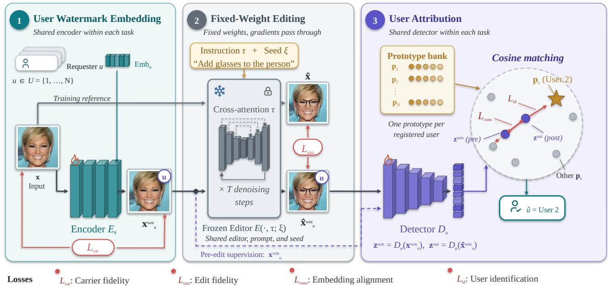
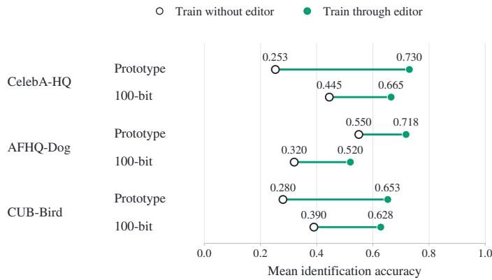
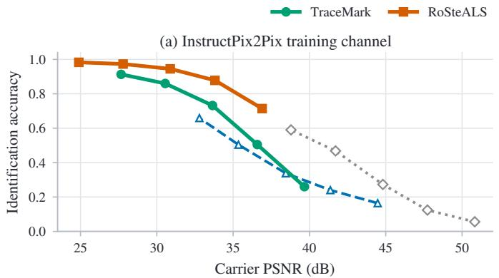
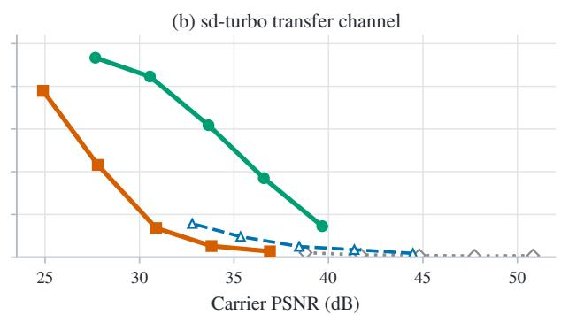
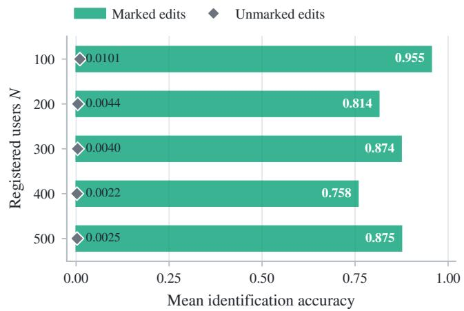
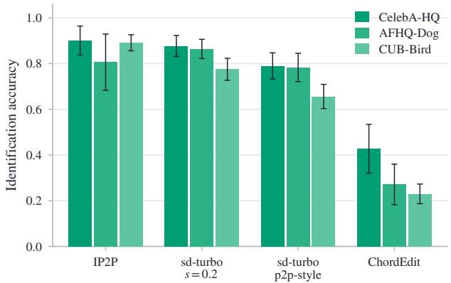
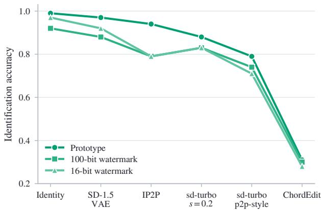

# TRACEMARK: Editor-Aware Watermarking for User Attribution in Text-Guided Image Editing

Xiaodong Wu, Xiangman Li, Student Member, IEEE, Jianbing Ni, Senior Member, IEEE, and Rongxing Lu, Fellow, IEEE,

Abstract—Images shared outside an editing service can lose the information linking them to the users who requested the edits. Recovering this link from the image itself would support provenance tracking after redistribution, but a user watermark must remain distinguishable after image content changes. We propose TRACEMARK, an editor-aware watermarking framework that learns to identify requesting users from edited images. A shared encoder embeds a user-specific watermark before editing, and a shared detector identifies the user by comparing image features with learned user reference vectors. The encoder and detector are trained jointly through an editor whose parameters remain fixed. Errors in identifying the user guide the encoder toward watermarks that remain recoverable after editing, while fidelity losses limit changes to the input and intended output. Each instruction and image domain has a separately trained model shared by its registered users. Controlled experiments across three domains show that including the editor in training improves user recovery with both reference-vector matching and binary watermark decoding. The benefit therefore extends across both identification methods tested. Separately trained models achieve 87.5% mean identification accuracy among 500 users. Tests that replace the editor without retraining the watermark modules also recover user information, although accuracy depends on the editor and input resolution. These findings support direct supervision of user identification when learning watermarks for text-guided editing.

Index Terms—Image watermarking, text-guided image editing, user attribution, watermark robustness, multimedia provenance, multimedia forensics.

## I. INTRODUCTION

T appearance and content of an existing image with a natural-language prompt. Editors such as InstructPix2Pix [1] can modify a portrait in response to make the hair blond, producing an image that can subsequently be downloaded and shared. An editing service records who requested the change, but this information may be lost when the result is reposted outside the service. Recovering the requesting user from the image would reconnect redistributed content with its provenance and allow the service to consult the corresponding request records. This motivates the user-attribution problem illustrated in Figure 1: how can an image editing service trace an edited image back to the user who requested the edit?

A straightforward approach is to add a user-specific watermark after the edit is complete. This can identify the user from the released image, but does not by itself protect the association if that image is edited again. The underlying challenge is to keep user information recoverable through semantic changes [2]. Watermarks trained to withstand compression or resizing can be damaged when a generative editor reconstructs image content, introducing errors into the recovered user information. VINE [3] and Robust-Wide [4] improve message recovery under editing, while SafeMark [5] trains the editor to preserve an existing watermark. These methods support attribution by assigning a different message to each user. Their training targets message recovery, and the recovered message is then matched to the registered users’ messages. For attribution, the final goal is to distinguish the requesting user from the other registered users. We therefore study whether learning user-specific watermarks and this identification decision jointly can improve recovery after editing. The evaluated image carries one user’s watermark and undergoes one edit.

  
Fig. 1. System and watermark-integration paths for user attribution in textguided image editing.

We propose TRACEMARK, an editor-aware watermarking framework that learns user-specific signals by directly optimizing user identification from edited images. The service supplies the requesting user’s identifier to a shared encoder, which embeds the corresponding watermark in the input image. After the editor applies the requested change, a shared detector converts the edited image into a feature vector. The system identifies the user whose learned reference vector is most similar to this vector. Training compares this prediction with the requesting user’s identifier and propagates the resulting error through the fixed-weight editor to the encoder. This feedback allows embedding and identification to be learned together from the edited output. Fidelity losses additionally keep the marked input close to the original image and its edit close to the result obtained without a watermark. All users share the encoder and detector within a model trained for one instruction and image domain. Once the appropriate task model is selected, identification uses the edited image without requiring the original image.

Because attribution depends on what survives the editing process, the evaluation first tests user identification with the editor used for training and then replaces that editor while retaining the same watermark modules (research question 1, RQ1). These tests assess recovery under both matched and changed editing conditions. To determine how training contributes to recovery, matched controls enable or disable training through the editor for each of two identification methods: matching learned user reference vectors and decoding user-specific binary messages (RQ2). We then vary watermark distortion, edit magnitude, input resolution, editing instruction, and user population to examine the conditions under which attribution remains effective (RQ3). The evaluated images come from the training image pools, so these results do not establish recovery on previously unseen images.

Experiments across three image domains show that training through the editor improves both identification approaches, while changing the identification approach has a smaller and less consistent effect. Separately trained models achieve 87.5% mean accuracy among 500 users. Across 90 editing tasks, TRACEMARK outperforms four released watermarks on three unseen editing channels at a common 256-pixel resolution. These gains have clear boundaries: RoSteALS is stronger on the editor used to train TRACEMARK, VINE-R and Robust-Wide outperform the 256-pixel TRACEMARK model at their released 512-pixel resolution, and TRACEMARK’s accuracy also drops substantially on ChordEdit. The results support user-attribution training and establish the need to validate recovery under the intended editing conditions.

Contributions.

• User attribution through editing. TRACEMARK jointly learns user-conditioned input watermarks and a shared detector to identify requesting users from edited images without updating the editor’s parameters.

• Evidence for the training mechanism. TRACEMARK’s matched controls establish consistent gains from training through the editor across two attribution approaches and three domains within a shared architecture.

• Measured attribution capability. TRACEMARK supports 500-user identification and improves recovery on three unseen editing channels at a common carrier resolution, with fidelity and resolution controls that establish where these comparisons hold.

Sections II and III review prior work and develop the motivating study. Section IV presents TRACEMARK, Section V evaluates user attribution and its robustness, and Section VI concludes the paper.

## II. RELATED WORK

## A. User Attribution with Image Watermarks

Assigning a different binary watermark to each user allows recovered messages to identify users. Learned methods preserve these messages through simulated distortions [6], physical print-and-capture channels [7], [8], and video transformations [9]. For existing images, TrustMark [10] supports variable resolutions, while RoSteALS [11] embeds messages through a pretrained autoencoder. Both accept different messages with shared network weights, allowing multi-user attribution without a separate encoder per user. Section III examines when this capability survives editing and when bit errors make user identification ambiguous.

Generation-integrated methods instead associate images with users, keys, or model recipients during synthesis. In latent diffusion models [12], signatures can enter through decoder fine-tuning [13], user-conditioned weights [14], or variable-message conditioning [15]. Latent Watermark [16] embeds and detects messages in diffusion latent space. Mark-Plugger [17] reuses latent-space watermarks across generator variants without updating their weights. Initial-noise methods provide another integration point for detection or identification [18]–[20]. These approaches establish attribution during generation. In image editing, the additional question is whether the user signal remains recoverable when an existing input is transformed by a requested semantic edit.

## B. Watermark Recovery Through Text-Guided Editing

Text-guided editors reconstruct image content using noise injection, attention control, or instruction conditioning [1], [21], [22]. Further advances in editing and its supervision [23]–[25] broaden the transformations a watermark may encounter beyond conventional compression and filtering. A visually coherent edit can still replace image details that carry the watermark. Recovery after compression or filtering therefore does not establish that the same user signal will survive semantic editing.

VINE [3] and Robust-Wide [4] learn watermarks for these editing conditions. VINE uses generative priors and editing-related distortions, with VINE-R additionally trained on InstructPix2Pix outputs. Robust-Wide includes instructiondriven editing in watermark training. Both train watermark components with a fixed downstream editor and report tests across editing configurations. Their objective is message recovery, which supports attribution when messages are assigned to users. TRACEMARK directly optimizes user identification, jointly learning the embedded signal, detector, and user reference vectors used for matching. Both the signal and the identification references are therefore learned from post-edit user identification errors under the training editor.

SafeMark [5] approaches preservation from the editor side. It fine-tunes the editor to retain an existing watermark, which may already identify a source or user, while keeping the watermark encoder and decoder fixed. TRACEMARK instead learns the requesting user’s watermark and its identification through a fixed editor. Thus, SafeMark adapts editing to an existing signal, whereas TRACEMARK adapts the signal and user identification to editing.

## C. Evaluating Attribution and Robustness

Robustness benchmarks [26] and studies of regeneration [27], diffusion purification and model substitution [28], and adaptive attacks [29] show that recovery depends on the transformation and attacker access. Withholding the decoder does not prevent removal, as demonstrated by no-box attacks [30] and MarkNull’s model-agnostic latent manipulation [31]. Consequently, attribution comparisons must specify the editing conditions and measure correct user recovery alongside image fidelity. Our evaluation covers requested edits in a trusted service and examines editor, resolution, and population effects. Resistance to deliberate removal is outside this evaluation of user attribution under requested edits.

## III. MOTIVATING STUDY AND DESIGN IMPLICATIONS

This section studies whether released image watermarks can identify a registered user after text-guided editing. We first assign different binary messages to users and test whether the recovered messages identify them. We then examine how bit errors affect identification under conventional distortions, autoencoder reconstruction, and semantic editing. Finally, we compare editors that change images by similar amounts to test whether edit magnitude explains differences in attribution. The findings motivate the training design in Section IV and its controlled evaluation in Section V-C across two attribution methods within the same watermark architecture.

## A. Existing Watermarks Support Attribution Under Compatible Editors

A k-bit watermark can identify a user from a fixed registry by assigning each user u a distinct binary message, or codeword, $\mathbf { c } _ { u } \in \{ 0 , 1 \} ^ { k }$ . After a marked image is transformed, the decoder returns a recovered message cˆ. We select the user whose assigned message differs from it in the fewest bit positions, measured by Hamming distance. For all 100- bit methods, we use the same codebook, whose messages are chosen to differ in many bit positions. The codebook is fixed across images, editing features, and datasets. If multiple users are equally close to the decoded message, the system has no unique prediction and we record the result as an attribution error. We evaluate all 90 editing features, each corresponding to a target editing instruction, with 100 images per feature and 100 registered users.

TABLE I  
REGISTERED-USER IDENTIFICATION UNDER INSTRUCTPIX2PIX AND STABLE DIFFUSION XL (SDXL)-TURBO.
<table><tr><td>Method</td><td>#Bits</td><td>IP2P</td><td>SDXL-Turbo</td></tr><tr><td>TrustMark [10]</td><td>100</td><td>0.495</td><td>0.009</td></tr><tr><td>RoSteALS [11]</td><td>100</td><td>0.975</td><td>0.249</td></tr><tr><td>VINE-R [3]</td><td>100</td><td>0.529</td><td>0.922</td></tr><tr><td>Robust-Wide [4]</td><td>64</td><td>0.917</td><td>0.648</td></tr></table>

Figure 2(a) shows that the three released watermarks identify users almost perfectly before transformation (the identity channel) and after compression or blur (the pixel-domain channels). RoSteALS also reaches 0.975 after InstructPix2Pix (IP2P), establishing that an image watermark can support user attribution after a compatible editor. The same panel shows much lower accuracy under other editing channels. A well-separated registry therefore enables attribution but cannot compensate when a channel changes too much of the embedded message. We next quantify this decoding limit for a fixed population of registered users.

## B. Capacity Margin Links Bit Recovery to Attribution

The preceding results raise a practical question: how much bit corruption can a registry tolerate before user identities become ambiguous? Bit accuracy alone is incomplete because the same error rate can support different registry sizes when message lengths differ. Distinguishing N users requires log N bits, which is 6.64 bits for the 100-user registry used here. For a k-bit watermark with observed bit error rate p, we approximate decoding errors with a binary symmetric channel, in which each bit flips independently with probability p. The resulting information capacity is $k [ 1 - H _ { 2 } ( p ) ]$ , where $H _ { 2 } ( p ) = - p \log _ { 2 } p - ( 1 - p ) \log _ { 2 } ( 1 - p )$ is binary entropy [32]. We measure the surplus over the registry requirement with

$$
M ( k , p , N ) = k \big [ 1 - H _ { 2 } ( p ) \big ] - \log _ { 2 } N .\tag{1}
$$

A positive M means that the estimated remaining information exceeds what the registry needs. A negative M indicates an information deficit. Because editing can introduce correlated bit errors, M is a diagnostic quantity and does not guarantee a particular identification accuracy.

Figure 2(b) reports this margin for each method and transformation in panel (a). A channel here is the transformation between watermark embedding and decoding. The three channel groups cover conventional pixel-domain processing, autoencoder round trips that encode and reconstruct an image, and semantic editing. Identity, Joint Photographic Experts Group (JPEG) compression, and Gaussian blur leave at least 42.2 bits of margin for every method, together with identification accuracy of at least 0.970. The autoencoder round trips retain ample margin for TrustMark and RoSteALS but place VINE-R close to the registry requirement. IP2P leaves RoSteALS with a 36.0-bit margin while TrustMark and VINE-R are near zero. Under sd-turbo, all three margins become negative and identification accuracy falls to 0.013 for TrustMark, 0.436 for RoSteALS, and 0.093 for VINE-R.

  
Fig. 2. Registered-user identification (a) and capacity margin from bit recovery (b) for three released 100-bit watermarks.

The progression from large positive margins to information deficits illustrates why successful message recovery from an unedited marked image does not establish post-edit attribution. It motivates training on the user identity recovered from the edited output, so the watermark receives feedback about the information that survives the target transformation. Section V-C tests the effect of this training signal with a matched control.

## C. Editor Compatibility Shapes Attribution

The preceding experiment links bit errors to identification errors, but it does not explain why methods respond differently to two semantic editors. A method may fail because an editor changes the image more, or because the editor is incompatible with the model used to construct the watermark. We test whether edit magnitude alone explains the difference by measuring each editor on unmarked covers with a fixed Stable Diffusion 1.5 variational autoencoder (VAE). The normalized latent displacement is $\lVert \mathbf { z } _ { \mathrm { e d i t } } - \mathbf { z } _ { \mathrm { c o v e r } } \rVert _ { 2 } / \lVert \mathbf { z } _ { \mathrm { c o v e r } } \rVert _ { 2 }$ , where $\mathbf { z } _ { \mathrm { c o v e r } }$ and $\mathbf { z } _ { \mathrm { e d i t } }$ are the VAE representations of the input and edited image. Using the same VAE provides a common measure of image change across editors.

We compare IP2P with Stable Diffusion XL (SDXL)- Turbo at strength 0.2. The two editors produce nearly equal displacement, 0.683 and 0.698, over all 90 features and 50 covers per feature. Despite this similar edit magnitude, the leading method changes in Table I. RoSteALS embeds in the latent space of a latent-diffusion autoencoder [12] from the same model family as the Stable Diffusion 1.5 base of IP2P. It falls from 0.975 on IP2P to 0.249 on SDXL-Turbo. VINE-R moves in the opposite direction, from 0.529 to 0.922, and its encoder is built on SDXL-Turbo. Robust-Wide is trained through IP2P and is also stronger on that editor. TrustMark has no generative base model and is weak on both editors. Similar latent displacement therefore does not imply similar attribution accuracy. The relationship between performance and model family suggests that editor compatibility also matters, although this comparison does not isolate its cause.

These observations motivate studying whether joint watermark encoder and detector training through a target editor improves user attribution. TRACEMARK implements this approach while keeping editor parameters fixed. The evaluation separately measures performance across editors and the effect of including the editor in training within the same architecture. A matched control in Section V-C measures this training effect under prototype matching and binary decoding on one feature from each image domain with identical training conditions.

## IV. THE TRACEMARK FRAMEWORK

## A. Operational Setting and Design

TRACEMARK learns to identify the requesting user from an edited image. The service binds each request to its authenticated user and passes that user’s identifier, together with the input image, to the watermark encoder. Its user-conditioned encoder $E _ { \theta }$ produces a watermarked input image, also called the marked carrier. Its detector $D _ { \phi }$ maps an image y to a feature vector, or embedding, $D _ { \phi } ( \mathbf { y } ) \in \mathbb { R } ^ { d }$ , where d is the embedding dimension and $\theta$ and $\phi$ are trainable parameters. The detector compares this embedding with N learned reference vectors, one per registered user. These reference vectors are the user prototypes. Training jointly optimizes the encoder, detector, and prototypes while keeping editor parameters fixed. Prototype matching removes the need to construct a binary registry codebook for the registered user population.

Let $\mathcal { U } = \{ 1 , \ldots , N \}$ denote the registered user population. The index $u \in \mathcal { U }$ identifies the user who requested the edit, while $v \in \mathcal { U }$ indexes a candidate user with prototype $\mathbf { p } _ { v } \in \mathbb { R } ^ { d }$ Given a normalized red, green, and blue (RGB) cover image $\mathbf { x } \in [ - 1 , 1 ] ^ { 3 \times H \times W }$ of height H and width W, the encoder produces $\mathbf { x } _ { u } ^ { \mathrm { w m } } = E _ { \theta } ( \mathbf { x } , u )$ . A fixed-weight editor $\mathcal { E }$ takes an instruction τ and sampling seed $\xi ,$ producing the unmarked and marked edits $\hat { \mathbf { x } } = \mathcal { E } ( \mathbf { x } , \tau ; \boldsymbol { \xi } )$ and $\hat { \mathbf { x } } _ { u } ^ { \mathrm { w m } } = \mathcal { E } ( \mathbf { x } _ { u } ^ { \mathrm { w m } } , \tau ; \boldsymbol { \xi } )$ A hat over an image thus denotes the result after editing. For nonzero vectors a and $\mathbf { b } ,$ let cos $( \mathbf { a } , \mathbf { b } ) = \mathbf { a } ^ { \top } \mathbf { b } / ( \| \mathbf { a } \| _ { 2 } \| \mathbf { b } \| _ { 2 } )$ The predicted user is

$$
\hat { u } = \underset { v \in \mathcal { U } } { \arg \operatorname* { m a x } } \cos ( D _ { \phi } ( \hat { \mathbf { x } } _ { u } ^ { \mathrm { w m } } ) , \mathbf { p } _ { v } ) .\tag{2}
$$

Here, uˆ denotes the predicted user. The true user u supplies the training label but is unknown to the detector at inference. Training seeks $\hat { u } = u .$ . The marked carrier must remain visually close to x, and its edit $\hat { \mathbf { x } } _ { u } ^ { \mathrm { w m } }$ must remain close to the unmarked edit xˆ under the same instruction and seed.

Each model is trained for one domain, instruction, editor, registry, and carrier resolution. Attribution uses the corresponding detector and prototype bank, selected in advance. Automatic task-model selection is outside the evaluation.

  
Fig. 3. The TRACEMARK training loop for user-conditioned watermark embedding and attribution through a fixed-weight instruction editor.

A trusted editing service controls the encoder, detector, prototype bank, and user assignment. Equation 2 always selects a registered user, even for an unmarked image. Deployment beyond this registered-user evaluation therefore requires a calibrated rejection rule for unmarked images and unknown users. The recovered identity refers to the requesting user, whose relationship to the image is established by the service’s request record. It does not imply image ownership or authorship. Since the marked input already carries this identity, extraction alone also cannot certify that editing occurred. Adaptive removal, watermark forgery, and leakage of watermark components remain outside the evaluation.

Embedding before the requested edit lets us evaluate whether the user signal survives that transformation. A service that controls the final output can also embed after editing, although that placement alone gives no assurance of recovery after a subsequent edit. Our experiments measure recovery through the editor and do not compare the two placements. Attribution refers to the user associated with the evaluated request and does not reconstruct the sequence of users in a multi-stage editing history.

## B. Architecture

The encoder and detector weights are shared across all N users, while each user has two learned vectors with different roles: an embedding that tells the encoder which user’s watermark to write, and a prototype used for identification. Applying the same detector before and after editing makes the resulting embeddings directly comparable. The consistency objective uses this comparison to penalize edit-induced movement of the image representation within the shared detector embedding space used for user identification.

a) Identifier encoder: Let $\{ \mathrm { E m b } _ { u } \in \mathbb { R } ^ { d _ { u } } \} _ { u \in \mathcal { U } }$ be the learned user embedding table within $E _ { \theta } ,$ , where $d _ { u }$ is the user-embedding dimension. Given an input image ${ \textbf { x } } \in$ $[ - 1 , 1 ] ^ { 3 \times H \times W }$ , the encoder broadcasts $\operatorname { E m b } _ { u }$ over the $H \times W$ spatial grid and concatenates it with the image along the channel axis. A small fully convolutional stack outputs a residual field $\delta _ { \theta } ( \mathbf { x } , \mathrm { E m b } _ { u } ) ~ \in ~ \mathbb { R } ^ { 3 \times H \times W }$ . The fixed carrier strength $\alpha > 0$ scales this field after a tanh activation:

$$
\begin{array} { r } { \mathbf { x } _ { u } ^ { \mathrm { w m } } \ = \ \mathrm { c l a m p } \Big ( \mathbf { x } + \alpha \ \mathrm { t a n h } \big ( \delta _ { \theta } ( \mathbf { x } , \mathrm { E m b } _ { u } ) \big ) , - 1 , 1 \Big ) . } \end{array}\tag{3}
$$

The clamp acts elementwise. Since the output of tanh lies in [−1, 1], α bounds each absolute pixel residual before clamping and controls the tradeoff between carrier fidelity and identification capacity evaluated in Section V-D.

b) Fixed-weight editor: During training, the editor remains in evaluation mode with parameter gradients disabled. Its output-to-input computation graph is retained. This access lets gradients reach $E _ { \theta }$ through the marked edit without updating the editor parameters. An editor accessible only through a remote service cannot be used for this training path. We use a fixed sampler and inference-step budget for reproducible editor execution, and run the editor subgraph in single precision for numerical stability. At deployment, the trained modules operate without gradient computation.

c) Detector and attribution: The detector $D _ { \phi }$ is a compact strided convolutional backbone followed by global average pooling and a linear head that produces an embedding $\textbf { z } \in \ \mathbb { R } ^ { d }$ . For attribution, its input is the edited image, so $\mathbf { z } = D _ { \phi } ( \hat { \mathbf { x } } _ { u } ^ { \mathrm { w m } } )$ . For any nonzero vector a, let $\bar { \mathbf { a } } = \mathbf { a } / \lVert \mathbf { a } \rVert _ { 2 }$ denote its ℓ -normalized form. The classification scores, or logits, are scaled cosine similarities:

$$
\ell ( \mathbf { z } ) = s \left[ \bar { \mathbf { p } } _ { 1 } ^ { \top } \bar { \mathbf { z } } , \mathbf { \bar { \rho } } _ { \cdot } \mathbf { . } . . , \bar { \mathbf { p } } _ { N } ^ { \top } \bar { \mathbf { z } } \right] \in \mathbb { R } ^ { N } ,\tag{4}
$$

where $s \ > \ 0$ is a learned logit scale capped at 100, and $\ell ( { \mathbf { z } } ) _ { v }$ is the classification logit for candidate user v. Attribution selects the prototype with the highest cosine similarity, $\hat { u } = \arg \operatorname* { m a x } _ { v \in \mathcal { U } } \ell ( \mathbf { z } )$ . Exact channel widths, the value of $\alpha ,$ the detector dimensions, and the logit-scale configuration are reported in Appendix E.

## C. Training Objective

For the paired images defined in Section IV-A, the detector produces $\mathbf { z } ^ { \mathrm { w m } } ~ = ~ D _ { \phi } ( \mathbf { x } _ { u } ^ { \mathrm { w m } } )$ and $\mathbf { z } ^ { \mathrm { { o u t } } } \ = \ D _ { \phi } ( \hat { \mathbf { x } } _ { u } ^ { \mathrm { { w m } } } )$ before and after editing. Image-space $\ell _ { 1 }$ distances are measured after mapping images to [0, 1] and are averaged over pixels and channels. At training round t, the edit-loss ramp $r _ { t } = $ $\mathrm { c l i p } ( ( t - t _ { \mathrm { w a r m } } ) / t _ { \mathrm { r a m p } } , 0 , 1 )$ is set by warm-up length $t _ { \mathrm { w a r m } }$ and ramp length $t _ { \mathrm { r a m p } } ,$ both measured in training rounds. It increases the weights of edit-dependent losses from zero to their full values. Four losses target carrier and edit fidelity, embedding consistency, and user attribution.

Carrier fidelity. We penalize the residual added to the input image:

$$
\mathcal { L } _ { \mathrm { c a r } } = \| \mathbf { x } _ { u } ^ { \mathrm { w m } } - \mathbf { x } \| _ { 1 } .\tag{5}
$$

The hard bound in Eq. 3 limits the largest pixel change, while $\mathcal { L } _ { \mathrm { c a r } }$ reduces the average residual within that bound.

Edit fidelity. We keep the marked edit close to the corresponding unmarked edit generated with the same instruction and seed:

$$
\mathcal { L } _ { \mathrm { s i m } } = \| \hat { \mathbf { x } } _ { u } ^ { \mathrm { w m } } - \hat { \mathbf { x } } \| _ { 1 } .\tag{6}
$$

This term constrains changes attributable to the watermark after the requested transformation has been applied.

Embedding consistency. We align the detector embeddings before and after editing:

$$
\begin{array} { r } { \mathcal { L } _ { \mathrm { c o n s } } = 1 - \cos ( \mathbf { z } ^ { \mathrm { w m } } , \mathbf { z } ^ { \mathrm { o u t } } ) . } \end{array}\tag{7}
$$

It encourages the two embeddings to point in the same direction, preserving the representation used for cosine-based attribution across the registered user population.

User attribution. We apply cross-entropy supervision before and after editing:

$$
\begin{array} { r l } & { \mathcal { L } _ { \mathrm { p r e } } = \mathrm { C E } \left( \ell ( \mathbf { z } ^ { \mathrm { w m } } ) , u \right) , } \\ & { \mathcal { L } _ { \mathrm { o u t } } = \mathrm { C E } \left( \ell ( \mathbf { z } ^ { \mathrm { o u t } } ) , u \right) , } \\ & { \mathcal { L } _ { \mathrm { i d } } = \mathcal { L } _ { \mathrm { p r e } } + \lambda _ { \mathrm { o u t } } r _ { t } \mathcal { L } _ { \mathrm { o u t } } . } \end{array}\tag{8}
$$

Here, CE denotes cross entropy, and $\lambda _ { \mathrm { o u t } } > 0$ weights postedit attribution relative to its pre-edit counterpart. The ${ \mathcal { L } } _ { \mathrm { o u t } }$ term is the direct training signal for the final decision in Eq. 2.

The full objective combines the four losses:

$$
{ \mathcal { L } } \ = \ \lambda _ { \mathrm { i d } } { \mathcal { L } } _ { \mathrm { i d } } + \lambda _ { \mathrm { s i m } } r _ { t } { \mathcal { L } } _ { \mathrm { s i m } } + \lambda _ { \mathrm { c a r } } { \mathcal { L } } _ { \mathrm { c a r } } + \lambda _ { \mathrm { c o n s } } r _ { t } { \mathcal { L } } _ { \mathrm { c o n s } } .\tag{9}
$$

The nonnegative λ coefficients balance the four losses. Carrier fidelity and pre-edit attribution remain active throughout training. The ramp progressively activates edit fidelity, embedding consistency, and post-edit attribution, the last through Eq. 8.

## D. Training Procedure

Algorithm 1 outlines the update for one image, omitting the inner minibatch loop. In the implementation, each training round processes a fixed image quota in minibatches. The ramp $r _ { t }$ advances once per round and is shared by its minibatches (lines 3–4). During warm-up, carrier fidelity and pre-edit attribution train the encoder to embed user information and the detector to recover it from unedited marked images (lines 5– 8). While $\boldsymbol r _ { t } = 0 ,$ , the editor is skipped and the edit-dependent terms remain zero (line 17).

Algorithm 1: TRACEMARK training, with the mini  
batch loop omitted.   
Input: covers $x ,$ users $\begin{array} { r } { \mathcal { U } \mathrm { ~ } ( \vert \mathcal { U } \vert = N ) . } \end{array}$ , target instruction   
$\tau ,$ training rounds $T ,$ warm-up $t _ { \mathrm { w a r m } } ,$ , ramp   
length tramp   
Data: encoder $E _ { \theta } ,$ detector $D _ { \phi } ,$ , prototypes $\left\{ \mathbf { p } _ { u } \right\}$   
fixed-weight editor $\mathcal { E }$   
Output: trained $E _ { \theta } , D _ { \phi } , \{ \mathbf { p } _ { u } \}$   
1 Initialize $\theta , \phi , \{ \mathbf { p } _ { u } \} ;$   
2 for $t \gets 1$ to $T$ do   
3 Select cover $\mathbf { x } ,$ user $u ,$ and seed $\xi ;$   
4 $r _ { t } \gets \mathrm { c l i p } \big ( ( t - t _ { \mathrm { w a r m } } ) / t _ { \mathrm { r a m p } } , 0 , 1 \big ) \ ; \qquad / /$ ramp   
5 $\mathbf { x } _ { u } ^ { \mathrm { w m } } \gets \dot { E _ { \theta } } ( \mathbf { x } , u )$ // encode, Eq. 3   
6 $\mathbf { z } ^ { \mathrm { w m } } \gets D _ { \phi } ( \mathbf { x } _ { u } ^ { \mathrm { w m } } ) ;$   
7 $\mathcal { L } _ { \mathrm { c a r } }  \| \mathbf { x } _ { u } ^ { \mathrm { w m } } - \mathbf { x } \| _ { 1 } ; / /$ carrier fidelity   
8 $\mathcal { L } _ { \mathrm { i d } } \gets \mathrm { C E } ( \ell ( \mathbf { z } ^ { \mathrm { w m } } ) , u )$ // pre-edit   
9 if $r _ { t } > 0$ then   
10 $\begin{array} { r } { \hat { \mathbf { x } }  \mathcal { E } ( \mathbf { x } , \tau ; \xi ) \ ; } \end{array}$ $/ /$ edit clean   
11 $\hat { \mathbf { x } } _ { u } ^ { \mathrm { w m } } \gets \mathcal { E } ( \mathbf { x } _ { u } ^ { \mathrm { w m } } , \tau ; \boldsymbol { \xi } )$ // edit marked   
12 $\mathbf { z } ^ { \mathrm { { o u t } } } \gets D _ { \phi } ( \hat { \mathbf { x } } _ { u } ^ { \mathrm { { w m } } } ) ;$   
13 $\mathcal { L } _ { \mathrm { s i m } } \gets \| \hat { \mathbf { x } } _ { u } ^ { \mathrm { w m } } - \hat { \mathbf { x } } \| _ { 1 } ;$   
14 $\mathcal { L } _ { \mathrm { c o n s } } \gets 1 - \cos ( \mathbf { z } ^ { \mathrm { w m } } , \mathbf { z } ^ { \mathrm { o u t } } ) ;$   
15 $\mathcal { L } _ { \mathrm { i d } } \mathrel { + } \mathrel { = } \lambda _ { \mathrm { o u t } } r _ { t } \mathrm { C E } ( \ell ( \mathbf { z } ^ { \mathrm { o u t } } ) , u )$   
$/ /$ post-edit   
16 else   
17 $\mathcal { L } _ { \mathrm { s i m } } , \mathcal { L } _ { \mathrm { c o n s } }  0 \ ; \quad \mathrm { ~ \xi ~ } / /$ warm-up: skip E   
18 end   
19 ${ \mathcal { L } } \gets \lambda _ { \mathrm { i d } } { \mathcal { L } } _ { \mathrm { i d } } + \lambda _ { \mathrm { s i m } } r _ { t } { \mathcal { L } } _ { \mathrm { s i m } } + \lambda _ { \mathrm { c a r } } { \mathcal { L } } _ { \mathrm { c a r } } + \lambda _ { \mathrm { c o n s } } r _ { t } { \mathcal { L } } _ { \mathrm { c o n s } } ;$   
20 Update $\theta , \phi , \{ \mathbf { p } _ { u } \}$ by a gradient step on $\mathcal { L } \ ; \ \mathrm { ~  ~ { ~ / ~ } ~ } \mathcal { E }$   
frozen   
21 end

Once $r _ { t } ~ > ~ 0$ , the same instruction and seed edit the unmarked and marked inputs (lines 10–11). Their outputs define edit fidelity, embedding consistency, and post-edit attribution (lines 13–15). Increasing $r _ { t }$ increases the influence of these objectives as training proceeds. The combined loss in Eq. 9 updates the encoder, detector, and prototypes (lines 19–20).

## E. Complexity and Margin Analysis

Let z¯ and $\bar { \mathbf { z } } ^ { \prime }$ be the $\ell _ { 2 } \cdot$ -normalized detector embeddings of a marked image before and after editing or degradation. For candidate user v, let $c _ { v } ( \bar { \mathbf z } ) = \bar { \mathbf p } _ { v } ^ { \top } \bar { \mathbf z }$ denote the unscaled cosine score. For an image assigned to user u, define the attribution margin as the correct user’s score minus the highest competing user score:

$$
\gamma _ { u } ( \bar { \mathbf { z } } ) = c _ { u } ( \bar { \mathbf { z } } ) - \operatorname* { m a x } _ { v \neq u } c _ { v } ( \bar { \mathbf { z } } ) .\tag{10}
$$

Suppose the transformation satisfies $\| \bar { \mathbf { z } } ^ { \prime } - \bar { \mathbf { z } } \| _ { 2 } \leq \epsilon$ . Since $\| \bar { \mathbf p } _ { v } \| _ { 2 } = 1$ , the Cauchy–Schwarz inequality gives $| c _ { v } ( \bar { \mathbf { z } } ^ { \prime } ) - $ $c _ { v } ( \bar { \bf z } ) | \leq \epsilon$ for every candidate. The correct-user score can therefore decrease by at most ϵ, while the largest competing score can increase by at most ϵ. The predicted user remains u whenever $\gamma _ { u } ( \bar { \mathbf { z } } ) > 2 \epsilon$

TABLE II  
CROSS-EDITOR IDENTIFICATION IN THREE IMAGE DOMAINS USING A COMMON 256-PIXEL PIPELINE. EACH DOMAIN CONTAINS 30 EDITING FEATURES.
<table><tr><td>Editing channel</td><td>Domain</td><td>TRACEMARK</td><td>TrustMark</td><td>RoSteALS</td><td>VINE-R</td><td>Robust-Wide</td></tr><tr><td rowspan="3">InstructPix2Pix, training channel</td><td>CelebA-HQ</td><td>0.901</td><td>0.554</td><td>0.984</td><td>0.677</td><td>0.932</td></tr><tr><td>AFHQ-Dog</td><td>0.806</td><td>0.320</td><td>0.955</td><td>0.376</td><td>0.884</td></tr><tr><td>CUB-Bird</td><td>0.891</td><td>0.611</td><td>0.986</td><td>0.533</td><td>0.934</td></tr><tr><td rowspan="3">sd-turbo, s = 0.2</td><td>CelebA-HQ</td><td>0.877</td><td>0.019</td><td>0.355</td><td>0.140</td><td>0.255</td></tr><tr><td>AFHQ-Dog</td><td>0.864</td><td>0.012</td><td>0.422</td><td>0.069</td><td>0.291</td></tr><tr><td>CUB-Bird</td><td>0.775</td><td>0.009</td><td>0.531</td><td>0.071</td><td>0.427</td></tr><tr><td rowspan="3">sd-turbo, p2p-style s = 0.3</td><td>CelebA-HQ</td><td>0.790</td><td>0.009</td><td>0.102</td><td>0.072</td><td>0.110</td></tr><tr><td>AFHQ-Dog</td><td>0.783</td><td>0.008</td><td>0.138</td><td>0.036</td><td>0.142</td></tr><tr><td>CUB-Bird</td><td>0.656</td><td>0.010</td><td>0.162</td><td>0.030</td><td>0.284</td></tr><tr><td rowspan="3">ChordEdit</td><td>CelebA-HQ</td><td>0.427</td><td>0.009</td><td>0.061</td><td>0.038</td><td>0.034</td></tr><tr><td>AFHQ-Dog</td><td>0.271</td><td>0.007</td><td>0.067</td><td>0.017</td><td>0.039</td></tr><tr><td>CUB-Bird</td><td>0.230</td><td>0.007</td><td>0.057</td><td>0.019</td><td>0.070</td></tr></table>

This bound is a sufficient condition for preserving one image’s predicted user. Applying it to a given editor or degradation requires measuring or bounding its embedding displacement ϵ. The identification loss promotes a larger margin, and the consistency loss penalizes displacement caused by the target edit. The bound explains why both score separation and embedding stability matter for attribution. It does not guarantee recovery under an arbitrary editor. Attributing improved recovery to a design choice requires a matched control. Section V-C isolates the training path and attribution method under matched conditions.

For one trained population, the prototype bank and userembedding table require $O \big ( N ( d + d _ { u } ) \big )$ storage. After the detector produces one embedding, forming all user logits costs $O ( N d )$ during training or inference. The other network parameters and computations are independent of N. The current implementation retrains its learnable components when the registry expands. Population-specific results appear in Section V-D for registries of up to 500 users.

## V. EXPERIMENTS

## A. Experimental Setup

a) Datasets and editing features: Each editing feature specifies a target instruction, such as changing hair color or adding glasses. We evaluate 30 features in each of three multimedia domains: high-quality CelebA (CelebA-HQ) faces [33], the Animal Faces-HQ (AFHQ) Dog split [34], and Caltech-UCSD Birds-200-2011 (CUB-200-2011) [35]. Images are cropped to 256×256 as detailed in Appendix A. Each TRACE-MARK model is trained for one of the 90 domain-feature settings through InstructPix2Pix [1]. Cross-editor tests replace the editing channel while keeping the encoder, detector, and prototype bank fixed.

b) Compared watermarks: We compare TRACEMARK with the released TrustMark [10], RoSteALS [11], VINE-R [3], and Robust-Wide [4] checkpoints (Appendix B). For $N \ = \ 1 0 0$ , the first three baselines receive distinct 100-bit codewords from a balanced codebook, while Robust-Wide uses its released 64-bit messages. Nearest-codeword decoding maps each output to a user. If several codewords are equally close, the prediction is ambiguous and is counted as an error. The main comparison uses 256-pixel carriers, the native resolution of TRACEMARK, TrustMark, and RoSteALS. The control in Appendix D retains the released 512-pixel resolution of VINE-R and Robust-Wide. Changing TRACEMARK’s resolution requires retraining.

c) Editing channels and evaluation scope: The four channels in RQ1 are the InstructPix2Pix training channel, sdturbo image-to-image editing [36] at strength 0.2, sd-turbo editing at strength 0.3 with a pix2pix-style configuration, and ChordEdit [37]. Table II reports the mean identification accuracy over the 30 features in each domain. RQ2 uses one feature from each domain. RQ3 evaluates all settings for the fidelity control, cross-instruction reuse in all three domains, and four CelebA-HQ tasks for registries from 100 to 500 users. Appendix E gives detailed sample counts and hyperparameters. Paired comparisons reuse the user population, covers, instructions, and editor seeds. The evaluated TRACEMARK carriers come from the final training round, and the baselines use the same covers. These comparisons use images from the training pools. They do not measure generalization to held-out images.

d) Metrics: Identification accuracy is the fraction of marked outputs assigned to the correct registered user. For bitstring methods, bit accuracy is the fraction of correctly decoded watermark bits. Carrier fidelity uses peak signalto-noise ratio (PSNR), structural similarity index measure (SSIM) [38], and learned perceptual image patch similarity (LPIPS) [39]. Section III-C also measures normalized latent displacement with a fixed Stable Diffusion 1.5 variational autoencoder for both evaluated editors.

## B. Post-Edit Attribution (RQ1): Matched and Unseen Editors

At 256 pixels, TRACEMARK leads on the three unseen editing channels. Table II shows this advantage in every image domain. Averaged across domains, TRACEMARK reaches 1.9, 4.2, and 5.0 times the strongest released baseline on sdturbo, its p2p-style configuration, and ChordEdit, respectively.

  
Fig. 4. Four-channel mean identification accuracy with and without training through the editor, using two attribution methods in each domain.

Released watermarks nevertheless perform well on the InstructPix2Pix training channel, where RoSteALS leads with accuracy from 0.955 to 0.986, compared with 0.806–0.901 for TRACEMARK. Recovery on ChordEdit remains harder for TRACEMARK, with domain means of 0.230–0.427.

This advantage does not extend to baselines at their released 512-pixel resolution. A four-feature control restores that carrier size for VINE-R and Robust-Wide. Their mean accuracies over the three unseen channels rise from 0.062 to 0.997 and from 0.165 to 0.982, respectively. TrustMark and RoSteALS change little on those unseen channels when evaluated at 512 pixels. TRACEMARK remains at 256 pixels, so this control does not measure its own response to changing resolution, which would require retraining. Complete channellevel results and edit-displacement measurements appear in Appendix D. RQ2 next isolates the benefit of training through the editor within a shared architecture.

## C. Training Through the Editor (RQ2): Effect Across Attribution Methods

The system-level comparisons in RQ1 mix architecture and training differences. To isolate the effect of including the editor in training, we construct a $2 \times 2$ control that varies training through the editor and the attribution method on blond hair (CelebA-HQ), angry expressions (AFHQ-Dog), and crest (CUB-Bird). Within each feature, the four variants share encoder and detector backbones, training data, number of training workers, random seed, and 170 training rounds, each containing the same image quota. The editor-exposed variants train through InstructPix2Pix, while the unexposed variants disable all edit-dependent losses. Each condition uses either prototype matching or a 100-bit decoder with nearestcodeword attribution. Figure 4 pairs the two training conditions for each attribution method and reports mean accuracy over the four editing channels in Table II.

Training through the editor improves all six tested combinations. Gains across features and attribution methods range from 0.167 to 0.477. Mean gains are 0.339 for prototype matching and 0.219 for binary decoding. The difference between attribution methods, computed as prototype accuracy minus binary-decoding accuracy, averages 0.096 with editor exposure and −0.024 without it. Positive values favor prototype matching, and the sign varies by feature. In the AFHQ-Dog prototype variant, the 0.167 training gain is smaller than the prototype advantage over binary decoding, which is 0.198 with editor exposure and 0.230 without it. Thus, training through the editor consistently benefits both attribution methods in these controls, while the choice of attribution method has a smaller average effect. Prototype matching simplifies registry construction, but these results do not identify it as the source of edit robustness.

TABLE III  
POST-EDIT IDENTIFICATION ACCURACY AFTER REMOVING INDIVIDUAL OBJECTIVE TERMS IN THREE IMAGE DOMAINS.
<table><tr><td>Domain</td><td>Full</td><td>一  ${ \mathcal { L } } _ { \mathrm { c a r } }$ </td><td> ${ \mathcal { L } } _ { \mathrm { c o n s } }$ </td><td> ${ \mathcal { L } } _ { \mathrm { o u t } }$ </td></tr><tr><td>CelebA-HQ</td><td>0.927</td><td>0.944</td><td>0.963</td><td>0.743</td></tr><tr><td>AFHQ-Dog</td><td>0.854</td><td>0.850</td><td>0.885</td><td>0.593</td></tr><tr><td>CUB-Bird</td><td>0.818</td><td>0.839</td><td>0.905</td><td>0.613</td></tr><tr><td>Mean</td><td>0.866</td><td>0.878</td><td>0.918</td><td>0.650</td></tr></table>

The training benefit emerges after editing. We also evaluate the same trained variants on their marked inputs before editing and average each channel’s accuracy over the three features. Including the editor in training leaves pre-edit prototype accuracy nearly unchanged (0.983 to 0.980) and reduces binary accuracy (0.983 to 0.877). Through Instruct-Pix2Pix, the corresponding accuracies rise from 0.420 to 0.920 and from 0.410 to 0.757. All four variants can encode user identity, but training through the editor improves its recovery after transformation. On ChordEdit, the unexposed variants still average 0.120 and 0.123, so some attribution persists without edit-dependent training. The benefit is therefore associated with recovery after editing, and the trained architecture also retains some capability without editor exposure. Full per-channel results and the 16-bit width control appear in Appendix F.

Post-edit identification supervision provides the clearest accuracy benefit. The matched control changes all editdependent losses together. To examine the contribution of individual terms, we next remove one loss at a time on one feature from each domain. Table III reports identification accuracy. From these same runs, we also measure carrier $\ell _ { 1 }$ distortion and cosine similarity between embeddings of the marked input and its edited output, with all three metrics reported in Appendix I. Removing ${ \mathcal { L } } _ { \mathrm { o u t } }$ lowers accuracy by 0.184–0.261 and gives the lowest result in every domain. Removing ${ \mathcal { L } } _ { \mathrm { c o n s } }$ lowers cosine alignment by 0.009–0.026 while identification increases in all three domains. Removing $\mathcal { L } _ { \mathrm { c a r } }$ changes carrier $\ell _ { 1 }$ by up to approximately 0.001 under the hard residual bound and produces mixed accuracy changes. Identification also depends on competing-user scores, so better cosine alignment alone need not improve accuracy, as the margin condition in Section IV-E indicates. Since $\mathcal { L } _ { \mathrm { s i m } }$ is retained, these ablations cannot isolate the edit-fidelity term’s contribution to post-edit identification accuracy.

  
Fig. 5. Identification accuracy as a function of carrier peak signal-to-noise ratio under InstructPix2Pix and sd-turbo editing.

  
Fig. 6. Mean identification accuracy of population-specific models on marked and unmarked edited images.

## D. Operational Range (RQ3)

The editor-dependent ordering persists at similar carrier fidelity. The methods have different carrier fidelity at their default strengths (Appendix B). To compare accuracy at similar distortion levels, we scale each marked-image residual with $\beta \in \{ 0 . 3 5 , 0 . 5 , 0 . 7 , 1 . 0 , 1 . 4 \}$ and plot carrier PSNR against post-edit accuracy. Each point covers 90 features and 60 images per feature. Near 33.7 dB, RoSteALS reaches 0.878 on InstructPix2Pix, compared with 0.732 for TRACEMARK (Fig. 5(a)). On the unseen sd-turbo channel, TRACEMARK instead reaches 0.618, compared with 0.052 for RoSteALS (Fig. 5(b)). This ordering holds across the plotted fidelity range. TrustMark and VINE-R also remain below TRACE-MARK on sd-turbo. Appendix C provides the full sweep.

Similar edit magnitudes can produce different attribution outcomes. Section III-C compares IP2P and SDXL-Turbo at nearly equal latent displacement. Under that 90-feature protocol, TRACEMARK reaches 0.866 on IP2P and 0.430 on SDXL-Turbo. On the latter it exceeds RoSteALS at 0.249, but falls below VINE-R at 0.922 and Robust-Wide at 0.648. RQ1 and Appendix D report the complementary carrier-resolution control for the released baseline models.

User attribution can survive a change of instruction without retraining. The previous tests retain each model’s training instruction. To examine whether a task-specific model can also serve other requests, we keep InstructPix2Pix fixed and change only the instruction supplied at evaluation. We use eight trained models across the three domains and test each on three other instructions from the same domain, with 200 covers per pair. The source model embeds the user signal before the new edit, and its unchanged detector and prototypes identify the user afterward. Paired unmarked inputs receive the same edit and editor seed. Table IV summarizes the 24 instruction pairs, with mean accuracy of 0.635 on marked outputs and 0.009 on unmarked outputs. Recovery varies substantially with the target instruction. For example, the glasses-trained model reaches 0.975 for smiling but 0.680 for anime. The smilingtrained model reaches only 0.120 for a Van Gogh-style edit. These results demonstrate reuse for some requests beyond the training instruction, but do not establish reliable recovery for arbitrary instructions. Appendix G lists every source-target pair and its marked and unmarked accuracy.

TABLE IV  
CROSS-INSTRUCTION IDENTIFICATION WITH FIXED WATERMARK MODELS. EACH SOURCE MODEL IS TESTED ON THREE TARGET INSTRUCTIONS.
<table><tr><td>Training instruction</td><td>Marked mean</td><td>Marked range</td><td>Unmarked mean</td></tr><tr><td>CelebA-HQ</td><td></td><td></td><td></td></tr><tr><td>Add glasses</td><td>0.843</td><td>0.680–0.975</td><td>0.003</td></tr><tr><td>Make smiling</td><td>0.613</td><td>0.120–0.905</td><td>0.003</td></tr><tr><td>Make anime</td><td>0.858</td><td>0.735–0.920</td><td>0.023</td></tr><tr><td>AFHQ-Dog</td><td></td><td></td><td></td></tr><tr><td>Turn into cat</td><td>0.540</td><td>0.365–0.805</td><td>0.015</td></tr><tr><td>Turn into lion</td><td>0.425</td><td>0.250–0.725</td><td>0.003</td></tr><tr><td>Make anime</td><td>0.305</td><td>0.190–0.485</td><td>0.012</td></tr><tr><td>CUB-Bird</td><td></td><td></td><td></td></tr><tr><td>Make head red</td><td>0.740</td><td>0.630–0.870</td><td>0.003</td></tr><tr><td>Make tail blue</td><td>0.757</td><td>0.665–0.855</td><td>0.010</td></tr><tr><td>All 24 instruction pairs</td><td>0.635</td><td>0.120–0.975</td><td>0.009</td></tr></table>

Separately trained models support registries of up to 500 users. Figure 6 reports results for 100–500 users across four CelebA-HQ tasks. Mean accuracy ranges from 0.758 to 0.955, with 0.875 at N = 500. Applying each detector to edited images without an embedded watermark gives mean accuracies from 0.0022 to 0.0101, close to the chance level $1 / N _ { ☉ }$ . This unmarked control covers all four tasks except at

N = 200, where paired records are available for two tasks. The near-chance unmarked results support the contribution of the embedded user signal to identification. Optimization budgets and per-task measurements appear in Appendix H for each of the five evaluated registry sizes.

## VI. CONCLUSION

We presented TRACEMARK for tracing edited images to the users who requested them. Joint training of user-conditioned watermark embedding and detection through a fixed editor improves attribution in matched controls across three domains, and separately optimized models support registries of up to 500 users. For an editing service, the resulting image-based signal can reconnect redistributed content with its request records when identifying metadata is unavailable. This link supports provenance tracking beyond the service interface under trusted user assignment. The findings also make exact user recovery a concrete target for watermark training and evaluation: for user attribution, a recovered signal must distinguish the intended user from others in the registry. Editor-aware training helps achieve this within the tested settings, while comparisons with released watermarks identify conditions in which existing methods already perform well. These comparisons guide the choice between released watermarks and task-specific training, with validation needed for the intended editor, carrier resolution, and image population.

## REFERENCES

[1] T. Brooks, A. Holynski, and A. A. Efros, “InstructPix2Pix: Learning to follow image editing instructions,” in CVPR, 2023.

[2] J. Cao, Q. Li, Z. Zhang, J. Ni, and R. Lu, “Secure and robust watermarking for AI-generated images: A comprehensive survey,” arXiv preprint arXiv:2510.02384v2, 2026.

[3] S. Lu, Z. Zhou, J. Lu, Y. Zhu, and A. W.-K. Kong, “Robust watermarking using generative priors against image editing: From benchmarking to advances,” in ICLR, 2025.

[4] R. Hu, J. Zhang, T. Xu, J. Li, and T. Zhang, “Robust-wide: Robust watermarking against instruction-driven image editing,” in ECCV, 2024.

[5] X. Wu, Q. Li, X. Li, Z. Zhang, L. Liu, and J. Ni, “Are watermarked images editable? SafeMark for watermark-preserving text-guided image editing,” CoRR, vol. abs/2605.19511, 2026.

[6] J. Zhu, R. Kaplan, J. Johnson, and L. Fei-Fei, “HiDDeN: Hiding data with deep networks,” in ECCV, 2018.

[7] M. Tancik, B. Mildenhall, and R. Ng, “StegaStamp: Invisible hyperlinks in physical photographs,” in CVPR, 2020.

[8] C. Qin, X. Li, Z. Zhang, F. Li, X. Zhang, and G. Feng, “Printcamera resistant image watermarking with deep noise simulation and constrained learning,” IEEE Trans. Multimedia, vol. 26, pp. 2164–2177, 2024.

[9] K. A. Zhang, L. Xu, A. Cuesta-Infante, and K. Veeramachaneni, “Robust invisible video watermarking with attention,” CoRR, vol. abs/1909.01285, 2019.

[10] T. Bui, S. Agarwal, and J. Collomosse, “TrustMark: Robust watermarking and watermark removal for arbitrary resolution images,” in ICCV, 2025, pp. 18 629–18 639.

[11] T. Bui, S. Agarwal, N. Yu, and J. Collomosse, “RoSteALS: Robust steganography using autoencoder latent space,” in CVPR Workshops, 2023.

[12] R. Rombach, A. Blattmann, D. Lorenz, P. Esser, and B. Ommer, “Highresolution image synthesis with latent diffusion models,” in CVPR, 2022.

[13] P. Fernandez, G. Couairon, H. Jegou, M. Douze, and T. Furon, “The´ stable signature: Rooting watermarks in latent diffusion models,” in ICCV, 2023.

[14] C. Kim, K. Min, M. Patel, S. Cheng, and Y. Yang, “WOUAF: Weight modulation for user attribution and fingerprinting in text-to-image diffusion models,” in CVPR, 2024.

[15] C. Xiong, C. Qin, G. Feng, and X. Zhang, “Flexible and secure watermarking for latent diffusion model,” in Proceedings of the 31st ACM International Conference on Multimedia (MM), 2023, pp. 1668– 1676.

[16] Z. Meng, B. Peng, and J. Dong, “Latent watermark: Inject and detect watermarks in latent diffusion space,” IEEE Trans. Multimedia, vol. 27, pp. 3399–3410, 2025.

[17] G. Zhang, L. Wang, Y. Su, and A.-A. Liu, “MarkPlugger: Generalizable watermark framework for latent diffusion models without retraining,” IEEE Trans. Multimedia, vol. 27, pp. 6211–6220, 2025.

[18] Y. Wen, J. Kirchenbauer, J. Geiping, and T. Goldstein, “Tree-rings watermarks: Invisible fingerprints for diffusion images,” in NeurIPS, 2023.

[19] Z. Yang, K. Zeng, K. Chen, H. Fang, W. Zhang, and N. Yu, “Gaussian shading: Provable performance-lossless image watermarking for diffusion models,” in CVPR, 2024.

[20] H. Ci, P. Yang, Y. Song, and M. Z. Shou, “RingID: Rethinking tree-ring watermarking for enhanced multi-key identification,” in ECCV, 2024.

[21] C. Meng, Y. He, Y. Song, J. Song, J. Wu, J.-Y. Zhu, and S. Ermon, “SDEdit: Guided image synthesis and editing with stochastic differential equations,” in ICLR, 2022.

[22] A. Hertz, R. Mokady, J. Tenenbaum, K. Aberman, Y. Pritch, and D. Cohen-Or, “Prompt-to-prompt image editing with cross-attention control,” in ICLR, 2023.

[23] K. Zhang, L. Mo, W. Chen, H. Sun, and Y. Su, “MagicBrush: A manually annotated dataset for instruction-guided image editing,” in NeurIPS, 2023.

[24] Z. Geng, B. Yang, T. Hang, C. Li, S. Gu, T. Zhang, J. Bao, Z. Zhang, H. Li, H. Hu, D. Chen, and B. Guo, “InstructDiffusion: A generalist modeling interface for vision tasks,” in CVPR, 2024, pp. 12 709–12 720.

[25] S. Sheynin, A. Polyak, U. Singer, Y. Kirstain, A. Zohar, O. Ashual, D. Parikh, and Y. Taigman, “Emu Edit: Precise image editing via recognition and generation tasks,” in CVPR, 2024.

[26] B. An, M. Ding, T. Rabbani, A. Agrawal, Y. Xu, C. Deng, S. Zhu, A. Mohamed, Y. Wen, T. Goldstein, and F. Huang, “WAVES: Benchmarking the robustness of image watermarks,” in ICML, 2024, pp. 1456– 1492.

[27] X. Zhao, K. Zhang, Z. Su, S. Vasan, I. Grishchenko, C. Kruegel, G. Vigna, Y.-X. Wang, and L. Li, “Invisible image watermarks are provably removable using generative AI,” in NeurIPS, 2024, pp. 8643– 8672.

[28] M. Saberi, V. S. Sadasivan, K. Rezaei, A. Kumar, A. M. Chegini, W. Wang, and S. Feizi, “Robustness of AI-image detectors: Fundamental limits and practical attacks,” in ICLR, 2024.

[29] N. Lukas, A. Diaa, L. Fenaux, and F. Kerschbaum, “Leveraging optimization for adaptive attacks on image watermarks,” in ICLR, 2024.

[30] X. Wu, T. Tang, X. Li, J. Ni, and Y. Yu, “When there is no decoder: Removing watermarks from stable diffusion models in a no-box setting,” in ICICS, 2025, pp. 553–572.

[31] J. Cao, Q. Li, Z. Zhang, X. Wu, L. Liu, X. Li, and J. Ni, “MarkNull: Model-agnostic watermark removal in AI-generated images via onmanifold latent manipulation,” in 35th USENIX Security Symposium (USENIX Security 26). USENIX Association, 2026, pp. 4721–4740.

[32] C. E. Shannon, “A mathematical theory of communication,” The Bell System Technical Journal, vol. 27, no. 3, pp. 379–423, 1948.

[33] T. Karras, T. Aila, S. Laine, and J. Lehtinen, “Progressive growing of GANs for improved quality, stability, and variation,” in ICLR, 2018.

[34] Y. Choi, Y. Uh, J. Yoo, and J.-W. Ha, “StarGAN v2: Diverse image synthesis for multiple domains,” in CVPR, 2020.

[35] C. Wah, S. Branson, P. Welinder, P. Perona, and S. Belongie, “The Caltech-UCSD birds-200-2011 dataset,” California Institute of Technology, Tech. Rep. CNS-TR-2011-001, 2011.

[36] A. Sauer, D. Lorenz, A. Blattmann, and R. Rombach, “Adversarial diffusion distillation,” in ECCV, 2024, pp. 87–103.

[37] L. Lu, X. Chen, M. Guo, S. Li, J. Wang, and Y. Shi, “ChordEdit: Onestep low-energy transport for image editing,” in CVPR, 2026, pp. 14 398– 14 407.

[38] Z. Wang, A. C. Bovik, H. R. Sheikh, and E. P. Simoncelli, “Image quality assessment: From error visibility to structural similarity,” IEEE Trans. Image Process., vol. 13, no. 4, pp. 600–612, 2004.

[39] R. Zhang, P. Isola, A. A. Efros, E. Shechtman, and O. Wang, “The unreasonable effectiveness of deep features as a perceptual metric,” in CVPR, 2018.

TABLE V  
CARRIER FIDELITY AT EACH METHOD’S NATIVE WATERMARK STRENGTH OVER 90 SEMANTIC EDITING FEATURES.
<table><tr><td>Method</td><td>PSNR ↑</td><td>SSIM ↑</td><td>LPIPS ↓</td></tr><tr><td>TRACEMARK</td><td>30.39</td><td>0.9566</td><td>0.0783</td></tr><tr><td>TrustMark</td><td>42.08</td><td>0.9883</td><td>0.0010</td></tr><tr><td>RoSteALS</td><td>29.07</td><td>0.8599</td><td>0.0348</td></tr><tr><td>VINE-R</td><td>36.53</td><td>0.9833</td><td>0.0089</td></tr></table>

## APPENDIX A

## DATASETS AND EDITING FEATURES

We evaluate faces from high-quality CelebA (CelebA-HQ) [33], animal faces from the Animal Faces-HQ (AFHQ) Dog split [34], and fine-grained birds from Caltech-UCSD Birds-200-2011 (CUB-200-2011) [35]. Their training pools contain 28,000, 4,739, and 5,994 images. CelebA-HQ and AFHQ-Dog are center-cropped. CUB bounding boxes are padded by 10% before cropping. All images are resized to $2 5 6 \times 2 5 6$ . Each domain has 30 short editing instructions. They cover identities, expressions, attributes, and styles for faces, breed, color, style, and action for dogs, and anatomical attributes for birds.

## APPENDIX B

## BASELINE CONFIGURATIONS

We compare TRACEMARK with four released checkpoints. TrustMark, RoSteALS, and VINE-R receive one 100-bit codeword per user from the balanced greedy codebook used in the main paper. Robust-Wide retains its native 64-bit message. Attribution selects the registered codeword with the fewest bit differences from the decoded message. Equal-distance matches count as identification errors.

TrustMark [10] uses its released Q model with a 100-bit raw message, error-correcting code (ECC) disabled, and watermark strength 1.0. RoSteALS [11] uses the public vq-f4 first-stage backbone and released epoch=000017-step=000449999.ckpt checkpoint. VINE-R [3] uses the released Shilin-LU/VINE-R-Enc encoder and Shilin-LU/VINE-R-Dec decoder. Robust-Wide [4] uses its released 64-bit encoder and decoder. Both VINE-R and Robust-Wide produce native 512 × 512 carriers. The common-resolution experiment resizes these to 256 × 256, while the resolution control retains the native size through editing and decoding.

Every baseline uses the same covers, instructions, and editor seeds. Its decoder is evaluated on the resulting edited images. Carrier fidelity uses peak signal-to-noise ratio (PSNR), structural similarity index measure (SSIM) [38], and learned perceptual image patch similarity (LPIPS) [39].

## APPENDIX C

## CARRIER-STRENGTH SWEEP

Table VI gives the complete measurements behind the mainpaper carrier-strength figure. Each entry averages 60 images for each of 90 semantic editing features. We multiply the difference between the marked and original image by β before editing, with $\beta = 1$ retaining the original watermark strength. The carrier PSNR is measured before editing.

TABLE VI  
CARRIER PSNR AND POST-EDIT IDENTIFICATION ACCURACY ACROSS WATERMARK STRENGTHS.
<table><tr><td>β</td><td>0.35</td><td>0.50</td><td>0.70</td><td>1.00</td><td>1.40</td></tr><tr><td colspan="6">Carrier PSNR (dB)</td></tr><tr><td>TRACEMARK</td><td>39.67</td><td>36.58</td><td>33.65</td><td>30.55</td><td>27.66</td></tr><tr><td>TrustMark</td><td>50.83</td><td>47.73</td><td>44.81</td><td>41.71</td><td>38.79</td></tr><tr><td>RoSteALS</td><td>36.90</td><td>33.81</td><td>30.88</td><td>27.79</td><td>24.89</td></tr><tr><td>VINE-R</td><td>44.47</td><td>41.37</td><td>38.45</td><td>35.35</td><td>32.79</td></tr><tr><td colspan="6">Identification accuracy: InstructPix2Pix</td></tr><tr><td>TRACEMARK</td><td>0.260</td><td>0.505</td><td>0.732</td><td>0.860</td><td>0.913</td></tr><tr><td>TrustMark</td><td>0.056</td><td>0.124</td><td>0.273</td><td>0.468</td><td>0.590</td></tr><tr><td>RoSteALS</td><td>0.714</td><td>0.878</td><td>0.945</td><td>0.973</td><td>0.983</td></tr><tr><td>VINE-R</td><td>0.164</td><td>0.240</td><td>0.338</td><td>0.504</td><td>0.659</td></tr><tr><td colspan="6">Identification accuracy: sd-turbo,</td></tr><tr><td>TRACEMARK</td><td>0.145</td><td> $s = 0 . 2$  0.370</td><td>0.618</td><td>0.846</td><td>0.934</td></tr><tr><td>TrustMark</td><td>0.007</td><td>0.006</td><td>0.008</td><td>0.011</td><td>0.021</td></tr><tr><td>RoSteALS</td><td>0.027</td><td>0.052</td><td>0.136</td><td>0.432</td><td>0.779</td></tr><tr><td>VINE-R</td><td>0.018</td><td>0.035</td><td>0.050</td><td>0.096</td><td>0.157</td></tr></table>

TABLE VII

FOUR-FEATURE IDENTIFICATION ACCURACY AT 256- AND 512-PIXEL CARRIER RESOLUTIONS. IP2P DENOTES INSTRUCTPIX2PIX.
<table><tr><td></td><td>Pixels</td><td></td><td>IP2P</td><td>sd-turbo  $s = 0 . 2$ </td><td>sd-turbo p2p-style  $s = 0 . 3$ </td><td>ChordEdit</td></tr><tr><td>TRACEMARK</td><td>256</td><td>Identity 0.985</td><td>0.907</td><td>0.873</td><td>0.780</td><td>0.287</td></tr><tr><td rowspan="2">TrustMark</td><td>256</td><td>1.000</td><td>0.557</td><td>0.020</td><td>0.007</td><td>0.015</td></tr><tr><td>512</td><td>1.000</td><td>0.988</td><td>0.035</td><td>0.013</td><td>0.003</td></tr><tr><td rowspan="2">RoSteALS</td><td>256</td><td>1.000</td><td>0.995</td><td>0.420</td><td>0.138</td><td>0.083</td></tr><tr><td>512</td><td>1.000</td><td>0.990</td><td>0.425</td><td>0.133</td><td>0.083</td></tr><tr><td rowspan="2">VINE-R</td><td>256</td><td>1.000</td><td>0.605</td><td>0.100</td><td>0.062</td><td>0.025</td></tr><tr><td>512</td><td>1.000</td><td>1.000</td><td>1.000</td><td>0.998</td><td>0.993</td></tr><tr><td rowspan="2">Robust-Wide</td><td>256</td><td>1.000</td><td>0.975</td><td>0.297</td><td>0.147</td><td>0.050</td></tr><tr><td>512</td><td>1.000</td><td>1.000</td><td>1.000</td><td>0.993</td><td>0.953</td></tr></table>

## APPENDIX D

## CARRIER-RESOLUTION AND DOMAIN BREAKDOWNS

The main paper summarizes the carrier-resolution control. This section gives the complete channel-level identification results, the corresponding edit displacement measurements, and the per-domain TRACEMARK breakdown.

The resolution control also measures each editor on unmarked covers. The same four features, covers, instructions, and seeds are used at both resolutions. Normalized latent displacement is measured with the fixed Stable Diffusion 1.5 variational autoencoder used for the main-paper editmagnitude control.

Table VIII shows that the 512-pixel pipelines change the covers less, with ratios of 512-pixel to 256-pixel displacement from 0.64 to 0.85. Resolution thus changes both the watermark input and the editing operation. On the three unseen editing channels, VINE-R and Robust-Wide improve to at least 0.953, while TrustMark and RoSteALS remain nearly unchanged. TrustMark does improve substantially on InstructPix2Pix. These different responses show that the effect of resolution is method-dependent. No 512-pixel TRACEMARK model is evaluated here.

TABLE VIII  
EDIT DISPLACEMENT AT CARRIER RESOLUTIONS OF 256 AND 512 PIXELS.
<table><tr><td>Editing channel</td><td>256</td><td>512</td><td>Ratio</td></tr><tr><td>InstructPix2Pix</td><td>0.513</td><td>0.436</td><td>0.85</td></tr><tr><td>sd-turbo,  $s = 0 . 2$ </td><td>0.474</td><td>0.370</td><td>0.78</td></tr><tr><td>sd-turbo, p2p-style s = 0.3</td><td>0.506</td><td>0.400</td><td>0.79</td></tr><tr><td>ChordEdit</td><td>0.869</td><td>0.557</td><td>0.64</td></tr></table>

  
Fig. 7. TRACEMARK identification accuracy by image domain and editing channel.

Figure 7 separates the 90-feature TRACEMARK results by dataset. Both sd-turbo configurations retain higher accuracy than ChordEdit in every domain, so the aggregate ranking also holds within each dataset.

## APPENDIX E

## IMPLEMENTATION AND REPRODUCIBILITY

Table IX lists the main hyperparameters, with architecture, training, and evaluation details below. The implementation is PyTorch 2.6 with diffusers 0.27, and one model is trained per editing feature with no weight sharing across features. Within each model, all registered users share the encoder and detector weights, with separate user embeddings and prototypes.

a) Identifier encoder: The encoder $E _ { \theta }$ broadcasts a learned $d _ { u } = 6 4$ user embedding over the spatial grid and concatenates it with the three image channels, forming a 67-channel input. Four convolutional blocks (convolution, GroupNorm, SiLU) of width 96 process it, and a final $1 \times 1$ convolution produces a 3-channel residual δ. The residual α tanh δ, with fixed $\alpha { = } 0 . 0 7$ , is added to the cover before clipping to [−1, 1].

b) Detector and prototype bank: The detector $D _ { \phi }$ is a five-stage strided convolutional backbone with channel widths $6 4 \to 9 6 \to 1 2 8 \to 1 9 2 \to 2 5 6$ , followed by global average pooling and a linear projection to a d=128 dimensional embedding. This embedding and the learned per-user prototypes are $\ell _ { 2 } \cdot$ -normalized. Class logits are their cosine similarities multiplied by a learned positive scale, initialized to 16 and capped at 100. The detector is shared before and after editing.

c) Optimization and edit curriculum: The encoder, detector, and prototypes are trained jointly with Adam at learning rate $1 . 8 \times 1 0 ^ { - 4 }$ , cosine-annealed to 5% of its initial value over $T _ { \mathrm { t r a i n } } { = } 1 7 0$ training rounds, using DistributedDataParallel across 6 A100-80GB graphics processing units (GPUs) with a global batch of 24 images (4 per GPU). Each round processes a fixed quota of 1,392 images per feature with random horizontal flips and assigns user indices by the deterministic mapping $u = ( t N _ { \mathrm { i m g } } + i )$ mod N. Here the implementation uses zerobased user, round, and sample indices, and $N _ { \mathrm { i m g } } ~ = ~ 1 { , } 3 9 2$ is the per-round image quota. This assignment updates the $N { = } 1 0 0$ prototypes near-uniformly. The first $t _ { \mathrm { w a r m } } { = } 3 5$ rounds use marked but unedited images $( r _ { t } \mathrm { = } 0 )$ . The editor is then included, and the weights of the three edit-dependent losses increase linearly to their full values over $t _ { \mathrm { r a m p } } { = } 9 0$ rounds, remaining fixed thereafter. Wall-clock time is about 4.5 h per feature. The full study of 90 features takes about 405 server hours, equal to roughly 2,430 A100 GPU-hours with six devices per run.

d) Editor invocation: The frozen editor is run with the EulerAncestralDiscreteScheduler for 6 inference steps at text guidance scale 7.0 and image guidance scale 2.0. Each watermarked cover and its clean counterpart use the same per-image seed, so the edit-fidelity comparison holds sampling randomness fixed. Gradients reach the encoder through the editor without updating the editor weights.

e) Evaluation protocol: The trained-editor and crosseditor comparisons use 100 images per feature across all 90 features. The equal-displacement study uses all 90 features and 50 images per feature. The carrier-resolution control uses four features and 100 images per feature. The carrierstrength sweep uses all 90 features and 60 images per feature. The population study uses four CelebA-HQ tasks at $N ~ \in ~ \{ 1 0 0 , 2 0 0 , 3 0 0 , 4 0 0 , 5 0 0 \}$ with the training-round and worker budgets reported in Table XII. Seeds are fixed within each paired comparison. The TRACEMARK carriers used in these evaluations are selected from outputs saved during the final training round on each training pool. The baselines receive the same covers in paired comparisons. The current protocol does not evaluate a disjoint cover split. Identification accuracy uses nearest-prototype matching for TRACEMARK and nearest-codeword matching for the bitstring methods.

f) Detection scoring and model size: For watermarkpresence detection, we evaluated four confidence scores: maximum softmax probability, the top-1 versus top-2 logit margin, the raw maximum logit maxv $\ell _ { v }$ , and negative softmax entropy. Averaged over the 90 editing features, their mean areas under the receiver operating characteristic curve (AUCs) are 0.884, 0.834, 0.946, and 0.909 in the same order. These scores assess watermark presence separately from user identification. At N=100 users the encoder $E _ { \theta }$ has $3 . 1 \times 1 0 ^ { 5 }$ and the detector $D _ { \phi }$ has $8 . 8 \times 1 0 ^ { 5 }$ parameters.

TABLE IX  
FULL TRACEMARK CONFIGURATION FOR THE PAPER-SCALE RUNS.
<table><tr><td>Setting</td><td>Value</td></tr><tr><td>User embedding dim  $d _ { u }$  Encoder blocks / width Carrier strength α</td><td>64 4 / 96 0.07</td></tr><tr><td>Detector backbone widths Embedding dim d Logit scale (init / cap) Optimiser</td><td>64, 96, 128, 192, 256 128 16 /  100</td></tr><tr><td>Learning rate Learning-rate schedule Training rounds  $T _ { \mathrm { t r a i n } }$  Warm-up / ramp (rounds)</td><td>Adam  $1 . 8 \times 1 0 ^ { - 4 }$  cosine to 5% 170 35 /  90</td></tr><tr><td>GPUs / global batch Images per feature / users N Editor steps Text / image guidance Resolution Loss weights  $\lambda _ { \mathrm { i d / s i m / c a r / c o n s } }$  Edited-image weight  $\lambda _ { \mathrm { o u t } }$ </td><td>6×A100 / 24 1,392 / 100 6  $7 . 0 ~ / ~ 2 . 0$  256 × 256</td></tr></table>

  
Fig. 8. Identification accuracy of editor-exposed variants with prototype matching, 16-bit decoding, and 100-bit decoding across six channels.

## APPENDIX F

## TRAINING EXPOSURE AND ATTRIBUTION METHODS

Table X gives the exact results summarized by the mainpaper training-control figure. Within each feature, the four variants share the training data, random seed, GPU worker count, training-round budget, and encoder and detector backbones. The upper block reports the four-channel mean by feature. The lower block reports each channel after averaging over the three features. Exposed variants include InstructPix2Pix in training, while unexposed variants disable all edit-dependent losses. The Training columns subtract unexposed accuracy from exposed accuracy. The Method effect columns subtract binary-decoding accuracy from prototype-matching accuracy. The identity channel evaluates the same models on marked inputs before editing.

All four variants retain mean identity-channel accuracy between 0.877 and 0.983. Training through the editor improves recovery after editing for both attribution methods in every domain.

Figure 8 supplies the additional watermark-width control.

The 16-bit and 100-bit variants both reach 0.790 on Instruct-Pix2Pix. Their ChordEdit accuracies are 0.280 and 0.300. Watermark width changes accuracy on unedited marked inputs, while the two binary decoders have similar accuracies on the tested editing channels.

## APPENDIX G

## CROSS-INSTRUCTION REUSE

The main paper summarizes reuse of eight task-specific models across 24 source-target instruction pairs. Three source models use CelebA-HQ, three use AFHQ-Dog, and two use CUB-Bird. For each model, three target instructions from the same domain are evaluated without retraining. Each pair uses 200 covers sampled from that source model’s retained image pool, with the user identifiers stored by its checkpoint. The source encoder marks each cover, InstructPix2Pix applies the target instruction, and the source detector and prototype bank predict the user. For the unmarked control, the same cover receives the same instruction and editor seed without watermark embedding. Identification accuracy is computed against the same assigned user in both conditions. These tests change the instruction and do not measure generalization to held-out images.

Table XI reports all pairs, weighted equally when computing means. Domain means are 0.772 for CelebA-HQ, 0.423 for AFHQ-Dog, and 0.748 for CUB-Bird. These tests measure instruction reuse without isolating the cause of individual accuracy drops.

## APPENDIX H

## POPULATION-CAPACITY MEASUREMENTS

Table XII records the values and optimization budgets summarized by the main-paper population figure. The N = 200 glasses and makeup runs use eight workers. The red-hair and smiling runs use three. The $N \ = \ 3 0 0$ row uses six to eight workers across tasks. All other rows use six. The unmarked-edit column averages the same four tasks except at N = 200, where only the glasses and makeup paired records were retained.

## APPENDIX I

## OBJECTIVE ABLATIONS

We remove the carrier penalty $\mathcal { L } _ { \mathrm { c a r } }$ , embedding-consistency penalty ${ \mathcal { L } } _ { \mathrm { c o n s } } ,$ or post-edit identification term ${ \mathcal { L } } _ { \mathrm { o u t } }$ one at a time on one feature per domain. Table XIII reports identification accuracy, carrier $\ell _ { 1 }$ distortion, and cosine similarity between pre-edit and post-edit embeddings. The hard residual bound remains active in every variant. Removing ${ \mathcal { L } } _ { \mathrm { o u t } }$ gives the lowest accuracy in each domain. Removing ${ \mathcal { L } } _ { \mathrm { c o n s } }$ lowers cosine alignment despite higher identification accuracy.

TABLE X  
IDENTIFICATION ACCURACY FOR THE TRAINING-EXPOSURE AND ATTRIBUTION-METHOD CONTROL BY IMAGE DOMAIN AND EDITING CHANNEL.
<table><tr><td></td><td colspan="3">Prototype matching</td><td colspan="3">100-bit decoding</td><td colspan="2">Method effect</td></tr><tr><td>Feature</td><td>Exposed</td><td>Unexposed</td><td>Training</td><td>Exposed</td><td>Unexposed</td><td>Training</td><td>Exposed</td><td>Unexposed</td></tr><tr><td>Blond hair, CelebA-HQ</td><td>0.730</td><td>0.253</td><td> $+ 0 . 4 7 7$ </td><td>0.665</td><td>0.445</td><td>+0.220</td><td>+0.065</td><td>-0.192</td></tr><tr><td>Angry, AFHQ-Dog</td><td>0.718</td><td>0.550</td><td>+0.167</td><td>0.520</td><td>0.320</td><td>+0.200</td><td>+0.198</td><td>+0.230</td></tr><tr><td>Crest, CUB-Bird</td><td>0.653</td><td>0.280</td><td>+0.373</td><td>0.628</td><td>0.390</td><td>+0.238</td><td>+0.025</td><td>-0.110</td></tr><tr><td>Mean</td><td>0.700</td><td>0.361</td><td>+0.339</td><td>0.604</td><td>0.385</td><td>+0.219</td><td>+0.096</td><td>-0.024</td></tr><tr><td>Channel</td><td colspan="8">Exposed, prototype</td></tr><tr><td>Identity</td><td colspan="2">0.980</td><td colspan="2">Exposed, 100-bit 0.877</td><td colspan="2">Unexposed, prototype</td><td colspan="2">Unexposed, 100-bit</td></tr><tr><td></td><td colspan="2"></td><td colspan="2"></td><td colspan="2">0.983</td><td colspan="2">0.983</td></tr><tr><td>Variational autoencoder round trip</td><td colspan="2"></td><td colspan="2"></td><td colspan="2">0.623</td><td colspan="2">0.717</td></tr><tr><td>InstructPix2Pix</td><td colspan="2"></td><td colspan="2"></td><td colspan="2">0.420 0.473</td><td colspan="2">0.410</td></tr><tr><td>sd-turbo,  $s = 0 . 2$   $s = 0 . 3$ </td><td colspan="2"></td><td colspan="2"></td><td colspan="2">0.430</td><td colspan="2">0.560 0.447</td></tr><tr><td>sd-turbo, p2p-style ChordEdit</td><td colspan="2"></td><td colspan="2"></td><td colspan="2">0.120</td><td colspan="2">0.123</td></tr></table>

TABLE XI  
IDENTIFICATION ACCURACY FOR ALL CROSS-INSTRUCTION PAIRS, WITH 200 IMAGES PER PAIR.
<table><tr><td>Training instruction</td><td>Test instruction</td><td>Marked</td><td>Unmarked</td></tr><tr><td>CelebA-HQ</td><td></td><td></td><td></td></tr><tr><td></td><td>Make older</td><td>0.875</td><td>0.005</td></tr><tr><td>Add glasses</td><td>Make smiling</td><td>0.975</td><td>0.000</td></tr><tr><td></td><td>Make anime</td><td>0.680</td><td>0.005</td></tr><tr><td>Make smiling</td><td>Add glasses</td><td>0.905</td><td>0.000</td></tr><tr><td></td><td>Make older</td><td>0.815</td><td>0.005</td></tr><tr><td></td><td>Van Gogh style</td><td>0.120</td><td>0.005</td></tr><tr><td>Make anime</td><td>Add glasses</td><td>0.920</td><td>0.020</td></tr><tr><td></td><td>Add makeup</td><td>0.920</td><td>0.025</td></tr><tr><td></td><td>Add beard</td><td>0.735</td><td>0.025</td></tr><tr><td>AFHQ-Dog</td><td></td><td></td><td></td></tr><tr><td>Turn into cat</td><td>Turn into lion</td><td>0.365</td><td>0.020</td></tr><tr><td></td><td>Make anime</td><td>0.805</td><td>0.010</td></tr><tr><td></td><td>Make red</td><td>0.450</td><td>0.015</td></tr><tr><td>Turn into lion</td><td>Make anime</td><td>0.725</td><td>0.010</td></tr><tr><td></td><td>Make blue</td><td>0.300</td><td>0.000</td></tr><tr><td></td><td>Make purple</td><td>0.250</td><td>0.000</td></tr><tr><td></td><td>Turn into cat</td><td>0.485</td><td>0.030</td></tr><tr><td>Make anime</td><td>Turn into lion</td><td>0.190</td><td>0.005</td></tr><tr><td></td><td>Turn into wolf</td><td>0.240</td><td>0.000</td></tr><tr><td>CUB-Bird</td><td></td><td></td><td></td></tr><tr><td></td><td>Make belly yellow</td><td>0.720</td><td>0.000</td></tr><tr><td>Make head red</td><td>Make crown black</td><td>0.630</td><td>0.005</td></tr><tr><td></td><td>Make breast red</td><td>0.870</td><td>0.005</td></tr><tr><td></td><td>Make breast orange</td><td>0.665</td><td>0.010</td></tr><tr><td>Make tail blue</td><td>Make beak longer</td><td>0.855</td><td>0.005</td></tr><tr><td></td><td>Make head red</td><td>0.750</td><td>0.015</td></tr></table>

TABLE XII  
IDENTIFICATION ACCURACY AND OPTIMIZATION BUDGETS FOR FOUR CELEBA-HQ TASKS WITH REGISTRIES FROM 100 TO 500 USERS.
<table><tr><td>Registry size N</td><td>100</td><td>200</td><td>300</td><td>400</td><td>500</td></tr><tr><td>Training rounds Workers</td><td>170 6</td><td>200 8 / 3</td><td>300 6-8</td><td>400 6</td><td>700 6</td></tr><tr><td>Glasses</td><td>0.967</td><td>0.891</td><td>0.916</td><td>0.782</td><td>0.870</td></tr><tr><td>Makeup</td><td>0.952</td><td>0.876</td><td>0.891</td><td>0.700</td><td>0.869</td></tr><tr><td>Red hair</td><td>0.939</td><td>0.754</td><td>0.851</td><td>0.718</td><td>0.900</td></tr><tr><td>Smiling</td><td>0.961</td><td>0.735</td><td>0.837</td><td>0.831</td><td>0.861</td></tr><tr><td>Mean</td><td>0.955</td><td>0.814</td><td>0.874</td><td>0.758</td><td>0.875</td></tr><tr><td>Unmarked</td><td>0.0101</td><td>0.0044</td><td>0.0040</td><td>0.0022</td><td>0.0025</td></tr></table>

TABLE XIII  
LOSS ABLATION IN THREE IMAGE DOMAINS.
<table><tr><td>Metric</td><td>Domain</td><td>Full</td><td>no  ${ \mathcal { L } } _ { \mathrm { c a r } }$ </td><td>no  ${ \mathcal { L } } _ { \mathrm { c o n s } }$ </td><td>no  ${ \mathcal { L } } _ { \mathrm { o u t } }$ </td></tr><tr><td rowspan="3">Accuracy ↑</td><td>CelebA-HQ</td><td>0.927</td><td>0.944</td><td>0.963</td><td>0.743</td></tr><tr><td>AFHQ-Dog</td><td>0.854</td><td>0.850</td><td>0.885</td><td>0.593</td></tr><tr><td>CUB-Bird</td><td>0.818</td><td>0.839</td><td>0.905</td><td>0.613</td></tr><tr><td rowspan="3">Carrier  $\ell _ { 1 } \downarrow$ </td><td>CelebA-HQ</td><td>0.030</td><td>0.031</td><td>0.031</td><td>0.030</td></tr><tr><td>AFHQ-Dog</td><td>0.031</td><td>0.031</td><td>0.031</td><td>0.031</td></tr><tr><td>CUB-Bird</td><td>0.028</td><td>0.029</td><td>0.026</td><td>0.027</td></tr><tr><td rowspan="3">Cosine ↑</td><td>CelebA-HQ</td><td>0.952</td><td>0.932</td><td>0.943</td><td>0.902</td></tr><tr><td>AFHQ-Dog</td><td>0.933</td><td>0.922</td><td>0.912</td><td>0.873</td></tr><tr><td>CUB-Bird</td><td>0.874</td><td>0.859</td><td>0.848</td><td>0.791</td></tr></table>