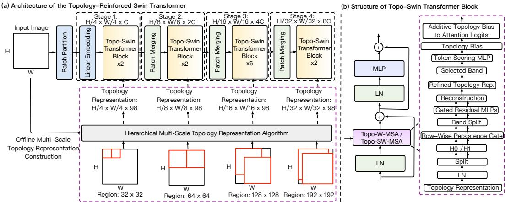
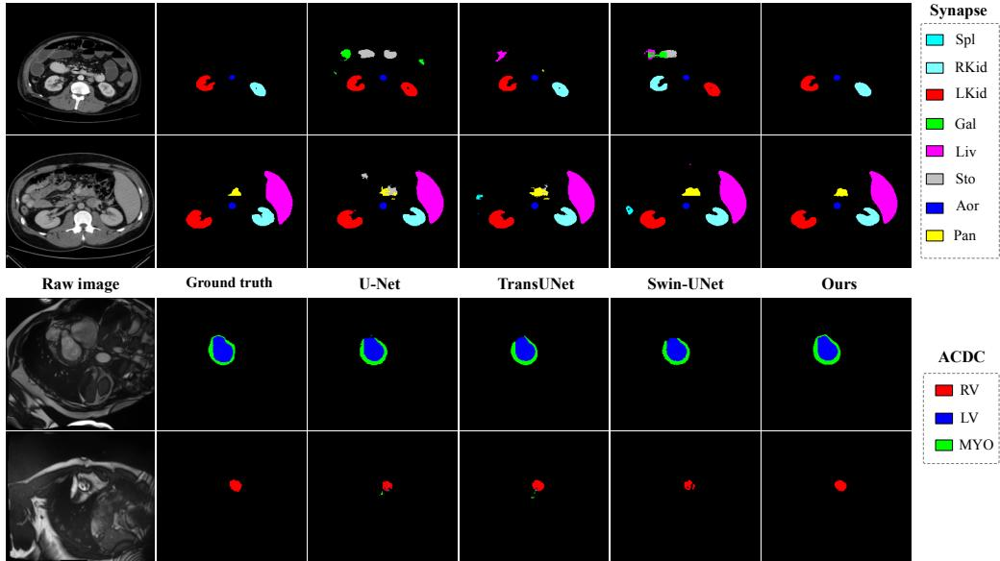
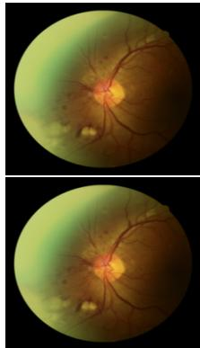
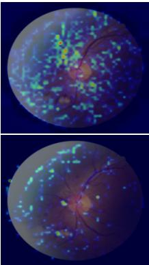
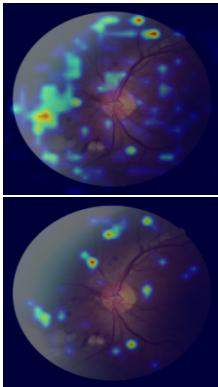
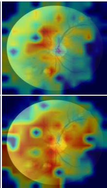
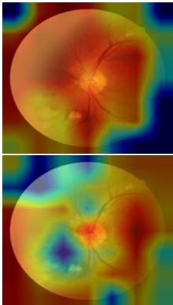

# TRiST: Topology-Reinforced Swin Transformer for Medical Image Analysis

Pengfei Gu1 Huimin Li2 Guangyu Meng3 Hao Zheng4 Haoteng Tang1 Bin Fu1 Danny Z. Chen3

1Department of Computer Science, The University of Texas Rio Grande Valley 2School of Mathematical and Statistical Sciences, The University of Texas Rio Grande Valley

3Department of Computer Science and Engineering, University of Notre Dame 4School of Computing and Informatics, University of Louisiana at Lafayette pengfei.gu01@utrgv.edu

## Abstract

Topological patterns in medical images, such as connected components and loops, across multiple spatial scales carry critical structural information, from microaneurysm-scale lesions to organ-level boundaries. Despite the success of hierarchical Vision Transformers (e.g., Swin Transformer) in medical image analysis, existing methods lack an explicit architectural scheme to represent and incorporate multi-scale topological structures through the Transformer hierarchy. In this paper, we propose Topology-Reinforced Swin Transformer (TRiST), a new Swin Transformer model family for medical image analysis, which reinforces multi-scale hierarchical topology into the hierarchical Transformer architecture. Instead of treating topology as an auxiliary descriptor or post hoc fusion cues, TRiST takes topology as a native part of representation construction, refinement, and token interaction. First, because topology does not compose hierarchically through pooling or interpolation, we develop a Hierarchical Multi-Scale Topology Representation algorithm that computes 2D persistent homology $( H _ { 0 }$ and $H _ { 1 }$ on image patches) at each native scale of Swin Transformer, constructing four topological representations aligned 1-to-1 with the Swin token grid. Second, motivated by the persistence lifetime of topological features, we develop a Band-Aware $H _ { 0 } / H _ { 1 } ^ { \mathrm { ~ \tiny ~ { ~ \cdot ~ } ~ } }$ Residual Refinement module that separately processes short-, medium-, and long-persistence information using dedicated gated residual MLPs. Third, we introduce a Persistence-Band Progressive Attention Bias that converts stagespecific topological descriptors into learned key-saliency scores and injects them into shifted-window attention logits. Based on these strategies, we instantiate two task-specific models: Topo-SwinV2-B for classification and Topo-Swin-UNet for segmentation. Both models retain the original Swin-based backbone structure while equipping it with native multi-scale topological features. Experiments on five medical image datasets show consistent improvements over Swin-based baselines and competitive performance relative to existing topology-augmented methods.

## 1 Introduction

Medical image analysis benefits largely from models that jointly capture fine-grained local appearance and large-scale structural organization [29, 1, 4, 49, 32]. In many medical imaging applications, spatial organization and structural patterns provide complementary information to photometric and semantic representations. In diabetic retinopathy grading, microaneurysms manifest as small isolated connected components whose number and spatial distribution across retinal quadrants determine the disease severity [39, 31]. In dermoscopy, malignant lesions exhibit irregular boundary loops and asymmetric connected structures that distinguish them from benign nevi [16, 36, 35, 37]. In cardiac MRI, the myocardium forms a closed annular boundary whose topological integrity is clinically meaningful [14]. In mammography, suspicious microcalcification clusters form spatially distributed point sets whose connectivity and persistence distinguish malignant from benign cases [41]. In these examples, the relevant signals span multiple spatial scales: fine-scale topology captures local lesion structures, intermediate-scale topology captures vascular connectivity and tissue boundaries, and coarse-scale topology captures global anatomical enclosures and organ-level distributions. Such topological properties, e.g., connected components and loops captured by $H _ { 0 }$ and $H _ { 1 }$ persistent homology (PH) [13] on 2D image patches and their birth and death across filtration thresholds, are not captured well by pixel intensity alone. An explicit multi-scale representation of topological structures can largely boost the capability of deep learning (DL) models.

Despite the strong inductive bias that topology can provide for medical imaging, integrating PH into DL models remains an under-explored topic. Standard DL methods for medical image classification and segmentation (e.g., ResNet [20], SwinV2-B [33], U-Net [43], TransUNet [9], Swin-UNet [7], Attention U-Net [40], and UNETR [18]) operate purely on visual features with no representation of topological persistence. Topology-guided loss approaches [23, 24, 11, 45, 19] incorporate topological constraints into training objectives to encourage topologically correct predictions, but do not inject topology into intermediate feature representations; the model must still infer topological structures from visual features alone. Topology-as-features approaches learn from persistence diagrams (PDs) [2] directly or fuse persistence descriptors with visual features. PersLay [8] and PLLay [26] introduce learnable vectorization layers for PDs; PersFormer [42] embeds persistence features into Transformer architectures; PHG-Net [41] and its multi-scale extension [16] fuse multiscale topological descriptors with CNN features for medical image classification. TopoTxR [46] extracts 1D (loop) and 2D (bubble) topological structures from breast DCE-MRI using PH and incorporates them into a 3D CNN with a topology-guided spatial attention mechanism, directing the model’s focus toward biologically relevant voxels near fibroglandular tissue structures for pathological complete response prediction. While TopoTxR shows that topological structures can meaningfully guide spatial attention, it operates at a single spatial scale, applies topology as an external attention mask rather than an additive bias inside the attention logit, and is designed for a 3D CNN rather than a hierarchical Vision Transformer. More broadly, known topology-as-features methods [8, 26, 42, 47, 27, 15, 36, 35, 16, 21, 41] typically fuse topology at a single scale or as a global descriptor, losing the spatial localization and scale correspondence essential for dense prediction tasks. More importantly, these methods do not compute topology at multiple scales natively and directly from raw images, and do not place topology inside the attention computation of a hierarchical Vision Transformer to directly modulate which tokens communicate with one another at each spatial scale.

In this work, we aim to show that hierarchical Vision Transformers, and in particular Swin Transformer [33], are naturally compatible with multi-scale topology computation and integration. By applying shifted-window self-attention at four progressively coarser spatial resolutions, the Swin hierarchy defines four distinct spatial scales, each with a well defined token stride and spatial support. This hierarchy provides a principled scaffold for multi-scale topology: computing topology at the four native resolutions of the Swin hierarchy ensures that each topological representation is spatially aligned with the corresponding Swin feature map by construction, without requiring any resizing, pooling, or interpolation. However, exploiting this compatibility requires overcoming two non-trivial obstacles: (1) How to compute topological representation at each scale correctly and (2) how to inject topology into the attention mechanism in order to directly modulate token communication.

We propose Topology-Reinforced Swin Transformer (TRiST), a new Swin Transformer model family, which reinforces multi-scale hierarchical topology in the hierarchical Transformer architecture. Our design is guided by the following observations. (1) Topology does not compose hierarchically. A simplest approach to compute multi-scale topology is to compute a single topology representation at the finest resolution and downsample it to coarser stages via pooling or interpolation. However, this is fundamentally flawed: the PD of a large region captures qualitatively different topological patterns than the average of many small-region PDs, because global structures such as vessel loops and organ enclosures may become complete only at an appropriate spatial scale. Thus, downsampling a fine-scale topological representation can destroy scale-specific semantic content that makes topology comprehensive. We develop a Hierarchical Multi-Scale Topology Representation algorithm that computes PH independently at each stage-specific native scale, producing four topology representations that are aligned 1-to-1 with the Swin token grid at each stage. (2) The persistence axis ofPD has semantic meaning. Note that features near the diagonal of a PD have short lifetime and correspond to ephemeral events such as noise and fine texture, while features far from the diagonal have long lifetime and encode stable structures such as organ boundaries, vessel walls, and lesion clusters. Treating all persistence elements uniformly with a single MLP conflates noise-level features with structurally significant ones, and can lead the model to inadvertently suppress diagnostically relevant long-lifetime features. We design a Band-Aware $H _ { 0 } / H _ { 1 }$ Residual Refinement module that independently refines each of six persistence lifetime sub-bands $( \mathrm { i . e . , } H _ { 0 }$ and $H _ { 1 }$ each split into short, medium, and long persistence) using dedicated gated residual MLPs, respecting both the semantic structure of the persistence axis and the geometric distinction between connectivity $( H _ { 0 } )$ and enclosure $( H _ { 1 } )$ . (3) Topologically salient tokens should attract stronger attention. Tokens corresponding to microaneurysms, vessel junctions, or boundary segments have high topological salience, and their local persistence descriptors encode structurally significant events relative to surrounding background tokens. Standard shifted-window self-attention learns content-dependent token interactions but does not explicitly incorporate persistence-derived structural salience. We propose a Persistence-Band Progressive Attention Bias that adds an outer-sum topology bias to the attention logits. After row-wise softmax, the query-dependent component of the outer-sum bias cancels, leaving an effective topology-conditioned key-saliency prior. Consequently, tokens assigned higher topology scores can contribute more strongly to the updated representations of neighboring query tokens.

  
Figure 1: (a) The overall architecture of our Topology-Reinforced Swin Transformer (TRiST). In parallel to the Swin backbone, we pre-compute hierarchically aligned multi-scale topological representations at four native scales. (b) The structure of a TRiST block. Each stage-specific topological representation is normalized and refined by the proposed Band-Aware $H _ { 0 } / { \bar { H _ { 1 } } }$ Residual Refinement module, and then decomposed into persistence bands to construct an additive topology bias for window attention. The resulting topology bias is injected into the attention logits together with the relative position bias. Stages 1, 2, and 3–4 use short, medium, and long bands, respectively.

We instantiate our TRiST framework using two specific architectures: Topo-SwinV2-B for medical image classification built on Swin Transformer [33], and Topo-Swin-UNet for medical image segmentation built on Swin-UNet [7]. Both models share the same topology pipeline and require no structural changes to the original backbones. On benchmark datasets that include dermoscopy classi fication (ISIC 2018), mammography classification (CBIS-DDSM), retinal grading (RetinaMNIST), multi-organ CT segmentation (Synapse), and cardiac MRI segmentation (ACDC), both architectures consistently improve over their strong Swin-based baselines and achieve competitive performance relative to topology-augmented methods, with only negligible additional parameter costs.

## 2 Method

TRiST has three main components (see Fig. 1): (1) a hierarchical multi-scale topology representation algorithm that pre-computes topology at four native Swin resolutions; (2) a Band-Aware $H _ { 0 } / H _ { 1 }$ Residual Refinement module that adapts topology representations to downstream tasks; (3) a Persistence-Band Progressive Attention Bias module that injects stage-specific topology into shifted-window self-attention. Sect. 2.4 presents the classification/segmentation instantiation models.

## 2.1 Hierarchical Multi-Scale Topology Representation

Let $\mathbf { I } \in \mathbb { R } ^ { H \times W \times 3 }$ be an input 2D image. For a Swin backbone with patch stride $p = 4 ,$ , the spatial size of the stage-s feature map is

$$
H _ { s } \times W _ { s } = \frac { H } { p 2 ^ { s - 1 } } \times \frac { W } { p 2 ^ { s - 1 } } ,
$$

and the corresponding token stride in the original image is $S _ { s } = p 2 ^ { s - 1 } , s \in \{ 1 , 2 , 3 , 4 \}$ . Each token at stage s therefore corresponds to a spatial footprint of $S _ { s } \times S _ { s }$ pixels in the original image, growing from $4 \times 4$ pixels at Stage 1 to $3 2 \times { \bar { 3 } } 2$ pixels at Stage 4.

A simple way to obtain topology at multiple scales is to compute one topology representation at the finest resolution and downsample it in the coarser stages via average pooling or bilinear interpolation. But, topology does not compose hierarchically under pooling or interpolation. Pooling a persistence image (PI) [2] averages the birth–death pair densities of small local regions, but it does not produce the PD of a larger region. The PD of a 64 × 64 region captures qualitatively different topological events than the average of sixteen $1 6 \times 1 6$ PDs: the former may detect a single closed vessel loop spanning the large region, while the latter can only aggregate point-wise statistics of much smaller structures. Thus, resizing a topology representation can conflate scale-specific topological semantics, destroying the correspondence between a descriptor and the spatial scale that it aims to represent.

To address this issue, we compute PH separately at each scale on image regions whose size follows the same progression as the Swin stage hierarchy. For stage s, a topology descriptor (e.g., PI) is extracted from an image region of size $R _ { s } ~ = ~ S _ { s } k _ { s } .$ where $k _ { s }$ is an overlap multiplier controlling the spatial context assigned to each token-aligned descriptor. We use $( k _ { 1 } , \bar { k _ { 2 } } , k _ { 3 } , \bar { k _ { 4 } } ) \ = \ ( 8 , 8 , 8 , \bar { 6 } )$ , yielding region sizes $3 2 \times 3 2$ , 64 × 64, $1 2 8 \times 1 2 8$ , and $1 9 2 \times 1 9 2$ for Stages 1–4, respectively. Stages 1–3 share the same multiplier $k _ { s } = 8$ , maintaining a consistent context ratio across scales. At Stage 4, using $k _ { 4 } = 8$ would produce a $2 5 6 \times 2 5 6$ region, exceeding the $2 2 4 \times 2 2 4$ image boundary; reducing $k _ { 4 }$ to 6 yields a $1 9 2 \times 1 9 2$ region, whose area is approximately 73.5% of the standardized $2 2 4 \times 2 2 \hat { 4 }$ image area. Boundary-centered crops may still extend beyond the image domain and are handled by reflection padding. To center each topology region on the corresponding Swin token, the image is reflect-padded by pad $\it \Pi _ { ; } ~ = ~ \left\lfloor \frac { R _ { s } } { 2 } \right\rfloor - \left\lfloor \frac { S _ { s } } { 2 } \right\rfloor$ pixels on each side before region extraction. The region extracted at token position $( i , j )$ is then centered at the same image location as the corresponding stage-s Swin token.

For each stage s and token position $( i , j )$ , we extract an $R _ { s } \times R _ { s }$ image crop. For RGB inputs, grayscale intensity is computed as $I _ { \mathrm { g r a y } } = 0 . 2 9 9 R + 0 . 5 8 7 G + 0 . 1 1 4 B$ . Each crop is then normalized by its maximum intensity:

$$
\widehat { I } ( x ) = \left\{ \begin{array} { l l } { I _ { \mathrm { g r a y } } ( x ) / \operatorname* { m a x } _ { y } I _ { \mathrm { g r a y } } ( y ) , } & { \operatorname* { m a x } _ { y } I _ { \mathrm { g r a y } } ( y ) > 0 , } \\ { 0 , } & { \mathrm { o t h e r w i s e } . } \end{array} \right.\tag{1}
$$

We employ a sublevel-set filtration ${ \mathcal { F } } _ { t } = \{ x : { \widehat { I } } ( x ) \leq t \}$ , in which lower-intensity pixels enter before higher-intensity pixels on the corresponding cubical complexes, obtaining two PDs: $\mathrm { P D } _ { s , i , j } ^ { H _ { 0 } }$ for connected components $( H _ { 0 } )$ and $\mathrm { P D } _ { s , i , j } ^ { H _ { 1 } }$ for loops $( H _ { 1 } )$ . The essential $H _ { 0 }$ class (with infinite death) is removed before vectorization. Let $\mathcal { V } ( \cdot )$ denote a diagram vectorization operator. In our implementation, each vectorized descriptor is reshaped to a $7 \times 7$ grid, yielding a 49-dimensional vector per homology group. The stage-s topology descriptor at position $( i , j )$ is

$$
\mathbf { P } _ { s } [ i , j , : ] \ = \ \big [ \mathbf { v } _ { s , i , j } ^ { H _ { 0 } } ; \mathbf { v } _ { s , i , j } ^ { H _ { 1 } } \big ] \ \in \ \mathbb { R } ^ { 9 8 } ,
$$

where vectors $\mathbf { v } _ { s , i , j } ^ { H _ { 0 } } , \mathbf { v } _ { s , i , j } ^ { H _ { 1 } } \in \mathbb { R } ^ { 4 9 }$ . Collecting all positions yields $\mathbf { P } _ { s } \in \mathbb { R } ^ { H _ { s } \times W _ { s } \times 9 8 }$ , spatially aligned with the Swin visual feature map at stage s. The construction procedure is given in Algorithm 1;

Algorithm 1 Hierarchical Multi-Scale Topology Representation   
Require: Input image $\mathbf { I } \in \mathbb { R } ^ { H \times W \times 3 }$ , patch stride $p = 4 ,$ overlap multipliers $( k _ { 1 } , k _ { 2 } , k _ { 3 } , k _ { 4 } ) = ( 8 , 8 , 8 , 6 )$   
vectorization operator V   
Ensure: $\{ \mathbf { P } _ { s } \} _ { s = 1 } ^ { 4 }$ with $\mathbf { P } _ { s } \in \mathbb { R } ^ { \dot { H } _ { s } \times W _ { s } \times 9 8 }$ aligned with the stage-s token grid   
1: for $s = 1$ to 4 do   
2: $S s  p 2 ^ { s - 1 } , \quad R _ { s }  S _ { s } k _ { s } , \quad H _ { s }  H / S _ { s } , \quad W _ { s }  W / S _ { s }$   
3: pad $\mathbf { \gamma } _ { s } \gets \lfloor R _ { s } / 2 \rfloor \ - \lfloor S _ { s } / 2 \rfloor ;$ Ipad ← ReflectPad(I, pad )   
4: Initialize $\mathbf { \bar { P } } _ { s } \in \mathbb { \bar { R } } ^ { H _ { s } \times W _ { s } ^ { ' } \times \bar { 9 } 8 }$   
5: for each position $( i , j )$ on the $H _ { s } \times W _ { s }$ grid do   
6: Extract $R _ { s } \times R _ { s }$ crop centered at token $( i , j )$ from $\mathbf { I } ^ { \mathrm { p a d } }$   
7: Convert to grayscale (if color crop); max-normalize to $[ 0 , 1 ]$   
8: Compute $\mathrm { \bar { P D } } _ { s , i , j } ^ { \bar { H } _ { 0 } }$ and $\mathrm { P D } _ { s , i , j } ^ { H _ { 1 } }$ via sublevel-set persistent homology;   
9: $\mathbf { v } _ { s , i , j } ^ { H _ { 0 } }  \mathrm { v e c } ( \mathcal { V } ( \mathrm { P D } _ { s , i , j } ^ { H _ { 0 } } ) ) \stackrel { } { \in } \mathbb { R } ^ { 4 9 }$   
10: $\mathbf { v } _ { s , i , j } ^ { \dot { H } _ { 1 } }  \mathrm { v e c } ( \mathcal { V } ( \mathrm { P D } _ { s , i , j } ^ { \dot { H } _ { 1 } } ) ) \in \mathbb { R } ^ { 4 9 }$   
11: $\mathbf { P } _ { s } [ i , j , : ]  [ \mathbf { v } _ { s , i , j } ^ { H _ { 0 } } ; \mathbf { v } _ { s , i , j } ^ { H _ { 1 } } ]$ ▷ [ ; ] is concatenation   
12: return $\{ \mathbf { P } _ { 1 } , \mathbf { P } _ { 2 } , \mathbf { P } _ { 3 } , \mathbf { P } _ { 4 } \}$

stage-wise region sizes and topology dimensions are summarized in Appendix Table 4. Note that the pipeline for multi-scale topology representation construction is descriptor-agnostic at the PD level: the same region extraction, sublevel-set homology computation, and four-scale alignment mechanism are applied regardless of the vectorization chosen. The vectorization operator V can be PI, persistence landscapes (PL) [6], Betti curves (BC) [10], or persistence statistics (PS) [3] without modifying the hierarchical alignment mechanism.

Native multi-scale topology computation preserves the semantics of the Swin hierarchy: early stages capture local topological structures, while later stages capture larger and more stable anatomical patterns. By computing topology at each stage-specific region size, the resulting topology representations remain both scale-appropriate and spatially aligned with the Swin hierarchy (see Table 3).

## 2.2 Band-Aware $H _ { 0 } / H _ { 1 }$ Residual Refinement

The raw topology representation ${ \bf P } _ { s }$ is computed directly from pixel intensities and is thus taskagnostic. A useful refinement module must satisfy two requirements simultaneously: it must preserve the semantic structure already encoded by PH, and it must adapt that structure to the downstream task without destabilizing the pretrained Swin backbone. Hence, we refine each stage-specific topology representation using a structured residual module that respects two principles: (i) $H _ { 0 }$ and $H _ { 1 }$ encode qualitatively different geometries and should not be mixed; (ii) persistence lifetime carries meaningful semantics and should not be processed by a single MLP over all 98 dimensions.

Before refinement, each stage-specific topology representation is normalized along its descriptor dimension: $\bar { \mathbf { P } } _ { s } ~ = ~ \mathrm { L N } ( \mathbf { P } _ { s } )$ , where LN denotes a LayerNorm over the 98 channels. We split P¯ s into its two homology groups:

$$
\begin{array} { r } { \bar { \mathbf { P } } _ { s } \ = \ \big [ \bar { \mathbf { P } } _ { s } ^ { ( H _ { 0 } ) } \ \lVert \ \bar { \mathbf { P } } _ { s } ^ { ( H _ { 1 } ) } \big ] , \bar { \mathbf { P } } _ { s } ^ { ( H _ { 0 } ) } , \bar { \mathbf { P } } _ { s } ^ { ( H _ { 1 } ) } \in \mathbb { R } ^ { H _ { s } \times W _ { s } \times 4 9 } . } \end{array}
$$

Each 49-dimensional vector is reshaped into a $7 \times 7$ grid: $\mathbf { X } _ { s } ^ { ( g ) } \ \in \ \mathbb { R } ^ { H _ { s } \times W _ { s } \times 7 \times 7 } , g \in \{ H _ { 0 } , H _ { 1 } \}$ For PIs, the rows of the $7 \times 7$ grid correspond to different persistence-lifetime ranges. We partition these rows into short (rows 0–1), medium (rows 2–4), and long (rows 5–6) persistence bands. For BC, PL, and PS, we retain the same grid organization and index partitions for architectural consistency. However, these descriptors do not generally have the same intrinsic birth–persistence geometry as PIs, so their groups are fixed index partitions rather than literal persistence-lifetime intervals.

This design is motivated by two facts: persistence lifetime has semantic meaning, and $H _ { 0 }$ and $H _ { 1 }$ encode different geometries. Thus, we avoid processing all 98 dimensions with a single shared MLP; instead, we refine each homology group and persistence band separately.

Row-wise Persistence Gate. Before splitting into three bands, we apply a learnable row-wise gate to the $7 \times 7$ topology grid for each homology group:

$$
\widetilde { \mathbf { X } } _ { s } ^ { ( g ) } = \mathbf { X } _ { s } ^ { ( g ) } \odot \Big ( \mathbf { 1 } + \sigma ( \gamma _ { s } ^ { ( g ) } ) \Big ) ,
$$

where $\gamma _ { s } ^ { ( g ) } \in \mathbb { R } ^ { 7 }$ is a learnable vector broadcast over the column axis and all spatial positions, ⊙ is Hadamard multiplication, and $\sigma ( \cdot )$ is the sigmoid function. This gate provides a stage-specific, globally shared reweighting of persistence lifetime before the fixed short/medium/long split is applied.

Band-specific Residual Refinement. For each stage s, homology group $g \in \{ H _ { 0 } , H _ { 1 } \}$ , and band $b \in \{ { \mathrm { s h o r t } } , { \mathrm { m e d i u m } } , { \mathrm { l o n g } } \}$ , we flatten the corresponding slice of $\widetilde { \mathbf { X } } _ { s } ^ { ( g ) }$ into a vector $\mathbf { z } _ { s } ^ { ( g , b ) }$ and refine it with a dedicated two-layer MLP:

$$
\widehat { \mathbf { z } } _ { s } ^ { ( g , b ) } = \mathbf { z } _ { s } ^ { ( g , b ) } + \sigma ( \alpha _ { s } ^ { ( g , b ) } ) \mathrm { M L P } _ { s } ^ { ( g , b ) } \Big ( \mathbf { z } _ { s } ^ { ( g , b ) } \Big ) ,
$$

where $\alpha _ { s } ^ { ( g , b ) } \in \mathbb { R }$ is a learnable scalar gate. Each $\mathrm { M L P } _ { s } ^ { ( g , b ) }$ has hidden dimension 32 and is parameterized independently. The short and long bands have input dimension 14 per homology group, while the medium band has input dimension 21 per homology group. To preserve the pretrained backbone during early training, the output layer of every band-specific MLP is zero-initialized, and the residual gate is initialized with $\alpha _ { s } ^ { ( g , b ) } = - 6 $ , so that $\sigma ( \alpha _ { s } ^ { ( g , b ) } ) \approx 0 . 0 0 2 5$ . The zero-initialized output layers and small residual gates ensure that the band-specific MLP updates are initially negligible, stabilizing topology refinement during fine-tuning. However, LayerNorm and row-wise gating still transform the raw topology descriptors. Thus, the near-identity initialization applies to the residua MLP updates rather than to the entire topology refinement pipeline.

Reconstruction. After refining all the six sub-bands, we reconstruct the refined stage-s descriptor by concatenating them in their original order:

$$
\begin{array} { r } { \widetilde { \mathbf { P } } _ { s } [ i , j , : ] \ = \ \left\lceil \widehat { \mathbf { z } } _ { s } ^ { ( H _ { 0 } , \mathrm { s h o r t } ) } , \ \widehat { \mathbf { z } } _ { s } ^ { ( H _ { 0 } , \mathrm { m e d i u m } ) } , \ \widehat { \mathbf { z } } _ { s } ^ { ( H _ { 0 } , \mathrm { l o n g } ) } , \ \widehat { \mathbf { z } } _ { s } ^ { ( H _ { 1 } , \mathrm { s h o r t } ) } , \ \widehat { \mathbf { z } } _ { s } ^ { ( H _ { 1 } , \mathrm { m e d i u m } ) } , \ \widehat { \mathbf { z } } _ { s } ^ { ( H _ { 1 } , \mathrm { l o n g } ) } \right\rceil \ \in \mathbb { R } ^ { 9 8 } . } \end{array}
$$

A separate refinement module is used at each stage, yielding four independent instances that adapt the topology representations to the visual semantics of their corresponding Swin stages.

The band-specific residual updates provide a controlled mechanism for adapting the topology descriptors during fine-tuning. Although the residual MLPs are initialized with zero output, LayerNorm and row-wise gating still transform the original descriptors. The refinement therefore starts with negligible residual updates rather than an identity transformation of the raw topology representation.

## 2.3 Persistence-Band Progressive Attention Bias

Standard feature-fusion approaches incorporate topological descriptors into visual representations through concatenation, addition, or other fusion operations. When applied before self-attention, such approaches may also influence attention weights indirectly through learned query and key projections. However, in medical images, topologically salient tokens may provide useful structural information to other tokens within the same attention window. To explicitly emphasize these tokens during attention, we introduce a learned topology-conditioned additive bias into the pre-softmax attention logits, allowing selected key tokens to contribute more strongly to neighboring query representations.

Stage-wise Band Selection. From the refined stage-specific topology representation $\widetilde { \mathbf { P } } _ { s }$ , we select a persistence band according to the following progressive routing strategy:

$$
\mathbf { B } _ { s } \ = \ \left\{ \begin{array} { l l } { \mathrm { S h o r t } ( \widetilde { \mathbf { P } } _ { 1 } ) , } & { s = 1 , } \\ { \mathrm { M e d i u m } ( \widetilde { \mathbf { P } } _ { 2 } ) , } & { s = 2 , } \\ { \mathrm { L o n g } ( \widetilde { \mathbf { P } } _ { s } ) , } & { s \in \{ 3 , 4 \} , } \end{array} \right.
$$

where $\mathbf { B } _ { 1 } \in \mathbb { R } ^ { H _ { 1 } \times W _ { 1 } \times 2 8 } , \mathbf { B } _ { 2 } \in \mathbb { R } ^ { H _ { 2 } \times W _ { 2 } \times 4 2 }$ , and $\mathbf { B } _ { 3 } , \mathbf { B } _ { 4 } \in \mathbb { R } ^ { H _ { s } \times W _ { s } \times 2 8 }$ . We adopt a progressive band-routing strategy motivated by the hierarchical organization of Swin Transformer. Short-, medium-, and long-persistence bands are emphasized in Stages 1, 2, and $_ { 3 - 4 }$ , respectively. Importantly, persistence lifetime and spatial support are distinct quantities. A small crop may contain highly persistent features, whereas a large crop may contain short-lived features. Thus, the proposed routing is an architectural inductive bias rather than an assumed correspondence between persistence lifetime and spatial scale. Its effectiveness relative to uniform-band alternatives is evaluated in Table 3.

Token Scoring. For every stage, a lightweight scoring network maps the selected band vector at each token to a per-head topology score:

$$
\mathbf { s } _ { s } ( i , j ) = \mathrm { M L P } _ { s } ^ { \mathrm { s c o r e } } ( \mathbf { B } _ { s } ( i , j ) ) \in \mathbb { R } ^ { h _ { s } } ,
$$

where $h _ { s }$ is the number of attention heads at stage s. The scoring MLP has the form Linear $( d _ { s } , 6 4 ) $ $\mathrm { G E L U } \to \mathrm { L i n e a r } ( 6 4 , h _ { s } )$ , where $d _ { s } \in \{ 2 8 , \bar { 4 } 2 \}$ is the band dimension. Its output layer is zeroinitialized so that the topology bias is initially negligible.

Window-aligned Topology Bias. The score map is padded, cyclically shifted, and partitioned into windows using exactly the same operations as the visual feature map in shifted-window attention. This alignment is essential: the topology bias must correspond to the same token pairs that appear in the stage-specific attention matrix. Within each window, the topology bias is constructed by an outer-sum form:

$$
{ \bf B } _ { s } ^ { \mathrm { t o p o } } ( u , v ) = \sigma ( \beta _ { s } ) \big ( { \bf s } _ { s } ( u ) + { \bf s } _ { s } ( v ) \big ) ,
$$

where u and v index two tokens in the same window and $\beta _ { s }$ is a learnable scalar gate. In implementation, $\beta _ { s }$ is initialized $\mathrm { a s - 5 } .$ , so that $\sigma ( \beta _ { s } ) \approx 0 . 0 0 6 7$ and the bias begins near zero.

Attention-logit Injection. Let As be the pre-softmax attention logits for a stage-s window. For Swin-V1 blocks, the topology-reinforced attention logits are

$$
{ \bf A } _ { s } \ = \ \frac { { \bf Q } { \bf K } ^ { \top } } { \sqrt { d } } + { \bf B } _ { s } ^ { \mathrm { r e l } } + { \bf B } _ { s } ^ { \mathrm { t o p o } } + { \bf M } _ { s } ,
$$

where M is the shifted-window attention mask. For Swin-V2 blocks, the dot-product term is replaced by cosine attention with a learned logit scale, while the topology bias is injected at the same location:

$$
{ \bf A } _ { s } = \tau _ { s } \frac { \mathbf { Q } } { \| { \bf Q } \| } \frac { { \bf K } ^ { \top } } { \| { \bf K } \| } + { \bf B } _ { s } ^ { \mathrm { r e l } } + { \bf B } _ { s } ^ { \mathrm { t o p o } } + { \bf M } _ { s } ,
$$

where $\tau _ { s }$ is a learned logit scale.

For a fixed query token u, the term $\sigma ( \beta _ { s } ) \mathbf { s } _ { s } ( u )$ is constant across all keys and therefore cancels under row-wise softmax. Consequently, the effective topology-dependent contribution is $\sigma ( \beta _ { s } ) \mathbf { s } _ { s } ( v )$ , which acts as a learned key-saliency prior. For fixed visual attention logits, a key assigned a higher topology score receives a larger relative attention weight. Its associated value representation can therefore contribute more strongly to the updated representations of query tokens within the same window. Thus, the proposed mechanism explicitly modulates attention using input-derived persistent-homology descriptors, but it does not implement a fully pairwise topological query–key interaction.

## 2.4 Applications to Medical Image Classification and Segmentation

We instantiate our TRiST framework in two settings: Topo-SwinV2-B for classification and Topo-Swin-UNet for segmentation. In both cases, stage-aligned topology is pre-computed, refined, and converted into stage-specific attention biases. For classification, we additionally use a lightweight topology bypass branch to Swin Transformer V2 Base [33] for preserving global topology cues. For segmentation, the same topology pipeline is used within a Swin-UNet [7] encoder-decoder architecture. Full architectural details of these models are provided in Appendix Sect. D.

## 3 Experiments

Datasets. We evaluate our TRiST approach on three medical image classification datasets, ISIC 2018 [12], CBIS-DDSM [30], and RetinaMNIST [48], and two medical image segmentation datasets, Synapse [28] and ACDC [5]. Dataset details are provided in Appendix Sect. A.

## 3.1 Main Results

Classification. Table 1 gives the classification results on the ISIC 2018, CBIS-DDSM, and RetinaM NIST datasets. We compare standard DL classification baselines, including ResNet152, SENet154, and SwinV2-B, two topology-based methods PHG-Net and its multi-scale extension (PHG-Net + multi-scale), and four variants of our proposed Topo-SwinV2-B trained with multi-scale topology representations produced by different descriptors: PI, BC, PS, and PL. From Table 1, one can see: (1) Standard baselines perform competitively on ISIC 2018 but are weaker on the more challenging CBIS-DDSM and RetinaMNIST datasets, suggesting that visual features alone are insufficient for capturing subtle structural cues. (2) Topology-based methods improve over the standard baselines, confirming the usefulness of topology. (3) Among all methods, the proposed Topo-SwinV2-B variants achieve the best or near-best performance across the three datasets. On CBIS-DDSM, Topo-SwinV2-B w/ PI achieves the best accuracy (75.62), while PHG-Net + multi-scale attains a slightly higher AUC (82.34 vs. 82.01). On ISIC 2018 and RetinaMNIST, our proposed variants achieve the best results in all reported metrics. Some GradCAM visualizations are given in Appendix Sect. G.

Table 1: Experimental results of different methods on the medical image classification datasets.
<table><tr><td></td><td colspan="2">ISIC2018 [12]</td><td colspan="2">CBIS-DDSM [30]</td><td colspan="2">RetinaMNIST [48]</td></tr><tr><td>Method</td><td>Acc ↑</td><td>AUC ↑</td><td>Acc ↑</td><td>AUC↑</td><td>Acc ↑</td><td>AUC↑</td></tr><tr><td>ResNet152 [20]</td><td>89.63 ±0.04</td><td>97.43 ±0.19</td><td>72.29 ±0.06</td><td>78.74 ±0.34</td><td>66.78 ±1.64</td><td>84.97 ±0.80</td></tr><tr><td>SENet154 [22]</td><td>90.52±0.24</td><td>97.85 ±0.11</td><td>73.14 ±0.58</td><td>79.40 ±0.51</td><td>67.44 ±1.05</td><td>86.45 ±0.88</td></tr><tr><td>SwinV2-B [33]</td><td>90.82 ±0.33</td><td>98.21 ±0.12</td><td>72.78 ±0.21</td><td>79.84 ±0.61</td><td>67.67 ±1.13</td><td>86.42 ±0.01</td></tr><tr><td>PHG-Net [41]</td><td>91.60 ±0.43</td><td>98.44 ±0.23</td><td>74.57 ±0.38</td><td>80.93±0.43</td><td>69.00 ±0.88</td><td>87.18 ±0.26</td></tr><tr><td>PHG-Net + multi-scale [16]</td><td>92.32 ±0.36</td><td>98.28 ±0.27</td><td>75.57 ±0.70</td><td>82.34 ±0.72</td><td>70.00 ±1.59</td><td>87.38 ±0.02</td></tr><tr><td>Topo-SwinV2-B w/ PI</td><td>91.97 ±0.31</td><td>98.84 ±0.08</td><td>75.62 ±0.85</td><td>82.01 ±0.38</td><td>69.92 ±0.58</td><td>87.23 ±0.74</td></tr><tr><td>Topo-SwinV2-B w/ BC</td><td>91.54 ±0.50</td><td>98.38 ±0.20</td><td>74.91 ±0.47</td><td>81.54 ±0.52</td><td>70.42 ±0.62</td><td>87.67 ±0.29</td></tr><tr><td>Topo-SwinV2-B w/ PS</td><td>92.60 ±0.27</td><td>99.02 ±0.06</td><td>74.55 ±0.22</td><td>81.30 ±0.63</td><td>70.84 ±0.49</td><td>87.92 ±0.43</td></tr><tr><td>Topo-SwinV2-B w/ PL</td><td>91.35 ±0.58</td><td>98.44 ±0.13</td><td>74.28 ±0.24</td><td>80.89 ±0.11</td><td>70.05 ±0.79</td><td>88.05 ±0.57</td></tr></table>

Segmentation. Table 2 reports the segmentation results on the Synapse and ACDC datasets. We compare our Topo-Swin-UNet with two groups of methods: 2D segmentation methods including U-Net, TransUNet, Attention U-Net, and Swin-UNet, and 3D segmentation methods including V-Net, UNETR, Swin UNETR, nnFormer, and the recent UNETR++. On Synapse, 2D methods generally under-perform compared to 3D methods since they cannot exploit inter-slice volumetric context. Nevertheless, Topo-Swin-UNet w/ PI achieves 82.19 Dice and 11.10 HD95, outperforming all 2D baselines and remaining competitive with strong 3D methods. On ACDC, Topo-Swin-UNet w/ PI achieves 91.73 Dice and the best HD95 of 0.84. Although UNETR++ and nnFormer obtain higher Dice scores, our proposed method achieves the lowest HD95 on ACDC, suggesting that the topology-enhanced 2D model is especially effective for boundary delineation.

Fig. 2 presents qualitative segmentation results on the Synapse and ACDC datasets. On Synapse, U-Net produces fragmented and anatomically inconsistent outcomes, particularly for small structures such as gallbladder (Gal) and stomach (Sto), which are either entirely missed or incorrectly localized. TransUNet improves boundary delineation but still exhibits spurious false-positive predictions in background regions. Swin-UNet produces cleaner segmentations but loses fine structural details for small organs. Our proposed method yields predictions most consistent with the ground truth across all organ classes, accurately recovering both large structures such as the liver (Liv) and spleen (Spl) and small challenging structures including the aorta (Aor) and pancreas (Pan), with sharper boundaries and fewer false positives. On the ACDC dataset, all competing methods show reasonable left ventricle (LV) segmentation due to its large size and high contrast; still, our proposed method demonstrates superior delineation of the myocardium (MYO) boundary and more precise right ventricle (RV) localization in the more challenging apical slice (the bottom row), where competing methods either miss the RV entirely or introduce spurious outputs. These qualitative results are consistent with the quantitative improvements reported in Table 2, and suggest that our proposed method learns more anatomically coherent and boundary-aware representations across both CT and MRI modalities.

Effect of Topology Descriptor Choices. Descriptor performance is task-dependent for classification, with PS performing the best on ISIC 2018, PI on CBIS-DDSM, and PS/PL on RetinaMNIST. For segmentation, PI is the most consistent descriptor across both datasets and achieves the lowest HD95 among the evaluated descriptors. Improvements across all four descriptors suggest that the framework can benefit from multiple persistent-homology vectorizations rather than relying on a single descriptor type. Detailed descriptor analysis is provided in Appendix Sect. H.

## 3.2 Ablation Studies

Table 3 reports ablation studies on CBIS-DDSM and Synapse using PI as the topology descriptor.

Main Components Ablation. Removing the Band-Aware $H _ { 0 } / H _ { 1 }$ Residual Refinement module reduces the accuracy by 2.04 points and Dice by 1.16 points, showing that raw topology representations must be adapted to the downstream tasks. Replacing the topology attention bias with concatenation causes the largest drop: the accuracy decreases to 72.73, even below the non-topology baseline (72.78), and Dice drops to 78.04, 4.15 points lower than the full model. This result suggests that explicit logit-level topology modulation is more effective than the evaluated feature-concatenation alternative under the same experimental setting. Replacing the topology bias with attention-based residual gating recovers part of the performance (73.15 accuracy, 80.96 Dice), but still remains well below the full model, highlighting the importance of injecting topology directly into attention.

Table 2: Experimental results of different methods on the medical image segmentation datasets.
<table><tr><td rowspan="2">Method</td><td colspan="2">Synapse [28]</td><td colspan="2">ACDC [5]</td></tr><tr><td>Dice ↑</td><td>HD95↓</td><td>Dice ↑</td><td>HD95↓</td></tr><tr><td>U-Net [43]</td><td> $7 6 . 0 5 \pm 0 . 3 9$ </td><td> $1 9 . 0 2 \pm 2 . 3 6$ </td><td> $8 8 . 3 2 \pm 0 . 7 0 $ </td><td> $3 . 5 8 \pm 0 . 5 7$ </td></tr><tr><td>TransUNet [9]</td><td> $7 7 . 3 4 \pm 0 . 8 6$ </td><td> $1 6 . 8 3 \pm 1 . 8 4$ </td><td> $8 9 . 4 2 \pm 0 . 6 0$ </td><td> $1 . 5 8 \pm 0 . 1 4$ </td></tr><tr><td>Attention U-Net [40]</td><td> $7 7 . 6 9 \pm 0 . 4 4$ </td><td> $1 7 . 2 9 \pm 1 . 9 1$ </td><td> $8 6 . 8 2 \pm 0 . 5 8$ </td><td> $5 . 5 2 \pm 0 . 4 2$ </td></tr><tr><td>Swin-UNet [7]</td><td> $7 9 . 7 6 \pm 1 . 2 3$ </td><td> $1 4 . 8 8 \pm 1 . 6 0 $ </td><td> $9 0 . 9 2 \pm 0 . 7 7$ </td><td> $1 . 1 5 \pm 0 . 6 5$ </td></tr><tr><td>V-Net [38]</td><td> $6 9 . 0 1 \pm 0 . 9 2$ </td><td> $3 3 . 6 9 \pm 1 . 1 2$ </td><td> $8 4 . 7 4 \pm 0 . 3 8 $ </td><td> $5 . 1 5 \pm 0 . 4 9$ </td></tr><tr><td>UNETR [18]</td><td> $7 8 . 9 8 \pm 0 . 7 5$ </td><td> $1 8 . 0 3 \pm 1 . 5 5$ </td><td> $8 9 . 7 2 \pm 0 . 3 6 $ </td><td> $2 . 3 3 \pm 0 . 3 2$ </td></tr><tr><td>Swin UNETR [17]</td><td> $8 2 . 6 2 \pm 0 . 5 0$ </td><td> $1 2 . 4 4 \pm 1 . 0 6$ </td><td> $9 1 . 6 0 \pm 0 . 3 3 $ </td><td> $1 . 1 3 \pm 0 . 1 8$ </td></tr><tr><td>nnFormer [50]</td><td> $8 6 . 1 4 \pm 0 . 4 8$ </td><td> $1 1 . 9 8 \pm 1 . 1 0$ </td><td> $9 2 . 3 4 \pm 0 . 2 4$ </td><td> $1 . 1 1 \pm 0 . 3 5$ </td></tr><tr><td>UNETR++ [44]</td><td> $\mathbf { 8 6 . 6 2 \ \pm 0 . 4 2 }$ </td><td> $\mathbf { 1 0 . 4 5 \ : \pm 1 . 4 4 }$ </td><td> $\mathbf { 9 2 . 9 8 \ : \pm 0 . 7 3 }$ </td><td> $0 . 9 8 \pm 0 . 6 9$ </td></tr><tr><td>Topo-Swin-UNet w/ PI</td><td> $8 2 . 1 9 \pm 0 . 2 9$ </td><td> $1 1 . 1 0 \pm 0 . 3 8$ </td><td> $9 1 . 7 3 \pm 0 . 5 6 $ </td><td> ${ \bf 0 . 8 4 \ L 0 . 0 9 }$ </td></tr><tr><td>Topo-Swin-UNet w/ BC</td><td> $7 9 . 8 4 \pm 1 . 5 3 $ </td><td> $1 3 . 6 7 \pm 0 . 9 6$ </td><td> $9 1 . 4 4 \pm 0 . 5 4$ </td><td> $1 . 0 0 \pm 0 . 1 3$ </td></tr><tr><td>Topo-Swin-UNet w/ PS</td><td> $8 1 . 3 8 \pm 1 . 0 3 $ </td><td> $1 4 . 2 4 \pm 1 . 3 9$ </td><td> $9 1 . 6 5 \pm 0 . 4 4$ </td><td> $0 . 8 6 \pm 0 . 2 8$ </td></tr><tr><td> $\mathrm { T o p o - S w i n \mathrm { - U N e t w / P L } }$ </td><td> $8 0 . 2 8 \pm 0 . 6 7$ </td><td> $1 4 . 6 4 \pm 1 . 2 2$ </td><td> $9 1 . 4 7 \pm 1 . 2 2 $ </td><td> $1 . 0 1 \pm 0 . 1 8$ </td></tr></table>

Table 3: Ablation study on CBIS-DDSM (classification) and Synapse (segmentation).
<table><tr><td rowspan="2">Method</td><td colspan="2">CBIS-DDSM</td><td colspan="2">Synapse</td></tr><tr><td>Acc ↑</td><td>AUC↑</td><td>Dice ↑</td><td>HD95↓</td></tr><tr><td>SwinV2-B / Swin-UNet</td><td>72.78</td><td>79.84</td><td>79.76</td><td>14.88</td></tr><tr><td>Topo-SwinV2-B w/ PI / Topo-Swin-UNet w/ PI</td><td>75.62</td><td>82.01</td><td>82.19</td><td>11.10</td></tr><tr><td>Main Components Ablation</td><td></td><td></td><td></td><td></td></tr><tr><td>W/o Band-Aware H0/H1 Residual Refinement</td><td>73.58</td><td>80.28</td><td>81.03</td><td>11.45</td></tr><tr><td>Fusion w/ concatenation</td><td>72.73</td><td>78.99</td><td>78.04</td><td>16.12</td></tr><tr><td>Fusion w/ attention-based residual gating</td><td>73.15</td><td>80.22</td><td>80.96</td><td>12.95</td></tr><tr><td>Band Selection Ablation</td><td></td><td></td><td></td><td></td></tr><tr><td>Short uniform-band across stages</td><td>73.01</td><td>79.92</td><td>77.19</td><td>17.82</td></tr><tr><td>Medium uniform-band across stages</td><td>74.86</td><td>82.19</td><td>81.14</td><td>13.89</td></tr><tr><td>Long uniform-band across stages</td><td>74.43</td><td>81.03</td><td>81.34</td><td>11.60</td></tr><tr><td>Multi-scale Topology Representation Ablation</td><td></td><td></td><td></td><td></td></tr><tr><td>Single-scale at stage 1</td><td>74.01</td><td>80.68</td><td>80.14</td><td>14.07</td></tr><tr><td>Single-scale and downsample</td><td>71.59</td><td>78.42</td><td>76.91</td><td>22.05</td></tr></table>

Band Selection Ablation. Compared with the evaluated uniform-band strategies, progressive routing achieves higher CBIS-DDSM accuracy and Synapse Dice, as well as lower Synapse HD95, although uniform medium-band routing attains a slightly higher CBIS-DDSM AUC (82.19 versus 82.01). The uniform short-band strategy yields the weakest results (73.01 accuracy, 77.19 Dice, and 17.82 HD95). The uniform medium- and long-band strategies perform better. In particular, the uniform long-band strategy achieves an HD95 of 11.60, approaching that of the full model (11.10). Nevertheless, progressive routing achieves the strongest overall performance, supporting its effectiveness as an architectural inductive bias relative to the evaluated uniform-band alternatives.

Multi-scale Topology Representation Ablation. Using only the Stage 1 topology representation reduces performance to 74.01 accuracy and 80.14 Dice, showing that fine-scale topology alone is insufficient. The largest drop occurs when the Stage 1 topology representation is downsampled and reused for deeper stages instead of computing topology natively at each scale: this reduces performance to 71.59 accuracy, 78.42 AUC, 76.91 Dice, and 22.05 HD95, falling even below the non-topology baselines in all metrics. These results demonstrate that the evaluated fine-scale descriptor-downsampling strategy is less effective than independently computing persistent homology at each Swin stage’s spatial support. The full multi-scale topology representation construction achieves the best results in all metrics and is the only variant that consistently improves over the non-topology baselines across both tasks.

  
Figure 2: Visual segmentation results of different methods on the Synapse and ACDC datasets.

## 3.3 Time and Parameter Complexity

Trainable Parameter Overhead. The new modules added to Topo-SwinV2-B introduce approximately 83,300 trainable parameters on top of the 87.9M-parameter Swin-V2-B backbone (i.e., an overhead of only 0.095%). A full per-module breakdown is provided in Appendix Sect. E.

Offline Multi-scale Topology Pre-computation Time. The multi-scale topology representations are computed once per dataset split, stored on disk, and loaded as standard arrays during training; no PD computation occurs at training time or during evaluation on a fixed benchmark test set whose topology representations have been pre-computed. Using PS as the topology descriptor, precomputation requires 2h 16min for RetinaMNIST (1,480 images, ≈5.5s per image), and 7h 17min in total for the Synapse CT dataset (3,779 slices across training and test splits, ≈7.0s per image). Note that pre-computation time can be reduced substantially by parallelizing across images or scales. However, it does introduce a practical preprocessing latency at deployment. Thus, reducing the topology pre-computation cost is an important direction for future research.

## 4 Conclusions and Discussion

In this paper, we proposed Topology-Reinforced Swin Transformer (TRiST), a new topology-aware Swin-based model family for medical image analysis. TRiST integrates topology into representation construction, refinement, and token interaction with hierarchical multi-scale topology representations, band-aware $H _ { 0 } / H _ { 1 }$ refinement, and persistence-band progressive attention bias injection. Across five datasets, TRiST consistently improves over strong Swin-based baselines while remaining competitive with topology-augmented methods.

The proposed method still has several limitations. First, topology representations are pre-computed offline, which introduces additional latency for deployment on unseen image data. Second, the current framework is restricted to 2D $H _ { 0 } / { \dot { H } } _ { 1 }$ features on image patches and does not model native 3D topology. Future work will focus on reducing the topology pre-computation cost and extending the framework to native 3D PH for volumetric medical image analysis.

## 5 Acknowledgements

This research was supported in part by NSF grant CCF-2523787, AHA award 26AIREA1574568, and the Louisiana Board of Regents under Contract Number LEQSF(2025-28)-RD-A-21. We also acknowledge the UTRGV High Performance Computing Resource.

Competing Interests. The authors declare no competing interests.

## References

[1] D. Adame, J. A. Nunez, F. Vazquez, N. Gurrola, H. Li, H. Tang, B. Fu, and P. Gu. Topo-VM-UNetV2: Encoding topology into vision Mamba UNet for polyp segmentation. In Proceedings of the 2025 IEEE 38th International Symposium on Computer-Based Medical Systems, pages 258–263, 2025.

[2] H. Adams, T. Emerson, M. Kirby, R. Neville, C. Peterson, P. Shipman, S. Chepushtanova, E. Hanson, F. Motta, and L. Ziegelmeier. Persistence Images: A stable vector representation of persistent homology. Journal of Machine Learning Research, 18:8:1–8:35, 2017.

[3] D. Ali, A. Asaad, M.-J. Jimenez, V. Nanda, E. Paluzo-Hidalgo, and M. Soriano-Trigueros. A survey of vectorization methods in topological data analysis. IEEE Transactions on Pattern Analysis and Machine Intelligence, 45(12), 2023.

[4] D. An, P. Du, P. Gu, J.-X. Wang, and C. Wang. Hierarchical LoG bayesian neural network for enhanced aorta segmentation. In Proceedings of the 2025 IEEE 22nd International Symposium on Biomedical Imaging, pages 1–5, 2025.

[5] O. Bernard, A. Lalande, C. Zotti, F. Cervenansky, X. Yang, P.-A. Heng, I. Cetin, K. Lekadir, O. Camara, M. A. G. Ballester, et al. Deep learning techniques for automatic MRI cardiac multi-structures segmentation and diagnosis: Is the problem solved? IEEE Transactions on Medical Imaging, 37(11):2514–2525, 2018.

[6] P. Bubenik. Statistical topological data analysis using persistence landscapes. Journal of Machine Learning Research, 16(1):77–102, 2015.

[7] H. Cao, Y. Wang, J. Chen, D. Jiang, X. Zhang, Q. Tian, and M. Wang. Swin-UNet: UNet-like pure Transformer for medical image segmentation. In Proceedings ofthe European Conference on Computer Vision, pages 205–218, 2022.

[8] M. Carrière, F. Chazal, Y. Ike, T. Lacombe, M. Royer, and Y. Umeda. PersLay: A neural network layer for persistence diagrams and new graph topological signatures. In Proceedings of the International Conference on Artificial Intelligence and Statistics, pages 2786–2796, 2020.

[9] J. Chen, Y. Lu, Q. Yu, X. Luo, E. Adeli, Y. Wang, L. Lu, A. L. Yuille, and Y. Zhou. TransUNet: Transformers make strong encoders for medical image segmentation. arXiv preprint arXiv:2102.04306, 2021.

[10] Y.-M. Chung and A. Lawson. Persistence curves: A canonical framework for summarizing persistence diagrams. Advances in Computational Mathematics, 48(1):6, 2022.

[11] J. R. Clough, N. Byrne, I. Oksuz, V. A. Zimmer, J. A. Schnabel, and A. P. King. A topological loss function for deep-learning based image segmentation using persistent homology. IEEE Transactions on Pattern Analysis and Machine Intelligence, 44(12):8766–8778, 2020.

[12] N. Codella, V. Rotemberg, P. Tschandl, M. E. Celebi, S. Dusza, D. Gutman, B. Helba, A. Kalloo, K. Liopyris, M. Marchetti, et al. Skin lesion analysis toward melanoma detection 2018: A challenge hosted by the International Skin Imaging Collaboration (ISIC). arXiv preprint arXiv:1902.03368, 2019.

[13] H. Edelsbrunner, D. Letscher, and A. Zomorodian. Topological persistence and simplification. Discrete & Computational Geometry, 28:511–533, 2002.

[14] P. Gu, H. Li, Y. Zhang, C. Wang, and D. Z. Chen. Self pre-training with topology-and spatialityaware masked autoencoders for 3D medical image segmentation. In Proceedings of the IEEE International Conference on Bioinformatics and Biomedicine, pages 3608–3613, 2025.

[15] P. Gu, H. Wang, Y. Zhang, H. Li, C. Wang, and D. Chen. TopoImages: Incorporating local topology encoding into deep learning models for medical image classification. In Proceedings ofthe 33rd ACM International Conference on Multimedia, pages 1938–1947, 2025.

[16] P. Gu, H. Li, H. Tang, D. Xu, E. Enriquez, D. Kim, B. Fu, and D. Z. Chen. Integrating multiscale and multi-filtration topological features for medical image classification. In Proceedings of the IEEE/CVF Winter Conference on Applications of Computer Vision, pages 8660–8669, 2026.

[17] A. Hatamizadeh, V. Nath, Y. Tang, D. Yang, H. R. Roth, and D. Xu. Swin UNETR: Swin Transformers for semantic segmentation of brain tumors in MRI images. In Proceedings ofthe International Conference on Medical Image Computing and Computer Assisted Interventions Brainlesion Workshop, pages 272–284, 2022.

[18] A. Hatamizadeh, Y. Tang, V. Nath, D. Yang, A. Myronenko, B. Landman, H. R. Roth, and D. Xu. UNETR: Transformers for 3D medical image segmentation. In Proceedings of the IEEE/CVF Winter Conference on Applications ofComputer Vision, pages 1748–1758, 2022.

[19] H. He, J. Wang, P. Wei, F. Xu, X. Ji, C. Liu, and J. Chen. TopoSeg: Topology-aware nuclear instance segmentation. In Proceedings of the IEEE Conference on Computer Vision and Pattern Recognition, pages 21307–21316, 2023.

[20] K. He, X. Zhang, S. Ren, and J. Sun. Deep residual learning for image recognition. In Proceedings of the IEEE Conference on Computer Vision and Pattern Recognition, pages 770–778, 2016.

[21] C. Hofer, R. Kwitt, M. Niethammer, and A. Uhl. Deep learning with topological signatures. Advances in Neural Information Processing Systems, 30:1634–1644, 2017.

[22] J. Hu, L. Shen, and G. Sun. Squeeze-and-excitation networks. In Proceedings of the IEEE Conference on Computer Vision and Pattern Recognition, pages 7132–7141, 2018.

[23] X. Hu, F. Li, D. Samaras, and C. Chen. Topology-preserving deep image segmentation. Advances in Neural Information Processing Systems, 32:5658–5669, 2019.

[24] X. Hu, Y. Wang, L. Fuxin, D. Samaras, and C. Chen. Topology-aware segmentation using discrete Morse theory. In Proceedings ofInternational Conference on Learning Representations, 2020.

[25] S. Kaji, T. Sudo, and K. Ahara. Cubical Ripser: Software for computing persistent homology of image and volume data. arXiv preprint arXiv:2005.12692, 2020.

[26] K. Kim, J. Kim, M. Zaheer, J. S. Kim, F. Chazal, and L. Wasserman. PLLay: Efficient topological layer based on persistence landscapes. Advances in Neural Information Processing Systems, 2020.

[27] S. Kim. xPerT: Extended persistence Transformer. arXiv preprint arXiv:2410.14193, 2024.

[28] B. Landman, Z. Xu, J. Igelsias, M. Styner, T. Langerak, and A. Klein. MICCAI multi-atlas labeling beyond the cranial vault – workshop and challenge. In MICCAI Multi-Atlas Labeling Beyond Cranial Vault—Workshop Challenge, page 12, 2015.

[29] P. Lawson, A. B. Sholl, J. Q. Brown, B. T. Fasy, and C. Wenk. Persistent homology for the quantitative evaluation of architectural features in prostate cancer histology. Scientific Reports, 9(1):1139, 2019.

[30] R. S. Lee, F. Gimenez, A. Hoogi, K. K. Miyake, M. Gorovoy, and D. L. Rubin. A curated mammography data set for use in computer-aided detection and diagnosis research. Scientific Data, 4(1):1–9, 2017.

[31] L. Li, Q. Ma, C. Oyang, J. C. Paetzold, D. Rueckert, and B. Kainz. Topology optimization in medical image segmentation with fast χ Euler characteristic. IEEE Transactions on Medical Imaging, 44(12):5221–5232, 2025.

[32] P. Liang, Y. Ding, Y. Zhang, J. Chen, H. Zheng, H. Wang, Y. Zhang, G. Meng, T. Weninger, M. Niemier, et al. Cell instance segmentation: The devil is in the boundaries. IEEE Transactions on Medical Imaging, 45(4):1311–1324, 2026.

[33] Z. Liu, H. Hu, Y. Lin, Z. Yao, Z. Xie, Y. Wei, J. Ning, Y. Cao, Z. Zhang, L. Dong, et al. Swin Transformer v2: Scaling up capacity and resolution. In Proceedings of the IEEE/CVF Conference on Computer Vision and Pattern Recognition, pages 12009–12019, 2022.

[34] I. Loshchilov and F. Hutter. Decoupled weight decay regularization. In Proceedings of the International Conference on Learning Representations, 2019.

[35] G. Meng, P. Gu, X. Li, Y. Shi, E. W. Chambers, and D. Z. Chen. TopoAgent: An agentic framework for automated topology learning in medical imaging. In Proceedings ofthe European Conference on Computer Vision, volume 17075, pages 303–321, 2026.

[36] G. Meng, P. Gu, P. Liang, J. P. Lalor, E. W. Chambers, and D. Z. Chen. TopoCL: Topological contrastive learning for medical imaging. In Proceedings of the IEEE/CVF Conference on Computer Vision and Pattern Recognition, pages 42681–42690, 2026.

[37] G. Meng, P. Gu, P. Liang, J. P. Lalor, E. W. Chambers, and D. Z. Chen. VTRL-Med: Progressive visual refinement with topology-guided regularization for medical image clustering. arXiv preprint arXiv:2610.32884, 2026.

[38] F. Milletari, N. Navab, and S.-A. Ahmadi. V-Net: Fully convolutional neural networks for volumetric medical image segmentation. In Proceedings of the Fourth International Conference on 3D Vision, pages 565–571, 2016.

[39] S. Mishra, Y. X. Wang, C. C. Wei, D. Z. Chen, and X. S. Hu. VTG-Net: A CNN based vessel topology graph network for retinal artery/vein classification. Frontiers in Medicine, 8:750396, 2021.

[40] O. Oktay, J. Schlemper, L. L. Folgoc, M. Lee, M. Heinrich, K. Misawa, K. Mori, S. McDonagh, N. Y. Hammerla, B. Kainz, et al. Attention U-Net: Learning where to look for the pancreas. In Proceedings ofthe Medical Imaging with Deep Learning, 2018.

[41] Y. Peng, H. Wang, M. Sonka, and D. Z. Chen. PHG-Net: Persistent homology guided medical image classification. In Proceedings of the IEEE/CVF Winter Conference on Applications of Computer Vision, pages 7583–7592, 2024.

[42] R. Reinauer, M. Caorsi, and N. Berkouk. Persformer: A Transformer architecture for topological machine learning. arXiv preprint arXiv:2112.15210, 2021.

[43] O. Ronneberger, P. Fischer, and T. Brox. U-Net: Convolutional networks for biomedical image segmentation. In Proceedings of the International Conference on Medical Image Computing and Computer Assisted Interventions, pages 234–241, 2015.

[44] A. Shaker, M. Maaz, H. Rasheed, S. Khan, M.-H. Yang, and F. S. Khan. UNETR++: Delving into efficient and accurate 3D medical image segmentation. IEEE Transactions on Medical Imaging, 43(9):3377–3390, 2024.

[45] S. Shit, J. C. Paetzold, A. Sekuboyina, I. Ezhov, A. Unger, A. Zhylka, J. P. Pluim, U. Bauer, and B. H. Menze. clDice – a novel topology-preserving loss function for tubular structure segmentation. In Proceedings of the IEEE Conference on Computer Vision and Pattern Recognition, pages 16560–16569, 2021.

[46] F. Wang, Z. Zou, N. Sakla, L. Partyka, N. Rawal, G. Singh, W. Zhao, H. Ling, C. Huang, P. Prasanna, et al. TopoTxR: A topology-guided deep convolutional network for breast parenchyma learning on DCE-MRIs. Medical image analysis, 99:103373, 2025.

[47] M. Wang, Z. Huang, and J. Xu. Multiset Transformer: Advancing representation learning in persistence diagrams. arXiv preprint arXiv:2411.14662, 2024.

[48] J. Yang, R. Shi, D. Wei, Z. Liu, L. Zhao, B. Ke, H. Pfister, and B. Ni. MedMNIST v2: A large-scale lightweight benchmark for 2D and 3D biomedical image classification. Scientific Data, 10(1):41, 2023.

[49] Y. Zhang, H. Chao, Z. Qiu, W. Liu, Y. Shen, N. Sapkota, P. Gu, D. Z. Chen, L. Lu, K. Yan, et al. IHCSurv: Effective immunohistochemistry priors for cancer survival analysis in gigapixel multi-stain whole slide images. In Proceedings of the International Conference on Medical Image Computing and Computer-Assisted Intervention, pages 211–221, 2024.

[50] H.-Y. Zhou, J. Guo, Y. Zhang, L. Yu, L. Wang, and Y. Yu. nnFormer: Interleaved Transformer for volumetric segmentation. arXiv preprint arXiv:2109.03201, 2021.

[51] J. Zhuang, W. Li, S. Manivannan, R. Wang, J. Zhang, J. Liu, J. Pan, G. Jiang, and Z. Yin. Skin lesion analysis towards melanoma detection using deep neural network ensemble. ISIC Challenge, 2018(2):1–6, 2018.

## A Datasets

We evaluate TRiST on three classification datasets and two segmentation datasets.

(1) ISIC 2018 [12]. This skin lesion classification dataset contains 10,015 training images and 193 validation images across 7 lesion classes. For fair comparison, we follow the split setting in [51] and report 5-fold cross-validation results.

(2) CBIS-DDSM [30]. The Curated Breast Imaging Subset of the Digital Database for Screening Mammography (CBIS-DDSM) contains 1,566 participants and 6,775 studies, categorized as benign or malignant. We adopt the train/test split provided by the dataset, using 20% of the cases for testing and the remaining cases for training.

(3) RetinaMNIST [48]. This dataset contains 1,080 training images, 120 validation images, and 400 test images (1,600 images in total), each of size $2 2 4 \times 2 2 4$ pixels, categorized into five grades of diabetic retinopathy severity (0–4). We follow the standard MedMNIST v2 train/validation/test split and report classification accuracy on the official test set.

(4) Synapse CT [28]. This dataset contains 30 abdominal CT volumes with 8 annotated organs. Following [9], we split the dataset into 18 volumes for training and 12 volumes for testing, corresponding to 2,211 training slices and 1,568 test slices in our 2D setting. We report the average Dice and 95% Hausdorff distance (HD95) on eight organs: spleen (Spl), right kidney (RKid), left kidney (LKid), gallbladder (Gal), liver (Liv), stomach (Sto), aorta (Aor), and pancreas (Pan).

(5) ACDC [5]. This dataset contains 100 cardiac MRI cases for segmenting the left ventricle (LV), right ventricle (RV), and myocardium (MYO). In total, the dataset contains 1,902 2D image slices. For fair comparison, we report 5-fold cross-validation results.

## B Implementation Details

All experiments are implemented in PyTorch. We use Cubical Ripser [25] to compute persistence diagrams. Training is performed on a single NVIDIA A100 GPU (80 GB) using the AdamW optimizer [34] with weight decay 0.005. The input image size and patch size are set as 224 × 224 and 4, respectively, following Swin Transformer V2 [33] and Swin-UNet [7].

For classification, the learning rate is $1 \times 1 0 ^ { - 4 }$ , the batch size is 160, and the number of training epochs is 400. For segmentation, the learning rate is $1 \times 1 0 ^ { - 4 }$ , the batch size is 24, and the number of training epochs is 200.

To preserve exact spatial alignment between the input image and the pre-computed topology representations, we use only topology-preserving data augmentation during training. Specifically, we apply photometric transformations (e.g., color jitter and intensity perturbation) and random horizontal/vertical flips, with flips applied identically to both the image and its corresponding topology representations. We do not use random resized cropping or arbitrary rotations, since these would break the 1-to-1 alignment between topology representations and the Swin token grid.

For ISIC 2018 and ACDC, we report mean ± standard deviation over 5-fold cross-validation. For CBIS-DDSM, RetinaMNIST, and Synapse, we report mean ± standard deviation over 5 independent runs with different random seeds.

## C Stage-wise Region Sizes and Topology Representation Dimensions

Table 4: Stage-aligned multi-scale topology representation construction for the four-stage Swin hierarchy with 224 × 224 input images.
<table><tr><td>Stage s</td><td>Token grid  $H _ { s } \times W _ { s }$ </td><td>Stride  $S _ { s }$ </td><td>Region  $R _ { s }$ </td><td>Topology representation</td><td>Band</td></tr><tr><td>1</td><td> $5 6 \times 5 6$ </td><td>4</td><td> $3 2 \times 3 2$ </td><td> $5 6 \times 5 6 \times 9 8$ </td><td>Short</td></tr><tr><td>2</td><td> $2 8 \times 2 8$ </td><td>8</td><td> $6 4 \times 6 4$ </td><td> $2 8 \times 2 8 \times 9 8$ </td><td>Medium</td></tr><tr><td>3</td><td> $1 4 \times 1 4$ </td><td>16</td><td> $1 2 8 \times 1 2 8$ </td><td> $1 4 \times 1 4 \times 9 8$ </td><td>Long</td></tr><tr><td>4</td><td> $7 \times 7$ </td><td>32</td><td> $1 9 2 \times 1 9 2$ </td><td> $7 \times 7 \times 9 8$ </td><td>Long</td></tr></table>

## D Applications to Medical Image Classification and Segmentation

Topo-SwinV2-B for classification. Our classification model is built on Swin Transformer V2 Base [33] with embedding dimension $C \ = \ 1 2 8$ , stage depths (2, 2, 18, 2), attention heads (4, 8, 16, 32), and window size 8 × 8. At each stage, the pre-computed topology representation ${ \bf P } _ { s }$ is normalized, refined, decomposed, and converted into a stage-specific topology bias, which is injected into every block of that stage.

In addition to topology-guided attention, we use a lightweight topology bypass branch to preserve global topology cues. Specifically, the refined topology representations from Stages 2–4 are spatially average-pooled, projected by three independent branch MLPs, concatenated, and fused into a global topology summary vector $\dot { \mathbf { f } } _ { \mathrm { t o p o } } \in \mathbb { R } ^ { 1 2 8 }$ . Let $\mathbf { f } _ { \mathrm { v i s } } \in \mathbb { R } ^ { 1 0 2 4 }$ denote the global visual feature after the backbone and global average pooling. The final prediction is computed from the concatenated visual and topology summaries:

$$
\begin{array} { r } { \hat { \mathbf { y } } = \mathbf { W } _ { \mathrm { h e a d } } \left[ \mathbf { f } _ { \mathrm { v i s } } ; \mathbf { f } _ { \mathrm { t o p o } } \right] + \mathbf { b } _ { \mathrm { h e a d } } . } \end{array}
$$

All newly introduced topology parameters are trained from scratch, while the SwinV2-B backbone is initialized from ImageNet-pretrained weights. The zero-initialized topology scoring output ensures that attention-logit injection has no effect at initialization, while the zero-initialized residual MLP outputs limit the initial refinement updates.

Topo-Swin-UNet for segmentation. For segmentation, we use the same topology construction, refinement, and topology-bias modules within a Swin-UNet [7] encoder–decoder architecture. The encoder follows the standard multi-stage Swin hierarchy, and the topology bias is injected into the window-attention blocks at the corresponding resolutions. In the decoder, topology biases are reused by resolution so that encoder and decoder blocks operating at the same spatial scale share the same topology prior. This design keeps the parameter overhead low while maintaining stage-consistent topology guidance across the full segmentation network.

## E Trainable Parameter Breakdown

Table 5 provides a per-module breakdown of the trainable parameters added to Topo-SwinV2-B relative to the 87.9M-parameter Swin-V2-B backbone [33]. The PersistenceBandDecomposer contains no learnable parameters, since it performs only fixed index slicing over the 98-dimensional descriptor. The classification-head expansion adds exactly 128K weight parameters, where K is the number of output classes, amounting to 896 (ISIC 2018, K = 7), 256 (CBIS-DDSM, K = 2), and 640 (RetinaMNIST, K = 5). The bias vector of size K is already present in the baseline classification head and therefore does not constitute an additional parameter overhead.

Table 5: Trainable parameter breakdown for the topology modules added to Topo-SwinV2-B. The Swin-V2-B backbone has 87,930,848 parameters. The total topology overhead is 0.095% of the backbone.
<table><tr><td>Module</td><td>Parameters</td><td></td></tr><tr><td>LayerNorm ×4 (98-dim)</td><td>784</td><td>2 × 98 × 4</td></tr><tr><td>BandAwareH0H1ResidualRefinement ×4</td><td>26,328</td><td>6 MLPs (hidden dim. 32) + 6 gates + 2 row gates per stage</td></tr><tr><td>PersistenceBandDecomposer</td><td>0</td><td>fixed index slicing, no learnable parameters</td></tr><tr><td>PersistenceBandWindowAttentionBias ×4</td><td>12,224</td><td>scoring MLP (Linear(dband, 64) → GELU → Linear(64  $h _ { s } ) ) + \hat { \beta } _ { s }$  per stage</td></tr><tr><td>TopologyBypassSummary</td><td>43,968</td><td>3 × Linear(98, 64) + Linear(192, 128) + LayerNorm(128)</td></tr><tr><td>Head expansion (+128 input dim)</td><td>≤ 896</td><td>128 × K, with K ≤ 7</td></tr><tr><td>Total topology overhead</td><td>≈ 83,300</td><td>0.095% of backbone</td></tr></table>

## F Time and Parameter Complexity

Trainable parameter overhead. The topology modules added to Topo-SwinV2-B introduce approximately 83,300 trainable parameters on top of the 87.9M-parameter Swin-V2-B backbone, corresponding to an overhead of only 0.095%. This includes four BandAwareH0H1ResidualRefinement instances (26,328 parameters), one TopologyBypassSummary (43,968 parameters), four PersistenceBandWindowAttentionBias modules (12,224 parameters), four LayerNorm layers (784 parameters), and a small head expansion (≤ 896 parameters). A full per-module breakdown is given in Table 5.

  
Raw image

  
Stage 1

  
Stage 2

  
Stage 3

  
Stage 4  
Figure 3: GradCAM visualizations comparing Topo-SwinV2-B w/ PS (top row) and SwinV2-B (bottom row) on a Severe DR (Grade 3) fundus image. Columns show the raw image followed by activation maps from Stage 1 to Stage 4. Warmer colors indicate stronger GradCAM attribution for the target prediction.

Offline topology pre-computation time. The multi-scale topology representations are computed once per dataset split, stored on disk, and loaded as standard arrays during training. Thus, no persistence diagram computation occurs during training or during evaluation on a fixed benchmark test set whose topology representations have already been pre-computed. However, a new unseen test image still requires persistent homology computation before inference. Therefore, TRiST does not add trainable complexity to the backbone, but it does introduce a practical preprocessing latency at deployment.

Using persistence statistics (PS) as topology descriptor, pre-computation requires 2h 16min for RetinaMNIST (1,480 images, approximately 5.5 s per image) and 7h 17min in total for the Synapse CT dataset (3,779 slices across training and test splits, approximately 7.0 s per image). This cost can be reduced substantially by parallelizing across images or scales, and reducing this bottleneck is an important direction for future work.

## G Qualitative Results

Classification. Fig. 3 presents GradCAM visualizations across four stages for SwinV2-B and Topo-SwinV2-B w/ PS on a Grade 3 diabetic retinopathy fundus image. The two models exhibit different spatial attribution patterns across the hierarchical feature representations.

The observed differences suggest that topology reinforcement influences the learned representations. However, GradCAM does not directly establish correspondence between persistence generators, learned topology scores, and clinically annotated anatomical structures. These results should therefore be interpreted as qualitative evidence of representational differences rather than direct validation of anatomical localization or clinical reasoning.

## H Effect of Topology Descriptor Choices

On classification, descriptor performance is task-dependent. PS achieves the best accuracy and AUC on ISIC 2018, suggesting that compact global persistence statistics provide sufficient discriminative signal while also acting as a natural regularizer. On CBIS-DDSM, PI provides the strongest overall performance among the TRiST variants, achieving the best accuracy, while PHG-Net + multi-scale attains the highest AUC overall. This suggests that PI better preserves the structural cues needed for TRiST on mammography classification. On RetinaMNIST, PS gives the best accuracy, while PL gives the best AUC, indicating that the ranked functional encoding of PL is well suited to subtle differences across adjacent diabetic retinopathy severity grades.

For segmentation, PI performs most consistently across both datasets. On Synapse, PI achieves the best Dice (82.19) and HD95 (11.10) among all Topo-Swin-UNet variants, outperforming BC, PS, and PL by a clear margin. This is consistent with the nature of dense prediction, where PI retains both the spatial location and lifetime of topological events, providing richer structural information for boundary localization. On ACDC, all four descriptors obtain similar Dice scores (91.44–91.73), but PI again achieves the lowest HD95 (0.84), indicating better boundary agreement among the evaluated descriptors.

Importantly, all four descriptors outperform the corresponding non-topology baselines, suggesting that the proposed framework can benefit from multiple persistent-homology vectorizations rather than relying on a single descriptor type. The contributions of hierarchical alignment, refinement, and topology-guided attention are examined separately through the component ablations.

## NeurIPS Paper Checklist

## 1. Claims

Question: Do the main claims made in the abstract and introduction accurately reflect the paper’s contributions and scope?

Answer: [Yes]

Justification: The abstract and introduction clearly state the main claims and contributions of the paper, including hierarchical multi-scale topology representation, Band-Aware $H _ { 0 } / H _ { 1 }$ Residual Refinement, and Persistence-Band Progressive Attention Bias. These claims are supported by experiments on five medical imaging benchmarks.

Guidelines:

• The answer [N/A] means that the abstract and introduction do not include the claims made in the paper.

• The abstract and/or introduction should clearly state the claims made, including the contributions made in the paper and important assumptions and limitations. A [No] or [N/A] answer to this question will not be perceived well by the reviewers.

• The claims made should match theoretical and experimental results, and reflect how much the results can be expected to generalize to other settings.

• It is fine to include aspirational goals as motivation as long as it is clear that these goals are not attained by the paper.

## 2. Limitations

Question: Does the paper discuss the limitations of the work performed by the authors?

Answer: [Yes]

Justification: The paper discusses key limitations, including the offline pre-computation cost of topology descriptors and the current restriction to 2D ${ \bar { H _ { 0 } } } / { H _ { 1 } }$ topology rather than native 3D persistent homology.

Guidelines:

• The answer [N/A] means that the paper has no limitation while the answer [No] means that the paper has limitations, but those are not discussed in the paper.

• The authors are encouraged to create a separate “Limitations” section in their paper.

• The paper should point out any strong assumptions and how robust the results are to violations of these assumptions (e.g., independence assumptions, noiseless settings, model well-specification, asymptotic approximations only holding locally). The authors should reflect on how these assumptions might be violated in practice and what the implications would be.

• The authors should reflect on the scope of the claims made, e.g., if the approach was only tested on a few datasets or with a few runs. In general, empirical results often depend on implicit assumptions, which should be articulated.

• The authors should reflect on the factors that influence the performance of the approach. For example, a facial recognition algorithm may perform poorly when image resolution is low or images are taken in low lighting. Or a speech-to-text system might not be used reliably to provide closed captions for online lectures because it fails to handle technical jargon.

• The authors should discuss the computational efficiency of the proposed algorithms and how they scale with dataset size.

• If applicable, the authors should discuss possible limitations of their approach to address problems of privacy and fairness.

• While the authors might fear that complete honesty about limitations might be used by reviewers as grounds for rejection, a worse outcome might be that reviewers discover limitations that aren’t acknowledged in the paper. The authors should use their best judgment and recognize that individual actions in favor of transparency play an important role in developing norms that preserve the integrity of the community. Reviewers will be specifically instructed to not penalize honesty concerning limitations.

## 3. Theory assumptions and proofs

Question: For each theoretical result, does the paper provide the full set of assumptions and a complete (and correct) proof?

Answer: [N/A]

Justification: This paper does not make formal theoretical claims requiring theorems or proofs. The contribution is methodological and empirical.

## Guidelines:

• The answer [N/A] means that the paper does not include theoretical results.

• All the theorems, formulas, and proofs in the paper should be numbered and crossreferenced.

• All assumptions should be clearly stated or referenced in the statement of any theorems.

• The proofs can either appear in the main paper or the supplemental material, but if they appear in the supplemental material, the authors are encouraged to provide a short proof sketch to provide intuition.

• Inversely, any informal proof provided in the core of the paper should be complemented by formal proofs provided in appendix or supplemental material.

• Theorems and Lemmas that the proof relies upon should be properly referenced.

## 4. Experimental result reproducibility

Question: Does the paper fully disclose all the information needed to reproduce the main experimental results of the paper to the extent that it affects the main claims and/or conclusions of the paper (regardless of whether the code and data are provided or not)?

Answer: [Yes]

Justification: The paper describes the proposed architecture, multi-scale topology representation computation algorithm, refinement module, attention-bias construction, datasets, and evaluation protocol in sufficient detail for reproduction. Additional implementation details are provided in the Appendix.

## Guidelines:

• The answer [N/A] means that the paper does not include experiments.

• If the paper includes experiments, a [No] answer to this question will not be perceived well by the reviewers: Making the paper reproducible is important, regardless of whether the code and data are provided or not.

• If the contribution is a dataset and/or model, the authors should describe the steps taken to make their results reproducible or verifiable.

• Depending on the contribution, reproducibility can be accomplished in various ways. For example, if the contribution is a novel architecture, describing the architecture fully might suffice, or if the contribution is a specific model and empirical evaluation, it may be necessary to either make it possible for others to replicate the model with the same dataset, or provide access to the model. In general. releasing code and data is often one good way to accomplish this, but reproducibility can also be provided via detailed instructions for how to replicate the results, access to a hosted model (e.g., in the case of a large language model), releasing of a model checkpoint, or other means that are appropriate to the research performed.

• While NeurIPS does not require releasing code, the conference does require all submissions to provide some reasonable avenue for reproducibility, which may depend on the nature of the contribution. For example

(a) If the contribution is primarily a new algorithm, the paper should make it clear how to reproduce that algorithm.

(b) If the contribution is primarily a new model architecture, the paper should describe the architecture clearly and fully.

(c) If the contribution is a new model (e.g., a large language model), then there should either be a way to access this model for reproducing the results or a way to reproduce the model (e.g., with an open-source dataset or instructions for how to construct the dataset).

(d) We recognize that reproducibility may be tricky in some cases, in which case authors are welcome to describe the particular way they provide for reproducibility. In the case of closed-source models, it may be that access to the model is limited in some way (e.g., to registered users), but it should be possible for other researchers to have some path to reproducing or verifying the results.

## 5. Open access to data and code

Question: Does the paper provide open access to the data and code, with sufficient instructions to faithfully reproduce the main experimental results, as described in supplemental material?

Answer: [No]

Justification: We do not release code at submission time. However, all datasets used in this work are publicly available from their original sources, and the paper and appendix provide detailed descriptions of the model, training protocol, and evaluation settings.

Guidelines:

• The answer [N/A] means that paper does not include experiments requiring code.

• Please see the NeurIPS code and data submission guidelines (https://neurips.cc/ public/guides/CodeSubmissionPolicy) for more details.

• While we encourage the release of code and data, we understand that this might not be possible, so [No] is an acceptable answer. Papers cannot be rejected simply for not including code, unless this is central to the contribution (e.g., for a new open-source benchmark).

• The instructions should contain the exact command and environment needed to run to reproduce the results. See the NeurIPS code and data submission guidelines (https: //neurips.cc/public/guides/CodeSubmissionPolicy) for more details.

• The authors should provide instructions on data access and preparation, including how to access the raw data, preprocessed data, intermediate data, and generated data, etc.

• The authors should provide scripts to reproduce all experimental results for the new proposed method and baselines. If only a subset of experiments are reproducible, they should state which ones are omitted from the script and why.

• At submission time, to preserve anonymity, the authors should release anonymized versions (if applicable).

• Providing as much information as possible in supplemental material (appended to the paper) is recommended, but including URLs to data and code is permitted.

## 6. Experimental setting/details

Question: Does the paper specify all the training and test details (e.g., data splits, hyperparameters, how they were chosen, type of optimizer) necessary to understand the results?

Answer: [Yes]

Justification: The paper specifies the datasets, model variants, evaluation metrics, and experimental protocol. Additional details, including data splits and implementation settings are provided in the Appendix.

Guidelines:

• The answer [N/A] means that the paper does not include experiments.

• The experimental setting should be presented in the core of the paper to a level of detail that is necessary to appreciate the results and make sense of them.

• The full details can be provided either with the code, in appendix, or as supplemental material.

## 7. Experiment statistical significance

Question: Does the paper report error bars suitably and correctly defined or other appropriate information about the statistical significance of the experiments?

Answer: [Yes]

Justification: Results are reported with measures of variability (mean ± standard deviation) over repeated 5 runs or 5 cross-validation folds, depending on the dataset.

## Guidelines:

• The answer [N/A] means that the paper does not include experiments.

• The authors should answer [Yes] if the results are accompanied by error bars, confidence intervals, or statistical significance tests, at least for the experiments that support the main claims of the paper.

• The factors of variability that the error bars are capturing should be clearly stated (for example, train/test split, initialization, random drawing of some parameter, or overall run with given experimental conditions).

• The method for calculating the error bars should be explained (closed form formula, call to a library function, bootstrap, etc.)

• The assumptions made should be given (e.g., Normally distributed errors).

• It should be clear whether the error bar is the standard deviation or the standard error of the mean.

• It is OK to report 1-sigma error bars, but one should state it. The authors should preferably report a 2-sigma error bar than state that they have a 96% CI, if the hypothesis of Normality of errors is not verified.

• For asymmetric distributions, the authors should be careful not to show in tables or figures symmetric error bars that would yield results that are out of range (e.g., negative error rates).

• If error bars are reported in tables or plots, the authors should explain in the text how they were calculated and reference the corresponding figures or tables in the text.

## 8. Experiments compute resources

Question: For each experiment, does the paper provide sufficient information on the computer resources (type of compute workers, memory, time of execution) needed to reproduce the experiments?

Answer: [Yes]

Justification: The appendix reports compute-related details, including GPU hardware and software package for computing 2D topology.

Guidelines:

• The answer [N/A] means that the paper does not include experiments.

• The paper should indicate the type of compute workers CPU or GPU, internal cluster, or cloud provider, including relevant memory and storage.

• The paper should provide the amount of compute required for each of the individual experimental runs as well as estimate the total compute.

• The paper should disclose whether the full research project required more compute than the experiments reported in the paper (e.g., preliminary or failed experiments that didn’t make it into the paper).

## 9. Code of ethics

Question: Does the research conducted in the paper conform, in every respect, with the NeurIPS Code of Ethics https://neurips.cc/public/EthicsGuidelines?

Answer: [Yes]

Justification: We have read the NeurIPS Code of Ethics and believe that this work complies with it.

Guidelines:

• The answer [N/A] means that the authors have not reviewed the NeurIPS Code of Ethics.

• If the authors answer [No], they should explain the special circumstances that require a deviation from the Code of Ethics.

• The authors should make sure to preserve anonymity (e.g., if there is a special consideration due to laws or regulations in their jurisdiction).

## 10. Broader impacts

Question: Does the paper discuss both potential positive societal impacts and negative societal impacts of the work performed?

Answer: [No]

Justification: The current submission does not include a dedicated discussion of broader societal impacts beyond methodological limitations and intended medical-imaging research use.

## Guidelines:

• The answer [N/A] means that there is no societal impact of the work performed.

• If the authors answer [N/A] or [No], they should explain why their work has no societal impact or why the paper does not address societal impact.

• Examples of negative societal impacts include potential malicious or unintended uses (e.g., disinformation, generating fake profiles, surveillance), fairness considerations (e.g., deployment of technologies that could make decisions that unfairly impact specific groups), privacy considerations, and security considerations.

• The conference expects that many papers will be foundational research and not tied to particular applications, let alone deployments. However, if there is a direct path to any negative applications, the authors should point it out. For example, it is legitimate to point out that an improvement in the quality of generative models could be used to generate Deepfakes for disinformation. On the other hand, it is not needed to point out that a generic algorithm for optimizing neural networks could enable people to train models that generate Deepfakes faster.

• The authors should consider possible harms that could arise when the technology is being used as intended and functioning correctly, harms that could arise when the technology is being used as intended but gives incorrect results, and harms following from (intentional or unintentional) misuse of the technology.

• If there are negative societal impacts, the authors could also discuss possible mitigation strategies (e.g., gated release of models, providing defenses in addition to attacks, mechanisms for monitoring misuse, mechanisms to monitor how a system learns from feedback over time, improving the efficiency and accessibility of ML).

## 11. Safeguards

Question: Does the paper describe safeguards that have been put in place for responsible release of data or models that have a high risk for misuse (e.g., pre-trained language models, image generators, or scraped datasets)?

Answer: [N/A]

Justification: This work does not release a high-risk generative model or other system requiring special safeguards.

Guidelines:

• The answer [N/A] means that the paper poses no such risks.

• Released models that have a high risk for misuse or dual-use should be released with necessary safeguards to allow for controlled use of the model, for example by requiring that users adhere to usage guidelines or restrictions to access the model or implementing safety filters.

• Datasets that have been scraped from the Internet could pose safety risks. The authors should describe how they avoided releasing unsafe images.

• We recognize that providing effective safeguards is challenging, and many papers do not require this, but we encourage authors to take this into account and make a best faith effort.

## 12. Licenses for existing assets

Question: Are the creators or original owners of assets (e.g., code, data, models), used in the paper, properly credited and are the license and terms of use explicitly mentioned and properly respected?

Answer: [No]

Justification: The paper cites the original sources of the datasets and baseline methods used in the experiments, but it does not explicitly document license or reuse terms for these assets.

Guidelines:

• The answer [N/A] means that the paper does not use existing assets.

• The authors should cite the original paper that produced the code package or dataset.

• The authors should state which version of the asset is used and, if possible, include a URL.

• The name of the license (e.g., CC-BY 4.0) should be included for each asset.

• For scraped data from a particular source (e.g., website), the copyright and terms of service of that source should be provided.

• If assets are released, the license, copyright information, and terms of use in the package should be provided. For popular datasets, paperswithcode.com/datasets has curated licenses for some datasets. Their licensing guide can help determine the license of a dataset.

• For existing datasets that are re-packaged, both the original license and the license of the derived asset (if it has changed) should be provided.

• If this information is not available online, the authors are encouraged to reach out to the asset’s creators.

## 13. New assets

Question: Are new assets introduced in the paper well documented and is the documentation provided alongside the assets?

Answer: [N/A]

Justification: This submission does not release a new public dataset, benchmark, or other public asset.

Guidelines:

• The answer [N/A] means that the paper does not release new assets.

• Researchers should communicate the details of the dataset/code/model as part of their submissions via structured templates. This includes details about training, license, limitations, etc.

• The paper should discuss whether and how consent was obtained from people whose asset is used.

• At submission time, remember to anonymize your assets (if applicable). You can either create an anonymized URL or include an anonymized zip file.

## 14. Crowdsourcing and research with human subjects

Question: For crowdsourcing experiments and research with human subjects, does the paper include the full text of instructions given to participants and screenshots, if applicable, as well as details about compensation (if any)?

Answer: [N/A]

Justification: This work does not involve crowdsourcing or human-subject experiments conducted by the authors.

Guidelines:

• The answer [N/A] means that the paper does not involve crowdsourcing nor research with human subjects.

• Including this information in the supplemental material is fine, but if the main contribution of the paper involves human subjects, then as much detail as possible should be included in the main paper.

• According to the NeurIPS Code of Ethics, workers involved in data collection, curation, or other labor should be paid at least the minimum wage in the country of the data collector.

## 15. Institutional review board (IRB) approvals or equivalent for research with human subjects

Question: Does the paper describe potential risks incurred by study participants, whether such risks were disclosed to the subjects, and whether Institutional Review Board (IRB) approvals (or an equivalent approval/review based on the requirements of your country or institution) were obtained?

Answer: [N/A]

Justification: This work does not involve human-subject experimentation requiring IRB approval.

## Guidelines:

• The answer [N/A] means that the paper does not involve crowdsourcing nor research with human subjects.

• Depending on the country in which research is conducted, IRB approval (or equivalent) may be required for any human subjects research. If you obtained IRB approval, you should clearly state this in the paper.

• We recognize that the procedures for this may vary significantly between institutions and locations, and we expect authors to adhere to the NeurIPS Code of Ethics and the guidelines for their institution.

• For initial submissions, do not include any information that would break anonymity (if applicable), such as the institution conducting the review.

## 16. Declaration of LLM usage

Question: Does the paper describe the usage of LLMs if it is an important, original, or non-standard component of the core methods in this research? Note that if the LLM is used only for writing, editing, or formatting purposes and does not impact the core methodology, scientific rigor, or originality of the research, declaration is not required.

## Answer: [N/A]

Justification: Large language models were not used as an important, original, or non-standard component of the core methodology, experiments, or scientific contribution of this research.

## Guidelines:

• The answer [N/A] means that the core method development in this research does not involve LLMs as any important, original, or non-standard components.

• Please refer to our LLM policy in the NeurIPS handbook for what should or should not be described.