# Towards Practical 20 kbps Generative Video Compression via Adaptive Tokenization and Entropy Modeling

Jiancheng Zhao Jixiang Luo Haibin Huang Chi Zhang Xuelong Li

## Abstract

Video compression at ultra-low bitrates remains challenging due to the loss ofperceptually important details under limited bit budgets. Recent generative video compression methods leverage pretrained video priors to improve perceptual quality and temporal coherence, but manyfollow a compress-then-generate paradigm, where generative priors are primarily exploited during reconstruction. Moreover, representations learned for generation and reconstruction are not inherently optimizedfor entropy coding.

In this work, we propose H3VC, which adapts pretrained video representations into compression-oriented representations while preserving their reconstruction capability. Specifically, we adapt the pretrained causal video VAE of MiniMax-H3 into a discrete video tokenizer and develop a small autoregressive entropy model that captures local and global token dependencies, with groupedpredictionforparallel decoding. To further improve coding efficiency, we jointly optimize the tokenizer and entropy model using a differentiable rate surrogate, allowing rate gradients to adapt token assignments toward lower coding costs while preserving reconstruction quality. Experiments on UVG, MCL-JCV, and HEVC Class B demonstrate superior perceptual rate–distortion performance, achieving BD-LPIPS savings of 82.2%–87.5% and BD-DISTS savings of 78.3%–85.0% relative to GLC-Video.

## 1. Introduction

Video compression at ultra-low bitrates remains challenging because using only limited information, some perceptual details can be lost, and results in blurred textures. Generative video compression (GVC) addresses this challenge by leveraging learned generative priors to reconstruct perceptually plausible details. Recent GVC methods [5, 12, 24, 26, 29] use pretrained video generative models as decoders, conditioning video reconstruction on information transmitted in the compressed bitstream.

However, representations learned for generation and reconstruction are not inherently optimized for entropy coding. Many GVC methods follow a compress-then-generate paradigm, where video latents are first compressed into compact representations and then reconstructed using pretrained generative priors. While effective in improving perceptual quality, these methods primarily exploit generative priors during reconstruction, without directly addressing how pretrained generative representations can be adapted for efficient coding. This raises a natural question: can pretrained video representations be adapted into compressionoriented representations while preserving their reconstruction capability?

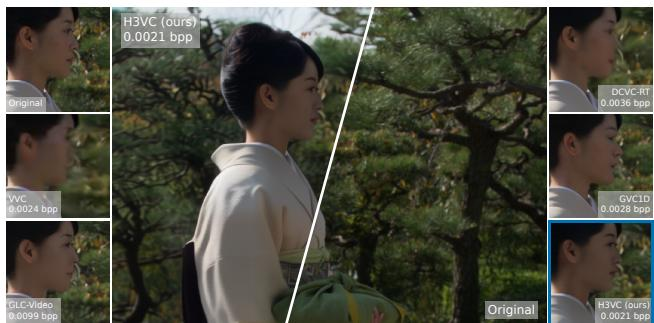

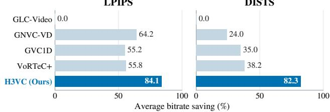  
Figure 1. H3VC achieves average BD-rate savings of 84.1% and 82.3% on UVG, MCL-JCV, and HEVC Class B over GLC-Video [21], at same LPIPS and DISTS.

To address this challenge, we propose H3VC, which directly entropy codes the spatiotemporal representations learned by the pretrained causal video VAE of MiniMax-H3 [19]. To get a reconstructive and compressive representation, we first adapt the pretrained VAE into a discrete video tokenizer, preserving its reconstruction capability while converting continuous video representations into discrete tokens. To efficiently compress discrete video tokens, we develop a small autoregressive entropy model that captures local and global dependencies for accurate probability estimation. To reduce sequential decoding complexity, we adopt a grouped prediction scheme that enables parallel token prediction within each group. However, training the tokenizer and entropy model separately does not explicitly optimize the learned representations for compression. The tokenizer is optimized for reconstruction, producing token distributions that are not necessarily low coding cost, while the entropy model can only learn to predict these fixed distributions without influencing the token assignments. To address this limitation, we introduce a differentiable rate surrogate that propagates rate gradients to the encoder, enabling joint rate–distortion optimization to adapt token assignments for lower coding costs while preserving reconstruction quality.

Experiments on UVG, MCL-JCV, and HEVC Class B demonstrate that H3VC achieves superior perceptual rate–distortion performance compared with existing video codecs, with BD-LPIPS savings of 82.2%–87.5% and BD-DISTS savings of 78.3%–85.0% relative to GLC-Video [21].

## 2. Related Work

Generative video compression. Generative video compression (GVC) leverages learned generative priors to improve perceptual reconstruction at low bitrates. Early approaches employ perceptual and adversarial training to recover realistic details [16, 27]. Subsequent methods explore compression in generative latent spaces, including GLC-Video [21], which performs conditional latent coding, and GVC1D [32], which combines compact onedimensional representations with short- and long-term temporal context. More recently, pretrained video generative models have been incorporated into GVC to improve perceptual quality and temporal coherence, including GNVC-VD [14], CGVC [2], ZeroGVC [5], and Free-GVC [12]. These approaches demonstrate the effectiveness of generative priors for video reconstruction, motivating further exploration of their learned representations for compression. Unlike approaches that primarily exploit pretrained generative priors to refine compressed representations, H3VC directly adapts pretrained video representations for entropyconstrained compression, integrating the learned generative representations into the coding process itself.

Autoencoder Video Coding. Direct entropy coding of learned video representations has been explored by Habibian et al. [6] and VCT [17]. Habibian et al. learn spatiotemporal representations using a 3D convolutional autoencoder, while VCT exploits temporal dependencies among framewise latents through Transformer-based entropy modeling. More recently, pretrained video representations have been investigated for direct video coding. GLC-Video [21] evaluates the pretrained 3D VAE of CogVideoX [28], showing that its compact spatiotemporal representations do not necessarily yield better rate–distortion performance than 2D representations.

Recent methods further explore pretrained discrete video representations. TVC [33] builds on pretrained Cosmos tokenizers [4], combining two discrete and continuous token streams for perceptual reconstruction. ProGVC [10] builds on the InfinityStar video tokenizer [13] and employs multi-scale autoregressive modeling for entropy coding and generation, enabling bitrate adaptation through progressive transmission of coarse-to-fine token scales. In contrast, H3VC directly adapts the pretrained MiniMax-H3 [19] causal video VAE into a single-stream discrete representation, without relying on an additional continuous stream or generative completion of token scales. More importantly, H3VC jointly optimizes token assignments and their conditional probability distribution, enabling rate and reconstruction constraints to guide token assignments toward lower coding costs while preserving reconstruction quality.

## 3. H3VC

H3VC aims to transform pretrained generative video representations into compression-oriented representations while preserving its reconstruction capability. Specifically, H3VC maps an input video $\mathbf { x } \in \mathbb { R } ^ { 3 \times T \times H \times W }$ into discrete spatiotemporal token indices $\mathbf { z } \in 0 , \ldots , N - 1 ^ { T _ { y } \times H _ { y } \times W _ { y } }$ for entropy coding, as illustrated in Figure 2. Here, N denotes the codebook size, and $( T , H , W )$ and $( T _ { y } , H _ { y } , W _ { y } )$ denote the dimensions of the input video and token grid, respectively.

Our framework consists of a video encoder $E _ { \theta }$ , a vector quantizer $Q \varepsilon$ with codebook $\mathcal { E } ,$ , an autoregressive entropy model $q _ { \psi }$ , and a video decoder $D _ { \theta }$ . Given an input video $\mathbf { x } ,$ the encoder produces continuous spatiotemporal latents $\mathbf { y } \in \mathbb { R } ^ { d \times T _ { y } \times H _ { y } ^ { * } \times W _ { y } }$ , which are quantized into discrete token indices z and corresponding quantized latents $\hat { \mathbf { y } }$

$$
{ \bf y } = E _ { \boldsymbol { \theta } } ( { \bf x } ) , \qquad ( { \bf z } , \hat { \bf y } ) = Q \varepsilon ( { \bf y } ) , \qquad \hat { \bf x } = D _ { \boldsymbol { \theta } } ( \hat { \bf y } ) .\tag{1}
$$

The entropy model $q _ { \psi }$ estimates the conditional probabilities of z for entropy coding, exploiting dependencies among discrete tokens. At the decoder, the recovered indices are mapped to quantized latents through codebook lookup to reconstruct the video.

## 3.1. Pretrained Video Representation

To convert the continuous spatiotemporal representation of the pretrained MiniMax-H3 VAE [19] into discrete tokens for entropy coding, we adopt vector quantization (VQ). In Stage I, we aim to learn a discrete tokenizer that preserves the reconstruction capability of the pretrained VAE without imposing rate constraints.

Specifically, given an N-entry codebook $\mathcal { E } \ = \ \{ \mathbf { e } _ { v } \in $ $\mathbb { R } ^ { d } \} _ { v = 0 } ^ { \mathbf { i } _ { N - 1 } }$ , we quantize each continuous latent vector $\mathbf { y } _ { i }$ using nearest-neighbor assignment with a straight-through estimator:

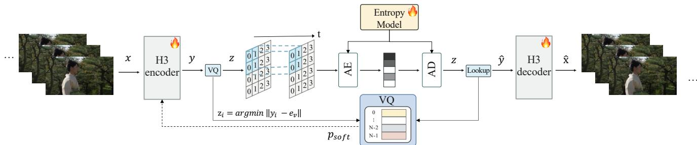  
Figure 2. Overview of H3VC. Our H3 encoder transforms the input video x into continuous latents ${ \bf y } ,$ which are quantized into discrete indices z using vector quantization. These indices will be entropy coded and decoded through our categorical entropy model. At the decoding side, the recovered indices z are mapped to quantized latents $\hat { \mathbf { y } }$ through codebook lookup, which are then passed to our H3 decoder to reconstruct xˆ. During Stage III, the encoder, decoder, and entropy model are jointly optimized with the codebook fixed; rate gradients reach the encoder through soft assignments.

<table><tr><td>Tokenizer</td><td>LPIPS ↓ DISTS ↓</td></tr><tr><td>Original H3 VAE</td><td>0.1941 0.0626</td></tr><tr><td>H3VC Tokenizer</td><td>0.1870 0.0474</td></tr></table>

Table 1. Reconstruction quality before and after VQ adaptation.

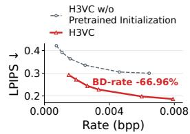  
Figure 3. Effect of pretrained initialization on perceptual rate–distortion performance.

$$
\begin{array} { r l } & { z _ { i } = \arg \underset { v \in \{ 0 , \ldots , N - 1 \} } { \operatorname* { m i n } } \| \mathbf { y } _ { i } - \mathbf { e } _ { v } \| _ { 2 } ^ { 2 } , } \\ & { \hat { \mathbf { y } } _ { i } = \mathbf { y } _ { i } + \mathrm { s g } ( \mathbf { e } _ { z _ { i } } - \mathbf { y } _ { i } ) . } \end{array}\tag{2}
$$

Here, sg(·) denotes the stop-gradient operator.

We initialize the encoder and decoder from the pretrained H3 VAE and optimize them using reconstruction and commitment losses, while updating the codebook through exponential moving averages (EMA). The training objective is

$$
\begin{array} { r } { \mathcal { L } _ { \mathrm { c o m m i t } } = \displaystyle \frac { 1 } { N _ { y } } \sum _ { i = 1 } ^ { N _ { y } } { \| \mathbf { y } _ { i } - \mathrm { s g } ( \mathbf { e } _ { z _ { i } } ) \| _ { 2 } ^ { 2 } } , } \\ { \mathcal { L } _ { 1 } = \mathcal { L } _ { \mathrm { M S E } } + \mathcal { L } _ { \mathrm { L P I P S } } + \beta \mathcal { L } _ { \mathrm { c o m m i t } } . } \end{array}\tag{3}
$$

Here, $N _ { y } = T _ { y } H _ { y } W _ { y }$ denotes the number of latent tokens, and $\beta = 0 . 2 5$ is the commitment weight.

As shown in Table 1, the VQ-trained tokenizer preserves the perceptual reconstruction quality of the original pretrained H3 VAE, achieving comparable or better LPIPS and DISTS.

## 3.2. Autoregressive Entropy Model

After obtaining the discrete video token grid ${ \textbf { z } } \in$ $\{ 0 , \ldots , N - 1 \bar  \} ^ { T _ { y } \times H _ { y } \times W _ { y } }$ in Stage I, we train an autoregressive entropy model to estimate the conditional probability of each token index for entropy coding, rather than directly storing it. Figure 4 illustrates the entropy model.

Local and global context. For each token index $z _ { i } ,$ we estimate its conditional probability $q _ { \psi } ( z _ { i } \mid C _ { i } )$ using two complementary sources of context. The local context consists of previously decoded tokens from the spatially corresponding window in preceding latent frames and earlier groups within the current window, capturing temporal and short-range spatial dependencies. To capture dependencies beyond the local window, we further introduce a global context through a fixed-size one-dimensional memory bank adapted from [31]. Previously decoded latent frames are summarized to update the memory bank, while learnable query tokens retrieve global information for subsequent predictions. Together, the local and global context provide complementary information for estimating the probability of $z _ { i }$

Grouped prediction. Fully sequential autoregressive prediction requires one decoding step per token, resulting in substantial latency. To enable parallel prediction, we partition each latent frame into non-overlapping $8 \times 8$ windows, each further divided into four parity groups indexed by $g \in \{ 0 , 1 , 2 , 3 \}$ . The groups are decoded in frame-major order, with prediction round $r = 4 t + g$ for group g in latent frame t. Tokens within the same group are modeled as conditionally independent and predicted in parallel across all windows. The resulting probability factorization is

$$
q _ { \psi } ( \mathbf { z } ) = \prod _ { r = 0 } ^ { 4 T _ { y } - 1 } \prod _ { i \in \mathcal { G } _ { r } } q _ { \psi } ( z _ { i } \mid C _ { i } ) ,\tag{4}
$$

where $\mathcal { G } _ { r }$ denotes the token positions predicted in round $r ,$ and $C _ { i }$ is the available context. This scheme reduces sequential prediction to four rounds per latent frame.

Entropy model training. In Stage II, we freeze the tokenizer and train the entropy model using categorical crossentropy:

$$
\mathcal { L } _ { 2 } = - \frac { 1 } { N _ { y } } \sum _ { i = 1 } ^ { N _ { y } } \sum _ { v = 0 } ^ { N - 1 } p _ { \mathrm { h a r d } } ( i , v ) \log _ { 2 } q _ { \psi } ( v \mid C _ { i } ) ,\tag{5}
$$

where $p _ { \mathrm { h a r d } } ( i , v ) = 1 { \mathrm { i f } } v = z _ { i }$ and 0 otherwise. The predicted conditional probabilities are used for entropy coding of the discrete token indices.

As shown in Table 2, the entropy model reduces the estimated coding cost from 12.000 to 8.427 bits/token on UVG, achieving a 29.8% reduction without affecting reconstruction quality.

Table 2. Coding cost before and after stage II entropy model training.
<table><tr><td>Coding</td><td>bits/token</td></tr><tr><td>w/o Entropy Coding</td><td>12.000</td></tr><tr><td>w/ Entropy Coding</td><td>8.487</td></tr></table>

## 3.3. Joint Rate–Distortion Optimization

The first two stages optimize the tokenizer and entropy model separately. In Stage I, the tokenizer is optimized for reconstruction, without explicitly considering the coding cost of its token assignments. In Stage II, entropy model learns to estimate the conditional probability of these tokens, but can only fit the token distribution without influencing it. However, if the encoder produces tokens that are difficult to predict, improving the entropy model alone cannot fundamentally improve the compressibility of the learned representation.

To address this limitation, we adopt a differentiable rate surrogate [8] that allows rate gradients to propagate to the encoder through relaxed codeword assignments. Specifically, we relax the non-differentiable hard assignment into a distance-based soft distribution over codebook entries:

$$
p _ { \mathrm { s o f t } } ( i , v ) = \mathrm { s o f t m a x } _ { v } \left( - \frac { \left\| \mathbf { y } _ { i } - \mathbf { e } _ { v } \right\| _ { 2 } ^ { 2 } } { \tau } \right) ,\tag{6}
$$

where $\tau > 0$ is the temperature. This relaxation enables joint rate–distortion optimization of the tokenizer and entropy model, allowing token assignments to adapt toward lower conditional coding costs while preserving reconstruction quality. In Stage III, we fix the codebook and jointly optimize the encoder, decoder, and entropy model using

$$
\mathcal { L } _ { 3 } = \mathcal { L } _ { 1 } + \frac { \lambda } { T H W } \sum _ { i = 1 } ^ { N _ { y } } \sum _ { v = 0 } ^ { N - 1 } p _ { \mathrm { s o f t } } ( i , v ) \left[ - \log _ { 2 } q _ { \psi } \left( v \mid C _ { i } \right) \right] .\tag{7}
$$

Here, $\mathcal { L } _ { 1 }$ is the reconstruction objective defined in Eq. 3, and the second term provides a differentiable surrogate for coding rate. Joint optimization allows the encoder to adapt its token assignments toward lower conditional coding costs while preserving reconstruction quality.

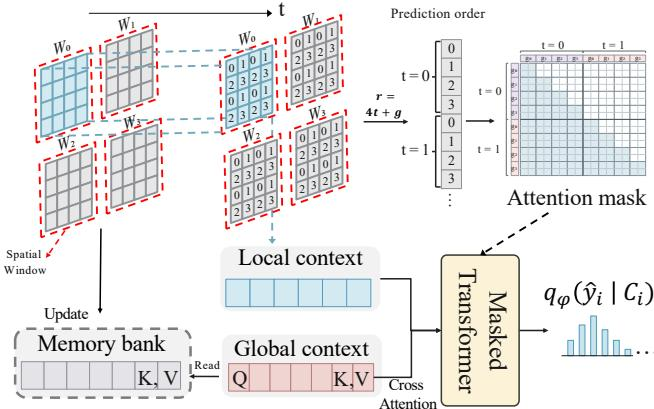  
Figure 4. Window-parallel autoregressive entropy modeling. Token groups follow the frame-major order $r = 4 t + g ,$ , with spatial windows processed in parallel. Group-causal attention captures local dependencies, while cross-attention incorporates global context retrieved from a memory bank of previously decoded frames.

As shown in Figure 5, stronger rate constraints lead to lower conditional coding costs, accompanied by changes in codebook usage and token prediction accuracy.

## 4. Experiments

## 4.1. Experimental Setup

Datasets. We train on OpenVid-HD [20] using the first 107 frames of each training video and random crops of 256 × 256. We evaluate the first 96 frames on three benchmarks UVG [18], HEVC Class B, and MCL-JCV [23] at 1920 × 1080 resolution.

Implementation details. We initialize the tokenizer from the pretrained MiniMax-H3 video VAE [19] and train on four NVIDIA H100 GPUs with a global batch size of 4. We use the Adam optimizer [9] with an initial learning rate of $1 0 ^ { - 4 }$ , reduced to $1 0 ^ { - 6 }$ using a cosine schedule. In Stage I, we train the discrete tokenizer with codebook size $N = 4 0 9 6$ and codeword dimension $d = 2 4$ using Eq. 3 for 60K steps. In Stage II, we freeze the tokenizer and train the entropy model with Eq. 5 for 20K steps. The entropy model uses $8 \times 8$ latent windows with four parity groups indexed by $g \in \{ 0 , 1 , 2 , 3 \}$ . Stage III jointly optimizes the tokenizer and entropy model with Eq. 7 for 20K additional steps, using the soft-assignment temperature $\tau = 0 . 0 5$ and rate weights λ ∈ {7.2, 12, 24, 36, 48, 72, 120}.

Compared methods. We compare H3VC with traditional codecs HEVC [22] and VVC [1], learned codecs DCVC-FM [11] and DCVC-RT [7], and generative codecs PLVC [27] and GLC-Video [21], GNVC-VD [15], GVC1D [32], and VoRTeC/VoRTeC+ [25]. All learned baselines are evaluated using official implementations or author-reported results for fair comparison. Following prior NVC studies, we evaluate the first 96 frames of each test sequence under a low-delay prediction configuration. All baselines are evaluated in RGB space.

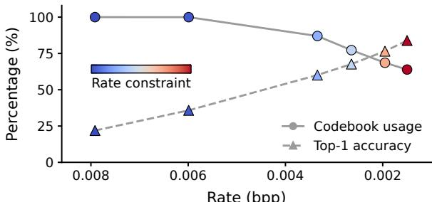  
(a) Usage and prediction accuracy

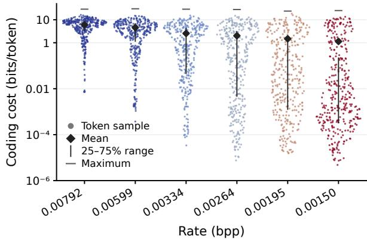  
(b) Coding cost per token  
Figure 5. Token predictability under different rate constraints on UVG. (a) Codebook usage (•) and top-1 prediction accuracy (▲). (b) Coding cost (bits/token): the bit cost assigned by the entropy model to each observed token.

Evaluation protocol. Our evaluation covers perceptual rate–distortion performance, the discrete representation, entropy modeling, joint rate–distortion optimization, temporal reconstruction quality, and rate scalability. We compare perceptual RD curves using LPIPS [30] and DISTS [3] against bpp, complemented by qualitative reconstruction comparisons. Following GNVC-VD [15], we assess temporal consistency on natural videos using motion-compensated warping error $E _ { \mathrm { w a r p } }$ and adjacent-frame CLIP-F. Our ablations examine the effects of pretrained Minimax-H3 weights, local and global entropy-model context, and Stage III joint rate–distortion optimization. Additional analyses investigate codebook usage and token predictability, as well as prefix transmission.

## 4.2. Perceptual Rate–Distortion Performance

Quantitative Comparisons. We compare H3VC with representative traditional, learned and generative video codecs on UVG [18], MCL-JCV [23], and HEVC-B. Figure 6 presents the perceptual rate–distortion performance measured by LPIPS and DISTS. H3VC consistently outperforms existing methods across all three datasets and different bitrates. Additionally, Table 3 summarizes BD-rate relative to GLC-Video [21] at matched LPIPS and DISTS. Compared with GLC-Video [21], H3VC achieves bitrate savings of 82.2%–87.5% in LPIPS and 78.3%–85.0% in DISTS across the three datasets.

Qualitative comparison. Figure 7 shows visual comparisons on videoSRC14 from MCL-JCV. At a lower bitrate, H3VC preserves finer facial and clothing details while achieving a lower sequence-average LPIPS than the compared methods.

Table 3. BD-rate (%) comparison of generative video codecs an chored to GLC-Video at LPIPS and DISTS.
<table><tr><td rowspan="2">Method</td><td colspan="2">HEVC-B</td><td colspan="2">UVG</td><td colspan="2">MCL-JCV</td></tr><tr><td>LPIPS</td><td>DISTS</td><td>LPIPS</td><td>DISTS</td><td>LPIPS</td><td>DISTS</td></tr><tr><td>GLC-Video</td><td>0.0</td><td>0.0</td><td>0.0</td><td>0.0</td><td>0.0</td><td>0.0</td></tr><tr><td>GNVC-VD</td><td>-61.9</td><td>-43.3</td><td>-72.9</td><td>-13.0</td><td>-57.9</td><td>-15.6</td></tr><tr><td>GVC1D</td><td>-51.6</td><td>-61.5</td><td>-53.0</td><td>6.0</td><td>-60.9</td><td>-49.5</td></tr><tr><td>VoRTeC</td><td>-35.5</td><td>-15.6</td><td>-44.1</td><td>-16.2</td><td>一</td><td></td></tr><tr><td>VoRTeC+</td><td>-57.9</td><td>-53.6</td><td>-63.7</td><td>-31.9</td><td>-45.7</td><td>-29.0</td></tr><tr><td>H3VC (Ours)</td><td>-82.6</td><td>-85.0</td><td>-87.5</td><td>-83.5</td><td>-82.2</td><td>-78.3</td></tr></table>

## 4.3. Pretrained Video Representations

H3VC leverages the pretrained video representations of MiniMax-H3 for perceptual video compression. To evaluate the contribution of these pretrained priors, we compare H3VC with a randomly initialized counterpart trained from scratch using the same architecture. Figure 3 presents the perceptual rate–distortion curves on UVG. H3VC achieves a BD-LPIPS reduction of 66.96% over random initialization on UVG, demonstrating the benefit of pretrained video representations for ultra-low-bitrate perceptual compression.

## 4.4. Effectiveness of Entropy Modeling

Our entropy model exploits dependencies among discrete video tokens to reduce their coding cost. Two key designs are local-global context modeling for accurate probability estimation and grouped prediction for parallel decoding.

Local and Global Context. To evaluate the contribution of each context, we compare H3VC with variants that remove either local or global context under identical training and evaluation settings. As shown in Table 4, removing local context increases BD-rate at matched LPIPS by 18.2% on UVG. Removing global context increases BDrate at matched LPIPS-VGG by 0.64%–5.47% across the three datasets, while reducing BD-rate at matched DISTS by 11.02%–17.76%. These results show that local context improves coding efficiency on UVG, while the effect of global context depends on the perceptual metric.

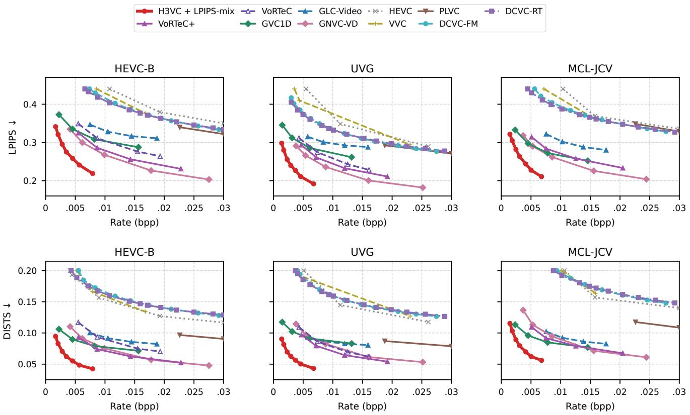  
Figure 6. Perceptual rate–distortion performance against state-of-the-art video codecs on HEVC-B, UVG, and MCL-JCV.

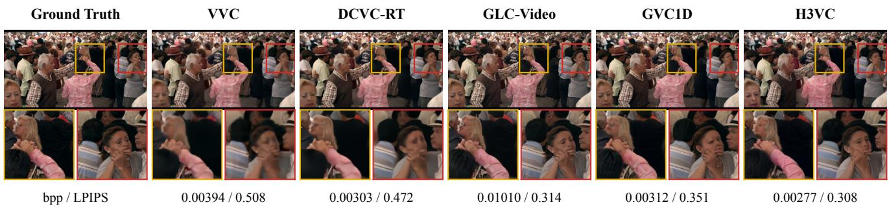  
Figure 7. Qualitative comparison on MCL-JCV. Best viewed when zoomed in.

Grouped Prediction. Table 5 compares grouping choices with a shared frozen tokenizer and parallel encoding. Relative to four groups, two groups reduce decoding latency by 13%–14% but increase coding cost by 0.82%–1.53%. Eight groups save only 0.59%–0.62% in coding cost while increasing decoding latency by 22%–25%. Increasing to 64 groups yields higher coding cost than eight groups and requires 2.81–2.91× their decoding time. We therefore use four groups by default to balance coding efficiency and decoding latency. Tokens within each group are predicted in parallel across windows, requiring $4 T _ { y }$ decoding rounds for $T _ { y }$ latent frames.

## 4.5. Joint Rate–Distortion Optimization

We adopt a differentiable rate surrogate that allows rate gradients to propagate to the encoder through relaxed codeword assignments. This enables joint optimization of the token distribution and entropy model, encouraging the encoder to produce tokens that are more predictable under the entropy model. By adjusting the rate constraint, H3VC learns representations with different coding costs, yielding operating points at different bitrates.

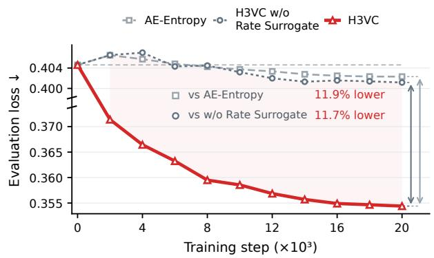  
Figure 8. Effect of rate gradients on joint rate–distortion training. Percentages show the evaluation-loss reductions at 20K steps.

Table 4. Local and global context ablation. BD-rate (%) relative to H3VC at matched LPIPS-VGG and DISTS.
<table><tr><td rowspan="2">Context</td><td colspan="2">HEVC-B</td><td colspan="2">UVG</td><td colspan="2">MCL-JCV</td></tr><tr><td>LPIPS</td><td>DISTS</td><td>LPIPS</td><td>DISTS</td><td>LPIPS</td><td>DISTS</td></tr><tr><td>w/o local context</td><td>+6.83</td><td>+15.95</td><td>+1.99</td><td>+19.01</td><td>+5.69</td><td>+13.01</td></tr><tr><td>w/o global context</td><td>+5.47</td><td>+12.36</td><td>+0.64</td><td>+17.76</td><td>+4.42</td><td>+11.02</td></tr></table>

Table 5. Grouping trade-off. Enc./Dec.: entropy-coding latency (ms/frame), excluding the VAE.
<table><tr><td rowspan="2">G</td><td colspan="3">HEVC-B</td><td colspan="2">UVG</td><td colspan="2">MCL-JCV</td></tr><tr><td>bits/token ↓</td><td>Enc.</td><td>Dec. bits/token ↓</td><td>Enc.</td><td></td><td>Dec. bits/token ↓</td><td>Enc. Dec.</td></tr><tr><td>2</td><td></td><td>9.281 35.55</td><td>42.87</td><td>8.547 35.76</td><td>42.76</td><td>8.722 35.66</td><td>42.58</td></tr><tr><td>4</td><td>9.152 37.39</td><td></td><td>50.43</td><td>8.47037.25</td><td>50.27</td><td>8.582 37.13</td><td>50.08</td></tr><tr><td>8</td><td>9.08040.70</td><td></td><td>63.75</td><td>8.40540.42</td><td>63.82</td><td>8.516 40.15</td><td>63.39</td></tr><tr><td>64</td><td></td><td>8.90436.86190.96</td><td></td><td>8.30036.69190.52</td><td></td><td></td><td>8.36436.46190.47</td></tr></table>

Rate surrogate ablation. To evaluate the contribution of rate gradients to the tokenizer, we compare three variants initialized from the same Stage II checkpoint: (i) AE-Entropy, which updates only the entropy model with a frozen tokenizer; (ii) H3VC w/o Rate Surrogate, which jointly trains both modules but blocks rate gradients to the tokenizer; and (iii) H3VC, which allows rate gradients to update the tokenizer. Figure 8 compares their evaluation loss on UVG. After 20K steps, H3VC achieves an 11.7% lower evaluation loss than H3VC w/o Rate Surrogate, demonstrating the benefit of adapting token assignments through rate gradients.

Codebook distribution and predictability. To examine how joint rate–distortion optimization shapes the discrete representation, we analyze codebook usage, prediction accuracy, and conditional token coding costs across operating points in Figure 5. The conditional coding costs decrease as the rate constraint strengthens.

Table 6. Temporal reconstruction quality on HEVC-B. Bold indicates the best value in each column.
<table><tr><td colspan="2"></td><td colspan="2">Temporal quality</td></tr><tr><td>Method</td><td>Rate (bpp) ↓</td><td> $E _ { \mathrm { w a r p } }$  ↓</td><td>CLIP-F ↑</td></tr><tr><td>HEVC</td><td>0.00636</td><td>27.29</td><td>0.9907</td></tr><tr><td>VVC</td><td>0.01017</td><td>25.43</td><td>0.9921</td></tr><tr><td>DCVC-RT</td><td>0.00626</td><td>24.74</td><td>0.9915</td></tr><tr><td>GLC-Video</td><td>0.00775</td><td>128.98</td><td>0.9884</td></tr><tr><td>GVC1D</td><td>0.00821</td><td>65.26</td><td>0.9908</td></tr><tr><td>H3VC (Ours)</td><td>0.00568</td><td>43.24</td><td>0.9931</td></tr></table>

## 4.6. Temporal Reconstruction Quality

To evaluate temporal consistency on natural videos, we measure motion-compensated warping error following GNVC-VD [15] and adjacent-frame CLIP-F. Table 6 shows lower warping error than GLC-Video and GVC1D and the highest CLIP-F among the evaluated methods on HEVC-B. These results support temporally consistent reconstruction at low bitrates.

## 4.7. Rate Scalability

Prefix Transmission To evaluate test-time rate adjustment, we compare full H3VC with predictive prefix completion, zero filling, and completion using separately trained tokenizer and entropy models (AE-Entropy), following RDVQ [8]. The prefix and zero-padding variants use the same λ = 7.2 checkpoint and transmit the first k ∈ {1, 2, 3} spatial groups. Figure 9 shows that H3VC-Prefix achieves lower LPIPS and DISTS with fewer bits than both controls at each partial-transmission level, while quality decreases as fewer groups are transmitted. These results support using the entropy model as a completion prior for test-time bitrate adjustment without retraining.

## 5. Conclusion

We presented H3VC, a video compression framework that explores the potential of pretrained video VAE representations for video compression. Particularly at ultra-low bitrates, compact spatiotemporal representations provide an effective way to exploit spatial and temporal redundancies while preserving perceptually important details. To enable flexible bitrate control, we introduce a categorical entropy model and jointly optimize it with the tokenizer, adapting token distributions and their predictability to achieve different compression rates. Extensive experiments across multiple benchmarks demonstrate superior perceptual rate– distortion performance over traditional, learned, and generative video codecs, as well as improved temporal coherence compared with existing generative methods. H3VC offers a new perspective on video compression, highlighting the potential of pretrained video representations and categorical entropy modeling for efficient perceptual coding.

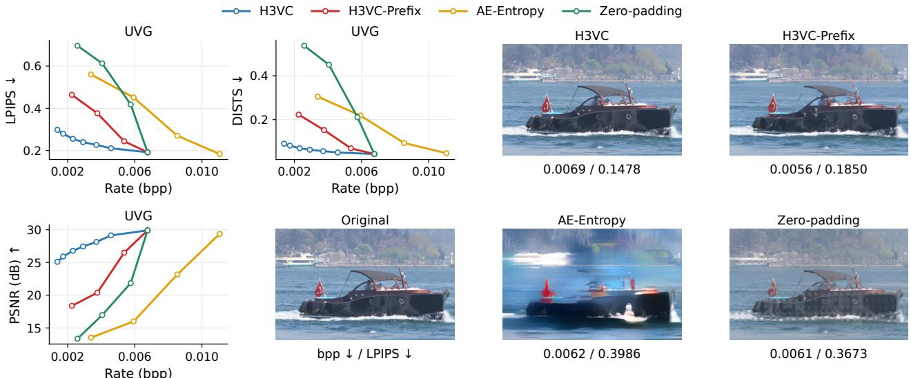  
Figure 9. Test-time rate adjustment via prefix transmission. LPIPS, DISTS, and PSNR curves on UVG, with Bosphorus reconstructions (bpp / LPIPS). Full H3VC and H3VC-Prefix use the same checkpoint.

## References

[1] Benjamin Bross, Ye-Kui Wang, Yan Ye, Shan Liu, Jianle Chen, Gary J Sullivan, and Jens-Rainer Ohm. Overview of the versatile video coding (vvc) standard and its applications. IEEE Transactions on Circuits and Systems for Video Technology, 31(10):3736–3764, 2021. 4

[2] Ding Ding, Daowen Li, Ying Chen, Yixin Gao, Ruixiao Dong, Kai Li, and Li Li. Controllable generative video compression. arXiv preprint arXiv:2604.06655, 2026. 2

[3] Keyan Ding, Kede Ma, Shiqi Wang, and Eero P Simoncelli. Image quality assessment: Unifying structure and texture similarity. IEEE transactions on pattern analysis and machine intelligence, 44(5):2567–2581, 2020. 5

[4] NVIDIA et. al. Cosmos world foundation model platform for physical ai. arXiv preprint arXiv:2501.03575, 2025. 2

[5] Yixin Gao, Xiaohan Pan, Lin Liu, Xin Li, Zhibo Chen, and Qi Tian. Zerogvc: Zero-shot generative video compression with autoregressive diffusion priors. arXiv preprint arXiv:2606.22371, 2026. 1, 2

[6] Amirhossein Habibian, Ties van Rozendaal, Jakub M Tomczak, and Taco S Cohen. Video compression with ratedistortion autoencoders. In Proceedings of the IEEE/CVF international conference on computer vision, pages 7033– 7042, 2019. 2

[7] Zhaoyang Jia, Bin Li, Jiahao Li, Wenxuan Xie, Linfeng Qi, Houqiang Li, and Yan Lu. Towards practical real-time neural

video compression. In 2025 IEEE/CVF Conference on Computer Vision and Pattern Recognition (CVPR), pages 12543– 12552. IEEE, 2025. 4

[8] Shiyin Jiang, Wei Long, Minghao Han, Zhenghao Chen, Ce Zhu, and Shuhang Gu. Differentiable vector quantization for rate-distortion optimization of generative image compression, 2026. 4, 7

[9] Diederik P. Kingma and Jimmy Ba. Adam: A method for stochastic optimization. In International Conference on Learning Representations, 2015. 4

[10] Daowen Li, Ruixiao Dong, Ying Chen, Kai Li, Ding Ding, and Li Li. Progvc: Progressive-based generative video compression via auto-regressive context modeling. arXiv preprint arXiv:2603.17546, 2026. 2

[11] Jiahao Li, Bin Li, and Yan Lu. Neural video compression with feature modulation. In 2024 IEEE/CVF Conference on Computer Vision and Pattern Recognition (CVPR), pages 26099–26108. IEEE, 2024. 4

[12] Xiaoyue Ling, Chuqin Zhou, Chunyi Li, Yunuo Chen, Yuan Tian, Guo Lu, and Wenjun Zhang. Free-gvc: Towards training-free extreme generative video compression with temporal coherence. arXiv preprint arXiv:2602.09868, 2026. 1, 2

[13] Jinlai Liu, Jian Han, Bin Yan, Hui Wu, Fengda Zhu, Xing Wang, Yi Jiang, Bingyue Peng, and Zehuan Yuan. Infinitystar: Unified spacetime autoregressive modeling for visual generation. Advances in Neural Information Processing Sys tems, 38:170054–170072, 2026. 2

[14] Qi Mao, Hao Cheng, Tinghan Yang, Libiao Jin, and Siwei Ma. Generative neural video compression via video diffusion prior. arXiv preprint arXiv:2512.05016, 2025. 2

[15] Qi Mao, Hao Cheng, Tinghan Yang, Libiao Jin, and Siwei Ma. Generative neural video compression via video diffusion prior. In Proceedings ofthe IEEE/CVF Conference on Com-

puter Vision and Pattern Recognition, pages 43239–43248, 2026. 4, 5, 7

[16] Fabian Mentzer, Eirikur Agustsson, Johannes Ballé, David Minnen, Nick Johnston, and George Toderici. Neural video compression using gans for detail synthesis and propagation. In European Conference on Computer Vision, pages 562– 578. Springer, 2022. 2

[17] Fabian Mentzer, George Toderici, David Minnen, Sung-Jin Hwang, Sergi Caelles, Mario Lucic, and Eirikur Agustsson. Vct: A video compression transformer. arXiv preprint arXiv:2206.07307, 2022. 2

[18] Alexandre Mercat, Marko Viitanen, and Jarno Vanne. Uvg dataset: 50/120fps 4k sequences for video codec analysis and development. In Proceedings of the 11th ACM multimedia systems conference, pages 297–302, 2020. 4, 5

[19] MiniMax. MiniMax-H3. https://github.com/ MiniMax-AI/MiniMax-H3, 2026. Accessed September 14, 2026. 1, 2, 4

[20] Kepan Nan, Rui Xie, Penghao Zhou, Tiehan Fan, Zhenheng Yang, Zhijie Chen, Xiang Li, Jian Yang, and Ying Tai. Openvid-1m: A large-scale high-quality dataset for text-tovideo generation. In International conference on learning representations, pages 1045–1064, 2025. 4

[21] Linfeng Qi, Zhaoyang Jia, Jiahao Li, Bin Li, Houqiang Li, and Yan Lu. Generative latent coding for ultralow bitrate image and video compression. arXiv preprint arXiv:2505.16177, 2025. 1, 2, 4, 5

[22] Gary J Sullivan, Jens-Rainer Ohm, Woo-Jin Han, and Thomas Wiegand. Overview of the high efficiency video coding (hevc) standard. IEEE Transactions on circuits and systemsfor video technology, 22(12):1649–1668, 2012. 4

[23] Haiqiang Wang, Weihao Gan, Sudeng Hu, Joe Yuchieh Lin, Lina Jin, Longguang Song, Ping Wang, Ioannis Katsavounidis, Anne Aaron, and C-C Jay Kuo. Mcl-jcv: a jnd-based h. 264/avc video quality assessment dataset. In 2016 IEEE international conference on image processing (ICIP), pages 1509–1513. IEEE, 2016. 4, 5

[24] Shaokang Wang, Jinchang Xu, Peidong Jia, Zhijian Hao, Siyuan Qian, Fei Zhao, Rui Ma, Xiaozhu Ju, Jian Tang, Xiaodong Xie, et al. Group-of-latents: Perceptual video compression at extreme bitrates via masked latent generative modeling. arXiv preprint arXiv:2607.19437, 2026. 1

[25] Yichong Xia, Qinhong Wu, Bin Chen, Jinpeng Wang, Zeyuan Chen, and Haoqian Wang. Vortec: Taming foundation flow for one-step real time video compression, 2026. 4

[26] Naifu Xue, Zhaoyang Jia, Haosen Li, Zihan Zheng, Jiahao Li, Bin Li, Xiaoyi Zhang, Qi Meng, Yuan Zhang, and Yan Lu. Generative video compression with adaptive score distillation. arXiv preprint arXiv:2607.22772, 2026. 1

[27] Ren Yang, Radu Timofte, and Luc Van Gool. Perceptual learned video compression with recurrent conditional gan. In IJCAI, pages 1537–1544, 2022. 2, 4

[28] Zhuoyi Yang, Jiayan Teng, Wendi Zheng, Ming Ding, Shiyu Huang, Jiazheng Xu, Yuanming Yang, Wenyi Hong, Xiaohan Zhang, Guanyu Feng, et al. Cogvideox: Text-tovideo diffusion models with an expert transformer. In In-

ternational Conference on Learning Representations, pages 83048–83077, 2025. 2

[29] Ziyue Zeng, Xun Su, Haoyuan Liu, Bingyu Lu, Yui Tatsumi, and Hiroshi Watanabe. Gvcc: Zero-shot video compression via codebook-driven stochastic rectified flow. arXiv preprint arXiv:2603.26571, 2026. 1

[30] Richard Zhang, Phillip Isola, Alexei A Efros, Eli Shechtman, and Oliver Wang. The unreasonable effectiveness of deep features as a perceptual metric. In 2018 IEEE/CVF conference on computer vision and pattern recognition, pages 586– 595. IEEE, 2018. 5

[31] Zihan Zheng, Zhaoyang Jia, Naifu Xue, Jiahao Li, Bin Li, Zongyu Guo, Xiaoyi Zhang, Zhenghao Chen, Houqiang Li, and Yan Lu. Generative video compression with one-dimensional latent representation. arXiv preprint arXiv:2603.15302, 2026. 3

[32] Zihan Zheng, Zhaoyang Jia, Naifu Xue, Jiahao Li, Bin Li, Zongyu Guo, Xiaoyi Zhang, Zhenghao Chen, Houqiang Li, and Yan Lu. Generative video compression with one-dimensional latent representation. arXiv preprint arXiv:2603.15302, 2026. 2, 4

[33] Lebin Zhou, Cihan Ruan, Nam Ling, Zhenghao Chen, Wei Wang, and Wei Jiang. Tvc: tokenized video compression with ultra-low bit rate. Visual Intelligence, 3(1):25, 2025. 2