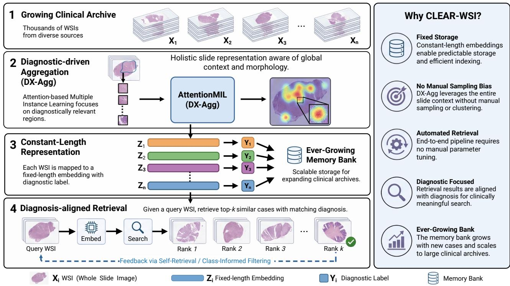
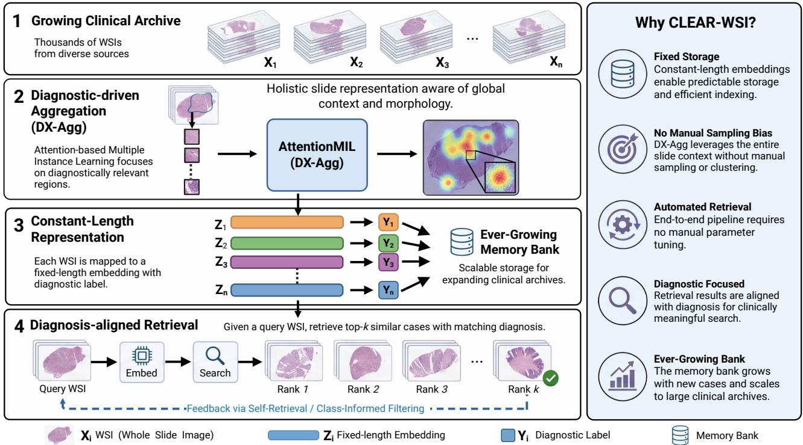
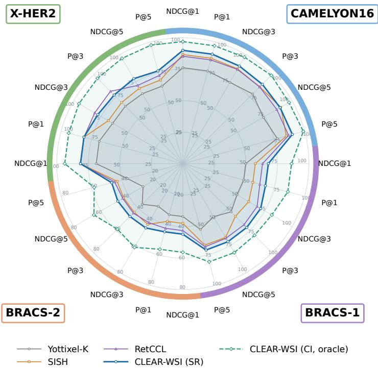

# Towards Scalable Diagnostic-Driven Whole-Slide Image Retrieval for Pathology Archives

Jingsong Liu1,3,6,\*,†, Youssef Wally2,†, Han Li1,3,4, Weiwei Zhou 5, Jing Dai5, Elisabeth Wetzer2, Peter J. Schüfler1,3,6

1Institute of Pathology, Technical University of Munich, TUM School of Medicine and Health, Munich, Germany

2Department of Physics and Technology, UiT The Arctic University of Norway, Tromsø, Norway 3Munich Center for Machine Learning (MCML), Munich, Germany

4Computer Aided Medical Procedures (CAMP), Technical University of Munich, Munich, Germany

5School of Biomedical Engineering, Faculty of Medicine, Dalian University of Technology, Dalian, China

6Munich Data Science Institute (MDSI), Munich, Germany

†These authors contributed equally to this work.

Corresponding author: Jingsong Liu Email: jingsong.liu@tum.de

## Acknowledgements

This work was supported by the German Federal Ministry of Education and Research (BMBF)- funded SATURN3 project (01KD2206C) and the Innovative Medicines Initiative (IMI) BIGPIC-TURE project (IMI945358), the Research Council of Norway, Integreat – Norwegian Centre for knowledge-driven machine learning (project number 332645). This work was supported through the Bavarian AI Foundation Model Initiative (AI-Bay.eu), funded by the Bavarian State Ministry of Science and the Arts (StMWK).

## CRediT authorship contribution statement

Jingsong Liu: Conceptualization, Methodology, Writing. Youssef Wally: Methodology, Validation, Original Draft. Han Li: Writing. Weiwei Zhou: Writing. Jing Dai: Writing. Elisabeth Wetzer: Writing and Supervision. Peter J. Schüfler: Conceptualization, Supervision, Funding acquisition, Review and Editing.

## Graphical Abstract

## Towards Scalable Diagnostic-Driven Whole-Slide Image Retrieval for Pathology Archives

## Highlights

## Towards Scalable Diagnostic-Driven Whole-Slide Image Retrieval for Pathology Archives

• CLEAR-WSI combines Diagnostic-aligned Aggregation, constant-length embeddings with a growing memory bank, and both Class-Informed and Self-Retrieval configurations for flexible retrieval with or without available diagnoses.

• CLEAR-WSI achieves state-of-the-art retrieval performance on a comprehensive benchmark across three public and one private clinical tasks of varying dificulty.

• Additional ablation and latency studies further examine the contribution of each component and demonstrate the framework’s potential for scalable deployment.

# Towards Scalable Diagnostic-Driven Whole-Slide Image Retrieval for Pathology Archives

## A R T I C L E I N F O

Keywords:   
Image Retrieval   
Content-Based Image Retrieval   
Whole Slide Images   
Digital Pathology   
Foundation Models

## A BS T RA C T

The growing adoption of digital pathology has rapidly expanded collections of hematoxylin-andeosin whole-slide images, yet eficient navigation through these archives remains challenging, as metadata is often inconsistent or unavailable. Content-based image retrieval addresses this challenge by identifying similar cases directly from visual representations instead of manual annotations or metadata. Existing retrieval systems have demonstrated promising performance but largely rely on handcrafted indexing pipelines and predefined sampling strategies, constraining scalability and generalization. Here, we present CLEAR-WSI (Constant-Length Embedding for Automatic Retrieval of Whole-Slide Images) as a scalable, diagnostic-driven slide-retrieval framework, validated on both public and clinical data. Using a fixed-length slide embedding, CLEAR-WSI refines retrieved candidates with either a predicted diagnostic labdddel or the ground-truth label, depending on the retrieval setting. Newly processed cases are subsequently added to the expanding memory bank, allowing the retrieval archive to grow over time. On a comprehensive benchmark consisting of two public and one private clinical datasets representing four retrieval tasks, CLEAR-WSI improves Precision@5 over the strongest evaluated baseline, with gains on CAMELYON16 (3.10), BRACS-1 (2.75), BRACS-2 (1.95), and X-HER2 (3.75). Additional ablation and latency studies further examine the contribution of each component and highlight its potential for scalable deployment.

## 1. Introduction

Digital pathology archives are currently growing, thus complicating the retrieval of relevant slides for a particular query slide. Metadata-based searches are often hindered by inconsistent or incomplete databases. Alternatively, content-based image retrieval (CBIR) enables searching for whole-slide images (WSIs) directly from a query image, but requires a useful representation and similarity measure between slides. For this work, we assume that the main objective is to find diagnostically related cases in the archive. Such retrieval can support case-based review [15], education [5], and similarity-driven exploration [34]. However, WSIs are gigapixel-sized images that contain a variable number of heterogeneous tissue regions, making conventional methods ineficient and challenging to apply [16, 30, 31]. A retrieval system must therefore represent diagnostically relevant morphology in a form that can be eficiently stored and searched.

Existing CBIR approaches address the gigapixel scale by representing each slide with a selected set of local observations. Earlier systems used handcrafted color and texture descriptors [34]; recent WSI systems instead use learned patch features within mosaic-based retrieval [15], slide-level hashing [17], discrete-code indexing [5], or local patch matching [27]. While these approaches improve retrieval eficiency, they also involve trade-ofs in how a slide is represented. The number of stored patches may depend on tissue content and sampling decisions, whereas stronger compression can remove diagnostically relevant details. In addition, visually similar slides are not necessarily diagnostically consistent.

For a scalable, searchable WSI archive, we argue that (i) the storage required for a newly indexed WSI should not depend on how many patches it contains, (ii) a WSI’s representation must preserve diagnostic evidence without relying on manually configured clustering or mosaic construction, and (iii) the search procedure must accommodate queries both with and without an available diagnosis. Motivated by these considerations, we recently conceptualized the diagnosisaligned WSI retrieval framework CLEAR-WSI (Constant-Length Embedding for Automatic Retrieval of Whole-Slide Images) for growing clinical archives [1].

In this work, we review this concept and extend it with a grid-search strategy for improved hyperparameter selection, dedicated ablation and latency studies, and a clinical evaluation study. Following its initial overall structure, CLEAR-WSI can be formalized as shown in Figure 1. In a nutshell, it uses a diagnosis-aware, fixed-length slide representation that provides a constant per-slide storage footprint and predictable memory-bank growth, and integrates automated Self-Retrieval (SR) and label-available Class-Informed (CI) modes to support diagnosis-aligned search both with and without an available query diagnosis. We show on two public datasets (CAMELYON16, BRACS-1/2) and a private clinical X-HER2 cohort that CLEAR-WSI consistently outperforms representative state-of-the-art retrieval methods, making it a powerful tool for archival slide retrieval. CLEAR-WSI is openly available at Anonymized Git Repo.

## 2. Related Work

Existing approaches can be broadly organized according to how they represent a complete slide and perform retrieval: mosaic or patch-set matching, discrete-code indexing, slidelevel hashing, and retrieval using foundation-model representations.

  
Figure 1: Overview of the CLEAR-WSI framework for scalable, diagnosis-aligned retrieval from growing clinical archives. Left: (1) A growing clinical archive contains WSIs from heterogeneous sources. (2) Each WSI is processed by Diagnostic-driven Aggregation (DX-Agg), implemented with Attention-based MIL, to identify diagnostically relevant evidence and capture global slide morphology. (3) DX-Agg maps each variable-size patch set to a fixed-length slide embedding $Z _ { i }$ and diagnostic prediction $Y _ { i } ,$ which are stored in an ever-growing memory bank, providing constant per-slide storage and predictable index expansion. (4) Given a query WSI, CLEAR-WSI retrieves the top-� similar cases and refines the ranked list using either Self-Retrieval (SR) filtering, when the query diagnosis is unknown, or Class-Informed (CI) filtering, when it is available. Right: Key features of CLEAR-WSI, including fixed-length storage, automated diagnosis-focused retrieval, and a scalable, ever-growing memory bank.

## 2.1. Mosaic or Patch-Set Retrieval

Early CBIR systems represented histopathology images using handcrafted color, texture, and local structural descriptors [34]. Although these methods enabled examplebased search, they were primarily developed for small images or manually selected regions and therefore did not directly address the gigapixel scale of WSIs. Subsequent WSI retrieval systems reduce this complexity by selecting a representative set of patches, often referred to as a mosaic, and deriving slide similarity from patch-level comparisons. Yottixel is a representative mosaic-based search engine that clusters tissue regions by color, spatially samples representative patches, and encodes them for eficient matching [15]. Its mosaic substantially reduces the number of patches that must be stored and compared, but the resulting slide representation remains dependent on clustering and sampling choices. Retrieval with Clustering-Guided Contrastive Learning (RetCCL) improves patch representations through clustering-guided contrastive learning and selects distinctive query patches using feature- and spatial-clustering [27]. It performs patch-by-patch retrieval and subsequently aggregates the local matches to rank their source WSIs. These approaches retain local evidence and can highlight corresponding regions, which supports interpretation of the retrieved results.

However, a complete WSI is represented by a collection of selected patch descriptors rather than a single global vector. Consequently, storage, matching complexity, and retrieval behavior remain coupled to the construction and size of the representative patch set, while potentially important regions may be omitted during sampling. This variable-size slide representation leads to an unpredictable storage cost per case and complicates downstream pipelines and capacity planning during deployment in continuously expanding clinical archives [10].

## 2.2. Discrete-Code and Indexed Patch-Set Retrieval

Discrete-code methods improve retrieval eficiency by mapping continuous image features to compact integer or binary representations that can be searched using specialized indices. Earlier histopathology retrieval studies used supervised kernel hashing [33] and deep ranking objectives [24] to reduce storage and accelerate similarity search. Nevertheless, extending these techniques from individual images or patches to heterogeneous WSIs requires an additional mechanism for organizing and comparing multiple local representations.

Self-Supervised Image Search for Histology (SISH) addresses this problem by combining mosaic construction with self-supervised discrete representation learning [5]. A vector-quantized variational autoencoder (VQ-VAE) maps each representative patch to a discrete latent code, and the resulting patch indices are organized in a van Emde Boas tree for eficient candidate search, followed by uncertaintybased ranking. SISH therefore achieves fast indexed search and retains patch-level interpretability.

Importantly, its fixed-size patch codes should not be confused with a fixed-length slide embedding: each WSI is still indexed as a set of mosaic patches and their associated codes. Accordingly, SISH compresses and indexes local entries eficiently but does not provide a uniform one-vectorper-slide representation.

## 2.3. Slide-Level Hashing Retrieval

Slide-level hashing methods seek to incorporate global WSI information while preserving the storage and search advantages of compact binary codes. High-Order Correlation-Guided Slide-Level Histology Retrieval with Self-Supervised Hashing (HSHR) learns an attention-based hash encoder that captures high-order relationships among patch features and generates compact hash representations for slide cluster centers [17]. Compared with direct patch matching, this formulation introduces slide-level context and uses learned attention to emphasize informative tissue patterns.

However, quantization into binary codes may discard fine-grained morphological information, and the clustercenter representation retains multiple codes rather than mapping every slide to one continuous embedding. This design requires multi-component matching instead of a uniform one-vector-per-slide index. These trade-ofs motivate representations that retain compact slide-level indexing without imposing discrete quantization or patch-set comparison.

## 2.4. Foundation Models for Histopathology Retrieval

Recent pathology foundation models (FMs) learn transferable, domain-specific representations from large WSI collections [26, 28, 9, 19]. Most operate at the patch level; for example, UNI was pretrained on over 100 million patches from more than 100,000 diagnostic WSIs [6]. Although these embeddings improve local retrieval, patch-level foundation models do not by themselves define a slide-level retrieval representation; an additional aggregation or patchmatching mechanism is still required. A smaller but growing class of whole-slide foundation models explicitly aggregates local features into general-purpose slide representations. Prov-GigaPath provides a pretrained slide encoder, while the multimodal TITAN model has demonstrated rare-cancer and cross-modal retrieval capabilities [29, 8]. However, these models are designed as broadly transferable representation learners rather than retrieval systems explicitly optimized for diagnosis-aligned indexing.

In contrast, CLEAR-WSI couples pathology FM features with Diagnostic-driven Aggregation (DX-Agg) to map every WSI to a fixed-length slide embedding, irrespective of its tissue area or number of extracted patches, and applies SR filtering to improve diagnostic consistency. This provides a fixed storage cost for each newly indexed slide, predictable linear growth of the memory bank, and uniform vectorto-vector matching. These properties simplify storage and compute planning, while the latency analysis in this study evaluates retrieval eficiency at the tested memory-bank scale.

## 3. Methods

System Formulation and State. The workflow in Fig. 1 separates slide encoding from archive search. At any retrieval step �, the system maintains a memory bank

$$
\mathcal { M } ^ { ( t ) } = \{ ( Z _ { i } , \tilde { y } _ { i } ) \} _ { i = 1 } ^ { N _ { t } } ,\tag{1}
$$

where � denotes the retrieval step, $N _ { t } = | \mathcal { M } ^ { ( t ) } |$ is the number of indexed WSIs, � indexes memory-bank entries, and � is the embedding dimensionality. Here, $Z _ { i } \in \mathbb { R } ^ { d }$ is a fixedlength WSI embedding and $\tilde { y } _ { i }$ is its predicted diagnostic label. This representation gives every indexed slide the same vector storage cost. Processing a query comprises four operations: construction of its slide representation, similarity ranking, optional diagnosis-aware filtering, and insertion of the processed query into $\mathcal { M } ^ { ( t ) }$

From Tissue Patches to a Slide Representation. Because direct processing at native WSI resolution is computationally prohibitive [20], each slide $X _ { l }$ is first tissue-segmented and tessellated using the standard WSI preprocessing workflow [21]. The retained tissue patches form a variable-size bag

$$
X _ { l } = \{ p _ { l j } \} _ { j = 1 } ^ { N _ { l } } , \qquad p _ { l j } \in \mathbb { R } ^ { h \times w \times c } .\tag{2}
$$

A patch encoder $f _ { \theta } ,$ , instantiated by a pathology foundation model such as UNI [6], maps every patch to $h _ { l j } = f _ { \theta } ( p _ { l j } ) \in$ $\mathbb { R } ^ { d }$ . Thus, diferences in tissue area afect the number $N _ { l }$ of local features but not their dimensionality.

DX-Agg converts this bag into a single slide vector. It is implemented by an AttentionMIL module [13] trained using slide-level diagnostic supervision. For slide �, the module produces normalized non-negative weights $\{ \beta _ { l j } \} _ { j = 1 } ^ { N _ { l } }$ , with $\begin{array} { r } { \sum _ { j } \beta _ { l j } = 1 } \end{array}$ , and computes

$$
Z _ { l } = \sum _ { j = 1 } ^ { N _ { l } } \beta _ { l j } h _ { l j } .\tag{3}
$$

The weights allow regions that support the diagnostic objective to contribute more strongly, while Eq. 3 always returns one �-dimensional vector. A classification head $g _ { \phi }$ applied

to the same representation yields posterior probabilities and the predicted label

$$
\tilde { y } _ { l } = \arg \operatorname* { m a x } _ { c } [ g _ { \phi } ( Z _ { l } ) ] _ { c } .\tag{4}
$$

The embedding is used for visual matching, whereas the prediction is reserved for label-consistency filtering and memory-bank storage.

Memory-Bank Initialization and Similarity Search. Before test-time retrieval, the trained encoder and DX-Agg module are applied to the validation slides to initialize $\mathcal { M } ^ { ( 0 ) }$ Each entry stores the resulting embedding and predicted label; ground-truth labels are not stored as candidate labels in the retrieval bank. For a query slide $X _ { q } ,$ the same encoding path produces $( Z _ { q } , \tilde { y } _ { q } )$ . Its similarity to entry � is cosine similarity,

$$
s ( q , i ) = \frac { Z _ { q } ^ { \top } Z _ { i } } { \Vert Z _ { q } \Vert _ { 2 } \Vert Z _ { i } \Vert _ { 2 } } ,\tag{5}
$$

and the unfiltered ordering is

$$
\pi ( q ) = \operatorname { a r g s o r t } _ { i \in \{ 1 , . . . , N _ { t } \} } s ( q , i ) ,\tag{6}
$$

with scores sorted in descending order.

Two Diagnosis-added Filters. Filtering is applied after similarity ranking, so the underlying embedding space and similarity function remain identical in both modes. When the query diagnosis $y _ { q }$ is available, CI retains candidates whose predicted bank label matches that diagnosis:

$$
\pi _ { \mathrm { C I } } ( q ) = \{ i \in \pi ( q ) \mid \tilde { y } _ { i } = y _ { q } \} .\tag{7}
$$

CI is treated as a label-available oracle in our experiments rather than as the default automated configuration. When $y _ { q }$ is unavailable, SR instead uses the query prediction:

$$
\pi _ { \mathrm { S R } } ( q ) = \{ i \in \pi ( q ) \mid \tilde { y } _ { i } = \tilde { y } _ { q } \} .\tag{8}
$$

The returned neighborhood is formed by the first � entries of the selected ordering. Test ground-truth labels are used only to score retrieval performance and, for CI, to define the explicit oracle query condition.

Growing Memory-Bank. After the current retrieval is completed, the query becomes available to subsequent searches:

$$
\mathcal { M } ^ { ( t + 1 ) } = \mathcal { M } ^ { ( t ) } \cup \{ ( Z _ { q } , \tilde { y } _ { q } ) \} .\tag{9}
$$

This update increases the candidate pool by exactly one constant-length embedding and one predicted label per processed WSI. It does not update model parameters online. The growing-bank experiment therefore measures the efect of accumulating searchable cases, separately from representation learning and filter choice; a fixed-bank comparator keeps $\mathcal { M } ^ { ( t ) } = \mathbf { \bar { \mathcal { M } } } ^ { ( 0 ) }$ throughout evaluation.

## 4. Experiments

## 4.1. Datasets

Experiments were conducted on a comprehensive benchmark, consisting of two public and one private clinical whole-slide image datasets representing four retrieval tasks of diferent diagnostic complexity. CAMELYON16 [18] contains WSIs for lymph-node metastasis assessment and consists of two classes: normal and tumor. BRACS [4] is a breast-cancer subtyping dataset containing seven diagnostic categories: Normal (N), Pathological Benign (PB), Usual Ductal Hyperplasia (UDH), Flat Epithelial Atypia (FEA), Atypical Ductal Hyperplasia (ADH), Ductal Carcinoma In Situ (DCIS), and Invasive Carcinoma (IC). Following the oficial benchmark protocol, retrieval is evaluated at two levels of diagnostic granularity. BRACS-1 groups slides into three categories: Benign (N, PB), Atypical (UDH, FEA, ADH), and Malignant (DCIS, IC). BRACS-2 uses the original seven-class subtype labels, representing a more finegrained retrieval task. X-HER2 is a private clinical breastcancer cohort from X Hospital containing 77 WSIs. It is evaluated as a binary HER2-status retrieval task with two classes: HER2-negative and HER2-positive.

Predefined train, validation, and test splits were adopted for all experiments. The corresponding partitions contain 243, 27, and 129 WSIs for CAMELYON16; 393, 64, and 87 WSIs for BRACS; and 43, 18, and 16 WSIs for X-HER2, respectively.

## 4.2. Baselines

Yottixel-K [15] constructs a representative patch mosaic for each WSI, converts patch features into binary barcodes, and ranks slides using barcode-based Hamming distances. We reproduced Yottixel-K using KimiaNet with its default tissue threshold of 0.7. SISH [5] encodes mosaic patches using VQ-VAE-based semantic codes and DenseNet-121- based binary texture codes, which are indexed in a van Emde Boas tree for eficient retrieval. We reproduced SISH using the released VQ-VAE checkpoint and semantic codebook with the default Hamming-distance threshold of 128. RetCCL [27] constructs representative patch mosaics using contrastively learned ResNet-50 features and produces slidelevel retrieval results through cosine-similarity matching, entropy-based filtering, and voting. We reproduced RetCCL using the released checkpoint with nine feature clusters, a 20% sampling ratio per cluster, and the default cosinesimilarity threshold of 0.7. All baselines were reproduced using the publicly available implementations provided by the PathologySearchComparison benchmark.1

## 4.3. CLEAR-WSI Setup

Encoder Selection. We compare four Vision Transformer (ViT)-based encoders: the general-domain Data-eficient Image Transformer (DeiT) [25] and Momentum Contrast version 3 (MoCo v3) [7], and the pathology-pretrained Prov-GigaPath tile encoder [29] and UNI [6]. DeiT and MoCo v3 are pretrained on ImageNet-1K and are fine-tuned on CAMELYON16 [2] and BRACS [4]. Prov-GigaPath was pretrained on approximately 1.3 billion tiles from more than 170,000 WSIs, while UNI was pretrained on more than 100 million tissue patches from over 100,000 diagnostic WSIs; both are kept frozen in our experiments. This comparison evaluates the efect of general-domain versus pathologyspecific patch representations on WSI retrieval. Based on this comparison, UNI is selected as our encoder due to its superior performance.

Training. An AttentionMIL model is trained as the Diagnosticdriven Aggregation (DX-Agg) module to map patch features to fixed-length slide embeddings and predict slide labels. The trained model is applied to the validation set to initialize the growing memory bank. For each validation slide, the bank stores its embedding and predicted label.

Inference. During inference, query slides are processed using either Class-Informed (CI) or Self-Retrieval (SR) filtering. CI uses the query ground-truth label and is treated as an oracle, label-available setting, whereas SR uses the label predicted by DX-Agg and requires no query annotation. The proposed system uses a growing memory bank: after retrieval, each query is added to the bank with its fixedlength slide embedding and predicted label. The fixed-bank configuration is evaluated only as a comparator in the ablation study.

## 4.4. Evaluation Metrics

Retrieval performance is quantified by evaluating how accurately the pipeline ranks relevant WSIs, where a retrieved slide is considered relevant if its label matches that of the query. Since clinically useful retrieval requires not only correct matches but also appropriate ranking of those matches, evaluation is performed using two complementary metrics: (1) Precision: We report Precision@� for $k \in$ {1, 3, 5}, defined as the proportion of relevant slides among the top-� retrieved results. (2) Normalized Discounted Cumulative Gain (NDCG): NDCG [14] is widely adopted in recommender-system evaluation [22, 3, 32, 11, 23, 12], but is less commonly used for WSI retrieval. Unlike Precision, NDCG accounts for the rank positions of relevant slides and rewards methods that place correct matches earlier. Following [24], we therefore report both Precision@� and NDCG@�.

## 4.5. Retrieval Results

Comparison with Existing Retrieval Methods. Figure 2 compares CLEAR-WSI with Yottixel-K, SISH, and RetCCL across the four retrieval tasks. In the label-unavailable setting, CLEAR-WSI (SR) achieves the highest Precision@5 on CAMELYON16, improving over the strongest baseline by 3.10 % (89.92% vs. 86.82%), while remaining competitive in NDCG@5. It also consistently outperforms all baselines on both BRACS tasks across the reported neighborhood sizes. At � = 5, the Precision gains over RetCCL are 2.75 % on BRACS-1 (71.03% vs. 68.28%) and 1.95 % on BRACS-2 (46.78% vs. 44.83%). Together with the consistent NDCG improvements, these results indicate that diagnostic-driven aggregation and SR filtering remain efective as class granularity increases.

On X-HER2, CLEAR-WSI (SR) matches the strongest baselines at $k = 1$ , is slightly lower at $k = 3 .$ , and surpasses them at $k = 5 ,$ where its NDCG@5 improves over RetCCL by 6.18 % (77.93% vs. 71.75%). This pattern suggests that SR provides a clearer advantage when a broader set of clinically relevant neighbors is retrieved. CI remains the strongest configuration across all neighborhood sizes, showing the potential benefit of an available diagnostic label. Detailed numerical results are reported in Table S1.

Retrieval Stability Across Neighborhood Sizes (�). The SR configuration remains robust across $k \in \{ 1 , 3 , 5 \}$ . At $k = 1$ , it attains 90.02% for both Precision and NDCG on CAMELYON16, exceeding both SISH and RetCCL. It also consistently leads all evaluated baselines on both BRACS tasks and at every reported �. On CAMELYON16, the only exception is NDCG@5, where SR remains competitive with SISH. Overall, the results show that CLEAR-WSI retrieves diagnostically relevant slides early in the ranked list, with its largest gains observed on the more heterogeneous BRACS tasks.

Filtering Dynamics: CI vs. SR. CI filtering uses the query ground-truth label and is therefore reported as an oracle, label-available setting rather than a fully automated configuration. It consistently exceeds SR across all four tasks. At � = 5, CI reaches 98.93% Precision and 97.23% NDCG on CAMELYON16; 80.69% and 81.59% on BRACS-1; 58.24% and 65.20% on BRACS-2; and 97.50% and 96.54% on X-HER2, respectively. The gap between CI and SR quantifies the potential benefit of a more accurate diagnostic prior. In contrast, SR requires no query ground-truth label and remains the fully automated configuration.

## 5. Ablation and Latency Study

To better understand CLEAR-WSI, we analyze its architecture, retrieval mechanisms, and computational eficiency. We first compare feature encoders and slide-level aggregation strategies, then evaluate the filter strategies and growing memory bank, and finally report latency at the tested memory-bank sizes.

## 5.1. Architecture Ablation Study

Table 1 compares feature encoders and WSI aggregation strategies. The results indicate that pathology-specific representations and diagnosis-guided slide aggregation are complementary for whole-slide retrieval.

Impact of Feature Encoders. We compare DeiT, MoCo v3, the Prov-GigaPath tile encoder, and UNI. While MoCo v3 and Prov-GigaPath provide incremental improvements over DeiT, UNI increases average NDCG by 20.51 percentage points relative to Prov-GigaPath. Within this CAME-LYON16 ablation, UNI therefore provides the most efective patch representation for diagnosis-aligned retrieval.

Selection of WSI Aggregation. Replacing linear principal component analysis (PCA) aggregation with DX-Agg, an AttentionMIL module, consistently improves both retrieval metrics. For example, DX-Agg with the DeiT encoder improves average NDCG from 63.66% to 66.86%. The further gain obtained by combining UNI with DX-Agg shows that pathology-specific patch features and diagnosis-guided slide aggregation are complementary.

  
Figure 2: Comparative retrieval performance of CLEAR-WSI across CAMELYON16, BRACS-1, BRACS-2, and X-HER2, together with available results from existing WSI retrieval methods. Each task sector reports normalized discounted cumulative gain (NDCG@�) and precision at rank � (P@�, i.e., Precision@�) for $k \in \{ 1 , 3 , 5 \}$ . Self-Retrieval (SR) is the fully automated CLEAR-WSI configuration and does not require the query ground-truth label. Class-Informed (CI) uses the query ground-truth label and is therefore shown as a dashed oracle reference. For visualization, CAMELYON16, BRACS-1, and X-HER2 use a radia maximum of 100, whereas BRACS-2 uses a radial maximum of 80; values should therefore be compared using the labeled scale within each task sector.

Architecture ablation on CAMELYON16. The table evaluates the impact of feature encoders and WSI aggregation methods on retrieval performance. Results represent the average NDCG and Precision across � ∈ {1, 3, 5}.
<table><tr><td rowspan="2">Configuration</td><td colspan="4">Feature Encoder</td><td colspan="2">WSI Aggregator</td><td colspan="2">CAMELYON16</td></tr><tr><td>DeiT</td><td></td><td>MoCo v3 Prov-GigaPath</td><td>UNI</td><td>PCA</td><td>DX-Agg</td><td>Average NDCG</td><td>Average Precision</td></tr><tr><td> $\mathsf { D e i T } + \mathsf { P C A }$ </td><td>√</td><td></td><td></td><td></td><td>√</td><td></td><td>63.66</td><td>66.41</td></tr><tr><td> $\mathsf { D e i T } + \mathsf { D X } \mathrm { - A g g }$ </td><td>√</td><td></td><td></td><td></td><td></td><td>√</td><td>66.86 (↑3.20)</td><td>69.00 (↑2.59)</td></tr><tr><td> $\mathsf { M o C o } \mathsf { v } \mathsf { 3 } + \mathsf { D } \mathsf { X } \mathrm { - A g } \mathsf { g }$ </td><td></td><td>√</td><td></td><td></td><td></td><td>√</td><td>67.06 (↑0.20)</td><td>70.54 (↑1.54)</td></tr><tr><td> $\mathsf { P r o v \mathrm { - } G i g a P a t h \mathrm { ~ + ~ } D X \mathrm { - } A g g }$ </td><td></td><td></td><td>√</td><td></td><td></td><td>√</td><td>69.04 (↑1.98)</td><td>70.03 (↓0.51)</td></tr><tr><td> $\mathsf { U N I } + \mathsf { D X } \mathrm { - A g g } \left( \mathsf { C L E A R - W S I } \right)$ </td><td></td><td></td><td></td><td>√</td><td></td><td>√</td><td>89.55 (↑20.51)</td><td>89.66 (↑19.63)</td></tr></table>

## 5.2. Retrieval Mechanism Ablation Study

Table 2 evaluates the filter strategy and growing memory bank used by CLEAR-WSI. The fixed bank is included only as an ablation comparator to isolate the contribution of incremental case accumulation; the proposed system uses the growing configuration. We conduct this analysis on BRACS

Level-2 because retrieval performance on CAMELYON16 and X-HER2 is close to saturation, making the efects of individual retrieval components less distinguishable.

Impact of Filter Strategy. Applying an SR filter (predictionbased) consistently improves retrieval quality over the unfiltered baseline under the label-unavailable setting. Restricting retrieval to diagnostically relevant candidates reduces semantic mismatch and improves neighborhood consistency. When labels are available, retrieval performance improves substantially further, indicating that retrieval quality is strongly influenced by the quality of the class prior used for candidate selection. The gap between prediction-based and ground-truth filtering (CI filter) therefore provides an estimate of the potential room for improvement achievable through more accurate diagnostic priors.

Table 3  
Mechanism ablation on BRACS. The table evaluates the contribution of filter strategies and the proposed growing memory bank under both automated and oracle settings. NDCG and Precision (%) are averaged over $k \in \{ 1 , 3 , 5 \}$ . CI Filter: assuming ground-truth labels are available.
<table><tr><td rowspan="2"></td><td rowspan="2">Pipeline</td><td colspan="2">Filter Strategy</td><td colspan="2">Memory Bank</td><td colspan="2">BRACS Level-2</td></tr><tr><td>No Filter</td><td>SR Cl</td><td>Fixed</td><td>Growing</td><td>Average NDCG</td><td>Average Precision</td></tr><tr><td rowspan="2">Label Unavailable</td><td> $\mathsf { U N I } + \mathsf { D X } \mathrm { - A g g }$ </td><td>√</td><td></td><td>√</td><td></td><td>41.72</td><td>41.40</td></tr><tr><td> $\mathsf { U N I } + \mathsf { D X } \mathsf { - A g g } + \mathsf { S R } \mathsf { F i l t e r }$ </td><td></td><td>√</td><td>√</td><td></td><td>44.82 (↑3.10)</td><td>43.99 (↑2.59)</td></tr><tr><td rowspan="2">Label</td><td> $\mathsf { U N I } + \mathsf { D X } { \cdot } \mathsf { A g g } + \mathsf { S R F i l t e r } + \mathsf { G r o w i n g ~ B a n k }$ </td><td></td><td>√</td><td></td><td>√</td><td>46.55 (↑1.73)</td><td>46.37 (↑2.38)</td></tr><tr><td> $\mathsf { U N I } + \mathsf { D X } \mathsf { - A g g } + \mathsf { C l } \mathsf { F i l t e r }$ </td><td></td><td>√</td><td>√</td><td></td><td>55.31 (↑13.59)</td><td>52.92 (↑11.52)</td></tr><tr><td>Available</td><td> $\mathsf { U N I } + \mathsf { D X } . \mathsf { A g g } + \mathsf { C I }$  Filter + Growing Bank</td><td></td><td>√</td><td></td><td>√</td><td>60.97 (↑5.66)</td><td>57.79 (↑4.87)</td></tr></table>

Latency and scalability analysis of CLEAR-WSI on an NVIDIA H100 GPU. The memory bank grows after each test slide is processed. Results are reported with $K = 5 ,$ , and online latency is computed as feature loading plus retrieval.
<table><tr><td rowspan="2">Dataset</td><td colspan="2">Dataset Profile</td><td>Offline Stage</td><td colspan="3">Online Stage</td></tr><tr><td>Slides</td><td>Memory Bank Size</td><td>Feature Extraction (s)</td><td>Feature Loading (s)</td><td>Retrieval (s)</td><td>Online Total (s)</td></tr><tr><td>CAMELYON16</td><td>399</td><td>27 → 156</td><td>2646.99 (6.6/slide)</td><td>3.55</td><td>3.62</td><td>7.17</td></tr><tr><td>BRACS</td><td>544</td><td> $6 4  1 5 1$ </td><td>3209.60 (5.9/slide)</td><td>3.17</td><td>2.66</td><td>5.83</td></tr><tr><td>X-HER2</td><td>77</td><td> $1 8  3 4$ </td><td>~472.01 (6.13/slide)</td><td>1.49</td><td>0.23</td><td>1.72</td></tr></table>

Contribution of the Growing Memory Bank. Introducing the growing memory bank further improves retrieval performance under both label-available and label-unavailable settings. These gains suggest that continuously accumulating previously observed cases provides a richer and more diverse retrieval space, allowing the system to identify more diagnostically relevant neighbors over time. Notably, the improvement is observed regardless of the filtering strategy, indicating that the benefit of the growing memory bank is complementary to filter quality rather than dependent on it. Combined Efect. The strongest results are obtained by combining CI filtering with the growing memory bank in the oracle setting. The same benefit from memory-bank growth is observed with SR when query labels are unavailable, showing that incremental case accumulation complements both filtering strategies within the evaluated setting.

## 5.3. Latency and Scalability Analysis

Table 3 reports inference eficiency on an NVIDIA H100 graphics processing unit (GPU). Feature extraction incurs a one-time ofline cost of 2646.99 seconds for CAME-LYON16, 3209.60 seconds for BRACS, and approximately 472.01 seconds for X-HER2. During sequential evaluation, the memory bank grows from 27 to 156 entries on CAME-LYON16, from 64 to 151 entries on BRACS, and from 18 to 34 entries on X-HER2; feature loading and retrieval require 7.17, 5.83, and 1.72 seconds, respectively, for the complete test sets. These measurements demonstrate lightweight online retrieval at the evaluated memory-bank sizes, while larger hospital-scale archives require further validation.

## 6. Conclusion and Discussion

Performance Across Retrieval Tasks. The retrieval results indicate that the advantage of CLEAR-WSI becomes more apparent as the diagnostic dificulty of the task increases. On CAMELYON16, several methods already operate near a high-performance regime, and CLEAR-WSI (SR) is competitive with SISH for NDCG@5 while providing higher Precision@5. The separation becomes clearer on BRACS, where subtyping produces more heterogeneous and finegrained neighborhoods. SR improves both ranking quality and precision over the evaluated baselines across the two BRACS tasks. This suggests that diagnosis-driven slide aggregation is especially useful when diagnostically relevant evidence is distributed across multiple tissue regions.

Contribution of Each System Component. The ablation study shows that retrieval performance benefits from three complementary components: slide representation, retrieval refinement, and archive growth. Replacing PCA with DX-Agg consistently improves retrieval quality when the underlying patch features are held fixed, indicating that diagnosisdriven aggregation contributes independently of the feature encoder. SR further improves retrieval by enforcing diagnostic consistency among retrieved candidates, while the growing memory bank provides additional gains for both SR and CI settings. Together, these results suggest that the performance improvements arise from the combined efect of stronger slide representations and retrieval-stage refinement rather than any single component alone.

Latency and Scalability. The latency analysis shows that most computation is incurred during the one-time feature extraction stage, whereas retrieval itself remains eficient at the evaluated memory-bank sizes. Since each indexed WSI contributes a single embedding and diagnostic label, the storage required for archive growth remains constant per slide. This compact representation reduces storage overhead and simplifies archive expansion as new cases are added. Integrated with the growing memory-bank design and eficient retrieval, it provides a practical foundation for deployment in continuously expanding clinical archives.

Limitations and Future Work. The present study is limited to three breast-pathology datasets, four diagnostic tasks, and memory banks containing hundreds rather than millions of WSIs. Although CLEAR-WSI achieves eficient retrieval with a constant per-slide storage footprint, the reported latency measurements were obtained on a single hardware configuration and may not generalize to large-scale clinical infrastructures. In addition, retrieval relevance was defined by dataset labels and therefore may not fully reflect clinically meaningful morphological similarity. Future work will focus on large-scale multi-organ validation, robustness to distribution shifts, and reader studies evaluating the impact of retrieval on diagnostic practice.

Table S1  
Complete comparative benchmarking of CLEAR-WSI and existing retrieval methods across four retrieval tasks. Results are reported as NDCG@� and Precision@�. CI uses the query ground-truth label and is reported as an oracle reference. The best result is shown in bold, and the second-best result is underlined.
<table><tr><td rowspan="2"></td><td rowspan="2">Methods</td><td>CAMELYON16</td><td>BRACS-1 NDCG@k | Precision@k</td><td>BRACS-2</td><td>X-HER2</td></tr><tr><td>NDCG@k | Precision©k</td><td></td><td>NDCG@k | Precision©k</td><td>NDCG@k | Precision©k</td></tr><tr><td rowspan="5">I = k</td><td>Yottixel-K [15]</td><td>76.21|76.21</td><td>49.91|49.91</td><td>33.61|33.61</td><td>68.75|68.75</td></tr><tr><td>SISH [5]</td><td>86.66|86.66</td><td>57.47|57.47</td><td>37.93|37.93</td><td>81.25|81.25</td></tr><tr><td>RetCCL [27]</td><td>85.32|85.32</td><td>63.22|63.22</td><td>42.53|42.53</td><td>81.25|81.25</td></tr><tr><td>CLEAR-WSI (SR UNI)</td><td>90.02|90.02</td><td>67.82|67.82</td><td>44.83|44.83</td><td>81.25|81.25</td></tr><tr><td>CLEAR-WSI (CI UNI)</td><td>96.93|96.93</td><td>86.21|86.21</td><td>56.32|56.32</td><td>93.75|93.75</td></tr><tr><td rowspan="5">3 Ⅱ k</td><td>Yottixel-K [15]</td><td>74.59|78.29 86.90|86.25</td><td>49.58|54.12</td><td>31.25|36.47</td><td>64.25|64.58</td></tr><tr><td>SISH [5] RetCCL [27]</td><td>86.47|86.18</td><td>60.34|59.00 68.03|68.58</td><td>44.56|43.68 43.26|44.44</td><td>68.28|68.75 80.75|81.25</td></tr><tr><td>CLEAR-WSI (SR UNI)</td><td>89.56|89.15</td><td>71.26|71.65</td><td></td><td></td></tr><tr><td>CLEAR-WSI (CI UNI)</td><td></td><td></td><td>47.14|47.51</td><td>77.93|77.08</td></tr><tr><td></td><td>97.69|99.22</td><td>81.46|80.46</td><td>61.39|58.81</td><td>95.22|95.83</td></tr><tr><td rowspan="5">5 ⅡI k</td><td>Yottixel-K [15]</td><td>73.69|77.49</td><td>48.64|54.12</td><td>29.17|36.47</td><td>64.17|63.75</td></tr><tr><td>SISH [5]</td><td>89.67|85.01 86.05|86.82</td><td>67.67|66.90 68.39|68.28</td><td>43.46|43.21 44.07|44.83</td><td>69.08|68.75</td></tr><tr><td>RetCCL [27] CLEAR-WSI (SR UNI)</td><td>89.07|89.92</td><td>71.56|71.03</td><td>47.67|46.78</td><td>71.75|72.50</td></tr><tr><td></td><td></td><td></td><td></td><td>77.93|76.25</td></tr><tr><td>CLEAR-WSI (CI UNI)</td><td>97.23|98.93</td><td>81.59|80.69</td><td>65.20|58.24</td><td>96.54|97.50</td></tr></table>

## A. Complete Numerical Retrieval Results

Table S1 reports the complete NDCG@� and Precision@� values underlying the radar visualization in Fig. 2 for all evaluated methods, tasks, and neighborhood sizes � ∈ {1, 3, 5}.

## References

[1] Anonymous Authors, 2026. CLEAR-WSI: Towards Foundation-Model-Empowered Diagnosis Aligned Whole Slide Image Retrieval, in: Medical Image Computing and Computer Assisted Intervention – MICCAI 2026 Workshops and Challenges, Springer Nature Switzerland. p. pending. LNCS 17251.

[2] Bejnordi, B., Veta, M., Van Diest, P., Van Ginneken, B., Karssemeijer, N., Litjens, G., Van Der Laak, J., Hermsen, M., Manson, Q., Balkenhol, M., Geessink, O., 2017. Diagnostic assessment of deep learning algorithms for detection of lymph node metastases in women with breast cancer. Jama 318, 2199–2210.

[3] Bellogín, A., Castells, P., Cantador, I., 2011. Precision-oriented evaluation of recommender systems: An algorithmic comparison, in: Proceedings of the Fifth ACM Conference on Recommender Systems, ACM. pp. 333–336.

[4] Brancati, N., Anniciello, A., Pati, P., Riccio, D., Scognamiglio, G., Jaume, G., De Pietro, G., Di B., M., Foncubierta, A., Botti, G., Gabrani, M., Feroce, F., Frucci, M., 2022. BRACS: A dataset for BReAst Carcinoma Subtyping in H&E histology images. Database 2022, baac093. doi:10.1093/database/baac093.

[5] Chen, C., Lu, M., Williamson, D.F., Chen, T., Schaumberg, A., Mahmood, F., 2022. Fast and scalable search of whole-slide images via self-supervised deep learning. Nature Biomedical Engineering 6, 1420–1434. doi:10.1038/s41551-022-00929-8.

[6] Chen, R., Ding, T., Lu, M., Williamson, D., Jaume, G., Chen, B., Zhang, A., Shao, D., Song, A., Shaban, M., et al., 2024. Towards a general-purpose foundation model for computational pathology. Nature Medicine 30, 850–862. doi:10.1038/s41591-024-02857-3.

[7] Chen, X., Xie, S., He, K., 2021. An empirical study of training self-supervised vision transformers, in: Proceedings of the IEEE/CVF International Conference on Computer Vision.

[8] Ding, T., Wagner, S., Song, A., Chen, R., Lu, M., Zhang, A., Vaidya, A., Jaume, G., Shaban, M., Kim, A., Williamson, D., et al., 2025. A multimodal whole-slide foundation model for pathology. Nature Medicine 31, 3749–3761. doi:10.1038/s41591-025-03982-3.

[9] Filiot, A., Jacob, P., Mac Kain, A., Saillard, C., 2024. Phikon-v2, a large and public feature extractor for biomarker prediction. arXiv preprint arXiv:2409.09173 .

[10] Hanna, M., Ardon, O., Reuter, V., Sirintrapun, S., England, C., Klimstra, D., Hameed, M., 2022. Integrating digital pathology into clinical practice. Modern Pathology 35, 152–164.

[11] He, X., Deng, K., Wang, X., Li, Y., Zhang, Y., Wang, M., 2020. LightGCN: Simplifying and powering graph convolution network for recommendation, in: Proceedings of the 43rd International ACM SIGIR Conference on Research and Development in Information Retrieval, ACM. pp. 639–648.

[12] He, X., Liao, L., Zhang, H., Nie, L., Hu, X., Chua, T., 2017. Neural collaborative filtering, in: Proceedings of the 26th International Conference on World Wide Web, ACM. pp. 173–182.

[13] Ilse, M., Tomczak, J., Welling, M., 2018. Attention-based deep multiple instance learning, in: International conference on machine learning, PMLR. pp. 2127–2136.

[14] Järvelin, K., Kekäläinen, J., 2002. Cumulated gain-based evaluation of IR techniques. ACM Transactions on Information Systems (TOIS) 20, 422–446.

[15] Kalra, S., Tizhoosh, H., Choi, C., Shah, S., Diamandis, P., Campbell, C., Pantanowitz, L., 2020. Yottixel–an image search engine for large archives of histopathology whole slide images. Medical Image Analysis 65, 101757. doi:10.1016/j.media.2020.101757.

[16] Li, H., Xu, Z., Zhou, M., Shi, X., Kang, Y., Bu, Q., Lv, H., Li, M., Lin, M., Cui, L., et al., 2023a. Segment membranes and nuclei from histopathological images via nuclei point-level supervision, in: International Conference on Medical Image Computing and Computer-Assisted Intervention, Springer. pp. 539–548.

[17] Li, S., Zhao, Y., Zhang, J., Yu, T., Zhang, J., Gao, Y., 2023b. Highorder correlation-guided slide-level histology retrieval with selfsupervised hashing. IEEE Transactions on Pattern Analysis and Machine Intelligence 45, 11008–11023. doi:10.1109/TPAMI.2023.3269810.

[18] Litjens, G., Bandi, P., Ehteshami Bejnordi, B., Geessink, O., Balkenhol, M., Bult, P., Halilovic, A., Hermsen, M., van de Loo, R., Vogels, R., Manson, Q.F., Stathonikos, N., Baidoshvili, A., van Diest, P., Wauters, C., van Dijk, M., van der Laak, J., 2018. 1399 H&Estained sentinel lymph node sections of breast cancer patients: the CAMELYON dataset. GigaScience 7, giy065. URL: https://doi. org/10.1093/gigascience/giy065, doi:10.1093/gigascience/giy065.

[19] Liu, J., Li, H., Xu, Z., Klaus, F.L., Stögbauer, F., Zu, S., Zhou, W., Kasajima, A., Schicktanz, F., Muckenhuber, A., Shakhtour, J., Yu, J., Zheng, T., Ma, X., Wang, M., Grashei, C., Li, B., Jiang, G., Xu, H., Zhou, S.K., Navab, N., Schüfler, P.J., 2026. Towards cellular-scale interpretability in pathology foundation models for biomarker assessment. URL: https://arxiv.org/abs/2511.05150, arXiv:2511.05150.

[20] Liu, J., Li, H., Yang, C., Deutges, M., Sadafi, A., You, X., Breininger, K., Navab, N., Schüfler, P.J., 2025. Hasd: hierarchical adaption for pathology slide-level domain-shift, in: International Conference on Medical Image Computing and Computer-Assisted Intervention, Springer. pp. 332–342.

[21] Lu, M., Williamson, D., Chen, T., Chen, R., Barbieri, M., Mahmood, F., 2021. Data-eficient and weakly supervised computational pathology on whole-slide images. Nature biomedical engineering 5, 555– 570.

[22] Mao, J., Liu, X., He, X., Jin, D., Li, Y., 2021. Simplex: A simple and strong baseline for collaborative filtering, in: Proceedings of the 44th International ACM SIGIR Conference on Research and Development in Information Retrieval, ACM. pp. 103–112.

[23] Rendle, S., Freudenthaler, C., Gantner, Z., Schmidt-Thieme, L., 2009. BPR: Bayesian personalized ranking from implicit feedback, in: Proceedings of the Twenty-Fifth Conference on Uncertainty in Artificial Intelligence, AUAI Press. pp. 452–461.

[24] Shi, X., Sapkota, M., Xing, F., Liu, F., Cui, L., Yang, L., 2018. Pairwise based deep ranking hashing for histopathology image classification and retrieval. Pattern Recognition 81, 14–22. doi:10.1016/ j.patcog.2018.03.015.

[25] Touvron, H., Cord, M., Douze, M., Massa, F., Sablayrolles, A., Jegou, H., 2021. Training data-eficient image transformers & distillation through attention, in: International Conference on Machine Learning, pp. 10347–10357.

[26] Vorontsov, E., Bozkurt, A., Casson, A., Shaikovski, G., Zelechowski, M., Severson, K., Zimmermann, E., Hall, J., Tenenholtz, N., Fusi, N., et al., 2024. A foundation model for clinical-grade computational pathology and rare cancers detection. Nature medicine 30, 2924– 2935.

[27] Wang, X., Du, Y., Yang, S., Zhang, J., Wang, M., Zhang, J., Yang, W., Huang, J., Han, X., 2023. Retccl: Clustering-guided contrastive learning for whole-slide image retrieval. Medical image analysis 83, 102645. doi:10.1016/j.media.2022.102645.

[28] Wang, X., Yang, S., Zhang, J., Wang, M., Zhang, J., Yang, W., Huang, J., Han, X., 2022. Transformer-based unsupervised contrastive learning for histopathological image classification. Medical image analysis 81, 102559.

[29] Xu, H., Usuyama, N., Bagga, J., Zhang, S., Rao, R., Naumann, T., Wong, C., Gero, Z., González, J., Gu, Y., Xu, Y., Wei, M., Wang, W., Ma, S., Wei, F., Yang, J., Li, C., Gao, J., Rosemon, J., Bower, T., Lee, S., Weerasinghe, R., Wright, B., Robicsek, A., Piening, B., Bifulco, C., Wang, S., Poon, H., 2024. A whole-slide foundation model for digital pathology from real-world data. Nature 630, 181– 188. doi:10.1038/s41586-024-07441-w.

[30] Xu, Z., Li, H., Liu, J., Ura, A., Zu, S., Zhou, S.K., Navab, N., Schüfler, P., 2026a. Pathpilot: An adaptive question-conditioned multi-magnification navigation agent for whole-slide image analysis. arXiv preprint arXiv:2610.16734 .

[31] Xu, Z., Li, H., Liu, J., Xie, L., Ma, X., You, X., Zu, S., Ito, A., Hao, X., Xu, H., et al., 2026b. Mmnavagent: Multi-magnification wsi navigation agent for clinically consistent whole-slide analysis. arXiv preprint arXiv:2603.02079 .

[32] Xue, H., Dai, X., Zhang, J., Huang, S., Chen, J., 2017. Deep matrix factorization models for recommender systems, in: Proceedings of the

26th International Joint Conference on Artificial Intelligence, IJCAI. pp. 3203–3209.

[33] Zhang, X., Liu, W., Dundar, M., Badve, S., Zhang, S., 2015. Towards large-scale histopathological image analysis: Hashing-based image retrieval. IEEE Transactions on Medical Imaging 34, 496–506. doi:10.1109/TMI.2014.2361481.

[34] Zheng, L., Wetzel, A.W., Gilbertson, J., Becich, M.J., 2003. Design and analysis of a content-based pathology image retrieval system. IEEE Transactions on Information Technology in Biomedicine 7, 249–255. doi:10.1109/TITB.2003.822952.