# Training-Free Predictive Spatio-Temporal Token Pruning for Few-Step Autoregressive Video Diffusion

Jia Li1,∗, Xurui Peng2,∗, Xing Wang2,†, Hayden Kwok-Hay So1,†

1The University of Hong Kong, 2ByteDance Seed

∗Equal contribution, †Corresponding authors

## Abstract

Few-step autoregressive (AR) video difusion models generate videos chunk by chunk and have made eficient video generation practical. However, further accelerating these models toward realtime generation remains challenging, as few-step distillation leaves little cross-step redundancy for existing training-free caching methods to exploit. We revisit this regime and identify two token level redundancy patterns: cross-frame redundancy from static content shared across adjacent frames, and cross-step redundancy from tokens that converge early during denoising. Crucially, we find that early clean estimates along the model’s own denoising trajectory provide an efective online signal for locating both patterns, requiring no retraining, auxiliary predictor, or reference video. Based on these findings, we propose PreSTP (Predictive Spatio-Temporal Token Pruning), a training-free framework that constructs a unified token-wise redundancy mask from cross-frame similarity and cross-step convergence. Tokens marked as redundant skip subsequent computation under a consistent last-computed-value restoration rule, and a content-adaptive mask reuse strat egy further reduces dense probing cost. On 5-second generation, PreSTP achieves 1.52×–3.20× speedups and a better eficiency–fidelity trade-of than coarse-grained caching baselines such as TeaCache and FlowCache. On 30-second generation, it reaches up to 1.96× speedup while improving VBench-Long and suppressing long-horizon drift. Notably, it continues to reduce inference cost even in the extreme one-step regime, where cross-step redundancy vanishes entirely and coarse step-wise caching is no longer applicable.

## 1 Introduction

Difusion models have become the dominant approach for high-quality video generation, but their iterative denoising process remains computationally expensive. Recent autoregressive (AR) video difusion models gen erate videos chunk by chunk with causal attention and have emerged as a promising paradigm for interactive and long-duration synthesis [1, 22]. These early AR models, however, still require tens of denoising steps per chunk, resulting in substantial generation cost. Few-step models such as CausVid and Self-Forcing reduce per-chunk denoising to only four steps [8, 26], making eficient AR video generation practical.

However, further reducing their latency toward real-time generation is dificult. Most training-free acceleration approaches reuse computation between neighboring denoising steps: TeaCache and related methods cache intermediate features across steps [15, 17], while FlowCache applies step-wise feature reuse to AR video generation [18]. Although efective for models with longer sampling schedules, these methods have much less step-axis redundancy to exploit after few-step distillation. In this regime, aggressive step reuse can noticeably perturb the generation trajectory while providing limited speedup.

We analyze few-step AR video difusion and identify two forms of token-level redundancy: (i) cross-frame redundancy, where spatially aligned tokens remain similar across adjacent frames because of shared static content, and (ii) cross-step redundancy, where diferent tokens converge at diferent stages of denoising. Moreover, although the clean video is unavailable during text-to-video generation, early clean estimates along the model’s own denoising trajectory provide a direct online signal for identifying both types of redundancy, without an external predictor or reference video.

Based on these observations, we propose PreSTP, a training-free framework for predictive spatio-temporal token pruning in few-step AR video difusion. For each chunk, we use the model’s own clean estimates to construct a unified token-wise mask combining cross-frame redundancy with cross-step convergence. Unlike coarse step-wise caching, PreSTP operates online at token granularity. Redundant tokens skip subsequent transformer computation and reuse their most recent values, while temporal memory remains consistent. A content-adaptive mechanism reuses masks across chunks to reduce dense probing overhead for static or slowly changing content. The method requires no retraining, auxiliary predictor, or external reference video.

Extensive experiments demonstrate consistent gains across diverse few-step AR video difusion models. On short-video generation, our method accelerates CausVid, Self-Forcing, and AnyFlow by 1.52×–3.20× while keeping the VBench score within a small margin of the original model, clearly outperforming TeaCache and FlowCache on the speed-fidelity trade-of. On 30-second generation, it reaches up to 1.96× speedup and, notably, even improves the VBench-Long score over the dense baseline by suppressing long-horizon drift. The same principle generalizes to the extreme one-step regime, where previous step-wise caching methods are no longer applicable. On One-Forcing and Causal Forcing++, it attains 1.10×–1.22× speedups with well preserved generation quality, and even surpasses dense models in VBench-Long score under the 30-second setting.

## Our contributions are summarized as follows:

• We identify two token-level redundancy patterns in few-step AR video difusion: cross-frame static redundancy and cross-step convergence redundancy. We show that early clean estimates during denoising provide an efective online signal for identifying both patterns without requiring an auxiliary predictor or external reference video.

• We propose PreSTP, a training-free framework that unifies both redundancy patterns into an online token-wise mask and skips redundant token computation. Last-computed-value restoration preserves output and KV-cache consistency, while content-adaptive mask reuse reduces dense probing to further accelerate inference.

• We validate our method across a wide range of few-step and one-step AR video difusion models, achieving up to 3.20× speedup with negligible loss in visual quality. It provides a stronger speed– fidelity trade-of than training-free caching baselines and remains efective in the one-step regime where such baselines no longer apply.

## 2 Related Work

Few-Step Autoregressive Video Difusion. Recent autoregressive (AR) video difusion models adopt causal attention and generate videos chunk by chunk. Representative models such as CausVid and Self-Forcing use distillation to accelerate generation [8, 26], while subsequent works target longer durations [13, 24] or fewer denoising network evaluations per chunk [4, 14, 28]. In these distilled models, denoising-trajectory redundancy is already substantially reduced, limiting the efectiveness of conventional step-wise acceleration.

Training-Free Difusion Acceleration. Most training-free acceleration methods target multi-step difusion models and reduce computation along the denoising trajectory. TCFG truncates redundant text-guidance computation [5], while TeaCache and related methods reuse intermediate features across steps [15, 17]. Flow-Cache further introduces chunk-adaptive feature caching and KV compression for AR video [18]. However, few-step models ofer few adjacent states for reuse, sharply limiting the available step-wise redundancy. Other approaches instead reduce the cost of historical attention through KV compression or instance-specific parametric absorption [6, 11].

Token Reduction and Pruning. Existing methods reduce difusion computation by dynamically scheduling text-conditioning tokens [12] or combining sparse attention with visual-token budget allocation $[ 1 6 , 2 7 ]$ . Beyond reducing computation within each step, recent training-free methods vary token update frequencies according to motion or denoising dynamics [3, 23]. In image and video editing, reference inputs provide an additional signal for identifying unedited regions or duplicated latent patches, allowing redundant computation to be skipped [2, 19]. Token pruning also serves a diferent purpose in AR long-video generation: TokenTrim removes unstable context tokens and regenerates the current chunk to suppress temporal drift, introducing additional inference cost [21]. In contrast, PreSTP targets acceleration of few-step AR generation from noise. It identifies cross-frame and cross-step redundancy online using clean estimates along the model’s own denoising trajectory and skips redundant token computation, without requiring an external reference image or video, retraining, or an auxiliary prediction model.

## 3 Method

## Preliminaries

Autoregressive video difusion models typically generate in a chunk-wise or frame-wise manner. For simplicity of notation, we take frame-wise generation as the main example, where a video latent is partitioned into N temporal frames:

$$
X = \{ x ^ { ( 1 ) } , x ^ { ( 2 ) } , \ldots , x ^ { ( N ) } \} .\tag{1}
$$

Given a condition $c \ ( \mathrm { e . g . }$ , a text prompt), the autoregressive factorization is:

$$
p _ { \theta } ( X \mid c ) = \prod _ { i = 1 } ^ { N } p _ { \theta } \left( x ^ { ( i ) } \mid x ^ { ( < i ) } , c \right) ,\tag{2}
$$

where $x ^ { ( < i ) }$ denotes previously generated historical frames, summarized via the autoregressive KV cache $\kappa ^ { ( < i ) }$

For the i-th frame, generation starts from pure noise and runs K denoising steps with $t _ { 0 } > t _ { 1 } > \dots > t _ { K } = 0$ Under the flow-matching parameterization, the denoising network $\Phi _ { \theta }$ predicts a velocity field

$$
v _ { \theta } ^ { ( i , k ) } \triangleq \Phi _ { \theta } \left( x _ { t _ { k } } ^ { ( i ) } , t _ { k } , c , K ^ { \left( < i \right) } \right) ,\tag{3}
$$

conditioned on the current latent, timestep $t _ { k } .$ , text prompt $c ,$ and historical KV cache $\mathcal { K } ^ { ( < i ) }$ . The solver uses $v _ { \theta } ^ { ( i , k ) }$ to advance the latent,

$$
x _ { t _ { k + 1 } } ^ { ( i ) } = x _ { t _ { k } } ^ { ( i ) } + \left( t _ { k + 1 } - t _ { k } \right) v _ { \theta } ^ { ( i , k ) } , \quad k = 0 , \ldots , K - 1 ,\tag{4}
$$

and it also yields the clean latent estimate at step $k ,$

$$
\begin{array} { r } { \hat { x } _ { 0 \mid t _ { k } } ^ { ( i ) } = x _ { t _ { k } } ^ { ( i ) } - t _ { k } v _ { \theta } ^ { ( i , k ) } . } \end{array}\tag{5}
$$

The i-th latent frame consists of a set of spatial tokens $\boldsymbol { \mathcal { T } ^ { ( i ) } }$ , where each token $j \in \mathcal { T } ^ { ( i ) }$ corresponds to a specific spatial patch. In the standard dense generator, all tokens in $\boldsymbol { \mathcal { T } ^ { ( i ) } }$ are recomputed at every denoising step, regardless of whether they have already stabilized.

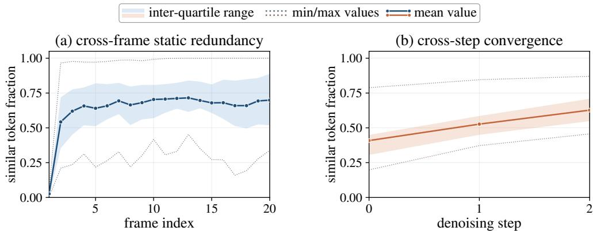  
Figure 1 Token-level redundancy analysis on Self-Forcing.

## Observation: Heterogeneous Token Redundancy

We measure token stability by the cosine similarity between two of its clean latents or estimates, and treat a token as stable when the similarity exceeds a threshold. Under this criterion, we identify two types of redundancy in AR video difusion models, summarized in Figure 1 $( \tau _ { s } = 0 . 9 5 , \tau _ { f } = 0 . 9 9 )$ .

(1) Cross-frame spatial redundancy. Many tokens remain nearly unchanged between adjacent frames,

$$
\cos \bigl ( [ x _ { 0 } ^ { ( i ) } ] _ { j } , [ x _ { 0 } ^ { ( i - 1 ) } ] _ { j } \bigr ) > \tau _ { s } ,\tag{6}
$$

especially in static or slowly changing background regions. Such tokens are largely determined by the historical context and gain little from repeated recomputation.

(2) Cross-step temporal redundancy. During denoising, many tokens yield highly similar clean predictions across consecutive steps,

$$
\cos \bigl ( [ \hat { x } _ { 0 | t _ { k } } ^ { ( i ) } ] _ { j } , [ \hat { x } _ { 0 | t _ { k + 1 } } ^ { ( i ) } ] _ { j } \bigr ) > \tau _ { f } ,\tag{7}
$$

indicating that these tokens have stabilized across steps.

Crucially, this stability is not uniform across tokens, and it emerges early in the trajectory: a substantial fraction of tokens are largely settled after the very first denoising step.

## Online Spatio-Temporal Masking

Motivated by the heterogeneous, early-emerging redundancy observed above, we propose the online pruning pipeline illustrated in Figure 2 and Algorithm 1, which replaces dense execution on the full token set $\bar { \mathcal { T } } ^ { ( i ) }$ with a dynamic active set

$$
S ^ { ( i , k ) } \subseteq \mathbb { Z } ^ { ( i ) } ,\tag{8}
$$

so that only tokens in $S ^ { ( i , k ) }$ are explicitly computed at timestep $k ,$ while other tokens are masked and skipped.

The main dificulty is $\mathrm { t o }$ determine $S ^ { ( i , k ) }$ online. Video-editing methods can derive a reuse pattern in advance from a given reference video [19], but no such reference exists during autoregressive generation, so the pruning mask must be predicted from the model’s own trajectory.

Cross-frame static mask. For frame $i ,$ reference $R ^ { ( i ) }$ is derived from frame i − 1. Each token in $R ^ { ( i ) }$ stores its last-computed clean value: the final clean latent if it completes the denoising schedule, or the clean estimate from its last executed step if frozen early. Thus, $R ^ { ( i ) }$ provides a consistent per-token reference regardless of how many denoising steps each token executes. For each token $j \in \mathcal { T } ^ { ( i ) }$ , we compare its initial clean estimate with the corresponding reference token:

$$
M _ { s } ^ { ( i ) } ( j ) = \mathbb { I } \left[ \cos \left( [ \hat { x } _ { 0 | t _ { 0 } } ^ { ( i ) } ] _ { j } , [ R ^ { ( i ) } ] _ { j } \right) > \tau _ { s } \right] .\tag{9}
$$

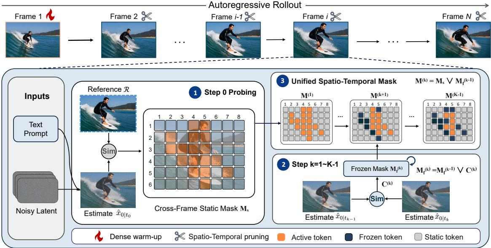  
Figure 2 Overview of PreSTP. After the dense first-frame warm-up, the step-0 clean estimate is compared with the previous-frame reference to predict $M _ { s } .$ . At each later denoising step, consecutive clean estimates identify newly converged tokens $C$ and update $M _ { f }$ . Together, $M _ { s }$ and $M _ { f }$ form the next-step mask $M ,$ which selects active tokens for computation.

Here, $\hat { x } _ { 0 \mid t _ { 0 } } ^ { ( i ) }$ denotes the clean estimate from the first denoising step. In few-step generators, this early estimate is informative enough to serve as a proxy for identifying cross-frame static tokens. $M _ { s } ^ { ( i ) } ( j ) = 1$ indicates that token $j$ can be skipped in subsequent computation. Once constructed, $\boldsymbol { M } _ { s } ^ { ( i ) }$ remains fixed within the current frame.

Cross-step frozen mask. The static mask captures inter-frame redundancy relative to the historical reference, but some non-static tokens also converge before the denoising schedule completes, exhibiting intra-frame redundancy. To exploit this, we maintain a growing frozen mask $M _ { f } ^ { ( i , k ) }$ that records tokens whose clean estimates have stabilized across denoising steps. Since a skipped token produces no new estimate, we evaluate convergence only for tokens that remain active at step k, i.e., those in the keep set $S ^ { ( i , k ) }$ ). For each such token, we compare its clean estimate at step k with that at step $k - 1$ , and indicate whether it has newly converged:

$$
C ^ { ( i , k ) } ( j ) = \mathbb { I } \Bigl [ \cos \Bigl ( [ \hat { x } _ { 0 | t _ { k } } ^ { ( i ) } ] _ { j } , [ \hat { x } _ { 0 | t _ { k - 1 } } ^ { ( i ) } ] _ { j } \Bigr ) > \tau _ { f } \Bigr ] , \qquad j \in S ^ { ( i , k ) } ,\tag{10}
$$

where $\tau _ { f }$ is the freezing threshold and $C ^ { ( i , k ) } ( j ) = 1$ marks a token that has newly converged at step $k ;$ we set $C ^ { ( i , k ) } ( j ) = 0$ for $j \not \in { \bar { S ^ { ( i , k ) } } }$ ). The frozen mask is then the running accumulation of these per-step increments,

$$
M _ { f } ^ { ( i , k ) } = M _ { f } ^ { ( i , k - 1 ) } \vee C ^ { ( i , k ) } , \qquad M _ { f } ^ { ( i , 0 ) } = { \bf 0 } ,\tag{11}
$$

so that once a token is marked as converged it remains frozen for all remaining denoising steps of the same frame.

Unified skip mask and keep set. At denoising step k, we combine the two heterogeneous masks into a unified mask that merges cross-frame redundancy with previously detected cross-step convergence:

$$
{ \cal M } ^ { ( i , k ) } = { \cal M } _ { s } ^ { ( i ) } \vee { \cal M } _ { f } ^ { ( i , k - 1 ) } ,\tag{12}
$$

and define the keep set as the tokens not marked by $M ^ { ( i , k ) }$ ，

$$
S ^ { ( i , k ) } = \left\{ j \in \mathbb { Z } ^ { ( i ) } \mid M ^ { ( i , k ) } ( j ) = 0 \right\} .\tag{13}
$$

Algorithm 1 Predictive Spatio-Temporal Token Pruning   
Require: Initial latents $\{ x _ { t _ { 0 } } ^ { ( i ) } \} _ { i = 1 } ^ { N }$ , condition c, timesteps $\{ t _ { k } \} _ { k = 0 } ^ { K } ,$ thresholds $\tau _ { s } , \tau _ { f } , g ,$ re-anchor period ∆   
1: Generate frame 1 densely; set $\rho _ { 1 } \gets 0$ and initialize $R ^ { ( 2 ) }$ and $\kappa ^ { ( < 2 ) }$   
2: for $i = 2$ to N do   
3: $M _ { f } ^ { ( i , 0 ) } \gets \mathbf { 0 }$   
4: if $\overset { \triangledown } { \boldsymbol { i } } = 2$ or $\rho _ { i - 1 } < g$ or $( i - 2 )$ mod $\Delta = 0$ then   
5: $\boldsymbol { v } _ { \theta } ^ { ( i , 0 ) } , \boldsymbol { \hat { x } } _ { 0 | t _ { 0 } } ^ { ( i ) } \gets \Phi _ { \theta } ( \boldsymbol { x } _ { t _ { 0 } } ^ { ( i ) } , t _ { 0 } , c , \mathcal { K } ^ { ( < i ) } )$   
6: $M _ { s } ^ { ( i ) } ( j )  \mathbb { I } \Big [ \cos \Big ( [ \hat { x } _ { 0 | t _ { 0 } } ^ { ( i ) } ] _ { j } , [ R ^ { ( i ) } ] _ { j } \Big ) > \tau _ { s } \Big ]$   
7: else   
8: $\ddot { M } _ { s } ^ { ( i ) }  M _ { s } ^ { ( i - 1 ) }$   
9: $S ^ { ( \bar { i } , 0 ) } \gets \{ \bar { j } \in \mathbb { Z } ^ { ( i ) } \ | \ M _ { s } ^ { ( i ) } ( j ) = 0 \}$   
10: $v _ { \theta } ^ { ( i , 0 ) } , \hat { x } _ { 0 \mid t _ { 0 } } ^ { ( i ) } \gets \Phi _ { \theta } ( x _ { t _ { 0 } } ^ { ( i ) } , t _ { 0 } , c , K ^ { ( < i ) } ; S ^ { ( i , 0 ) } )$   
11: end if   
12: $x _ { t _ { 1 } } ^ { ( i ) }  x _ { t _ { 0 } } ^ { ( i ) } + ( t _ { 1 } - t _ { 0 } ) v _ { \theta } ^ { ( i , 0 ) }$   
13: for $k = 1$ to $K - 1$ do   
14: $M ^ { ( i , k ) } \gets M _ { s } ^ { ( i ) } \vee M _ { f } ^ { ( i , k - 1 ) }$   
15: $S ^ { ( i , k ) } \gets \{ j \in \mathbb { Z } ^ { ( i ) } \ | \ M ^ { ( i , k ) } ( j ) = 0 \}$   
16: $v _ { \theta } ^ { ( i , k ) } , \hat { x } _ { 0 \mid t _ { k } } ^ { ( i ) } \gets \Phi _ { \theta } ( \dot { x } _ { t _ { k } } ^ { ( i ) } , t _ { k } , c , K ^ { ( < i ) } ; S ^ { ( i , k ) } )$   
17: $C ^ { ( i , k ) } ( j ) \gets \mathbb { I } \Bigl [ \cos \Bigl ( [ \hat { x } _ { 0 | t _ { k } } ^ { ( i ) } ] _ { j } , [ \hat { x } _ { 0 | t _ { k - 1 } } ^ { ( i ) } ] _ { j } \Bigr ) > \tau _ { f } \Bigr ] , \quad j \in S ^ { ( i , k ) }$   
18: $M _ { f } ^ { ( i , k ) } \gets M _ { f } ^ { ( { \bar { i } } , k - 1 ) } \vee C ^ { ( i , k ) }$   
19: $x _ { t _ { k + 1 } } ^ { ( i ) }  x _ { t _ { k } } ^ { ( i ) ^ { \ast } } + ( t _ { k + 1 } - t _ { k } ) v _ { \theta } ^ { ( i , k ) }$   
20: end for   
21: $\rho _ { i } \gets \frac { | M _ { s } ^ { ( i ) } | } { | \mathcal { T } ^ { ( i ) } | }$   
22: R(i+1), K(<i+1) ← UpdateMemory(i)   
23: end for

Only the tokens in $S ^ { ( i , k ) }$ are executed by the transformer at step k; the tokens marked in $M ^ { ( i , k ) }$ are skipped and restored according to the rules introduced in the following subsection.

Restoration and KV-cache consistency. We use $\Phi _ { \theta } ( \cdot ; S )$ to denote evaluation on the active set S followed by restoration to the full token layout. Skipped token outputs and KV-cache entries retain their most recently computed values, while only active cache entries are updated. Further details are provided in the supplementary material.

First-frame dense warm-up. In autoregressive video generation, the first frame serves as the reference anchor for subsequent frames, so early approximation errors can propagate throughout the rollout. Moreover, the cross-frame static mask is defined by the cosine similarity between each frame and its predecessor, and it cannot be computed for the first frame, which has no preceding frame for comparison. We therefore generate the first frame with the original dense computation and restrict predictive token pruning to the subsequent frames. This design naturally handles the boundary at the sequence start and mitigates initial error accumulation, and it aligns with the first-frame enhancement (FFE) principle in ASD [25], which highlights the role of the initial frame in stabilizing long autoregressive generation.

Content-adaptive mask reuse. However, obtaining $M _ { s } ^ { ( i ) }$ requires at least one dense step, which is a nonnegligible probing overhead in few-step generators. We exploit the temporal smoothness of video content: spatial redundancy changes gradually across adjacent frames, so the pattern in frame i−1 is a reliable proxy for that in frame i. This enables static-mask reuse without reconstruction at every frame.

<table><tr><td rowspan="2">Model</td><td rowspan="2">Method</td><td rowspan="2">Latency(s)↓ Speedup↑</td><td rowspan="2"></td><td rowspan="2">Throughput (FPS)↑</td><td rowspan="2">LPIPS↓</td><td rowspan="2">PSNR↑</td><td rowspan="2">SSIM↑</td><td colspan="3">VBench↑</td></tr><tr><td>Quality</td><td>Semantic</td><td>Total</td></tr><tr><td rowspan="4">CausVid</td><td>Vanilla</td><td>7.86</td><td>1.00×</td><td>10.3</td><td></td><td></td><td></td><td>84.02</td><td>78.46</td><td>82.91</td></tr><tr><td>+TeaCache</td><td>6.30</td><td>1.25×</td><td>12.9</td><td>0.286</td><td>15.02</td><td>0.784</td><td>83.79</td><td>78.09</td><td>82.65–0.26</td></tr><tr><td>+FlowCache</td><td>4.97</td><td>1.58×</td><td>16.3</td><td>0.456</td><td>12.28</td><td>0.608</td><td>83.73</td><td>79.36</td><td>82.86-0.05</td></tr><tr><td>+PreSTP</td><td>4.65</td><td>1.69×</td><td>17.4</td><td>0.092</td><td>21.03</td><td>0.934</td><td>83.89</td><td>78.69</td><td>82.85-0.06</td></tr><tr><td rowspan="4">Self-Forcing</td><td>Vanilla</td><td>7.92</td><td>1.00×</td><td>10.2</td><td></td><td></td><td></td><td>84.67</td><td>81.26</td><td>83.99</td></tr><tr><td>+TeaCache</td><td>6.31</td><td>1.26×</td><td>12.8</td><td>0.430</td><td>14.19</td><td>0.691</td><td>84.59</td><td>80.35</td><td>83.74-0.25</td></tr><tr><td>+FlowCache</td><td>6.31</td><td>1.26×</td><td>12.8</td><td>0.428</td><td>14.19</td><td>0.692</td><td>84.61</td><td>80.31</td><td>83.75-0.24</td></tr><tr><td>+PreSTP</td><td>5.21</td><td>1.52×</td><td>15.5</td><td>0.109</td><td>20.64</td><td>0.918</td><td>84.59</td><td>81.27</td><td>83.92–0.07</td></tr><tr><td rowspan="4">AnyFlow</td><td>Vanilla</td><td>26.21</td><td>1.00×</td><td>3.1</td><td></td><td></td><td></td><td>85.63</td><td>80.88</td><td>84.68</td></tr><tr><td>+TeaCache</td><td>24.44</td><td>1.07×</td><td>3.3</td><td>0.354</td><td>14.58</td><td>0.759</td><td>85.32</td><td>80.21</td><td>84.30-0.38</td></tr><tr><td>+FlowCache</td><td>24.41</td><td>1.07×</td><td>3.3</td><td>0.355</td><td>14.58</td><td>0.759</td><td>85.26</td><td>80.16</td><td>84.24–0.44</td></tr><tr><td>+PreSTP</td><td>8.19</td><td>3.20×</td><td>9.9</td><td>0.128</td><td>20.49</td><td>0.929</td><td>85.33</td><td>80.90</td><td>84.44-0.24</td></tr></table>

Table 1 Comparison with relevant baselines on the 5-second video generation task. LPIPS, PSNR, and SSIM are also computed against the dense output. The best results among acceleration methods are in bold.
<table><tr><td rowspan="2">Model</td><td rowspan="2">Method</td><td rowspan="2">Latency(s)↓ Speedup↑</td><td rowspan="2"></td><td rowspan="2">Throughput (FPS)↑</td><td rowspan="2"> $\Delta _ { \mathrm { s a t } } \downarrow$ </td><td colspan="2">LPIPS↓</td><td colspan="3">VBench↑</td></tr><tr><td>Early</td><td>Late</td><td>Quality</td><td>Semantic</td><td>Total</td></tr><tr><td rowspan="4">CausVid</td><td>Vanilla</td><td>60.17</td><td>1.00×</td><td>8.3</td><td>0.097</td><td></td><td></td><td>82.16</td><td>76.76</td><td>81.08</td></tr><tr><td>+TeaCache</td><td>48.32</td><td>1.25×</td><td>10.4</td><td>0.095</td><td>0.308</td><td>0.428</td><td>82.06</td><td>77.44</td><td>81.14+0.06</td></tr><tr><td>+FlowCache</td><td>48.22</td><td>1.25×</td><td>10.4</td><td>0.096</td><td>0.434</td><td>0.524</td><td>82.01</td><td>76.97</td><td>81.00-0.08</td></tr><tr><td>+PreSTP</td><td>30.67</td><td>1.96×</td><td>16.3</td><td>0.051</td><td>0.156</td><td>0.530</td><td>82.18</td><td>78.11</td><td>81.36+0.28</td></tr><tr><td rowspan="4">Self-Forcing</td><td>Vanilla</td><td>60.07</td><td>1.00×</td><td>8.3</td><td>0.118</td><td></td><td></td><td>83.11</td><td>77.01</td><td>81.89</td></tr><tr><td>+TeaCache</td><td>46.63</td><td>1.29×</td><td>10.7</td><td>0.121</td><td>0.454</td><td>0.591</td><td>82.88</td><td>76.98</td><td>81.70-0.19</td></tr><tr><td>+FlowCache</td><td>48.80</td><td>1.23×</td><td>10.3</td><td>0.119</td><td>0.451</td><td>0.587</td><td>82.95</td><td>77.11</td><td>81.78-0.11</td></tr><tr><td>+PreSTP</td><td>40.07</td><td>1.50×</td><td>12.5</td><td>0.102</td><td>0.168</td><td>0.560</td><td>83.04</td><td>78.21</td><td>82.07+0.18</td></tr><tr><td rowspan="4">LongLive</td><td>Vanilla</td><td>53.38</td><td>1.00×</td><td>8.9</td><td>0.021</td><td></td><td></td><td>83.30</td><td>80.54</td><td>82.75</td></tr><tr><td>+TeaCache</td><td>42.91</td><td>1.24×</td><td>11.1</td><td>0.019</td><td>0.410</td><td>0.474</td><td>83.59</td><td>80.50</td><td>82.97 +0.22</td></tr><tr><td>+FlowCache</td><td>47.13</td><td>1.13×</td><td>10.1</td><td>0.021</td><td>0.402</td><td>0.465</td><td>83.57</td><td>80.55</td><td> $8 2 . 9 7 \substack { + 0 . 2 2 }$ </td></tr><tr><td>+PreSTP</td><td>37.13</td><td>1.44×</td><td>12.8</td><td>0.007</td><td>0.127</td><td>0.309</td><td>83.39</td><td>80.95</td><td>82.90+0.15</td></tr></table>

Table 2 Comparison on the 30-second generation evaluated with VBench-Long metrics. $\Delta _ { \mathrm { s a t } }$ denotes the color saturation drift.

We use the cross-frame static-token ratio to gate static-mask reuse,

$$
\rho _ { i } = \frac { \left| M _ { s } ^ { ( i ) } \right| } { \left| \mathcal { T } ^ { ( i ) } \right| } .\tag{14}
$$

If $\rho _ { i - 1 } \geq g$ , frame i inherits the preceding frame’s static mask, $M _ { s } ^ { ( i ) } = M _ { s } ^ { ( i - 1 ) }$ , instead of reconstructing it through dense probing; otherwise, $M _ { s } ^ { ( i ) }$ is reconstructed by the cross-frame static masking procedure above. This gate applies to both multi-step and one-step models. Cross-step convergence contributes to token pruning within each frame but does not enter the reuse gate. To limit drift under prolonged reuse, dense probing is enforced every $\Delta$ frames to refresh the static mask.

This content-adaptive strategy reuses masks in static or slowly varying segments while reconstructing them for dynamic content, reducing probing overhead and limiting stale-mask error accumulation over long autoregressive rollouts. The complete inference procedure, including content-adaptive mask reuse, is summarized in Algorithm 1.

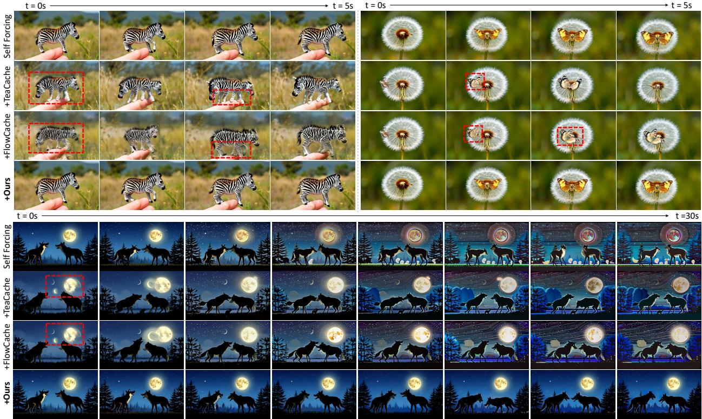  
Figure 3 Qualitative comparison on the 5-second (top two) and 30-second (bottom) generation tasks. Red boxes highlight regions with visible degradation. More qualitative results and video comparisons are provided in the supplementary material.

## 4 Experiments

## Experimental Setup

We evaluate on four distilled few-step AR video difusion models. We adopt CausVid [26] and Self-Forcing [8] as representative models for the common setting. In addition, we include the recent AnyFlow [7] for the 5-second setting, and LongLive [24], a native long-video model, for the 30-second setting. All models share the Wan2.1-1.3B backbone, use 4 denoising steps, and generate at 832 × 480 resolution in a chunk-by-chunk manner. For short-video generation (5s, 81 frames), we adopt VBench [9] to assess visual quality and semantic alignment on the oficial set of 946 prompts, using five random seeds per prompt to reduce sampling variance. For the 30-second setting, we use VBench-Long [10]. To measure fidelity to the base model, we further report LPIPS, PSNR, and SSIM against the original (dense) output, and quantify eficiency by difusion latency and its speedup over the vanilla model. We compare against two representative training-free cache-based methods for AR video difusion, TeaCache [15] and FlowCache [18]. PreSTP usually adopts $\tau _ { s } = 0 . 9 7 , \tau _ { f } = 0 . 9 9 7$ gate threshold $g = 0 . 5 0 \mathrm { { ; } }$ , re-anchor period $\Delta = 3 .$ and a chunk size of 3 frames. Complete parameter setting configurations for PreSTP and both baselines are provided in the supplementary material.

## Main Results

Short-video generation. Table 1 reports the 5-second results. Across all three base models, our method attains the largest speedup, from 1.52× to 3.20×, with the smallest fidelity loss relative to the dense output. The diference lies in the granularity of acceleration. TeaCache and FlowCache cache along the step axis, but distilled models retain little redundancy in denoising steps, so direct step reuse yields limited speedup at a clear cost in fidelity. Token-level pruning instead exploits the spatio-temporal redundancy that persists within each step, giving a substantially better acceleration-fidelity trade-of. On CausVid and Self-Forcing, it keeps VBench score within 0.07 of the dense model and surpasses all baselines on LPIPS, PSNR, and SSIM by a wide margin. AnyFlow benefits the most. It re-encodes the KV cache of all historical frames rather than only the current denoising chunk, which raises its latency to 26.21s and leaves heavy cross-frame redundancy. PreSTP removes this redundancy and reaches 3.20× at only a 0.24 drop in VBench score, whereas step-level caching stays near 1.07× and degrades as its threshold grows, with TeaCache losing 2.48 in VBench score for a mere 1.16× at a threshold of 0.15. Additional experimental settings and all 16 VBench dimensions are provided in the supplementary material.

<table><tr><td>Model</td><td>Method</td><td>Latency(s)↓</td><td>FPS↑</td><td>Speedup↑</td><td>LPIPS↓</td><td>VBench↑</td></tr><tr><td colspan="7">5-second generation</td></tr><tr><td rowspan="2">OF</td><td>Vanilla</td><td>4.75</td><td>17.1</td><td>1.00×</td><td></td><td>84.32</td></tr><tr><td>+PreSTP</td><td>4.00</td><td>20.3</td><td>1.19×</td><td>0.111</td><td>84.13-0.19</td></tr><tr><td rowspan="2">CF++</td><td>Vanilla</td><td>4.30</td><td>18.8</td><td>1.00×</td><td></td><td>83.40</td></tr><tr><td>+PreSTP</td><td>3.68</td><td>22.0</td><td>1.17×</td><td>0.084</td><td>83.28-0.12</td></tr><tr><td colspan="7">30-second generation</td></tr><tr><td rowspan="2">OF</td><td>Vanilla</td><td>40.05</td><td>12.5</td><td>1.00×</td><td></td><td>79.56</td></tr><tr><td>+PreSTP</td><td>32.76</td><td>15.3</td><td>1.22×</td><td>0.155</td><td>79.72 +0.16</td></tr><tr><td rowspan="2">CF++</td><td>Vanilla</td><td>33.07</td><td>15.2</td><td>1.00×</td><td></td><td>76.81</td></tr><tr><td>+PreSTP</td><td>30.04</td><td>16.7</td><td>1.10×</td><td>0.109</td><td>80.02+3.21</td></tr></table>

Table 3 Generalization on one-step AR models. LPIPS is computed against the dense output (early phase for the 30-second setting). OF: One-Forcing; CF++: Causal Forcing++.

Long-video generation. Table 2 reports the 30-second results on VBench-Long. A longer horizon accumulates more error, seen as artifacts and over-saturation, so we measure the saturation drift $\Delta _ { \mathrm { s a t } } = \left| \mathrm { s a t } _ { \mathrm { l a t e } } - \mathrm { s a t } _ { \mathrm { e a r l y } } \right|$ between the late and early phases as a proxy for long-horizon stability. Across all base models, PreSTP reaches the highest speedup, up to 1.96×, at the lowest $\Delta _ { \mathrm { s a t } }$ and the smallest early-phase LPIPS. On CausVid and Self-Forcing, whose dense outputs exhibit substantial long-horizon drift, PreSTP improves VBench scores over dense generation. On Self-Forcing, for example, PreSTP achieves 82.07, compared with 81.89 for the dense model, 81.70 for TeaCache, and 81.78 for FlowCache. LongLive is a native long-video model with an already stable dense output, whose $\Delta _ { \mathrm { s a t } }$ of 0.021 is substantially lower than those of the other models. Even here PreSTP reaches the highest speedup, lowers $\Delta _ { \mathrm { s a t } }$ to 0.007, and raises the semantic score from 80.54 to 80.95. The small early-phase LPIPS shows PreSTP stays close to the original trajectory, while the higher Late LPIPS is less directly informative because the drifted base model no longer ofers a reliable reference. Re-anchoring static tokens to earlier clean frames slows this error accumulation and keeps the long-horizon output stable.

Qualitative comparison. Figure 3 compares our method against the vanilla output and caching baselines on prompts sampled from MovieGen [20]. In the zebra case, the baselines sufer severe structural corruption, including a duplicated head, blurred stripe texture, and an incorrect leg count of five. In the dandelion case, the baselines blur the butterfly in the early frames and distort its wing structure, whereas our method keeps the wings sharp and well-formed. This contrast shows that our pruning preserves both global structure and high-frequency detail, since our first-frame dense warm-up preserves the original denoising trajectory and keeps the output highly faithful to the dense reference. In the 30-second case, the baselines accumulate temporal drift and produce spurious duplicated moons, whereas our method sustains strong subject and background consistency and remains even more stable than the vanilla output under long-horizon drift. This agrees with the lowest $\Delta _ { \mathrm { s a t } }$ in Table 2, confirming PreSTP’s long-horizon color stability.

## Generalization to One-Step AR Models

We further push to the most extreme setting, where the base model performs only a single denoising step. Here the denoising axis collapses and step-wise caching becomes inapplicable. We evaluate two representative one-step AR models, One-Forcing [4] and Causal Forcing++ [28], under both the 5-second and 30-second settings. As shown in Table 3, our method still delivers 1.10× to 1.22× speedups and higher throughput on every model, while preserving or improving VBench scores. Because it also prunes along the cross-frame axis, which does not depend on the number of denoising steps, PreSTP remains efective even when the step dimension collapses to a single step and step-wise caching no longer applies. For Causal Forcing++ at 30 seconds, where the dense model exhibits pronounced long-horizon degradation, re-anchoring static tokens to earlier clean frames even lifts the Total score from 76.81 to 80.02, with complete metrics in the supplementary material, confirming the efectiveness of cross-frame re-anchoring.

## Ablation Study

<table><tr><td>Method</td><td colspan="3">Speedup↑ VBench↑ LPIPS↓ PSNR↑ SSIM↑</td></tr><tr><td>Vanilla</td><td>1.00×</td><td>83.99</td><td></td></tr><tr><td>+ Spatial†</td><td>1.41×</td><td>79.44 0.399</td><td>14.41 0.717</td></tr><tr><td>+ Warm-up</td><td>1.42×</td><td>83.94 0.103</td><td>21.04 0.925</td></tr><tr><td>+ Temporal</td><td>1.44×</td><td>83.90 0.103</td><td>20.99 0.925</td></tr><tr><td>+ Reuse (full)</td><td>1.52×</td><td>83.92 0.109</td><td>20.64 0.918</td></tr></table>

Table 4 Key component ablation on Self-Forcing for 5-second generation. † denotes cross-frame spatial pruning without the first-frame dense warm-up strategy.

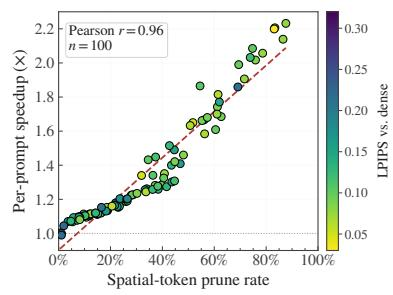  
Figure 4 Content-adaptive acceleration. Perprompt speedup versus cross-frame pruning rate; color denotes LPIPS to dense output.

Key component ablation. Table 4 evaluates each component added sequentially to the dense model on the 5-second task. Cross-frame pruning without first-frame protection reaches 1.41× speedup but severely degrades quality, reducing VBench to 79.44. Restoring the first-frame dense warm-up recovers VBench to 83.94 at nearly the same speedup, confirming its importance for trajectory fidelity at negligible cost. Cross-step pruning further improves speedup at comparable fidelity, showing that the two masks capture complementary token redundancy. Finally, content-adaptive mask reuse gives the full method its highest speedup of 1.52× at only a small drop (−0.07) in VBench score.

Content-adaptive acceleration. Figure 4 analyzes the first 100 MovieGen prompts. The online cross-frame pruning rate ranges from 0 to 88%, yielding per-prompt speedups of $0 . 9 9 \times - 2 . 2 3 \times$ . Motion-intensive prompts remain close to dense execution, whereas spatially redundant content permits larger gains. The strong correlation between pruning rate and speedup $( r = 0 . 9 6 )$ confirms that computation adapts to online redundancy rather than a fixed token budget, while LPIPS remains low across the observed range.

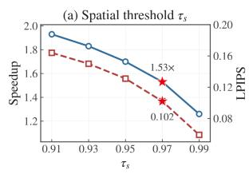

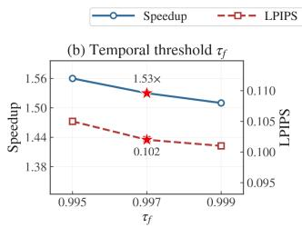

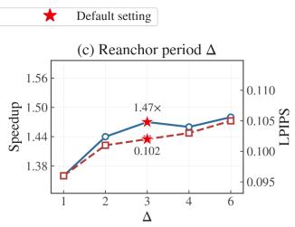

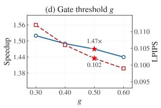  
Figure 5 Hyperparameter sensitivity on Self-Forcing for 5-second generation, conducted on a single seed for eficiency.

Hyperparameter sensitivity. Figure 5 varies each hyperparameter in turn with the others fixed. The spatial threshold $\tau _ { s }$ dominates the speedup-fidelity trade-of, as a lower value prunes more cross-frame tokens and reaches up to 1.93× at the cost of fidelity, while a higher value stays closer to the dense trajectory. The remaining three, the temporal threshold $\tau _ { f } ,$ the reanchor period $\Delta ,$ and the gate threshold $^ { g , }$ only shift the two metrics within a narrow band. All curves change smoothly without sharp clifs, so our method is robust to the exact hyperparameter choice, and the default setting reaches a 1.53× speedup at an LPIPS of 0.102.

## 5 Conclusion

We presented PreSTP, a training-free framework for predictive spatio-temporal token pruning in few-step AR video difusion. PreSTP uses clean estimates along the model’s own denoising trajectory to identify cross-frame static redundancy and cross-step convergence, and combines them into a unified online mask for skipping redundant token computation. Across diverse few-step AR models, PreSTP achieves speedups of up to 3.20× on short-video generation and 1.96× on 30-second generation while maintaining high fidelity to dense outputs. It also improves long-horizon stability and remains efective in one-step models, where step wise caching is inapplicable. These results demonstrate that token-level spatio-temporal redundancy remains exploitable even after few-step distillation has largely removed redundancy along the denoising trajectory.

PreSTP’s acceleration is content-dependent and becomes smaller for motion-intensive videos with limited cross-frame redundancy. In addition, it reduces query-side token computation while attention still operates over the full historical KV context. Future work will improve redundancy prediction for highly dynamic content, jointly optimize token pruning and context compression, and extend evaluation to broader video generation tasks such as image-to-video synthesis.

## References

[1] Guibin Chen, Dixuan Lin, Jiangping Yang, Chunze Lin, Junchen Zhu, Mingyuan Fan, Hao Zhang, Sheng Chen, Zheng Chen, Chengcheng Ma, et al. Skyreels-v2: Infinite-length film generative model. arXiv preprint arXiv:2504.13074, 2025.

[2] Pengtao Chen, Xianfang Zeng, Maosen Zhao, Mingzhu Shen, Peng Ye, Bangyin Xiang, Zhibo Wang, Wei Cheng, Gang Yu, and Tao Chen. Regione: Adaptive region-aware generation for eficient image editing. arXiv preprint arXiv:2510.25590, 2025.

[3] Ernie Chu and Vishal M Patel. Not all tokens need 40 steps: Heterogeneous step allocation in difusion transformers for eficient video generation. arXiv preprint arXiv:2605.06892, 2026.

[4] Jiaqi Feng, Justin Cui, Yuanhao Ban, and Cho-Jui Hsieh. One-forcing: Towards stable one-step autoregressive video generation, 2026. URL https://arxiv.org/abs/2605.23458.

[5] Xiaomeng Fu and Jia Li. Tcfg: Truncated classifier-free guidance for eficient and scalable text-to-image accelera tion. In Proceedings of the IEEE/CVF International Conference on Computer Vision (ICCV), pages 18552–18562, October 2025.

[6] Xiaomeng Fu, Jia Li, Yiming Hu, Yong Wang, Hayden Kwok-Hay So, Jiao Dai, Xiangxiang Chu, and Jizhong Han. Towards memory-eficient autoregressive video generation via instance-specific parametric absorption. arXiv preprint arXiv:2607.00712, 2026.

[7] Yuchao Gu, Guian Fang, Yuxin Jiang, Weijia Mao, Song Han, Han Cai, and Mike Zheng Shou. Anyflow: Any-step video difusion model with on-policy flow map distillation, 2026. URL https://arxiv.org/abs/2605.13724.

[8] Xun Huang, Zhengqi Li, Guande He, Mingyuan Zhou, and Eli Shechtman. Self forcing: Bridging the train-test gap in autoregressive video difusion. Advances in Neural Information Processing Systems, 38:167283–167308, 2025.

[9] Ziqi Huang, Yinan He, Jiashuo Yu, Fan Zhang, Chenyang Si, Yuming Jiang, Yuanhan Zhang, Tianxing Wu, Qingyang Jin, Nattapol Chanpaisit, et al. Vbench: Comprehensive benchmark suite for video generative models. In Proceedings of the IEEE/CVF Conference on Computer Vision and Pattern Recognition, pages 21807–21818, 2024.

[10] Ziqi Huang, Fan Zhang, Xiaojie Xu, Yinan He, Jiashuo Yu, Ziyue Dong, Qianli Ma, Nattapol Chanpaisit, Chenyang Si, Yuming Jiang, et al. Vbench++: Comprehensive and versatile benchmark suite for video generative models. IEEE Transactions on Pattern Analysis and Machine Intelligence, 2025.

[11] Yicheng Ji, Zhizhou Zhong, Jun Zhang, Qin Yang, XiTai Jin, Ying Qin, Wenhan Luo, Shuiyang Mao, Wei Liu, and Huan Li. Forcing-kv: Hybrid kv cache compression for eficient autoregressive video difusion models. arXiv preprint arXiv:2605.09681, 2026.

[12] Jia Li, Xiaomeng Fu, Yizhao Gao, Jiaxu Wang, Xi Wang, and Hayden Kwok-Hay So. Rethinking conditioning in difusion models: Dynamic token scheduling for eficient and aligned text-to-image generation. In Proceedings of the IEEE/CVF Conference on Computer Vision and Pattern Recognition (CVPR) Findings, pages 4160–4169, June 2026.

[13] Jia Li, Xiaomeng Fu, Xurui Peng, Weifeng Chen, Youwei Zheng, Tianyu Zhao, Jiexi Wang, Fangmin Chen, Xing Wang, and Hayden Kwok-Hay So. Train short, inference long: Training-free horizon extension for autoregressive video generation. arXiv preprint arXiv:2602.14027, 2026.

[14] Jia Li, Xurui Peng, Haowei Zhu, Tianyu Zhao, Jiexi Wang, Youwei Zheng, Yuxi Ren, Xinglong Wu, Xing Wang, and Hayden Kwok-Hay So. Tritd: Tri-partite trajectory-distribution distillation for real-time autoregressive video generation. arXiv preprint arXiv:2610.26165, 2026.

[15] Feng Liu, Shiwei Zhang, Xiaofeng Wang, Yujie Wei, Haonan Qiu, Yuzhong Zhao, Yingya Zhang, Qixiang Ye, and Fang Wan. Timestep embedding tells: It’s time to cache for video difusion model. In Proceedings of the Computer Vision and Pattern Recognition Conference, pages 7353–7363, 2025.

[16] Haosong Liu, Yuge Cheng, Wenxuan Miao, Zihan Liu, Aiyue Chen, Jing Lin, Yiwu Yao, Chen Chen, Jingwen Leng, Yu Feng, et al. Astraea: A token-wise acceleration framework for video difusion transformers. arXiv preprint arXiv:2506.05096, 2025.

[17] Zhengyao Lyu, Chenyang Si, Junhao Song, Zhenyu Yang, Yu Qiao, Ziwei Liu, and Kwan-Yee K Wong. Fastercache: Training-free video difusion model acceleration with high quality. In International Conference on Learning Representations, volume 2025, pages 33132–33156, 2025.

[18] Yuexiao Ma, Xuzhe Zheng, Jing Xu, Xiwei Xu, Feng Ling, Xiawu Zheng, Huafeng Kuang, Huixia Li, Xing Wang, Xuefeng Xiao, et al. Flow caching for autoregressive video generation. arXiv preprint arXiv:2602.10825, 2026.

[19] Dennis Menn, Yuedong Yang, Bokun Wang, Xiwen Wei, Mustafa Munir, Feng Liang, Radu Marculescu, Chenfeng Xu, and Diana Marculescu. Video compression meets video generation: Latent inter-frame pruning with attention recovery. arXiv preprint arXiv:2603.05811, 2026.

[20] Adam Polyak, Amit Zohar, Andrew Brown, Andros Tjandra, Animesh Sinha, Ann Lee, Apoorv Vyas, Bowen Shi, Chih-Yao Ma, Ching-Yao Chuang, et al. Movie gen: A cast of media foundation models. arXiv preprint arXiv:2410.13720, 2024.

[21] Ariel Shaulov, Eitan Shaar, Amit Edenzon, and Lior Wolf. Tokentrim: Inference-time token pruning for autoregressive long video generation. arXiv preprint arXiv:2602.00268, 2026.

[22] Hansi Teng, Hongyu Jia, Lei Sun, Lingzhi Li, Maolin Li, Mingqiu Tang, Shuai Han, Tianning Zhang, WQ Zhang, Weifeng Luo, et al. Magi-1: Autoregressive video generation at scale. arXiv preprint arXiv:2505.13211, 2025.

[23] Jing Xu, Yuexiao Ma, Songwei Liu, Xuzhe Zheng, Shiwei Liu, Chenqian Yan, Xiawu Zheng, Rongrong Ji, Fei Chao, and Xing Wang. Motion-aware caching for eficient autoregressive video generation. arXiv preprint arXiv:2605.01725, 2026.

[24] Shuai Yang, Wei Huang, Ruihang Chu, Yicheng Xiao, Yuyang Zhao, Xianbang Wang, Muyang Li, Enze Xie, Ying cong Chen, Yao Lu, et al. Longlive: Real-time interactive long video generation. arXiv preprint arXiv:2509.22622, 2025.

[25] Yongqi Yang, Huayang Huang, Xu Peng, Xiaobin Hu, Donghao Luo, Jiangning Zhang, Chengjie Wang, and Yu Wu. Towards one-step causal video generation via adversarial self-distillation. arXiv preprint arXiv:2511.01419, 2025.

[26] Tianwei Yin, Qiang Zhang, Richard Zhang, William T Freeman, Fredo Durand, Eli Shechtman, and Xun Huang. From slow bidirectional to fast autoregressive video difusion models. In Proceedings of the IEEE/CVF Conference on Computer Vision and Pattern Recognition, pages 22963–22974, 2025.

[27] Yuechen Zhang, Jinbo Xing, Bin Xia, Shaoteng Liu, Bohao Peng, Xin Tao, Pengfei Wan, Eric Lo, and Jiaya Jia. Training-free eficient video generation via dynamic token carving. Advances in Neural Information Processing Systems, 38:90947–90980, 2025.

[28] Min Zhao, Hongzhou Zhu, Kaiwen Zheng, Zihan Zhou, Bokai Yan, Xinyuan Li, Xiao Yang, Chongxuan Li, and Jun Zhu. Causal forcing++: Scalable few-step autoregressive difusion distillation for real-time interactive video generation, 2026. URL https://arxiv.org/abs/2605.15141.

## Appendix

This supplementary material provides implementation details and additional experimental results supporting the main paper. Section A describes the evaluation protocol and model-specific operating points. Section B de tails last-computed-value restoration and KV-cache consistency. Sections C–F report dimension-level VBench scores, extended one-step results, hyperparameter analyses, and long-horizon stability. The final figures pro vide additional qualitative comparisons. We use the notation defined in the main paper.

## A Implementation and Evaluation Details

## A.1 Evaluation Protocol

We report difusion latency, excluding prompt encoding, model loading, video decoding, and metric evaluation. For generated videos indexed by n, global throughput speedup is computed as

$$
{ \mathrm { S p e e d u p } } = { \frac { \sum _ { n } T _ { n } ^ { \mathrm { d e n s e } } } { \sum _ { n } T _ { n } ^ { \mathrm { m e t h o d } } } } .\tag{15}
$$

This dataset-level ratio, used throughout the main paper, difers from the mean of per-video speedup ratios. For 5-second generation, we evaluate on the oficial VBench set of 946 prompts using five random seeds per prompt to reduce sampling variance. For 30-second generation, we follow the VBench-Long protocol. LPIPS, PSNR, and SSIM measure fidelity to the dense output generated from the same prompt and random seed.

## A.2 Method and Baseline Settings

Table 5 lists the PreSTP operating points used in the reported experiments. CausVid and Self-Forcing use the common four-step setting $( \tau _ { s } , \tau _ { f } , g , \Delta ) = ( 0 . 9 7 , 0 . 9 9 7 , 0 . 5 0 , 3 )$ . AnyFlow and LongLive use diferent similarity thresholds, as listed in Table 5. All four-step experiments use chunks of three frames. For one-step models, cross-step convergence is unavailable and the corresponding mask is disabled. For both multi-step and onestep models, the reuse gate uses the preceding frame’s cross-frame static-token ratio, with periodic dense probing to refresh the static mask.

CausVid and Self-Forcing restore skipped positions with their last-computed clean values. For AnyFlow-FAR, the 5-second PreSTP configuration disables historical KV-cache compression and follows the incremental cache-update strategy of Self-Forcing. Each update encodes only the newly generated chunk while retaining previously cached KV states, avoiding repeated encoding of historical frames. LongLive uses its block-uniform long-video variant. The first generated frame is computed densely for both one-step models.

Table 6 records the baseline thresholds that define the operating points reported in the main paper. TeaCache and FlowCache are applied without retraining. Their operating points are selected for each model and duration because the scale of the cache criterion difers across implementations.

## B Restoration and KV-Cache Update

This section provides further details on the restoration and cache-consistency rule summarized in the main paper. Given the keep set $S ^ { ( i , k ) }$ , a pruned forward pass executes the transformer only on selected tokens, while the denoising solver still requires a complete token tensor after each step. For every token, we maintain $l ^ { ( i , k ) }$ , its most recent value produced by an actual transformer computation. The complete output at step k is

$$
[ y ^ { ( i , k ) } ] _ { j } = \left\{ \begin{array} { l l } { \left[ \Phi _ { \theta } ( x _ { t _ { k } } ^ { ( i ) } , t _ { k } , c , K ^ { ( < i ) } ; S ^ { ( i , k ) } ) \right] _ { j } , } & { j \in S ^ { ( i , k ) } , } \\ { [ l ^ { ( i , k - 1 ) } ] _ { j } , } & { j \notin S ^ { ( i , k ) } , } \end{array} \right.\tag{16}
$$

and the last-computed bufer is updated only for tokens that are actually computed,

$$
[ l ^ { ( i , k ) } ] _ { j } = \left\{ { \begin{array} { l l } { [ y ^ { ( i , k ) } ] _ { j } , } & { j \in S ^ { ( i , k ) } , } \\ { [ l ^ { ( i , k - 1 ) } ] _ { j } , } & { j \notin S ^ { ( i , k ) } . } \end{array} } \right.\tag{17}
$$

<table><tr><td>Model</td><td>Dur. Steps</td><td></td><td> $\tau _ { s }$ </td><td>Tf</td><td>g</td><td> $\Delta$ </td></tr><tr><td>CausVid</td><td>5/30s</td><td>4</td><td>0.97</td><td>0.997</td><td>0.50</td><td>3</td></tr><tr><td>Self-Forcing</td><td>5/30s</td><td>4</td><td>0.97</td><td>0.997</td><td>0.50</td><td>3</td></tr><tr><td>AnyFlow</td><td>5 s</td><td>4</td><td>0.999</td><td>0.9995</td><td>0.40</td><td>2</td></tr><tr><td>LongLive</td><td>30 s</td><td>4</td><td>0.95</td><td>0.995</td><td>default default</td><td></td></tr><tr><td>One-Forcing</td><td>5/30s</td><td>1</td><td>0.985</td><td></td><td>0.50</td><td>3</td></tr><tr><td>Causal Forcing++ 5/30s</td><td></td><td>1</td><td>0.98</td><td></td><td>0.50</td><td>3</td></tr></table>

Table 5 Model-specific PreSTP operating points used in the reported experiments. A dash indicates that cross-step convergence is unavailable for one-step models; “default” denotes the native LongLive setting.
<table><tr><td>Base model Duration</td><td></td><td>TeaCache τ FlowCache τ</td></tr><tr><td>Self-Forcing</td><td>5 s</td><td>0.103 0.30</td></tr><tr><td>Self-Forcing</td><td>30 s</td><td>0.103 0.15</td></tr><tr><td>CausVid</td><td>5 s</td><td>0.08 0.40</td></tr><tr><td>CausVid</td><td>30 s</td><td>0.08 0.15</td></tr><tr><td>AnyFlow</td><td>5 s</td><td>0.103 0.30</td></tr><tr><td>LongLive</td><td>30 s</td><td>0.103 0.15</td></tr></table>

Table 6 Model- and duration-specific operating points of TeaCache and FlowCache used for the comparisons reported in the main paper.
<table><tr><td>Model</td><td></td><td></td><td>Method Subj. Cons. Back. Cons. Flicker Motion</td><td></td><td></td><td></td><td>Dynamic Aesthetic Imaging Quality</td><td></td><td></td></tr><tr><td rowspan="2">Self-Forcing</td><td>Dense</td><td>95.74</td><td>96.35</td><td>99.13</td><td>98.37</td><td>64.72</td><td>65.81</td><td>69.16</td><td>84.67</td></tr><tr><td>PreSTP</td><td>95.70</td><td>96.45</td><td>99.32</td><td>98.37</td><td>62.50</td><td>65.71</td><td>69.23</td><td>84.59</td></tr><tr><td rowspan="2">CausVid</td><td>Dense</td><td>96.61</td><td>96.24</td><td>99.46</td><td>98.16</td><td>58.33</td><td>64.87</td><td>68.07</td><td>84.02</td></tr><tr><td>PreSTP</td><td>96.78</td><td>96.46</td><td>99.52</td><td>98.20</td><td>55.56</td><td>64.50</td><td>68.18</td><td>83.89</td></tr></table>

Table 7 Complete VBench quality-dimension scores for 5-second generation on Self-Forcing and CausVid.
<table><tr><td>Model</td><td>Method</td><td>Object</td><td>Multiple</td><td>Action</td><td>Color</td><td>Spatial</td><td>Scene</td><td>Appearance</td><td>Temp. Style</td><td>Overall</td><td>Semantic</td><td>Total</td></tr><tr><td rowspan="2">Self-Forcing</td><td>Dense</td><td>94.68</td><td>87.56</td><td>96.40</td><td>87.17</td><td>82.55</td><td>57.75</td><td>20.49</td><td>24.46</td><td>26.89</td><td>81.26</td><td>83.99</td></tr><tr><td>PreSTP</td><td>94.56</td><td>87.10</td><td>96.60</td><td>87.77</td><td>82.22</td><td>57.82</td><td>20.47</td><td>24.50</td><td>26.90</td><td>81.27</td><td>83.92</td></tr><tr><td rowspan="2">CausVid</td><td>Dense</td><td>93.04</td><td>85.64</td><td>96.20</td><td>86.65</td><td>73.36</td><td>52.56</td><td>20.21</td><td>23.82</td><td>25.91</td><td>78.46</td><td>82.91</td></tr><tr><td>PreSTP</td><td>92.97</td><td>86.27</td><td>96.00</td><td>86.98</td><td>74.64</td><td>52.67</td><td>20.10</td><td>23.84</td><td>26.03</td><td>78.69</td><td>82.85</td></tr></table>

Table 8 Complete VBench semantic-dimension scores for 5-second generation on Self-Forcing and CausVid. “Overall” denotes overall consistency; Semantic and Total are aggregate scores.
<table><tr><td>Model</td><td>Method</td><td>Latency</td><td>Speedup</td><td>Quality</td><td>Semantic</td><td>Total</td><td> $\mathrm { L P I P S _ { e a r l y } }$ </td><td> $\mathrm { L P I P S _ { l a t e } }$ </td><td> $\Delta _ { \mathrm { s a t } }$ </td></tr><tr><td rowspan="2">One-Forcing</td><td>Dense</td><td>40.05</td><td>1.00×</td><td>81.79</td><td>70.63</td><td>79.56</td><td></td><td></td><td>0.085</td></tr><tr><td>PreSTP</td><td>32.76</td><td>1.22×</td><td>81.38</td><td>73.08</td><td>79.72</td><td>0.155</td><td>0.498</td><td>0.064</td></tr><tr><td rowspan="2">Causal Forcing++</td><td>Dense</td><td>33.07</td><td>1.00×</td><td>79.12</td><td>67.59</td><td>76.81</td><td></td><td></td><td>0.096</td></tr><tr><td>PreSTP</td><td>30.04</td><td>1.10×</td><td>81.05</td><td>75.92</td><td>80.02</td><td>0.109</td><td>0.682</td><td>0.110</td></tr></table>

Table 9 Complete 30-second results on one-step AR video difusion models. Latency is measured in seconds, VBench-Long scores use the 0–100 scale, and $\Delta _ { \mathrm { s a t } }$ measures long-horizon saturation drift.

Thus, tokens skipped by either the cross-frame static mask or the cross-step frozen mask follow the same restoration rule.

Each pruned transformer pass follows a gather–compute–scatter procedure. Tokens in $S ^ { ( i , k ) }$ are gathered for

<table><tr><td colspan="4">Parameter Value Latency Speedup LPIPS VBench</td></tr><tr><td rowspan="4">0.91 Ts</td><td>3.94</td><td>1.93× 0.164</td><td>83.18</td></tr><tr><td>0.93 4.16</td><td>1.83× 0.150</td><td>83.31</td></tr><tr><td>0.95 4.49</td><td>1.70× 0.131</td><td>83.45</td></tr><tr><td>0.97 4.99 0.99 6.03</td><td>1.53× 0.102 1.26× 0.059</td><td>83.63 83.63</td></tr><tr><td rowspan="5"> $\tau _ { f }$ </td><td>0.995 4.90</td><td>1.56×</td><td>0.105 83.70</td></tr><tr><td>0.997 4.99</td><td>1.53×</td><td>0.102 83.63</td></tr><tr><td>0.999 5.05</td><td>1.51×</td><td>0.101 83.57</td></tr><tr><td></td><td></td><td></td></tr></table>

Table 10 Threshold sensitivity on Self-Forcing for 5- second generation. Latency is measured in seconds, and all parameters other than the one being varied remain fixed at the selected setting.

<table><tr><td colspan="5">Parameter Value Latency Speedup LPIPS VBench</td></tr><tr><td rowspan="5"> $\Delta$ </td><td>1 5.83</td><td>1.36×</td><td>0.096</td><td>83.70</td></tr><tr><td>2</td><td>5.49</td><td>1.44× 0.101</td><td>83.64</td></tr><tr><td>3</td><td>5.39</td><td>1.47× 0.102</td><td>83.64</td></tr><tr><td>4</td><td>5.42</td><td>1.46× 0.103</td><td>83.62</td></tr><tr><td>6</td><td>5.35</td><td>1.48× 0.105</td><td>83.59</td></tr><tr><td rowspan="4">g</td><td>0.30</td><td>5.23</td><td>1.52×</td><td>0.112 83.45</td></tr><tr><td>0.40</td><td>5.31</td><td>1.49× 0.106</td><td>83.58</td></tr><tr><td>0.50</td><td>5.39</td><td>1.47× 0.102</td><td>83.64</td></tr><tr><td>0.60</td><td>5.50 1.44×</td><td>0.099</td><td>83.70</td></tr></table>

Table 11 Mask-reuse sensitivity on Self-Forcing for 5-second generation, measured in a separate runtime environment with a dense-reference latency of 7.94 s. Speedups are relative to this dense reference.

computation, and their outputs and KV states are written back to the original spatial positions. Outputs and cache entries for skipped tokens remain unchanged.

## C Full VBench Dimension Breakdown

Tables 7 and 8 report all 16 oficial VBench dimensions and their aggregate scores for the two common fourstep base models. All scores are reported on the 0–100 scale. PreSTP changes the Total score by only −0.07 on Self-Forcing and −0.06 on CausVid, and most individual dimensions remain close to the dense results. The most pronounced and consistent change occurs in dynamic degree, which decreases from 64.72 to 62.50 on Self-Forcing and from 58.33 to 55.56 on CausVid. This behavior is consistent with static-token reuse slightly reducing measured motion, while temporal consistency, appearance, and semantic alignment remain largely preserved.

## D Complete Results on One-Step Models

Table 9 reports the complete 30-second metrics for the one-step experiments reported in the main paper. Early and late LPIPS are computed over the first and final quarters of each generated video, respectively. PreSTP reduces latency on both models. On Causal Forcing++, PreSTP increases the VBench-Long Total score from 76.81 to 80.02, with a 1.10× speedup.

Over all frames, PreSTP obtains LPIPS, PSNR, and SSIM scores of 0.337, 13.75, and 0.752 on One-Forcing, and 0.481, 11.54, and 0.570 on Causal Forcing++. Since the dense reference can itself drift over long rollouts, these fidelity scores should be considered alongside early LPIPS and VBench-Long: the former measures agreement with the dense output in the first quarter of the video, while the latter evaluates overall generation quality.

## E Detailed Hyperparameter Analysis

The main paper reports one-at-a-time hyperparameter sensitivity curves. Tables 10 and 11 provide the corresponding numerical results. For eficiency, each setting is evaluated using one seed per prompt on the oficial VBench set. The threshold experiments in Table 10 and the mask-reuse experiments in Table 11 use diferent runtime environments, with dense-reference latencies of 7.62 s and 7.94 s, respectively. Each speedup is computed against the dense reference in the same environment; absolute latencies are not directly comparable across the two groups or with the main results. The spatial threshold $\tau _ { s }$ provides the primary control over the speed–fidelity trade-of: lowering it marks more cross-frame tokens as redundant and therefore increases both pruning and deviation from the dense trajectory. Over the tested ranges, varying $\tau _ { f }$ , g, or $\Delta$ has a smaller efect on speedup and LPIPS than varying $\tau _ { s }$

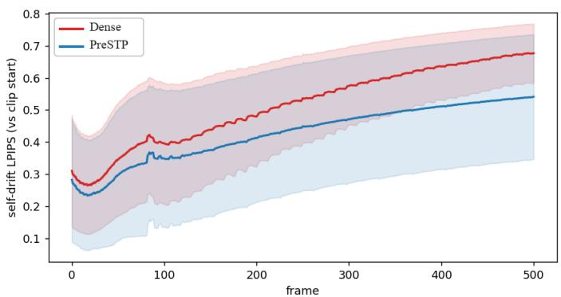  
Figure 6 Long-horizon self-drift on Self-Forcing. LPIPS relative to the beginning of each video, averaged over the evaluation set. Each curve shows the mean with one standard deviation.

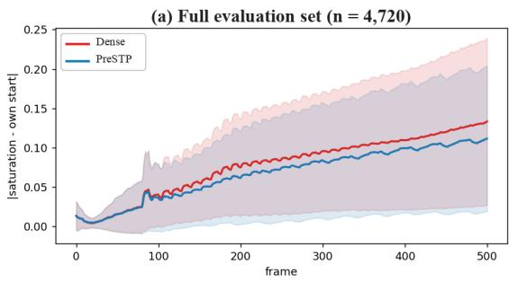

(b) High-redundancy subset  
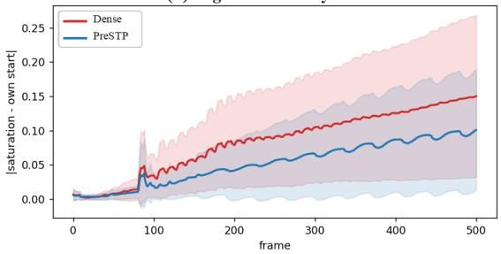  
Figure 7 Long-horizon saturation stability on Self-Forcing. Saturation deviation from the beginning of each video over the complete evaluation set (left) and the high-redundancy subset (right). Each curve shows the mean with one standard deviation.

## F Long-Horizon Stability

We further analyze long-horizon redundancy, acceleration, and temporal drift on Self-Forcing. Unlike paired fidelity metrics, the following diagnostics do not assume that the dense trajectory remains stable throughout the rollout.

Self-drift. Figure 6 measures how far each generated frame departs from the initial visual content as the autoregressive rollout progresses. Both methods accumulate drift over time, but PreSTP remains consistently below the dense model, with the gap becoming more pronounced later in the video. This result indicates that reusing stable content does not amplify long-horizon errors and can instead reduce their accumulation.

Saturation drift. Figure 7 separately evaluates long-horizon color stability. PreSTP exhibits lower saturation deviation over the complete set, and the reduction is substantially larger for videos with high spatial redundancy. In this regime, periodic re-anchoring prevents repeatedly reused static regions from inheriting the accumulated color shift of later dense frames. This analysis complements VBench-Long by measuring temporal stability without treating a potentially drifted dense output as the reference.

Figure 8 illustrates the same behavior qualitatively. Although the dense rollout progressively changes the background color and appearance, PreSTP retains a stable blue sky and consistent subject throughout the 30-second sequence. The example also shows why static content provides the largest acceleration opportunity: its high cross-frame redundancy supports aggressive pruning without sacrificing long-horizon consistency.

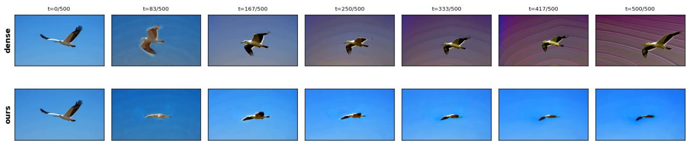  
Figure 8 Long-horizon qualitative comparison. The largely static scene permits aggressive adaptive pruning. PreSTP preserves the blue-sky background and subject appearance, whereas the dense trajectory develops substantial color drift. Columns show corresponding rollout timestamps.

## G Additional Qualitative Comparisons

Figures 9 and 10 compare dense generation, TeaCache, FlowCache, and PreSTP on six additional 5-second examples from Self-Forcing. Each comparison uses matched prompts and sampling conditions across methods.

In Figure 9, the caching baselines introduce visible structural artifacts, including distortions of the dog’s face and deformed facial features of both the red panda and the person holding it. The guitar scene also exhibits blurred hand structure, while the wedding sequence shows altered human poses. In the displayed frames, PreSTP better preserves facial structure and hand details.

In Figure 10, TeaCache and FlowCache exhibit distorted human heads in the balloon scene, malformed paintbrushes in the oil-painting scene, and blurred or distorted hummingbird wings. These artifacts afect the structure of people and objects, beyond changes in scene composition. PreSTP shows fewer such distortions and preserves clearer local details in the displayed frames.

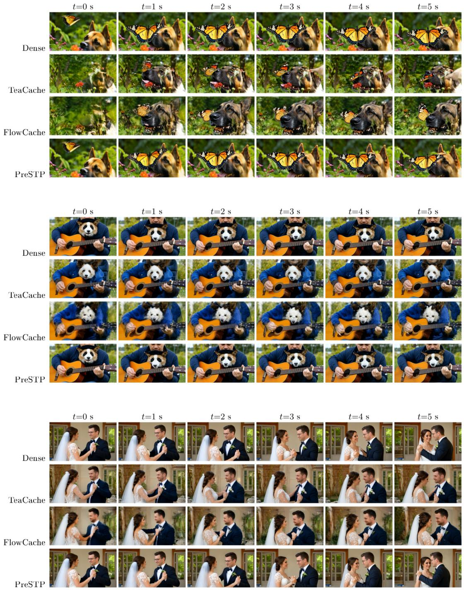  
Figure 9 Additional 5-second qualitative comparisons on Self-Forcing. From top to bottom: a butterfly approaching a dog, a red panda sitting in a person’s lap as the person plays a guitar, and a wedding interaction.

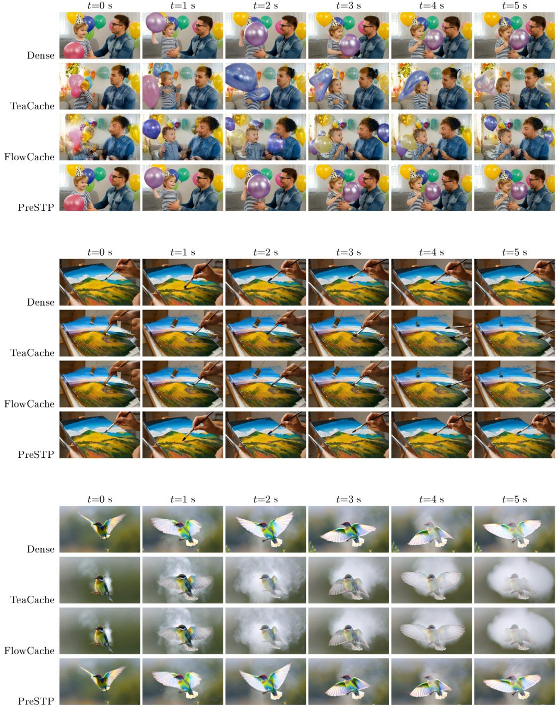  
Figure 10 Additional comparisons across diverse visual content. From top to bottom: a parent and child playing with balloons, a person creating an oil painting with a brush, and a hummingbird in flight.