# USB Gym: A Gymnasium Testbed for Closed-Loop Ultrasound View Matching

Thanapong Intharah<sup>a,∗</sup>, Zhichao Gao<sup>b</sup>, Yiliang Liu<sup>b</sup>, Hao Dong<sup>b</sup>

<sup>a</sup>Visual Intelligence Laboratory, Department ofStatistics, Faculty ofScience, Khon Kaen University, Khon Kaen 40002, Thailand <sup>b</sup>School of Computer Science, Peking University, Beijing 100871, China

## Abstract

Background and Objective: Our main goal is ultrasound guidance: moving a probe until its image matches a target view. Published methods for each part of a guide are evaluated in separate simulators. We asked whether these methods, combined into one guide, are good enough.

Methods: We built USB Gym, a testbed whose standard engine simulates ultrasound from public patient CT, with a network drawing organ textures from CT labels. Its guide has three replaceable parts (slots), an organ segmenter, a controller and a reward, which received 20 published methods, each run on the same 60 episodes of six held-ou patients. In each slot, a published method replaced ours only if detectably better on these patients. The better of this combination and our original guide on 20 new CTs is the benchmark baseline. A pose oracle, reading the exact probe pose available only in simulation, set the reference. The results below are exploratory.

Results: On these CTs, the probe started on average 16.0 mm from the target view; the pose oracle brought it to 1.5 mm. Of the results known when the combination was fixed, only an image-similarity reward (SSIM) was slightly but detectably better, so the combination was our guide with that reward. This combination was the benchmark baseline, ending at 13.7 mm (16% of the oracle’s progress).

Conclusions: Combining untuned published methods with ours did not guide the probe near the target view; the task remains under-explored. The testbed accepts new methods; no guide was tested on hardware.

Keywords: Ultrasound simulation, Robotic ultrasound, Reinforcement learning, Medical image segmentation, Visual servoing, Benchmarking

## 1. Introduction

Our main goal is ultrasound guidance for view matching: a closed loop that moves a probe until its image matches a target view. Such a guide combines several parts, among them a probe-navigation policy, an ultrasound segmenter and, in simulation, a B-mode renderer, but the groups that propose them rarely share a closed loop in which to compare them [1]. Without a shared loop, their errors on view matching share no scale.

To the best of our knowledge, no public testbed lets published methods replace any of several loop components and be evaluated against a privileged oracle ladder on identical episodes. We therefore asked whether existing pub lished components, combined into one guide, are good enough for this task, and built a testbed into which research components plug and are scored. Here, a guide is good enough, and solves the task, if it ends as close to the target as the privileged pose oracle without privileged input at run time; we report how far each pipeline remains from it.

USB Gym (UltraSound B-mode Gym) is that testbed, built on Gymnasium [2] and patient CT [3]. Its standard simulation engine renders patient CT with a physics renderer and the SonoSPADE texture stage, and its guide has three plug slots: mask source, controller and reward (Fig. 1, Table 2). We plugged 20 published methods into the guide’s slots, each in place of its slot’s reference component, on that component’s 60 held-out episodes; seven more, in the engine’s three slots, are in Appendix B. An oracle ladder runs from a pose oracle, which reads privileged simulator state that no physical rig provides, down to a static probe (Section 5.2). SonoSPADE [4], our published method, is the engine’s texture stage, unchanged and retrained once.

Here, existing published components, untuned, do not close the gap to the pose oracle, whether plugged one slot at a time or combined with our published pipeline [5] (Section 7.4). From a 16.0 mm start on six held-out patients, the pose oracle ends at 1.5 mm, but the CT-mask servo, steering by the CT’s true organ masks (privileged CT masks), ends at 11.6 to 11.8 mm. No published controller in place of ours, given the same input, ends detectably closer (exploratory). Steering by a segmenter’s masks, the learned-mask servo ends above the start with the ladder’s three other texture settings. With SonoSPADE, the standard stage and the only one reading the CT label, it ends at 13.1 mm, 3.4 to 3.8 mm closer than with any of them.

Only the pre-specified analyses of the reference pipeline and of real frames are primary; every other result, including the comparison of published methods, is exploratory (Section 5.4). All closed-loop results come from simulation with rigid tissue, never from a probe, phantom or robot, and we make no claim about clinical usability.

The contributions are:

1. A closed-loop testbed on patient CT (Sections 3 to 6), with privileged state kept out of the policy’s observation.

2. A slot-by-slot reference set for the guide (Section 7): every method’s error on the standard engine, paired with its slot’s reference component.

3. Controls and replication (Section 8): a positive control, label-input controls, an ofline real-frame score and two replication cohorts in simulation.

4. A benchmark baseline (Box 1; Section 7.4): to test the testbed, slot components chosen on six held-out patients are combined and tested on 20 new CTs (exploratory). On the standard engine, it is that combination, 13.70 mm from the target (pose oracle 1.47 mm; conditional on this renderer).

## 2. Related work

Ultrasound simulation. Ultrasound simulators turn labeled anatomy into B-mode frames for a probe pose, from CT on a GPU [6], by convolutional ray tracing of a labeled CT volume [7] or by simulating the acoustic field, as Field II [8], k-Wave [9] and SIMUS [10, 11] do; they leave the closed loop to the user. USB Gym’s renderer slot runs SIMUS and the original code of LOTUS, which learns such a ray model jointly with a segmentation task [12] (Appendix B.5).

Learned texture. Learned texture stages move simulated frames toward real-scan appearance, and USB Gym’s texture slot accepts one. CACTUSS translates real B-mode images into an intermediate representation rendered from CT labels [13]. Vitale et al. added CycleGAN texture to ray-traced abdominal simulations [14, 15], and SonoSPADE, from our group, conditions texture on a tissue label map [16, 4].

Learning probe navigation. Learned probe-navigation methods, reviewed in two surveys [1, 17], are each trained and evaluated in their own environment. Some learn from recorded scans: Droste et al. predicted probe motions ofline from 464 tracked clinical scans [18], and Li et al. steered a virtual probe through 41 reconstructed spine volumes, rewarded by its distance to a goal pose [19]. Others train on simulated images: Amadou et al. trained goal conditioned agents on images path-traced ofline from 929 patient CTs [20]. Hu et al. trained a deep Q-network on CT reslices synthesized into ultrasound by Field II, CycleGAN or U-GAT-IT [21], and their later agent, rewarded by CT labels, reached 75.8% success on a phantom and 74.0% on a cadaver [22]. Han et al. imitated a virtual expert that reads the true pose, in a ray-casting simulator with a CUT texture stage on MRI label maps [23]. Qian et al. compared nine image generators behind one SAC policy [24]; one of their policies, trained only in simulation, succeeded in 390 of 400 zero-shot deployments on a robot over a phantom. As of October 2026, we found no runnable environment released with these seven method papers.

Visual servoing. Ultrasound visual servoing maps image features to probe velocity: Mebarki et al. controlled six degrees of freedom from organ image moments [25], and Krupa et al. used speckle to stabilize a B-mode view against tissue motion [26]. USB Gym’s reference controller starts from such a map: its servo base, an image servo, fits the map by least squares rather than deriving it (Box 1).

Runnable testbeds. Simulation testbeds let robot-learning groups evaluate methods in one fixed environment. Table 1 lists the ultrasound environments that a researcher can run and plug a method into. Hase et al. released a Gym environment and its data, frames recorded from 34 volunteers [27]. VesNet-RL released an environment of simulated binary vessel images [28]. Its agent segments real images into such masks before acting. SonoGym brings such testbeds to robotic ultrasound on NVIDIA Isaac Lab, with orthopedic navigation, bone-surface reconstruction and spinal surgery tasks [29, 30], and renders CT anatomy by ray tracing or with the paired translator pix2pix [29, 31]. NVIDIA’s Isaac for Healthcare adds ultrasound robot workflows and a ray-traced ultrasound sensor on Isaac Sim [32]. USB Gym builds on Gym, Gymnasium and MuJoCo [33, 2, 34], and its privileged channel lets an imitation teacher see state that the policy cannot, as in Learning by Cheating [35].

Table 1: Runnable ultrasound navigation environments by publication year, as each source states them in October 2026. Privileged state: simulator state that a physical rig lacks, used by a reward, a teacher or the evaluation. <sup>†</sup>Privileged structure: the contact plane through the target window face and the start lift onto it (Section 3.3). Components swapped: parts swapped between runs, with the number of published methods run in them.
<table><tr><td>Environment</td><td>Image source</td><td>Closed loop</td><td>Components swapped (published methods)</td><td>Privileged state used</td><td>Robot or phantom test</td></tr><tr><td>Hase et al., 2020 [27]</td><td>Recorded frames of 34 volunteers on a grid</td><td>Yes, over the grid</td><td>Policy: the authors&#x27; DQN variants</td><td>Grid position, in the reward</td><td>None reported</td></tr><tr><td>VesNet-RL, 2022 [28]</td><td>Simulated binary vessel images</td><td>Yes, in simulation</td><td>None described</td><td>Centerline distance, in the reward</td><td>Robot arm on vascular phantoms</td></tr><tr><td>SonoGym, 2025 [29]</td><td>Ray tracing or pix2pix on TotalSegmentator CT</td><td>Yes, in simulation</td><td>Policy (5); renderer (2)</td><td>Goal pose in the reward; true state for the expert</td><td>None reported</td></tr><tr><td>Isaac for Healthcare, 2025 [32]</td><td>OptiX ray tracing of labeled Yes; camera images or surface meshes</td><td>poses as input</td><td>Policy (2)</td><td>Target pose in a task&#x27;s observation and reward</td><td>None described</td></tr><tr><td>USB Gym (this work)</td><td>Physics render of CT label slices; optional texture stage</td><td>Yes, in simulation</td><td>Six slots (27; Table 2)</td><td>Pose and CT masks, as rungs and in training; target-anchored contact†</td><td>None</td></tr></table>

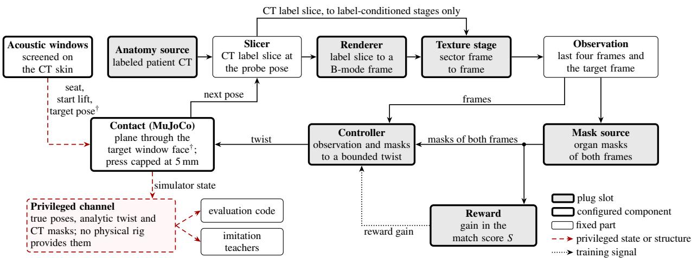  
Figure 1: The USB Gym closed loop. Each step slices the patient’s labeled CT at the probe pose, renders a frame and applies a texture stage. A mask source labels the organs of the observation and the target frame. The controller’s twist moves the probe, a lagged position servo, against a contact plane through the target window face. This target-anchored contact and the start lift onto it are privileged structure (<sup>†</sup>, red dashed arrow). Shaded boxes are the six plug slots, and white boxes with a heavy outline are configured components (Table 2). The dashed privileged channe feeds evaluation code and imitation teachers only.

Only USB Gym runs published methods in six components, the mask source and reward among them, and evaluates each on identical episodes against the privileged references of an oracle ladder (Section 5.2). Elsewhere in Table 1, published methods occupy at most the policy and the image source.

## 3. USB Gym: testbed design

## 3.1. Design goals, loop and task

USB Gym keeps every component of a closed ultrasound loop fixed except the one a user replaces, so a change in final error can be traced to that component. In each step (Fig. 1), the pose selects a CT label slice, which the simulation engine, a renderer and a texture stage, turns into the observation. A mask source labels the organs of the observation and target for the reward to score. The controller outputs a twist, a velocity of three translations and three rotations, which MuJoCo [34] executes against contact.

The task is a Gymnasium [2] environment in which the probe moves from a perturbed start to match a target view. An acoustic window is a skin pose from which the beam reaches the target organ largely free of bone, lung and bowel gas. Each target is the view at a screened liver or kidney window. Its start is drawn uniformly within ±20 mm lateral and elevational, ±10 mm axial, ±18<sup>◦</sup> of tilt and ±4<sup>◦</sup> of roll. Each step commands at most 3 mm along and 0.05 rad about each axis. The observation contains the last four $1 2 8 \times 1 2 8$ frames, the target frame and optional organ masks. Episodes have no terminal state and are truncated at 12 steps. The task is therefore local re-acquisition near a known window: finding a window from afar and deciding when to stop are out of scope.

## 3.2. Slots and interfaces

Table 2 lists the eight configurable components, the six plug slots among them, and what a replacement of each provides (slot terms and rules for reading the results: Box 1). The anatomy source, renderer and texture stage form the standard simulation engine, held at their reference components while the guide’s slots, mask source, controller and reward, are compared (Section 7); the engine’s slots stay pluggable (Table B.1).

## 3.3. Anatomy, windows and contact

Anatomy comes from 19 public TotalSegmentator CTs [3], split by patient into 13 training and six held-out cases that no component trained in this study saw (Fig. 2). The skin comes from the same CT, so probe seating needs no registration. Each accepted window passes eight screens (Supplementary S5), and its beam follows the inward skin normal or tilts toward the organ by at most 10<sup>◦</sup>. Liver windows lie on the anterior to right anterolateral abdomen, kidney windows on the flanks, and some in-plane rotations break the clinical display convention (Supplementary S5). No sonographer rated a window or its view. Every held-out patient has at least 5 liver and 11 kidney windows.

USB Gym seats the probe at a window screened on the patient’s CT skin. MuJoCo presses it against a plane through the target window face, perpendicular to the target beam. Because the plane carries the target’s depth and beam direction into the dynamics, we treat this target-anchored contact and the start lift onto it as privileged structure. The plane is tangent to the skin only at 15 of the 60 evaluation windows and tilted from it by up to 10<sup>◦</sup> at the other 45. The press is a position clamp at 5 mm below the plane, about 8.5 N in a steady press, and the tissue is rigid. Each 0.1 s control step integrates the commanded twist into a target pose without feedback, then simulates 20 ms of physics through a weld with a 0.02 s time constant. The probe is thus a lagged position servo. Under the CT-mask servo base, it trails its command by a mean 3.40 mm with contact, press included, and 2.09 mm without (post hoc). Starts below the plane, 40 of the 60, are lifted along its normal, the target beam axis, by a mean 6.4 mm (post hoc). Afterwards the axial start ofset spans −9 4 to −0 6 mm, so no start lies deeper than the target face (post hoc).

<table><tr><td colspan="2">(a) Terms.</td></tr><tr><td>Term</td><td>Definition</td></tr><tr><td>Configurable component Slot</td><td>A loop part that a user can replace; Table 2 lists eight. A configurable component into which published methods were plugged; six of the eight.</td></tr><tr><td>Standard engine; guide</td><td>The engine is the physics renderer, the SonoSPADE texture stage and the reference CT labels; the guide is the mask source, controller and reward. All six slots are pluggable; Section 7 compares the guide&#x27;s.</td></tr><tr><td>Reference component Family</td><td>A component of the primary results, ours or a prior one, against which a slot&#x27;s plugged methods are compared. Pre-specified comparisons within which Holm&#x27;s adjustment runs; in a slot&#x27;s family, each tests a plugged method.</td></tr><tr><td>Secondary comparison Privileged component (†)</td><td>A reported comparison outside every family, with a t CI and no decision. A component that reads simulator state that no physical rig provides.</td></tr><tr><td>Target-anchored contact (†)</td><td>Contact plane through the target window face, and the start lift onto it; privileged structure.</td></tr><tr><td>Privileged channel</td><td>The separate simulator output holding the true poses, the analytic twist and the CT masks.</td></tr><tr><td>Analytic twist</td><td>The clipped corrective twist from the true poses; the pose oracle executes it.</td></tr><tr><td>Oracle ladder; rung</td><td>References that see less and less simulator state on identical episodes; each is a rung.</td></tr><tr><td>Match score S; the paper&#x27;s S Servo base</td><td>Eq. (2): weighted organ-mask overlap plus in-sector appearance; it uses no pose</td></tr><tr><td>Reference pipeline; authors&#x27;</td><td>Our image servo: a least-squares linear map from mask moments to a twist.</td></tr><tr><td>original pipeline</td><td>Our published pipeline [5]: one of the four reference texture stages, the stage-matched U-Net mask and the reference controller, trained with S; every other slot at its reference component (Table 2).</td></tr><tr><td>Label-conditioned stage;</td><td>A texture stage that also reads the CT label slice, as SonoSPADE does; the frames are its output. Every frame,</td></tr><tr><td>label-conditioned frames</td><td>physics included, is first rendered from that slice.</td></tr><tr><td>SonoSPADE; per-tissue stage</td><td>Our published label-conditioned texture stage [4], used unchanged; the standard engine&#x27;s texture stage. Final error of the CT-mask servo minus that of the pose oracle.</td></tr><tr><td>Oracle-to-CT-mask gap CT-to-learned-mask gap</td><td>Final error of a learned-mask servo minus that of the CT-mask servo.</td></tr><tr><td>Benchmark baseline</td><td>On the standard engine (physics frames: Appendix B.10), the better of two pipelines on the 20 cohort CTs: the</td></tr><tr><td></td><td>authors&#x27; original one or, where it tests lower, the combination keeping the authors&#x27; component in each slot unless</td></tr><tr><td></td><td>a decision on the six held-out patients found a published one lower (Section 7.4). Others are not ranked against it.</td></tr><tr><td>Look-ahead ascent Planted deficit</td><td>A privileged rung that simulates candidate twists and executes the one with highest CT-mask S. A known lateral bias added to executed twists, to test whether REINFORCE removes it.</td></tr><tr><td>MDD TOST</td><td>Minimum detectable difference: smallest true paired difference a two-sided paired t-test detects at power 0.8. Two one-sided tests of equivalence within a preset margin, here ±1 mm.</td></tr><tr><td colspan="2">(b) How to read the results. 1. Tiers and labels. The primary results are the pre-specified analyses of the reference pipeline with its four reference texture stages (Section 6</td></tr><tr><td colspan="2">and Appendix A) and the primary real-frame results of Section 8.6 (every stage: Table A.9). Every other result, the comparison of published methods, the controls and the replication cohorts included, is exploratory; a pre-specified rule gives it a decision word, and an estimation-only result has none (Supplementary S7). New analyses of data already seen are labeled post hoc, and descriptive results are counts or summaries</td></tr><tr><td colspan="2">with no test. Sections 7 and 8.1 to 8.5 and Appendix B report only exploratory results, so there a result is labeled only when it is also post hoc, estimation only, secondary or descriptive; values of the six held-out patients quoted from Section 6 keep their primary status. 2. Unit. The patient is the unit of inference, with n = 6 (the six held-out patients, also the original six; TRAIN: the 13 training patients). On the</td></tr><tr><td colspan="2">20 replication CTs (also new, further or cohort CTs) and the 30 AMOS CTs, the CT is the unit. Seeds index trained artifacts, and every contrast is conditional on them.</td></tr><tr><td colspan="2">3. Intervals. Brackets give a 95% CI of the per-patient or per-CT paired difference: a patient-cluster bootstrap CI for primary results and a paired t CI for exploratory results. k/n counts the patients or CTs that share the sign of the mean.</td></tr><tr><td colspan="2">4. Decisions. A primary contrast is a difference when its CI excludes 0 and at least 5 of 6 patients share its sign. An exploratory contrast is a difference when its Holm-adjusted paired t-test within its family gives p &lt; 0.05 and at least 5 of 6 patients share its sign. On the 20 replication</td></tr><tr><td colspan="2">and 30 AMOS CTs, a sign-flip test with Holm decides, without a sign count. Every “lower&quot; decision against one of our reference components</td></tr><tr><td colspan="2">is reported in the main text. 5. No difference detected is not equivalence. The post hoc MDD gives each slot&#x27;s resolution; only a TOST shows equivalence, named if post hoc. 6. Rows. Privileged rows carry a dagger in every table, and secondary and estimation-only rows never carry a decision. Except in the skin-tangent</td></tr><tr><td colspan="2"></td></tr><tr><td colspan="2"></td></tr><tr><td colspan="2">contact experiment, every absolute error is conditional on the target-anchored plane; contact-off rows keep the start lift and the 5 mm press clamp below that plane. Where no other reason is given, a run that is not reported did not pass the provenance checks. 7. Where to look. Appendix B gives every pre-specified decision in full, keyed to the rows of Tables 5 and B.1.</td></tr></table>

Table 2: Configurable components of USB Gym: six plug slots, and the acoustic windows and contact, configured but not plugged. The anatomy source, renderer and texture stage form the standard simulation engine (results: Table B.1); the mask source, controller and reward form the guide (Table 5). Interface: what a replacement provides. A slot’s pre-specified comparisons are made against its first reference component. Plugged: the published methods placed in the slot, led by their count, which takes each method once whatever its backbone, box prompt, pretrained weight or residual form, and leaves out ablations of S ; the six counts sum to 27. Box 1 defines the entry types. <sup>†</sup>Privileged: a component that read simulator state, or the target-anchored contact. <sup>⋆</sup>Specified after the first families were fixed, in families of its own. <sup>R</sup>The authors’ reimplementation of the published method. NCC: normalized cross-correlation. SSIM, NMI, LPIPS: structural similarity, normalized mutual information, learned perceptual image patch similarity. BC: behavior cloning. CEM: cross-entropy method.
<table><tr><td>Component</td><td>Interface</td><td>Reference components</td><td>Plugged</td><td>Not evaluated, and why</td></tr><tr><td>Anatomy source</td><td>a labeled CT volume per patient</td><td>TotalSegmentator dataset masks [3]: 13 training and 6 held-out cases</td><td>1 method. Family*: TotalSegmentator v2 labels of the same CTs, fast mode</td><td>none</td></tr><tr><td>Acoustic windows</td><td>screening rules; target organs</td><td>screened windows; liver and kidney targets</td><td>none</td><td>none</td></tr><tr><td>Renderer</td><td>a label slice to a frame in [0, 1]; physics-renderer parameters</td><td>physics renderer (authors&#x27;); DR off except in one ablation</td><td>2 methods. Family: LOTUS forward model, original code, published default parameters [12]; the authors reimplementation of it. Secondary: SIMUS [10, 11], seed 0</td><td>Field II [8]: needs MATLAB. k-Wave [9]: needs an NVIDIA GPU, or hours per frame without one</td></tr><tr><td>Texture stage</td><td>a frame to a frame; a label-conditioned stage also reads the label slice</td><td>SonoSPADE [4] (authors&#x27;, method unchanged). Secondary: physics, CUT [36], CycleGAN [14]</td><td>4 methods. Family: FastCUT [36]R, DCLGAN [37]R, UNSB [38]R, global histogram matching [39]R</td><td>Echo from Noise [40], SDM [41]: no public abdominal weights. ConPres [42]: no public code</td></tr><tr><td>Mask source</td><td>a frame to an organ mask</td><td>U-Net [43] of the same stage and seed (authors&#x27;). Secondary: CT label†</td><td>7 methods. Family: LR-ASPP [44], DeepLabV3 [45] on MobileNetV3-L or ResNet-50 [46] and FCN [47], from scratch; nnU-Net [48] 2D, 2 epochs; SAM [49] and MedSAM [50] with U-Net boxes. Family*: SAMUS [51] with U-Net boxes; the torchvision networks with ImageNet-pretrained backbones. Secondary: SAM, MedSAM and SAMUS with CT-label boxes†</td><td>UltraSam [52], USFM [53]: need an NVIDIA GPU</td></tr><tr><td>Contact</td><td>probe contact in MuJoCo, on or off</td><td>on; plane through the target window face, with the start lift onto it†; press capped at 5 mm</td><td>none</td><td>none</td></tr><tr><td>Controller</td><td>any map from the observation to a normalized twist</td><td>REINFORCE residual over the servo base, imitation start (authors&#x27;). Secondary: servo base alone; pose oracle†</td><td>8 methods. Family: PPO [54], SAC [55], TD3 [56] and A2C [57] residuals, PPO and DQN [58] with 13 moves from scratch, in Stable-Baselines3 [59]; BC [60]R and DAgger [61]R from the pose-oracle teacher, residual and from scratch. Secondary: CEM look-ahead [62]†,R</td><td>SonoGym agents [29]: need an NVIDIA RTX GPU</td></tr><tr><td>Reward</td><td>a frame pair to a score; the weights of S</td><td>the match score S (authors&#x27;): weights 0.6 and 0.4, action cost 0.003</td><td>5 methods. Family: SSIM [63], NMI [64]R. Family*: LPIPS [65]. Secondary: organ overlap only, NCC only, whole-sector NCC; pose distance†,R [29]; pose distance plus organ area†,k [28]</td><td>none</td></tr></table>

## 3.4. Rendering and the standard texture stage

The reference renderer is a physics model seeded from the LOTUS defaults [12] (every term, and what the model leaves out: Supplementary S1). Each label slice is a $6 0 ^ { \circ }$ fan of 160 scanlines with 512 samples to 120 mm depth. Shadowing leaves at sample s of scanline l the energy

$$
E _ { l , s } = \bigl [ \prod _ { k = 1 } ^ { s } \bigl ( 1 - R _ { l , k } \bigr ) \bigr ] \exp \Bigl ( - 2 \kappa \Delta z \sum _ { j = 1 } ^ { s } \mu _ { l , j } \Bigr ) , R _ { l , k } = \mathopen { } \mathclose \bgroup \left( \frac { Z _ { l , k } - Z _ { l , k - 1 } } { Z _ { l , k } + Z _ { l , k - 1 } } \aftergroup \egroup \right) ^ { 2 } ,\tag{1}
$$

with $R _ { l , 1 } ~ = ~ 0 ;$ , impedance $Z ,$ attenuation $\mu ,$ sample spacing $\Delta z$ and a fixed gain κ. A depth-varying point spread function blurs a speckle field fixed to the image grid and drawn from one seed per run, or per episode under domain randomization (DR). Targets and observations share this field, so they are identical images at the same pose. The renderer’s acoustic constants and DR ranges are heuristic, not fitted to measured images. In the default render (default constants, no DR), organs look almost equally bright, that is, nearly isoechoic: their echo strengths difer by at most 1 dB. Organ boundaries are not drawn either, because their echoes are too weak for the display’s 50 dB range (Supplementary S1.10). The standard texture stage, SonoSPADE, textures each organ from the CT label. Frames are warped into the $4 6 ^ { \circ }$ sector of the 128 × 128 Vitale frames [15], which narrows the $6 0 ^ { \circ }$ fan by a factor of 0.77.

(a)  
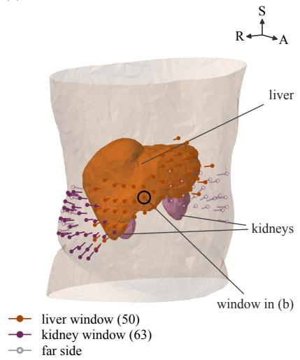  
(b)

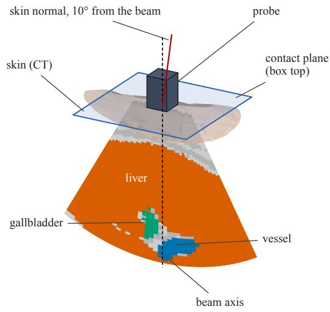  
(c)

Physics B-mode  
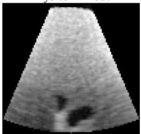

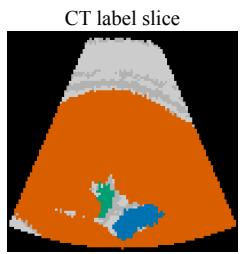  
Figure 2: The patient’s CT skin, its screened windows and the contact plane, shown for training patient s0011. (a) The skin surface extracted from the patient’s labeled CT, with the liver and kidneys inside. Dots mark the faces of the screened acoustic windows on the skin: 50 for the liver and 63 for the kidneys. Each stroke points along its window’s beam into the body. Hollow dots lie on the far side of the body from the viewer. (b) The probe seated at the top-ranked liver window, in the world frame of the MuJoCo scene. The contact plane, the top face of the static MuJoCo box, passes through the window face perpendicular to the beam axis. At this window the beam tilts 10<sup>◦</sup> from the skin normal toward the liver, so the plane is not tangent to the skin. Contact uses only this plane, not the skin surface. The fan is the slicing plane of the probe, painted with the CT labels it samples (orange liver, green gallbladder, blue vessel, grays other tissue). (c) The physics render at this pose and its CT label slice, mapped into the measured sector geometry without domain randomization and with a fixed speckle seed.

SonoSPADE [4], the only stage reading the CT label, is the standard engine’s texture stage, so label information reaches every standard frame (Section 8.4). The pre-specified oracle ladder of the primary results also runs three other texture settings (Fig. A.1): untextured physics, CUT [36] and CycleGAN [14]. We retrained the three networks once, with seed 0, on renders of eight training patients and 404 Vitale frames. A learned mask comes from one of 12 texture-matched U-Net segmenters [43], per stage and seed. Each also trains on 42 annotated Vitale frames and the KidneyUS training split [73], never on held-out patients, held-out real frames or AUL frames [78].

## 3.5. Match score and privileged channel

The default reward, the match score S of Eq. (2), combines organ-mask overlap with an in-sector appearance term and uses no pose. For frames I and I<sup>∗</sup> with organ masks M and $M ^ { * }$

$$
\begin{array} { r } { S = 0 . 6 S _ { \mathrm { s e g } } ( M , M ^ { * } ) + 0 . 4 S _ { \mathrm { a p p } } ( I , I ^ { * } ) , \qquad S _ { \mathrm { a p p } } = \frac { 1 } { 2 } \bigl ( 1 + \mathrm { N C C } _ { \Omega } ( I , I ^ { * } ) \bigr ) . } \end{array}\tag{2}
$$

Here $S _ { \mathrm { s e g } }$ is the mean per-organ intersection over union (IoU) of five organs, and $\mathrm { N C C } _ { \Omega }$ is the normalized crosscorrelation over the lit sector Ω. The step reward is the gain in S minus a small action cost. The score can therefore also rate real frames (Section 8.6), but its pose sensitivity on real images is untested. The privileged channel contains the true pose error, both poses, the CT masks and the analytic twist (Box 1). A controller meant for a physical rig must not read this channel, which the environment returns by default (Listing 1).

## 4. Interface, plug protocol and compute

## 4.1. Observation, action and reward

A controller receives the observation of Section 3.1 and returns a normalized twist; each step’s reward is the gain in S minus the action cost (Section 3.5). A texture stage, mask source or controller enters the environment through its texture or mask argument or its action, as in Listing 1, and a CT case as a label volume with screened windows. Plugged renderers and reward terms entered through adapters, code that replaces the render function or S (Table 2). In the CT-free configuration, organ masks come from a learned segmenter, no pose, CT mask or privileged channel reaches the controller or the reward, and only evaluation code reads the pose error. It still uses segmenters and a servo base fit with CT labels and true poses of training patients, and target-anchored contact (Section 3.3).

## 4.2. Plug protocol

Under the plug protocol, we swapped one slot at a time and held the rest of the loop at that slot’s condition in Table 5 or B.1. A new method therefore meets the same 60 held-out episodes as its slot’s reference component and is evaluated at 12 steps only. No plugged method is tuned: each runs with settings fixed before its held-out runs (controllers: Supplementary Table S3.4). Reinforcement learners get the reference controller’s 57,600 environment steps, and imitation learners its 40,000 samples. Learned methods run seeds 0 to 2, and SAM, MedSAM, SIMUS and the cross-entropy look-ahead run seed 0 only; plugged networks run batch normalization in evaluation mode. Holm’s adjustment runs within five pre-specified families of 4 texture stages, 7 mask sources, 10 controllers, 2 rewards and 2 renderers; five further families, specified after these (Section 5.4), are never pooled with them.

## 4.3. Compute cost

All compute costs were measured on one Apple M5 Pro laptop with 24 GB of memory (Table 3). On its CPU, one closed-loop step with a learned-mask policy takes a median 41.5 to 103.4 ms over the four reference texture stages,

```python
import gymnasium as gym
import numpy as np
import usbg.gym_env # registers the task
def my_stage(img01): # texture slot: frame to frame
return np.clip(img01, 0.0, 1.0) ** 1.5
env = gym.make("USBGym/ViewMatch-v0", base="servo",
patients="test", texture=my_stage, # slot call
mask="ct", # privileged
privileged_info=True) # privileged
obs, info = env.reset(options={"eval_episode": 0})
for _ in range(12):
twist = np.zeros(6, np.float32) # action: zero residual
obs, reward, term, trunc, info = env.step(twist)
print(info["privileged"]["pose_error_mm"]) # privileged
```

Listing 1: One held-out evaluation episode with a toy texture stage, , in the texture slot. Building the environment calibrates the servo base of Eq. (3) on the 13 training patients. Each step takes a twist and returns the observation and the reward. Under CT masks and a zero residual, the stage changes the frames and the reward’s appearance term but not the motion. The script therefore prints about 16.62, the CT-mask servo base’s final error (mm) on this episode (patient s0358, liver target) in the run behind Table 4. Lines marked privileged use simulator state that no physical rig provides. In the CT-free configuration of Section 4.1, a learned segmenter replaces the CT mask, the controller reads only the observation and only evaluation code reads the pose error.

Table 3: Hardware and software of USB Gym’s runs: every reported result was computed on one Apple M5 Pro laptop with 24 GB of unified memory.  
Machine Apple M5 Pro, 24 GB, 15 CPU cores, macOS (Darwin arm64), Apple GPU through   
PyTorch MPS   
Python, PyTorch 3.13.13, 2.12.1   
NumPy, MuJoCo 2.1.3, 3.3.7   
Gymnasium, Stable-Baselines3 1.0.0, 2.6.0

or 9.7 to 24.1 steps per second. Training one reference policy on the laptop’s GPU took a median 0.79 h with CT masks, 1.02 h with learned masks and 1.32 h under domain randomization. All 27 reference training runs took 0.61 to 2.97 h, timed while three runs shared the laptop (every frame, step and training time: Supplementary Table S3.3). The testbed, the analysis scripts and the table and figure builds were written, tested and run with the AI coding assistant Claude Code (Anthropic), on the models Claude Opus 4.8, Opus 5 and Opus 5.5; those scripts generate every table and figure data file from the archived results.

## 5. Reference pipeline and evaluation design

## 5.1. Reference controller

The reference controller adds a bounded learned residual to the servo base:

$$
a _ { t } = \mathrm { c l i p } ( b ( M _ { t } , M ^ { * } ) + \rho _ { t } , \pm a _ { \operatorname* { m a x } } ) ,\tag{3}
$$

where the residual $\rho _ { t }$ is bounded at half the twist bound $a _ { \mathrm { m a x } }$ (Section 3.1). The servo base b adapts the Mebarki et al. [25] servo: least squares on 500 training frame pairs maps per-organ mask moments, area and centroid, linearly to the analytic twist under its own mask source. The residual imitates the analytic twist minus the base, then trains by REINFORCE [66], a policy-gradient reinforcement learning (RL) method, with an imitation anchor; only training uses the true pose. At inference the learned-mask servo reads no pose and no CT mask, a CT-free configuration evaluated only in simulation. Policies keep batch normalization in training mode at evaluation (evaluation mode: Section 8.1).

## 5.2. Oracle ladder

The oracle ladder’s rungs see less and less simulator state on identical episodes, so the step between two rungs measures what that state is worth.

1. Pose oracle (privileged): the analytic twist.

2. CT-mask servo (privileged): Eq. (3) with CT masks.

3. Learned-mask servo: Eq. (3) with the stage’s texture-matched segmenter.

4. Servo base alone: b with no residual, privileged under CT masks.

5. Static: no commanded motion.

6. Scripted sweep: a fixed motion that reads no image and does not aim at the target. Over the 12 steps, the probe is pressed 1.2 mm into the body along the beam for four steps, then fanned about its lateral axis, 1.15<sup>◦</sup> per step, four steps out and four back, each with a 0.4 mm press to keep contact (commanded values).

Neither gap name of Box 1 assigns a cause. The RL contribution is a policy’s final error minus its error after imitation.

## 5.3. Episodes and metrics

Each configuration, or arm, runs 60 crossed episodes per seed, six held-out patients by two organs by five windows. By design, every rung, seed and plugged method meets the same targets and starts. Contact stays on and domain randomization (DR) of, except in the contact-of evaluations, one skin-tangent contact arm and one CT-mask DR ablation.

The primary metric is the final translation error in mm, the translational norm of the SE(3) logarithm of the final pose relative to the target. Rotation error is the geodesic angle to the target orientation. Success means ending within 5 mm and 5<sup>◦</sup>, or within 10 mm and 10<sup>◦</sup>, tolerances set here, not by a clinical source. Post hoc secondary metrics are per-axis errors in the target probe frame and the keep-best error or IoU, the value at the highest-scoring step, selected without the pose. Learnability is the Spearman correlation of the appearance term with closeness to the target pose. Distances to real frames are the intensity Wasserstein-1 distance (W1), the kernel and Fréchet Inception distances (KID, FID) [67, 68] and the area under the curve (AUC) of a classifier two-sample test (C2ST) [69].

## 5.4. Statistical analysis

Inference and decision rules. A contrast is a per-patient paired diference of means over organ, window and seed. Every contrast is conditional on the trained artifacts (texture networks, segmenters, bases and policies). Primary results keep the pre-specified, unadjusted CI-and-sign rule of Box 1, on a 95% patient-cluster bootstrap confidence interval (CI). Its type-I error at n = 6 was 0.11 to 0.16 in simulation (post hoc). Exploratory analyses therefore use the paired t rule of Box 1, a two-sided paired t-test with 5 degrees of freedom, Holm-adjusted [70] within each pre specified family. No exact test can reach Holm’s threshold at n = 6 in a family of two or more, since the smallest two-sided exact sign-flip p is 2/64. Exact sign-flip p values and bootstrap CIs serve as sensitivity analyses.

Replication cohorts. The 20 replication CTs are screened in a seeded order, and a CT is accepted only with at least 2 kidney windows, the minimum that training and evaluation use. Their decision rule is the exact sign-flip test with Holm. An external replication cohort in simulation uses 30 CTs of the public AMOS 2022 dataset [71], with sign-flip p values from 1,000,000 random sign vectors. AMOS records no patient identifier, so the CT is the unit, and two CTs from one patient cannot be excluded. The 79 eligible AMOS CTs are all 512 by 512 and 65 share one header pattern, so they may come from fewer scanners than AMOS as a whole; we make no statement about centers, vendors or scanners.

Timing of specification. The pre-specified analyses were not formally pre-registered. Results of an earlier version of this testbed on the same six held-out patients were known when the primary analyses were specified. The plug protocol was fixed before any plugged method ran on held-out or cohort patients. The paired t rule was chosen after post hoc paired t-tests on the 25 ladder contrasts had been seen (Section 6.4). Some exploratory runs began before their decision rules were fixed (Supplementary Table S4.1). They are five of the gap-cause level sets, the seed-0 look-ahead runs, SonoSPADE’s undirected-motion episodes, the planted-deficit RL runs and the two extra SonoSPADE texture seeds of the texture-budget test. The SAMUS and LPIPS priors were set after the SAM, MedSAM and reward results had been seen. Three further exploratory experiments were each fixed before their runs: learned-mask controllers with new learner seeds, skin-tangent contact and canonical phantoms. Earlier learned-mask controller results have no pre-specified rule (Appendix B.3). A benchmark baseline is set on the 20 cohort CTs by a rule fixed before those runs, its components known. A final set of follow-up runs was specified after nearly all other results had been seen, though before its own runs. It has no decision rule, and each of its results is labeled estimation only (Supplementary S7).

## 6. Results: the reference pipeline

## 6.1. Absolute performance and the oracle-to-CT-mask gap

From a 16.03 mm static start, the privileged pose oracle nearly reaches the target, at 1.53 mm, but the CT-mask servo stays far from it, at 11.64 to 11.81 mm (primary; Table 4). The oracle-to-CT-mask gap is +10 28 mm [+9 21, +11 39] with physics frames (6/6) and within 0.17 mm of that with the other stages.

Table 4: Oracle ladder: final translation error (mm), 6 held-out patients, contact on, evaluation domain randomization of; policy rows average 3 seeds, each meeting the same 60 crossed episodes. Pre-specified results, primary; the last block is post hoc. Errors: mean of per-patient means. Gaps: mean per-patient paired diference, patients of 6 sharing its sign, and 95% patient-cluster bootstrap CI (10,000 resamples); a diference under the pre-specified CI-and-sign rule. Every contrast is conditional on the trained artifacts (texture networks, segmenters, bases and policies). Seeds index artifacts; the patient is the sampling unit. The servo base accounts for nearly all of the improvement; imitation and REINFORCE each change the final translation error by less than 0.5 mm. <sup>L</sup>Reads the CT label slice. <sup>†</sup>Privileged: simulator state that no rig provides. Shaded: SonoSPADE, the texture stage of the standard engine and the main benchmark; physics, CUT and CycleGAN are the ladder’s other texture settings.
<table><tr><td></td><td>Physics</td><td>CUT</td><td>CycleGAN</td><td>SonoSPADEL</td></tr><tr><td colspan="5">Final translation error (mm)</td></tr><tr><td>Static start (no commanded motion)</td><td colspan="4">16.03</td></tr><tr><td>Scripted sweep (no feedback)</td><td colspan="4">15.52</td></tr><tr><td>Analytic pose oracle†</td><td colspan="4">1.53</td></tr><tr><td colspan="5">CT mask†</td></tr><tr><td>Servo base</td><td>11.65</td><td>11.65</td><td>11.65</td><td>11.65</td></tr><tr><td>After imitation</td><td>11.78</td><td>11.72</td><td>11.70</td><td>11.74</td></tr><tr><td>Final</td><td>11.81</td><td>11.64</td><td>11.69</td><td>11.69</td></tr><tr><td colspan="5">Learned mask (texture-matched segmenter)</td></tr><tr><td>Servo base</td><td>17.20</td><td>16.84</td><td>16.85</td><td>13.13</td></tr><tr><td>After imitation</td><td>17.02</td><td>16.42</td><td>16.42</td><td>13.07</td></tr><tr><td>Final</td><td>16.73</td><td>16.90</td><td>16.50</td><td>13.11</td></tr><tr><td colspan="5">Gaps (mm): patient-level mean, k/6 patients, 95% CI</td></tr><tr><td rowspan="2">Oracle-to-CT-mask gap</td><td>+10.28*, 6/6</td><td>+10.11*, 6/6</td><td>+10.17*, 6/6</td><td>+10.16*, 6/6</td></tr><tr><td>[+9.21,+11.39]</td><td>[+8.96,+11.27]</td><td>[+9.06,+11.36]</td><td>[+9.10,+11.27]</td></tr><tr><td rowspan="2">CT-to-learned-mask gap</td><td>+4.92*, 5/6</td><td>+5.26*, 6/6</td><td>+4.80*, 5/6</td><td>+1.43*, 6/6</td></tr><tr><td>[+2.46, +6.79]</td><td>[+3.07, +6.95]</td><td>[+2.15, +6.42]</td><td>[+0.86, +2.11]</td></tr><tr><td rowspan="2">RL contribution, CT mask</td><td>+0.04,3/6</td><td>-0.08,4/6</td><td>0.00, 3/6</td><td>-0.06, 3/6</td></tr><tr><td>[-0.10,+0.17]</td><td>[-0.29, +0.10]</td><td>[-0.23, +0.21]</td><td>[-0.33, +0.22]</td></tr><tr><td rowspan="2">RL contribution, learned mask</td><td>-0.29, 3/6</td><td>+0.47, 4/6</td><td>+0.08, 3/6</td><td>+0.05,3/6</td></tr><tr><td>[-0.80, +0.17]</td><td>[+0.06, +0.90]</td><td>[-0.37, +0.53]</td><td>[-0.24, +0.33]</td></tr><tr><td rowspan="2">SonoSPADE minus stage, learned-mask final</td><td>-3.62*, 5/6</td><td>-3.78*, 5/6</td><td>-3.38*, 5/6</td><td>n/a</td></tr><tr><td>[-5.03,-1.67]</td><td>[-5.14, -2.05]</td><td>[-4.94,-1.19]</td><td></td></tr><tr><td colspan="5">Post hoc block</td></tr><tr><td colspan="5">Final rotation error (deg)</td></tr><tr><td>CT mask†, final</td><td>7.60</td><td>7.79</td><td>7.35</td><td>6.91</td></tr><tr><td>Learned mask, final</td><td>7.93</td><td>8.29 static 0.0, scripted 3.3, pose oracle† 100.0</td><td>7.10</td><td>8.26</td></tr><tr><td colspan="5">Success, 5 mm and 5° (%)</td></tr><tr><td>CT mask†, final</td><td>8.3</td><td>8.9</td><td>9.4</td><td>10.0</td></tr><tr><td>Learned mask, final</td><td>1.1</td><td>3.9</td><td>2.2</td><td>5.6</td></tr><tr><td colspan="5">Success, 10 mm and 10° (%) static 3.3, scripted 16.7, pose oracle† 100.0</td></tr><tr><td>CT mask†, final</td><td>32.8</td><td>33.9</td><td>38.3</td><td>36.7</td></tr><tr><td>Learned mask, final</td><td>21.1</td><td>14.4</td><td>18.9 static 0.462, scripted 0.515, pose oracle† 0.872</td><td>30.6</td></tr><tr><td colspan="5">Final match score S</td></tr><tr><td>CT mask†, final</td><td>0.610</td><td>0.616</td><td>0.612 0.483</td><td>0.624 0.555</td></tr><tr><td>Learned mask, final</td><td>0.472</td><td>0.472</td><td></td><td></td></tr></table>

Without CT masks, three of the four learned-mask servos end at 16.50 to 16.90 mm, +0 5 to +0 9 mm above the static start (paired t CIs −2 00 to +3 41 mm; post hoc; Fig. A.2). SonoSPADE’s ends at 13.11 mm, −2 92 mm [−5 73, −0 10] from the static start, 5/6 (paired t p 0.045, not detectable after Holm; post hoc). At 5 mm and 5<sup>◦</sup>, 8.3 to 10.0% of CT-mask and 1.1 to 5.6% of learned-mask final episodes succeed, against 100% for the oracle (post hoc).

## 6.2. The CT-to-learned-mask gap by texture stage

The CT-to-learned-mask gap is larger with physics, CUT and CycleGAN frames, +4 92, +5 26 and +4 80 mm (5/6, 6/6 and 5/6), than with SonoSPADE frames, +1 43 mm [+0 86, +2 11] (6/6). The gap compares policies trained under diferent mask sources, so it does not estimate what better masks would remove. With texture-matched segmenters, per-tissue texture gives the lowest learned-mask error. Its learned-mask final lies 3.38 to 3.78 mm below the others (5/6 each). SonoSPADE alone also reads the CT label slice (Section 8.4). Per-tissue texture gives the most posesensitive appearance term of the four stages. Its learnability is 0.613, against at most 0.548 for the others (Table A.2).

## 6.3. Fine-tuning and translation error

The servo base accounts for nearly all of the improvement; imitation and REINFORCE each change the final translation error by less than 0.5 mm. The CT-mask servo base alone ends at 11.65 mm. The largest RL contribution, +0 47 mm [+0 06, +0 90] with CUT frames and learned masks, falls short of the decision rule (4/6).

## 6.4. Contact, texture under CT masks and domain randomization

With contact of at evaluation, the CT-mask servo ends at 14.4 to 14.8 mm, 2.7 to 3.0 mm farther (6/6 per stage). With contact, the scripted sweep, which reads no image, also ends with smaller tilts: 3.57 and 3.10<sup>◦</sup> out of plane and in plane, no larger at tilted windows, against 9.67 and 8.30<sup>◦</sup> without contact (post hoc). Every servo in Table 4 thus owes part of its absolute accuracy to the target-anchored plane (Section 3.3). On 20 new CTs, contact of raises the final error by 2.14 mm [1.68, 2.60] (20/20) for the CT-mask servo base and 2.02 to 2.13 mm for CT-mask final policies (exploratory; estimation only; Supplementary S7). With contact on and CT masks, only physics against SonoSPADE frames has a stage-pair CI excluding 0, +0 13 mm [+0 02, +0 25], 4/6, short of the decision rule. No interval of the domain-randomization ablation excludes zero (descriptive; Appendix A.4 and Appendix A.5).

Re-tested post hoc with paired t-tests, Holm-adjusted within each family, 11 of the 25 ladder contrasts reach Holm’s threshold: every oracle-to-CT-mask gap, every CT-to-learned-mask gap and every learned-mask SonoSPADE against-stage contrast. On the learnability, realism, domain-randomization policy and contact contrasts of the primary analysis, the paired t-test reaches Holm’s threshold in 9 of 9, 1 of 1, 0 of 3 and 9 of 16 (post hoc). The exact test reaches Holm’s threshold only in the one-member realism family, at $p = 2 / 6 4$ (post hoc; Supplementary Table S2.18).

## 6.5. What limits the CT-mask servo

The CT-mask servo leaves headroom in the match score. This subsection is exploratory. Privileged look-ahead values average look-ahead seeds 0 to 2. The servo base barely predicts the analytic twist on five of six axes (held-out $R ^ { 2 }$ at most 0.13). Under CT masks, its elevational error grows from 8.08 mm at step 12 to 13.75 mm at step 36, and its roll from 4.14 to $1 0 . 6 8 ^ { \circ }$ (6/6 each; post hoc). The oracle-to-CT-mask gap is not attributed to one cause (conditional on this renderer: grid-fixed speckle, no elevational beam width, rigid tissue). Under CT masks, 0/60 (0%) of targets have a pose 5 mm or more away scoring within 0.01 of the target’s own score (0/6 patients with a majority). Privileged look-ahead ascent on the CT-mask match score ends at 8.55 mm, against 11.65 mm for the servo base and 1.53 mm for the pose oracle. Privileged look-ahead ascent on the CT-mask match score ends below the servo base by 3.10 mm [0.14, 6.05] (6/6; conditional on this renderer: grid-fixed speckle, no elevational beam width, rigid tissue). It meets the paired t rule (t p = Holm $p = 0 . 0 4 3 ;$ exact sign-flip $p = 0 . 0 3 1 \mathrm { \Omega }$ ). Pose-free hill-climbing keeps its best random step on S . Under CT masks, hill-climbing on the match score ends 4.03 mm above the servo base (5/6). It also meets the paired t rule (t CI [+0 93, +7 13] mm; t p 0.021; Holm p 0.041; exact sign-flip p 0.063). The testbed exposes headroom between the servo base (11.65 mm) and the pose oracle (1.53 mm) that this controller does not close.

## 7. Results: published methods in the guide’s three slots

Of the 19 contrasts in the guide’s three slot families, 4 difer and 15 do not, 8 of these under privileged CT masks and 2 within ±1 mm (post hoc TOST; Table 5, Fig. B.1). Post hoc slot MDDs are 0.085 to 2.14 mm, smallest in the reward slot, where images act only through the residual. All 27 published methods ran under one protocol (Section 4.2) with pre-specified rules (Section 5.4); the results are exploratory, and Appendix B gives each decision. This section reports the 20 in the guide’s slots; the 7 in the engine’s slots are in Table B.1.

## 7.1. Mask source

None of the first family’s seven mask sources difers detectably from the stage-matched U-Net: they end at 12.76 to 14.88 mm on SonoSPADE frames, against 13.13 mm. SonoSPADE frames give the smallest CT-to-learned-mask gap, so diferences in this slot may be compressed. The four torchvision networks [44, 45, 47, 46] train from random weights and nnU-Net [48] trains 2 epochs against its default of 1,000, all on the U-Net’s simulated and real frames.

Neither SAMUS [51] nor any of the four networks with ImageNet-pretrained backbones difers detectably from the U-Net. Within the families, only FCN ResNet-50 with an ImageNet backbone is shown equivalent within ±1 mm (post hoc TOST). SAMUS is prompted with boxes from the U-Net’s own mask, not with its native point prompts, so this row measures what SAMUS adds to the U-Net’s detections. The pretrained networks use the from-scratch recipe (4,000 iterations), which is not tuned for pretrained backbones. ImageNet pretraining is not shown to change the mask-slot results of the torchvision segmenters $( n = 6 )$

## 7.2. Controller

Under privileged CT masks on SonoSPADE frames, none of the PPO [54], SAC [55], behavior cloning (BC) [60] and DAgger [61] residuals difers detectably from the slot’s reference, the REINFORCE residual [66] at 11.69 mm. Only PPO is shown equivalent within ±1 mm (post hoc TOST). The TD3 [56] and A2C [57] residuals raise the error, by +8 54 and +6 74 mm (6/6 each; Holm $p < 0 . 0 0 1 )$ . Each residual adds at most $a _ { \mathrm { m a x } } / 2$ to the servo base’s twist in Eq. (3), a bounded search around the base. With seeds 0 and 1, TD3 moves the probe identically on SonoSPADE and physics frames in all 60 episodes, and each TD3 actor was found saturated, adding one constant ofset at the residual bound whatever the image (post hoc). Without the servo base, full-twist BC raises the error by +7 92 mm (6/6, Holm p 0.006). The other controllers without the base, full-twist PPO and DAgger and DQN [58], show no detectable diference. The unadjusted intervals of full-twist DAgger and DQN exclude zero. TD3, A2C, DQN and full-twist BC and DAgger all end above the 16.03 mm static start. The Stable-Baselines3 (SB3) [59] learners start from random weights and REINFORCE from imitation; a decision describes this training (Section 4.2), not the algorithm.

Table 5: Published methods in the three slots of the guide: mask source, controller and reward (exploratory, pre-specified rule). Every row: 12 steps, the 60 held-out episodes of Table 4, contact on. Error: final translation error, mean over seeds of patient means. Diference: from the slot’s reference component, paired by seed, with 95% paired t CI and patients of 6 sharing its sign. Seeds: the seeds, of 3, whose own diference shares that sign (post hoc; n/a for seed-0 rows). Holm p: within the slot’s family. TOST: post hoc and unadjusted, yes when the 90% paired t CI lies inside ±1 mm, the pre-specified equivalence margin. Decision: the pre-specified outcome words; <sup>e</sup>equivalence within ±1 mm not shown. A decision of no detectable diference (in the pretrained-backbone family, does not detectably change) is not powered for equivalence; the TOST column shows where equivalence within ±1 mm holds. <sup>a</sup>Unadjusted CI excludes 0; not declared a diference after Holm (post hoc note). Slot headers give the condition, the reference error and the post hoc minimum detectable diference (MDD) from the median SD of the slot’s contrasts with its reference, over the rows carried to the cohort analysis, so not SAM, MedSAM, CEM or the CT label, also at the first Holm level. The MDD is that of the paired t-test alone; the 5 of 6 sign condition makes the decision rule slightly less sensitive. Every contrast is conditional on the trained artifacts (texture networks, segmenters, bases and policies). Seeds index artifacts; the patient is the sampling unit. Costs, t and sign-flip p, the 90% CIs and scores are in the supplementary twin of this table. <sup>L</sup>Reads the CT label slice. <sup>†</sup>Privileged: simulator state that no rig provides. <sup>‡</sup>Fewer seeds than designed.
<table><tr><td>Slot and method</td><td colspan="7">Error (mm) Difference (mm), 95% t CI, k/6 Seeds Holm p TOST Decision</td></tr><tr><td colspan="7">Mask source. Condition: SonoSPADE frames; mask from the plugged source; servo base fitted under that mask, residual off; seeds 0 to 2, and seed 0 for the</td></tr><tr><td colspan="7">SAM-type rows, paired with seed 0. Reference: the stage-matched U-Net, 13.13 mm. Families: mask source (m = 7), second mask source (m = 5) and pretrained backbone (m = 4), never pooled. Post hoc MDD: 2.14 mm, 3.25 mm at α = 0.05/7.</td></tr><tr><td></td></tr><tr><td>Reference U-Net, stage-matched (authors&#x27;) [43]</td><td>13.13</td><td></td><td></td><td></td><td></td><td></td></tr><tr><td>Seed 0 only, for the seed-0 rows</td><td>13.33</td><td></td><td></td><td></td><td></td><td></td></tr><tr><td>Family (m = 7)</td></tr><tr><td>LR-ASPP, MobileNetV3-L [44]</td><td></td><td>12.76 -0.38 [-2.01, +1.25], 4/6</td><td>2/3</td><td>1.000</td><td>no</td><td>no detectable difference</td></tr><tr><td>DeepLabV3, MobileNetV3-L [45, 44]</td><td></td><td>14.54 +1.41 [+0.15, +2.67], 6/6</td><td>3/3</td><td>0.242</td><td>no</td><td>no detectable differencea</td></tr><tr><td>DeepLabV3, ResNet-50 [45, 46]</td><td></td><td>13.20 +0.06 [-1.51, +1.64], 3/6</td><td>2/3</td><td>1.000</td><td>no</td><td>no detectable difference</td></tr><tr><td>FCN, ResNet-50 [47, 46]</td><td></td><td>12.81 -0.32 [-1.58, +0.93], 4/6</td><td>1/3</td><td>1.000</td><td>no</td><td>no detectable difference</td></tr><tr><td>nnU-Net 2D, 2 epochs [48]</td><td></td><td>14.88 +1.74 [−0.20, +3.69], 4/6</td><td>3/3</td><td>0.416</td><td>no</td><td>no detectable difference</td></tr><tr><td>SAM, boxes from the U-Net mask [49]</td><td></td><td>14.32 +0.99 [−0.65, +2.64], 5/6</td><td>n/a</td><td>0.904</td><td>no</td><td>no detectable difference</td></tr><tr><td>MedSAM, boxes from the U-Net mask [50]</td><td></td><td>12.85 −0.47 [-2.74, +1.79], 5/6</td><td>n/a</td><td>1.000</td><td>no</td><td>no detectable difference</td></tr><tr><td>Second mask-source family (m = 5)</td></tr><tr><td>SAMUS, boxes from the U-Net mask [51]</td><td></td><td>14.29 +0.96 [-0.37, +2.30], 5/6</td><td>n/a</td><td>0.613</td><td>no</td><td>no detectable difference</td></tr><tr><td>LR-ASPP, MobileNetV3-L, ImageNet backbone [44]</td><td></td><td>13.25 +0.11 [−1.22, +1.45], 4/6</td><td>2/3</td><td>1.000</td><td>no</td><td>no detectable difference</td></tr><tr><td>DeepLabV3, MobileNetV3-L, ImageNet backbone [45, 44]</td><td></td><td>12.66 −0.47 [-2.04, +1.09], 3/6</td><td>2/3</td><td>1.000</td><td>no</td><td>no detectable difference</td></tr><tr><td>DeepLabV3, ResNet-50, ImageNet backbone [45, 46]</td><td></td><td>12.62 -0.52 [−1.92, +0.89], 4/6</td><td>2/3</td><td>1.000</td><td>no</td><td>no detectable difference</td></tr><tr><td>FCN, ResNet-50, ImageNet backbone [47, 46]</td><td></td><td>12.77 −0.36 [−1.16, +0.44], 4/6</td><td>2/3</td><td>1.000</td><td>yes</td><td>no detectable difference</td></tr><tr><td colspan="7">Pretrained-backbone family, minus the same network from scratch (m = 4) LR-ASPP, MobileNetV3-L, ImageNet backbone [44], minus +0.49 [−1.92, +2.91], 3/6 3/3</td></tr><tr><td>the same network trained from scratch DeepLabV3, MobileNetV3-L, ImageNet backbone [45, 44],</td><td></td><td>-1.88 [-4.45, +0.69], 4/6</td><td>3/3</td><td>0.473</td><td></td><td></td></tr><tr><td>minus the same network trained from scratch</td><td></td><td></td><td></td><td></td><td>no</td><td>does not detectably change</td></tr><tr><td>DeepLabV3, ResNet-50, ImageNet backbone [45, 46], minus the same network trained from scratch</td><td></td><td>-0.58 [−2.33, +1.16], 4/6</td><td>3/3</td><td>1.000</td><td>no</td><td>does not detectably change</td></tr><tr><td>FCN, ResNet-50, ImageNet backbone [47, 46], minus the same network trained from scratch</td><td></td><td>-0.04 [−1.50, +1.42], 2/6</td><td>2/3</td><td>1.000</td><td>no</td><td>does not detectably change</td></tr><tr><td>Secondary</td></tr><tr><td>nnU-Net 2D, 20 epochs [48]‡</td><td>12.76</td><td></td><td>3/3</td><td></td><td>no</td><td>secondary</td></tr><tr><td>SAMUS, boxes from the U-Net mask [51], seeds 0 to 2 against U-Net seeds 0 to 2</td><td></td><td>13.98 +0.85 [−0.04, +1.74], 4/6</td><td></td><td></td><td></td><td>secondary</td></tr><tr><td></td></tr><tr><td>Privileged, secondary CT label (authors&#x27;)†</td><td></td><td>11.65 −1.48 [-2.11, -0.86], 6/6</td><td>3/3</td><td></td><td>no</td><td>secondary</td></tr><tr><td>SAM, boxes from the CT label [49]†</td><td></td><td>12.60 -0.73 [-3.36, +1.91], 3/6</td><td>n/a</td><td></td><td>no</td><td>secondary</td></tr><tr><td>MedSAM, boxes from the CT label [50]†</td><td></td><td>12.12 −1.21 [-3.76, +1.35], 4/6</td><td>n/a</td><td></td><td>no</td><td>secondary</td></tr><tr><td>SAMUS, boxes from the CT label [51]†</td><td></td><td>13.52 +0.20 [-1.81, +2.20], 3/6</td><td>n/a</td><td></td><td>no</td><td>secondary</td></tr><tr><td>SAMUS, boxes from the CT label [51], seeds 0 to 2 against</td><td></td><td>13.48 +0.35 [-0.37, +1.07], 3/6</td><td>2/3</td><td></td><td>yes</td><td>secondary</td></tr><tr><td>U-Net seeds 0 to 2†</td><td></td><td></td><td></td><td></td><td></td><td></td></tr></table>

Without CT masks, one published controller detectably lowers its servo base’s error, with physics frames only. In a pre-specified learned-mask controller experiment, we retrained the DAgger and BC residuals with new learner seeds; at run time they read only the frame history and target frame (Appendix B.3). They learned from a privileged pose-oracle teacher, on a base and segmenters fit with true poses and CT labels of training patients. They were chosen by CT-mask results on the same six patients, so the experiment is not independent of their earlier runs; new seeds remove only the seed part of that selection. Under learned masks with the physics stage, the DAgger residual gives a lower final translation error than the learned-mask servo base (−3 17 mm [−5 04, −1 31], 6/6; exploratory). With physics frames and learned masks, the testbed separates 1 of the three method pairs of this arm at n = 6 (exploratory). The separated pair is the DAgger residual and its base, which end at 14.02 and 17.20 mm, against 16.03 mm for the static start; DAgger and BC are not separated. With SonoSPADE frames and learned masks, no pair of methods in this arm is separated at n = 6 (exploratory). Equivalence within ±1 mm is not shown for any of its contrasts. With physics frames, the BC residual’s unadjusted interval excludes zero (Holm p 0.177).

Table 5: Continued.
<table><tr><td>Slot and method</td><td>Error (mm) Difference (mm), 95% t CI, k/6 Seeds Holm p TOST Decision</td><td></td><td></td><td></td><td></td><td></td></tr><tr><td colspan="7">Controller. Condition: SonoSPADE frames; CT mask†; the plugged controller, residual or full twist as named; seeds 0 to 2, and seed 0 for CEM. Reference: the REINFORCE residual from the imitation start, 11.69 mm. Family: m = 10. Post hoc MDD: 2.09 mm, 3.41 mm at α = 0.05/10.</td></tr><tr><td>Reference</td></tr><tr><td>REINFORCE residual, imitation start (authors&#x27;) [66]</td><td>11.69</td><td></td><td></td><td></td><td></td><td></td></tr><tr><td>Seed 0 only, for the seed-0 rows</td><td>11.79</td><td></td><td></td><td></td><td></td><td></td></tr><tr><td>Family (m = 10)</td><td></td><td></td><td></td><td>0.885</td><td>yes</td><td>no detectable difference</td></tr><tr><td>PPO, residual [54, 59] SAC, residual [55, 59]</td><td></td><td>11.50 -0.19 [-0.53, +0.16], 4/6</td><td>2/3 1/3</td><td>0.925</td><td>no</td><td>no detectable difference</td></tr><tr><td>TD3, residual [56, 59]</td><td></td><td>12.06 +0.37 [-0.86, +1.61], 4/6 20.22 +8.54 [+7.00, +10.08], 6/6</td><td>3/3</td><td>&lt; 0.001</td><td>no</td><td>higher</td></tr><tr><td>A2C, residual [57, 59]</td><td></td><td>18.43 +6.74 [+5.41, +8.07], 6/6</td><td>3/3</td><td>&lt; 0.001</td><td>no</td><td>higher</td></tr><tr><td>PPO, full twist [54, 59]</td><td></td><td>14.34 +2.66 [-0.39, +5.70], 5/6</td><td>3/3</td><td>0.376</td><td>no</td><td></td></tr><tr><td>DQN, 13 discrete moves [58, 59]</td><td></td><td>16.41 +4.72 [+1.64, +7.81], 6/6</td><td>3/3</td><td>0.077</td><td>no</td><td>no detectable difference no detectable differencea</td></tr><tr><td>BC, residual [60]</td><td></td><td>11.25 −0.44 [−1.42, +0.55], 4/6</td><td>3/3</td><td>0.925</td><td>no</td><td>no detectable difference</td></tr><tr><td>DAgger, residual [61]</td><td></td><td>10.85 -0.84 [-3.42, +1.74], 4/6</td><td>2/3</td><td>0.925</td><td>no</td><td>no detectable difference</td></tr><tr><td>BC, full twist [60]</td><td></td><td>19.60 +7.92 [+5.10, +10.73], 6/6</td><td>3/3</td><td>0.006</td><td>no</td><td></td></tr><tr><td>DAgger, full twist [61]</td><td></td><td>17.66 +5.98 [+0.53, +11.42], 5/6</td><td>3/3</td><td>0.222</td><td>no</td><td>higher</td></tr><tr><td>Secondary</td><td></td><td></td><td></td><td></td><td></td><td>no detectable differencea</td></tr><tr><td>Servo base alone (authors&#x27;)</td><td></td><td>11.65 -0.04 [-0.36, +0.29], 3/6</td><td>2/3</td><td></td><td>yes</td><td>secondary</td></tr><tr><td>REINFORCE residual, BatchNorm in eval mode (authors&#x27;)</td><td></td><td>11.70 +0.01 [-0.28, +0.30], 3/6</td><td>1/3</td><td></td><td>yes</td><td>secondary</td></tr><tr><td>BC, residual [60], BatchNorm in train mode</td><td></td><td>12.67 +0.98 [–0.02, +1.99], 5/6</td><td>3/3</td><td></td><td>no</td><td></td></tr><tr><td>DAgger, residual [61], BatchNorm in train mode</td><td></td><td>12.89 +1.20 [+0.57, +1.83], 6/6</td><td>3/3</td><td></td><td>no</td><td>secondary</td></tr><tr><td>BC, full twist [60], BatchNorm in train mode</td><td></td><td>15.75 +4.07 [+0.94, +7.19], 5/6</td><td>3/3</td><td></td><td>no</td><td>secondary</td></tr><tr><td>DAgger, full twist [61], BatchNorm in train mode</td><td></td><td>15.15 +3.47 [+0.83, +6.10], 5/6</td><td>3/3</td><td></td><td>no</td><td>secondary</td></tr><tr><td>Privileged, secondary</td><td></td><td></td><td></td><td></td><td></td><td>secondary</td></tr><tr><td>CEM look-ahead [62]†</td><td></td><td>6.98 -4.81 [-9.02, -0.60], 5/6</td><td>n/a</td><td></td><td>no</td><td>secondary</td></tr><tr><td colspan="7">Reward. Condition: SonoSPADE frames; CT mask†; the REINFORCE residual from the imitation start, trained with the plugged potential; seeds 0 to 2. Reference: the match score S, retrainedb, 11.97 mm. Families: reward (m = 2) and LPIPS reward (m = 1), never pooled. Post hoc MDD: 0.085 mm, 0.099 mm at α = 0.05/2.</td></tr><tr><td colspan="7"></td></tr><tr><td>Reference Match score S (authors&#x27;)</td><td>11.97</td><td></td><td></td><td></td><td></td><td></td></tr><tr><td>Family (m = 2)</td><td></td><td></td><td></td><td></td><td></td><td></td></tr><tr><td>SSIM appearance term [63] NMI appearance term [64]</td><td></td><td>11.92 -0.047 [–0.085, -0.009], 5/6 11.98 +0.006 [-0.042, +0.053], 4/6</td><td>2/3 1/3</td><td>0.049 0.774</td><td>yes yes</td><td>lower no detectable difference</td></tr><tr><td>LPIPS reward family (m = 1)</td><td></td><td></td><td></td><td></td><td></td><td></td></tr><tr><td>LPIPS appearance term [65]</td><td></td><td>11.90 -0.066 [-0.122, -0.011], 5/6</td><td>2/3</td><td>0.028</td><td>yes</td><td>lower</td></tr><tr><td>Secondary</td><td></td><td></td><td></td><td></td><td></td><td></td></tr><tr><td>Organ overlap only (authors&#x27;)</td><td></td><td>11.91 -0.065 [-0.128, -0.003], 5/6</td><td>2/3</td><td></td><td>yes</td><td>secondary</td></tr><tr><td>Appearance NCC only (authors&#x27;)</td><td></td><td>12.06 +0.094 [-0.004, +0.191], 5/6</td><td>2/3</td><td></td><td>yes</td><td>secondary</td></tr><tr><td>NCC over the whole sector (authors&#x27;)</td><td></td><td>11.99 +0.023 [-0.004, +0.050], 5/6</td><td>3/3</td><td></td><td>yes</td><td>secondary</td></tr><tr><td>Privileged, secondary</td><td></td><td></td><td></td><td></td><td></td><td></td></tr><tr><td>Change in pose distance [29, 27]†</td><td></td><td>11.92 -0.049 [-0.180, +0.082], 4/6</td><td>2/3</td><td></td><td>yes</td><td>secondary</td></tr><tr><td>Pose distance plus organ area [28]†</td><td></td><td>11.90 -0.070 [-0.158, +0.018], 5/6</td><td>3/3</td><td></td><td>yes</td><td>secondary</td></tr><tr><td>(b) The reference is the match score S, retrained in the same way as the plugged rewards. It ends 0.28 mm above its 11.69 mm in Table 4, more than the 0.17 mm</td><td></td><td></td><td></td><td></td><td></td><td></td></tr><tr><td colspan="7">spread across texture stages under CT masks.</td></tr></table>

## 7.3. Reward

SSIM and LPIPS end below the retrained match score S , each by under a quarter of S ’s 0.28 mm drift. A new term replaces S only in the REINFORCE step reward, under privileged CT masks, against S retrained at 11.97 mm. NMI [64] shows no detectable diference. A reward row acts only through REINFORCE, which moved the error of the primary results by under 0.5 mm and did not recover a planted deficit, so a null row says little. The SSIM [63] appearance term gives a lower final translation error than the paper’s S in the reward potential slot (−0 047 mm [−0<sub>.</sub>085<sub>,</sub> −0<sub>.</sub>009], 5/6; exploratory). The LPIPS [65] appearance term gives a lower final translation error than the paper’s S in the reward slot (−0 066 mm [−0 122 −0 011], 5/6; exploratory). Both meet the paired t rule (Holm p 0.049 and 0.028; exact sign-flip p 0.0625 each). For both, the pre-specified patient-by-seed interval excludes 0, while a post hoc crossed one includes it. Every plugged reward is equivalent to S within ±1 mm (post hoc TOST). The appearance terms train only with target and observation sharing one speckle field.

## 7.4. Benchmark baseline

To test the testbed, we combined slot components: the authors’ unless a slot decision found a method lower. Fixed before its runs, its components known, the rule used the six held-out patients, not the 20 cohort CTs that test it (Section 8.5). Only the reward slot changed, to the SSIM appearance term, so no pipeline plugged in several slots was measured. That choice rests on a small diference: SSIM’s −0 047 mm under privileged CT masks with SonoSPADE frames lies below the slot’s post hoc MDD of 0.085 mm. Its paired t p of 0.0246 lies 0.0004 below Holm’s first threshold, and its sign held in 2 of 3 learner seeds, shared with the retrained S . With SSIM, the residual ends at 11.92 mm, above the primary REINFORCE result of 11.69 mm. The combination’s imitation start, behavior-cloning anchor, servo base and segmenters were fit with true poses and CT labels of training patients.

This test runs on the standard engine; its physics-frame arm is reported in Appendix B.10. On 20 new $\mathrm { C T s , }$ the SonoSPADE combination gives a lower final translation error than the authors’ original pipeline (0.26 mm [−0 39, −0 12], 16/20, Holm $p = 0 . 0 0 2 \mathrm { ; }$ exploratory). So, at 13.70 mm [12.68, 14.73], it is the benchmark baseline on the standard engine (exploratory), whose SonoSPADE frames are rendered from the CT label slice, so label information reaches the image. It is equivalent to its learned-mask servo base within ±1 mm (−0 01 mm; TOST, Holm $p ~ =$ $3 . 8 \times 1 0 ^ { - 6 } )$ . It is also equivalent to our reference pipeline (Holm $p = 3 . 8 \times 1 0 ^ { - 6 } )$ . Its diference from it is conditional on its six RL runs, and its crossed case-by-seed interval includes 0, so it may come from those runs rather than from the change of reward. Retrained with the same procedure and seeds, S ends 0.04 mm below the combination and difers from our reference pipeline by −0 29 mm (estimation only). This control holds the training procedure and the seeds fixed; it does not make a diference of the combination a property of SSIM in general. The combination ends far above the privileged pose oracle, by 12.24 mm (20/20; Holm $p = 3 . 8 \times 1 0 ^ { - 6 } ;$ conditional on this renderer). The rule (Table B.8) ranks no other pipeline, such as the scripted sweep, the learned-mask controller arm or those of Supplementary S7.

Table 6: Controls, sensitivity analyses and replication: the question each answers and its outcome, absolute values first (exploratory). Supplementary Table S4.2 gives each criterion. Every contrast is conditional on the trained artifacts (texture networks, segmenters, bases and policies). Seeds index artifacts; the patient or CT is the sampling unit. Intervals: 95% paired t with the patients sharing the sign. Criterion met: yes or no, inconclusive, descriptive, or, for a family of changes, how many difer.
<table><tr><td>Analysis</td><td>Question</td><td>Outcome</td><td>Criterion met</td></tr><tr><td colspan="4">Controls Independent target</td></tr><tr><td>speckle</td><td>Are appearance scores insensitive to shared speckle?</td><td>Largest: learned-mask servo base, physics, seed 0, 16.39 against 17.03 mm, -0.63 [−2.04, +0.78], 5/6; 4 conditions: -0.63 to +0.05 mm 2.40 to 2.58 mm in 3 of 3 seeds: bound 4.43, pose oracle 1.43, static start 15.45 mm</td><td>yes</td></tr><tr><td>Positive control, SB3 learner</td><td>Can the RL training loop learn a correction?</td><td></td><td>yes</td></tr><tr><td>Positive control, REINFORCE</td><td>Can REINFORCE remove a planted deficit?</td><td>Planted lateral deficit 3.84 mm; 0.32 to 0.38 of it removed, positive in 0 of 6 patients for every setting; the planted bias did not meet the reward-visibility rule</td><td>inconclusive</td></tr><tr><td>Label-channel controls</td><td>Does the SonoSPADE lead come from label access rather than texture?</td><td>Label-painted stage 14.22 mm against physics 17.20 and SonoSPADE 13.13 mm: -2.97 [-5.50, -0.45], 6/6 from physics, 0.73 [0.33, 1.34] of the lead; equivalence with SonoSPADE not shown. Rendered masks follow offset and permuted labels, 6/6 each. Permuted organ</td><td>inconclusive</td></tr><tr><td>Texture-budget test</td><td>Does the SonoSPADE lead persist with equal budgets</td><td>identities 21.69 mm, +8.56 [+4.46, +12.65], 6/6 SonoSPADE, three texture seeds, 12.92 mm against budget-matched CUT 17.20, CycleGAN 16.93 and physics 17.20 mm: -4  $4 . 2 9 [ - 6 . 5 7 , - \bar { 2 } . 0 0 ] , 6 / 6 \bar { ; } - 4 . 0 1 [ - 6 . 7 4 , - 1 . 2 7 ] , 6 / 6 \bar { ; } - 4 . 2 8$ </td><td></td></tr><tr><td>Skin-tangent contact</td><td>and three texture seeds? Do the results depend on the target-anchored contact</td><td>[-6.76, −1.80], 6/6 mm No level of the oracle ladder changes detectably (+0.36 to +3.53 mm, Holm p 0.093 to 0.620); 0 of 5 differ equivalence within ±1 mm is not shown. The CT-mask and learned-mask servo-base differences are +3.53 and +3.00 mm, 6/6 each. The plane lies near the target window (median</td><td></td></tr><tr><td></td><td>plane?</td><td>angle 10.96°). MDD 1.71 mm at the median SD; pose-oracle success at 5 mm and 5°, -62 points (secondary)</td><td></td></tr><tr><td colspan="4">Sensitivity</td></tr><tr><td>BatchNorm in eval mode</td><td>Are the results unchanged with eval-mode BatchNorm?</td><td>-0.34 to +0.22 mm over 18 policies; the outcomes of the 0.5 mm bound on imitation and REINFORCE and of the CT-mask stage-pair test change</td><td>no</td></tr><tr><td>36-step horizon</td><td>Is the servo&#x27;s error a horizon limit?</td><td>Servo base 18.34 mm at 36 steps against 11.65 mm at 12, +6.69 [+4.96, +8.43], 6/6; pose oracle 0.14 mm</td><td>no</td></tr><tr><td>Phantom bands</td><td>Do the renderers&#x27; properties lie in their designed ranges?</td><td>Bands met: physics renderer 5 of 8, original LOTUS code 2 of 4, SIMUS 5 of 8 (2, 2 and 1 not descriptive scorable). Outside: the disc CNR over the speckle SNR, 0.67 and 0.80 (band at least 0.90); the SIMUS shadow below the bone slab, 0.00 mm (band at least 10 mm). Output speckle SNR</td><td></td></tr><tr><td></td><td></td><td>3.57, 4.71 and 1.55, in that order (Rayleigh 1.91). Several bands are design checks</td><td></td></tr><tr><td>Replication 20-CT cohort</td><td>Do the main contrasts recur beyond the six held-out</td><td>Physics servo: CT mask 12.80, learned mask 15.36 mm; gap +2.57 [+1.66, +3.47], 19/20, against +4.92, 5/6, on the six. SonoSPADE minus physics, learned-mask servo base: -2.04 [–2.75, –1.33], 17/20, against -4.06, 5/6. RL change within 1 mm in all 8 configurations; the</td><td>yes</td></tr><tr><td></td><td>patients? Do plugged-method orderings</td><td>ordering recurs Orderings kept: controller 63 of 66, reward 25 of 28, renderer 3 of 3, mask source 16 of 21,</td><td></td></tr><tr><td>Plugged methods on the cohort</td><td>recur on the cohort? Do the main contrasts recur on a second public CT</td><td>texture 17 of 28; Kendall τb 0.21 [0.00, 0.64] to 1.00 [0.33, 1.00] Learned minus CT masks, physics: +4.01 [+3.40, +4.62], 29/30, against +4.92 on the six. SonoSPADE minus physics, learned-mask servo base: -2.73 [-3.43, -2.03], 27/30, against</td><td>descriptive</td></tr></table>

A post hoc selection (Table A.10), whose outcome predates the pre-specified rule, takes the lowest error on the six patients that measured it, so it can name another pipeline. With the privileged CT mask, its lowest pipeline ends 9.32 mm [7 56 11 08] above the pose oracle (6/6), not detectably below the CT-mask servo base (−0 80 mm [−3 20 +1 60], 4/6; post hoc). Selecting on five patients and scoring the sixth gives 11.87 mm, above the base’s 11.65 mm. Without privileged input, its post hoc lowest pipeline ends 9.91 mm [7 39 12 43] above the pose oracle (6/6) with label-conditioned frames. No published component measured here, alone or in the rule’s combination, closes the gap to the pose oracle. The task thus remains under-explored, with much room for research.

## 8. Controls, sensitivity analyses and replication

The analyses of this section ask whether the results of Sections 6 and 7 depend on the testbed’s settings or the six held-out patients (pre-specified criteria: Supplementary Table S4.2; outcomes: Table 6); all but the primary real-frame results of Section 8.6 are exploratory.

## 8.1. Training variability, inference mode and renderer phantoms

The 95% prediction interval of the final error for one new training seed is ±1 34 mm. With BatchNorm in eval mode, the CT-mask physics and per-tissue finals, the learned-mask CUT and CycleGAN rows after imitation and the learned-mask CUT final change by up to 0.34 mm. Two pre-specified outcomes change: the 0.5 mm bound on imitation and REINFORCE in the learned-mask CUT and CycleGAN arms, and the CT-mask stage-pair test of physics against the per-tissue stage. BatchNorm mode changes policy rows by more than the texture stages do under CT masks; both modes are reported (exploratory).

On canonical phantoms, the physics renderer, the original LOTUS code and SIMUS meet 5 of 8, 2 of 4 and 5 of 8 bands fixed before rendering, with 2, 2 and 1 not scorable (descriptive). For the physics renderer and SIMUS, the anechoic disc’s contrast-to-noise ratio over the speckle signal-to-noise ratio of phantom H, 0.67 and 0.80, falls below its minimum of 0.90. SIMUS’s shadow depth below the bone slab of phantom B, 0.00 mm, falls below its minimum of 10 mm. Several bands are design checks that hold by the renderer’s construction. No renderer is called realistic.

## 8.2. Positive controls of RL training

On training patients, a PPO learner [59, 54] trained through the same environment and 57,600-step budget ends within 3 mm of the pose oracle on a privileged easy variant in all three seeds, so the RL training loop can learn a correction (exploratory). REINFORCE [66] does not recover half of a planted deficit under any of the three settings at 57,600 steps. Nor does it recover half of a secondary deficit that halves the servo base’s command at execution (recovery statistic positive in 1 of 6 patients for every setting). The outcome is inconclusive: on training patients, the planted bias lowers the final match score by only 0.008, below the visibility rule’s 0.03. Raised to 1.0 mm per step, the largest value tried on TRAIN, the planted bias still lowers the final match score by only 0.023. At this bias, REINFORCE removes 10%, 9% and 29% of the 7.60 mm lateral deficit with default settings, learned exploration and privileged pose shaping (exploratory; estimation only; Supplementary S7). Their patient-bootstrap intervals are [8%, 12%], [7%, 11%] and [27%, 31%], and the recovery statistic is positive in 0 of 6 patients for every setting. The PPO control shows that the training loop can learn, not that learning from images is possible, because its learner, observation and reward difer from REINFORCE’s (Fig. 3a). Every RL statement is scoped to this configuration and budget, and the RL null of Table 4 says nothing about RL in general.

## 8.3. Horizon and contact surface

At 36 steps, the CT-mask servo base ends at 18.34 mm and the learned-mask bases at 21.32 to 32.67 mm, above the 16.03 mm static start (Fig. 3c). Tripling the horizon changes the CT-mask servo error by +6 69 mm [+4 96, +8 43], 6/6; the 12-step horizon is not what holds the servo near 11.7 mm (exploratory). At 36 steps the pose oracle ends at 0.14 mm; its 12-step residual of 1.53 mm is a horizon and gain efect (exploratory). Post hoc, the logs trace this residual to lagged tracking: after each step, the oracle’s probe trails its command by a mean 4.60 mm (Supplementary Table S2.12). Every plugged method is evaluated at 12 steps, which can hide later drift (Section 4.2).

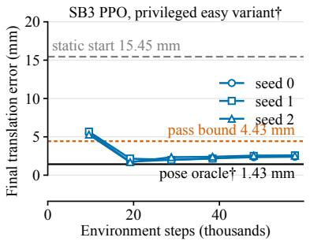

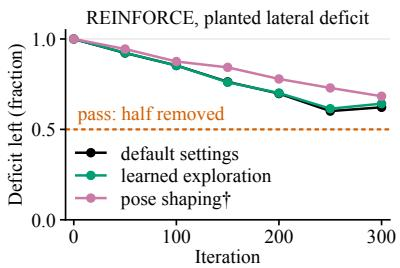  
(a)

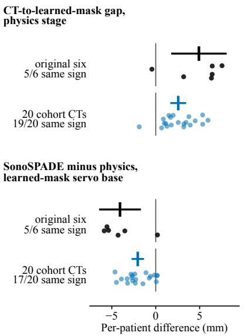  
(b)

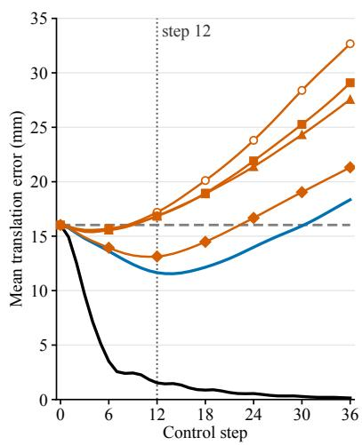  
(c)  
Figure 3: Controls and replication: exploratory results, except the original six patients in (b), which are primary; daggers mark privileged inputs. (a) Top: SB3 PPO on the privileged easy variant, final error on training-patient episodes against environment steps, three seeds, with the static start, pass bound and pose oracle. Bottom: the REINFORCE control, the fraction of the planted lateral deficit left against iteration, three settings, pass line at one half. (b) Per-patient diferences of the two cohort contrasts, original six and 20 cohort CTs, with means and 95% t intervals, also for the original six, whose primary bootstrap intervals are in Table 4. (c) Mean translation error against control step 0 to 36; the dotted line marks the evaluation horizon, step 12. Every contrast is conditional on the trained artifacts (texture networks, segmenters, bases and policies). Seeds index artifacts; the patient is the sampling unit.

Replacing the target-anchored plane with a skin-tangent plane where the start pose’s beam axis enters the skin, with no artifact retrained, changes no level of the oracle ladder detectably (+0 36 to +3 53 mm; Holm p 0.093 to 0.620; MDD 1.71 mm at the experiment’s median SD; Table B.3). The start is still drawn around the target pose, so this plane lies near the target window. This experiment therefore measures a change of contact geometry, not contact free of target information. Both servo bases keep the calibrations fit with the target-anchored plane. Equivalence within ±1 mm is not shown for any level (TOST, Holm p 0.337 to 1.000). Both servo-base diferences are positive in 6/6 patients, with unadjusted intervals above 0, [+0 89, +6 18] and [+0 29, +5 72] mm. In a secondary comparison, the pose oracle’s success at 5 mm and $5 ^ { \circ }$ falls by 62 [46, 77] percentage points (Supplementary Table S6.2).

## 8.4. Label-channel controls and texture budget

Three controls ask whether the SonoSPADE lead comes from label access: out-of-plane label ofsets, permuted organ identities and a label-painted stage. These controls describe label-conditioned stages as a class; the published pertissue method is used unchanged. Permuting the organ identities raises the total final error from 13.13 to 21.69 mm, by +8 56 mm [+4 46, +12 65]. Label ofsets of 3 and 6 mm change it by +0 01 and +0 49 mm. Applied to the observations only, they shift the final elevational displacement by −0 36 mm [−0 87, +0 14] and −0 82 mm [−1 52, −0 11].

For both ofsets, a shift of at least half the ofset is not shown (exploratory). With the label ofset reversed (−3 mm), the shift is +0 40 mm [−0 20, +1 01] (secondary). Given a label slice taken 3 or 6 mm out of plane, the per-tissue stage leads its matched segmenter to follow the given label rather than the anatomy in the physics input. Its labelfollowing index is +0 142 [+0 116, +0 168] and +0 281 [+0 247, +0 315], or 53% and 64% of complete following. With organ identities permuted in the label, the masks follow the permuted identities (+1 137 [+1 038, +1 235], 6/6). A non-learned label-painted physics stage lowers the learned-mask base error below physics (−2 97 mm; exploratory) and recovers 0.73 [0.33, 1.34] of the per-tissue lead. Equivalence with the per-tissue stage is not shown (n = 6). Its TOST within ±1 mm has a power of about 0.01. The painted stage brightens the kidney from a depth-driven median of 1.89 toward a normal liver-to-kidney ratio of 1.14 [72], and draws 12 dB capsule lines, so its 0.73 mixes label access with renderer calibration. Each label-control contrast that meets the decision rule has its sign in 6/6 patients and an exact sign-flip p of 0.031 (paired t and Holm p: 0.003 and 0.009 for the permuted total error, both at most $3 . 3 \times 1 0 ^ { - 5 }$ for the masks, 0.029 for painting).

Neither the training budget nor a single texture seed explains the SonoSPADE lead. We retrained CUT [36] and CycleGAN [14], which the reference pipeline trains on 1,540 frames for 800 iterations, at SonoSPADE’s budget of 4,620 frames and 1,500 iterations, with an exponential moving average (EMA) of their weights. With equal training budgets and three texture seeds per stage, the per-tissue stage gives a lower learned-mask base error than budgetmatched CUT (−4 29 mm [−6 57, −2 00]), CycleGAN (−4 01 [−6 74, −1 27]) and physics (−4 28 [−6 76, −1 80]). All three meet the decision rule, each in 6/6 patients (paired t p 0.005 to 0.013; Holm p 0.014 and exact sign-flip p 0.031 each). Raising CUT and CycleGAN to the per-tissue budget changes their learned-mask base error by +0 37 and +0<sub>.</sub>07 mm (secondary). The policy rows of Table 4 still rest on one texture run per stage.

## 8.5. Replication cohorts

The main contrasts of the six held-out patients recur on the 20 replication CTs, the mask and texture contrasts at about half their size. With physics frames, the CT-mask and learned-mask servos end at 12.80 and 15.36 mm on these CTs. These 20 cases come from the same public dataset (16 of 20 from institute E); this is internal replication, not external validity. On 20 new CTs, learned masks with the physics stage add 2.57 mm over CT masks ([+1 66, +3 47], 19/20, Holm $p = 7 . 4 \times 1 0 ^ { - 5 } ;$ exploratory), replicating the CT-to-learned-mask gap. This gap is about half the +4 92 mm, 5/6, of the six held-out patients. Both gaps are measured on the default render, whose organ boundaries fall below its display window. The physics segmenters reach Dice 0.50 to 0.53 for liver and 0.17 to 0.42 for kidney on held-out simulated frames (post hoc; Supplementary Table S2.9). On real liver frames (Vitale holdout, AUL), they reach 0.58 to 0.69 and SonoSPADE’s 0.40 to 0.58; on KidneyUS kidney, 0.35. Each held-out simulated frame carries its own domain-randomization draw, so none is the default render. On 20 new CTs, the per-tissue stage gives a lower learned-mask base error than physics (−2 04 mm [−2 75, −1 33], 17/20, Holm $p = 7 . 4 \times 1 0 ^ { - 5 } ;$ exploratory). This lead is about half the −4 06 mm, 5/6, of the six held-out patients (Fig. 3b). On 20 new CTs, REINFORCE fine-tuning changes the final error by less than 1 mm in every policy arm (TOST, intersection-union, Holm $p = 7 . 4 \times 1 0 ^ { - 5 }$ ;

exploratory). Applied post hoc to the six held-out patients, a TOST at the same margin shows equivalence in 8 of 8 policy configurations, but the crossed patient-by-seed interval with CUT frames and learned masks reaches +1 18 mm (Supplementary Table S2.7). The intersection-union form of the cohort test was fixed when this post hoc result on the six held-out patients was already known. The rung and stage ordering of the original six recurs on 20 new CTs (100% of the 40 rule-holding pairs keep their sign; Kendall $\tau _ { b } = 0 . 6 1 [ 0 . 4 5 , 0 . 8 2 ] )$ . On 20 new CTs, the servo base under CT masks ends 11.17 mm farther from the target than the privileged pose oracle (oracle-to-CT-mask gap; exploratory). On 20 new CTs, privileged look-ahead ascent on the CT-mask match score (a privileged reference rung) ends below the servo base by 4.96 mm [3.68, 6.23] (exploratory). Both meet the cohort decision rule, with the same sign in 20/20 CTs (exact sign-flip $p = 1 . 9 \times 1 0 ^ { - 6 }$ ; Holm $p = 3 . 8 \times 1 0 ^ { - 6 } )$ . Both are conditional on this renderer: grid-fixed speckle, no elevational beam width, rigid tissue. This bound uses look-ahead sampling seed 0, as pre-specified. With sampling seeds 0 to 2 averaged, it ends at 7.51 mm, 5.13 mm [3.87, 6.39] below the servo base (20/20; exploratory; estimation only; conditional on this renderer; Supplementary S7).

A second cohort of 30 CTs from the public AMOS 2022 dataset [71], with TotalSegmentator v2 labels checked against its manual organ labels and every trained artifact unchanged, replicates the same contrasts (Appendix B.9). Learned masks with the physics stage add 4.01 mm over CT masks (29/30), SonoSPADE frames give the learned-mask servo base a lower error than physics frames (−2 73 mm, 27/30), REINFORCE fine-tuning changes the final error by less than 1 mm in every policy configuration, and the ordering of rungs and stages recurs. This is external replication in simulation only: CT source and label source change together, and no AMOS result speaks to real ultrasound. Whether TotalSegmentator v2 was trained on AMOS images is not recorded, so the labels are treated as in-sample predictions; no artifact of the testbed was trained on an AMOS CT. On 30 AMOS CTs, the servo base under CT masks ends 10.68 mm farther from the target than the privileged pose oracle (oracle-to-CT-mask gap; exploratory). On 30 AMOS CTs, privileged look-ahead ascent on the CT-mask match score (a privileged reference rung) ends below the servo base by 4.51 mm [3.74, 5.29] (exploratory). Both hold in 30/30 CTs, with Monte Carlo sign-flip $p = 1 . 0 \times 1 0 ^ { - 6 }$ (1,000,000 sign vectors, seed 0) and Holm $p = 2 . 0 \times 1 0 ^ { - 6 }$ . Both are conditional on this renderer: grid-fixed speckle, no elevational beam width, rigid tissue. This bound uses look-ahead sampling seed 0, as pre-specified. With sampling seeds 0 to 2 averaged, it ends at 7.40 mm, 4.77 mm [4.05, 5.49] below the servo base (29/30; exploratory; estimation only; conditional on this renderer; Supplementary S7). Appendix B.9 reports, as estimation only, a relabeling control on the 20 replication CTs, a comparison of the two cohorts and the secondary results.

## 8.6. Ofline evaluation on real frames

On public real frames, a classifier distinguishes every texture stage from real images, and selection by the match score gives small organ-overlap gains for some combinations of stage, dataset and organ; this ofline check uses no probe, phantom or robot. The check does not show directed control on real frames (Table 7). Against 60 annotated public frames [15] that no stage trained on, the two-sample classifier’s AUC [69] is 0.701 for CUT, 0.753 for CycleGAN, 0.936 for physics and 0.979 for SonoSPADE (Table A.6). In a post hoc label-permutation null with

Table 7: Outcomes of the real-frame cells of SonoSPADE, the standard engine’s texture stage (all eight testable cells, with the ladder’s other texture settings: Table A.9). Keep-best gain: primary gain over the static start (Table A.8). Selection: organ IoU of the state the match score selects along undirected motion, minus that of a random state. Directed control: the policy’s keep-best gain minus that of magnitude-matched undirected motion with the same selection. Values: exploratory per-subject IoU means [95% subject-by-CT bootstrap CI]. A cell holds if its CI excludes 0 and its Holm p over eight cells is below 0.05. In the holding cell, 38/55 subjects share the sign; exact sign-flip $p = 3 . 4 \times 1 0 ^ { - 4 }$ and Holm $p = 0 . 0 0 3 .$ Elsewhere Holm p is 0.055 to 1.000.
<table><tr><td>Stage</td><td>Keep-best gain</td><td>Selection [CI]</td><td>Outcome</td><td>Directed control [CI]</td><td>Outcome</td></tr><tr><td>SonoSPADE moves the view</td><td>Vitale holdout [15], liver, 12 subjects</td><td>+0.011 [+0.002, +0.024] not detectably better</td><td></td><td></td><td>+0.041 [-0.001, +0.098] selection, not directed contro]</td></tr><tr><td>KidneyUS [73], kidney, 55 subjects</td><td></td><td></td><td></td><td></td><td></td></tr><tr><td></td><td>SonoSPADE moves the view</td><td> $+ 0 . 0 1 5 \ [ + 0 . 0 0 3 , + 0 . 0 2 8 ]$ </td><td>informative selection signal</td><td> $+ 0 . 0 1 4 \left[ - 0 . 0 1 1 , + 0 . 0 3 7 \right]$ </td><td>selection, not directed control</td></tr></table>

200 permutations per stage, the AUC averages 0.50 (SD 0.07) and never reaches the observed value of any stage $( p = 1 / 2 0 1$ each; Supplementary Table S2.16). The physics renderer is closer to real than the authors’ reimplementa tion of LOTUS, with a pooled W1 of 0.0727 against 0.1272 and a lower W1 in 6/6 patients. In a post hoc comparison, the physics renderer’s W1 is also below that of the original LOTUS code, 0.0875, pooled and in 5/6 patients. This W1 is sensitive to display settings, because one domain-randomization draw per view lowers it to 0.0154. The 0.77 sector compression of Section 3.4 enters every real-frame metric and the matched-layout ceiling, the median IoU, 0.56, of 60 real frames against their best-matching held-out CT views. No stage is called realistic. Organ identity counts the scored organs whose most frequent predicted class is correct in both domains. It shows no diference detected across stages on all 60 Vitale frames and on the 18 holdout frames (not powered for equivalence; Table A.7).

The reward, computed on real frames, moves the simulated view toward the real target’s organ layout for liver, and for kidney with SonoSPADE on KidneyUS. Elsewhere there is no reliable improvement on real targets, including every stage on the 4 Vitale kidney targets. Keep-best gains over the static start have CIs above 0 in 7 of 16 combinations (Table A.8), and physics on KidneyUS kidney falls, $\mathrm { a t } - 0 . 0 1 4 [ - 0 . 0 2 6 , - 0 . 0 0 1 ]$ . Under a post hoc bootstrap crossed over targets, CTs and seeds, only SonoSPADE on Vitale-holdout liver keeps a CI above 0, and none also meets a Holm-adjusted t-test (Supplementary S2). Absolute keep-best IoU is 0.303 to 0.344 on Vitale-holdout liver and 0.144 to 0.186 on KidneyUS kidney [73], against a matched-layout ceiling of 0.56 (exploratory). Final-step gains are −0 073 to −0 031 on KidneyUS kidney, negative for all four stages, and +0 016 to +0 050 on Vitale-holdout liver (exploratory). Real-side units are frames or file-stem groups of unknown patient identity and may not be independent.

## 9. Discussion

## 9.1. Principal findings

The answer to the research question is no: in this testbed, published components plugged one slot at a time did not close the gap to the pose oracle. Without privileged input, no level of the ladder succeeded at 5 mm and $5 ^ { \circ }$ in over 5.6% of episodes (post hoc). Among controllers, only the DAgger residual separated from its base (−3 17 mm, 6/6; Section 7.2), a base not detectably closer than the start. In the primary analysis, most of the error $( + 1 0 . 1 \mathrm { t o } + 1 0 . 3 \mathrm { m m }$ 6/6) lies between the pose oracle and the CT-mask servo. The oracle-to-CT-mask gap is not attributed to one cause (conditional on this renderer: grid-fixed speckle, no elevational beam width, rigid tissue). The CT-to-learned-mask gap is the second limit, at +4 80 to +5 26 mm for three of four stages on the nearly isoechoic default render. Across the engine’s texture settings, the smaller CT-to-learned-mask gap went with label access, not with distance to real frames by KID. As the label-painted control of Section 8.4 shows, label access is a property of the engine’s texture stage, not of one method.

## 9.2. Using the testbed and reporting new methods

Unlike hardware tests [22, 24], USB Gym compares components slot by slot against privileged references, in simulation only. A new method can be reported as in Table 5, from at least three training seeds with the patient-by seed interval of Appendix B. One new reference seed is expected within ±1 34 mm of the seed mean (95% prediction interval; Section 8.1). At n = 6, a plugged method’s result is an estimate with its interval, read beside coverage and cost, not a ranking. Of 19 contrasts in the guide’s slots, 15 showed no detectable diference; the task remains under-explored.

## 9.3. Limitations

USB Gym cannot show how tissue deforms under pressure or whether a rendered frame looks real. Deformable ultrasound simulation [74, 75, 76] ofers a route to pressure-dependent images. By default, the renderer has grid-fixed speckle, no elevational beam width and a nearly isoechoic default. The reference renderer was compared with no physical phantom, only with the original LOTUS code, SIMUS and digital phantom bands. The real-frame results score the reward ofline, so we claim no sim-to-real transfer of a policy.

Every absolute error and success rate is conditional on the target-anchored contact plane, one per target window and normal to its beam. The skin-tangent contact plane lies near the target window, so contact still carries target information (Section 8.3); deformable contact with the CT skin itself could remove this dependence. Under the servo base and pose oracle, the probe lags its command by 1.3 to 1.5 mean commanded steps (post hoc; Supplementary Table S2.12). Neither the contact nor the actuation model has been validated against a robot. The loop models no respiration, arm kinematics, tracking noise, contact force in the observation or loss of gel coupling.

Without tuning, no result ranks a method beyond this configuration or for clinical use. The reward weights, the action cost and the DR ranges were set by hand and never varied, and the DR landscape has intervals over three segmenter seeds only (post hoc). The learned-mask controller experiment removes privileged input from the controller and mask source only (Section 7.2). The v2 relabeling (Appendix B.6) uses TotalSegmentator’s own training CTs, so it likely understates an independent segmenter’s label noise. In the AMOS CTs, CT source and label source change together (Section 8.5). Every result was computed on one Apple-silicon laptop. Evaluating the learned-mask servo base on the CPU instead of the laptop’s GPU changes a patient’s final error by up to 0.22 mm (physics stage, seed 0; exploratory), more than the smallest reported diferences, so small contrasts should be compared on one device.

SonoSPADE [4] comes from our group and was used unchanged, so the comparisons against it are not independent of its authors. The guide’s slots were compared on the standard engine only, whose SonoSPADE frames carry label information (Section 8.4).

## 10. Conclusions

Plugged one slot at a time, untuned and at the reference training budget, existing published components did not close the gap to the pose oracle in this simulator. The guide was compared on the standard simulation engine, a physics renderer with the SonoSPADE texture stage, which stays pluggable. To test the testbed, the combination of slot components chosen on six held-out patients, our pipeline with an SSIM reward term, was tested on 20 new CTs. On the standard engine, it was the benchmark baseline, at 13.70 mm (pose oracle 1.47 mm; exploratory; conditional on this renderer). Its 0.26 mm lead over our reference pipeline lies within ±1 mm and is not attributed to SSIM (Section 7.4). Of 19 contrasts in the guide’s slots, 4 difered detectably and 15 did not, 2 of these within ±1 mm (post hoc) and 13 inconclusive at n = 6 (exploratory). The task therefore remains under-explored, with much room for research. The testbed accepts new components in each slot. No policy ran on hardware, so a phantom or robot test is the next step.

## Data and software availability

Software. The code, tests and documentation are public at https://github.com/tohnperfect/USBGym under the Apache License 2.0. Zenodo archives every release [5] under the concept DOI 10.5281/zenodo.23942190, which resolves to the latest; that release’s scripts/paper folder rebuilds every table and figure data file of the article and the supplement from the result files below and compares each with the printed one, except the figure data that need the texture-network checkpoints or the Vitale frames, which the result files leave out. Every printed number can be recomputed from it, and retraining reproduces a result only within the training variability of Section 8.1. The segmenter training code is in the segtrain folder of the code repository. A second Zenodo record [77] holds the result files behind every table, under DOI 10.5281/zenodo.23913142. Appendix C lists every plugged method of each slot from these files (Table C.1).

Data. All data behind the results come from public datasets. CT anatomy, including the 20 replication CTs, comes from the TotalSegmentator dataset [3] under CC BY 4.0. The 30 CTs of the external cohort come from AMOS 2022 [71]. Its dataset description states CC BY-SA 4.0 and its Zenodo record CC BY 4.0, so any derivative is released, if at all, under CC BY-SA 4.0 with attribution. Real abdominal frames come from the public Kaggle set of Vitale et al. [15], whose page reserves the data files to their original authors and asks users to cite [15]. Real kidney frames come from KidneyUS [73] under CC BY-NC-SA. Its maintainers grant access only after registration and manual approval. Segmenter weights trained on KidneyUS are not released; the segtrain folder of the code repository retrains them from the datasets above. Real liver frames come from the Annotated Ultrasound Liver dataset [78, 79] under CC BY 4.0. The liver frames, the KidneyUS holdout split and a group-disjoint Vitale holdout serve only as real targets. Fig. A.3 reproduces frames of the public Vitale set [80].

Third-party code and weights. The plugged methods use third-party code and weights under their own licenses. Supplementary S3 lists each license.

## Ethics statement

The results use only public, de-identified datasets. No new human or animal data were collected. No experiment involved human participants. Ethical approval was therefore not sought.

## CRediT authorship contribution statement

Thanapong Intharah: Conceptualization, Methodology, Software, Validation, Formal analysis, Investigation, Data curation, Visualization, Writing (original draft), Writing (review and editing), Project administration, Funding acquisition. Zhichao Gao: Conceptualization, Methodology. Yiliang Liu: Conceptualization, Validation. Hao Dong: Supervision.

## Declaration of competing interest

Three of the authors, T. Intharah, Z. Gao and H. Dong, developed SonoSPADE [4]. This study uses SonoSPADE, with its method unchanged, as the texture stage of its standard simulation engine. The authors declare no other known competing financial interests or personal relationships that could have appeared to influence the work reported in this paper.

## Declaration of generative AI and AI-assisted technologies in the manuscript preparation process

During the preparation of this work the authors used Claude Code (Anthropic) in order to draft and edit the text, write and test the testbed and analysis code, and run the experiments and analyses. The tool ran the models Claude Opus 4.8, Claude Opus 5 and Claude Opus 5.5, as the commit history of the code records. It also checked the references against Crossref and PubMed. The authors reviewed the text in successive drafts and checked the code through its test suite, run on Linux, Windows and macOS, and through the scripts that rebuild every table and figure data file from the archived results. After using this tool, the authors reviewed and edited the content as needed and take full responsibility for the content of the published article.

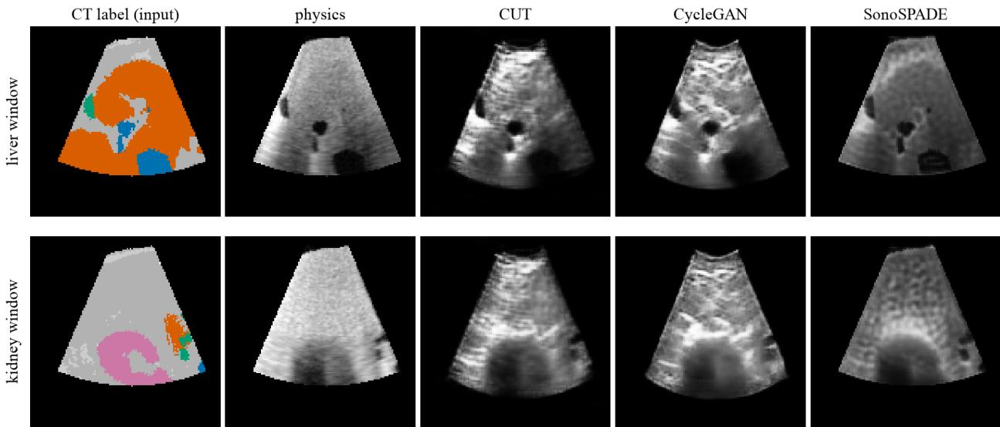  
Figure A.1: What the testbed renders: one held-out view under the four reference texture stages, from patient s0513 at the target pose of its first screened liver window (top) and kidney window (bottom). Left: the CT label map, with orange liver, green gallbladder, blue vessel, pink kidney and gray other tissue. Physics: the sector-warped render without domain randomization and with a fixed speckle seed, in which liver and surrounding tissue are nearly isoechoic (Section 3.4). CUT, CycleGAN and SonoSPADE act on that frame, and SonoSPADE also receives the label map. Supplementary Fig. S3.1 shows the same patient under the renderer-slot simulators. The figure is qualitative.

## Funding

This research has received funding support from the NSRF via the Program Management Unit for Human Resources & Institutional Development, Research and Innovation [grant number B13F680141] and the NSRF via the Research and Innovation Acceleration Agency for Competitiveness and Area Development (RCAD) (Program Management Unit for Frontier Brainpower and Future Industries) [grant number B13T690002-4].

## Appendix A. Evaluation details and supporting results

This appendix reports the details of the controls, the supporting result tables and renders of the four reference texture stages, and four post hoc items: the step curves, the per-axis and keep-best tables of the closed loop and the lowest-error table. Supplementary S5 gives the testbed details and the designs of these evaluations.

## Appendix A.1. Case split and reference texture stages

The 13 training cases are s0011, s0058, s0344, s0461, s0477, s0511, s0522, s0703, s0720, s0727, s0777, s1086 and s1373. The six held-out cases are s0358, s0513, s0519, s0591, s0649 and s0762. Supplementary S5 lists the window screens (Supplementary Table S5.1), the gel coupling and the start lift.

Fig. A.1, cited in Section 3.4, shows one held-out view under the four reference texture stages.

## Appendix A.2. Details of the controls

All results of this subsection are exploratory; they complete the controls that Sections 6 and 8 and Table 6 summarize.

Independent target speckle. Two of the four comparisons use the hill-climb, a pose-free controller that keeps a random step only when the match score rises. The CT-mask servo base reads only CT label slices, so an independent target speckle field leaves it unchanged by construction. With a target speckle field independent of the observation’s, the learned-mask servo base changes by −0<sub>.</sub>63 mm [−2<sub>.</sub>04, +0<sub>.</sub>78] (secondary). With a target speckle field independent of the observation’s, the hill-climb under CT masks changes by +0 05 mm [−0 13, +0 24] (secondary). With a target speckle field independent of the observation’s, the hill-climb under learned masks changes by −0 14 mm [−0 71, +0 42] (secondary).

Second gap-cause family. Every sentence of this paragraph is conditional on this renderer: grid-fixed speckle, no elevational beam width, rigid tissue. Privileged look-ahead ascent ends 7.03 mm [4.48, 9.58] farther from the target than the pose oracle (6/6; exploratory, look-ahead seeds 0 to 2). With per-tissue appearance, privileged look-ahead ascent on the CT-mask match score ends below the servo base by 4.67 mm [1.57, 7.77] (6/6; exploratory, look-ahead seed 0 only). At 36 steps, privileged look-ahead ascent on the CT-mask match score ends below the 36-step servo base by 13.36 mm [9.20, 17.52] (6/6; exploratory, look-ahead seed 0 only). Ambiguity is measured against each target’s own score, rescored with three fresh speckle pairs, at δ = 0 01, and the proximity clauses are one-sided t bounds. The level-set search uses 2000 start draws in every condition, distance shells, ridge seeds and cross-entropy refinement (pre-specified). With $S _ { \mathrm { s e g } }$ alone, poses 5 mm or more from the target score within 0.01 of the target’s own score for 0/60 targets (0/6 patients with a majority; margin 0.100 [0.076, 0.124]). With CT masks and per-tissue appearance, poses 5 mm or more from the target score within 0.01 of the target’s own score for 0/60 targets (0/6 patients with a majority; margin 0.073 [0.058, 0.089]). With learned masks and the physics stage, poses 5 mm or more from the target score within 0.01 of the target’s own score for 6/60 targets (0/6 patients with a majority; margin 0.056 [0.035, 0.076]). With learned masks and the CUT stage, poses 5 mm or more from the target score within 0.01 of the target’s own score for 9/60 targets (0/6 patients with a majority; margin 0.056 [0.043, 0.070]). With learned masks and the CycleGAN stage, poses 5 mm or more from the target score within 0.01 of the target’s own score for 8/60 targets (1/6 patients with a majority; margin 0.053 [0.040, 0.066]). With learned masks and the per-tissue stage, poses 5 mm or more from the target score within 0.01 of the target’s own score for 4/60 targets (0/6 patients with a majority; margin 0.060 [0.043, 0.077]). Each level set was rescored on fresh speckle fields. The gap-cause class is mixed, because both single-cause classes fail on their bound clauses, which do not depend on the rescoring.

Second imaging plane. The gap-cause test was also run with a second imaging plane, the probe pose turned 90<sup>◦</sup> about its beam axis: each plane is scored against its own target plane, and the score is the mean of the two (conditional on this renderer: grid-fixed speckle, no elevational beam width, rigid tissue). It repeats the CT-mask level set, searched at 2, 5 and 10 mm and read at 5 mm, and privileged look-ahead ascent, the bound of the test, at look-ahead seed 0 and 12 steps, both with this score. With a second, orthogonal imaging plane, 0/6 patients are ambiguous at 5 mm (single plane: 0/6), and the bound ends at 5.75 mm (exploratory). The bound is a privileged reference, not a bound on other controllers.

Tissue-anchored speckle. The gap-cause test was also run with speckle fixed to tissue on a 0.23 mm lattice, with observation and target sharing one anchored field or drawing independent ones (estimation only; Supplementary S7). Every result of this paragraph under the anchored mode is conditional on this renderer with tissue-anchored speckle: no elevational beam width, rigid tissue. With no elevational beam width, the speckle of one field changes completely within about one lattice spacing of out-of-plane motion. With speckle anchored to tissue, 0/6 patients are ambiguous at 5 mm and the bound ends at 8.77 mm (exploratory). With the target drawn from an independent anchored field, so that speckle carries no match information, 0/6 patients are ambiguous at 5 mm and the bound ends at 8.26 mm. With grid-fixed speckle, 0/6 were ambiguous and the bound ended at 8.55 mm, and the independent-field bound ends 0.30 mm [−0 57, 1.17] below it (2/6; exploratory; estimation only; Supplementary S7). This variant assigns no gapcause class, and the class stays mixed. Supplementary S7 gives the level-set margins and the contrasts of both bounds with the servo base and the pose oracle.

Shared speckle field. Under CT masks with physics frames, the gap-cause test also scored each pose against a target that shares the observation’s speckle field. Scoring against a target that shares the observation’s speckle field raises the score at 98.1% of the 229,631 scored poses (smallest shared minus independent −0 0105; mean +0 0043). With it, the largest score 5 mm or more away is 0.924, against 1.000 at the target (conditional on this renderer: grid-fixed speckle, no elevational beam width, rigid tissue).

Hill-climb. Hill-climbing on the match score does not end below the servo base within 12 steps under either mask source. Supplementary S7 gives three further pose-free rungs and, beyond physics frames, the hill-climb under the other three texture stages (estimation only).

Base fit. The base fit refits the servo base to the analytic twist per channel on 500 fresh pairs of training patients and 500 held-out pairs. It reads $\mathbf { R } ^ { 2 }$ of 0.2 to 0.5 as partly and below 0.2 as barely predicting. Channels vx to wz are the lateral, elevational and axial translations, then the rotations about those axes. Under CT masks, on held-out pairs the servo base partly predicts wy $( \mathsf { R } ^ { 2 } \ 0 . 3 1 $ to 0.41; fresh TRAIN pairs 0.37 to 0.38) and its gains shrink to $\mathbf { b } = 0 . 3 2$ to 0.39. It barely predicts vx, vy, vz, wx and wz (held-out $\mathbf { R } ^ { 2 }$ at most 0.13; fresh TRAIN pairs at most 0.17), and its gains on them shrink to $\mathbf { b } = - 0 . 0 3$ to 0.18. Under learned masks, on held-out pairs the servo base barely predicts all six channels $( \mathbf { R } ^ { 2 } - 0 . 1 8 8 \mathrm { t o } 0 . 1 9 8 ;$ fresh TRAIN pairs −0 091 to 0.240) and its gains shrink to b = −0 03 to 0.25. Supplementary S7 repeats this fit for a servo base whose map is a multilayer perceptron and for the servo base under learned masks with the other three texture stages (estimation only).

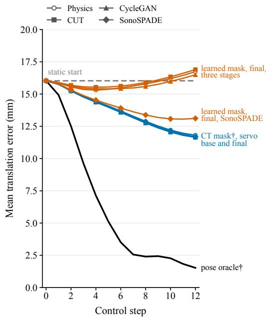  
Figure A.2: Mean translation error against control step on the six held-out patients, with contact on and no domain randomization at evaluation (post hoc). Lines show the static start, the pose oracle, the CT-mask servo base and final policies, and the learned-mask final policies. The CT-mask servos improve up to step 12, while three learned-mask policies are lowest at step 4 or 5 and then drift away. Supplementary Fig. S2.1 shows each patient’s final error on every rung. Every contrast is conditional on the trained artifacts (texture networks, segmenters, bases and policies). Seeds index artifacts; the patient is the sampling unit.

Keep-best error. In the exploratory 36-step experiment, the post hoc keep-best error of the CT-mask servo base is 10.30 mm, against a final error of 18.34 mm (Table A.1; Supplementary Table S2.13 splits the error by axis at 0, 12 and 36 steps).

Step curves. Fig. A.2 plots the mean translation error against the control step for the static start, the pose oracle and the CT-mask and learned-mask servos (post hoc). Supplementary Tables S2.1 to S2.3 give the rotation error, success rate and match score of every level, the split by target organ and the error at each step.

Label-painted stage. The painted stage sets the kidney echogenicity from the published normal hepatorenal index [72], draws a 12 dB capsule line as a design constant and leaves organs without a published quantitative ratio at the physics level; its efect counts as reproduced only if a TOST at ±1 mm passes. The painted stage’s segmenters reach a held-out simulated Dice of 0.56 to 0.63, and a real-frame Dice of 0.35 to 0.71 on liver and 0.37 to 0.40 on kidney. Against real frames, the painted stage has a W1 of 0.083, a KID of 0.205 and a C2ST AUC of 0.942, against 0.073, 0.220 and 0.936 for physics frames. No stage is called realistic.

Window yield of the replication cohort. The window screen passed 11 of 12 thorax-abdomen-pelvis, 8 of 11 polytrauma, 5 of 6 neck-thorax-abdomen-pelvis and 5 of 5 whole-body studies. The 20 accepted cases comprise 9, 6, 3 and 2 studies of these types.

## Appendix A.3. Appearance-term learnability

Appendix A.3, Appendix A.4 and Appendix A.5 compare the four texture stages with task and windows held fixed. The learnability and DR landscape results come from simulation alone. Learnability is the Spearman correlation between the appearance term and closeness, the negative translation distance to the target, so a higher value means a more pose-sensitive term. Each contrast uses $\Delta z ,$ the per-patient diference in mean Fisher-transformed correlation, SonoSPADE minus the other stage.

Table A.1: Keep-best error against final error, contact on (post hoc). Keep-best is the translation error at the step of highest match score S , a selection that reads no pose. The 12-step rows are the episodes of Table 4, seeds pooled; four-stage rows average the four stages. The 36-step rows are exploratory. Plug rows use the episodes and seeds of Table 5. <sup>†</sup>Privileged.
<table><tr><td>Row</td><td>Final (mm)</td><td>Keep-best (mm)</td></tr><tr><td colspan="3">Reference ladder, 12 steps</td></tr><tr><td>Static start</td><td>16.03</td><td>16.03</td></tr><tr><td>Scripted sweep</td><td>15.52</td><td>15.57</td></tr><tr><td>Pose oracle†</td><td>1.53</td><td>1.49</td></tr><tr><td>CT-mask servo base†, four stages</td><td>11.65</td><td>11.25</td></tr><tr><td>CT mask†, after imitation, four stages</td><td>11.74</td><td>11.40</td></tr><tr><td>CT mask†, final, four stages</td><td>11.71</td><td>11.39</td></tr><tr><td>Learned mask, servo base, physics</td><td>17.20</td><td>15.36</td></tr><tr><td>Learned mask, final, physics</td><td>16.73</td><td>15.25</td></tr><tr><td>Learned mask, servo base, CUT</td><td>16.84</td><td>15.63</td></tr><tr><td>Learned mask, final, CUT</td><td>16.90</td><td>15.87</td></tr><tr><td>Learned mask, servo base, CycleGAN</td><td>16.85</td><td>15.55</td></tr><tr><td>Learned mask, final, CycleGAN</td><td>16.50</td><td>15.30</td></tr><tr><td>Learned mask, servo base, SonoSPADE</td><td>13.13</td><td>12.44</td></tr><tr><td>Learned mask, final, SonoSPADE</td><td>13.11</td><td>12.52</td></tr><tr><td colspan="3">36 steps (exploratory)</td></tr><tr><td>CT-mask servo base†</td><td>18.34</td><td>10.30</td></tr><tr><td>Pose oracle†</td><td>0.14</td><td>0.14</td></tr><tr><td>Scripted sweep</td><td>15.84</td><td>15.44</td></tr><tr><td>Learned mask, servo base, physics</td><td>32.67</td><td>17.71</td></tr><tr><td>Learned mask, servo base, CUT</td><td>29.09</td><td>17.08</td></tr><tr><td>Learned mask, servo base, CycleGAN</td><td>27.56</td><td>16.96</td></tr><tr><td>Learned mask, servo base, SonoSPADE Plug rows, 12 steps</td><td>21.32</td><td>12.24</td></tr><tr><td colspan="3">Texture: SonoSPADE (reference)</td></tr><tr><td></td><td>13.13</td><td>12.44</td></tr><tr><td>Texture: none, physics frame</td><td>17.20</td><td>15.36</td></tr><tr><td>Texture: CUT</td><td>16.84</td><td>15.63</td></tr><tr><td>Texture: CycleGAN</td><td>16.85</td><td>15.55</td></tr><tr><td>Texture: FastCUT</td><td>16.13</td><td>14.62</td></tr><tr><td>Mask: U-Net (reference)</td><td>13.13</td><td>12.44</td></tr><tr><td>Mask: CT label†</td><td>11.65</td><td>11.19</td></tr><tr><td>Mask: LR-ASPP, MobileNetV3-L</td><td>12.76</td><td>11.95</td></tr><tr><td>Mask: DeepLabV3, MobileNetV3-L</td><td>14.54</td><td>13.43</td></tr><tr><td>Mask: DeepLabV3, ResNet-50</td><td>13.20</td><td>12.24</td></tr><tr><td>Mask: nnU-Net 2D, 2 epochs</td><td>14.88</td><td>13.99</td></tr><tr><td>Mask: SAM, U-Net boxes</td><td>14.32</td><td>13.12</td></tr><tr><td>Mask: MedSAM, U-Net boxes</td><td>12.85</td><td>12.52</td></tr><tr><td>Mask: SAM, CT boxes†</td><td>12.60</td><td>11.89</td></tr><tr><td>Mask: MedSAM, CT boxes†</td><td>12.12</td><td>11.65</td></tr><tr><td>Controller: REINFORCE residual (reference)</td><td>11.69</td><td>11.37</td></tr><tr><td>Controller: servo base alone</td><td>11.65</td><td>11.19</td></tr><tr><td>Controller: REINFORCE, BatchNorm eval</td><td>11.70</td><td>11.39</td></tr><tr><td>Controller: PPO, residual</td><td>11.50</td><td>11.32</td></tr><tr><td>Controller: SAC, residual</td><td>12.06</td><td>10.90</td></tr><tr><td>Controller: A2C, residual</td><td>18.43</td><td>13.66</td></tr><tr><td>Controller: PPO, full twist</td><td>14.34</td><td>14.32</td></tr><tr><td>Controller: DQN, 13 moves</td><td>16.41</td><td>14.95</td></tr><tr><td>Controller: BC, residual</td><td>11.25</td><td>10.18</td></tr><tr><td>Controller: DAgger, residual</td><td>10.85</td><td>9.53</td></tr><tr><td>Controller: BC, residual, BatchNorm train</td><td>12.67</td><td>12.31</td></tr><tr><td>Controller: DAgger, residual, BatchNorm train</td><td>12.89</td><td>12.44</td></tr><tr><td>Controller: CEM look-ahead†</td><td>6.98</td><td>7.05</td></tr><tr><td>Reward: paper S (reference)</td><td>11.97</td><td>11.67</td></tr><tr><td>Reward: organ overlap only</td><td></td><td>11.88</td></tr><tr><td></td><td>11.91</td><td></td></tr><tr><td>Reward: appearance NCC only</td><td>12.06</td><td>11.70</td></tr><tr><td>Reward: NCC over the sector</td><td>11.99</td><td>11.68</td></tr><tr><td>Reward: SSIM term Reward: NMI term</td><td>11.92</td><td>11.69</td></tr><tr><td>Reward: change in pose distance</td><td>11.98</td><td>11.71</td></tr><tr><td>Reward: pose distance plus area</td><td>11.92 11.90</td><td>11.61 11.62</td></tr><tr><td>Renderer: physics (reference)</td><td>11.81</td><td>11.41</td></tr><tr><td>Renderer: LOTUS, authors&#x27; reimplementation</td><td>11.86</td><td>11.50</td></tr><tr><td>Renderer: SIMUS</td><td>12.40</td><td>11.74</td></tr></table>

Table A.2: Appearance-term learnability on the 6 held-out patients. Each target view (5 per patient and organ, 60 in all) is compared with 40 nearby probe poses; the per-view score is the Spearman correlation between the sector-interior appearance match and closeness to the target pose. (a) SonoSPADE against each other stage: mean per-view Spearman of both stages, the mean over patients of the per-patient diference in mean Fisher-z (∆z), its 95% patient-cluster bootstrap CI, and the number of patients that share its sign. Rule: a diference under the CI-and-sign rule. The pooled rows are the pre-specified primary contrast. (b) Exploratory renderer-term ablation, not pre-specified: mean per-view Spearman with one renderer term switched of. Interface reflection of: no transmission loss or specular echo at tissue interfaces, attenuation kept. Difuse scattering of: scattering strength 0. Depth variation of the PSF of: a depth-invariant lateral width. Flat means the appearance term is constant over poses, so the correlation is undefined. DR is of throughout.  
(a) SonoSPADE against each other texture stage
<table><tr><td>Scope</td><td>Views</td><td>Other stage</td><td>Spearman, SonoSPADE / other</td><td>∆z</td><td>95% CI</td><td>k/6, rule</td></tr><tr><td>Pooled</td><td>60</td><td>Physics</td><td>0.613 / 0.542</td><td>+0.107</td><td>[+0.075, +0.138]</td><td>6/6, yes</td></tr><tr><td></td><td></td><td>CUT</td><td>0.613 / 0.544</td><td>+0.105</td><td>[+0.074, +0.144]</td><td>6/6, yes</td></tr><tr><td></td><td></td><td>CycleGAN</td><td>0.613 / 0.548</td><td>+0.098</td><td>[+0.065, +0.127]</td><td>6/6, yes</td></tr><tr><td>Liver</td><td>30</td><td>Physics</td><td>0.585 / 0.502</td><td>+0.127</td><td>[+0.080, +0.170]</td><td>6/6, yes</td></tr><tr><td></td><td></td><td>CUT</td><td>0.585 / 0.512</td><td>+0.110</td><td>[+0.067, +0.150]</td><td>6/6, yes</td></tr><tr><td></td><td></td><td>CycleGAN</td><td>0.585 / 0.514</td><td>+0.108</td><td>[+0.051,+0.160]</td><td>5/6, yes</td></tr><tr><td>Kidney</td><td>30</td><td>Physics</td><td>0.642 / 0.582</td><td>+0.088</td><td>[+0.062,+0.117]</td><td>6/6, yes</td></tr><tr><td></td><td></td><td>CUT</td><td>0.642 / 0.576</td><td>+0.099</td><td>[+0.052, +0.156]</td><td>6/6, yes</td></tr><tr><td></td><td></td><td>CycleGAN</td><td>0.642 / 0.583</td><td>+0.088</td><td>[+0.065, +0.113]</td><td>6/6, yes</td></tr></table>

(b) Renderer-term ablation, mean per-view Spearman
<table><tr><td>Term switched off</td><td>Physics</td><td>CUT</td><td>CycleGAN</td><td>SonoSPADE</td></tr><tr><td>None (full renderer)</td><td>0.542</td><td>0.544</td><td>0.548</td><td>0.613</td></tr><tr><td>Interface reflection</td><td>0.535</td><td>0.545</td><td>0.551</td><td>0.613</td></tr><tr><td>Diffuse scattering</td><td>0.476</td><td>0.540</td><td>0.508</td><td>0.647</td></tr><tr><td>Depth variation of the PSF</td><td>0.535</td><td>0.547</td><td>0.548</td><td>0.614</td></tr><tr><td>All three</td><td>flat</td><td>flat</td><td>flat</td><td>0.641</td></tr></table>

Per-tissue texture gives the most pose-sensitive appearance term of the four stages. Pooled over organs, the mean correlation is 0.613 for SonoSPADE and 0.542 to 0.548 for physics, CUT and CycleGAN (Table A.2; Supplementary Fig. S2.2 draws the landscape). Against each of the three, ∆z is +0 098 to +0 107, each CI excludes 0, and the sign agrees in 6/6 patients. The CI-and-sign rule is also met within each organ, with ∆z of +0 108 to +0 127 for liver (6/6, 6/6 and 5/6 patients) and +0 088 to +0 099 for kidney (6/6 each).

An exploratory renderer-term ablation, not pre-specified, switches of one term of the physics renderer at a time and then all three (Table A.2, part b). Switching of interface reflection or the depth variation of the PSF moves no mean correlation by more than 0.007. Switching of difuse scattering lowers physics to 0.476 and CycleGAN to 0.508, leaves CUT at 0.540 and raises SonoSPADE to 0.647. With all three switched of, the appearance term of physics, CUT and CycleGAN is constant across poses. SonoSPADE’s appearance term, whose input also includes the

Table A.3: Domain-randomization (DR) knobs. When DR is on, each knob is drawn uniformly from its range once per episode and shared by the target and the observations. DR is of in training and evaluation for Tables 4 and A.2; Table A.4 reports the DR arms. Efect: mean absolute change of the in-sector pixel intensity (scale 0 to 1, ×100) when the knob alone moves to the low (lo) or high (hi) end of its range, with the speckle seed fixed, over 60 frames (6 held-out patients × 10 jittered window poses), with each texture stage applied (physics: none). <sup>†</sup>Drawn independently per tissue label and measured one label at a time (mean over labels covering at least 1% of the sector). The speckle and noise seed is also redrawn per episode. The reference rows give the change from a new seed alone, a 5 mm in-plane slide and a full DR draw (5 draws per frame, 300 in all). The two weakest knobs, impedance multiplier and overall gain, change the frame by at most 0.21 and 0.48.
<table><tr><td></td><td></td><td></td><td colspan="2">Physics</td><td colspan="2">CUT</td><td colspan="2">CycleGAN</td><td colspan="2">SonoSPADE</td></tr><tr><td>Knob</td><td>Default</td><td>Range</td><td>lo</td><td>hi</td><td>lo</td><td>hi</td><td>lo</td><td>hi</td><td>lo</td><td>hi</td></tr><tr><td>Overall gain</td><td>1</td><td>[0.8, 1.25]</td><td>0.44</td><td>0.38</td><td>0.38</td><td>0.32</td><td>0.48</td><td>0.43</td><td>0.21</td><td>0.18</td></tr><tr><td>Time-gain slope</td><td>1</td><td>[0.6, 1.4]</td><td>18.96</td><td>17.70</td><td>14.50</td><td>14.33</td><td>15.93</td><td>14.60</td><td>9.76</td><td>10.34</td></tr><tr><td>Lateral PSF σ at focus (px)</td><td>1.1</td><td>[0.8, 1.6]</td><td>1.16</td><td>1.53</td><td>1.42</td><td>1.90</td><td>1.51</td><td>1.98</td><td>0.76</td><td>1.02</td></tr><tr><td>Focal depth (m)</td><td>0.05</td><td>[0.03, 0.08]</td><td>2.70</td><td>2.69</td><td>2.95</td><td>3.07</td><td>2.71</td><td>2.93</td><td>1.39</td><td>1.45</td></tr><tr><td>Speckle strength</td><td>0.9</td><td>[0.6, 1.2]</td><td>0.86</td><td>0.50</td><td>0.72</td><td>0.41</td><td>0.91</td><td>0.55</td><td>0.40</td><td>0.23</td></tr><tr><td>Electronic noise σ</td><td>0.004</td><td>[0, 0.05]</td><td>1.84</td><td>9.53</td><td>1.51</td><td>8.94</td><td>1.97</td><td>9.65</td><td>0.82</td><td>4.43</td></tr><tr><td>Dynamic range (dB)</td><td>50</td><td>[45,60]</td><td>3.70</td><td>6.31</td><td>2.46</td><td>4.04</td><td>2.84</td><td>4.42</td><td>1.31</td><td>2.08</td></tr><tr><td>Impedance multiplier†</td><td>1</td><td>[0.9, 1.1]</td><td>0.18</td><td>0.16</td><td>0.20</td><td>0.19</td><td>0.21</td><td>0.19</td><td>0.12</td><td>0.11</td></tr><tr><td>Attenuation multiplier†</td><td>1</td><td>[0.7, 1.4]</td><td>4.88</td><td>5.57</td><td>4.27</td><td>4.79</td><td>4.25</td><td>5.06</td><td>2.70</td><td>3.05</td></tr><tr><td>Backscatter multiplier†</td><td>1</td><td>[0.7, 1.4]</td><td>1.22</td><td>1.36</td><td>1.87</td><td>1.90</td><td>1.77</td><td>1.84</td><td>0.80</td><td>0.80</td></tr><tr><td>New speckle seed only</td><td></td><td></td><td colspan="2">3.88</td><td colspan="2">5.69</td><td colspan="2">5.32</td><td colspan="2">3.16</td></tr><tr><td>5 mm in-plane slide Full DR draw</td><td></td><td></td><td colspan="2">7.21 14.76</td><td colspan="2">7.68 13.61</td><td colspan="2">8.00 13.83</td><td colspan="2">6.40 7.78</td></tr></table>

tissue-label slice, stays pose-sensitive at 0.641.

## Appendix A.4. DR knobs and the DR landscape

Table A.3 lists each randomized render parameter with its range and the mean absolute in-sector pixel change at each end, in hundredths of the intensity range. A full DR draw changes the frame by 13.61 to 14.76 for physics, CUT and CycleGAN and by 7.78 for SonoSPADE, against 6.40 to 8.00 for a 5 mm probe slide. The overall gain and the impedance multiplier are nearly inert, changing it by at most 0.48 at either end of their ranges.

The DR landscape repeats the learnability measurement with DR of, with one draw shared by target and samples, with independent draws for each, and with a new speckle seed only. Under independent draws, the appearance term’s mean correlation falls from 0.542–0.548 to 0.320–0.327 for physics, CUT and CycleGAN and from 0.613 to 0.508 for SonoSPADE. With a new speckle seed only, it stays within 0.005 of the DR-of value, so the speckle seed alone does not explain the drop.

With the CT mask, the combined reward keeps 95 to 97% of its DR-of correlation under independent draws, so all four stages meet the pre-specified 80% retention rule. Its pose sensitivity under randomization then rests on the segmentation term rather than on texture. With each stage’s own seed-0 segmenter, it keeps 96% for SonoSPADE and 51 to 56% for the other three stages, so only SonoSPADE meets the rule. Over segmenter seeds 0 to 2, it keeps 95 to 97% for SonoSPADE and 51 to 61% for the other three stages (post hoc; Supplementary Table S2.17). In every seed, only SonoSPADE meets the rule. The learned segmentation term shows the same split, falling from 0.453–0.482 to 0.173–0.233 for the other stages while SonoSPADE’s moves from 0.604 to 0.594. These statements concern the reward landscape, and Appendix A.5 reports the policy side.

Table A.4: Contact and domain-randomization (DR) contrasts on the final pose error (mm), 6 held-out patients, 3 seeds, the crossed episodes of Table 4. Contact rows: contact switched of at evaluation only, minus contact on, for every rung. The static start never moves, so its delta is 0 to numerical precision. The reference rungs and the CT-mask servo base do not depend on the texture stage and give one value (all). DR rows: the SonoSPADE CT-mask arm with DR in evaluation, in training, or in both, minus the same arm without DR (11.69 mm); these rows are descriptive. Each row gives the mean of per-patient paired diferences, a 95% patient-cluster bootstrap CI and the number of patients that share the sign of the mean. <sup>∗</sup>: a diference under the CI-and-sign rule. <sup>H</sup>: also passes Holm on the paired t-test over the 16 contact rows (post hoc; Supplementary Table S2.18); 5 of the 14 starred rows do not.
<table><tr><td>Rung</td><td>Stage</td><td>Mean</td><td>95% CI</td><td>k/6</td></tr><tr><td>Contact off minus on</td><td></td><td></td><td></td><td></td></tr><tr><td>Static start</td><td>all</td><td>0.00</td><td>[0.00,0.00]</td><td>n/a</td></tr><tr><td>Scripted sweep</td><td>all</td><td>+0.26*H</td><td>[+0.19, +0.33]</td><td>6/6</td></tr><tr><td>Pose oracle (privileged)</td><td>all</td><td>-0.17*</td><td>[-0.25,-0.08]</td><td>5/6</td></tr><tr><td>Servo base, CT mask</td><td>all</td><td>+2.98*H</td><td>[+2.63, +3.29]</td><td>6/6</td></tr><tr><td>Servo base, learned</td><td>Physics</td><td>+0.88*</td><td>[+0.22, +1.35]</td><td>5/6</td></tr><tr><td></td><td>CUT</td><td>+1.26*H</td><td>[+0.75,+1.70]</td><td>6/6</td></tr><tr><td></td><td>CycleGAN</td><td>+0.83*</td><td>[+0.33, +1.36]</td><td>6/6</td></tr><tr><td></td><td>SonoSPADE</td><td>+1.86*H</td><td>[+1.64, +2.07]</td><td>6/6</td></tr><tr><td>Final servo, CT mask</td><td>Physics</td><td>+2.96*H</td><td>[+2.55, +3.38]</td><td>6/6</td></tr><tr><td></td><td>CUT</td><td>+2.87*H</td><td>[+2.44, +3.25]</td><td>6/6</td></tr><tr><td></td><td>CycleGAN</td><td>+2.72*H</td><td>[+2.16, +3.28]</td><td>6/6</td></tr><tr><td>Final servo, learned</td><td>SonoSPADE</td><td>+2.92*H</td><td>[+2.39, +3.42]</td><td>6/6</td></tr><tr><td></td><td>Physics</td><td>+0.82</td><td>[+0.08, +1.56]</td><td>4/6</td></tr><tr><td></td><td>CUT</td><td>+1.04*</td><td>[+0.65,+1.56]</td><td>6/6</td></tr><tr><td></td><td>CycleGAN</td><td>+0.92*</td><td>[+0.32, +1.68]</td><td>6/6</td></tr><tr><td></td><td>SonoSPADE</td><td>+1.97*H</td><td>[+1.50, +2.42]</td><td>6/6</td></tr><tr><td colspan="3">DR minus no DR, SonoSPADE, CT mask (descriptive)</td><td></td><td></td></tr><tr><td colspan="2">DR in evaluation only</td><td>+0.04</td><td>[-0.01, +0.12]</td><td>3/6</td></tr><tr><td colspan="2">DR in training only</td><td>+0.10</td><td>[-0.06, +0.29]</td><td>5/6</td></tr><tr><td colspan="2">DR in training and evaluation</td><td>+0.15</td><td>[-0.07,+0.37]</td><td>4/6</td></tr></table>

## Appendix A.5. Contact and DR in the closed loop

Table A.4 reports, as measured, the contact-of minus contact-on delta at every level of the oracle ladder that Section 6 summarizes. The 5 mm press cap and rigid tissue stay unchanged when contact is of.

Turning contact of raises the CT-mask servo-base error by 3.0 mm (6/6). With learned masks it raises the final error by 0.8 to 2.0 mm and the servo-base error by 0.8 to 1.9 mm. Of all servo deltas, only the final one under learned masks with physics frames, +0 82 mm (4/6), does not meet the decision rule. In the post hoc per-axis split of Table A.5, contact lowers the mean axial error and both tilts of every level, including the scripted sweep, which reads no image.

The DR ablation is pre-specified as descriptive. With DR at evaluation, in training or in both, the final error changes by +0<sub>.</sub>04 to +0<sub>.</sub>15 mm against the SonoSPADE CT-mask configuration without DR. Every CI includes 0, so we make no claim that DR helps the policy.

Table A.5: Per-axis final error with contact on and of, 12 steps, the 60 held-out episodes (post hoc). Errors are patient-level means of the absolute SE(3)-log component in the target probe frame: lateral, elevational and axial translation, and out-of-plane tilt, in-plane tilt and roll. Base and policy rows pool seeds 0 to 2; four-stage rows also pool the four texture stages. In contact is the share of steps in contact. Gap is the mean height of the lowest face point above the plane, negative when pressed in. Lag is the mean distance between commanded and actual probe position after a step. The episodes are those of Table 4. <sup>†</sup>Privileged.
<table><tr><td></td><td></td><td colspan="3">Translation (mm)</td><td colspan="3">Rotation (°)</td><td colspan="5"></td></tr><tr><td>Rung</td><td>Contact</td><td>Lat.</td><td></td><td>Elev. Axial</td><td></td><td>Out</td><td>In Roll</td><td></td><td>Final (mm)</td><td>In contact (share)</td><td>Gap (mm)</td><td>Lag (mm)</td></tr><tr><td>Start (all rungs)</td><td></td><td>11.05</td><td>9.54</td><td>3.64</td><td></td><td>9.44</td><td>8.30</td><td>1.89</td><td>16.03</td><td></td><td></td><td></td></tr><tr><td>Scripted sweep</td><td>on</td><td>11.03</td><td>9.71</td><td>1.10</td><td></td><td>3.57 3.10</td><td>1.89</td><td></td><td>15.52</td><td>0.88</td><td>-0.78</td><td>1.67</td></tr><tr><td></td><td>off</td><td>11.01</td><td>9.68</td><td>2.71</td><td></td><td>9.67</td><td>8.30</td><td>1.89</td><td>15.78</td><td>0.00</td><td>-2.75</td><td>0.80</td></tr><tr><td>Pose oracle†</td><td>on</td><td>1.08</td><td>0.87</td><td>0.10</td><td></td><td>0.13</td><td>0.17</td><td>0.93</td><td>1.53</td><td>0.85</td><td>-0.11</td><td>4.60</td></tr><tr><td></td><td>off</td><td>0.85</td><td>0.81</td><td>0.33</td><td></td><td>0.93</td><td>0.92</td><td>0.31</td><td>1.36</td><td>0.00</td><td>-0.49</td><td>3.74</td></tr><tr><td>CT-mask servo base†</td><td>on</td><td>6.78</td><td>8.08</td><td>0.94</td><td></td><td>3.10</td><td>3.28</td><td>4.14</td><td>11.65</td><td>0.94</td><td>-1.02</td><td>3.40</td></tr><tr><td></td><td>off</td><td>8.79</td><td>9.38</td><td>3.08</td><td></td><td>7.85</td><td>7.02</td><td>4.43</td><td>14.63</td><td>0.00</td><td>-3.63</td><td>2.09</td></tr><tr><td>CT mask†, final, four stages</td><td>on</td><td>6.86</td><td>8.16</td><td>0.90</td><td></td><td>3.21</td><td>3.67</td><td>4.15</td><td>11.71</td><td>0.94</td><td>-1.01</td><td>3.37</td></tr><tr><td></td><td>off</td><td>8.71</td><td>9.50</td><td>2.83</td><td></td><td>7.90</td><td>7.62</td><td>4.33</td><td>14.58</td><td>0.00</td><td>-3.61</td><td>2.11</td></tr><tr><td>Learned-mask base, physics</td><td>on</td><td>10.42</td><td>11.29</td><td>0.98</td><td></td><td>3.79</td><td>3.51</td><td>4.33</td><td>17.20</td><td>0.94</td><td>-1.01</td><td>3.30</td></tr><tr><td></td><td>off</td><td>10.76</td><td>11.63</td><td>3.29</td><td></td><td>10.28</td><td>8.45</td><td>4.38</td><td>18.07</td><td>0.00</td><td>-3.66</td><td>2.04</td></tr><tr><td>Learned-mask base, CUT</td><td>on</td><td>11.26</td><td>10.33</td><td>1.02</td><td></td><td>3.97</td><td>3.62</td><td>3.89</td><td>16.84</td><td>0.94</td><td>-1.03</td><td>3.19</td></tr><tr><td></td><td>off</td><td>11.49</td><td>11.23</td><td>3.42</td><td></td><td>10.03</td><td>9.36</td><td>3.87</td><td>18.09</td><td>0.00</td><td>-3.68</td><td>1.92</td></tr><tr><td>Learned-mask base, CycleGAN</td><td>on</td><td>10.94</td><td>10.77</td><td>1.03</td><td></td><td>3.57</td><td>3.46</td><td>3.76</td><td>16.85</td><td>0.94</td><td>-1.05</td><td>3.12</td></tr><tr><td></td><td>off</td><td>11.20</td><td>11.18</td><td></td><td>3.12</td><td>10.34</td><td>8.75</td><td>4.10</td><td>17.68</td><td>0.00</td><td>-3.69</td><td>1.89</td></tr><tr><td>Learned-mask base, SonoSPADE</td><td>on</td><td>7.73</td><td>9.11</td><td>0.88</td><td></td><td>3.04</td><td>3.33</td><td>4.24</td><td>13.13</td><td>0.94</td><td>-1.01</td><td>3.39</td></tr><tr><td></td><td>off</td><td>9.11</td><td>9.70</td><td></td><td>2.94</td><td>8.56</td><td>7.88</td><td>4.46</td><td>14.99</td><td>0.00</td><td>-3.66</td><td>2.04</td></tr><tr><td>Learned mask, final, four stages</td><td>on</td><td>10.13</td><td>10.18</td><td></td><td>0.92</td><td>3.59</td><td>3.90</td><td>4.24</td><td>15.81</td><td>0.94</td><td>-1.03</td><td>3.22</td></tr><tr><td></td><td>off</td><td>10.75</td><td>10.66</td><td></td><td>2.98</td><td>9.77</td><td>8.93</td><td>4.20</td><td>17.00</td><td>0.00</td><td>-3.65</td><td>2.00</td></tr></table>

## Appendix A.6. Distance to real frames and organ identity

Table A.6 gives each stage’s distance to the 60 annotated Vitale frames (Section 8.6). Both LOTUS versions output a linear intensity map, whereas the physics renderer is log-compressed (Supplementary Table S1.3). By FID, both LOTUS versions are lower than physics (193.5 and 193.8 against 198.7), and by KID the original code and physics difer by less than one SD. By C2ST AUC, physics is lower by point estimate $( 0 . 9 3 6 \pm 0 . 1 0 2$ against $0 . 9 8 2 \pm 0 . 0 3 7$ and $1 . 0 0 0 \pm 0 . 0 0 0 )$ , by less than its SD.

Organ-identity consistency counts the organs, among liver, gallbladder, vessel and kidney, whose most frequent predicted class is correct both in simulation and on real frames. With all 60 Vitale frames on the real side, the mean count per seed is 3.3 for SonoSPADE and physics, 3.0 for CUT and 2.3 for CycleGAN (Table A.7). The pre-specified rule for a diference needs both CUT and CycleGAN to trail both other stages by at least 0.67 organ. CUT trails them by 0.3 organ. With the 18 holdout frames instead, the counts are 1.7, 2.3, 2.0 and 1.7 in the same order. Under this rule, neither real side shows a diference in organ identity across stages (Section 8.6). We therefore make no claim that a global translator degrades organ identity. The standard deviation over seeds reaches 1.2 organs, and spleen is consistent for no stage on any seed. In an exploratory analysis on AUL liver frames [78], liver is consistent on 3/3 seeds for physics, CUT and CycleGAN and on 1/3 for SonoSPADE.

Table A.6: Distance to real B-mode frames in matched sector geometry. Simulated side: 50 views per held-out patient (6 patients, 300 views) jittered around screened acoustic windows, warped to the real sector. Real side: the 60 annotated Vitale frames [15], which no texture stage trained on. All scores use in-sector pixels only (sector mask eroded by 3 px). W1: intensity Wasserstein-1 distance. KID and FID: kernel and Fréchet Inception distances. C2ST AUC: area under the ROC curve of a CNN classifier two-sample test, mean ± std over 5 repeats × 5 grouped folds (0.5 means the classifier cannot separate the domains). KID: mean ± std over 100 random subsets of 50 frames per domain. Lower W1, KID and FID mean a smaller distance to the real frames. FID from 60 real frames is biased upward and is printed for completeness; KID is the unbiased kernel distance. NumPy renderer: the five-tissue appearance model of the authors’ earlier simulator (Supplementary Table S1.3). A post hoc label-permutation null with 200 permutations per stage gives a mean AUC of 0.50 (SD 0.07) for every stage and never reaches the observed AUC of any stage $( p = 1 / 2 0 1$ each). Physics W1 is below the authors’ reimplementation of LOTUS in 6/6 held-out patients and is below it pooled. In a post hoc comparison with the original LOTUS code, physics W1 is lower in 5/6 patients and lower pooled. Supplementary Table S2.16 gives the null per stage and post hoc frame-bootstrap intervals for W1 and KID. The established-simulator rows run the same protocol with the renderer swapped (exploratory). The original LOTUS code runs with its published default parameters.
<table><tr><td>Variant</td><td>W1↓</td><td>KID↓</td><td>FID↓</td><td>C2ST AUC</td></tr><tr><td colspan="5">Baseline renderers</td></tr><tr><td>LOTUS, authors&#x27; reimplementation</td><td>0.1272</td><td> $0 . 2 2 8 8 \pm 0 . 0 0 6 6$ </td><td>193.5</td><td> $0 . 9 8 2 \pm 0 . 0 3 7$ </td></tr><tr><td>NumPy renderer</td><td>0.1882</td><td> $0 . 3 2 9 1 \pm 0 . 0 0 9 3$ </td><td>256.8</td><td> $1 . 0 0 0 \pm 0 . 0 0 2$ </td></tr><tr><td colspan="5">USB Gym stages, default render</td></tr><tr><td>Physics (no network)</td><td>0.0727</td><td> $0 . 2 1 9 9 \pm 0 . 0 0 8 8$ </td><td>198.7</td><td> $0 . 9 3 6 \pm 0 . 1 0 2$ </td></tr><tr><td>Physics + CUT</td><td>0.0277</td><td> $0 . 0 7 4 0 \pm 0 . 0 0 4 5$ </td><td>94.0</td><td> $0 . 7 0 1 \pm 0 . 1 4 0$ </td></tr><tr><td> $\mathrm { P h y s i c s + C y c l e G A N }$ </td><td>0.0293</td><td> $0 . 0 4 8 5 \pm 0 . 0 0 3 7$ </td><td>72.1</td><td> $0 . 7 5 3 \pm 0 . 1 7 3$ </td></tr><tr><td>Physics + SonoSPADE</td><td>0.0528</td><td> $0 . 1 5 0 9 \pm 0 . 0 0 6 6$ </td><td>154.5</td><td> $0 . 9 7 9 \pm 0 . 0 3 7$ </td></tr><tr><td colspan="5">USB Gym stages, one full DR draw per view</td></tr><tr><td>Physics</td><td>0.0154</td><td> $0 . 1 9 8 9 \pm 0 . 0 0 7 3$ </td><td>187.2</td><td> $0 . 9 6 9 \pm 0 . 0 7 1$ </td></tr><tr><td>Physics + CUT</td><td>0.0437</td><td> $0 . 0 5 6 6 \pm 0 . 0 0 3 2$ </td><td>77.3</td><td> $0 . 7 3 1 \pm 0 . 1 3 4$ </td></tr><tr><td> $\mathrm { P h y s i c s + C y c l e G A N }$ </td><td>0.0149</td><td> $0 . 0 3 2 3 \pm 0 . 0 0 2 5$ </td><td>56.1</td><td> $0 . 7 3 4 \pm 0 . 1 4 6$ </td></tr><tr><td> $\mathrm { P h y s i c s } + \mathrm { S o n o S P A D E }$ </td><td>0.0630</td><td> $0 . 1 5 3 9 \pm 0 . 0 0 6 2$ </td><td>155.8</td><td> $0 . 9 8 4 \pm 0 . 0 3 6$ </td></tr><tr><td colspan="5">Established simulator code (exploratory)</td></tr><tr><td>Original LOTUS code, default parameters</td><td>0.0875</td><td> $0 . 2 2 1 2 \pm 0 . 0 0 6 9$ </td><td>193.8</td><td> $1 . 0 0 0 \pm 0 . 0 0 0$ </td></tr><tr><td>SIMUS via PyMUST</td><td>0.2038</td><td> $0 . 2 4 4 4 \pm 0 . 0 1 0 8$ </td><td>197.4</td><td> $0 . 9 5 5 \pm 0 . 0 6 9$ </td></tr></table>

## Appendix A.7. Ofline registration and matched layout

Table A.8 gives the keep-best gain on real targets per stage, source and organ, which Section 8.6 reports, and Supplementary Table S2.8 reanalyzes it with crossed bootstraps over targets, CTs and seeds. Fig. A.3 pairs real Vitale frames with their best-matching held-out CT views, whose median IoU, 0.56, is the matched-layout ceiling of Section 8.6.

Table A.9 gives the outcome of all eight testable real-frame cells of Section 8.6, with the ladder’s other texture settings; Table 7 prints those of the standard engine.

## Appendix A.8. Post hoc lowest-error pipelines

Table A.10 lists the lowest measured error for each kind of run-time input. Each lowest-error pipeline was selected post hoc on the same six held-out patients that measured it, so its error is optimistic. The table is not the pre-specified combination rule, whose result is in Appendix B.10.

Table A.7: Cross-domain organ identity of each stage’s texture-matched segmenter. A cell counts the segmenter seeds, of 3, on which the moda predicted class of the organ is the correct class both in simulation (288 frames from the held-out patients) and on real frames. Liver, gallbladder (GB), vessel and spleen are scored on Vitale [15]: all 60 annotated frames, each predicted by a model that never trained on it (top), or only the 18 holdout frames that no segmenter trained on (bottom). Kidney is scored on the KidneyUS holdout [73] (107 frames) in both panels. Last column: organs of the four (liver, GB, vessel, kidney) per seed, mean ± population std over the 3 seeds. Spleen is not a target and is descriptive only. The table is descriptive. Under the pre-specified rule, both panels detect no diference in organ-identity consistency across stages (not powered for equivalence).
<table><tr><td>Stage</td><td>Liver</td><td>GB</td><td>Vessel</td><td>Kidney</td><td>Spleen</td><td>Organs of 4</td></tr><tr><td colspan="7">Real side: all 60 annotated Vitale frames, out-of-fold predictions</td></tr><tr><td>SonoSPADE</td><td>2/3</td><td>3/3</td><td>2/3</td><td>3/3</td><td>0/3</td><td> $3 . 3 \pm 0 . 9$ </td></tr><tr><td>Physics</td><td>3/3</td><td>3/3</td><td>3/3</td><td>1/3</td><td>0/3</td><td> $3 . 3 \pm 0 . 5$ </td></tr><tr><td>CUT</td><td>3/3</td><td>3/3</td><td>3/3</td><td>0/3</td><td>0/3</td><td> $3 . 0 \pm 0 . 0$ </td></tr><tr><td>CycleGAN</td><td>3/3</td><td>3/3</td><td>1/3</td><td>0/3</td><td>0/3</td><td> $2 . 3 \pm 0 . 5$ </td></tr><tr><td colspan="7">Real side: the 18 Vitale holdout frames only</td></tr><tr><td>SonoSPADE</td><td>1/3</td><td>0/3</td><td>1/3</td><td>3/3</td><td>0/3</td><td> $1 . 7 \pm 0 . 9$ </td></tr><tr><td>Physics</td><td>3/3</td><td>1/3</td><td>2/3</td><td>1/3</td><td>0/3</td><td> $2 . 3 \pm 1 . 2$ </td></tr><tr><td>CUT</td><td>3/3</td><td>2/3</td><td>1/3</td><td>0/3</td><td>0/3</td><td> $2 . 0 \pm 0 . 0$ </td></tr><tr><td>CycleGAN</td><td>3/3</td><td>2/3</td><td>0/3</td><td>0/3</td><td>0/3</td><td> $1 . 7 \pm 0 . 5$ </td></tr></table>

Table A.8: Ofline registration against real target frames (no probe, phantom or robot). Each real target is paired with 3 held-out CTs. Each learned-mask servo (3 seeds) takes its masks of the real frame and of the simulated view, for control and reward, from its own segmenter. Score: organ-restricted IoU between the CT label of the simulated view and the annotated organ of the real frame, at the keep-best step (chosen by that reward, without ground truth) minus at the static start. Mean over targets (each averaged over 9 runs), with a 95% bootstrap CI over targets. Rule met: yes only if the CI lies above 0 (pre-specified rule). AUL and KidneyUS frames are resized screenshots outside the convex-sector geometry of the renders.
<table><tr><td>Stage</td><td>Keep-best minus static IoU</td><td>95% CI</td><td>Rule met</td></tr><tr><td colspan="3">Vitale holdout [15], liver, n = 12 targets</td><td></td></tr><tr><td>Physics</td><td>+0.028</td><td>[+0.007, +0.051]</td><td>yes</td></tr><tr><td>CUT</td><td>+0.020</td><td>[+0.008, +0.033]</td><td>yes</td></tr><tr><td>CycleGAN</td><td>+0.030</td><td>[+0.014, +0.048]</td><td>yes</td></tr><tr><td>SonoSPADE</td><td>+0.062</td><td>[+0.029, +0.098]</td><td>yes</td></tr><tr><td colspan="3">Vitale holdout [15], kidney, n = 4 targets</td><td></td></tr><tr><td>Physics</td><td>+0.037</td><td>[+0.000, +0.093]</td><td>no</td></tr><tr><td>CUT</td><td>+0.017</td><td>[+0.000, +0.052]</td><td>no</td></tr><tr><td>CycleGAN</td><td>+0.022</td><td>[+0.000, +0.064]</td><td>no</td></tr><tr><td>SonoSPADE</td><td>+0.044</td><td>[+0.000, +0.108]</td><td>no</td></tr><tr><td colspan="3">AUL [78], liver, n = 60 targets</td><td></td></tr><tr><td>Physics</td><td>0.000</td><td>[-0.009, +0.010]</td><td>no</td></tr><tr><td>CUT</td><td>+0.013</td><td>[+0.004, +0.022]</td><td>yes</td></tr><tr><td>CycleGAN</td><td>+0.004</td><td>[-0.005, +0.013]</td><td>no</td></tr><tr><td>SonoSPADE</td><td>+0.018</td><td>[+0.002, +0.034]</td><td>yes</td></tr><tr><td colspan="3">KidneyUS holdout [73], kidney, n = 56 targets</td><td></td></tr><tr><td>Physics</td><td>-0.014</td><td>[-0.026,-0.001]</td><td>no (CI below 0)</td></tr><tr><td>CUT</td><td>-0.010</td><td>[-0.024, +0.004]</td><td>no</td></tr><tr><td>CycleGAN</td><td>-0.002</td><td>[-0.018, +0.013]</td><td>no</td></tr><tr><td>SonoSPADE</td><td>+0.028</td><td>[+0.013, +0.044]</td><td>yes</td></tr></table>

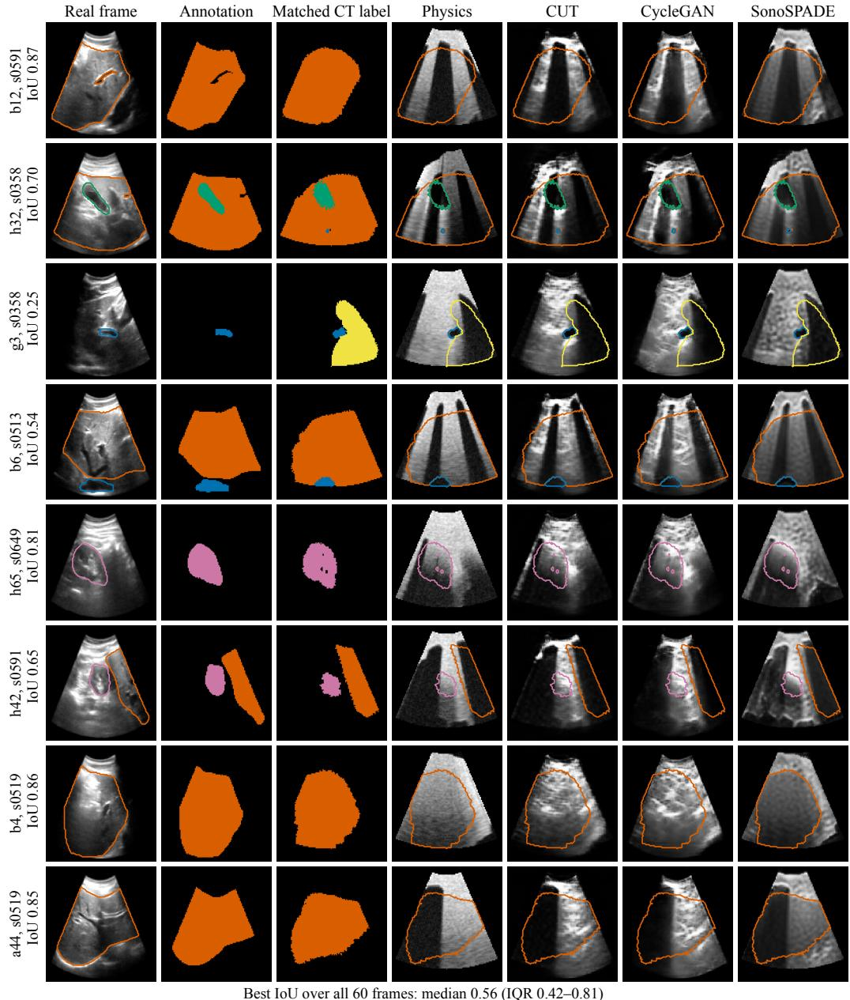  
Figure A.3: Simulated and real frames in matched sector geometry. Each row pairs one annotated public real frame from the Vitale test set [80, 15] with the held-out CT view whose organ layout best matches its annotation; the row label gives the frame, the CT patient and the organ-layout IoU of the match. For each real frame, the search scored 2,000 candidate probe poses per held-out patient around the screened acoustic windows by mean per-organ IoU and refined the best three by a cross-entropy search; a pose rotated by 180 degrees about the beam axis was also allowed. The search used label maps only, and no rendered image entered it. The columns show the real frame with its annotation outlined, the annotation, the matched CT label, and the physics, CUT, CycleGAN and SonoSPADE renders at the matched pose (no domain randomization, fixed speckle seed) with the CT label outlined (orange liver, green gallbladder, blue vessel, pink kidney, yellow spleen). The rows follow a fixed rule: the best frame of each organ stratum that has at least three frames, then the global IoU rank, with at most two rows per patient. Over all 60 frames, the median best IoU is 0.56 (interquartile range 0.42 to 0.81).

Table A.9: Outcomes of the eight testable real-frame cells, every texture stage of the ladder (Table 7 prints the rows of SonoSPADE, the standard engine’s stage). Keep-best gain: primary gain over the static start (Table A.8). Selection: organ IoU of the state the match score selects along undirected motion, minus that of a random state. Directed control: the policy’s keep-best gain minus that of magnitude-matched undirected motion with the same selection. Values: exploratory per-subject IoU means [95% subject-by-CT bootstrap CI]. A cell holds if its CI excludes 0 and its Holm p over eight cells is below 0.05. In the holding cell, 38/55 subjects share the sign; exact sign-flip $p = 3 . 4 \times 1 0 ^ { - 4 }$ and Holm p = 0 003. Elsewhere Holm p is 0.055 to 1.000.
<table><tr><td>Stage</td><td>Keep-best gain</td><td>Selection [CI]</td><td>Outcome</td><td></td><td>Directed control [CI]</td><td>Outcome</td></tr><tr><td colspan="7">Vitale holdout [15], liver, 12 subjects</td></tr><tr><td>Physics</td><td>moves the view</td><td>+0.008 [-0.003, +0.020]</td><td></td><td>not detectably better</td><td>+0.014 [-0.023, +0.052]</td><td>selection, not directed control</td></tr><tr><td>CUT</td><td>moves the view</td><td>+0.003 [-0.007, +0.014]</td><td></td><td>not detectably better</td><td>+0.010 [-0.018, +0.037]</td><td>selection, not directed control</td></tr><tr><td>CycleGAN</td><td>moves the view</td><td>-0.001 [-0.012, +0.010]</td><td></td><td>not detectably better</td><td>+0.023 [-0.009, +0.059]</td><td>selection, not directed control</td></tr><tr><td>SonoSPADE</td><td>moves the view</td><td>+0.011 [+0.002, +0.024]</td><td></td><td>not detectably better</td><td>+0.041 [-0.001, +0.098]</td><td>selection, not directed control</td></tr><tr><td colspan="7">KidneyUS [73], kidney, 55 subjects</td></tr><tr><td>Physics</td><td>no reliable improvement</td><td>-0.002 [-0.014, +0.013]</td><td></td><td>not detectably better</td><td>-0.005 [-0.032, +0.021]</td><td>no detectable gain</td></tr><tr><td>CUT</td><td>no reliable improvement</td><td>+0.007 [-0.004, +0.021]</td><td></td><td>not detectably better</td><td>-0.014 [-0.037, +0.006]</td><td>no detectable gain</td></tr><tr><td>CycleGAN</td><td>no reliable improvement</td><td>+0.008 [-0.004, +0.022]</td><td></td><td>not detectably better</td><td>-0.007 [-0.031, +0.016]</td><td>no detectable gain</td></tr><tr><td>SonoSPADE</td><td>moves the view</td><td>+0.015 [+0.003, +0.028]</td><td></td><td>informative selection signal</td><td>+0.014 [-0.011, +0.037]</td><td>selection, not directed control</td></tr></table>

Table A.10: Lowest measured error per kind of run-time input, post hoc. Post hoc: lowest point estimate on the same six held-out patients that measured it, so optimistic; not the pre-specified combination rule. The pre-specified combination selects by the slot decisions and tests its choice on 20 CTs that played no part in it, so the two can name diferent pipelines. Pipelines name the frames, the mask source and the controller. Error: final translation error over the 60 held-out episodes of Table 4, mean over seeds of patient means. Diferences are paired by patient, with the 95% t CI and the patients of 6 sharing the sign. A random-action controller, from earlier runs with no pre-specified rule, ends at 17.45 mm (3 seeds; Supplementary Table S3.2). Each post hoc lowest row is the lowest error among the 18, 17 and 43 measured candidates of the second, third and fourth blocks. No candidate combines the winners of two slots; the pre-specified combination is reported in Section 7.4. The learned-mask controller arm with new learner seeds is not a candidate; its rows are in Table B.2. Both lowest rows without privileged input are BC residuals (exploratory, no pre-specified rule). None of these rows enters a decision, and none is read as a separation of two methods. Cohort: the same configuration on the 20-CT replication cohort, an unselected check; n/r, not run there. Every episode keeps the contact plane through the target window face and a start drawn around the target. No row is therefore free of target information. <sup>L</sup>Label-conditioned stage: its network also reads the CT label slice. <sup>†</sup>Privileged: simulator state that no rig provides. <sup>E</sup>Exploratory, no pre-specified rule.

<table><tr><td>Pipeline</td><td>(mm)</td><td>Error Minus static start (mm), 95% t CI, k/6</td><td>Minus pose oracle (mm), 95% t CI, k/6</td><td>20-CT cohort (mm)</td></tr><tr><td colspan="5">Anchors (reference ladder, Table 4)</td></tr><tr><td>Static start (no commanded motion)</td><td>16.03 n/a</td><td></td><td>+14.50 [+11.48, +17.52], 6/6</td><td>15.97</td></tr><tr><td>Scripted sweep (no feedback)</td><td></td><td>15.52 -0.51 [–0.81, −0.22], 5/6</td><td>+13.99 [+11.12, +16.86], 6/6</td><td>15.38</td></tr><tr><td>Analytic pose oracle</td><td></td><td>1.53 -14.50 [-17.52, -11.48], 6/6 n/a</td><td></td><td>1.47</td></tr><tr><td colspan="5">No privileged input at run time: frames without a label-conditioned stage, learned mask</td></tr><tr><td>Reference: Physics; U-Net; servo base</td><td></td><td>17.20+1.17[-1.21, +3.54], 4/6</td><td>+15.67 [+13.94, +17.39], 6/6</td><td>15.75</td></tr><tr><td>Post hoc lowest: Physics; U-Net; servo base + BC residualE</td><td></td><td>14.22 -1.81 [-5.71, +2.09], 4/6</td><td>+12.69 [+10.06, +15.32], 6/6</td><td>n/r</td></tr><tr><td colspan="5">No privileged input at run time: label-conditioned framesL, learned mask</td></tr><tr><td>Reference: SonoSPADEL; U-Net; servo base</td><td></td><td>13.13 -2.89 [–6.06, +0.27], 4/6</td><td>+11.60 [+10.45, +12.76], 6/6</td><td>13.71</td></tr><tr><td>Post hoc lowest: SonoSPADEL; U-Net; servo base + BC residualE</td><td></td><td>11.44 -4.59 [-8.84, -0.34], 5/6</td><td>+9.91 [+7.39, +12.43], 6/6</td><td>n/r</td></tr><tr><td colspan="5">Privileged mask at run time†</td></tr><tr><td>Reference: Any stage; CT mask†; servo base</td><td></td><td>11.65 -4.38 [-7.69, -1.06], 5/6</td><td>+10.12 [+8.51, +11.74], 6/6</td><td>12.64</td></tr><tr><td>Post hoc lowest: SonoSPADEL; CT mask†; servo base + DAgger residual</td><td></td><td>10.85 -5.18 [-8.99, -1.37], 5/6</td><td>+9.32 [+7.56, +11.08], 6/6</td><td>n/r</td></tr><tr><td>Privileged simulator look-ahead, a reference never selected</td><td></td><td></td><td></td><td></td></tr><tr><td>SonoSPADEL; CT mask†; CEM look-ahead†, seed 0</td><td></td><td>6.98 -9.05 [-12.16, -5.93], 6/6</td><td>+5.45 [+2.47, +8.44], 6/6</td><td>n/r</td></tr></table>

## Appendix B. Outcomes of the pre-specified comparisons and exploratory experiments

This appendix reports the outcome of each pre-specified comparison of Tables 5 and B.1, slot by slot, and of the exploratory experiments: the learned-mask controller experiment (Appendix B.3), the canonical phantoms (Appendix B.5), the contact surface (Appendix B.8), the external cohort (Appendix B.9) and the combination (Ap pendix B.10). Each decision below is printed in its pre-specified wording; Tables 5 and B.1 and Fig. B.1 give the same results at a glance. In that wording, frames rendered from the CT label slice are the label-conditioned frames of Box 1, and frames not rendered from it are the others. Each decision of the comparison of published methods follows a rule fixed for its family before the held-out data were seen, and each is exploratory. Each block names its family and size m, and Holm’s adjustment runs within that family only. Holm therefore controls the familywise error within each family, not across the exploratory families of Supplementary Table S4.1, so a few false diferences are expected among all decisions. Family boundaries matter at n = 6: over the 25 contrasts of the oracle ladder as one family, 4 reach Holm’s threshold on the paired t-test (Supplementary Table S2.5). In Table 5, the second mask-source family is MASK-P, the pretrained-backbone family IMN-T and the LPIPS reward family LPIPS-R; in Table B.1, the CT-anatomy diference and equivalence families are CTA-D and CTA-E. The exploratory experiments fixed their decision rules before any of their outputs existed. Their families are LM-D and LM-E for the learned-mask controller experiment, SKIN-D and SKIN-E for the contact surface, AMOS-P and AMOS-S for the external cohort, and CMB-D, CMB-E and CMB-G for the combination. Secondary comparisons give a t interval and no decision. Fig. B.1 draws the diference of every plugged method of the five slot families of Tables 5 and B.1 from its slot’s reference, with its 95% and 90% t intervals.

## Appendix B.1. Texture stage

All four published texture stages [36, 37, 38, 39] end farther from the target than SonoSPADE [4], at 16.13 to 17.64 mm against 13.13 mm (Holm p 0.011 to 0.038). Unlike SonoSPADE, which we used unchanged, they read no CT label, run at the smaller network sizes of the reference stages and train on 1,540 frames for 800 iterations, against SonoSPADE’s 4,620 for 1,500. A diference thus mixes texture with label access and budget and does not rank textures. FastCUT, DCLGAN and UNSB are our reimplementations, with the oficial loss weights. No texture stage is shown equivalent to SonoSPADE within ±1 mm (post hoc TOST), nor is the label-painted stage in its prespecified test (Section 8.4). Family texture, m = 4, against SonoSPADE. SonoSPADE reads the CT label slice, and no member of this family does.

## FastCUT [36]

FastCUT gives a higher final translation error than SonoSPADE in the texture stage slot (+3<sub>.</sub>00 mm [+0<sub>.</sub>24<sub>,</sub> +5<sub>.</sub>75], 5/6; exploratory). SonoSPADE reads the CT label slice, and FastCUT does not.

## DCLGAN [37]

DCLGAN gives a higher final translation error than SonoSPADE in the texture stage slot (+3 80 mm

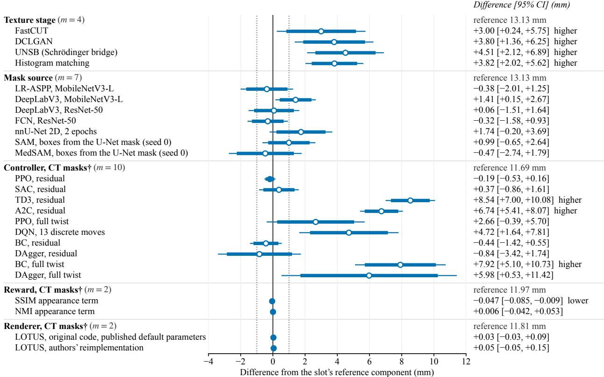  
Figure B.1: Published methods in the plug slots, each drawn as its diference from its slot’s reference component, the solid vertical line. Each line is one plugged method of the five slot families of Table 5. The thin bar is the 95% paired t CI, and the thick bar is the 90% paired t CI. A filled marker means that the method is equivalent to its reference within ±1 mm, the pre-specified margin, which the dotted lines mark (post hoc, unadjusted TOST). The right column prints each diference with its 95% CI and outcome word, and daggers mark slots under the privileged CT mask. These results are exploratory; Table 5 gives each slot’s post hoc minimum detectable diference. Every contrast is conditional on the trained artifacts (texture networks, segmenters, bases and policies). Seeds index artifacts; the patient is the sampling unit.

[+1 36 +6 25], 5/6; exploratory). SonoSPADE reads the CT label slice, and DCLGAN does not.

## UNSB [38]

UNSB gives a higher final translation error than SonoSPADE in the texture stage slot (+4 51 mm [+2 12 +6 89], 6/6; exploratory). SonoSPADE reads the CT label slice, and UNSB does not.

## Histogram matching [39]

Histogram matching gives a higher final translation error than SonoSPADE in the texture stage slot (+3 82 mm [+2<sub>.</sub>02<sub>,</sub> +5<sub>.</sub>62], 6/6; exploratory). SonoSPADE reads the CT label slice, and histogram matching does not.

## Appendix B.2. Mask source

Family mask source, m = 7, against the stage-matched U-Net on SonoSPADE frames.

Table B.1: Published methods in the three slots of the standard engine: texture stage, renderer and CT anatomy (exploratory, pre-specified rule). The engine is the physics renderer with the SonoSPADE texture stage and the reference CT labels; every slot stays pluggable. Columns, slot headers, marks and notes as in Table 5; the MDD leaves out SIMUS and the painted stage.
<table><tr><td>Slot and method</td><td>Error</td><td>(mm) Difference (mm), 95% t CI, k/6 Seeds Holm p TOST Decision</td><td></td><td></td><td></td><td></td></tr><tr><td colspan="7">Texture stage. Condition: frames from the plugged stage; mask from that stage&#x27;s own matched U-Net; servo base, residual off; seeds 0 to 2. Reference: SonoSPADE, 13.13 mm. Family: m = 4. Post hoc MDD: 3.24 mm, 4.39 mm at α = 0.05/4.</td></tr><tr><td colspan="7">Reference</td></tr><tr><td>SonoSPADE (authors&#x27;) [4]L</td><td>13.13</td><td></td><td></td><td></td><td></td><td></td></tr><tr><td>Family (m = 4)</td><td></td><td></td><td></td><td></td><td></td><td></td></tr><tr><td>FastCUT [36]</td><td></td><td>16.13 +3.00 [+0.24, +5.75], 5/6</td><td>3/3</td><td>0.038</td><td>no</td><td>higher</td></tr><tr><td>DCLGAN [37]</td><td></td><td>16.94 +3.80 [+1.36, +6.25], 5/6</td><td>3/3</td><td>0.021</td><td>no</td><td>higher</td></tr><tr><td>UNSB (Schrödinger bridge) [38]</td><td></td><td>17.64 +4.51 [+2.12, +6.89], 6/6</td><td>3/3</td><td>0.014</td><td>no</td><td>higher</td></tr><tr><td>Histogram matching [39]</td><td></td><td>16.95 +3.82 [+2.02, +5.62], 6/6</td><td>3/3</td><td>0.011</td><td>no</td><td>higher</td></tr><tr><td>Secondary</td><td></td><td></td><td></td><td></td><td></td><td></td></tr><tr><td>None, physics frame (authors&#x27;)</td><td></td><td>17.20 +4.06 [+1.68, +6.44], 5/6</td><td>3/3</td><td></td><td>no</td><td>secondary</td></tr><tr><td>CUT (prior) [36]</td><td></td><td>16.84 +3.70 [+1.33, +6.07], 5/6</td><td>3/3</td><td></td><td>no</td><td>secondary</td></tr><tr><td>CycleGAN (prior) [14]</td><td></td><td>16.85 +3.72 [+1.18, +6.26], 5/6</td><td>3/3</td><td></td><td>no</td><td>secondary</td></tr><tr><td>Label-painted physics stage (authors&#x27;, not learned)L</td><td></td><td>14.22 +1.09 [−1.98, +4.16], 3/6</td><td>2/3</td><td></td><td>no</td><td>secondary</td></tr><tr><td colspan="7">Renderer. Condition: frames from the plugged renderer, no texture stage; CT mask†; the physics-trained policy, residual on; seeds 0 to 2, and seed 0 for SIMUS. Reference: the physics renderer, 11.81 mm. Family: m = 2. Post hoc MDD: 0.11 mm, 0.13 mm at α = 0.05/2.</td></tr><tr><td colspan="7">Reference</td></tr><tr><td>Physics renderer (authors&#x27;)</td><td>11.81</td><td></td><td></td><td></td><td></td><td></td></tr><tr><td>Seed 0 only, for the seed-0 rows Family (m = 2)</td><td>11.91</td><td></td><td></td><td></td><td></td><td></td></tr><tr><td>LOTUS, original code, published default parameters [12, 7]</td><td></td><td>11.84 +0.03 [-0.03, +0.09], 4/6</td><td>2/3</td><td>0.523</td><td>yes</td><td>no detectable difference</td></tr><tr><td>LOTUS, authors&#x27; reimplementation [12]</td><td></td><td>11.86 +0.05 [-0.05, +0.15], 4/6</td><td>2/3</td><td>0.523</td><td>yes</td><td>no detectable difference</td></tr><tr><td>Secondary SIMUS via PyMUST [10, 11]</td><td></td><td></td><td>n/a</td><td></td><td>yes</td><td></td></tr><tr><td></td><td></td><td>12.40 +0.49 [+0.21, +0.78], 6/6</td><td></td><td></td><td></td><td>secondary</td></tr><tr><td colspan="7">CT anatomy (label volume). Condition: five reference levels of the oracle ladder, each in its Table 4 condition with seeds 0 to 2. TotalSegmentator v2 labels [3] (fast mode, 3.0 mm) replace the reference labels on the same episodes and classes. Reference: each level rerun on the reference labels. Families: CT-anatomy</td></tr><tr><td>difference, paired t, and CT-anatomy equivalence, TOST at ±1 mm, m = 5 each. The trained artifacts never saw the new labels, so a change mixes label noise with</td><td></td><td></td><td></td><td></td><td></td><td></td></tr><tr><td colspan="7">the shift between training and evaluation labels. No row runs on the replication cohort, so the slot has no post hoc MDD.</td></tr><tr><td></td><td></td><td></td><td></td><td></td><td></td><td></td></tr><tr><td>CT-mask servo base, physics†</td><td></td><td>11.73 +0.08 [-0.27, +0.42], 3/6</td><td>1/3 2/3</td><td>1.000</td><td>yes</td><td>equivalent within ±1 mm no detectable changee</td></tr><tr><td>Learned-mask servo base, physics</td><td></td><td>16.58 -0.62 [-1.67, +0.43], 5/6 12.62 −0.51 [−1.29, +0.26], 5/6</td><td>2/3</td><td>0.766 0.748</td><td>no no</td><td>no detectable changee</td></tr><tr><td>Learned-mask servo base, SonoSPADE</td><td></td><td>11.70 −0.11 [–0.81, +0.59], 5/6</td><td>2/3</td><td>1.000</td><td>yes</td><td></td></tr><tr><td>CT-mask policy, physics, final weights†</td><td></td><td></td><td>2/3</td><td></td><td></td><td>equivalent within ±1 mm</td></tr><tr><td>CT-mask policy, SonoSPADE, final weights†</td><td></td><td>11.62 −0.07 [–0.82, +0.68], 4/6</td><td></td><td>1.000</td><td>yes</td><td>equivalent within ±1 mm</td></tr><tr><td colspan="7">All 19 CTs are in TotalSegmentator&#x27;s own training data, so these labels are in-sample predictions: the rows are a label-noise sensitivity check, not a test of an</td></tr><tr><td>independent CT segmenter.</td><td></td><td></td><td></td><td></td><td></td><td></td></tr></table>

## LR-ASPP, MobileNetV3-L [44]

LR-ASPP MobileNetV3-L and the stage-matched U-Net show no detectable diference in the mask source slot (−0 38 mm [−2 01 +1 25]; not powered for equivalence; exploratory).

## DeepLabV3, MobileNetV3-L [45, 44]

DeepLabV3 MobileNetV3-L and the stage-matched U-Net show no detectable diference in the mask source slot (+1 41 mm [+0 15 +2 67]; not powered for equivalence; exploratory). Its interval excludes zero, but its Holm-adjusted p is 0.24 in the family of seven (exploratory).

## DeepLabV3, ResNet-50 [45, 46]

DeepLabV3 ResNet-50 and the stage-matched U-Net show no detectable diference in the mask source slot (+0 06 mm [−1 51 +1 64]; not powered for equivalence; exploratory).

## FCN, ResNet-50 [47, 46]

FCN ResNet-50 and the stage-matched U-Net show no detectable diference in the mask source slot (−0 32 mm [−1 58 +0 93]; not powered for equivalence; exploratory).

nnU-Net 2D, 2 epochs [48] nnU-Net 2D, 2 epochs, and the stage-matched U-Net show no detectable diference in the mask source slot (+1 74 mm [−0 20 +3 69]; not powered for equivalence; exploratory).

## SAM, boxes from the U-Net mask [49]

SAM, boxes from the U-Net mask, and the stage-matched U-Net show no detectable diference in the mask source slot (+0 99 mm [−0 65 +2 64]; not powered for equivalence; exploratory).

## MedSAM, boxes from the U-Net mask [50]

MedSAM, boxes from the U-Net mask, and the stage-matched U-Net show no detectable diference in the mask source slot (−0 47 mm [−2 74 +1 79]; not powered for equivalence; exploratory). MedSAM’s real-frame Dice is not reported, because its training corpus may include the real test frames.

Family MASK-P, m = 5, against the stage-matched U-Net.

## SAMUS, boxes from the U-Net mask [51]

SAMUS with boxes from the U-Net mask and the stage-matched U-Net show no detectable diference in the mask-source slot (+0<sub>.</sub>96 mm [−0<sub>.</sub>37<sub>,</sub> +2<sub>.</sub>30]; not powered for equivalence; exploratory).

## LR-ASPP, MobileNetV3-L, ImageNet-pretrained backbone [44]

LR-ASPP MobileNetV3-L with an ImageNet-pretrained backbone and the stage-matched U-Net show no detectable diference in the mask-source slot (+0 11 mm [−1 22 +1 45]; not powered for equivalence; exploratory).

DeepLabV3, MobileNetV3-L, ImageNet-pretrained backbone [45, 44] DeepLabV3 MobileNetV3-L with an ImageNet-pretrained backbone and the stage-matched U-Net show no detectable diference in the mask-source slot (−0 47 mm [−2 04 +1 09]; not powered for equivalence; exploratory).

DeepLabV3, ResNet-50, ImageNet-pretrained backbone [45, 46] DeepLabV3 ResNet-50 with an ImageNet-pretrained backbone and the stage-matched U-Net show no detectable diference in the mask-source slot (−0<sub>.</sub>52 mm [−1<sub>.</sub>92<sub>,</sub> +0<sub>.</sub>89]; not powered for equivalence; exploratory).

FCN, ResNet-50, ImageNet-pretrained backbone [47, 46] FCN ResNet-50 with an ImageNet-pretrained backbone and the stage-matched U-Net show no detectable difference in the mask-source slot (−0 36 mm [−1 16 +0 44]; not powered for equivalence; exploratory).

Family IMN-T, m = 4, against the same network trained from scratch.

## LR-ASPP, MobileNetV3-L, ImageNet backbone against its from-scratch twin

Starting the LR-ASPP MobileNetV3-L backbone from ImageNet weights does not detectably change the final translation error against the same network trained from scratch (+0 49 mm [−1 92 +2 91]; not powered for equivalence; exploratory).

## DeepLabV3, MobileNetV3-L, ImageNet backbone against its from-scratch twin

Starting the DeepLabV3 MobileNetV3-L backbone from ImageNet weights does not detectably change the final translation error against the same network trained from scratch (−1 88 mm [−4 45 +0 69]; not powered for equivalence; exploratory).

## DeepLabV3, ResNet-50, ImageNet backbone against its from-scratch twin

Starting the DeepLabV3 ResNet-50 backbone from ImageNet weights does not detectably change the fina translation error against the same network trained from scratch (−0 58 mm [−2 33 +1 16]; not powered for equivalence; exploratory).

## FCN, ResNet-50, ImageNet backbone against its from-scratch twin

Starting the FCN ResNet-50 backbone from ImageNet weights does not detectably change the final translation error against the same network trained from scratch (−0 04 mm [−1 50 +1 42]; not powered for equivalence; exploratory).

## No contrast of this family holds

ImageNet pretraining is not shown to change the mask-slot results of the torchvision segmenters (n = 6).

These caveats apply to SAMUS and the pretrained backbones of this slot.

• SAMUS runs at inference only.

• SAMUS was trained and evaluated with one positive point per object.

• Its box prompts pass through the prompt encoder and mask decoder of SAM ViT-B, which SAMUS kept frozen.

• The non-privileged row depends on the U-Net for its boxes, so it is not independent of the reference.

• SAMUS runs with its own preprocessing and with no adaptation to the testbed’s frames.

• SAMUS’s real-frame Dice is not reported, because its training corpus may include the real test frames.

• The pretrained networks start their backbones from torchvision ImageNet-1K weights.

• Every other setting is that of their from-scratch twins.

• Their pretraining used natural RGB photographs, whereas their input is a gray frame replicated to three channels.

• The contact rows of SAMUS and of the pretrained networks run a policy trained with U-Net masks under their masks, out of its training distribution.

## Appendix B.3. Controller

Family controller, m = 10, against the REINFORCE residual under CT masks on SonoSPADE frames. Behavior cloning and DAgger policies use BatchNorm in eval mode, the pre-specified primary setting. A full-twist controller outputs the whole twist without the servo base, whereas a residual controller adds to it a correction bounded at half of a<sub>max</sub>.

## PPO, residual [54, 59]

PPO, residual, and the REINFORCE residual show no detectable diference in the controller slot (−0 19 mm [−0 53 +0 16]; not powered for equivalence; exploratory).

## SAC, residual [55, 59]

SAC, residual, and the REINFORCE residual show no detectable diference in the controller slot (+0 37 mm [−0 86 +1 61]; not powered for equivalence; exploratory).

## TD3, residual [56, 59]

TD3, residual, gives a higher final translation error than the REINFORCE residual in the controller slot (+8 54 mm [+7 00 +10 08], 6/6; exploratory). The TD3 residual collapsed to a constant action within about 500 environment steps of its first update (post hoc diagnostic). From then on, it adds the same ofset at the residual bound on every axis, whatever the image. Under CT masks, its physics and SonoSPADE trajectories therefore coincide in seeds 0 and 1. Seed 2 difers only because it settled on a diferent constant action.

## A2C, residual [57, 59]

A2C, residual, gives a higher final translation error than the REINFORCE residual in the controller slot (+6 74 mm [+5 41 +8 07], 6/6; exploratory).

## PPO, full twist [54, 59]

PPO, full twist, and the REINFORCE residual show no detectable diference in the controller slot (+2 66 mm [−0<sub>.</sub>39<sub>,</sub> +5<sub>.</sub>70]; not powered for equivalence; exploratory).

## DQN, 13 discrete moves [58, 59]

DQN, 13 discrete moves, and the REINFORCE residual show no detectable diference in the controller slot (+4 72 mm [+1 64 +7 81]; not powered for equivalence; exploratory). DQN’s interval excludes zero, but its Holm-adjusted p is 0.077 in the family of ten (exploratory).

## BC, residual [60]

BC from the pose oracle, residual, and the REINFORCE residual show no detectable diference in the controller slot (−0 44 mm [−1 42 +0 55]; not powered for equivalence; exploratory).

## BC, full twist [60]

BC from the pose oracle, full twist, gives a higher final translation error than the REINFORCE residual in the controller slot (+7 92 mm [+5 10 +10 73], 6/6; exploratory).

## DAgger, residual [61]

DAgger from the pose oracle, residual, and the REINFORCE residual show no detectable diference in the controller slot (−0<sub>.</sub>84 mm [−3<sub>.</sub>42<sub>,</sub> +1<sub>.</sub>74]; not powered for equivalence; exploratory).

## DAgger, full twist [61]

DAgger from the pose oracle, full twist, and the REINFORCE residual show no detectable diference in the controller slot (+5 98 mm [+0 53 +11 42]; not powered for equivalence; exploratory). Its interval excludes zero, but its Holm-adjusted p is 0.222 in the family of ten (exploratory).

## CEM look-ahead, privileged, secondary [62]

The CEM look-ahead ends at 6.98 mm, −4 81 mm [−9 02 −0 60] from the REINFORCE residual (privileged, secondary).

The BatchNorm comparisons below are secondary.

• In BatchNorm train mode, the BC and DAgger residuals end at 12.67 and 12.89 mm (secondary).

• With BatchNorm in train mode, the BC residual difers from the REINFORCE residual by +0 98 mm [−0 02 +1 99], 5/6 (secondary).

• With BatchNorm in train mode, the DAgger residual difers from the REINFORCE residual by +1 20 mm [+0 57 +1 83], 6/6 (secondary).

• In BatchNorm train mode, the full-twist BC and DAgger rows end at 15.75 and 15.15 mm (secondary).

• With BatchNorm in train mode, the full-twist BC row difers from the REINFORCE residual by +4 07 mm [+0 94 +7 19], 5/6 (secondary).

• With BatchNorm in train mode, the full-twist DAgger row difers from the REINFORCE residual by +3 47 mm [+0 83 +6 10], 5/6 (secondary).

• With BatchNorm in eval mode, the REINFORCE residual ends at 11.70 mm, against 11.69 mm in train mode (secondary).

Learned-mask controller experiment. Families LM-D and LM-E, m = 6 each, contrast the DAgger and BC residuals of this experiment with the learned-mask servo base and with each other, on physics and SonoSPADE frames. LM-D tests a diference with the paired t-test, and LM-E tests equivalence within ±1 mm with two one-sided tests. Each contrast states the decision of both families, and Table B.2 gives its statistics.

## B1, DAgger residual minus learned-mask servo base, physics frames

Under learned masks with the physics stage, the DAgger residual gives a lower final translation error than the learned-mask servo base (−3 17 mm [−5 04, −1 31], 6/6; exploratory).

## B2, DAgger residual minus learned-mask servo base, SonoSPADE frames

Under learned masks with the SonoSPADE stage, the DAgger residual and the learned-mask servo base show no detectable diference (−1 09 mm [−2 70, +0 51]; exploratory). Their equivalence within ±1 mm is not shown either (TOST, Holm p = 1 000).

## B3, BC residual minus learned-mask servo base, physics frames

Under learned masks with the physics stage, the BC residual and the learned-mask servo base show no detectable diference (−2 91 mm [−5 52, −0 30]; exploratory). Their equivalence within ±1 mm is not shown either (TOST, Holm p = 1 000).

## B4, BC residual minus learned-mask servo base, SonoSPADE frames

Under learned masks with the SonoSPADE stage, the BC residual and the learned-mask servo base show no detectable diference (−0 80 mm [−2 36, +0 76]; exploratory). Their equivalence within ±1 mm is not shown either (TOST, Holm p = 1 000).

## P1, DAgger residual minus BC residual, physics frames

Under learned masks with the physics stage, the DAgger and BC residuals show no detectable diference (−0 27 mm [−2 47, +1 94]; exploratory). Their equivalence within ±1 mm is not shown either (TOST, Holm p = 1<sub>.</sub>000).

## P2, DAgger residual minus BC residual, SonoSPADE frames

Under learned masks with the SonoSPADE stage, the DAgger and BC residuals show no detectable diference (−0 29 mm [−2 02, +1 45]; exploratory). Their equivalence within ±1 mm is not shown either (TOST, Holm p = 1<sub>.</sub>000).

With physics frames and learned masks, the testbed separates 1 of the three method pairs of this arm at n = 6 (exploratory). With SonoSPADE frames and learned masks, no pair of methods in this arm is separated at n = 6 (exploratory). Table B.2 names each separated pair and the direction of its diference. Conditions of every result.

• At run time, the learners in this arm read only the frame history and the target frame.

• The servo base under them reads only the learned masks of the same frames.

• Both learners were trained on labels from a privileged pose-oracle teacher on training patients.

• The servo base and the segmenters were fit with true poses and CT labels of training patients.

• Every episode keeps the contact plane through the target window face, normal to the target beam.

• Starts below that plane are lifted onto it.

• After the lift, no start lies deeper than the target face.

• With the SonoSPADE stage, every frame is rendered from the CT label slice.

• The two learners were chosen as the lowest CT-mask rows on the same six held-out patients, with BatchNorm in eval mode.

• New learner seeds remove the seed part of that selection, not the patient part.

• Other readings of “lowest” pick other pairs: the three lowest errors span 0.65 mm, below the slot’s MDD of 1.74 mm over the contrasts complete when the learners were chosen. The DAgger residual keeps its sign in 2 of 3 seeds.

• These learners ran earlier under learned masks with other learner seeds on the same artifacts, so this arm is not independent of those runs.

Supplementary Table S6.1 gives the other comparisons of this experiment (secondary; no decision).

Earlier learned-mask runs. The controller slot’s earlier learned-mask runs, five learners on two stages with seeds 0 to 2, preceded this arm and have no pre-specified rule. Under learned masks with the physics stage, the five earlier learners end at 14.22 to 17.43 mm, against 17.20 mm for the servo base (exploratory, no pre-specified rule). Under learned masks with the SonoSPADE stage, the five earlier learners end at 11.44 to 17.04 mm, against 13.13 mm for the servo base (exploratory, no pre-specified rule). With physics frames under CT masks, the 10 learners end at 11.07 to 23.03 mm, against 11.65 mm for the servo base (exploratory, no pre-specified rule). None of these rows enters a decision, and none is read as a separation of two methods. Supplementary Table S3.2 prints each row with its diference from the servo base.

## Appendix B.4. Reward

Family reward, m = 2, against the match score S , retrained in the same way as the plugged rewards. Two privileged rewards follow prior work: the change in pose distance used by SonoGym [29], and pose distance plus visible organ area, adapted from VesNet-RL [28].

## SSIM appearance term [63]

The SSIM appearance term gives a lower final translation error than the paper’s S in the reward potential slot (−0 047 mm [−0 085 −0 009], 5/6; exploratory). Per seed, SSIM minus S is −0 028, +0 004 and −0 116 mm, so 2 of 3 seeds share its sign (post hoc; Appendix B.11).

Table B.2: Learned-mask controller experiment on the six held-out patients (exploratory, pre-specified rule). Families LM-D (diference) and LM-E (equivalence within ±1 mm), m = 6 each, Holm within each family. A diference holds if its Holm p is below 0.05 and at least 5 of 6 patients share its sign (paired t, df 5); the exact sign-flip p is printed and never decides. Absolute errors are the base’s mean plus the paired diference. The servo base ends at 17.20 mm with physics frames and 13.13 mm with SonoSPADE frames, and the pose oracle at 1.53 mm. MDD from the observed SDs: 2.37 and 3.63 mm for the base contrasts, 2.69 and 4.12 mm for the learner pair, at α = 0 05 and at Holm’s first step. The separation criterion (a physics-frame diference of B1, B3 or P1 holds) is met. Crossed bootstrap: case by seed, a sensitivity check.
<table><tr><td>Contrast</td><td>Family</td><td>Difference or 90% CI (mm)</td><td>k/6</td><td>Test p</td><td>Sign-flip p</td><td>Holm p</td><td>Decision</td><td>Crossed bootstrap 95% CI</td></tr><tr><td>B1: DAgger residual minus learned-mask servo base, physics frames; the</td><td>LM-D</td><td>-3.17 [-5.04, -1.31]</td><td>6/6</td><td>0.007 (paired t)</td><td>0.031</td><td>0.043</td><td>holds lower</td><td>[-4.56,-1.26]</td></tr><tr><td>DAgger residual ends at 14.02 mm Equivalence within</td><td>LM-E</td><td>90% [-4.63, -1.71]</td><td></td><td>0.985 (TOST)</td><td></td><td>1.000</td><td>equivalence not</td><td></td></tr><tr><td>±1 mm B2: DAgger residual minus learned-mask servo</td><td>LM-D</td><td>-1.09 [-2.70, +0.51]</td><td></td><td>5/6 0.141 (paired t)</td><td>0.156</td><td>0.564</td><td>shown no detectable difference</td><td>[-2.96, +0.28]</td></tr><tr><td>base, SonoSPADE frames; the DAgger residual ends at</td><td></td><td></td><td></td><td></td><td></td><td></td><td></td><td></td></tr><tr><td>12.04 mm Equivalence within ±1 mm</td><td>LM-E</td><td>90% [-2.35, +0.17]</td><td></td><td>0.555 (TOST)</td><td></td><td>1.000</td><td>equivalence not</td><td></td></tr><tr><td>B3: BC residual minus learned-mask servo base,</td><td>LM-D</td><td>-2.91 [–5.52, -0.30]</td><td></td><td>6/6 0.035 (paired t)</td><td>0.031</td><td>0.177</td><td>shown no detectable</td><td>[-5.45,-0.55]</td></tr><tr><td>physics frames; the BC residual ends at 14.29 mm</td><td></td><td></td><td></td><td></td><td></td><td></td><td>difference</td><td></td></tr><tr><td>Equivalence within ±1 mm B4: BC residual minus</td><td>LM-E</td><td>90% [-4.95, -0.86]</td><td></td><td>0.940 (TOST)</td><td></td><td>1.000</td><td>equivalence not shown</td><td></td></tr><tr><td>learned-mask servo base,</td><td>LM-D</td><td>-0.80 [-2.36, +0.76]</td><td></td><td>4/6 0.242 (paired t)</td><td>0.219</td><td>0.727</td><td>no detectable difference</td><td>[-2.80, +0.93]</td></tr><tr><td>SonoSPADE frames; the BC residual ends at 12.33 mm</td><td></td><td></td><td></td><td></td><td></td><td></td><td></td><td></td></tr><tr><td>Equivalence within ±1 mm</td><td>LM-E</td><td>90% [-2.03, +0.42]</td><td></td><td>0.380 (TOST)</td><td></td><td>1.000</td><td>equivalence not</td><td></td></tr><tr><td>P1: DAgger residual minus</td><td>LM-D</td><td>-0.27 [-2.47, +1.94]</td><td>3/6</td><td>0.769 (paired t)</td><td>0.813</td><td>1.000</td><td>shown no detectable</td><td>[-2.16,+1.57]</td></tr><tr><td>BC residual, physics frames Equivalence within</td><td></td><td></td><td></td><td></td><td></td><td></td><td>difference</td><td></td></tr><tr><td>±1 mm</td><td>LM-E</td><td>90% [-1.99, +1.46]</td><td></td><td>0.215 (TOST)</td><td></td><td>1.000</td><td>equivalence not</td><td></td></tr><tr><td></td><td></td><td></td><td></td><td></td><td></td><td></td><td>shown</td><td></td></tr><tr><td>P2: DAgger residual minus</td><td></td><td></td><td></td><td></td><td></td><td></td><td></td><td></td></tr><tr><td></td><td></td><td></td><td></td><td></td><td></td><td></td><td></td><td></td></tr><tr><td></td><td></td><td></td><td></td><td></td><td></td><td></td><td></td><td></td></tr><tr><td></td><td></td><td></td><td></td><td></td><td></td><td></td><td></td><td></td></tr><tr><td></td><td>LM-D</td><td></td><td></td><td></td><td></td><td></td><td></td><td></td></tr><tr><td></td><td></td><td></td><td></td><td></td><td>0.844</td><td></td><td></td><td></td></tr><tr><td></td><td></td><td>-0.29 [-2.02, +1.45]</td><td></td><td>3/6 0.689 (paired t)</td><td></td><td>1.000</td><td>no detectable</td><td>[-2.38, +1.62]</td></tr><tr><td></td><td></td><td></td><td></td><td></td><td></td><td></td><td></td><td></td></tr><tr><td>BC residual, SonoSPADE</td><td></td><td></td><td></td><td></td><td></td><td></td><td></td><td></td></tr><tr><td></td><td></td><td></td><td></td><td></td><td></td><td></td><td>difference</td><td></td></tr><tr><td></td><td></td><td></td><td></td><td></td><td></td><td></td><td></td><td></td></tr><tr><td></td><td></td><td></td><td></td><td></td><td></td><td></td><td></td><td></td></tr><tr><td></td><td></td><td></td><td></td><td></td><td></td><td></td><td></td><td></td></tr><tr><td></td><td></td><td></td><td></td><td></td><td></td><td></td><td></td><td></td></tr><tr><td></td><td></td><td></td><td></td><td></td><td></td><td></td><td></td><td></td></tr><tr><td>frames</td><td></td><td></td><td></td><td></td><td></td><td></td><td></td><td></td></tr><tr><td>Equivalence within</td><td></td><td></td><td></td><td></td><td></td><td></td><td></td><td></td></tr><tr><td></td><td>LM-E</td><td></td><td></td><td>0.169 (TOST)</td><td></td><td>1.000</td><td>equivalence not</td><td></td></tr><tr><td></td><td></td><td>90% [-1.64, +1.07]</td><td></td><td></td><td></td><td></td><td></td><td></td></tr><tr><td></td><td></td><td></td><td></td><td></td><td></td><td></td><td></td><td></td></tr><tr><td>±1 mm</td><td></td><td></td><td></td><td></td><td></td><td></td><td></td><td></td></tr><tr><td></td><td></td><td></td><td></td><td></td><td></td><td></td><td>shown</td><td></td></tr><tr><td></td><td></td><td></td><td></td><td></td><td></td><td></td><td></td><td></td></tr><tr><td></td><td></td><td></td><td></td><td></td><td></td><td></td><td></td><td></td></tr><tr><td></td><td></td><td></td><td></td><td></td><td></td><td></td><td></td><td></td></tr><tr><td></td><td></td><td></td><td></td><td></td><td></td><td></td><td></td><td></td></tr><tr><td></td><td></td><td></td><td></td><td></td><td></td><td></td><td></td><td></td></tr><tr><td></td><td></td><td></td><td></td><td></td><td></td><td></td><td></td><td></td></tr><tr><td></td><td></td><td></td><td></td><td></td><td></td><td></td><td></td><td></td></tr><tr><td></td><td></td></table>

## NMI appearance term [64]

The NMI appearance term and the paper’s S show no detectable diference in the reward potential slot (+0<sub>.</sub>006 mm [−0<sub>.</sub>042<sub>,</sub> +0<sub>.</sub>053]; not powered for equivalence; exploratory).

## Pose distance plus organ area, privileged, secondary [28]

Pose distance plus organ area ends at 11.90 mm, −0 070 mm [−0 158 +0 018], 5/6 from S (privileged, secondary).

Family LPIPS-R, m = 1, against the same S .

## LPIPS appearance term [65]

The LPIPS appearance term gives a lower final translation error than the paper’s S in the reward slot (−0 066 mm [−0 122 −0 011], 5/6; exploratory). Had LPIPS, fixed later in a family of its own, joined the reward family (m = 3), SSIM’s paired t p of 0.0246 would lie above Holm’s first threshold (post hoc). No reward would then be lower, and the combination rule would have changed no slot.

These caveats apply to the LPIPS reward.

• LPIPS enters as the appearance term of $S = 0 . 6 S _ { \mathrm { s e g } } + 0 . 4 ( 1 - \mathrm { L P I P S } )$

• Its AlexNet trunk was trained on natural RGB photographs.

• Its heads were calibrated on human judgments of distorted natural-image patches, not on ultrasound.

• LPIPS trains under the shared-seed rendering of the paper’s S , so a deep-feature term may match the shared speckle field rather than anatomy.

• Its independent-speckle condition is not reported.

• The SB3 positive control certifies the SB3 rows, not REINFORCE.

## Appendix B.5. Renderer

The original LOTUS code [12, 7] and our reimplementation of it end at 11.84 and 11.86 mm, neither difering detectably from the reference physics renderer, with which the privileged CT-mask policy trained on physics frames ends at 11.81 mm. The original code runs unchanged, with its published default parameters. SIMUS [10, 11], a secondary comparison run through PyMUST, uses 2 scatterers per mm<sup>2</sup>, too few for fully developed speckle (settings in Supplementary S1). All three are shown equivalent within ±1 mm (post hoc TOST). The policy’s servo base reads only CT label slices, so a renderer acts only through the bounded residual. In the reward and renderer slots, this equivalence describes the learner and servo configuration and does not make the plugged methods interchangeable. Family renderer, m = 2, against the physics renderer under the physics-trained CT-mask policy.

## LOTUS, original code [12]

The original LOTUS code and the physics renderer show no detectable diference in the renderer slot (+0 03 mm [−0<sub>.</sub>03<sub>,</sub> +0<sub>.</sub>09]; not powered for equivalence; exploratory).

## LOTUS, authors’ reimplementation [12]

The authors’ reimplementation of LOTUS and the physics renderer show no detectable diference in the renderer slot (+0<sub>.</sub>05 mm [−0<sub>.</sub>05<sub>,</sub> +0<sub>.</sub>15]; not powered for equivalence; exploratory).

## SIMUS via PyMUST, secondary [10, 11]

Under SIMUS, the policy ends at 12.40 mm, +0<sub>.</sub>49 mm [+0<sub>.</sub>21<sub>,</sub> +0<sub>.</sub>78] from physics (secondary).

Canonical phantoms. On canonical digital phantoms, the physics renderer meets 5 of its 8 bands fixed before rendering, the original LOTUS code 2 of its 4 and SIMUS 5 of its 8 (descriptive; Supplementary S1). Of these bands, 2, 2 and 1 could not be scored, because a wire was not measurable in every seed. The phantoms test renderer properties against bands fixed in advance. Several bands are design checks that hold by the renderer’s construction. No renderer is called realistic. Scored on native 512 by 160 frames, the output speckle SNR is 3.57, 4.71 and 1.55 for physics, the original LOTUS code and SIMUS, against 1.91 for a Rayleigh envelope. No physics wire is measurable in every one of the 10 seeds. Most wire peaks stand less than 6 dB above the speckle background, and those at 50 and 70 mm also reach the per-frame white level. SIMUS and the original LOTUS code cast no shadow below the bone slab (Supplementary Table S1.5).

## Appendix B.6. CT anatomy

Relabeling the CTs with TotalSegmentator v2 moves the five reference levels of the oracle ladder by −0 62 to +0 08 mm, none detectably; with the reference TotalSegmentator dataset masks [3], they end at 11.65 to 17.20 mm. The three privileged CT-mask levels are equivalent within ±1 mm. For the two learned-mask levels, equivalence is not shown. All 19 CTs are in TotalSegmentator’s own training data, so these labels are in-sample predictions: the rows are a label-noise sensitivity check, not a test of an independent CT segmenter. Families CTA-D and CTA-E, m = 5 each, contrast TotalSegmentator v2 labels [3] with the reference labels at the same oracle-ladder level, seeds 0 to 2. CTA-D tests a diference with the paired t-test, and CTA-E tests equivalence within ±1 mm with two one-sided tests. Each level states the decision of both families.

## R1, CT-mask servo base, physics, privileged

With TotalSegmentator labels in place of the reference labels, rung R1 is equivalent within ±1 mm (+0<sub>.</sub>08 mm, 90% CI [−0 20 +0 35]; TOST, Holm p = 0.003; exploratory).

## R2, learned-mask servo base, physics

With TotalSegmentator labels in place of the reference labels, rung R2 shows no detectable change (−0 62 mm [−1 67 +0 43]; equivalence within ±1 mm not shown, TOST Holm p = 0.196; exploratory).

## R3, learned-mask servo base, per-tissue stage

With TotalSegmentator labels in place of the reference labels, rung R3 shows no detectable change (−0<sub>.</sub>51 mm [−1<sub>.</sub>29<sub>,</sub> +0<sub>.</sub>26]; equivalence within ±1 mm not shown, TOST Holm p = 0.166; exploratory).

## R4, CT-mask policy, physics, final weights, privileged

With TotalSegmentator labels in place of the reference labels, rung R4 is equivalent within ±1 mm (−0 11 mm, 90% CI [−0<sub>.</sub>66<sub>,</sub> +0<sub>.</sub>44]; TOST, Holm p = 0.045; exploratory).

## R5, CT-mask policy, per-tissue stage, final weights, privileged

With TotalSegmentator labels in place of the reference labels, rung R5 is equivalent within ±1 mm (−0<sub>.</sub>07 mm, 90% CI [−0<sub>.</sub>66<sub>,</sub> +0<sub>.</sub>52]; TOST, Holm p = 0.045; exploratory).

These caveats apply to the CT-anatomy slot.

• TotalSegmentator v2 rebuilds each label volume from its own predictions on the same raw CT, in fast mode at 3.0 mm.

• The CT intensities, the windows, the episode setups and every trained artifact stay those of the primary results.

• Each row therefore measures what the frozen pipeline does when its anatomy comes from an automatic segmenter.

• R1, R2 and R4 render physics frames; R3 and R5, SonoSPADE frames.

• No CT-anatomy row runs on the replication cohort, whose 20 CTs lie in the same training split.

• Fast mode is coarser than the 1.5 mm default, which is not reported.

• The class mapping and the exclusions are those of the reference labels.

• The trained artifacts never saw the new labels, so a change mixes label noise with the shift between training and evaluation labels.

• The reference of each level is its rerun on the reference labels, so the values of Table 4 stay primary.

The reference masks were drafted by public and intermediate nnU-Net models and then reviewed and corrected by hand [3]. TotalSegmentator v2 was trained on images that include these subjects (TotalSegmentator v2 release notes). Agreement between the masks and TotalSegmentator predictions is therefore not an accuracy estimate. The conclusion is ours, not the paper’s. The TotalSegmentator v2 fast weights used here are named for 1559 training subjects, up from 1139 for v1. No source names the added subjects. All 39 CTs of the testbed therefore stay treated as training data of the label model. The CT-anatomy rows stay a sensitivity check.

## Appendix B.7. Plugged methods on the replication cohort

The cohort rerun evaluates the frozen plugged artifacts on the 20 replication CTs and attaches no decision. Supplementary Table S6.7 gives each method’s mean error on the six held-out patients and on the 20 CTs. SAM, MedSAM, the look-ahead, the physics policy under each renderer, SIMUS, SAMUS, the pretrained backbones, LPIPS and the CT-anatomy labels have no cohort run. The minimum detectable diferences below use the all-pairs rule fixed for the ordering check; Tables 5 and B.1 give those of the contrasts with each slot’s reference (texture 3.24 mm), which the decisions use. As pre-specified, the minimum detectable diference of each slot is computed at n = 6, 20 and 26.

## Controller, plug cohort

Across 20 new CTs, the controller methods keep 63 of 66 pairwise orderings of the original six (Kendall tau-b 0.91 [0.76, 0.94]; exploratory); diferences smaller than 3.51 mm are not detectable at n = 6. At n = 20 and 26, the minimum detectable diferences are 1.40 and 1.24 mm.

## Mask source, plug cohort

Across 20 new CTs, the mask source methods keep 16 of 21 pairwise orderings of the original six (Kendall tau-b 0.52 [0.24, 0.62]; exploratory). Diferences smaller than 2.54 mm are not detectable at n = 6. At n = 20 and 26, the minimum detectable diferences are 0.89 and 0.81 mm.

## Texture stage, plug cohort

Across 20 new CTs, the texture methods keep 17 of 28 pairwise orderings of the original six (Kendall tau-b 0.21 [0.00, 0.64]; exploratory); diferences smaller than 2.13 mm are not detectable at n = 6. At n = 20 and 26, the minimum detectable diferences are 1.01 and 0.90 mm.

## Reward, plug cohort

Across 20 new CTs, the reward methods keep 25 of 28 pairwise orderings of the original six (Kendall tau-b 0.79 [−0 21, 0.93]; exploratory); diferences smaller than 0.131 mm are not detectable at n = 6. At n = 20 and 26, the minimum detectable diferences are 0.058 and 0.055 mm.

## Renderer, plug cohort

Across 20 new CTs, the renderer methods keep 3 of 3 pairwise orderings of the original six (Kendall tau-b 1.00 [0.33, 1.00]; exploratory); diferences smaller than 0.24 mm are not detectable at n = 6. At n = 20 and 26, the minimum detectable diferences are 0.15 and 0.13 mm.

In the renderer slot, each policy is trained and evaluated under its renderer, as pre-specified, not the physics-trained policy of Table B.1.

## Appendix B.8. Contact surface

Families SKIN-D and SKIN-E, m = 5 each, contrast the skin-tangent contact plane with the target-anchored plane at the same level and seed. SKIN-D tests a change with the paired t-test, and SKIN-E tests equivalence within ±1 mm with two one-sided tests. Each level states the decision of both families, and Table B.3 gives their statistics with the plane quantities of each level.

## Static start

With a contact plane tangent to the skin at the start pose, the static start shows no detectable change (+0 36 mm [−0<sub>.</sub>55, +1<sub>.</sub>28]; exploratory). Its equivalence within ±1 mm is not shown (TOST, Holm p = 0<sub>.</sub>337).

## Scripted sweep

With a contact plane tangent to the skin at the start pose, the scripted sweep shows no detectable change (+0 55 mm [−0 70, +1 80]; exploratory). Its equivalence within ±1 mm is not shown (TOST, Holm p = 0 792).

## Pose oracle, privileged

With a contact plane tangent to the skin at the start pose, the pose oracle shows no detectable change (+0<sub>.</sub>96 mm [−0 20, +2 12]; exploratory). Its equivalence within ±1 mm is not shown (TOST, Holm p = 1 000).

## CT-mask servo base, physics frames, seeds 0 to 2

With a contact plane tangent to the skin at the start pose, the CT-mask servo base shows no detectable change (+3 53 mm [+0 89, +6 18]; exploratory). Its equivalence within ±1 mm is not shown (TOST, Holm $p = 1 . 0 0 0 )$ .

Table B.3: Skin-tangent contact experiment (exploratory, pre-specified rule): skin-tangent plane minus target-anchored plane, same rung and seed, on the six held-out patients. Families SKIN-D (change) and SKIN-E (equivalence within ±1 mm), m = 5 each, Holm within each family; a change holds if its Holm p is below 0.05 and at least 5 of 6 patients share its sign (paired t, df 5); the exact sign-flip p is printed and never decides. Both servo bases keep the calibrations fit with the target-anchored plane. MDD from the observed SDs: 1.71 mm at α = 0 05 and 2.51 mm at Holm’s first step. Lower block: the plane quantities over the same sampled setups, per rung (n episodes: 60 setups, times 3 seeds for the bases).
<table><tr><td>Rung</td><td>Family</td><td>Change or 90% CI (mm)</td><td>k/6 Test p</td><td></td><td>Sign-flip p Holm p</td><td>Decision</td><td>Crossed bootstrap 95% CI</td></tr><tr><td>Static start</td><td>SKIN-D</td><td>+0.36 [-0.55, +1.28]</td><td>2/6 0.353</td><td>(paired t) 0.500</td><td>0.620</td><td>no detectable change</td><td>n/a</td></tr><tr><td>Equivalence within ±1 mm</td><td>SKIN-E</td><td>90% [-0.35, +1.08]</td><td>0.067 (TOST)</td><td></td><td>0.337</td><td>equivalence not shown</td><td></td></tr><tr><td>Scripted sweep</td><td>SKIN-D</td><td>+0.55 [−0.70, +1.80]</td><td>4/6 0.310 (paired t)</td><td>0.250</td><td>0.620</td><td>no detectable change</td><td>n/a</td></tr><tr><td>Equivalence within ±1 mm</td><td>SKIN-E</td><td>90% [-0.43, +1.53]</td><td>0.198 (TOST)</td><td></td><td>0.792</td><td>equivalence not</td><td></td></tr><tr><td>Pose oracle (privileged)</td><td>SKIN-D</td><td>+0.96 [-0.20, +2.12]</td><td>6/6 0.086 (paired t)</td><td>0.031</td><td>0.257</td><td>shown no detectable</td><td>n/a</td></tr><tr><td>Equivalence within ±1 mm</td><td>SKIN-E</td><td>90% [+0.06, +1.87]</td><td>0.470 (TOST)</td><td></td><td>1.000</td><td>change equivalence not</td><td></td></tr><tr><td>CT-mask servo base, physics</td><td>SKIN-D</td><td>+3.53 [+0.89, +6.18]</td><td>6/6 0.019 (paired t)</td><td>0.031</td><td>0.093</td><td>shown no detectable</td><td>[+1.92, +5.68]</td></tr><tr><td>frames, seeds 0 to 2 Equivalence within ±1 mm</td><td>SKIN-E</td><td>90% [+1.46, +5.61]</td><td>0.971 (TOST)</td><td></td><td>1.000</td><td>change equivalence not</td><td></td></tr><tr><td>Learned-mask servo base,</td><td>SKIN-D</td><td>+3.00 [+0.29, +5.72]</td><td>6/6 0.036 (paired t)</td><td>0.031</td><td>0.145</td><td>shown no detectable</td><td>[+1.34,+5.19]</td></tr><tr><td>SonoSPADE frames, seeds 0 to 2 Equivalence within ±1 mm</td><td>SKIN-E 90% [+0.87, +5.14]</td><td></td><td></td><td></td><td></td><td>change</td><td></td></tr><tr><td></td><td></td><td></td><td>0.942 (TOST)</td><td></td><td>1.000</td><td>equivalence not shown</td><td></td></tr><tr><td>Plane quantities per rung: median (range); lift: median (largest)</td><td></td><td></td><td></td><td></td><td></td><td></td><td></td></tr><tr><td></td><td>Angle to the target beam (deg)</td><td></td><td>Signed target-face offset (mm)</td><td></td><td></td><td>Lift (mm)</td><td></td></tr><tr><td>Static start</td><td>10.96 (1.70 to 78.35)</td><td></td><td></td><td></td><td></td><td>3.75 (20.30)</td><td>Episodes 60</td></tr><tr><td>Scripted sweep</td><td>10.96 (1.70 to 78.35)</td><td></td><td>−0.36 (−9.96 to +10.63) −0.36 (−9.96 to +10.63)</td><td></td><td></td><td>3.75 (20.30)</td><td>60</td></tr><tr><td>Pose oracle (privileged)</td><td>10.96 (1.70 to 78.35)</td><td></td><td>-0.36 (−9.96 to +10.63)</td><td></td><td></td><td>3.75 (20.30)</td><td>60</td></tr><tr><td>CT-mask servo base, physics</td><td>10.96 (1.70 to 78.35)</td><td></td><td></td><td></td><td></td><td></td><td></td></tr><tr><td></td><td></td><td></td><td></td><td></td><td></td><td></td><td></td></tr><tr><td>frames, seeds 0 to 2</td><td></td><td></td><td></td><td></td><td></td><td></td><td></td></tr><tr><td></td><td></td><td></td><td></td><td></td><td></td><td></td><td></td></tr><tr><td></td><td></td><td></td><td></td><td></td><td></td><td></td><td></td></tr><tr><td></td><td></td><td></td><td></td><td></td><td></td><td>3.75 (20.30)</td><td></td></tr><tr><td></td><td></td><td></td><td>−0.36 (−9.96 to +10.63)</td><td></td><td></td><td></td><td>180</td></tr><tr><td></td><td></td><td></td><td></td><td></td><td></td><td></td><td></td></tr><tr><td></td><td></td><td></td><td></td><td></td><td></td><td></td><td></td></tr><tr><td></td><td></td><td></td><td></td><td></td><td></td><td></td><td></td></tr><tr><td></td><td></td><td></td><td></td><td></td><td></td><td></td><td></td></tr><tr><td></td><td></td><td></td><td></td><td></td><td></td><td></td><td></td></tr><tr><td></td><td></td><td></td><td></td><td></td><td></td><td></td><td></td></tr><tr><td></td><td>10.96 (1.70 to 78.35)</td><td></td><td></td><td></td><td></td><td></td><td></td></tr><tr><td></td><td></td><td></td><td></td><td></td><td></td><td>3.75 (20.30)</td><td></td></tr><tr><td>Learned-mask servo base,</td><td></td><td></td><td></td><td></td><td></td><td></td><td></td></tr><tr><td></td><td></td><td></td><td>−0.36 (−9.96 to +10.63)</td><td></td><td></td><td></td><td>180</td></tr><tr><td></td><td></td><td></td><td></td><td></td><td></td><td></td><td></td></tr><tr><td></td><td></td><td></td><td></td><td></td><td></td><td></td><td></td></tr><tr><td></td><td></td><td></td><td></td><td></td><td></td><td></td><td></td></tr><tr><td>SonoSPADE frames, seeds 0 to 2</td><td></td><td></td><td></td><td></td><td></td><td></td><td></td></tr><tr><td></td><td></td><td></td><td></td><td></td><td></td><td></td><td></td></tr><tr><td></td><td></td><td></td><td></td><td></td><td></td><td></td><td></td></tr><tr><td></td><td></td><td></td><td></td><td></td><td></td><td></td><td></td></tr><tr><td></td><td></td><td></td><td></td><td></td><td></td><td></td><td></td></tr><tr><td></td><td></td><td></td><td></td><td></td><td></td><td></td><td></td></tr><tr><td></td><td></td><td></td><td></td><td></td><td></td><td></td><td></td></tr><tr><td></td><td></td><td></td><td></td><td></td><td></td><td></td><td></td></tr><tr><td></td><td></td><td></td><td></td><td></td><td></td><td></td><td></td></tr><tr><td></td><td></td><td></td><td></td><td></td><td></td><td></td><td></td></tr><tr><td></td><td></td><td></td><td></td><td></td><td></td><td></td><td></td></tr><tr><td></td><td></td><td></td><td></td><td></td><td></td><td></td><td></td></tr><tr><td></td><td></td><td></td><td></td><td></td><td></td><td></td></table>

## Learned-mask servo base, SonoSPADE frames, seeds 0 to 2

With a contact plane tangent to the skin at the start pose, the learned-mask SonoSPADE base shows no detectable change (+3 00 mm [+0 29, +5 72]; exploratory). Its equivalence within ±1 mm is not shown (TOST, Holm p = 1 000).

Conditions of every result.

• The skin-tangent plane is fixed by the patient’s skin where the start pose’s beam axis enters it.

• The start is still drawn around the target pose, so this plane lies near the target window.

• Both servo bases keep the calibrations of the primary results, fit with the target-anchored plane.

• No artifact was retrained for the new contact surface.

• The angle between the two planes and the ofset of the target face are printed with each rung.

Supplementary Table S6.2 gives the other comparisons of this experiment, with its tangent and tilted windows (secondary; descriptive).

## Appendix B.9. External cohort

Families AMOS-P, m = 3, and AMOS-S, m = 2, repeat the contrasts of the replication cohort on 30 CTs of the public AMOS 2022 dataset [71]. Each family uses the two-sided sign-flip test with 1,000,000 Monte Carlo sign vectors and seed 0, with Holm within the family, and the CT is the unit. C1 and C2 replicate when they hold with the sign of the original six, and C3 tests equivalence within ±1 mm in every policy arm. Conditions of every result.

• These 30 CTs come from AMOS 2022, a public dataset other than TotalSegmentator; their labels are Total-Segmentator v2 predictions checked against the AMOS manual organ labels, and every trained artifact is unchanged.

• This is external replication in simulation only: CT source and label source change together, and no AMOS result speaks to real ultrasound.

• Of 79 eligible AMOS CTs (slice spacing at most 2.5 mm), 77 passed the label check and 76 the window screen; the first 30 in the seeded order form the cohort (Table B.4).

• Whether TotalSegmentator v2 was trained on AMOS images is not recorded, so the labels are treated as insample predictions; no artifact of the testbed was trained on an AMOS CT.

## C1, learned minus CT masks, physics stage

On 30 AMOS CTs, learned masks with the physics stage add 4.01 mm over CT masks ([+3 40, +4 62], 29/30, Holm $p = 3 . 0 \times 1 0 ^ { - 6 }$ ; exploratory), replicating the CT-to-learned-mask gap on CTs from outside the Total-Segmentator dataset.

## C2, per-tissue stage minus physics, learned-mask servo base

On 30 AMOS CTs, the per-tissue stage gives a lower learned-mask base error than physics (−2 73 mm [−3 43, −2 03], 27/30, Holm $p = 3 . 0 \times 1 0 ^ { - 6 }$ ; exploratory).

## C3, REINFORCE final minus after imitation, 8 policy arms

On 30 AMOS CTs, REINFORCE fine-tuning changes the final error by less than 1 mm in every policy arm (TOST, intersection-union, Holm $p \ : = \ : 0 . 0 0 9$ ; exploratory). Averaged over the 8 policy arms, REINFORCE fine-tuning changes the final error by +0 17 mm [+0 07, +0 27] on 30 AMOS CTs (TOST at ±1 mm, Monte Carlo sign-flip $p = 1 . 0 \times 1 0 ^ { - 6 }$ , 1,000,000 sign vectors, seed 0; secondary).

## Gap, CT-mask servo base minus pose oracle

On 30 AMOS CTs, the servo base under CT masks ends 10.68 mm farther from the target than the privileged pose oracle (oracle-to-CT-mask gap; exploratory) (conditional on this renderer: grid-fixed speckle, no elevational beam width, rigid tissue).

## Bound, look-ahead minus CT-mask servo base

On 30 AMOS CTs, privileged look-ahead ascent on the CT-mask match score (a privileged reference rung) ends below the CT-mask servo base by 4.51 mm [3.74, 5.29] (exploratory) (conditional on this renderer: grid-fixed speckle, no elevational beam width, rigid tissue). Both meet the decision rule, with the same sign in 30/30 CTs (Monte Carlo sign-flip $p = 1 . 0 \times 1 0 ^ { - 6 }$ and Holm $p = 2 . 0 \times 1 0 ^ { - 6 }$ each in family AMOS-S; Table B.7). This bound uses look-ahead sampling seed 0, as pre-specified; Section 8.5 gives it with sampling seeds 0 to 2 averaged (estimation only).

## Ordering of rungs and stages

The rung and stage ordering of the original six recurs on 30 AMOS CTs (100% of the 40 rule-holding pairs keep their sign; Kendall τ<sub>b</sub> = 0<sub>.</sub>79 [0.70, 0.91]; exploratory).

The comparison with the replication cohort is estimation only and attaches no p and no decision.

• C1: +4<sub>.</sub>01 mm [+3<sub>.</sub>40, +4<sub>.</sub>62] on 30 AMOS CTs, +2<sub>.</sub>57 mm [+1<sub>.</sub>66, +3<sub>.</sub>47] on the 20 replication-cohort CTs and +4 92 mm on the original six. AMOS minus replication cohort: +1 44 mm [+0 38, +2 51] (Welch 95% CI; estimation only).

• C2: −2 73 mm [−3 43, −2 03] on 30 AMOS CTs, −2 04 mm [−2 75, −1 33] on the 20 replication-cohort CTs and −4 06 mm on the original six. AMOS minus replication cohort: −0 68 mm [−1 65, +0 29] (Welch 95% CI; estimation only).

• gap: +10 68 mm [+9 99, +11 37] on 30 AMOS CTs, +11 17 mm [+10 32, +12 03] on the 20 replication-cohort CTs and +10<sub>.</sub>12 mm on the original six. AMOS minus replication cohort: −0<sub>.</sub>49 mm [−1<sub>.</sub>56, +0<sub>.</sub>57] (Welch 95% CI; estimation only).

• bound: −4 51 mm [−5 29, −3 74] on 30 AMOS CTs, −4 96 mm [−6 23, −3 68] on the 20 replication-cohort CTs and −3 52 mm on the original six at look-ahead seed 0. AMOS minus replication cohort: +0 44 mm [−1<sub>.</sub>01, +1<sub>.</sub>90] (Welch 95% CI; estimation only).

• Across the 8 policy arms, the REINFORCE change on AMOS minus that on the replication cohort ranges from −0 05 to +0 40 mm (Welch 95% CIs within [−0 27, +0 83]; estimation only).

• Kendall <sub>τb</sub> between the replication cohort’s and AMOS’s 12 cell means is 0.82 [0.55, 0.91] (two-sample case bootstrap; descriptive).

• Learned-mask base by stage, lowest first (descriptive, no p): on 30 AMOS CTs per-tissue 13.91 mm, physics 16.63 mm, CUT 16.77 mm, CycleGAN 16.93 mm; on the replication cohort per-tissue 13.71 mm, physics 15.75 mm, CycleGAN 16.14 mm, CUT 16.31 mm; on the original six per-tissue 13.13 mm, CUT 16.84 mm, CycleGAN 16.85 mm, physics 17.20 mm.

• The two cohorts difer in CT source, label source and patients, and possibly in scanners and protocols, so a diference between them is not attributed to any one of these; an interval that covers 0 does not show that a gap is unchanged.

• The AMOS cohort has 30 CTs and the replication cohort 20, so their intervals difer in width and their tests in power; a diference between their decisions is not read as a diference between the cohorts.

Both cohorts rerun the same trained artifacts, so they replicate over CTs, not over training runs. On both, C1 and C2 are smaller in magnitude than on the six held-out patients, whose intervals are wide. The look-ahead bound is larger in magnitude (−4 51 and −4 96 against −3 52 mm at look-ahead seed 0). A pre-specified relabeling control reruns the 20 replication CTs with TotalSegmentator labels in place of the reference labels.

• With TotalSegmentator labels in place of the reference labels on 20 replication-cohort CTs, C1 changes by +0<sub>.</sub>84 mm [−0<sub>.</sub>03, +1<sub>.</sub>70] (13/20, paired; estimation only).

• With TotalSegmentator labels on both, AMOS minus the relabeled replication cohort, C1: +0 61 mm [−0 71, +1 92] (Welch 95% CI; estimation only).

• With TotalSegmentator labels in place of the reference labels on 20 replication-cohort CTs, C2 changes by −0<sub>.</sub>61 mm [−1<sub>.</sub>43, +0<sub>.</sub>20] (11/20, paired; estimation only).

• With TotalSegmentator labels on both, AMOS minus the relabeled replication cohort, C2: −0 07 mm [−1 17, +1 03] (Welch 95% CI; estimation only).

• With TotalSegmentator labels in place of the reference labels on 20 replication-cohort CTs, gap changes by −0 54 mm [−1 21, +0 12] (15/20, paired; estimation only).

• With TotalSegmentator labels on both, AMOS minus the relabeled replication cohort, gap: +0 05 mm [−1 10, +1 20] (Welch 95% CI; estimation only).

• With TotalSegmentator labels in place of the reference labels on 20 replication-cohort CTs, bound changes by −0<sub>.</sub>38 mm [−1<sub>.</sub>39, +0<sub>.</sub>63] (11/20, paired; estimation only).

• With TotalSegmentator labels on both, AMOS minus the relabeled replication cohort, bound: +0 82 mm [−0 69, +2 34] (Welch 95% CI; estimation only).

• The relabeled replication cohort’s labels are in-sample predictions for TotalSegmentator, so this control holds the label model fixed, not its accuracy.

Secondary and descriptive results follow. Without the 9 AMOS CTs whose aorta median is at least 300 HU, C1 is +4 20 mm [+3 44, +4 95] and C2 is −2 47 mm [−3 26, −1 67] on 21 CTs (secondary; no decision). Against the AMOS manual labels, TotalSegmentator’s Dice on the 30 cohort CTs has a median of 0.96 for the liver and 0.93 for the kidneys (all 12 shared structures in Table B.5; descriptive). The labels may be in-sample predictions for TotalSegmentator, so this agreement may be optimistic. For context, Table B.6 prints the five CT-anatomy rungs of the original six on TotalSegmentator labels beside the same rungs on AMOS; the two share the label model and difer in CT source, patients, n, the labels of the calibration fit and the window source (descriptive). Supplementary Tables S6.3 to S6.5 give the ordering cells, the per-case descriptors and the secondary rows of the AMOS cohort, never pooled with the other sets.

Table B.4: Yield of the AMOS external cohort (exploratory). Of 79 eligible AMOS CTs (slice spacing at most 2.5 mm), 77 passed the label check and 76 the window screen. The first 30 passes in the seeded order form the cohort. Rows: AMOS split (Tr, training; Va, validation) and native slice spacing. Windows: screened acoustic windows per CT. Every AMOS structure comes from TotalSegmentator v2 fast-mode predictions; the AMOS manual labels serve only to accept a case, which needs a liver Dice of at least 0.85 and a kidney Dice of at least 0.70, with 5 mL as the absent-kidney volume.
<table><tr><td>Split, slice spacing</td><td>Screened</td><td>Pass</td><td>Rejected</td><td>failed</td><td>Label check Liver windows, median</td><td>No liver window</td><td>Kidney windows, median</td><td>No kidney window</td></tr><tr><td>Tr, slice 2.5 mm</td><td>4</td><td>4</td><td>0</td><td>0</td><td>10.5</td><td>0</td><td>30.0</td><td>0</td></tr><tr><td>Tr, slice 2.0 mm</td><td>34</td><td>32</td><td>2</td><td>1</td><td>19.0</td><td>0</td><td>35.0</td><td>1</td></tr><tr><td>Va, slice 2.0 mm</td><td>33</td><td>33</td><td>0</td><td>0</td><td>22.0</td><td>0</td><td>38.0</td><td>0</td></tr><tr><td>Tr, slice 1.25 mm</td><td>3</td><td>2</td><td>1</td><td>1</td><td>17.5</td><td>0</td><td>36.0</td><td>0</td></tr><tr><td>Va, slice 2.5 mm</td><td>3</td><td>3</td><td>0</td><td>0</td><td>21.0</td><td>0</td><td>36.0</td><td>0</td></tr><tr><td>Va, slice 1.25 mm</td><td>2</td><td>2</td><td>0</td><td>0</td><td>22.0</td><td>0</td><td>39.0</td><td>0</td></tr></table>

Table B.5: Agreement of the TotalSegmentator v2 labels with the AMOS manual organ labels, Dice per structure (descriptive). Accepted: the 30 cohort CTs; rejected: the 3 screened CTs rejected by the label check or the window screen. Median over the accepted CTs: liver 0.96, kidneys 0.93.
<table><tr><td>Structure</td><td colspan="2">Accepted: median (min, max)</td><td colspan="2">Rejected: median (min, max)</td></tr><tr><td>Spleen</td><td>0.94</td><td>(0.91, 0.96)</td><td>0.95</td><td>(0.94, 0.95)</td></tr><tr><td>Right kidney</td><td>0.92</td><td>(0.00, 0.95)</td><td>0.72 (0.53,</td><td>0.95)</td></tr><tr><td>Left kidney</td><td>0.93</td><td>(0.87, 0.95)</td><td>0.80 (0.55,</td><td>0.93)</td></tr><tr><td>Gallbladder</td><td>0.82</td><td>(0.00, 0.93)</td><td>0.84 (0.70,</td><td>0.88)</td></tr><tr><td>Esophagus</td><td>0.80</td><td>(0.50, 0.87)</td><td>0.81 (0.67,</td><td>0.82)</td></tr><tr><td>Liver</td><td>0.96</td><td>(0.88, 0.97)</td><td>0.94 (0.90,</td><td>0.97)</td></tr><tr><td>Stomach</td><td>0.92</td><td>(0.49, 0.96)</td><td>0.90 (0.74,</td><td>0.93)</td></tr><tr><td>Aorta</td><td>0.89</td><td>(0.79, 0.93)</td><td>0.91 (0.91,</td><td>0.92)</td></tr><tr><td>Inferior vena cava</td><td>0.81</td><td>(0.60, 0.90)</td><td>0.74 (0.74,</td><td>0.81)</td></tr><tr><td>Pancreas</td><td>0.82 (0.53,</td><td>0.89)</td><td>0.82 (0.74,</td><td>0.85)</td></tr><tr><td>Duodenum</td><td>0.75 (0.16,</td><td>0.84)</td><td>0.69 (0.53,</td><td>0.75)</td></tr><tr><td>Urinary bladder</td><td>0.84 (0.37,</td><td>0.95)</td><td>0.86 (0.83,</td><td>0.88)</td></tr><tr><td>Right adrenal gland</td><td>0.66 (0.38, (0.18,</td><td>0.79)</td><td>0.68 (0.11,</td><td>0.68)</td></tr><tr><td>Left adrenal gland</td><td>0.66</td><td>0.79)</td><td>0.65 (0.55,</td><td>0.72)</td></tr></table>

## Appendix B.10. Combination and benchmark baseline

Families CMB-D and CMB-E, m = 4 each, and CMB-G, m = 2, test the rule-chosen combination on the 20 replication CTs, with the exact sign-flip test and Holm within each family. CMB-D tests a diference from the authors original pipeline and from the learned-mask servo base, CMB-E tests equivalence within ±1 mm, and CMB-G tests the gap to the pose oracle. The six held-out patients and the 30 AMOS CTs give estimates only, and Table B.8 gives every result. The learned-mask controller arm (Appendix B.3) ran on the six held-out patients only and had no result when the rule was written, so none of its rows is ranked against the benchmark baseline. Conditions of every result.

• The combination was assembled by a rule fixed before its runs: in each slot the authors’ component stays unless the slot’s decision found a published method lower.

Table B.6: CT-anatomy context (descriptive): the five CT-anatomy rungs of the original six on TotalSegmentator labels beside the same rungs on the 30 AMOS CTs. The two columns share the label model and difer in CT source, patients, n, the labels of the calibration fit and the window source; they are never pooled, and no diference across them is printed. Error: final translation error, mean over seeds of case means.

<table><tr><td>Rung</td><td>Original six, TotalSegmentator labels (mm)</td><td>AMOS (mm), 95% t CI</td><td>AMOS n</td></tr><tr><td>CT-mask servo base, physics</td><td>11.73</td><td>12.18 [11.46, 12.89]</td><td>30</td></tr><tr><td>Learned-mask servo base, physics</td><td>16.58</td><td>16.63 [16.02, 17.24]</td><td>30</td></tr><tr><td>Learned-mask servo base, SonoSPADE</td><td>12.62</td><td>13.91 [13.16, 14.65]</td><td>30</td></tr><tr><td>CT-mask policy, physics, final weights</td><td>11.70</td><td>12.36 [11.65, 13.07]</td><td>30</td></tr><tr><td>CT-mask policy, SonoSPADE, final weights</td><td>11.62</td><td>12.24 [11.52, 12.96]</td><td>30</td></tr></table>

Table B.7: AMOS external cohort on 30 CTs (exploratory, pre-specified rule; external replication in simulation only). Top: the decisions. Families AMOS-P (m = 3) and AMOS-S (m = 2), two-sided Monte Carlo sign-flip test (1,000,000 sign vectors, seed 0), Holm within each family; the CT i the unit. C1 and C2 replicate when they hold with the sign of the original six. Middle: AMOS beside the 20 replication-cohort CTs and the original six (estimation only; no p, no decision; 95% t CIs). An interval that covers 0 does not show that a value is unchanged, and one that excludes 0 is not a diference that holds. Bottom: the relabeling control on the 20 cohort CTs (estimation only), the paired change and the AMOS diference side by side, never added.
<table><tr><td>Contrast</td><td>Estimate (mm), 95% t CI</td><td>k/n</td><td>Sign-flip p</td><td>Holm p</td><td>Decision</td><td>Case bootstrap</td><td>Case-by-seed bootstrap</td><td>Six</td></tr><tr><td>C1: learned minus CT masks, physics, final policy</td><td>+4.01 [+3.40, +4.62]</td><td>29/30</td><td>1.0 × 10-6</td><td>3.0 × 10−6</td><td>replicates</td><td>[+3.42, +4.56]</td><td>[+3.29, +4.68]</td><td>+4.92</td></tr><tr><td>C2: SonoSPADE minus physics, learned-mask servo</td><td>-2.73 [-3.43,-2.03]</td><td>27/30</td><td>1.0 × 10−6</td><td></td><td>3.0 × 10−6 replicates</td><td>[-3.39,-2.06]</td><td>[-3.50,-1.97]</td><td>-4.06</td></tr><tr><td>base Gap: CT-mask servo base</td><td>+10.68 [+9.99, +11.37]</td><td>30/30</td><td>1.0 × 10−6</td><td></td><td>2.0 × 10−6 holds higher</td><td>[+10.05,+11.33][+9.99, +11.40]</td><td></td><td>+10.12</td></tr><tr><td>minus pose oracle Bound: privileged</td><td>-4.51 [-5.29, -3.74]</td><td>30/30</td><td>1.0 × 10−6</td><td>2.0 × 10−6</td><td>holds lower</td><td>[-5.24,-3.80]</td><td>[-5.31,-3.74]</td><td>-3.52</td></tr><tr><td>look-ahead (seed 0) minus CT-mask servo base</td><td></td><td></td><td></td><td></td><td></td><td></td><td></td><td></td></tr><tr><td>C3: RL change within ±1 mm in all 8 policy arms</td><td></td><td></td><td>0.009</td><td>0.009</td><td>equivalence within ±1 mm</td><td></td><td></td><td></td></tr><tr><td>(intersection-union TOST)</td><td></td><td></td><td></td><td></td><td>shown in every</td><td></td><td></td><td></td></tr><tr><td></td><td></td><td></td><td></td><td></td><td>arm</td><td></td><td></td><td></td></tr><tr><td>Largest per-arm TOST p: +0.52, 90% [+0.20, +0.84] 20/30 0.009 (TOST)</td><td></td><td></td><td></td><td></td><td></td><td></td><td></td><td></td></tr><tr><td>learned masks, CUT</td><td></td><td></td><td></td><td></td><td></td><td></td><td></td><td></td></tr><tr><td></td><td></td><td></td><td></td><td></td><td></td><td></td><td></td><td></td></tr><tr><td>Ordering of the rungs and</td><td></td><td></td><td></td><td></td><td></td><td></td><td></td><td></td></tr><tr><td></td><td>τb 0.79 [0.70, 0.91]</td><td>40/40</td><td></td><td></td><td></td><td></td><td></td><td></td></tr></table>

<table><tr><td>Contrast</td><td></td><td>AMOS (mm), 95% t CI 20-CT cohort (mm), 95% t CI</td><td></td><td>Six AMOS minus cohort, Welch 95% CI Two-sample bootstrap 95% CI</td><td></td></tr><tr><td>C1: learned minus CT masks, physics, final policy</td><td>+4.01 [+3.40, +4.62]</td><td>+2.57 [+1.66, +3.47]</td><td></td><td>+4.92 +1.44 [+0.38, +2.51]</td><td>[+0.43, +2.44]</td></tr><tr><td>C2: SonoSPADE minus physics, learned-mask servo</td><td>-2.73 [-3.43, -2.03]</td><td>-2.04 [–2.75, -1.33]</td><td></td><td>-4.06 -0.68 [-1.65, +0.29]</td><td>[-1.58, +0.25]</td></tr><tr><td>base</td><td></td><td></td><td></td><td></td><td></td></tr><tr><td>RL change, CT masks, physics</td><td>+0.18 [+0.07, +0.28]</td><td>+0.15 [+0.00, +0.30]</td><td></td><td>+0.04 +0.02 [-0.16, +0.21]</td><td>[-0.15,+0.19]</td></tr><tr><td>RL change, CT masks, CUT</td><td>+0.01 [-0.10, +0.11]</td><td>+0.02 [-0.13, +0.16]</td><td></td><td>-0.08 -0.01 [-0.19, +0.16]</td><td>[-0.18, +0.15]</td></tr><tr><td>RL change, CT masks, CycleGAN</td><td>+0.05 [-0.03, +0.14]</td><td>-0.04 [-0.17, +0.10]</td><td></td><td>+0.00 +0.09 [-0.06, +0.24]</td><td>[-0.06, +0.23]</td></tr><tr><td>RL change, CT masks, SonoSPADE</td><td>+0.06 [-0.07, +0.18]</td><td>-0.02 [-0.18, +0.14]</td><td></td><td>-0.06 +0.08 [-0.12, +0.27]</td><td>[-0.12, +0.26]</td></tr><tr><td>physics</td><td>RL change, learned masks, +0.13 [-0.08, +0.34]</td><td>-0.27 [-0.54, +0.00]</td><td></td><td>-0.29 +0.40 [+0.07, +0.73]</td><td>[+0.09, +0.72]</td></tr><tr><td>RL change, learned masks, +0.52 [+0.14, +0.91] CUT</td><td></td><td>+0.18 [-0.14, +0.50]</td><td></td><td>+0.47 +0.34 [-0.15, +0.83]</td><td>[-0.12, +0.80]</td></tr><tr><td>CycleGAN</td><td>RL change, learned masks, +0.22 [+0.02, +0.43]</td><td>+0.05 [-0.19, +0.28]</td><td></td><td>+0.08 +0.17 [-0.13, +0.48]</td><td>[-0.11, +0.46]</td></tr><tr><td>SonoSPADE</td><td>RL change, learned masks, +0.22 [+0.07, +0.37]</td><td>+0.27 [+0.11, +0.44]</td><td></td><td>+0.05 -0.05 [-0.27, +0.16]</td><td>[-0.26, +0.15]</td></tr><tr><td>minus pose oracle</td><td>Gap: CT-mask servo base +10.68 [+9.99, +11.37] +11.17 [+10.32, +12.03]</td><td></td><td></td><td>+10.12 -0.49 [-1.56, +0.57]</td><td>[-1.50, +0.52]</td></tr><tr><td>Bound: privileged</td><td>-4.51 [-5.29, -3.74]</td><td>-4.96 [-6.23,-3.68]</td><td></td><td>-3.52 +0.44 [-1.01, +1.90]</td><td>[-0.98, +1.80]</td></tr><tr><td>look-ahead (seed 0) minus CT-mask servo base</td><td></td><td></td><td></td><td></td><td></td></tr></table>

Table B.7: Continued.
<table><tr><td>Contrast (relabeling control on 20 cohort CTs)</td><td>Relabeled minus cohort, paired 95% t CI</td><td>k/n</td><td>AMOS minus relabeled cohort, Welch 95% CI</td></tr><tr><td>C1: learned minus CT masks, physics, final policy</td><td>+0.84 [-0.03, +1.70]</td><td>13/20</td><td>+0.61 [−0.71, +1.92]</td></tr><tr><td>C2: SonoSPADE minus physics, learned-mask servo base</td><td>-0.61 [-1.43, +0.20]</td><td>11/20</td><td>-0.07 [-1.17, +1.03]</td></tr><tr><td>Gap: CT-mask servo base minus pose oracle</td><td>-0.54 [-1.21, +0.12]</td><td></td><td>15/20 +0.05 [-1.10, +1.20]</td></tr><tr><td>Bound: privileged look-ahead (seed 0) minus CT-mask servo base</td><td>-0.38 [-1.39, +0.63]</td><td>11/20</td><td>+0.82 [-0.69, +2.34]</td></tr><tr><td>RL change, CT masks, physics</td><td>+0.04 [-0.12, +0.19]</td><td></td><td>11/20 -0.01 [-0.19, +0.16]</td></tr><tr><td>RL change, CT masks, CUT</td><td>+0.04 [-0.08, +0.16]</td><td></td><td>10/20 -0.05 [-0.22, +0.11]</td></tr><tr><td>RL change, CT masks, CycleGAN</td><td>+0.07 [-0.06, +0.20]</td><td></td><td>11/20+0.02 [-0.13, +0.17]</td></tr><tr><td>RL change, CT masks, SonoSPADE</td><td>+0.07 [-0.04, +0.19]</td><td></td><td>12/20 +0.00 [-0.20, +0.20]</td></tr><tr><td>RL change, learned masks, physics</td><td>+0.39 [+0.17, +0.62]</td><td></td><td>17/20 +0.01 [-0.30, +0.32]</td></tr><tr><td>RL change, learned masks, CUT RL change, learned masks, CycleGAN</td><td>+0.11 [-0.19, +0.40]</td><td></td><td>11/20 +0.23 [-0.29, +0.76]</td></tr><tr><td>RL change, learned masks, SonoSPADE</td><td>+0.02 [−0.22, +0.25]</td><td></td><td>9/20 +0.16 [-0.15, +0.47]</td></tr><tr><td></td><td>-0.13 [-0.34, +0.07]</td><td></td><td>13/20 +0.08 [-0.14, +0.30]</td></tr></table>

• The rule was written when its outcome and that of the post hoc lowest-error table were already known.

• The combination trains with learner seeds 6 to 8, and its renders keep the artifact seed.

• Only the reward slot changed: the SSIM appearance term replaced the NCC term of the match score in the REINFORCE reward (Table 5: −0 047 mm [−0 085, −0 009], 5/6, Holm p = 0 049, under CT masks with SonoSPADE frames).

• That diference lies below the slot’s post hoc minimum detectable diference (0.085 mm), kept its sign in 2 of 3 seeds, and was measured under privileged CT masks.

• LPIPS also reads lower but was not a candidate, because its result was not available to the rule when the rule was fixed.

• No component was chosen with the 20 replication-cohort CTs that test the combination; the six held-out patients informed the choice.

• These 20 cases come from the same public dataset (16 of 20 from institute E); this is internal replication, not external validity.

• At run time, the combination reads only the frame history and the target frame, and its servo base only the learned masks of those frames.

• Its imitation start, the behavior-cloning anchor of its RL phase, its servo base and its segmenters were fit with true poses and CT labels of training patients, and every episode keeps the contact plane through the target window face.

• With the SonoSPADE stage, every frame is rendered from the CT label slice, so label information reaches the image.

Physics composition, frames not rendered from the CT label. On 20 new CTs, the physics combination (frames not rendered from the CT label) ends at 15.62 mm [14.76, 16.48]; the authors’ original pipeline ends at 15.36 mm its learned-mask servo base at 15.75 mm, the static start at 15.97 mm and the privileged pose oracle at 1.47 mm (exploratory). On 20 new CTs, the physics combination gives a higher final translation error than the authors’ original pipeline (0.25 mm [+0 11, +0 40], 15/20, Holm $p = 0 . 0 0 7$ ; exploratory). This diference lies within ±1 mm (TOST, Holm $p = 3 . 8 \times 1 0 ^ { - 6 } ;$ exploratory). This contrast compares three trained policies per arm whose RL phases used diferent random streams, so it is conditional on those six RL runs (per seed +0 02, +0 32 and +0 42 mm; crossed case-by-seed 95% CI [+0 00, +0 54]); on the six held-out patients, a fresh RL phase from the same imitation start under CT masks ended 0.28 mm above the policy of the primary results (Table 5), so a diference here is not attributed to SSIM. Its crossed case-by-seed interval includes $0 ,$ so the diference may come from the six RL runs rather than from the change of reward. With the paper’s score retrained with the same training procedure, masks, imitation start and seeds, the physics combination difers from that retrained score by +0 09 mm [−0 02, +0 21] (12/20), and the retrained score difers from the authors’ original pipeline by +0 16 mm [+0 04, +0 28] (estimation only). This control holds the training procedure and the seeds fixed; it does not make a diference of the combination a property of SSIM in general. On 20 new CTs, the physics combination and its learned-mask servo base alone are equivalent within ±1 mm (−0 14 mm, 90% CI [−0 39, +0 11]; TOST, Holm $p = 1 . 0 \times 1 0 ^ { - 5 }$ ; exploratory). With the physics combination higher, the authors’ original pipeline is the benchmark baseline with physics frames, at 15.36 mm [14.53, 16.20], 13.90 mm [+13 08, +14 71] farther from the target than the privileged pose oracle (exploratory; the gap is estimation only). On the same 20 CTs, our reference pipeline ends level with the scripted sweep, which reads no image (15.36 against 15.38 mm), and 0.61 mm below the static start (15.97 mm; unranked, no test). With SonoSPADE frames, the benchmark baseline ends 1.67 mm below the sweep (no test). Other pipelines measured on these CTs (the other learned-mask stages, the scripted sweep and the static start in Table B.8, the plug-cohort rows, which change one slot at a time and attach no decision, and the post hoc lowest of Table A.10, selected on the six held-out patients) are reported as measured, and none is ranked against it. The estimation-only rows measured on these CTs (Supplementary S7) are likewise reported as measured, and none is ranked against the benchmark baseline. Among them, the learnedmask S -guarded servo ends at 14.78 mm with physics frames (Supplementary Table S7.4); specified after nearly all other results had been seen and with no decision, it is not the benchmark baseline but its next candidate (exploratory; estimation only). On 20 new CTs, the physics combination ends 14.15 mm farther from the target than the privileged pose oracle (exploratory) (conditional on this renderer: grid-fixed speckle, no elevational beam width, rigid tissue). It meets the decision rule, with the same sign in 20/20 CTs (exact sign-flip $p = 1 . 9 \times 1 0 ^ { - 6 }$ and Holm $p = 3 . 8 \times 1 0 ^ { - 6 }$ in family CMB-G; Table B.8).

SonoSPADE composition, frames rendered from the CT label slice. On 20 new CTs, the SonoSPADE combination (frames rendered from the CT label slice) ends at 13.70 mm [12.68, 14.73]; the authors’ original pipeline ends at 13.96 mm, its learned-mask servo base at 13.71 mm, the static start at 15.97 mm and the privileged pose oracle at

1.47 mm (exploratory). On 20 new CTs, the SonoSPADE combination gives a lower final translation error than the authors’ original pipeline (0.26 mm [−0 39, −0 12], 16/20, Holm $p = 0 . 0 0 2 ;$ exploratory). This diference lies within ±1 mm (TOST, Holm $p = 3 . 8 \times 1 0 ^ { - 6 } ;$ exploratory). This contrast compares three trained policies per arm whose RL phases used diferent random streams, so it is conditional on those six RL runs (per seed −0 12, −0 06 and −0 58 mm; crossed case-by-seed 95% CI [−0 63, +0 02]); on the six held-out patients, a fresh RL phase from the same imitation start under CT masks ended 0.28 mm above the policy of the primary results (Table 5), so a diference here is not attributed to SSIM. Its crossed case-by-seed interval includes 0, so the diference may come from the six RL runs rather than from the change of reward. With the paper’s score retrained with the same training procedure, masks, imitation start and seeds, the SonoSPADE combination difers from that retrained score by +0 04 mm [−0 04, +0 11] (10/20), and the retrained score difers from the authors’ original pipeline by −0 29 mm [−0 43, −0 16] (estimation only). This control holds the training procedure and the seeds fixed; it does not make a diference of the combination a property of SSIM in general. Rerun unchanged on the 20 CTs, the SSIM and S policies of Table 5 end with SSIM 0.002 mm lower, against 0.047 mm on the six held-out patients (Supplementary Table S6.7; estimation only, no test). On 20 new CTs, the SonoSPADE combination and its learned-mask servo base alone are equivalent within ±1 mm (−0 01 mm, 90% CI [−0 08, +0 07]; TOST, Holm $p ~ = ~ 3 . 8 \times 1 0 ^ { - 6 }$ ; exploratory). Being lower than the authors original pipeline, the SonoSPADE combination, at 13.70 mm [12.68, 14.73], is the benchmark baseline with frames rendered from the CT label slice (exploratory). Other pipelines measured on these CTs (the other learned-mask stages, the scripted sweep and the static start in Table B.8, the plug-cohort rows, which change one slot at a time and attach no decision, and the post hoc lowest of Table A.10, selected on the six held-out patients) are reported as measured, and none is ranked against it. As measured (Supplementary Table S6.7), three one-slot mask-source servo bases without privileged input end at 12.99 to 13.42 mm with SonoSPADE frames, below the benchmark baseline’s 13.70 mm (no decision, unranked). nnU-Net at 20 epochs ran seed 0 only. The estimation-only rows measured on these CTs (Supplementary S7) are likewise reported as measured, and none is ranked against the benchmark baseline. On 20 new CTs, the SonoSPADE combination ends 12.24 mm farther from the target than the privileged pose oracle (exploratory) (conditional on this renderer: grid-fixed speckle, no elevational beam width, rigid tissue). It meets the decision rule, with the same sign in 20/20 CTs (exact sign-flip $p = 1 . 9 \times 1 0 ^ { - 6 }$ and Holm $p = 3 . 8 \times 1 0 ^ { - 6 }$ in family CMB-G; Table B.8).

Six held-out patients and post hoc table. On the six held-out patients, whose Table 5 rows the rule read, the physics combination ends at 16.62 mm, −0 11 mm [−0 59, +0 37] from the authors’ original pipeline (3/6) and −0 57 mm [−1 10, −0 05] from its learned-mask servo base (selection-biased; estimation only). On the six held-out patients it ends 15.09 mm [+12 91, +17 28] farther from the target than the privileged pose oracle (selection-biased; estimation only). On the six held-out patients, whose Table 5 rows the rule read, the SonoSPADE combination ends at 13.10 mm, −0 01 mm $[ - 0 . 4 0 , + 0 . 3 7 ]$ from the authors’ original pipeline (3/6) and −0 03 mm [−0 42, +0 35] from its learned mask servo base (selection-biased; estimation only). On the six held-out patients it ends 11.57 mm [+10 42, +12 72] farther from the target than the privileged pose oracle (selection-biased; estimation only). The post hoc table selects the lowest error on the six held-out patients that measured it; the rule selects by the pre-specified decisions and tests its choice on 20 CTs that played no part in it, so the two can name diferent pipelines.

AMOS results of the combination. These are the 30 AMOS CTs of Appendix B.9, with the same label source and the same scope: external replication in simulation only. On 30 AMOS CTs (secondary; estimation only), the physics combination ends at 16.37 mm [15.68, 17.07], +0 00 mm [−0 13, +0 12] from the authors’ original pipeline (14/30), −0 26 mm [−0 49, −0 03] from its learned-mask servo base and 14.88 mm [+14 22, +15 53] farther from the target than the privileged pose oracle. On 30 AMOS CTs (secondary; estimation only), the SonoSPADE combination ends at 13.99 mm [13.22, 14.75], −0 15 mm [−0 28, −0 02] from the authors’ original pipeline (19/30), +0 08 mm [−0 10, +0 26] from its learned-mask servo base and 12.49 mm [+11 75, +13 23] farther from the target than the privileged pose oracle. AMOS values are printed beside the replication cohort’s, never pooled with them; a diference between the two sets is not attributed to CT source, label source or patients alone. Supplementary Table S6.6 gives the per-seed diferences of the combination and their crossed intervals.

## Appendix B.11. Patient-by-seed intervals

For each row trained with three seeds, the patient-by-seed bootstrap interval prints beside its paired t interval as a sensitivity check. Table B.9 gives this interval for the 50 rows with three seeds, with the per-seed diferences and a post hoc crossed interval beside it. For 2 rows the pre-specified interval includes 0 while the paired t CI excludes it: DeepLabV3 with MobileNetV3-L in the mask slot and organ overlap only in the reward slot. For SSIM the prespecified interval, [−0 094 −0 003] mm, excludes 0, and the crossed interval, [−0 119 +0 020] mm, includes it. For LPIPS the pre-specified interval, [−0 126 −0 011] mm, excludes 0, and the crossed interval, [−0 166 +0 026] mm, includes it.

Table B.8: Combination chosen by the pre-specified rule (exploratory): the authors’ original pipeline with the SSIM appearance term in the REINFORCE reward, the only slot the rule changed. Primary: the 20 replication-cohort CTs, exact sign-flip test, Holm within families CMB-D (m = 4, diference), CMB-E (m = 4, equivalence within ±1 mm, TOST) and CMB-G (m = 2, gap to the pose oracle, conditional on this renderer: grid-fixed speckle, no elevational beam width, rigid tissue). Each D diference compares three trained policies per arm and is conditional on those six RL runs. Other pipelines measured on these CTs print as measured and none is ranked against the combination. MDD from the observed SDs, at α = 0 05 and at Holm’s first step. The continuation prints the six held-out patients (selection-biased; estimation only), the same-procedure retraining of the match score S (estimation only) and AMOS (secondary; estimation only).
<table><tr><td>Contrast</td><td>Family</td><td>Difference or 90% CI (mm)</td><td>k/20</td><td>Sign-flip p</td><td>Holm p</td><td>Decision</td><td>Crossed 95% CI MDD (mm)</td><td></td></tr><tr><td>Pipelines on the 20 cohort CTs, final translation error (mm), as measured and unranked Static start 15.97; pose oracle (privileged) 1.47 With physics frames: authors&#x27; original pipeline 15.36; its learned-mask servo base 15.75; the combination 15.62 With SonoSPADE frames: authors&#x27; original pipeline 13.96;</td><td></td><td></td><td></td><td></td><td></td><td></td><td></td><td></td></tr><tr><td>16.31, REINFORCE final 15.99; CycleGAN frames: base 16.14, final 15.89</td><td></td><td></td><td></td><td></td><td></td><td></td><td></td><td></td></tr><tr><td>authors&#x27; original pipeline, physics frames</td><td></td><td></td><td></td><td></td><td></td><td>holds higher</td><td>[+0.00, +0.54]</td><td>0.21, 0.26</td></tr><tr><td>Equivalence within ±1 mm D-S: Combination minus</td><td></td><td>CMB-D -0.26 [-0.39, -0.12]</td><td>16</td><td>5.6 × 10−4</td><td>9.5 × 10−7 (TOST) 3.8 × 10−6</td><td>equivalent within ±1 mm</td><td></td><td>0.20, 0.24</td></tr><tr><td>authors&#x27; original pipeline, SonoSPADÉ frames</td><td></td><td></td><td></td><td></td><td></td><td>holds lower</td><td></td><td></td></tr><tr><td>Equivalence within ±1 mm B-P: Combination minus its</td><td>CMB-D</td><td>90% [-0.37,-0.14] -0.14[-0.44,+0.17]</td><td>11</td><td>0.352</td><td>9.5 × 10−7 (TOST) 3.8 × 10−6</td><td>equivalent within ±1 mm no difference</td><td>[-0.48, +0.24]</td><td>0.43, 0.53</td></tr><tr><td>learned-mask servo base, physics frames</td><td></td><td></td><td></td><td></td><td></td><td>detected</td><td></td><td></td></tr><tr><td>Equivalence within ±1 mm</td><td>CMB-E</td><td>90% [-0.39, +0.11]</td><td></td><td></td><td>1.0 × 10−5 (TOST) 1.0 × 10−5</td><td>equivalent within ±1 mm</td><td></td><td></td></tr><tr><td>B-S: Combination minus its learned-mask servo base, SonoSPADE frames</td><td>CMB-D</td><td>-0.01 [-0.10, +0.09]</td><td>10</td><td>0.904</td><td>0.904</td><td>no difference detected</td><td>[-0.15,+0.14]</td><td>0.13,0.17</td></tr><tr><td>Equivalence within ±1 mm</td><td>CMB-E</td><td>90% [-0.08, +0.07]</td><td></td><td>9.5 × 10−7 (TOST) 3.8 × 10−6</td><td></td><td>equivalent within</td><td></td><td></td></tr><tr><td>G-P: Combination minus pose</td><td></td><td></td><td>20</td><td>1.9 × 10−6</td><td></td><td></td><td></td><td></td></tr><tr><td>oracle, physics frames</td><td></td><td></td><td></td><td></td><td></td><td></td><td></td><td></td></tr><tr><td></td><td></td><td></td><td></td><td></td><td></td><td></td><td></td><td></td></tr><tr><td></td><td></td><td></td><td></td><td></td><td></td><td></td><td></td><td></td></tr><tr><td></td><td></td><td></td><td></td><td></td><td>3.8 × 10−6</td><td></td><td></td><td></td></tr><tr><td></td><td></td><td></td><td></td><td></td><td></td><td>±1 mm</td><td></td><td></td></tr><tr><td></td><td></td><td></td><td></td><td></td><td></td><td></td><td></td><td></td></tr><tr><td></td><td></td><td></td><td></td><td></td><td></td><td></td><td></td><td></td></tr><tr><td></td><td></td><td></td><td></td><td></td><td></td><td>holds higher;</td><td></td><td>1.18, 1.32</td></tr><tr><td></td><td></td><td>CMB-G +14.15 [+13.32, +14.98]</td><td></td><td></td><td></td><td></td><td></td><td></td></tr><tr><td></td><td></td><td></td><td></td><td></td><td></td><td></td><td></td><td></td></tr><tr><td></td><td></td><td></td><td></td><td></td><td></td><td></td><td></td><td></td></tr><tr><td></td><td></td><td></td><td></td><td></td><td></td><td>conditional on</td><td></td><td></td></tr><tr><td></td><td></td><td></td><td></td><td></td><td></td><td></td><td></td><td></td></tr><tr><td></td><td></td><td></td><td></td><td></td><td></td><td></td><td></td><td></td></tr><tr><td></td><td></td><td></td><td></td><td></td><td></td><td>this renderer</td><td></td><td></td></tr><tr><td></td><td></td><td></td><td></td><td></td><td></td><td></td><td></td><td></td></tr><tr><td></td><td></td><td></td><td></td><td></td><td></td><td></td><td></td><td></td></tr><tr><td></td><td></td><td></td><td></td><td>1.9 × 10−6</td><td>3.8 × 10−6</td><td>holds higher;</td><td></td><td>1.44, 1.61</td></tr><tr><td></td><td></td><td>G-S: Combination minus pose CMB-G +12.24 [+11.22, +13.26]</td><td>20</td><td></td><td></td><td></td><td></td><td></td></tr><tr><td></td><td></td><td></td><td></td><td></td><td></td><td></td><td></td><td></td></tr><tr><td></td><td></td><td></td><td></td><td></td><td></td><td></td><td></td><td></td></tr><tr><td></td><td></td><td></td><td></td><td></td><td></td><td>conditional on</td><td></td><td></td></tr><tr><td>oracle, SonoSPADE frames</td><td></td><td></td><td></td><td></td><td></td><td></td><td></td><td></td></tr><tr><td></td><td></td><td></td><td></td><td></td><td></td><td>this renderer</td><td></td><td></td></tr><tr><td></td><td></td><td></td><td></td><td></td><td></td><td></td><td></td><td></td></tr><tr><td></td><td></td><td></td><td></td><td></td><td></td><td></td><td></td><td></td></tr><tr><td></td><td></td><td></td><td></td><td></td><td></td><td></td><td></td><td></td></tr><tr><td></td><td></td><td></td><td></td><td></td><td></td><td></td><td></td><td></td></tr><tr><td></td><td></td><td></td><td></td><td></td><td></td><td></td><td></td><td></td></tr><tr><td></td><td></td><td></td><td></td><td></td><td></td><td></td><td></td><td></td></tr><tr><td></td><td></td><td></td><td></td><td></td><td></td><td></td><td></td><td></td></tr><tr><td></td><td></td><td></td><td></td><td></td><td></td><td></td><td></td><td></td></tr><tr><td></td><td></td><td></td><td></td><td></td><td></td><td></td><td></td><td></td></tr><tr><td></td><td></td></table>

Table B.8: Continued.
<table><tr><td>Row</td><td>Estimate (mm), 95% t CI</td><td>k/n</td><td>Sign-flip p</td><td>Interval (sensitivity)</td></tr><tr><td colspan="5">Secondary, cohort CTs (no family, no decision)</td></tr><tr><td>Combination, physics frames: mean final error minus the static start</td><td>15.62 [14.76, 16.48] -0.35 [-1.20, +0.49]</td><td>13/20</td><td></td><td></td></tr><tr><td>share of the static-to-oracle distance closed</td><td>0.024 [-0.031, 0.076] (case bootstrap)</td><td></td><td></td><td></td></tr><tr><td>Combination, SonoSPADE frames: mean final error</td><td>13.70 [12.68, 14.73]</td><td></td><td></td><td></td></tr><tr><td>minus the static start</td><td>-2.27 [-3.31, -1.22]</td><td>18/20</td><td></td><td></td></tr><tr><td>share of the static-to-oracle distance closed</td><td>0.156 [0.090, 0.217] (case bootstrap)</td><td></td><td></td><td></td></tr><tr><td colspan="5">Six held-out patients (selection-biased; estimation only) With physics frames: authors&#x27; original pipeline 16.73, servo</td></tr><tr><td>base 17.20, combination 16.62 With SonoSPADE frames: authors&#x27; original pipeline 13.11,</td><td></td><td></td><td></td><td></td></tr><tr><td>servo base 13.13, combination 13.10 D-P: Combination minus authors&#x27; original pipeline, physics</td><td>-0.11 [-0.59, +0.37]</td><td>3/6</td><td>0.563</td><td>[-0.51, +0.36] (patient by seed)</td></tr><tr><td>frames D-S: Combination minus authors&#x27; original pipeline,</td><td>-0.01 [-0.40, +0.37]</td><td>3/6</td><td>0.969</td><td>[-0.36, +0.30] (patient by seed)</td></tr><tr><td>SonoSPADE frames B-P: Combination minus its learned-mask servo base, physics</td><td>-0.57 [-1.10, -0.05]</td><td>6/6</td><td>0.031</td><td>[−1.01, -0.21] (patient by seed)</td></tr><tr><td>frames B-S: Combination minus its learned-mask servo base,</td><td>-0.03 [-0.42, +0.35]</td><td></td><td>0.906</td><td></td></tr><tr><td>SonoSPADE frames</td><td></td><td>5/6</td><td></td><td>[-0.32, +0.33] (patient by seed)</td></tr><tr><td>G-P: Combination minus pose oracle, physics frames G-S: Combination minus pose oracle, SonoSPADE frames</td><td>+15.09 [+12.91, +17.28] +11.57 [+10.42, +12.72]</td><td>6/6 6/6</td><td>0.031 0.031</td><td>[+13.23, +16.56] (patient by seed) [+10.47, +12.73] (patient by seed)</td></tr><tr><td colspan="5">Same-procedure retraining of the match score S (estimation only): the two differences side by side, never added</td></tr><tr><td>physics frames, 20 cohort CTs: combination minus rerun</td><td>+0.09 [-0.02, +0.21]</td><td>12/20</td><td></td><td></td></tr><tr><td></td><td>+0.16 [+0.04, +0.28]</td><td>17/20</td><td></td><td></td></tr><tr><td>rerun minus the authors&#x27; original pipeline</td><td></td><td>3/6</td><td></td><td></td></tr><tr><td>physics frames, six held-out patients: combination minus rerun</td><td>+0.11 [-0.36, +0.57]</td><td>6/6</td><td></td><td></td></tr><tr><td>rerun minus the authors&#x27; original pipeline</td><td>-0.22 [-0.35, −0.09] +0.04 [-0.04, +0.11]</td><td>10/20</td><td></td><td></td></tr><tr><td>SonoSPADE frames, 20 cohort CTs: combination minus rerun rerun minus the authors&#x27; original pipeline</td><td>-0.29 [-0.43, −0.16]</td><td>18/20</td><td></td><td></td></tr><tr><td>SonoSPADE frames, six held-out patients: combination minus</td><td>-0.04 [-0.22, +0.15]</td><td>3/6</td><td></td><td></td></tr><tr><td>rerun rerun minus the authors&#x27; original pipeline</td><td>+0.02 [-0.39, +0.44]</td><td>2/6</td><td></td><td></td></tr><tr><td>30 AMOS CTs (secondary; estimation only; no Holm, no decision) Static start 16.05; pose oracle (privileged) 1.50</td><td></td><td></td><td></td><td></td></tr><tr><td colspan="5">With physics frames: authors&#x27; original pipeline 16.37, servo base 16.63, combination 16.37 With SonoSPADE frames: authors&#x27; original pipeline 14.13,</td></tr><tr><td>servo base 13.91, combination 13.99</td><td></td><td></td><td></td><td></td></tr><tr><td>D-P: Combination minus authors&#x27; original pipeline, physics frames</td><td>+0.00 [-0.13, +0.12]</td><td>14/30</td><td>0.990MC</td><td>[-0.15, +0.18] (crossed)</td></tr><tr><td>D-S: Combination minus authors&#x27; original pipeline, SonoSPADE frames</td><td>-0.15 [−0.28, −0.02]</td><td>19/30</td><td>0.025MC</td><td>[-0.34, +0.02] (crossed)</td></tr><tr><td>B-P: Combination minus its learned-mask servo base, physics frames</td><td>-0.26 [-0.49, -0.03]</td><td>20/30</td><td>0.028MC</td><td>[-0.56, +0.01] (crossed)</td></tr><tr><td>B-S: Combination minus its learned-mask servo base,</td><td>+0.08 [-0.10, +0.26]</td><td>14/30</td><td>0.364MC</td><td>[-0.11, +0.34] (crossed)</td></tr><tr><td>SonoSPADE frames G-P: Combination minus pose oracle, physics frames</td><td>+14.88 [+14.22, +15.53]</td><td>30/30</td><td>1.0 × 10−6MC</td><td>[+14.17, +15.60] (crossed)</td></tr><tr><td>G-S: Combination minus pose oracle, SonoSPADE frames MCMonte Carlo sign-flip p (1,000,000 sign vectors, seed 0).</td><td>+12.49 [+11.75, +13.23]</td><td></td><td>30/30 1.0 × 10-6MC</td><td>[+11.65, +13.31] (crossed)</td></tr></table>

Table B.9: Patient-by-seed intervals of the Table 5 rows with three seeds (exploratory). Diference and k/6 as in Table 5. Per seed: the diference of patient means within one seed, seed s of the row minus seed s of the reference, for seeds 0, 1 and 2. Seeds: those whose diference shares the sign of the mean (post hoc). Patient-by-seed: the pre-specified bootstrap, which resamples patients, then seeds within each sampled patient, with the seed index paired across arms; 10,000 resamples, seed 0. Crossed: patients and seeds resampled independently, a post hoc sensitivity check with the same resamples and seed. Rows run at seed 0 only have no seed factor and are not listed. Every contrast is conditional on the trained artifacts (texture networks, segmenters, bases and policies). <sup>†</sup>Privileged.
<table><tr><td>Slot and row</td><td>Difference (mm), 95% t CI, k/6</td><td>Per seed (mm)</td><td>Seeds</td><td>Patient-by-seed 95% CI</td><td>Crossed 95% CI</td></tr><tr><td colspan="6">Texture stage, minus SonoSPADE</td></tr><tr><td>None, physics frame (authors&#x27;)</td><td>+4.06 [+1.68, +6.44], 5/6</td><td>+3.70, +3.89, +4.60</td><td>3/3</td><td>[+2.09, +5.70]</td><td>[+1.99, +5.75]</td></tr><tr><td>CUT (prior) [36]</td><td>+3.70 [+1.33, +6.07], 5/6</td><td>+3.44, +4.41, +3.26</td><td>3/3</td><td>[+1.51, +5.73]</td><td>[+1.37, +5.72]</td></tr><tr><td>CycleGAN (prior) [14]</td><td>+3.72 [+1.18, +6.26], 5/6</td><td>+3.28, +4.52, +3.35</td><td>3/3</td><td>[+1.44, +5.60]</td><td>[+1.35, +5.68]</td></tr><tr><td>Label-painted physics stage (authors&#x27;, not learned)</td><td>+1.09 [−1.98, +4.16], 3/6</td><td>+1.66, +2.11, −0.49</td><td>2/3</td><td>[-1.27, +3.46]</td><td>[-1.53, +3.80]</td></tr><tr><td>FastCUT [36]</td><td>+3.00 [+0.24, +5.75], 5/6</td><td>+3.23, +3.68, +2.08</td><td>3/3</td><td>[+0.81, +5.00]</td><td>[+0.72, +5.15]</td></tr><tr><td>DCLGAN [37]</td><td>+3.80 [+1.36, +6.25], 5/6</td><td>+5.02, +2.59, +3.80</td><td>3/3</td><td>[+1.71, +5.63]</td><td>[+1.61, +6.18]</td></tr><tr><td>UNSB (Schrödinger bridge) [38]</td><td>+4.51 [+2.12, +6.89], 6/6</td><td>+4.86, +4.56, +4.11</td><td>3/3</td><td>[+2.68, +6.38]</td><td>[+2.71, +6.48]</td></tr><tr><td>Histogram matching [39]</td><td>+3.82 [+2.02, +5.62], 6/6</td><td>+3.38, +4.27, +3.81</td><td>3/3</td><td>[+2.15, +5.49]</td><td>[+2.11, +5.49]</td></tr><tr><td colspan="6">Mask source, minus the stage-matched U-Net</td></tr><tr><td>CT label (authors&#x27;)†</td><td>-1.48 [-2.11, -0.86], 6/6</td><td>-1.87, -1.46, -1.12</td><td>3/3</td><td>[-2.22, -0.78]</td><td>[-2.37,-0.69]</td></tr><tr><td>LR-ASPP, MobileNetV3-L [44]</td><td>-0.38 [-2.01, +1.25], 4/6</td><td>+0.60,-0.27, -1.47</td><td>2/3</td><td>[-1.78, +1.08]</td><td>[-1.87,+1.42]</td></tr><tr><td>DeepLabV3, MobileNetV3-L [45, 44]</td><td>+1.41 [+0.15, +2.67], 6/6</td><td>+1.59, +0.38, +2.25</td><td>3/3</td><td>[-0.08, +2.71]</td><td>[-0.39, +2.82]</td></tr><tr><td>DeepLabV3, ResNet-50 [45, 46]</td><td>+0.06 [−1.51, +1.64], 3/6</td><td>+0.35, +0.07, −0.22</td><td>2/3</td><td>[-1.35, +1.59]</td><td>[-1.43,+1.57]</td></tr><tr><td>FCN, ResNet-50 [47, 46]</td><td>-0.32 [−1.58, +0.93], 4/6</td><td>+0.30, +0.01, −1.27</td><td>1/3</td><td>[-1.37, +0.84]</td><td>[-1.52,+1.10]</td></tr><tr><td>nnU-Net 2D, 2 epochs [48]</td><td>+1.74 [-0.20, +3.69], 4/6</td><td>+2.25, +1.88, +1.10</td><td>3/3</td><td>[+0.15, +3.46]</td><td>[+0.16, +3.61]</td></tr><tr><td>SAMUS, boxes from the U-Net mask [51], seeds 0 to 2 against U-Net seeds 0 to 2</td><td>+0.85 [-0.04, +1.74], 4/6</td><td>+0.96, +1.49, +0.10</td><td>3/3</td><td>[-0.16, +1.77]</td><td>[-0.31,+1.93]</td></tr><tr><td>SAMUS, boxes from the CT label [51], seeds 0 to 2</td><td>+0.35 [-0.37, +1.07], 3/6</td><td>+0.20, +0.92, −0.07</td><td>2/3</td><td>[-0.73, +1.50]</td><td>[-0.86, +1.62]</td></tr><tr><td>against U-Net seeds 0 to 2† LR-ASPP, MobileNetV3-L, ImageNet backbone [44]</td><td>+0.11 [−1.22, +1.45], 4/6</td><td>+0.65, +0.44, −0.74</td><td>2/3</td><td>[-1.18, +1.23]</td><td>[-1.42, +1.30]</td></tr><tr><td>LR-ASPP, MobileNetV3-L, ImageNet backbone [44],</td><td>+0.49 [-1.92, +2.91], 3/6</td><td>+0.04, +0.71, +0.73</td><td>3/3</td><td>[-1.31, +2.43]</td><td>[-1.46, +2.29]</td></tr><tr><td>minus the same network trained from scratch DeepLabV3, MobileNetV3-L, ImageNet</td><td>-0.47 [−2.04, +1.09], 3/6</td><td>+0.40, −1.07, −0.75</td><td>2/3</td><td></td><td></td></tr><tr><td>backbone [45, 44]</td><td></td><td></td><td></td><td>[-1.91,+1.24]</td><td>[-1.98, +1.50]</td></tr><tr><td>DeepLabV3, MobileNetV3-L, ImageNet</td><td>-1.88 [-4.45, +0.69], 4/6</td><td>-1.19,-1.46, -3.00</td><td>3/3</td><td>[-3.94, +0.18]</td><td>[-4.11,+0.37]</td></tr><tr><td>backbone [45, 44], minus the same network trained from scratch</td><td></td><td></td><td></td><td></td><td></td></tr><tr><td>DeepLabV3, ResNet-50, ImageNet backbone [45, 46]</td><td>-0.52 [−1.92, +0.89], 4/6</td><td>+0.12,−0.75, −0.92</td><td>2/3</td><td>[-1.64,+0.72]</td><td>[-1.79, +0.78]</td></tr><tr><td>DeepLabV3, ResNet-50, ImageNet backbone [45, 46],</td><td>-0.58 [-2.33, +1.16], 4/6</td><td>-0.23, −0.82, −0.70</td><td>3/3</td><td>[-1.93, +0.73]</td><td>[-1.97, +0.82]</td></tr><tr><td>minus the same network trained from scratch</td><td></td><td></td><td></td><td></td><td></td></tr><tr><td>FCN, ResNet-50, ImageNet backbone [47, 46]</td><td>-0.36 [-1.16, +0.44], 4/6</td><td>-1.05, −0.39, +0.35</td><td>2/3</td><td>[-1.25, +0.76]</td><td>[-1.42,+1.04]</td></tr><tr><td>FCN, ResNet-50, ImageNet backbone [47, 46], minus the same network trained from scratch</td><td>-0.04 [−1.50, +1.42], 2/6</td><td>-1.35, -0.40, +1.62</td><td>2/3</td><td>[-1.34, +1.25]</td><td>[-1.66, +2.01]</td></tr></table>

Table B.9: Continued.
<table><tr><td>Slot and row</td><td>Difference (mm), 95% t CI, k/6</td><td>Per seed (mm)</td><td>Seeds</td><td>Patient-by-seed 95% CI</td><td>Crossed 95% CI</td></tr><tr><td colspan="6">Controller, minus the REINFORCE residual from the imitation start</td></tr><tr><td>Servo base alone (authors&#x27;)</td><td>-0.04 [-0.36, +0.29], 3/6</td><td>-0.34, 0.00, +0.23</td><td>2/3</td><td>[-0.31,+0.25]</td><td>[-0.44, +0.29]</td></tr><tr><td>REINFORCE residual, BatchNorm in eval mode</td><td>+0.01 [-0.28, +0.30], 3/6</td><td>-0.01,-0.07,+0.12</td><td>1/3</td><td>[-0.22, +0.28]</td><td>[-0.24, +0.29]</td></tr><tr><td colspan="6">(authors&#x27;)</td></tr><tr><td>PPO, residual [54, 59]</td><td>-0.19 [–0.53, +0.16], 4/6</td><td>-0.58, +0.20, −0.18</td><td>2/3</td><td>[-0.50,+0.17]</td><td>[-0.59, +0.33]</td></tr><tr><td>SAC, residual [55, 59]</td><td>+0.37 [-0.86, +1.61], 4/6</td><td>-0.29, +1.94, −0.53</td><td>1/3</td><td>[-0.92, +1.58]</td><td>[-1.36, +2.02]</td></tr><tr><td>TD3, residual [56, 59]</td><td>+8.54 [+7.00, +10.08], 6/6</td><td>+6.30, +8.41, +10.90</td><td>3/3</td><td>[+6.60, +10.09]</td><td>[+5.63, +10.80]</td></tr><tr><td>A2C, residual [57, 59]</td><td>+6.74 [+5.41, +8.07], 6/6</td><td>+1.05, +10.04, +9.14</td><td>3/3</td><td>[+4.57,+9.00]</td><td>[+1.23,+10.63]</td></tr><tr><td>PPO, full twist [54, 59]</td><td>+2.66 [–0.39, +5.70], 5/6</td><td>+2.14, +2.69, +3.14</td><td>3/3</td><td>[+0.29, +4.68]</td><td>[+0.17, +4.69]</td></tr><tr><td>DQN, 13 discrete moves [58, 59]</td><td>+4.72 [+1.64, +7.81], 6/6</td><td>+5.37, +5.37, +3.43</td><td>3/3</td><td>[+2.53,+7.14]</td><td>[+2.39, +7.34]</td></tr><tr><td>BC, residual [60]</td><td>-0.44 [−1.42, +0.55], 4/6</td><td>-0.30, −0.62, −0.39</td><td>3/3</td><td>[-1.25,+0.47]</td><td>[-1.31,+0.52]</td></tr><tr><td>BC, residual [60], BatchNorm in train mode</td><td>+0.98 [−0.02, +1.99], 5/6</td><td>+0.19, +1.03, +1.72</td><td>3/3</td><td>[+0.11,+1.82]</td><td>[-0.24, +1.86]</td></tr><tr><td>DAgger, residual [61]</td><td>-0.84 [-3.42, +1.74], 4/6</td><td>-2.16, +1.16, -1.51</td><td>2/3</td><td>[-2.80,+1.33]</td><td>[-3.00, +2.04]</td></tr><tr><td>DAgger, residual [61], BatchNorm in train mode</td><td>+1.20 [+0.57, +1.83], 6/6</td><td>+0.89, +0.69, +2.03</td><td>3/3</td><td>[+0.63,+1.90]</td><td>[+0.42, +2.18]</td></tr><tr><td>BC, full twist [60] BC, full twist [60], BatchNorm in train mode</td><td>+7.92 [+5.10, +10.73], 6/6</td><td>+0.03, +6.31, +17.41</td><td>3/3</td><td>[+4.07, +12.12]</td><td>[+0.27, +16.93]</td></tr><tr><td>DAgger, full twist [61]</td><td>+4.07 [+0.94, +7.19], 5/6</td><td>+3.02, +4.45, +4.74</td><td>3/3</td><td>[+1.64,+6.11] [+2.40, +10.40]</td><td>[+1.45, +6.17]</td></tr><tr><td>DAgger, full twist [61], BatchNorm in train mode</td><td>+5.98 [+0.53, +11.42], 5/6</td><td>+3.48, +6.72, +7.73 +3.33, +3.97, +3.11</td><td>3/3 3/3</td><td></td><td>[+2.02, +10.80]</td></tr><tr><td></td><td>+3.47 [+0.83, +6.10], 5/6</td><td></td><td></td><td>[+1.49,+5.30]</td><td>[+1.47, +5.39]</td></tr><tr><td colspan="6">Reward, minus the match score S, retrained</td></tr><tr><td>Organ overlap only (authors&#x27;)</td><td>-0.065 [-0.128, -0.003], 5/6</td><td>+0.015, -0.006, -0.204</td><td>2/3</td><td>[-0.145, +0.002]</td><td>[-0.204, +0.044]</td></tr><tr><td>Appearance NCC only (authors&#x27;)</td><td>+0.094 [-0.004, +0.191], 5/6</td><td>+0.113, -0.073, +0.242</td><td>2/3</td><td>[-0.009, +0.199]</td><td>[-0.081, +0.259]</td></tr><tr><td>NCC over the whole sector (authors&#x27;)</td><td>+0.023 [-0.004, +0.050], 5/6</td><td>+0.009, +0.013, +0.048</td><td>3/3</td><td>[-0.002, +0.046]</td><td>[-0.009, +0.052]</td></tr><tr><td>SSIM appearance term [63]</td><td>-0.047 [–0.085, -0.009], 5/6</td><td>-0.028, +0.004, -0.116</td><td>2/3</td><td>[-0.094,-0.003]</td><td>[-0.119, +0.020]</td></tr><tr><td>NMI appearance term [64]</td><td>+0.006 [-0.042, +0.053], 4/6</td><td>-0.024, +0.089, −0.048</td><td>1/3</td><td>[-0.053, +0.056]</td><td>[-0.073, +0.088]</td></tr><tr><td>Change in pose distance [29, 27]†</td><td>-0.049 [-0.180, +0.082], 4/6</td><td>-0.184, -0.051, +0.089</td><td>2/3</td><td>[-0.203, +0.098]</td><td>[-0.260, +0.139]</td></tr><tr><td>Pose distance plus organ area [28]†</td><td>-0.070 [-0.158, +0.018], 5/6</td><td>-0.021,-0.131,-0.059</td><td>3/3</td><td>[-0.187,+0.042]</td><td>[-0.210, +0.053]</td></tr><tr><td>LPIPS appearance term [65]</td><td>-0.066 [–0.122, -0.011], 5/6</td><td>-0.071, +0.029, -0.156</td><td>2/3</td><td>[-0.126,-0.011]</td><td>[-0.166, +0.026]</td></tr><tr><td colspan="6">Renderer, minus the physics renderer</td></tr><tr><td>LOTUS, original code, published default parameters [12, 7]</td><td>+0.03 [−0.03, +0.09], 4/6</td><td>+0.08, +0.07, −0.06</td><td>2/3</td><td>[-0.05, +0.12]</td><td>[-0.07, +0.15]</td></tr><tr><td>LOTUS, authors&#x27; reimplementation [12]</td><td>+0.05 [–0.05, +0.15], 4/6</td><td>+0.04, +0.14, −0.03</td><td>2/3</td><td>[-0.04,+0.17]</td><td>[-0.05, +0.22]</td></tr></table>

## Appendix C. Leaderboard of the plugged methods

Table C.1 lists every method plugged under the protocol of Section 4.2, slot by slot, with its result in Table 5 or B.1, ordered by mean error. As in Section 9.2, the order is not a ranking: each method was compared only with its slot’s reference. A later method is reported as in Section 9.2, on the same held-out episodes as its slot’s reference. It lies outside the pre-specified families, so it is marked post hoc, with no Holm adjustment and no pre-specified decision word. The code repository keeps this table, in the same order, as LEADERBOARD.md, and its SUBMITTING.md describes how a later method is added.

Table C.1: Leaderboard of the methods plugged into each slot (exploratory). Each row is the row of Table 5 (the guide’s slots) or Table B.1 (the engine’s slots) for the same method, run in its slot’s condition (slot headers, as in those tables), with 12 steps, the 60 held-out episodes of Table 4 and contact on. In each slot the reference comes first, then the rows whose diference is taken from it, by mean error, lowest first, with the privileged rows last. Rows run at seed 0 only follow the reference’s seed-0 line in the same order, since their diferences are taken from that line and their error is that of one seed. The order is by mean error only and is not a ranking: each row was tested against its slot’s reference, not against the other rows, and where the decision is no detectable diference, the methods are not distinguished from the reference or from each other. The CT-anatomy rows keep the order of Table B.1, since each is scored against its own reference level. Authors’: our published component [5]. Role: the row’s group in those tables; second family: the second mask-source family or the LPIPS reward family; privileged: its group of privileged rows, which are secondary. Error, diference with its 95% paired t CI and k/6, and decision, with the marks L, †, ‡, a and e, as in those tables. The pretrained-backbone diferences of Table 5, which have no error of their own, are left out.

<table><tr><td>Slot and method</td><td>Role</td><td>Error (mm)</td><td>Difference (mm), 95% t CI, k/6 Decision</td></tr><tr><td colspan="4">Texture stage. Condition: frames from the plugged stage; mask from that stage&#x27;s own matched U-Net; servo base, residual off; seeds 0 to 2. Reference: SonoSPADE, 13.13 mm.</td></tr><tr><td>SonoSPADE (authors&#x27;) [4]L</td><td>reference</td><td>13.13</td><td></td></tr><tr><td>Label-painted physics stage (authors&#x27;, not learned)L</td><td>secondary</td><td>14.22</td><td>+1.09 [−1.98, +4.16], 3/6 secondary</td></tr><tr><td>FastCUT [36]</td><td>family</td><td>16.13</td><td>+3.00 [+0.24, +5.75], 5/6 higher</td></tr><tr><td>CUT (prior) [36]</td><td>secondary</td><td>16.84</td><td>+3.70 [+1.33, +6.07], 5/6 secondary</td></tr><tr><td>CycleGAN (prior) [14]</td><td>secondary</td><td>16.85</td><td>+3.72 [+1.18, +6.26], 5/6 secondary</td></tr><tr><td>DCLGAN [37]</td><td>family</td><td>16.94</td><td>+3.80 [+1.36, +6.25], 5/6 higher</td></tr><tr><td>Histogram matching [39]</td><td>family</td><td>16.95</td><td>+3.82 [+2.02, +5.62], 6/6 higher</td></tr><tr><td>None, physics frame (authors&#x27;)</td><td>secondary family</td><td>17.20 +4.06 [+1.68, +6.44], 5/6</td><td>secondary</td></tr><tr><td>UNSB (Schrödinger bridge) [38]</td><td></td><td>17.64 +4.51 [+2.12, +6.89], 6/6</td><td>higher</td></tr><tr><td colspan="4">Mask source. Condition: SonoSPADE frames; mask from the plugged source; servo base fitted under that mask, residual off; seeds 0 to 2, and seed 0 for the</td></tr><tr><td>SAM-type rows, paired with seed 0. Reference: the stage-matched U-Net, 13.13 mm. U-Net, stage-matched (authors&#x27;) [43]</td><td></td><td>13.13</td><td></td></tr><tr><td>DeepLabV3, ResNet-50, ImageNet backbone [45, 46]</td><td>reference second family</td><td>12.62 -0.52 [–1.92, +0.89], 4/6</td><td>no detectable difference</td></tr><tr><td>DeepLabV3, MobileNetV3-L, ImageNet backbone [45, 44]</td><td>second family</td><td>12.66 -0.47 [-2.04, +1.09], 3/6</td><td>no detectable difference</td></tr><tr><td>LR-ASPP, MobileNetV3-L [44]</td><td>family</td><td>12.76 -0.38 [-2.01, +1.25], 4/6</td><td>no detectable difference</td></tr><tr><td>FCN, ResNet-50, ImageNet backbone [47, 46]</td><td>second family</td><td>12.77 -0.36 [−1.16, +0.44], 4/6</td><td>no detectable difference</td></tr><tr><td>FCN, ResNet-50 [47, 46]</td><td>family</td><td>12.81 -0.32 [−1.58, +0.93], 4/6</td><td>no detectable difference</td></tr><tr><td>DeepLabV3, ResNet-50 [45, 46]</td><td>family</td><td>13.20 +0.06 [−1.51, +1.64], 3/6</td><td>no detectable difference</td></tr><tr><td>LR-ASPP, MobileNetV3-L, ImageNet backbone [44]</td><td>second family</td><td>13.25 +0.11 [-1.22, +1.45], 4/6</td><td>no detectable difference</td></tr><tr><td>SAMUS, boxes from the U-Net mask [51], seeds 0 to 2 against U-Net seeds 0 to 2</td><td>secondary</td><td>13.98 +0.85 [–0.04, +1.74], 4/6</td><td>secondary</td></tr><tr><td>DeepLabV3, MobileNetV3-L [45, 44]</td><td></td><td>14.54 +1.41 [+0.15, +2.67], 6/6</td><td>no detectable differencea</td></tr><tr><td>nnU-Net 2D, 2 epochs [48]</td><td>family family</td><td>14.88 +1.74 [−0.20, +3.69], 4/6</td><td>no detectable difference</td></tr><tr><td>CT label (authors&#x27;)†</td><td>privileged</td><td>11.65 -1.48 [-2.11, -0.86], 6/6</td><td>secondary</td></tr><tr><td>SAMUS, boxes from the CT label [51], seeds 0 to 2 against U-Net seeds 0 to 2†</td><td>privileged</td><td>13.48 +0.35 [-0.37, +1.07], 3/6</td><td>secondary</td></tr><tr><td>Seed 0 only, for the seed-0 rows</td><td>reference</td><td>13.33</td><td></td></tr><tr><td>nnU-Net 2D, 20 epochs [48]‡</td><td>secondary</td><td>12.76</td><td>secondary</td></tr><tr><td>MedSAM, boxes from the U-Net mask [50]</td><td>family</td><td>12.85 -0.47 [-2.74, +1.79], 5/6</td><td>no detectable difference</td></tr><tr><td>SAMUS, boxes from the U-Net mask [51]</td><td>second family</td><td>14.29 +0.96 [–0.37, +2.30], 5/6</td><td>no detectable difference</td></tr><tr><td>SAM, boxes from the U-Net mask [49]</td><td>family</td><td>14.32 +0.99 [−0.65, +2.64], 5/6</td><td>no detectable difference</td></tr><tr><td>MedSAM, boxes from the CT label [50]†</td><td>privileged</td><td>12.12 -1.21 [-3.76, +1.35], 4/6</td><td>secondary</td></tr><tr><td>SAM, boxes from the CT label [49]</td><td>privileged</td><td>12.60 -0.73 [-3.36, +1.91], 3/6</td><td>secondary</td></tr><tr><td>SAMUS, boxes from the CT label [51]†</td><td>privileged</td><td>13.52 +0.20[-1.81, +2.20], 3/6</td><td>secondary</td></tr></table>

Table C.1: Continued.
<table><tr><td>Slot and method</td><td>Role</td><td>Error (mm)</td><td>Difference (mm), 95% t CI, k/6 Decision</td><td></td></tr><tr><td colspan="5">Controller. Condition: SonoSPADE frames; CT mask†; the plugged controller, residual or full twist as named; seeds 0 to 2, and seed 0 for CEM. Reference: the REINFORCE residual from the imitation start, 11.69 mm.</td></tr><tr><td>REINFORCE residual, imitation start (authors&#x27;) [66]</td><td>reference</td><td>11.69</td><td></td><td></td></tr><tr><td>DAgger, residual [61]</td><td>family</td><td>10.85</td><td>-0.84 [-3.42, +1.74], 4/6</td><td>no detectable difference</td></tr><tr><td>BC, residual [60]</td><td>family</td><td>11.25</td><td>-0.44 [−1.42, +0.55], 4/6</td><td>no detectable difference</td></tr><tr><td>PPO, residual [54, 59]</td><td>family</td><td>11.50</td><td>-0.19 [–0.53, +0.16], 4/6</td><td>no detectable difference</td></tr><tr><td>Servo base alone (authors&#x27;)</td><td>secondary</td><td>11.65</td><td>-0.04 [-0.36, +0.29], 3/6</td><td>secondary</td></tr><tr><td>REINFORCE residual, BatchNorm in eval mode (authors&#x27;)</td><td>secondary</td><td>11.70</td><td>+0.01 [-0.28, +0.30], 3/6</td><td>secondary</td></tr><tr><td>SAC, residual [55, 59]</td><td>family</td><td>12.06</td><td>+0.37 [–0.86, +1.61], 4/6</td><td>no detectable difference</td></tr><tr><td>BC, residual [60], BatchNorm in train mode</td><td>secondary</td><td>12.67</td><td>+0.98 [–0.02, +1.99], 5/6</td><td>secondary</td></tr><tr><td>DAgger, residual [61], BatchNorm in train mode</td><td>secondary</td><td>12.89</td><td>+1.20 [+0.57, +1.83], 6/6</td><td>secondary</td></tr><tr><td>PPO, full twist [54, 59]</td><td>family</td><td>14.34</td><td>+2.66 [–0.39, +5.70], 5/6</td><td>no detectable difference</td></tr><tr><td>DAgger, full twist [61], BatchNorm in train mode</td><td>secondary</td><td>15.15</td><td>+3.47 [+0.83, +6.10], 5/6</td><td></td></tr><tr><td>BC, full twist [60], BatchNorm in train mode</td><td>secondary</td><td>15.75</td><td>+4.07 [+0.94, +7.19], 5/6</td><td>secondary</td></tr><tr><td>DQN, 13 discrete moves [58, 59]</td><td>family</td><td>16.41</td><td>+4.72 [+1.64, +7.81], 6/6</td><td>secondary</td></tr><tr><td></td><td>family</td><td>17.66</td><td>+5.98 [+0.53, +11.42], 5/6</td><td>no detectable difference²</td></tr><tr><td>DAgger, full twist [61]</td><td>family</td><td></td><td></td><td>no detectable differencea</td></tr><tr><td>A2C, residual [57, 59]</td><td></td><td>18.43</td><td>+6.74 [+5.41, +8.07], 6/6</td><td>higher</td></tr><tr><td>BC, full twist [60]</td><td>family</td><td>19.60</td><td>+7.92 [+5.10, +10.73], 6/6</td><td>higher</td></tr><tr><td>TD3, residual [56, 59]</td><td>family</td><td>20.22</td><td>+8.54 [+7.00, +10.08], 6/6</td><td>higher</td></tr><tr><td>Seed 0 only, for the seed-0 rows CEM look-ahead [62]†</td><td>reference privileged</td><td>11.79 6.98</td><td>-4.81 [-9.02, -0.60], 5/6</td><td>secondary</td></tr><tr><td colspan="5">Reward. Condition: SonoSPADE frames; CT mask†; the REINFORCE residual from the imitation start, trained with the plugged potential; seeds 0 to 2. Reference:</td></tr><tr><td>the match score S, retrainedb, 11.97 mm.</td><td></td><td></td><td></td><td></td></tr><tr><td>Match score S (authors&#x27;)</td><td>reference</td><td>11.97</td><td></td><td></td></tr><tr><td>LPIPS appearance term [65]</td><td>second family</td><td>11.90</td><td>-0.066 [–0.122, −0.011], 5/6</td><td>lower</td></tr><tr><td>Organ overlap only (authors&#x27;)</td><td>secondary</td><td>11.91</td><td>-0.065 [-0.128, -0.003], 5/6</td><td>secondary</td></tr><tr><td>SSIM appearance term [63]</td><td>family</td><td>11.92</td><td>-0.047 [-0.085, -0.009], 5/6</td><td>lower</td></tr><tr><td>NMI appearance term [64]</td><td>family</td><td>11.98</td><td>+0.006 [-0.042, +0.053], 4/6</td><td>no detectable difference</td></tr><tr><td>NCC over the whole sector (authors&#x27;)</td><td>secondary</td><td>11.99</td><td>+0.023 [-0.004, +0.050], 5/6</td><td>secondary</td></tr><tr><td>Appearance NCC only (authors&#x27;)</td><td>secondary</td><td>12.06</td><td>+0.094 [-0.004, +0.191], 5/6</td><td>secondary</td></tr><tr><td>Pose distance plus organ area [28]†</td><td>privileged</td><td>11.90</td><td>-0.070 [-0.158, +0.018], 5/6</td><td>secondary</td></tr><tr><td>Change in pose distance [29, 27]†</td><td>privileged</td><td></td><td>11.92 −0.049 [-0.180, +0.082], 4/6</td><td>secondary</td></tr><tr><td colspan="5">(b) The reference is the match score S, retrained in the same way as the plugged rewards. It ends 0.28 mm above its 11.69 mm in Table 4, more than the 0.17 mm spread across texture stages under CT masks.</td></tr><tr><td>Renderer. Condition: frames from the plugged renderer, no texture stage; CT mask†; the physics-trained policy, residual on; seeds 0 to 2, and seed 0 for SIMUS. Reference: the physics renderer, 11.81 mm.</td><td></td><td></td><td></td><td></td></tr><tr><td>Physics renderer (authors&#x27;)</td><td>reference</td><td>11.81</td><td></td><td></td></tr><tr><td>LOTUS, original code, published default parameters [12, 7]</td><td>family</td><td>11.84</td><td>+0.03 [-0.03, +0.09], 4/6</td><td>no detectable difference</td></tr><tr><td>LOTUS, authors&#x27; reimplementation [12]</td><td>family</td><td>11.86</td><td>+0.05 [−0.05, +0.15], 4/6</td><td>no detectable difference</td></tr><tr><td>Seed 0 only, for the seed-0 rows SIMUS via PyMUST [10, 11]</td><td>reference</td><td>11.91</td><td></td><td></td></tr><tr><td></td><td>secondary</td><td>12.40</td><td>+0.49 [+0.21, +0.78], 6/6</td><td>secondary</td></tr><tr><td colspan="5">CT anatomy (label volume). Condition: five reference levels of the oracle ladder, each in its Table 4 condition with seeds 0 to 2. TotalSegmentator v2 labels [3] (fast mode, 3.0 mm) replace the reference labels on the same episodes and classes. Reference: each level rerun on the reference labels. The trained artifacts never</td></tr><tr><td>saw the new labels, so a change mixes label noise with the shift between training and evaluation labels.</td><td></td><td></td><td></td><td></td></tr><tr><td>CT-mask servo base, physics†</td><td>family</td><td></td><td>11.73 +0.08 [-0.27, +0.42], 3/6</td><td>equivalent within ±1 mm</td></tr><tr><td>Learned-mask servo base, physics</td><td>family</td><td></td><td>16.58 -0.62 [-1.67, +0.43], 5/6</td><td>no detectable changee</td></tr><tr><td>Learned-mask servo base, SonoSPADE</td><td>family</td><td></td><td>12.62 −0.51 [−1.29, +0.26], 5/6</td><td>no detectable changee</td></tr><tr><td>CT-mask policy, physics, final weights†</td><td>family</td><td></td><td>11.70 -0.11 [-0.81, +0.59], 5/6</td><td>equivalent within ±1 mm</td></tr><tr><td>CT-mask policy, SonoSPADE, final weights</td><td>family</td><td></td><td>11.62 −0.07 [–0.82, +0.68], 4/6</td><td>equivalent within ±1 mm</td></tr><tr><td>All 19 CTs are in TotalSegmentator&#x27;s own training data, so these labels are in-sample predictions: the rows are a label-noise sensitivity check, not a test of an</td><td></td><td></td><td></td><td></td></tr><tr><td colspan="5">independent CT segmenter.</td></tr></table>

## References

[1] F. von Haxthausen, S. Böttger, D. Wulf, J. Hagenah, V. García-Vázquez, S. Ipsen, Medical robotics for ultrasound imaging: current systems and future trends, Curr. Robot. Rep. 2 (2021) 55–71. https://doi.org/10.1007/s43154-020-00037-y.

[2] M. Towers, A. Kwiatkowski, J. Balis, G. De Cola, T. Deleu, M. Goulão, A. Kallinteris, M. Krimmel, A. KG, R. Perez-Vicente, J. Terry, A. Pierré, S. Schulhof, J.J. Tai, H. Tan, O.G. Younis, Gymnasium: a standard interface for reinforcement learning environments, in: Advances in Neural Information Processing Systems 38 (NeurIPS 2025), 2025, pp. 163114–163129. https://doi.org/10.52202/085713-4916.

[3] J. Wasserthal, H.-C. Breit, M.T. Meyer, M. Pradella, D. Hinck, A.W. Sauter, T. Heye, D.T. Boll, J. Cyriac, S. Yang, M. Bach, M. Segeroth, TotalSegmentator: robust segmentation of 104 anatomic structures in CT images, Radiol. Artif. Intell. 5 (2023) e230024. https://doi. org/10.1148/ryai.230024.

[4] T. Intharah, Z. Gao, H. Dong, SonoSPADE: real-time, per-tissue ultrasound texture synthesis for closed-loop acquisition, in: Medical Image Computing and Computer Assisted Intervention, MICCAI 2026 Workshops and Challenges (SASHIMI), Lect. Notes Comput. Sci., vol. 17258, Springer Nature, Cham, 2026. Available at https://papers.miccai.org/miccai-2026-sat/SASHIMI\_035.html.

[5] T. Intharah, Z. Gao, Y. Liu, H. Dong, USB Gym: a Gymnasium testbed for closed-loop ultrasound view matching (software, all versions), Zenodo, 2026, license Apache 2.0. https://doi.org/10.5281/zenodo.23942190. Code repository: https://github.com/ tohnperfect/USBGym.

[6] O. Kutter, R. Shams, N. Navab, Visualization and GPU-accelerated simulation of medical ultrasound from CT images, Comput. Method Programs Biomed. 94 (2009) 250–266. https://doi.org/10.1016/j.cmpb.2008.12.011.

[7] M. Salehi, S.-A. Ahmadi, R. Prevost, N. Navab, W. Wein, Patient-specific 3D ultrasound simulation based on convolutional ray-tracing and appearance optimization, in: Medical Image Computing and Computer-Assisted Intervention, MICCAI 2015, Lect. Notes Comput. Sci., vol. 9350, Springer, Cham, 2015, pp. 510–518. https://doi.org/10.1007/978-3-319-24571-3\_61.

[8] J.A. Jensen, N.B. Svendsen, Calculation of pressure fields from arbitrarily shaped, apodized, and excited ultrasound transducers, IEEE Trans. Ultrason. Ferroelectr. Freq. Control 39 (1992) 262–267. https://doi.org/10.1109/58.139123.

[9] B.E. Treeby, B.T. Cox, k-Wave: MATLAB toolbox for the simulation and reconstruction of photoacoustic wave fields, J. Biomed. Opt. 15 (2010) 021314. https://doi.org/10.1117/1.3360308.

[10] D. Garcia, SIMUS: an open-source simulator for medical ultrasound imaging. Part I: theory & examples, Comput. Methods Programs Biomed. 218 (2022) 106726. https://doi.org/10.1016/j.cmpb.2022.106726.

[11] A. Cigier, F. Varray, D. Garcia, SIMUS: an open-source simulator for medical ultrasound imaging. Part II: comparison with four simulators, Comput. Methods Programs Biomed. 220 (2022) 106774. https://doi.org/10.1016/j.cmpb.2022.106774.

[12] Y. Velikova, M.F. Azampour, W. Simson, V. Gonzalez Duque, N. Navab, LOTUS: learning to optimize task-based US representations, in: Medical Image Computing and Computer Assisted Intervention, MICCAI 2023, Lect. Notes Comput. Sci., vol. 14220, Springer, Cham, 2023, pp. 435–445. https://doi.org/10.1007/978-3-031-43907-0\_42.

[13] Y. Velikova, W. Simson, M. Salehi, M.F. Azampour, P. Paprottka, N. Navab, CACTUSS: common anatomical CT-US space for US examinations, in: Medical Image Computing and Computer Assisted Intervention, MICCAI 2022, Lect. Notes Comput. Sci., vol. 13433, Springer, Cham, 2022, pp. 492–501. https://doi.org/10.1007/978-3-031-16437-8\_47.

[14] J.-Y. Zhu, T. Park, P. Isola, A.A. Efros, Unpaired image-to-image translation using cycle-consistent adversarial networks, in: Proc. IEEE Int. Conf. Comput. Vis. (ICCV), IEEE, 2017, pp. 2242–2251. https://doi.org/10.1109/ICCV.2017.244.

[15] S. Vitale, J.I. Orlando, E. Iarussi, I. Larrabide, Improving realism in patient-specific abdominal ultrasound simulation using CycleGANs, Int J. Comput. Assist. Radiol. Surg. 15 (2020) 183–192. https://doi.org/10.1007/s11548-019-02046-5.

[16] T. Park, M.-Y. Liu, T.-C. Wang, J.-Y. Zhu, Semantic image synthesis with spatially-adaptive normalization, in: Proc. IEEE/CVF Conf. Comput. Vis. Pattern Recognit. (CVPR), IEEE, 2019, pp. 2332–2341. https://doi.org/10.1109/CVPR.2019.00244.

[17] Z. Jiang, S.E. Salcudean, N. Navab, Robotic ultrasound imaging: state-of-the-art and future perspectives, Med. Image Anal. 89 (2023) 102878. https://doi.org/10.1016/j.media.2023.102878.

[18] R. Droste, L. Drukker, A.T. Papageorghiou, J.A. Noble, Automatic probe movement guidance for freehand obstetric ultrasound, in: Medical

Image Computing and Computer Assisted Intervention, MICCAI 2020, Lect. Notes Comput. Sci., vol. 12263, Springer, Cham, 2020, pp. 583– 592. https://doi.org/10.1007/978-3-030-59716-0\_56.

[19] K. Li, J. Wang, Y. Xu, H. Qin, D. Liu, L. Liu, M.Q.-H. Meng, Autonomous navigation of an ultrasound probe towards standard scan planes with deep reinforcement learning, in: Proc. IEEE Int. Conf. Robot. Autom. (ICRA), IEEE, 2021, pp. 8302–8308. https://doi.org/10. 1109/ICRA48506.2021.9561295.

[20] A.A. Amadou, V. Singh, F.C. Ghesu, Y.-H. Kim, L. Stanciulescu, H.P. Sai, P. Sharma, A. Young, R. Rajani, K. Rhode, Goal-conditioned reinforcement learning for ultrasound navigation guidance, in: Medical Image Computing and Computer Assisted Intervention, MICCAI 2024, Lect. Notes Comput. Sci., vol. 15011, Springer, Cham, 2024, pp. 319–329. https://doi.org/10.1007/978-3-031-72120-5\_30.

[21] Y. Hu, Y. Huang, A. Song, C.K. Jones, J.H. Siewerdsen, B. Basar, P.A. Helm, A. Uneri, Probe positioning for robot-assisted intraoperative ultrasound imaging using deep reinforcement learning, in: Medical Imaging 2024: Image-Guided Procedures, Robotic Interventions, and Modeling, Proc. SPIE, vol. 12928, SPIE, 2024, 1292803. https://doi.org/10.1117/12.3006918.

[22] Y. Hu, Y. Huang, C.K. Jones, D. China, H. Xu, B. Basar, Y. Paitel, P.A. Helm, A. Uneri, Autonomous localization of renal ultrasound scan planes using sim-to-real reinforcement learning with image-based rewards, IEEE Trans. Med. Robot. Bionics 8 (2026) 1005–1014. https://doi.org/10.1109/TMRB.2026.3699227.

[23] T. Han, H. Liang, Q. Zeng, Y. Kang, H. Liao, G. Ning, S.E. Salcudean, Automatic probe guidance for volumetric liver ultrasound acquisition via imitation learning from a virtual expert, Int. J. Comput. Assist. Radiol. Surg. (2026), published online 6 September 2026. https://doi. org/10.1007/s11548-026-03787-w.

[24] Y. Qian, J. Luo, W. Zhu, Y. Zhang, M.Q.-H. Meng, Y. Yuan, L. Liu, Task-relevant feature-dynamics fidelity enables zero-shot sim-to-rea transfer for robotic ultrasound scanning, arXiv preprint arXiv:2608.29516, 2026. https://arxiv.org/abs/2608.29516

[25] R. Mebarki, A. Krupa, F. Chaumette, 2-D ultrasound probe complete guidance by visual servoing using image moments, IEEE Trans. Robot. 26 (2010) 296–306. https://doi.org/10.1109/TRO.2010.2042533.

[26] A. Krupa, G. Fichtinger, G.D. Hager, Real-time motion stabilization with B-mode ultrasound using image speckle information and visua servoing, Int. J. Robot. Res. 28 (2009) 1334–1354. https://doi.org/10.1177/0278364909104066.

[27] H. Hase, M.F. Azampour, M. Tirindelli, M. Paschali, W. Simson, E. Fatemizadeh, N. Navab, Ultrasound-guided robotic navigation with deep reinforcement learning, in: Proc. IEEE/RSJ Int. Conf. Intell. Robots Syst. (IROS), IEEE, 2020, pp. 5534–5541. https://doi.org/10. 1109/IROS45743.2020.9340913.

[28] Y. Bi, Z. Jiang, Y. Gao, T. Wendler, A. Karlas, N. Navab, VesNet-RL: simulation-based reinforcement learning for real-world US probe navigation, IEEE Robot. Autom. Lett. 7 (2022) 6638–6645. https://doi.org/10.1109/LRA.2022.3176112.

[29] Y. Ao, M. Moghani, M. Mittal, M. Prajapat, L. Wu, F. Giraud, F. Carrillo, A. Krause, P. Fürnstahl, SonoGym: high performance simulation for challenging surgical tasks with robotic ultrasound, in: Advances in Neural Information Processing Systems 38 (NeurIPS 2025), 2025, pp. 45013–45040. https://doi.org/10.52202/085713-1343.

[30] M. Mittal, C. Yu, Q. Yu, J. Liu, N. Rudin, D. Hoeller, J.L. Yuan, R. Singh, Y. Guo, H. Mazhar, A. Mandlekar, B. Babich, G. State, M. Hutter, A. Garg, Orbit: a unified simulation framework for interactive robot learning environments, IEEE Robot. Autom. Lett. 8 (2023) 3740–3747. https://doi.org/10.1109/LRA.2023.3270034. Isaac Lab development started from the Orbit framework.

[31] P. Isola, J.-Y. Zhu, T. Zhou, A.A. Efros, Image-to-image translation with conditional adversarial networks, in: Proc. IEEE Conf. Comput. Vis. Pattern Recognit. (CVPR), IEEE, 2017, pp. 5967–5976. https://doi.org/10.1109/CVPR.2017.632.

[32] [software] NVIDIA Corporation, Isaac for Healthcare: i4h-workflows and i4h-sensor-simulation, GitHub repositories, license Apache 2.0, 2026. https://github.com/isaac-for-healthcare/i4h-workflows; https://github.com/isaac-for-healthcare/ i4h-sensor-simulation. Accessed 19 October 2026.

[33] G. Brockman, V. Cheung, L. Pettersson, J. Schneider, J. Schulman, J. Tang, W. Zaremba, OpenAI Gym, arXiv preprint arXiv:1606.01540, 2016. https://arxiv.org/abs/1606.01540.

[34] E. Todorov, T. Erez, Y. Tassa, MuJoCo: a physics engine for model-based control, in: Proc. IEEE/RSJ Int. Conf. Intell. Robots Syst. (IROS), IEEE, 2012, pp. 5026–5033. https://doi.org/10.1109/IROS.2012.6386109.

[35] D. Chen, B. Zhou, V. Koltun, P. Krähenbühl, Learning by cheating, in: Proc. Conf. Robot Learn. (CoRL), Proc. Mach. Learn. Res., vol. 100, PMLR, 2020, pp. 66–75. https://proceedings.mlr.press/v100/chen20a.html.

[36] T. Park, A.A. Efros, R. Zhang, J.-Y. Zhu, Contrastive learning for unpaired image-to-image translation, in: Computer Vision, ECCV 2020, Lect. Notes Comput. Sci., vol. 12354, Springer, Cham, 2020, pp. 319–345. https://doi.org/10.1007/978-3-030-58545-7\_19.

[37] J. Han, M. Shoeiby, L. Petersson, M.A. Armin, Dual contrastive learning for unsupervised image-to-image translation, in: Proc. IEEE/CVF Conf. Comput. Vis. Pattern Recognit. Workshops (CVPRW), IEEE, 2021, pp. 746–755. https://doi.org/10.1109/CVPRW53098.2021. 00084.

[38] B. Kim, G. Kwon, K. Kim, J.C. Ye, Unpaired image-to-image translation via neural Schrödinger bridge, in: Int. Conf. Learn. Represent. (ICLR), 2024, pp. 19312–19331. https://arxiv.org/abs/2305.15086.

[39] R.C. Gonzalez, R.E. Woods, Digital Image Processing, 4th ed., Pearson, 2018.

[40] D. Stojanovski, U. Hermida, P. Lamata, A. Beqiri, A. Gomez, Echo from noise: synthetic ultrasound image generation using difusion models for real image segmentation, in: Simplifying Medical Ultrasound, ASMUS 2023, Lect. Notes Comput. Sci., vol. 14337, Springer, Cham, 2023, pp. 34–43. https://doi.org/10.1007/978-3-031-44521-7\_4.

[41] W. Zhou, W. Wang, J. Bao, D. Chen, D. Chen, L. Yuan, H. Li, Semantic image synthesis via difusion models, arXiv preprint arXiv:2207.00050, 2022. https://arxiv.org/abs/2207.00050.

[42] D. Tomar, L. Zhang, T. Portenier, O. Goksel, Content-preserving unpaired translation from simulated to realistic ultrasound images, in: Medical Image Computing and Computer Assisted Intervention, MICCAI 2021, Lect. Notes Comput. Sci., vol. 12908, Springer, Cham, 2021, pp. 659–669. https://doi.org/10.1007/978-3-030-87237-3\_63.

[43] O. Ronneberger, P. Fischer, T. Brox, U-Net: convolutional networks for biomedical image segmentation, in: Medical Image Computing and Computer-Assisted Intervention, MICCAI 2015, Lect. Notes Comput. Sci., vol. 9351, Springer, Cham, 2015, pp. 234–241. https: //doi.org/10.1007/978-3-319-24574-4\_28.

[44] A. Howard, M. Sandler, B. Chen, W. Wang, L.-C. Chen, M. Tan, G. Chu, V. Vasudevan, Y. Zhu, R. Pang, H. Adam, Q. Le, Searching for MobileNetV3, in: Proc. IEEE/CVF Int. Conf. Comput. Vis. (ICCV), IEEE, 2019, pp. 1314–1324. https://doi.org/10.1109/ICCV. 2019.00140.

[45] L.-C. Chen, G. Papandreou, F. Schrof, H. Adam, Rethinking atrous convolution for semantic image segmentation, arXiv preprint arXiv:1706.05587, 2017. https://arxiv.org/abs/1706.05587.

[46] K. He, X. Zhang, S. Ren, J. Sun, Deep residual learning for image recognition, in: Proc. IEEE Conf. Comput. Vis. Pattern Recognit. (CVPR), IEEE, 2016, pp. 770–778. https://doi.org/10.1109/CVPR.2016.90.

[47] J. Long, E. Shelhamer, T. Darrell, Fully convolutional networks for semantic segmentation, in: Proc. IEEE Conf. Comput. Vis. Pattern Recognit. (CVPR), IEEE, 2015, pp. 3431–3440. https://doi.org/10.1109/CVPR.2015.7298965.

[48] F. Isensee, P.F. Jaeger, S.A.A. Kohl, J. Petersen, K.H. Maier-Hein, nnU-Net: a self-configuring method for deep learning-based biomedical image segmentation, Nat. Methods 18 (2021) 203–211. https://doi.org/10.1038/s41592-020-01008-z.

[49] A. Kirillov, E. Mintun, N. Ravi, H. Mao, C. Rolland, L. Gustafson, T. Xiao, S. Whitehead, A.C. Berg, W.-Y. Lo, P. Dollár, R. Girshick, Segment anything, in: Proc. IEEE/CVF Int. Conf. Comput. Vis. (ICCV), IEEE, 2023, pp. 3992–4003. https://doi.org/10.1109/ ICCV51070.2023.00371.

[50] J. Ma, Y. He, F. Li, L. Han, C. You, B. Wang, Segment anything in medical images, Nat. Commun. 15 (2024) 654. https://doi.org/10. 1038/s41467-024-44824-z.

[51] X. Lin, Y. Xiang, L. Yu, Z. Yan, Beyond adapting SAM: towards end-to-end ultrasound image segmentation via auto prompting, in: Medical Image Computing and Computer Assisted Intervention, MICCAI 2024, Lect. Notes Comput. Sci., vol. 15008, Springer, Cham, 2024, pp. 24– 34. https://doi.org/10.1007/978-3-031-72111-3\_3. Its preprint, arXiv:2309.06824, names the method SAMUS.

[52] A. Meyer, A. Murali, F. Zarin, D. Mutter, N. Padoy, Ultrasam: a foundation model for ultrasound using large open-access segmentation datasets, Int. J. Comput. Assist. Radiol. Surg. 21 (2026) 93–102. https://doi.org/10.1007/s11548-025-03517-8.

[53] J. Jiao, J. Zhou, X. Li, M. Xia, Y. Huang, L. Huang, N. Wang, X. Zhang, S. Zhou, Y. Wang, Y. Guo, USFM: a universal ultrasound

foundation model generalized to tasks and organs towards label eficient image analysis, Med. Image Anal. 96 (2024) 103202. https: //doi.org/10.1016/j.media.2024.103202.

[54] J. Schulman, F. Wolski, P. Dhariwal, A. Radford, O. Klimov, Proximal policy optimization algorithms, arXiv preprint arXiv:1707.06347, 2017. https://arxiv.org/abs/1707.06347.

[55] T. Haarnoja, A. Zhou, P. Abbeel, S. Levine, Soft actor-critic: of-policy maximum entropy deep reinforcement learning with a stochastic actor, in: Proc. Int. Conf. Mach. Learn. (ICML), Proc. Mach. Learn. Res., vol. 80, PMLR, 2018, pp. 1861–1870. https://proceedings. mlr.press/v80/haarnoja18b.html.

[56] S. Fujimoto, H. van Hoof, D. Meger, Addressing function approximation error in actor-critic methods, in: Proc. Int. Conf. Mach. Learn (ICML), Proc. Mach. Learn. Res., vol. 80, PMLR, 2018, pp. 1587–1596. https://proceedings.mlr.press/v80/fujimoto18a.html.

[57] V. Mnih, A.P. Badia, M. Mirza, A. Graves, T. Lillicrap, T. Harley, D. Silver, K. Kavukcuoglu, Asynchronous methods for deep reinforcement learning, in: Proc. Int. Conf. Mach. Learn. (ICML), Proc. Mach. Learn. Res., vol. 48, PMLR, 2016, pp. 1928–1937. https://proceedings. mlr.press/v48/mniha16.html.

[58] V. Mnih, K. Kavukcuoglu, D. Silver, A.A. Rusu, J. Veness, M.G. Bellemare, A. Graves, M. Riedmiller, A.K. Fidjeland, G. Ostrovski, S. Petersen, C. Beattie, A. Sadik, I. Antonoglou, H. King, D. Kumaran, D. Wierstra, S. Legg, D. Hassabis, Human-level control through deep reinforcement learning, Nature 518 (2015) 529–533. https://doi.org/10.1038/nature14236.

[59] A. Rafin, A. Hill, A. Gleave, A. Kanervisto, M. Ernestus, N. Dormann, Stable-Baselines3: reliable reinforcement learning implementations, J. Mach. Learn. Res. 22 (268) (2021) 1–8. https://jmlr.org/papers/v22/20-1364.html.

[60] D.A. Pomerleau, Eficient training of artificial neural networks for autonomous navigation, Neural Comput. 3 (1991) 88–97. https://doi. org/10.1162/neco.1991.3.1.88.

[61] S. Ross, G.J. Gordon, J.A. Bagnell, A reduction of imitation learning and structured prediction to no-regret online learning, in: Proc. Int. Conf. Artif. Intell. Stat. (AISTATS), Proc. Mach. Learn. Res., vol. 15, PMLR, 2011, pp. 627–635. https://proceedings.mlr.press/ v15/ross11a.html.

[62] R. Rubinstein, The cross-entropy method for combinatorial and continuous optimization, Methodol. Comput. Appl. Probab. 1 (1999) 127–190. https://doi.org/10.1023/A:1010091220143.

[63] Z. Wang, A.C. Bovik, H.R. Sheikh, E.P. Simoncelli, Image quality assessment: from error visibility to structural similarity, IEEE Trans. Image Process. 13 (2004) 600–612. https://doi.org/10.1109/TIP.2003.819861.

[64] C. Studholme, D.L.G. Hill, D.J. Hawkes, An overlap invariant entropy measure of 3D medical image alignment, Pattern Recognit. 32 (1999) 71–86. https://doi.org/10.1016/S0031-3203(98)00091-0.

[65] R. Zhang, P. Isola, A.A. Efros, E. Shechtman, O. Wang, The unreasonable efectiveness of deep features as a perceptual metric, in: Proc. IEEE/CVF Conf. Comput. Vis. Pattern Recognit. (CVPR), IEEE, 2018, pp. 586–595. https://doi.org/10.1109/CVPR.2018.00068.

[66] R.J. Williams, Simple statistical gradient-following algorithms for connectionist reinforcement learning, Mach. Learn. 8 (1992) 229–256. https://doi.org/10.1007/BF00992696.

[67] M. Binkowski, D.J. Sutherland, M. Arbel, A. Gretton, Demystifying MMD GANs, in: ´ Int. Conf. Learn. Represent. (ICLR), 2018. https: //arxiv.org/abs/1801.01401.

[68] M. Heusel, H. Ramsauer, T. Unterthiner, B. Nessler, S. Hochreiter, GANs trained by a two time-scale update rule converge to a local Nash equilibrium, in: Advances in Neural Information Processing Systems 30 (NIPS 2017), Curran Associates, 2017. https://arxiv.org/abs/ 1706.08500.

[69] D. Lopez-Paz, M. Oquab, Revisiting classifier two-sample tests, in: Int. Conf. Learn. Represent. (ICLR), 2017. https://arxiv.org/abs/ 1610.06545.

[70] S. Holm, A simple sequentially rejective multiple test procedure, Scand. J. Stat. 6 (1979) 65–70. https://www.jstor.org/stable/ 4615733.

[71] Y. Ji, H. Bai, J. Yang, C. Ge, Y. Zhu, R. Zhang, Z. Li, L. Zhang, W. Ma, X. Wan, P. Luo, AMOS: a large-scale abdominal multi-organ benchmark for versatile medical image segmentation, in: Advances in Neural Information Processing Systems 35 (NeurIPS 2022), Datasets

and Benchmarks Track, 2022. https://arxiv.org/abs/2206.08023.

[72] K. Shiralkar, S. Johnson, E.I. Bluth, R.H. Marshall, A. Dornelles, P.M. Gulotta, Improved method for calculating hepatic steatosis using the hepatorenal index, J. Ultrasound Med. 34 (2015) 1051–1059. https://doi.org/10.7863/ultra.34.6.1051.

[73] R. Singla, C. Ringstrom, G. Hu, V. Lessoway, J. Reid, C. Nguan, R. Rohling, The open kidney ultrasound data set, in: Simplifying Medical Ultrasound, ASMUS 2023, Lect. Notes Comput. Sci., vol. 14337, Springer, Cham, 2023, pp. 155–164. https://doi.org/10.1007/ 978-3-031-44521-7\_15.

[74] O. Goksel, S.E. Salcudean, B-mode ultrasound image simulation in deformable 3-D medium, IEEE Trans. Med. Imaging 28 (2009) 1657– 1669. https://doi.org/10.1109/TMI.2009.2016561.

[75] B. Burger, S. Bettinghausen, M. Radle, J. Hesser, Real-time GPU-based ultrasound simulation using deformable mesh models, IEEE Trans. Med. Imaging 32 (2013) 609–618. https://doi.org/10.1109/TMI.2012.2234474.

[76] R. Starkov, L. Zhang, M. Bajka, C. Tanner, O. Goksel, Ultrasound simulation with deformable and patient-specific scatterer maps, Int. J. Comput. Assist. Radiol. Surg. 14 (2019) 1589–1599. https://doi.org/10.1007/s11548-019-02054-5.

[77] [dataset] T. Intharah, Z. Gao, Y. Liu, H. Dong, USB Gym: result files behind the tables and figures, version 1.0, Zenodo, 2026, license CC BY 4.0. https://doi.org/10.5281/zenodo.23913142.

[78] Y. Xu, B. Zheng, X. Liu, T. Wu, J. Ju, S. Wang, Y. Lian, H. Zhang, T. Liang, Y. Sang, R. Jiang, G. Wang, J. Ren, T. Chen, Improving artificial intelligence pipeline for liver malignancy diagnosis using ultrasound images and video frames, Brief. Bioinform. 24 (2023) bbac569. https://doi.org/10.1093/bib/bbac569.

[79] [dataset] Y. Xu, B. Zheng, X. Liu, T. Wu, J. Ju, S. Wang, Y. Lian, H. Zhang, T. Liang, Y. Sang, R. Jiang, G. Wang, J. Ren, T. Chen, Annotated Ultrasound Liver images, Zenodo, 2022, license CC BY 4.0. https://doi.org/10.5281/zenodo.7272660.

[80] [dataset] S. Vitale, J.I. Orlando, US simulation & segmentation: real and synthetic abdominal ultrasound scans, with manual segmentations, Kaggle, 2020. https://www.kaggle.com/datasets/ignaciorlando/ussimandsegm