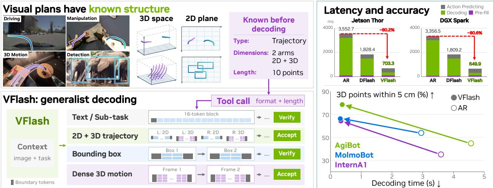
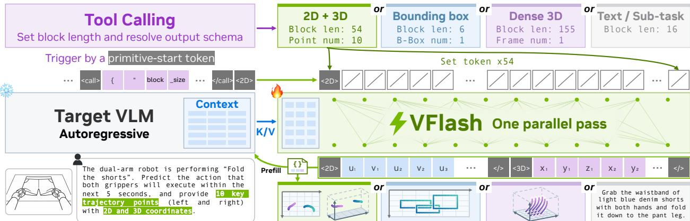
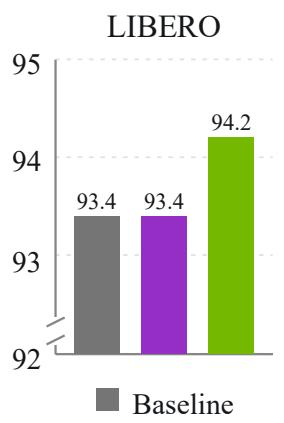
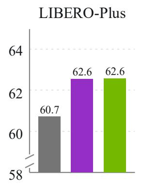
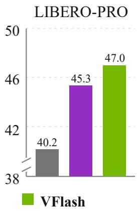
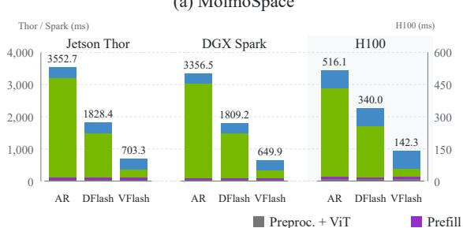
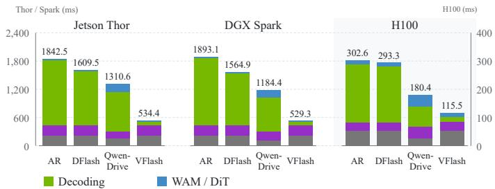
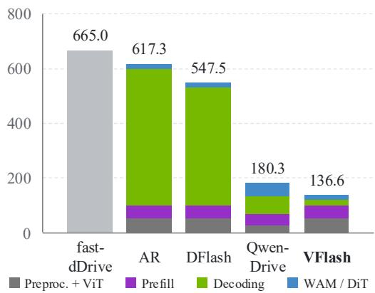

# VFlash: Fast, Accurate Visual Planning via Flash Primitive Decoding

Yu-Cheng Chou1\*†, Shihao Wang2\*†, Jin Huang\*, Chi-Pin Huang, Chiao-An Yang3†, Xianzhe Fan4†, Jing Wang, Zhiqi Li, Yuanguo Kuang2†, Ruijie Zheng, Johan Bjorck, Sifei Liu, Hang Su, Abhishek Badki, Lei Zhang2, Alan Yuille1, Linxi “Jim” Fan, Jan Kautz, Zhiding Yu‡

Links: GitHub | Project Page

  
Figure 1: VFlash is a generalist decoding framework for fast, accurate visual planning across Physical AI tasks such as robotics and autonomous driving. By aligning prediction blocks with the known structure of visual primitives, it enables parallel decoding of common structured outputs such as bounding boxes, variable-length 2D/3D trajectories, and dense point motion, while retaining verified speculative decoding for text and sub-task plans. Compared with autoregressive (AR) decoding, VFlash improves accuracy on 3D robot trajectory planning while substantially reducing decoding latency across NVIDIA platforms, including Jetson Thor, DGX Spark, and H100.

## Abstract

Models for physical AI tasks, such as robotics and autonomous driving, need not reason solely in language. They can use visual plans—points, bounding boxes, and trajectories—to represent spatial goals and anticipate motion. However, autoregressive vision-language models generate these plans one coordinate token at a time, making richer predictions increasingly costly. We introduce VFlash, a method for fast, accurate visual planning through Flash Primitive Decoding. VFlash exploits the known structure of visual primitives to predict their coordinates jointly, using a lightweight drafter that generates an entire primitive in one forward pass. The layout adapts to the primitive’s type, dimensionality, and length, supporting compact boxes and long, variable-length trajectories. Crucially, spatial accuracy need not require reproducing an autoregressive model’s exact token sequence. VFlash therefore trains on annotated primitives and directly accepts structurally valid predictions without target-token agreement. Across the evaluated 2D and 3D robot trajectory tasks, VFlash consistently reduces prediction errors relative to autoregressive decoding. Preliminary single-rollout measurements indicate approximately 25× faster generation for 3D point motion forecasting. A world action model conditioned on VFlash plans achieves 70.2% average success across four MolmoSpaces task suites, compared with 62.6% for the baseline.

## 1. Introduction

Vision-language models (VLMs) are increasingly used as high-level brains for physical AI systems, interpreting visual observations and task instructions to guide behavior in robotics and autonomous driving (Gemini Robotics Team, 2025; NVIDIA et al., 2025; Tian et al., 2025). Their reasoning need not be expressed solely in language. VLMs can formulate intermediate predictions as visual plans: points and bounding boxes identify relevant locations or objects (Jiang et al., 2025; Yuan et al., 2025), while trajectories describe intended motion or forecast how a scene will evolve (Gu et al., 2024; Zhang et al., 2026a). Recent work uses spatial traces and visual primitives to guide action generation (Guo et al., 2026; Lee et al., 2025; Li et al., 2025a). These plans make spatial goals and anticipated motion explicit before action. Each visual primitive has identifiable boundaries and an organized coordinate layout.

Generating such plans eficiently becomes increasingly important as their spatial detail grows. Longer trajectories, additional objects, and joint 2D image and 3D predictions require more coordinate tokens, which autoregressive VLMs decode sequentially (Bai et al., 2023, 2025; Chen et al., 2022; Zhu et al., 2025). For physical agents that update their plans as new observations arrive, sequential decoding limits spatial detail and update frequency under a fixed latency budget. This motivates decoding methods that can generate complete visual plans with fewer sequential forward passes while preserving their spatial accuracy.

Parallel decoding ofers a promising route to reducing this sequential cost, particularly for latency-sensitive physical AI systems operating at batch size one. Existing approaches include speculative decoding with parallel verification (Leviathan et al., 2023; Li et al., 2025b) and difusion language models (dLLMs) with parallel denoising (Arriola et al., 2025; Nie et al., 2025). However, dLLMs often exhibit a speed–quality trade-of relative to autoregressive models (Liu et al., 2025; Wu et al., 2025). DFlash combines these approaches using a lightweight block difusion draft model to predict draft tokens in a single forward pass, followed by target verification that preserves the autoregressive model’s output distribution (Chen et al., 2026). For visual outputs, LocateAnything exploits spatial structure through parallel box decoding (Wang et al., 2026).

In this work, we introduce VFlash, a generalist decoding framework for physical AI (Figure 1) that accommodates both text (e.g., sub-task plans) and diverse visual primitives, such as bounding boxes, variable-length trajectories, and dense 3D motion predictions. Our study reveals an interesting observation: a lightweight difusion drafter can even surpass its autoregressive target in spatial accuracy of the visual plans while decoding much faster. The structure of visual primitives helps explain this finding: once a primitive’s type, dimensionality, and length are specified, its boundaries and coordinate layout are known. Aligning draft blocks with these boundaries allows an entire geometric object to be predicted jointly, with tens to hundreds of tokens decoded in a single forward pass. These observations motivate aligning training and decoding with complete primitive boundaries and directly accepting structurally valid drafts without requiring token-level agreement with the target, while retaining verified decoding for text.

At the center of VFlash is Flash Primitive Decoding (FPD), which uses the requested output structure to organize both drafter training and inference. A tool call specifies the size of a variable-length prediction, while the primitive type determines its coordinate layout. Conditioned on features from a frozen target VLM, a lightweight difusion drafter learns to predict complete primitives from annotated spatial data. At inference, the decoder applies layout-specific constraints (Geng et al., 2023; Willard and Louf, 2023) and accepts valid primitives in full. The target VLM supplies context for subsequent predictions, and ordinary text retains speculative decoding with target verification.

We evaluate VFlash on 2D and 3D robot trajectories, bounding boxes, and dense 3D point motion forecasting, and study its use in downstream manipulation and driving. VFlash consistently reduces prediction errors relative to its autoregressive target across the evaluated robot trajectory tasks. In the downstream robot manipulation pipeline shown in Figure 1, it reduces inference latency by about 80% on both Jetson Thor and DGX Spark. These visual plans also provide useful conditioning for action models: on MolmoSpaces (Kim et al.,

2026b), a world action model (NVIDIA, 2026c; Ye et al., 2026) conditioned on VFlash plans achieves 70.2% average success across four task suites, compared with 62.6% for the baseline.

Beyond acceleration, our work suggests a broader role for parallel decoding in multimodal systems. Lossless speculative decoding preserves the autoregressive target’s output distribution (Chen et al., 2023a; Leviathan et al., 2023), whereas structured visual planning instead permits predictions to be judged by their spatial accuracy and usefulness for action, in the spirit of relaxed acceptance criteria (Bachmann et al., 2025; Wang et al., 2025c). VFlash enables a System-1 mode (Kahneman, 2011) of visual planning in VLMs, producing fast, structured spatial predictions through joint coordinate decoding. This perspective interestingly connects to recent System-1 models such as Jev, which emphasize fast, typed decisions (Almeida, 2026; Yu and Yao, 2026). VFlash brings this perspective to complete geometric predictions, exploiting structure within each primitive. The resulting gains in both speed and spatial accuracy suggest that autoregressive decoding need not define the quality ceiling for visual outputs.

## 2. Method

This section presents the generalist decoding framework ofVFlash for physical AI, covering both the preliminaries of DFlash and the detailed design of Flash Primitive Decoding (Figure 2).

## 2.1. Preliminaries

In speculative decoding, a draft model $q _ { \phi }$ proposes � tokens that the target model $p _ { \theta }$ verifies in parallel, giving an average per-token latency of

$$
L = \frac { T _ { \mathrm { d r a f t } } + T _ { \mathrm { v e r i f y } } } { \tau } ,\tag{1}
$$

where � is the expected number of tokens accepted per cycle (Chen et al., 2026). DFlash reduces the numerator with a lightweight block difusion drafter. Features $H _ { \boldsymbol \theta } ( { \boldsymbol { x } } )$ from selected target layers are fused and injected as keys and values into each draft layer. Given a start token $a _ { 0 } ,$ the drafter predicts $\gamma$ masked tokens in one bidirectional forward pass, yielding $T _ { \mathrm { d r a f t } } = t _ { \mathrm { p a r } } \ll \gamma t _ { \mathrm { s t e p } } ,$ , where $t _ { \mathrm { s t e p } }$ is the sequential drafting cost per token. Longer drafts, however, need not increase �: greedy verification accepts tokens only up to the first mismatch with the target:

$$
\tau _ { \mathrm { v e r } } = 1 + \operatorname* { m a x } { \Big \{ } k \leq \gamma : \ a _ { j } = \arg \operatorname* { m a x } _ { v } p _ { \theta } ( v \mid x , a _ { < j } ) { \mathrm { ~ f o r ~ a l l ~ } } j \leq k { \Big \} } .\tag{2}
$$

$\tau _ { \mathrm { v e r } }$ often saturates well below $\gamma .$ . Thus enlarging a block does not necessarily enlarge its final throughput. For text generation, the goal is to preserve the target distribution (Leviathan et al., 2023) via verification. But token-level agreement need not reflect spatial accuracy. VFlash retains the drafting architecture and replaces Eq. 2 with direct acceptance of structurally valid visual primitives.

## 2.2. Flash primitive decoding

Given visual observations and a task instruction, the VLM predicts spatial objects such as boxes, robot trajectories, or future point positions. Each prediction is a visual primitive with a schema � specifying its type, coordinate dimensions, and extent. This fixes each coordinate’s role while leaving its value to be inferred from the input. A trajectory’s 2D image coordinates and 3D spatial coordinates can form one primitive and be predicted jointly. For variable-length predictions, a tool call declares the extent, which together with the primitive type determines the layout; for fixed-size predictions such as boxes, the type alone sufices. The structure is thus known before coordinate prediction, and each decoding block covers a complete primitive.

The schema defines a block of length $B ( s )$ : an observed start token $a _ { 0 }$ followed by $B ( s ) - 1$ masked tokens. An autoregressive target factorizes the blocks as $\textstyle \prod _ { j } p _ { \theta } ( a _ { j } \mid x , a _ { < j } )$ and needs $B ( s ) - 1$ sequential passes. Given the layout and the target context, VFlash instead predicts all positions conditionally independently,

$$
q _ { \phi } \bigl ( a _ { 1 : B ( s ) - 1 } \mid H _ { \theta } ( x ) , a _ { 0 } \bigr ) = \prod _ { j = 1 } ^ { B ( s ) - 1 } q _ { \phi , j } \Bigl ( a _ { j } \mid H _ { \theta } ( x ) , a _ { 0 } , { \mathrm { M A S K } } ^ { B ( s ) - 1 } \Bigr ) ,\tag{3}
$$

  
Figure 2: FPD design. A primitive-start token triggers a prediction block layout determined by the primitive type and the preceding tool calling. By adapting the prediction block to each primitive’s structure, VFlash supports diferent spatial formats and lengths without requiring token-level agreement with the VLM.

in a single forward pass. The complete primitive is thus the unit of parallel prediction, with a speculation budget $\gamma = B ( s ) - 1$ set by the request rather than by a fixed window. The same principle covers targets that emit coordinates as ordinary text: we align their numeric fields in a fixed-width layout and render the predictions back into the target’s text format. Appendix A gives the coordinate conventions and serialization formats of each task.

## 2.3. Token representations

Visual plans often require large, variable-length draft blocks. For example, NAVSIM requires eight waypoints over four seconds, while Waymo requires twenty over five seconds. Drafting such blocks introduces challenges in format following and spatial accuracy. We find that two design principles help address these challenges:

Boundary alignment decides what is predicted together: each draft block covers one complete primitive, avoiding the splits caused by fixed-length windows. The tool call declares the block length, from which the waypoint count � follows, and a shared layout template accommodates diferent lengths, allowing the whole primitive to be drafted in one pass.

Position alignment decides what each position predicts: every slot has a known role—a waypoint, axis, or delimiter—before decoding. This supports parallel prediction with a consistent layout and per-position constraints at inference.

Table 1: Primitive layouts. Each block begins with the start token �0. � denotes the number of points; (�, �) and (�, �, �) denote image-plane and metric coordinates in special tokens.
<table><tr><td>Primitive</td><td>Layout</td></tr><tr><td>B-box</td><td>&lt;box&gt; u1 v1 u2 v2 &lt;/&gt;</td></tr><tr><td>2D+3D traj.</td><td>&lt;2D&gt; (u v)×P &lt;/&gt; &lt;3D&gt; (x y z)×P &lt;/&gt;</td></tr><tr><td>Dense motion</td><td>&lt;Dense&gt; t1t2 [k (s d1 · · ·d5)×3]×P&lt;/&gt;</td></tr></table>

Maintaining this layout requires each coordinate to occupy a fixed number of positions. Recent VLMs normalize image coordinates to 0–1,000 and write them as ordinary text (Bai et al., 2023; Zhu et al., 2025); models built around visual primitives often use special tokens (Jiang et al., 2025; Wang et al., 2026). A special coordinate token occupies one position, whereas text tokenization can vary with the value and shift subsequent coordinates. VFlash supports both representations.

For our base model (Section 3), typed start and end tokens mark primitive boundaries and transitions between text and primitive decoding. Each coordinate uses one of 1,001 special tokens, allowing prediction to be restricted to its legal vocabulary. For text-tokenized targets, VFlash gives each coordinate a sign and five digit positions, with unused high-order positions filled by the mask token. This fixed-width grid preserves position roles and is rendered back into the target’s text format, whose delimiters mark block boundaries. Table 1 and Appendix A give the formats details.

## 2.4. Training

We adapt an autoregressive VLM to the spatial response format with next-token supervision, then freeze it and train a shallow, non-causal drafter on its features. For an annotated block $^ { a , }$ we minimize the weighted cross-entropy of Eq. 3,

$$
\mathcal { L } _ { \mathrm { p r i m } } = - \sum _ { j = 1 } ^ { B ( s ) - 1 } w _ { j } \log q _ { \phi , j } \Big ( a _ { j } \ | \ H _ { \theta } ( x ) , a _ { 0 } , \mathrm { M A S K } ^ { B ( s ) - 1 } \Big ) ,\tag{4}
$$

with all logits computed jointly in one forward pass. Primitive positions use uniform $w _ { j } ,$ unlike the decaying weights that favor early positions under Eq. 2. Crucially, labels $a _ { j }$ come from annotated coordinates or rendered grids rather than the target’s continuation, optimizing the drafter for spatial accuracy instead of token-level agreement.

Each annotated primitive contributes one complete block. Where the response also contains text, sampled short blocks train the ordinary drafting path, so one drafter serves both the verified text path and the direct primitive path. Packed attention keeps examples and independent blocks separate while preserving attention within each primitive. Backbones, data, validity weights, and adaptation recipes are given in Appendix B.

## 2.5. Inference

Decoding runs 16-position DFlash blocks until a primitive-start token is accepted; the decoder then resolves the declared schema and drafts the complete block of length $B ( s )$ in one pass. Per-position constraints restrict coordinates and delimiters to their legal vocabularies, and cross-position rules pair out-of-frame coordinates; both act on logits already computed and add no neural evaluation.

Let �ˆ be the resulting prediction and � its acceptance test: the schema validator, plus for boxes the spatialconfidence guard of LocateAnything (Wang et al., 2026). VFlash replaces Eq. 2 with

$$
\tau _ { \mathrm { d i r } } = \left\{ \begin{array} { l l } { B ( s ) , } & { A _ { s } ( \hat { a } ) = 1 , } \\ { 1 + r , } & { \mathrm { o t h e r w i s e } , } \end{array} \right.\tag{5}
$$

where the first � draft slots are retained $( r = 0$ for trajectories; for boxes, those before the first uncertain coordinate) and the rest are regenerated by constrained target AR. An accepted primitive is committed without token-level agreement; one target pass updates the cache and context features and emits the next token. Text still follows Eq. 2; Appendix C gives both procedures.

Substituting Eq. 5 into Eq. 1, a valid primitive costs

$$
L _ { \mathrm { d i r } } = \frac { t _ { \mathrm { p a r } } + t _ { \mathrm { t a r g e t } } } { B ( s ) } ,\tag{6}
$$

against one target forward $t _ { \mathrm { t a r g e t } }$ per coordinate under autoregressive decoding, up to prefix and continuation overhead. Both passes grow mildly with $B ( s )$ , but their number does not, so a more detailed plan adds no sequential decoding steps.

Table 2: Open-loop 2D trajectory prediction. DFD, HD, and RMSE in normalized image coordinates (↓). Reference rows are taken from prior work; Baseline (AR) and VFlash share the same 4B target and difer only in the decoder. Bold and underline mark the best and second-best values.
<table><tr><td colspan="2"></td><td colspan="3">ShareRobot-Bench</td><td colspan="3">VABench-V</td></tr><tr><td>Method</td><td>Params</td><td>DFD</td><td>HD</td><td>RMSE</td><td>DFD</td><td>HD</td><td>RMSE</td></tr><tr><td rowspan="2">Qwen3-VL (2025) Qwen3-VL (2025)</td><td>4B</td><td>0.381</td><td>0.329</td><td>0.220</td><td>0.279</td><td>0.253</td><td>0.204</td></tr><tr><td>8B</td><td>0.392</td><td>0.341</td><td>0.233</td><td>0.274</td><td>0.255</td><td>0.202</td></tr><tr><td rowspan="4">MolmoAct (2025) Embodied-R1 (2026b) HAMSTER (2025a)</td><td>7B</td><td>0.776</td><td>0.776</td><td>0.677</td><td>0.814</td><td>0.814</td><td>0.688</td></tr><tr><td>3B</td><td>0.343</td><td>0.300</td><td>0.239</td><td>0.303</td><td>0.259</td><td>0.213</td></tr><tr><td>13B</td><td>0.437</td><td>0.392</td><td>0.355</td><td>0.212</td><td>0.205</td><td>0.183</td></tr><tr><td>RoboBrain-2.0 (2025) 7B</td><td>0.167</td><td>0.158</td><td>0.125</td><td>0.329</td><td>0.260</td><td>0.224</td></tr><tr><td>LoHo-Manip (2026b)</td><td>4B</td><td>0.231</td><td>0.206</td><td>0.156</td><td>0.212</td><td>0.182</td><td>0.147</td></tr><tr><td>Baseline (AR)</td><td>4B</td><td>0.202</td><td>0.175</td><td>0.142</td><td>0.130</td><td>0.125</td><td>0.093</td></tr><tr><td>VFlash (ours)</td><td>4B</td><td>0.194</td><td>0.162</td><td>0.133</td><td>0.126</td><td>0.116</td><td>0.089</td></tr></table>

Table 3: Category-conditioned box generation. F1 (%, ↑) and boxes per second (BPS, ↑). Direct accepts every schema-valid box without verification; AR fallback regenerates boxes rejected by the spatial-confidence guard with constrained AR (Appendix F.4). BPS is measured separately on each dataset.
<table><tr><td colspan="3"></td><td colspan="2">F1@IoU (%)</td><td rowspan="2">BPS</td></tr><tr><td>Method</td><td>Dataset</td><td>Mean</td><td>0.50</td><td>0.95</td></tr><tr><td rowspan="2">Baseline (AR)</td><td>COCO</td><td>48.68</td><td>65.29</td><td>16.09</td><td>3.15</td></tr><tr><td>Dense200</td><td>60.10</td><td>76.70</td><td>16.95</td><td>6.73</td></tr><tr><td>VFlash (direct)</td><td>COCO</td><td>41.32</td><td>59.64</td><td>10.76</td><td>5.96</td></tr><tr><td rowspan="2">VFlash</td><td>Dense200</td><td>39.09</td><td>55.06</td><td>6.59</td><td>22.66</td></tr><tr><td>COCO</td><td>47.79</td><td>66.38</td><td>13.48</td><td>8.76</td></tr><tr><td>(AR fallback)</td><td>Dense200</td><td>61.78</td><td>82.64</td><td>12.11</td><td>17.46</td></tr></table>

Table 4: Open-loop 3D robot trajectory prediction. ADE and FDE in meters (↓); SR@5 and SR@10 are the fraction of waypoints within 5 cm and 10 cm (↑). The three variants difer in what the model generate (3D only, 2D+3D) and whether wrist-camera views were added in training. All groups are evaluated with the same single-view inputs. Bold marks the best value per column.
<table><tr><td colspan="2"></td><td colspan="4">InternA1 (2026)</td><td colspan="4">AgiBot (2025)</td><td colspan="4">MolmoBot (2026)</td></tr><tr><td>Training Variant</td><td>Decoder</td><td>ADE</td><td>FDE</td><td>SR@5</td><td>SR@10</td><td>ADE</td><td>FDE</td><td>SR@5</td><td>SR@10</td><td>ADE</td><td>FDE</td><td>SR@5</td><td>SR@10</td></tr><tr><td>3D-only</td><td>AR</td><td>0.101</td><td>0.155</td><td>0.412</td><td>0.658</td><td>0.083</td><td>0.125</td><td>0.503</td><td>0.799</td><td>0.066</td><td>0.104</td><td>0.526</td><td>0.804</td></tr><tr><td rowspan="2">2D+3D</td><td>VFlash</td><td>0.065</td><td>0.098</td><td>0.638</td><td>0.820</td><td>0.042</td><td>0.067</td><td>0.731</td><td>0.914</td><td>0.054</td><td>0.083</td><td>0.653</td><td>0.870</td></tr><tr><td>AR</td><td>0.153</td><td>0.233</td><td>0.273</td><td>0.473</td><td>0.105</td><td>0.151</td><td>0.398</td><td>0.698</td><td>0.076</td><td>0.116</td><td>0.467</td><td>0.767</td></tr><tr><td rowspan="2">2D+3D w/ wrist-</td><td>VFlash</td><td>0.062</td><td>0.091</td><td>0.640</td><td>0.827</td><td>0.041</td><td>0.064</td><td>0.739</td><td>0.919</td><td>0.055</td><td>0.085</td><td>0.640</td><td>0.862</td></tr><tr><td>AR</td><td>0.130</td><td>0.196</td><td>0.360</td><td>0.554</td><td>0.084</td><td>0.129</td><td>0.456</td><td>0.749</td><td>0.066</td><td>0.102</td><td>0.547</td><td>0.813</td></tr><tr><td>camera training</td><td>VFlash</td><td>0.060</td><td>0.091</td><td>0.651</td><td>0.835</td><td>0.036</td><td>0.057</td><td>0.794</td><td>0.937</td><td>0.052</td><td>0.080</td><td>0.671</td><td>0.877</td></tr></table>

## 3. Experiment

Base VLM. Most experiments use a customized embodied VLM combining Qwen3-4B (Yang et al., 2025), a native-resolution MoonViT encoder (Kimi Team, 2025), and an MLP connector. It is trained progressively on general vision-language tasks, grounding (Wang et al., 2026), embodied spatial understanding, and joint 2D/3D trajectory prediction. Coordinates for bounding box and trajectory use special tokens, with 2D image coordinates normalized to 0–1,000 and 3D coordinates uniformly quantized within predefined ranges. For dense motion prediction, we use the released MolmoMotion-AR model (Zhang et al., 2026a), retaining its text-based coordinate representation.

Per-task training. For clean ablation studies, we fine-tune the AR target on task-specific data, then freeze it and train a five-layer VFlash drafter on the same data. For MolmoMotion, we train only the drafter on the frozen released target. Detailed per-task datasets, training mixtures, and optimization settings are provided in Appendix B.

Visual-plan conditioning. Despite diferences in DiT/WAM architectures and their interfaces with the VLM, a commonality is that the action models cross-attend to VLM features encoding the generated visual plans. These features are obtained by processing VFlash’s accepted primitives with the frozen target VLM. Appendix D details the architectures and conditioning mechanisms.

Table 5: 3D point motion forecasting on PointMotionBench. VFlash uses MolmoMotion-AR (Zhang et al., 2026a) as its target. VFlash achieves approximately 25× faster single-rollout generation than AR (Appendix F.3). ADE/FDE are in meters (↓); Frames and Text indicate observation history and language input. Bold and underline mark the best and second-best values.
<table><tr><td rowspan="2">Method</td><td colspan="2">Input</td><td colspan="3">HOT3D</td><td colspan="3">WorldTrack</td><td colspan="3">DAVIS</td></tr><tr><td>Frames</td><td>Text</td><td>ADE↓</td><td>FDE↓</td><td>PWT↑</td><td>ADE↓</td><td>FDE↓</td><td>PWT↑</td><td>ADE↓</td><td>FDE↓</td><td>PWT↑</td></tr><tr><td>ObjectForesight (2026)</td><td>3</td><td>No</td><td>0.129</td><td>0.192</td><td>0.353</td><td></td><td></td><td></td><td></td><td></td><td></td></tr><tr><td>EgoScaler (2025)</td><td>1</td><td>Yes</td><td>0.170</td><td>0.179</td><td>0.218</td><td></td><td></td><td></td><td></td><td></td><td></td></tr><tr><td>Robot4DGen (2026d)</td><td>3</td><td>No</td><td>0.212</td><td>0.271</td><td>0.112</td><td>0.548</td><td>0.704</td><td>0.121</td><td>2.120</td><td>3.382</td><td>0.081</td></tr><tr><td>Track2Act (2024)</td><td>1</td><td>No</td><td>0.294</td><td>0.413</td><td>0.202</td><td>1.230</td><td>1.567</td><td>0.053</td><td>4.853</td><td>8.110</td><td>0.018</td></tr><tr><td>MolmoMotion-FM (2026a)</td><td>3</td><td>Yes</td><td>0.135</td><td>0.255</td><td>0.382</td><td>0.158</td><td>0.295</td><td>0.438</td><td>1.480</td><td>2.520</td><td>0.130</td></tr><tr><td>MolmoMotion-AR (2026a)</td><td>3</td><td>Yes</td><td>0.109</td><td>0.217</td><td>0.444</td><td>0.143</td><td>0.261</td><td>0.445</td><td>1.227</td><td>2.108</td><td>0.153</td></tr><tr><td>VFlash</td><td>3</td><td>Yes</td><td>0.122</td><td>0.200</td><td>0.391</td><td>0.145</td><td>0.300</td><td>0.408</td><td>0.893</td><td>1.716</td><td>0.143</td></tr></table>

## 3.1. Visual primitive prediction

2D trajectory prediction. On ShareRobot-Bench (Ji et al., 2025) and VABench-V (Yuan et al., 2026a), VFlash lowers all six errors of its AR target (Table 2), by 7% on HD and 3–6% on DFD and RMSE across both benchmarks. On VABench-V, VFlash cuts every error by roughly 40% relative to the best prior model, LoHo-Manip (Liu et al., 2026b), with our AR target already outperforming the listed baselines; on ShareRobot-Bench, VFlash is second only to RoboBrain-2.0 (BAAI RoboBrain Team, 2025).

2D bounding box prediction. On COCO (Lin et al., 2014) and Dense200 (Jiang et al., 2025), VFlash with AR fallback matches AR on mean F1 while decoding 2.6–2.8× faster (Table 3), with higher F1 at IoU 0.50, especially on the crowded Dense200 scenes, but lower F1 at IoU 0.95. Without fallback, mean F1 drops by about 20 points on Dense200.

3D trajectory prediction. On InternA1 (Tian et al., 2026), AgiBot (Bu et al., 2025), and MolmoBot (Deshpande et al., 2026), VFlash improves all four metrics for all three target variants (Table 4). ADE falls by 18–49% with the 3D-only target and by 28–61% with the 2D+3D target; waypoint accuracy at 5 cm on AgiBot rises from 50% to 73% and from 40% to 74%, respectively. With joint 2D+3D outputs, AR’s 3D ADE is 15–51% higher than with 3D-only outputs, while VFlash maintains similar accuracy by predicting both segments in one parallel pass. The wrist-camera training variant further reduces VFlash’s ADE by 3–12%, with evaluation still using only the primary camera.

Dense 3D motion prediction. On PointMotionBench (Zhang et al., 2026a), we freeze the backbone of MolmoMotion-AR and draft each future frame of query points as one block with a fixed-width digit layout (Appendix A). As shown in Table 5, VFlash reduces DAVIS ADE and FDE by 27% and 19%, respectively, and HOT3D FDE by 8%. Its ADE ranks second on HOT3D and WorldTrack, behind AR but ahead of the flow-matching variant, although WorldTrack FDE increases by 15% and PWT is 7–12% lower across the three datasets. These results extend VFlash to dense motion prediction with text-tokenized coordinates, with gains over AR on several error metrics and approximately 25× faster single-rollout generation (Appendix F.3).

## 3.2. Downstream applications

Experiment Setup. We prioritize controlled comparisons of visual-plan conditioning over maximizing benchmark scores through additional model enhancements. The VLM remains frozen in all configurations; action policies condition on its hidden states encoding the generated plans and visual context. Within each application, we keep the action-model architecture fixed across comparisons.

MolmoSpaces. For MolmoSpaces (Kim et al., 2026b) the policy is a world action model (WAM) obtained by post-training Cosmos-Predict2.5 (NVIDIA, 2026c) for robot control. We replace its Cosmos-Reason text encoder with our VLM. The WAM reads the VLM’s hidden states at the question, the generated subtask, and the visual plans of 2D+3D trajectories with ten waypoints, passed through a linear projection into its existing text cross-attention path. It keeps its own camera and robot-state inputs, predicts 20-step action chunks, and requests a new plan every three chunks. The baseline is the unmodified WAM with its original text encoder.

Table 6: MolmoSpaces manipulation results. Baseline and VFlash share the same WAM; Baseline keeps its original text encoder, VFlash replaces it with our VLM and conditions on the generated plan. Bold marks the best value per column.  
Table 7: All variants use the same WAM with diferent decoders, primitive types, or conditioning features. Baseline uses WAM’s original text encoder. Q, S, T, and I denote the VLM hidden features for the question, subtask, trajectory, and image tokens. Image context baseline uses VFlash to decode subtask.
<table><tr><td>Method</td><td>Avg.</td><td>Pick</td><td>P&amp;P</td><td>Open</td><td>Close</td></tr><tr><td>π₀-FAST DROID (2025)</td><td>20.7</td><td>22.0</td><td>11.0</td><td>11.1</td><td>38.6</td></tr><tr><td> $\pi _ { 0 }$  DROID (2024)</td><td>23.2</td><td>16.2</td><td>12.5</td><td>11.0</td><td>53.1</td></tr><tr><td> $\pi _ { 0 . 5 }$  DROID (2025)</td><td>34.5</td><td>36.4</td><td>13.6</td><td>22.7</td><td>65.1</td></tr><tr><td>PRTS-Droid (2026c)</td><td>42.4</td><td>53.8</td><td>27.7</td><td>12.0</td><td>76.3</td></tr><tr><td>Cosmos3-Nano-Policy (2026a)</td><td>53.0</td><td>65.5</td><td>35.2</td><td>32.0</td><td>79.1</td></tr><tr><td>WALL-OSS-0.5 (2026)</td><td>53.8</td><td>73.8</td><td>46.0</td><td>16.8</td><td>78.5</td></tr><tr><td>PrimeR0 (2026)</td><td>60.3</td><td>77.5</td><td>54.6</td><td>27.8</td><td>81.3</td></tr><tr><td>Baseline</td><td>62.6</td><td>81.1</td><td>55.7</td><td>49.3</td><td>64.2</td></tr><tr><td>VFlash</td><td>70.2</td><td>83.6</td><td>67.3</td><td>52.8</td><td>77.0</td></tr></table>

<table><tr><td>Variant</td><td>Decode</td><td>Primitive</td><td>Context</td><td>Avg.</td></tr><tr><td>Baseline</td><td></td><td></td><td>Native</td><td>62.6</td></tr><tr><td>AR generation</td><td>AR</td><td>2D+3D</td><td>Q+S+T</td><td>61.0</td></tr><tr><td>3D-only</td><td>VFlash</td><td>3D</td><td>Q+S+T</td><td>69.3</td></tr><tr><td>Image context</td><td>VFlash</td><td></td><td>Q+S+I</td><td>63.7</td></tr><tr><td>VFlash</td><td>VFlash</td><td>2D+3D</td><td>Q+S+T 70.2</td><td></td></tr></table>

As shown in Table 6, visual-plan conditioning raises average success from 62.6% to 70.2%, exceeding the listed public model, PrimeR0 (Lumos Robotics, 2026), by 9.9 percentage points on average and scoring higher on three of four tasks. The largest gains over the baseline are on Pick & Place and Close (11.6 and 12.8 points), compared with 2.5 points on Pick, suggesting greater benefits for tasks involving multiple dependent motions.

Table 7 compares plan representations and conditioning choices. Using AR-generated 2D+3D plans instead of VFlash plans lowers average success from 70.2% to 61.0%. Replacing trajectory states with image states lowers success by 6.5 percentage points to 63.7%. A 3D-only plan reaches 69.3%, while joint 2D+3D plans achieve the best average.

Average success rate (%)

  
Figure 3: LIBERO family. Average success (%) of the same PIv3 head conditioned on a frozen Qwen3-VL-4B (Baseline), on our VLM’s states up to the generated subtask (w/o Visual Primitives), and on the full visual plan (VFlash).

LIBERO family. On LIBERO (Liu et al., 2023), LIBERO-Plus (Fei et al., 2025), and LIBERO-PRO (Zhou et al., 2025b), we train a PIv3 flow-matching action head in StarVLA (StarVLA Community, 2026), with per-layer cross-attention to a frozen VLM. Given primary and wrist images, the VLM generates a subtask and a tenwaypoint 2D+3D trajectory before each eight-action chunk. We compare conditioning on VLM states through the subtask or the full plan. The baseline uses the same action head with a frozen Qwen3-VL-4B encoding only images and instructions.

Table 8: Autonomous driving results on NAVSIM (left) and the Waymo test split (right). RL indicates reinforcement learning; ↑ / ↓ denote higher / lower is better.
<table><tr><td>Method</td><td>RL</td><td>NC↑</td><td>DAC↑</td><td>EP↑</td><td>TTC↑</td><td>Comf.↑</td><td>PDMS↑</td></tr><tr><td>Hydra-MDP (2024b)</td><td></td><td>98.3</td><td>96.0</td><td>78.7</td><td>94.6</td><td>100.0</td><td>86.5</td></tr><tr><td>DiffusionDrive (2025)</td><td></td><td>98.2</td><td>96.2</td><td>82.2</td><td>94.7</td><td>100.0</td><td>88.1</td></tr><tr><td>ReCogDrive (2026)</td><td>一</td><td>98.3</td><td>95.1</td><td>81.1</td><td>94.3</td><td>100.0</td><td>86.8</td></tr><tr><td>ReCogDrive (2026)</td><td>√</td><td>98.2</td><td>97.8</td><td>83.5</td><td>95.2</td><td>99.8</td><td>89.6</td></tr><tr><td>SpanVLA (2026c)</td><td>√</td><td>99.1</td><td>97.1</td><td>86.3</td><td>95.2</td><td>100.0</td><td>90.3</td></tr><tr><td>ExploreVLA (2026)</td><td>√</td><td>98.8</td><td>98.4</td><td>83.5</td><td>96.5</td><td>99.9</td><td>90.4</td></tr><tr><td>EponaV2 (2026a)</td><td>√</td><td>98.6</td><td>97.9</td><td>84.8</td><td>95.7</td><td>100.0</td><td>90.4</td></tr><tr><td>Qwen-Drive-1.0-SFT (2026b)</td><td>一</td><td>98.4</td><td>96.6</td><td>82.4</td><td>94.7</td><td>100.0</td><td>88.2</td></tr><tr><td>Qwen-Drive-1.0-RL (2026b)</td><td>√</td><td>98.6</td><td>98.2</td><td>84.8</td><td>95.9</td><td>100.0</td><td>90.7</td></tr><tr><td>VFlash-SFT</td><td>–</td><td>98.1</td><td>95.2</td><td>81.7</td><td>94.3</td><td>100.0</td><td>87.1</td></tr><tr><td>VFlash-RL</td><td>√</td><td>98.3</td><td>97.8</td><td>85.9</td><td>95.4</td><td>100.0</td><td>90.7</td></tr></table>

<table><tr><td>Method</td><td></td><td>RL ADE3s ↓</td><td>ADE5s ↓</td><td>RFS↑</td></tr><tr><td>DiffusionLTF (2025)</td><td></td><td>1.36</td><td>2.89</td><td>7.72</td></tr><tr><td>dVLM-AD (2026)</td><td></td><td>1.29</td><td>3.02</td><td>7.63</td></tr><tr><td>HMVLM (2025a)</td><td></td><td>1.33</td><td>3.07</td><td>7.74</td></tr><tr><td>MindVLA-U1 (2026)</td><td></td><td>1.16</td><td>2.67</td><td>7.77</td></tr><tr><td>Fast-dDrive (2026b)</td><td></td><td>1.25</td><td>2.91</td><td>7.82</td></tr><tr><td>NoRD (2026)</td><td>√</td><td>1.25</td><td></td><td>7.71</td></tr><tr><td>MindVLA-U1 (2026)</td><td>√</td><td>1.09</td><td>2.66</td><td>7.87</td></tr><tr><td>Qwen-Drive-1.0-SFT (2026b)</td><td>一</td><td>1.19</td><td>2.65</td><td>7.78</td></tr><tr><td>Qwen-Drive-1.0-RL (2026b)</td><td>√</td><td>1.19</td><td>2.67</td><td>7.91</td></tr><tr><td>VFlash-SFT</td><td></td><td>1.23</td><td>2.71</td><td>7.79</td></tr><tr><td>VFlash-RL</td><td>√</td><td>1.22</td><td>2.70</td><td>7.86</td></tr></table>

As shown in Figure 3, gains over the baseline increase from 0.8 percentage points on LIBERO to 1.9 on LIBERO-Plus and 6.8 on LIBERO-PRO, indicating greater benefits under perturbations. On LIBERO-PRO, visual plans improve Spatial, Object, and Goal by 11.1, 9.4, and 6.9 points over the baseline. Compared with subtask-only conditioning, they add 2.6 points on Spatial, 1.2 on Goal, and 2.0 on Long, showing that trajectories provide useful information beyond the generated subtask.

Autonomous driving. For NAVSIM (Dauner et al., 2024) and Waymo (Xu et al., 2026b) the policy is a ReCogDrive-derived difusion transformer (Li et al., 2026) that reads the VLM’s final-layer states over the prompt and the generated plan through cross-attention, alongside ego history and vehicle state, and outputs a continuous trajectory. The VLM is frozen and generates a 2D+3D trajectory on each dataset’s native grid; separate heads are trained on Waymo, NAVSIM, and Alpamayo-derived data. RL then fine-tunes the head alone with PDMS and RFS as rewards, so the plans are identical in the SFT and RL rows.

As shown in Table 8, VFlash achieves competitive driving performance with a frozen planning VLM and a small action head. With supervised training, it reaches 87.1 PDMS on NAVSIM, above ReCogDrive (86.8), and 7.79 RFS on Waymo, comparable to Qwen-Drive-1.0-SFT (7.78). RL on the action head raises these scores to 90.7 PDMS and 7.86 RFS, matching Qwen-Drive-1.0-RL on NAVSIM and coming within 0.05 RFS of the best listed Waymo result. These gains require no updates to the VLM or its generated plans. Together, the results show that VFlash supports competitive plan-conditioned driving while substantially reducing decoding latency (Section 3.3).

## 3.3. Throughput analysis

Figure 4 splits per-step latency into visual encoding, prefill, decoding, and the action model at batch size one on Jetson Thor, DGX Spark, and H100. Thor is an embedded platform for robots and vehicles and Spark a desktop-class system, typical on-device hardware for the System-1 visual planning of Section 1; H100 is the server reference. Appendix E gives the timing boundary and the full table. Across devices, VFlash cuts per-step latency 5.1–5.2× on MolmoSpaces on Thor and Spark and 3.6× on H100, and 3.4–3.6× and 2.6× on NAVSIM; on Waymo (Figure 5) the H100 reduction is 4.5×. The gain comes almost entirely from decoding: under AR it takes 75–87% of each step on Thor, and VFlash cuts it 12–42× while the other stages are unchanged.

AR decoding runs one 4B VLM pass per token (35–39 ms on Thor, 33–40 ms on Spark, 4.7–6.0 ms on H100), so decoding time grows roughly linearly with token count. Drafting predicts the remaining tokens of a 36–84-token primitive in one pass, taking 13–23 ms on Thor and 1–3 ms on H100. Verification still needs a target pass per block, so its benefit depends on the tokens committed per iteration. On MolmoSpaces, DFlash

(b) NAVSIM

  
Inference latency (ms) ↓

  
Figure 4: VFlash latency across diferent downstream tasks on Jetson Thor, DGX Spark and H100.

commits 5.5 tokens per iteration on subtask text but only 2.2 within trajectory blocks: a coordinate one bin of the target’s choice fails Eq. 2 even with small geometric error. DFlash thus only about halves decoding time. VFlash skips token-level verification for visual primitives, using one drafter pass and one target pass per primitive; the target pass updates the cache and extracts hidden states for the action head, amortized over the block. On Thor, decoding takes 72–78 ms as the driving primitive grows from 36 to 84 tokens, so denser plans add little latency over this range.

## 4. Related Work

Embodied VLMs and visual plans. Embodied VLMs are increasingly used as high-level modules that turn visual observations and language instructions into plans, afordances, and trajectories (BAAI RoboBrain Team, 2025; Dang et al., 2026; Gemini Robotics Team, 2025; Ji et al., 2025; Yuan et al., 2026b). Spatial prediction is central to these models: points and boxes localize objects or afordances (Deitke et al., 2025; Jiang et al., 2025; Yuan et al., 2025; Zhou et al., 2025a), while traces describe intended or predicted motion (Wen et al., 2024; Zhang et al., 2026a; Zhou et al., 2026a). These visual plans can condition manipulation policies (Gu et al., 2024; Huang et al., 2025; Li et al., 2025a; Liu et al., 2026b; Tan et al., 2026) or be fed back as prompts (Zheng et al., 2025). Other work reasons spatially before acting (Fang et al., 2026; Guo et al., 2026; Lee et al., 2025), predicts future states (Kim et al., 2026a; Ye et al., 2026), or plans driving trajectories from scene understanding (NVIDIA et al., 2025; Tian et al., 2025; Wang et al., 2025b). While this literature asks what embodied models should predict, we ask how fast such spatial predictions can be produced. Token-by-token coordinate generation makes every extra waypoint, object, or dimension an additional decoding step.

Parallel and speculative decoding. Speculative decoding accelerates LLM inference by verifying multiple drafted tokens in parallel (Chen et al., 2023a; Leviathan et al., 2023; Stern et al., 2018). Medusa, EAGLE, TIDAR, and DFlash explore diferent ways to produce these drafts (Cai et al., 2024; Chen et al., 2026; Li et al., 2024a; Liu et al., 2026c). For visual outputs, LocateAnything decodes points and boxes as units, but is limited to fixed-size 2D primitives (Wang et al., 2026). Closest to this work, Spec-VLA accelerates OpenVLA by accepting draft action tokens whose bins lie near the target’s (Wang et al., 2025c). However, it still verifies each action token against the target and commits only 2.10–2.94 tokens per pass. Based on our finding that, for visual trajectory prediction, one-pass drafts are more accurate than the autoregressive target, VFlash instead drafts the entire visual primitive in one pass rather than by agreement with the target.

Embodied and System-1 models. In a deployed perception-action loop, VLM latency directly limits how quickly the agent can react. Prior eficiency works mainly accelerate the action execution pipeline, for example via action compression, parallel action chunks, or flow matching (Black et al., 2024; Kim et al., 2025; Pertsch et al., 2025; Song et al., 2025). Prior VLM-based planning, however, still often rely on highly autoregressive token decoding. System-1 models such as Jev make fast typed decisions that downstream applications can use directly (Almeida, 2026), and Visual Jev answers many independent visual questions in parallel after one image encoding (Yu and Yao, 2026). Our work can be seen as a relevant efort that enables System-1 VLM spatial prediction. Within this context, our work studies optimized token representation and decoding schemes systematically, supporting both dedicated special tokens (Chen et al., 2022) and plain numbers (Bai et al., 2023; Chen et al., 2023b; Zhu et al., 2025).

In summary, VFlash uses DFlash-style drafting without target-token agreement, extending fast and accurate visual plan generation from LocateAnything’s parallel box decoding to richer and more general visual primitives that are useful for downstream embodied applications. It also enables more eficient decoding parallelism via systematic studies, in contrast to relevant or concurrent works.

## 5. Conclusion

We presented VFlash, which uses the known structure of visual primitives to replace sequential coordinate generation with parallel prediction. Our results show that useful spatial predictions need not reproduce an autoregressive model’s output: direct drafts reduce robot trajectory errors, while single-rollout timing estimates indicate approximately 25× faster generation for 3D object point forecasting. Plan-conditioned manipulation further demonstrates how these predictions support downstream action generation. Future work will examine whether generating multiple complementary primitives from shared observations improves control within a fixed latency budget.

Acknowledgement. The team would like to thank Pavlo Molchanov, Jindong Jiang, Yonggan Fu, Guillermo Siman, Andrew Tao, Karan Sapra, Pulkit Kumar, Patrick Liu and Yan Wang for the valuable discussions. The team would also like to give special thanks to the NVIDIA TSE Team for their exceptional work on the TensorRT deployment of this work.

## AI use statement

Generative AI tools were used to assist with manuscript drafting, language polishing, and structural editing, as well as with literature search and code development. AI-generated suggestions were used only as assistance and were reviewed, revised, and verified by the authors. All technical claims, experimental results, interpretations, and final written content were validated by the authors, who take full responsibility for the work.

## References

Diogo Almeida. Introducing System One Models & Jev. TypeSafe AI, September 2026. URL https://typesafe.ai/blog /introducing-system-one-models-and-jev.

Marianne Arriola, Aaron Gokaslan, Justin T Chiu, Zhihan Yang, Zhixuan Qi, Jiaqi Han, Subham Sekhar Sahoo, and Volodymyr Kuleshov. Block difusion: Interpolating between autoregressive and difusion language models. arXiv:2503.09573, 2025.

BAAI RoboBrain Team. RoboBrain 2.0 technical report. arXiv:2507.02029, 2025.

Gregor Bachmann, Sotiris Anagnostidis, Albert Pumarola, Markos Georgopoulos, Artsiom Sanakoyeu, Yuming Du, Edgar Schönfeld, Ali Thabet, and Jonas Kohler. Judge decoding: Faster speculative sampling requires going beyond model alignment. In ICLR, 2025.

Jinze Bai, Shuai Bai, Shusheng Yang, Shijie Wang, Sinan Tan, Peng Wang, Junyang Lin, Chang Zhou, and Jingren Zhou. Qwen-VL: A versatile vision-language model for understanding, localization, text reading, and beyond. arXiv:2308.12966, 2023.

Shuai Bai, Yuxuan Cai, Ruizhe Chen, Keqin Chen, Xionghui Chen, Zesen Cheng, Lianghao Deng, Wei Ding, Chang Gao, Chunjiang Ge, et al. Qwen3-VL technical report. arXiv:2511.21631, 2025.

Homanga Bharadhwaj, Roozbeh Mottaghi, Abhinav Gupta, and Shubham Tulsiani. Track2act: Predicting point tracks from internet videos enables generalizable robot manipulation. In ECCV, 2024.

Kevin Black, Noah Brown, Danny Driess, Adnan Esmail, Michael Equi, Chelsea Finn, Niccolo Fusai, Lachy Groom, Karol Hausman, Brian Ichter, Szymon Jakubczak, Tim Jones, Liyiming Ke, Sergey Levine, Adrian Li-Bell, Mohith Mothukuri, Suraj Nair, Karl Pertsch, Lucy Xiaoyang Shi, James Tanner, Quan Vuong, Anna Walling, Haohuan Wang, and Ury Zhilinsky. � : A vision-language-action flow model for general robot control. arXiv:2410.24164, 2024.

Qingwen Bu, Jisong Cai, Li Chen, et al. Agibot world colosseo: A large-scale manipulation platform for scalable and intelligent embodied systems. arXiv:2503.06669, 2025.

Tianle Cai, Yuhong Li, Zhengyang Geng, Hongwu Peng, Jason D. Lee, Deming Chen, and Tri Dao. Medusa: Simple LLM inference acceleration framework with multiple decoding heads. arXiv:2401.10774, 2024.

Charlie Chen, Sebastian Borgeaud, Geofrey Irving, Jean-Baptiste Lespiau, Laurent Sifre, and John Jumper. Accelerating large language model decoding with speculative sampling. arXiv:2302.01318, 2023a.

Jian Chen, Yesheng Liang, and Zhijian Liu. DFlash: Block difusion for flash speculative decoding. arXiv:2602.06036, 2026.

Keqin Chen, Zhao Zhang, Weili Zeng, Richong Zhang, Feng Zhu, and Rui Zhao. Shikra: Unleashing multimodal LLM’s referential dialogue magic. arXiv:2306.15195, 2023b.

Ting Chen, Saurabh Saxena, Lala Li, David J. Fleet, and Geofrey Hinton. Pix2seq: A language modeling framework for object detection. In ICLR, 2022.

Ronghao Dang, Jiayan Guo, Bohan Hou, Sicong Leng, Kehan Li, Xin Li, Jiangpin Liu, Yunxuan Mao, Zhikai Wang, Yuqian Yuan, Minghao Zhu, Xiao Lin, Yang Bai, Qian Jiang, Yaxi Zhao, Minghua Zeng, Junlong Gao, Yuming Jiang, Jun Cen, Siteng Huang, Liuyi Wang, Wenqiao Zhang, Chengju Liu, Jianfei Yang, Shijian Lu, and Deli Zhao. RynnBrain: Open embodied foundation models. arXiv:2602.14979, 2026.

Daniel Dauner, Marcel Hallgarten, Tianyu Li, Xinshuo Weng, Zhiyu Huang, Zetong Yang, Hongyang Li, Igor Gilitschenski, Boris Ivanovic, Marco Pavone, et al. Navsim: Data-driven non-reactive autonomous vehicle simulation and benchmarking. In NeurIPS, 2024.

Matt Deitke, Christopher Clark, et al. Molmo and pixmo: Open weights and open data for state-of-the-art vision-language models. In CVPR, 2025.

Abhay Deshpande, Maya Guru, Rose Hendrix, Snehal Jauhri, Ainaz Eftekhar, Rohun Tripathi, Max Argus, Jordi Salvador, Haoquan Fang, Matthew Wallingford, et al. Molmob0t: Large-scale simulation enables zero-shot manipulation. arXiv:2603.16861, 2026.

Haoquan Fang, Jiafei Duan, Donovan Clay, Sam Wang, Shuo Liu, Weikai Huang, Xiang Fan, Wei-Chuan Tsai, Shirui Chen, Yi Ru Wang, Shanli Xing, Jaemin Cho, Jae Sung Park, Ainaz Eftekhar, Peter Sushko, Karen Farley, Angad Wadhwa, Cole Harrison, Winson Han, Ying-Chun Lee, Eli VanderBilt, Rose Hendrix, Suveen Ellawela, Lucas Ngoo, Joyce Chai, Zhongzheng Ren, Ali Farhadi, Dieter Fox, and Ranjay Krishna. Molmoact2: Action reasoning models for real-world deployment. arXiv:2605.02881, 2026.

Senyu Fei, Siyin Wang, Junhao Shi, Zihao Dai, Jikun Cai, Pengfang Qian, Li Ji, Xinzhe He, Shiduo Zhang, Zhaoye Fei, Jinlan Fu, Jingjing Gong, and Xipeng Qiu. LIBERO-plus: In-depth robustness analysis of vision-language-action models. arXiv:2510.13626, 2025.

Gemini Robotics Team. Gemini robotics: Bringing ai into the physical world. arXiv:2503.20020, 2025.

Saibo Geng, Martin Josifoski, Maxime Peyrard, and Robert West. Grammar-constrained decoding for structured NLP tasks without finetuning. In EMNLP, 2023.

Jiayuan Gu, Sean Kirmani, Paul Wohlhart, Yao Lu, Montserrat Gonzalez Arenas, Kanishka Rao, Wenhao Yu, Chuyuan Fu, Keerthana Gopalakrishnan, Zhuo Xu, Priya Sundaresan, Peng Xu, Hao Su, Karol Hausman, Chelsea Finn, Quan Vuong, and Ted Xiao. RT-trajectory: Robotic task generalization via hindsight trajectory sketches. In ICLR, 2024.

Weilong Guo, Yuchen Wang, Renping Zhou, Yunfeng Zhang, Rui Fang, Yuyang Pang, Wenda Xu, and Gao Huang. Action with visual primitives. arXiv:2605.22183, 2026. Withdrawn by the authors, September 2026; v3 (June 2026) is the version cited.

Ryan Hoque, Peide Huang, David J. Yoon, Mouli Sivapurapu, and Jian Zhang. Egodex: Learning dexterous manipulation from large-scale egocentric video. arXiv:2505.11709, 2025.

Kefeng Huang, Tingguang Li, Yuzhen Liu, Zhe Zhang, Jiankun Wang, and Lei Han. VLM-TDP: Vlm-guided trajectoryconditioned difusion policy for robust long-horizon manipulation. arXiv:2507.04524, 2025.

Yuzhou Huang, Benjin Zhu, Hengtong Lu, Victor Shea-Jay Huang, Haiming Zhang, Wei Chen, Jifeng Dai, Yan Xie, and Hongsheng Li. MindVLA-U1: Vla beats va with unified streaming architecture for autonomous driving. arXiv:2605.12624, 2026.

Yuheng Ji, Huajie Tan, Jiayu Shi, Xiaoshuai Hao, Yuan Zhang, Hengyuan Zhang, Pengwei Wang, Mengdi Zhao, Yao Mu, Pengju An, Xinda Xue, Qinghang Su, Huaihai Lyu, Xiaolong Zheng, Jiaming Liu, Zhongyuan Wang, and Shanghang Zhang. RoboBrain: A unified brain model for robotic manipulation from abstract to concrete. In CVPR, 2025.

Qing Jiang, Junan Huo, Xingyu Chen, Yuda Xiong, Zhaoyang Zeng, Yihao Chen, Tianhe Ren, Junzhi Yu, and Lei Zhang. Detect anything via next point prediction. arXiv:2510.12798, 2025.

Linyi Jin, Richard Tucker, Zhengqi Li, David Fouhey, Noah Snavely, and Aleksander Holynski. Stereo4d: Learning how things move in 3d from internet stereo videos. In CVPR, 2025.

Daniel Kahneman. Thinking, Fast and Slow. Farrar, Straus and Giroux, 2011.

Alexander Khazatsky, Karl Pertsch, Suraj Nair, Ashwin Balakrishna, Sudeep Dasari, Siddharth Karamcheti, et al. DROID: A large-scale in-the-wild robot manipulation dataset. In RSS, 2024.

Moo Jin Kim, Chelsea Finn, and Percy Liang. Fine-tuning vision-language-action models: Optimizing speed and success. In RSS, 2025.

Moo Jin Kim, Yihuai Gao, Tsung-Yi Lin, Yen-Chen Lin, Yunhao Ge, Grace Lam, Percy Liang, Shuran Song, Ming-Yu Liu, Chelsea Finn, and Jinwei Gu. Cosmos policy: Fine-tuning video models for visuomotor control and planning. arXiv:2601.16163, 2026a.

Yejin Kim, Wilbert Pumacay, Omar Rayyan, Max Argus, Winson Han, Eli VanderBilt, Jordi Salvador, Abhay Deshpande, Rose Hendrix, Snehal Jauhri, et al. Molmospaces: A large-scale open ecosystem for robot navigation and manipulation. arXiv:2602.11337, 2026b.

Kimi Team. Kimi-VL technical report. arXiv:2504.07491, 2025.

Jason Lee, Jiafei Duan, Haoquan Fang, et al. Molmoact: Action reasoning models that can reason in space. arXiv:2508.07917, 2025.

Mengqi Lei, Shuokun Cheng, Wei Bao, Shaoyi Du, Jun-Hai Yong, Siqi Li, and Yue Gao. Count anything. arXiv:2605.30846, 2026.

Yaniv Leviathan, Matan Kalman, and Yossi Matias. Fast inference from transformers via speculative decoding. In ICML, 2023.

Yi Li, Yuquan Deng, Jesse Zhang, Joel Jang, Marius Memmel, Raymond Yu, Caelan Reed Garrett, Fabio Ramos, Dieter Fox, Anqi Li, Abhishek Gupta, and Ankit Goyal. HAMSTER: Hierarchical action models for open-world robot manipulation. arXiv:2502.05485, 2025a.

Yongkang Li, Kaixin Xiong, Xiangyu Guo, Fang Li, Sixu Yan, Gangwei Xu, Lijun Zhou, Long Chen, Haiyang Sun, Bing Wang, Kun Ma, Guang Chen, Hangjun Ye, Wenyu Liu, and Xinggang Wang. Recogdrive: A reinforced cognitive framework for

end-to-end autonomous driving. In ICLR, 2026.

Yuhui Li, Fangyun Wei, Chao Zhang, and Hongyang Zhang. EAGLE: Speculative sampling requires rethinking feature uncertainty. In ICML, 2024a.

Yuhui Li, Fangyun Wei, Chao Zhang, and Hongyang Zhang. EAGLE-3: Scaling up inference acceleration of large language models via training-time test. arXiv:2503.01840, 2025b.

Zhenxin Li, Kailin Li, Shihao Wang, Shiyi Lan, Zhiding Yu, Yishen Ji, Zhiqi Li, Ziyue Zhu, Jan Kautz, Zuxuan Wu, et al. Hydra-MDP: End-to-end multimodal planning with multi-target hydra-distillation. arXiv:2406.06978, 2024b.

Bencheng Liao, Shaoyu Chen, Haoran Yin, Bo Jiang, Cheng Wang, Sixu Yan, Xinbang Zhang, Xiangyu Li, Ying Zhang, Qian Zhang, et al. DifusionDrive: Truncated difusion model for end-to-end autonomous driving. In CVPR, 2025.

Tsung-Yi Lin, Michael Maire, Serge Belongie, James Hays, Pietro Perona, Deva Ramanan, Piotr Dollár, and C. Lawrence Zitnick. Microsoft COCO: Common objects in context. In ECCV, 2014.

Bo Liu, Yifeng Zhu, Chongkai Gao, Yihao Feng, Qiang Liu, Yuke Zhu, and Peter Stone. LIBERO: Benchmarking knowledge transfer for lifelong robot learning. In NeurIPS, 2023.

Chang Liu, Haoning Wu, and Weidi Xie. Count anything at any granularity. arXiv:2605.10887, 2026a.

Isabella Liu, An-Chieh Cheng, Rui Yan, Geng Chen, Ri-Zhao Qiu, Xueyan Zou, Sha Yi, Hongxu Yin, Xiaolong Wang, and Sifei Liu. Long-horizon manipulation via trace-conditioned VLA planning. arXiv:2604.21924, 2026b.

Jingyu Liu, Xin Dong, Zhifan Ye, Rishabh Mehta, Yonggan Fu, Vartika Singh, Jan Kautz, Ce Zhang, and Pavlo Molchanov. Tidar: Think in difusion, talk in autoregression. In MLSys, 2026c.

Yangzhou Liu, Yue Cao, Hao Li, Gen Luo, Zhe Chen, Weiyun Wang, Xiaobo Liang, Biqing Qi, Lijun Wu, Changyao Tian, et al. Sequential difusion language models. arXiv:2509.24007, 2025.

Zeyi Liu, Shuang Li, Eric Cousineau, Siyuan Feng, Benjamin Burchfiel, and Shuran Song. Geometry-aware 4d video generation for robot manipulation. In ICLR, 2026d.

Lumos Robotics. Global no.1: Lumos Prime R0 tops a leading embodied intelligence benchmark, June 2026. URL https://www.lumosbot.tech/news. Published June 23, 2026. Accessed September 23, 2026.

Yingzi Ma, Yulong Cao, Wenhao Ding, Shuibai Zhang, Yan Wang, Boris Ivanovic, Ming Jiang, Marco Pavone, and Chaowei Xiao. dVLM-AD: Enhance difusion vision-language-model for driving via controllable reasoning. In Findings of CVPR, 2026.

Long Nguyen, Micha Fauth, Bernhard Jaeger, Daniel Dauner, Maximilian Igl, Andreas Geiger, and Kashyap Chitta. Open X-AV: Unifying end-to-end autonomous driving datasets. In CVPR Workshop on Autonomous Driving (WAD), 2025.

Shen Nie, Fengqi Zhu, Zebin You, Xiaolu Zhang, Jingyang Ou, Jun Hu, Jun Zhou, Yankai Lin, Ji-Rong Wen, and Chongxuan Li. Large language difusion models. arXiv:2502.09992, 2025.

NVIDIA. Cosmos 3: Omnimodal world models for physical ai. arXiv:2606.02800, 2026a.

NVIDIA. TensorRT Edge-LLM. GitHub repository, 2026b. URL https://github.com/NVIDIA/TensorRT-Edge-LLM.

NVIDIA. World simulation with video foundation models for physical AI. arXiv:2511.00062, 2026c.

NVIDIA, Yan Wang, Wenjie Luo, Junjie Bai, Yulong Cao, Tong Che, Ke Chen, Yuxiao Chen, et al. Alpamayo-r1: Bridging reasoning and action prediction for generalizable autonomous driving in the long tail. arXiv:2511.00088, 2025.

Open X-Embodiment Collaboration. Open X-Embodiment: Robotic learning datasets and RT-X models. In ICRA, 2024.

Toby Perrett, Ahmad Darkhalil, Saptarshi Sinha, Omar Emara, Sam Pollard, Kranti Kumar Parida, Kaiting Liu, Prajwal Gatti, Siddhant Bansal, Kevin Flanagan, et al. Hd-epic: A highly-detailed egocentric video dataset. In CVPR, 2025.

Karl Pertsch, Kyle Stachowicz, Brian Ichter, Danny Driess, Suraj Nair, Quan Vuong, Oier Mees, Chelsea Finn, and Sergey Levine. Fast: Eficient action tokenization for vision-language-action models. arXiv:2501.09747, 2025.

Physical Intelligence, Kevin Black, Noah Brown, James Darpinian, Karan Dhabalia, Danny Driess, Adnan Esmail, Michael Equi, Chelsea Finn, Niccolo Fusai, Manuel Y. Galliker, Dibya Ghosh, Lachy Groom, Karol Hausman, Brian Ichter, Szymon Jakubczak, Tim Jones, Liyiming Ke, Devin LeBlanc, Sergey Levine, Adrian Li-Bell, Mohith Mothukuri, Suraj Nair, Karl Pertsch, Allen Z. Ren, Lucy Xiaoyang Shi, Laura Smith, Jost Tobias Springenberg, Kyle Stachowicz, James Tanner, Quan Vuong, Homer Walke, Anna Walling, Haohuan Wang, Lili Yu, and Ury Zhilinsky. � : a vision-language-action model with open-world generalization. arXiv:2504.16054, 2025.

Ishaan Rawal, Shubh Gupta, Yihan Hu, and Wei Zhan. Nord: A data-eficient vision-language-action model that drives without reasoning. arXiv:2602.21172, 2026.

Ropedia. Xperience-10M: A large-scale egocentric multimodal dataset with structured 3D/4D annotations. Hugging Face, 2026. URL https://huggingface.co/datasets/ropedia-ai/xperience-10m. Dataset.

Zihao Sheng, Xin Ye, Jingru Luo, Sikai Chen, and Liu Ren. Explorevla: Dense world modeling and exploration for end-to-end autonomous driving. In ECCV, 2026.

Jiaming Song, Chenlin Meng, and Stefano Ermon. Denoising difusion implicit models. arXiv:2010.02502, 2020.

Wenxuan Song, Jiayi Chen, Pengxiang Ding, Han Zhao, Wei Zhao, Zhide Zhong, Zongyuan Ge, Zhijun Li, Donglin Wang, Lujia Wang, Jun Ma, and Haoang Li. Pd-vla: Accelerating vision-language-action model integrated with action chunking via parallel decoding. In IROS, 2025.

Rustin Soraki, Homanga Bharadhwaj, Ali Farhadi, and Roozbeh Mottaghi. Objectforesight: Predicting future 3d object trajectories from human videos. In ECCV, 2026.

StarVLA Community. Starvla: A lego-like codebase for vision-language-action model developing. arXiv:2604.05014, 2026.

Mitchell Stern, Noam Shazeer, and Jakob Uszkoreit. Blockwise parallel decoding for deep autoregressive models. In NeurIPS, 2018.

Huajie Tan, Peterson Co, Yijie Xu, Shanyu Rong, Yuheng Ji, Cheng Chi, et al. Action-sketcher: From reasoning to action via visual sketches for long-horizon robotic manipulation. arXiv:2601.01618, 2026.

Xiaoyu Tian, Junru Gu, Bailin Li, Yicheng Liu, Yang Wang, Zhiyong Zhao, Kun Zhan, Peng Jia, XianPeng Lang, and Hang Zhao. DriveVLM: The convergence of autonomous driving and large vision-language models. In CoRL, 2025.

Yang Tian, Yuyin Yang, Yiman Xie, Zetao Cai, Xu Shi, Ning Gao, Hangxu Liu, Xuekun Jiang, Zherui Qiu, Feng Yuan, et al. Interndata-a1: Pioneering high-fidelity synthetic data for pre-training generalist policy. In CVPR, 2026.

Daming Wang, Yuhao Song, Zijian He, Kangliang Chen, Xing Pan, Lu Deng, and Weihao Gu. HMVLM: Multistage reasoning-enhanced vision-language model for long-tailed driving scenarios. arXiv:2506.05883, 2025a.

Shihao Wang, Zhiding Yu, Xiaohui Jiang, Shiyi Lan, Min Shi, Nadine Chang, Jan Kautz, Ying Li, and Jose M Alvarez. Omnidrive: A holistic vision-language dataset for autonomous driving with counterfactual reasoning. In CVPR, 2025b.

Shihao Wang, Shilong Liu, Yuanguo Kuang, Xinyu Wei, Yangzhou Liu, Zhiqi Li, Yunze Man, Guo Chen, Andrew Tao, Guilin Liu, Jan Kautz, Lei Zhang, and Zhiding Yu. Locateanything: Fast and high-quality vision-language grounding with parallel box decoding. arXiv:2605.27365, 2026.

Songsheng Wang, Rucheng Yu, Zhihang Yuan, Chao Yu, Feng Gao, Yu Wang, and Derek F Wong. Spec-vla: speculative decoding for vision-language-action models with relaxed acceptance. In EMNLP, 2025c.

Chuan Wen, Xingyu Lin, John So, Kai Chen, Qi Dou, Yang Gao, and Pieter Abbeel. Any-point trajectory modeling for policy learning. In RSS, 2024.

Brandon T. Willard and Rémi Louf. Eficient guided generation for large language models. arXiv:2307.09702, 2023.

Chengyue Wu, Hao Zhang, Shuchen Xue, Shizhe Diao, Yonggan Fu, Zhijian Liu, Pavlo Molchanov, Ping Luo, Song Han, and Enze Xie. Fast-dllm v2: Eficient block-difusion llm. arXiv:2509.26328, 2025.

Jiawei Xu, Zhizhou Zhong, Zhijian Shu, Mingkai Jia, Mingxiao Li, Jia-Wang Bian, Qian Zhang, Kaicheng Zhang, Jin Xie, Jian Yang, et al. Eponav2: Driving world model with comprehensive future reasoning. arXiv:2605.14696, 2026a.

Runsheng Xu, Hubert Lin, Wonseok Jeon, Hao Feng, Yuliang Zou, Liting Sun, John Gorman, Kate Tolstaya, Sarah Tang, Brandyn White, Ben Sapp, Mingxing Tan, Jyh-Jing Hwang, and Dragomir Anguelov. WOD-E2E: Waymo open dataset for end-to-end driving in challenging long-tail scenarios. In CVPR, 2026b.

An Yang, Anfeng Li, Baosong Yang, Beichen Zhang, Binyuan Hui, Bo Zheng, Bowen Yu, Chang Gao, Chengen Huang, Chenxu Lv, et al. Qwen3 technical report. arXiv:2505.09388, 2025.

Linjie Yang, Yuchen Fan, and Ning Xu. Video instance segmentation. In ICCV, 2019.

Seonghyeon Ye, Yunhao Ge, Kaiyuan Zheng, Shenyuan Gao, Sihyun Yu, George Kurian, Suneel Indupuru, You Liang Tan, et al. World action models are zero-shot policies. arXiv:2602.15922, 2026.

Tomoya Yoshida, Shuhei Kurita, Taichi Nishimura, and Shinsuke Mori. Generating 6dof object manipulation trajectories from action description in egocentric vision. In CVPR, 2025.

Guanxu Yu and Yuhang Yao. Visual Jev: Accurate and eficient decisions from shared visual context. arXiv:2609.25845, 2026.

Ryan Yu, Pushi Zhang, Starrick Liu, Brae Liu, Miracle Kang, Shalfun Li, Lights Shi, Ellie Ma, Ping Yang, Chris Pan, Jerry Chen, Dongxiu Liu, Rain Sun, Miles Guo, Byron Zhang, Hugo Zhou, Zach Xu, Vincent Chen, Harrison Huang, James Wang, Dance Kuzi, Andy Zhai, Hang Su, Roy Gan, Lucy Liang, Hao Wang, and Qian Wang. Wall-oss-0.5 technical report. arXiv:2605.30877, 2026.

Wentao Yuan, Jiafei Duan, Valts Blukis, Wilbert Pumacay, Ranjay Krishna, Adithyavairavan Murali, Arsalan Mousavian, and Dieter Fox. RoboPoint: A vision-language model for spatial afordance prediction in robotics. In CoRL, 2025.

Yifu Yuan, Haiqin Cui, Yibin Chen, Zibin Dong, Fei Ni, Longxin Kou, Jinyi Liu, Pengyi Li, Yan Zheng, and Jianye Hao. From seeing to doing: Bridging reasoning and decision for robotic manipulation. In ICLR, 2026a.

Yifu Yuan, Haiqin Cui, Yaoting Huang, Fei Ni, Zibin Dong, Pengyi Li, Yan Zheng, Hongyao Tang, and Jianye Hao. Embodied-R1: Reinforced embodied reasoning for general robotic manipulation. In ICLR, 2026b.

Jianing Zhang, Chenhao Zheng, Yajun Yang, Max Argus, Rustin Soraki, Winson Han, Taira Anderson, Chun-Liang Li, Shuo Liu, Jiafei Duan, Zhongzheng Ren, Jieyu Zhang, and Ranjay Krishna. Molmomotion: Forecasting point trajectories in 3d with language instruction. arXiv:2606.18558, 2026a.

Kewei Zhang, Jin Wang, Sensen Gao, Chengyue Wu, Yulong Cao, Songyang Han, Boris Ivanovic, Langechuan Liu, Marco Pavone, Song Han, et al. Fast-dDrive: Eficient block-difusion vlm for autonomous driving. arXiv:2605.23163, 2026b.

Yang Zhang, Jiangyuan Zhao, Chenyou Fan, Fangzheng Yan, Tian Li, Haitong Tang, Sen Fu, Xuan’er Wu, Qizhen Weng, Weinan Zhang, Xiu Li, Chi Zhang, Chenjia Bai, and Xuelong Li. Prts: A primitive reasoning and tasking system via contrastive representations. arXiv:2604.27472, 2026c.

Ruijie Zheng, Yongyuan Liang, Shuaiyi Huang, Jianfeng Gao, Hal Daumé III, Andrey Kolobov, Furong Huang, and Jianwei Yang. TraceVLA: Visual trace prompting enhances spatial-temporal awareness for generalist robotic policies. In ICLR, 2025.

Enshen Zhou, Jingkun An, Cheng Chi, Yi Han, Shanyu Rong, Chi Zhang, Pengwei Wang, Zhongyuan Wang, Tiejun Huang, Lu Sheng, and Shanghang Zhang. RoboRefer: Towards spatial referring with reasoning in vision-language models for robotics. arXiv:2506.04308, 2025a.

Enshen Zhou, Yibo Li, Jingkun An, Jiayuan Zhang, Shanyu Rong, Mengzhen Liu, Yi Han, Yuheng Ji, Huajie Tan, Jiawei He, Pengwei Wang, Zhongyuan Wang, Cheng Chi, Lu Sheng, and Shanghang Zhang. Towards spatial trace with reasoning in vision-language models for robotics. arXiv:2512.13660, 2026a.

Xin Zhou, Zongchuang Zhao, Zhibo Yang, Mingsheng Li, Humen Zhong, Shuai Bai, Du Chu, Ruizhe Chen, Zhaohai Li, Jun Tang, et al. Qwen-drive-1.0: An initial step towards a vision-language foundation model for autonomous driving. arXiv:2609.00111, 2026b.

Xueyang Zhou, Yangming Xu, Guiyao Tie, Yongchao Chen, Guowen Zhang, Duanfeng Chu, Pan Zhou, and Lichao Sun. LIBERO-PRO: Towards robust and fair evaluation of vision-language-action models beyond memorization. arXiv:2510.03827, 2025b.

Zewei Zhou, Ruining Yang, Xuewei (Tony) Qi, Yiluan Guo, Sherry X. Chen, Tao Feng, Kateryna Pistunova, Yishan Shen, Lili Su, and Jiaqi Ma. Spanvla: Eficient action bridging and learning from negative-recovery samples for vision-languageaction model. arXiv:2604.19710, 2026c.

Jinguo Zhu, Weiyun Wang, Zhe Chen, Zhaoyang Liu, Shenglong Ye, Lixin Gu, Hao Tian, Yuchen Duan, Weijie Su, Jie Shao, et al. InternVL3: Exploring advanced training and test-time recipes for open-source multimodal models. arXiv:2504.10479, 2025.

## Appendix Contents

A Visual Primitive Specifications 18   
B Training Details 19   
C Decoding Details 20   
Downstream Action Models 21   
D.1 MolmoSpaces . 21   
D.2 LIBERO 22   
D.3 Autonomous Driving 22   
E Latency Evaluation 24   
E.1 Deployment and Configuration 24   
E.2 Profiling Results . 25   
F Evaluation Protocols 27   
F.1 2D Trajectories 27   
F.2 3D Robot Trajectories . 27   
F.3 Dense Motion 27   
F.4 Box Generation 27   
F.5 Autonomous Driving 28

## A. Visual Primitive Specifications

Special tokens and tool call. Our base VLM adds three groups of special tokens: the numbers $< 0 > , \ldots , < 1 0 0 0 > _ { ; }$ the primitive delimiters listed in Table ${ \boldsymbol { 9 } } ;$ and two markers, <oof> for an out-of-frame image position and <text\_mask>, the mask token that occupies every position before the drafter predicts it. A primitive is requested by a tool call that the target writes as ordinary text:

$$
< \tan 1 . { \bf \ L } _ { - } \subset \tan 1 1 > \{ { } ^ { \{ \bf \ L } _ { 1 }  \tan \Theta { \bf e } ^ { { \bf \ L } _ { 1 } } : { } ^ { { \bf \ L } _ { 1 } } \mathrm { a t o m i } { \bf c } _ { - } \mathrm { d e c o d i n g ~ } ^ { { \bf \ L } _ { 1 } } , { } ^ { { \bf \ L } _ { 1 } } \mathrm { a r g u m e n t ~ } { \bf \ L } { \bf \Lambda } ^ { n } : { } ^ { { \bf \ L } _ { 1 } } \mathrm { b l o c k } _ { - } \mathrm { s i } \mathrm { \bf \Sigma } _ { 2 } { \bf e } ^ { { \bf \ L } _ { 1 } } : { } \mathrm { \bf \Sigma } _ { 3 } 4 \} \} < / \tan 1 . . . \mathrm { c a l } 1 >
$$

where block\_size counts every token of the block including its start token. The start token that follows identifies the layout, and the two together fix the role of every position before drafting. A block whose length does not match any layout, or that exceeds the remaining output budget, is rejected before drafting begins.

Table 9: Primitive specifications for our base VLM. � is the number of waypoints per arm or vehicle. Block length includes the start token and all delimiters. Dual-arm blocks repeat the single-arm layout for the left and then the right arm, with left/right replacing single in the start tokens.
<table><tr><td>Primitive</td><td>Layout</td><td>Length</td></tr><tr><td>Bounding box</td><td>&lt;box&gt; u1v1u2v2 &lt;/box&gt;</td><td>6</td></tr><tr><td>Robot 3D</td><td>&lt;robot_single&gt;  $( x y z ) ^ { P }$  &lt;/robot&gt;</td><td> $3 P + 2$ </td></tr><tr><td>Robot  $2 \mathrm { D } + 3 \mathrm { D }$ </td><td>&lt;robot_single_2d&gt;  $( u v ) ^ { P }$  &lt;/robot&gt; &lt;robot_single&gt;  $( x y z ) ^ { P }$  &lt;/robot&gt;</td><td> $5 P + 4$ </td></tr><tr><td>Dual-arm  $3 \mathrm { D } / 2 \mathrm { D } + 3 \mathrm { D }$ </td><td>left-arm block, then right-arm block</td><td> $6 P + 4 / 1 0 P + 8$ </td></tr><tr><td>Driving 3D</td><td>&lt;drive&gt;  $( x y ) ^ { P } < / \mathrm { d } \mathbf { r } \mathbf { i } \mathbf { v e } >$ </td><td> $2 P + 2$ </td></tr><tr><td>Driving 2D+3D</td><td>&lt;drive_2d&gt;  $( u v ) ^ { P }$  &lt;/drive&gt; &lt;drive&gt;  $( x y ) ^ { P }$  &lt;/drive&gt;</td><td> $4 P + 4$ </td></tr></table>

Coordinate quantization. A coordinate $q \in [ \ell , u ]$ is mapped to a number token by

$$
k = \left\lfloor 1 0 0 0 { \frac { q - \ell } { u - \ell } } + { \frac { 1 } { 2 } } \right\rfloor , \qquad { \widehat { q } } = \ell + { \frac { k } { 1 0 0 0 } } ( u - \ell ) ,\tag{7}
$$

rounding half up. Robot XYZ uses $[ - 5 , 5 ] , [ - 5 , 5 ] _ { \scriptscriptstyle }$ , and [0, 10] meters in the current primary camera’s OpenCV frame (X right, Y down, Z forward), giving a 1 cm resolution. Driving uses ego-frame X forward in [−10, 200] meters and Y left in [−50, 50] meters; height is omitted and heading is left to the action head. Image coordinates are normalized to [0, 1000]: robot projections divide by the image dimension minus one, boxes divide by width and height. These ranges are independent of the action heads’ own normalization (Appendix D.3).

Validity rules. A block is accepted only if every delimiter is in its declared position, every coordinate position holds a number token, and the waypoint count matches the tool call. A robot or driving waypoint whose projection falls outside the image is written as a pair of <oof> markers in the 2D segment; its metric waypoint is kept. Boxes must satisfy $u _ { 1 } < u _ { 2 }$ and $v _ { 1 } < v _ { 2 } ;$ the converter clips training boxes to the image and expands zero-area boxes to one bin. Boxes within a category are generated one block at a time, sorted lexicographically in training, and an empty category is answered with the text None. Decoding enforces the same rules by restricting each position to its legal tokens (Appendix C).

Dense motion on a text-tokenized target. The MolmoMotion target keeps its own tokenizer and text format: coordinates are signed millimeter integers relative to the first query point at the current frame, and future frames are separated by a fixed separator. One block covers one future frame of $P$ query points and has 19� + 3 positions: the frame separator serves as the start token, two positions hold the timestamp, and each point gets one position for its index followed by three coordinates of a sign and five digits. Unused high-order digits, and every position of a point the target would omit, are filled with the target’s mask token, so an omitted point is signaled by a masked index rather than by a shorter frame. The completed block is rendered back into the target’s text by inserting its fixed punctuation; the mask token never appears in the rendered answer. The target’s vocabulary is unchanged. Following MolmoMotion (Zhang et al., 2026a), we use $P = 8$ and five-digit coordinates in all experiments (Appendix B).

## B. Training Details

Base VLM. The visual encoder is MoonViT-SO-400M (Kimi Team, 2025) with 27 layers of width 1,152, 14-pixel patches, and $2 \times 2$ spatial merging; a two-layer MLP connects it to Qwen3-4B (Yang et al., 2025), whose decoder has 36 layers of width 2,560. It is trained on image and video question answering, grounding, pointing, and spatial reasoning data. Every task-specific AR target in Section 3 is fully fine-tuned from this checkpoint. The dense-motion experiment instead uses the released MolmoMotion-4B-H3-F30 (Zhang et al., 2026a) target without fine-tuning.

Drafter architecture. Following DFlash (Chen et al., 2026), the drafter has five full-width Qwen3 transformer layers with 32 query heads, eight key/value heads, 128-dimensional heads, and a 9,728-dimensional feedforward layer. Target layers 1, 9, 17, 25, and 33 (zero-based) provide context features; their concatenated 12,800-dimensional states are projected to 2,560 dimensions and RMS-normalized. The drafter shares the frozen target’s input embedding and output projection and has 537M trainable parameters. Positions inside a block attend to each other and to the target context before the block; target features are computed online with gradients disabled.

Loss weights. We minimize Eq. 4 over the annotated sequence, with the target encoding the clean sequence and the drafter reconstructing the masked positions. Primitive positions have unit weight. Ordinary-text positions decay as $w _ { j } = \exp ( - ( j - 1 ) / 7 )$ with distance from the anchor, following DFlash. Out-of-frame labels are downweighted by 0.1 in both the target’s fine-tuning loss and the drafter loss. Anchors and padding are excluded. No soft-logit distillation or hidden-state regression is used.

Block sampling and packing. Each annotated primitive contributes one complete block. The 2D, ${ \mathrm { 2 D + 3 D } } ,$ and wrist-camera drafters additionally sample up to 512 ordinary-text anchors per example, shared across assistant turns, so that one drafter serves both the text and the primitive path; text blocks stop at primitive boundaries. The 3D-only and box drafters train on primitive blocks only. Packed examples keep independent position indices and attention masks: each block sees only its own positions and the target positions of its own example before its anchor, so schemas and lengths mix freely in a batch without leaking labels across blocks or examples.

Table 10: Task adaptation budgets. AR columns describe full target fine-tuning; draft columns describe drafter training on the frozen target. Batch is the number of examples per draft update.
<table><tr><td>Task</td><td>AR updates</td><td>AR peak LR</td><td>Draft updates</td><td>Draft peak LR</td><td>Draft batch</td></tr><tr><td>2D trajectories</td><td>10,800</td><td> $2 \times 1 0 ^ { - 6 }$ </td><td>7,142</td><td> $2 \times 1 0 ^ { - 4 }$ </td><td>64</td></tr><tr><td>Robot 3D-only</td><td>10,317</td><td> $2 \times 1 0 ^ { - 6 }$ </td><td>30,562</td><td> $6 \times 1 0 ^ { - 4 }$ </td><td>512</td></tr><tr><td>Robot 2D+3D</td><td>11,207</td><td> $2 \times 1 0 ^ { - 6 }$ </td><td>30,562</td><td> $6 \times 1 0 ^ { - 4 }$ </td><td>512</td></tr><tr><td>Robot 2D+3D, wrist camera</td><td>26,245</td><td> $2 \times 1 0 ^ { - 6 }$ </td><td>46,306</td><td> $6 \times 1 0 ^ { - 4 }$ </td><td>512</td></tr><tr><td>Driving 3D-only</td><td>13,740</td><td> $2 \times 1 0 ^ { - 6 }$ </td><td>4,028</td><td> $6 \times 1 0 ^ { - 4 }$ </td><td>512</td></tr><tr><td>Driving 2D+3D</td><td>13,740</td><td> $2 \times 1 0 ^ { - 6 }$ </td><td>4,028</td><td> $6 \times 1 0 ^ { - 4 }$ </td><td>512</td></tr><tr><td>Boxes</td><td>3,000</td><td> $2 \times 1 0 ^ { - 6 }$ </td><td>14,722</td><td> $6 \times 1 0 ^ { - 4 }$ </td><td>256</td></tr></table>

Data and optimization. Table 10 lists the budgets. The 2D target uses ShareRobot (Ji et al., 2025) trajectories and afordances plus FSD (Yuan et al., 2026a) direct and reasoning annotations: 69,129 source records, 152,346 repeat-weighted examples per pass, about two passes, two 8,192-token packs per update. Its drafter trains for three passes with 16 examples per GPU on four GPUs and a 1,700-token limit per example. The two primary-view robot targets share 5,215,780 repeat-weighted examples from MolmoBot (Deshpande et al., 2026), AgiBot (Bu et al., 2025), InternA1 (Tian et al., 2026), OXE-Trace (Open X-Embodiment Collaboration, 2024), and DROID (Khazatsky et al., 2024), serialized as 3D-only or joint 2D+3D trajectories; each AR run covers about one pass with 16 packs of 32,768 tokens per update, and each drafter trains for three passes with a 4,096-token limit per example. The wrist-camera variant adds LIBERO (Liu et al., 2023) two-camera observations and additional views of the same robot data, for 7,902,844 weighted examples; its target uses 32 packs of 16,384 tokens, its drafter an 8,192-token limit. All runs use AdamW, BF16, zero weight decay, gradient clipping at 1.0, and cosine decay to zero. Target warm-up is 200 updates for 2D trajectories and 500 for robot 3D and boxes; drafter warm-up is 4% of the budget. Each drafter is paired with its own target and evaluated at the final checkpoint.

Boxes. The box target is trained on COCO train2017 (Lin et al., 2014), CountAnything (Lei et al., 2026), and KubriCount (Liu et al., 2026a) multi-turn conversations. Each COCO image is queried for its present categories and up to ten sampled absent categories, with the image supplied in the first turn only; three COCO variants difer in their negative-category samples, and CountAnything and KubriCount use positive categories. Repeating each source twice gives 1,256,254 weighted conversations per pass, with category outputs capped at 900 boxes. Post-training image identifiers do not overlap the evaluation sets. The AR target trains for 3,000 updates with 16 packs of up to 32,768 tokens per update. The drafter trains for three passes with 16 conversations per GPU on 16 GPUs and a 262,144-token pack limit, supervising every six-token box block with uniform weights; a mixed text-and-box variant with up to 512 text anchors was also trained, but the reported results use the box-only drafter.

Dense motion. The MolmoMotion drafter is randomly initialized and trained with uniform cross-entropy over the 19� + 2 predicted positions of each frame block, mask tokens included. It uses the same five-layer architecture and the frozen target’s embedding and output weights. The mixture contains 241,692 entries from EgoDex (Hoque et al., 2025), HD-EPIC (Perrett et al., 2025), Stereo4D (Jin et al., 2025), Xperience (Ropedia, 2026), and YouTube-VIS (Yang et al., 2019), sampled in proportion to the square root of each source’s size. Training windows use eight points, up to 30 future frames, and one or three history frames with equal probability; frames whose coordinates exceed five digits are excluded. Training runs 34,563 updates over 12.7M sampled windows, each update using four 6,144-token packs per GPU on 32 H100 GPUs. AdamW uses learning rate $2 \times 1 0 ^ { - 4 } , ( \beta _ { 1 } , \beta _ { 2 } ) = ( 0 . 9 , 0 . 9 9 9 )$ , zero weight decay, gradient clipping at 1.0, BF16 computation with FP32 master weights, and 4% linear warm-up followed by cosine decay to zero. Table 5 uses the final checkpoint.

## C. Decoding Details

Algorithm 1 summarizes one generation. Text follows the DFlash procedure and primitives follow VFlash; the two share the drafter, the target, and the KV cache.

Text and routing. After multimodal prefill, ordinary text is generated in DFlash blocks of 16 positions: one accepted anchor and up to 15 proposals. The target verifies the block in one pass and keeps the longest matching prefix plus its own next token. The tool call is generated on this path. When an accepted prefix reaches a primitive-start token, any speculative tokens after it are discarded and the declared schema and block length take over. A block whose length exceeds the remaining budget is rejected before drafting.

Primitive prediction and acceptance. The drafter processes the start token and all masked positions in one pass. Delimiter positions are fixed, coordinate positions are restricted to number tokens, and coupled rules such as the pairing of out-of-frame markers and the ordering of box corners are resolved by a small selection loop over the logits already computed, with no further network evaluation. The target then processes the completed block once to update its cache, supply context features for the next block, and predict the continuation. A schema-valid block is accepted in full without token-level agreement. If validation fails, the target cache is rolled back to the anchor and the block is regenerated by constrained target AR from the first invalid position (� = 0 for trajectories); the drafter cache is reset afterwards. The DFlash baseline in Section 3.3 instead applies 16-position blocks and longest-prefix acceptance throughout the response, including inside primitives.

Algorithm 1 Flash primitive decoding for one response   
Require: prompt �, target �, drafter �, block size � = 16, budget �   
1: prefill � on $x ; y \gets [ ]$   
2: while $| y | < N$ and � does not end with EOS do   
3: if � ends with a primitive-start token $a _ { 0 }$ of schema � then   
4: � ← block length declared by the preceding tool call   
5: $\hat { a } \gets \phi ( H _ { \theta } , a _ { 0 } , \mathrm { M A S K } ^ { B - 1 } )$ , one pass, each position restricted to its legal tokens   
6: if $A _ { s } ( \hat { a } ) = 1$ then ◁ schema valid; boxes also pass the confidence guard   
7: append �ˆ to �; one target pass over �ˆ updates the cache and emits the next token   
8: else   
9: keep the first � positions; regenerate the rest with constrained target AR   
10: end if   
11: else   
12: $\hat { a } \gets \phi ( H _ { \theta } , y _ { - 1 } , \mathrm { M A S K } ^ { K - 1 } )$ ◁ ordinary text   
13: one target pass over �ˆ; accept the longest agreeing prefix plus the target’s correction   
14: truncate after a primitive-start token if one was accepted   
15: end if   
16: end while

Dense motion continuation. For the MolmoMotion target the drafter fills the $1 9 P + 2$ positions of one frame. The rendered frame receives one target pass, which supplies the next frame’s features and chooses between the frame separator and the closing delimiter; the target writes the answer’s opening and closing text autoregressively. Missing or non-increasing timestamps are set to the previous timestamp plus one, and a frame whose points are all masked keeps its highest-margin point. Malformed frames fall back to target AR. Generation continues for at most 30 frames, so parallelism is across the points and coordinates of one frame while frames remain sequential.

## D. Downstream Action Models

## D.1. MolmoSpaces

Plan conditioning. The manipulation policy is the world action model (WAM) of MolmoSpaces (Kim et al., 2026b), obtained by post-training Cosmos-Predict2.5 (NVIDIA, 2026c) for robot control. Unless otherwise specified, MolmoSpaces uses the primary-view 2D+3D robot target–drafter pair described in Appendix B. We replace its text-encoder context with states from the frozen 4B planning VLM. For every retained position, each of the VLM’s 36 layer outputs is standardized along its 2,560 channels and the results are concatenated; a newly initialized linear projection followed by GELU maps this vector to the WAM’s context width. The resulting 512 context positions enter the WAM through its existing text cross-attention path. The trajectory reaches the WAM only through these states; there is no separate numeric trajectory encoder. The VLM stays frozen throughout.

Post-training. All five configurations start from the same pretrained WAM checkpoint and are evaluated after 100,000 post-training updates. Post-training uses AdamW with learning rate 10−4, weight decay 0.01, gradient-norm clipping at 1.0, BF16, and global batch size 512 (32 GPUs, four examples per device, four accumulation steps); the schedule warms up for 15,000 steps and stays at its peak through the evaluated checkpoint, for 51.2 million samples per model. Training uses seed 24, and every configuration is evaluated at the same update count rather than at its own best checkpoint. The post-training data are 172.5 million frames of simulated Franka demonstrations in six task splits covering picking, placing, and opening

Execution and scoring. The WAM executes 20-action chunks. A new plan is generated synchronously every three chunks, or 60 control steps; the simulator pauses during inference. Evaluation uses seed 42 and all 3,915 benchmark episodes: 1,000 each for Pick, Pick & Place, and Open, and all 915 Close episodes. Horizons are

455 control steps for Pick, Open, and Close and 682 for Pick & Place. An episode succeeds if the goal is reached at any step; episodes run to the horizon. Suite success is aggregated before rounding, and the mean is the unweighted average of the four suites. Each row is one training seed and one evaluation seed.

## D.2. LIBERO

Action head. The LIBERO policies use the PIv3 flow-matching action head of StarVLA (StarVLA Community, 2026). The LIBERO experiments use the wrist-camera-trained 2D+3D robot target–drafter pair described in Appendix B. A LayerNorm and linear projection map each of the frozen VLM’s 36 hidden-state layers from 2,560 to 1,024 dimensions, and action-transformer layer � cross-attends to projected VLM layer �. The 36-layer head and projections contain about 634 million trainable parameters. Both primary and wrist images are rotated by 180∘, resized to $2 2 4 \times 2 2 4$ , and included in the VLM sequence; no proprioceptive input is used. The head predicts eight seven-dimensional actions (end-efector increments and a gripper command) with four flow-matching steps. VFlash generates a fresh subtask and plan before every action chunk. The two context variants retain the prompt through the generated subtask, or the prompt through the full generated answer. The baseline is the same head on a frozen Qwen3-VL-4B that encodes only the images and the instruction.

Training and evaluation. All policies train on 273,463 demonstration steps from the same 1,693 episodes. The randomly initialized heads train for 80,000 AdamW updates with batch size 128, learning rate $1 0 ^ { - 4 }$ 5,000 warm-up steps, cosine decay to $1 0 ^ { - 6 } , ( \beta _ { 1 } , \beta _ { 2 } ) = ( 0 . 9 , 0 . 9 5 )$ , weight decay $1 0 ^ { - 8 }$ , BF16, and seed 42. Evaluation uses seed 7. LIBERO (Liu et al., 2023) covers four suites with ten tasks and 50 initial states each (2,000 episodes). LIBERO-Plus (Fei et al., 2025) evaluates 10,030 perturbed task instances once each. LIBERO-PRO (Zhou et al., 2025b) crosses the four base suites with object, swap, language, and task perturbations (8,000 episodes); environment perturbations are excluded. The policies train on the standard 40 LIBERO tasks and are evaluated unchanged on the two perturbation benchmarks. Success follows each environment’s goal predicate. We report the unweighted mean of the success rates across its four task suites.

## D.3. Autonomous Driving

## D.3.1. Action Model Training

## Conditioning on the target VLM.

The action head conditions on selected 2,560-dimensional final-layer states of the frozen target VLM. States at generated trajectory positions are obtained by processing the accepted primitive with the target VLM. We define conditioning sequence as prompt and plan. Variable-length BF16 states are projected to 384 dimensions, with padding masked in pooling and cross-attention.

Ego motion inputs. The head uses 16 history entries, each containing position and heading $( x , y , \psi )$ , three availability indicators, and a relative timestamp. The resulting 112-dimensional vector is standardized using training-set statistics, with unavailable values zeroed and shorter histories left-padded. The 16-dimensional current-state vector contains four command indicators, four motion measurements, and eight availability indicators. Separate MLPs with 1,024 hidden units and LayerNorm map the history and current state to 384-dimensional embeddings.

Trajectory head. The ReCogDrive-derived head alternates eight self-attention and eight cross-attention blocks, with eight heads of width 48, adaptive normalization, and SwiGLU feed-forward layers. Each noisy waypoint is embedded with a learned index and a sinusoidal encoding of its physical future time; the index table supports up to 64 waypoints. Concatenating the waypoint embedding with the broadcast history embedding and masked mean VLM context yields 1,152 channels, which are projected to 384. The current-state and difusion-timestep embeddings condition the transformer blocks. A 512-dimensional output projection followed by an MLP with 1,024 hidden units predicts three noise components per waypoint, for $( x , y , \psi )$ on NAVSIM and $( x , y )$ on Waymo, where the heading channel is masked. NAVSIM and Waymo use the same architecture with separately trained weights.

Difusion objective and sampling. For normalized recorded future waypoints $\widetilde { Y } _ { i }$ , the head $\epsilon _ { \theta }$ minimizes masked noise-prediction error:

$$
Y _ { s } = \sqrt { \bar { \alpha } _ { s } } \widetilde { Y } + \sqrt { 1 - \bar { \alpha } _ { s } } \epsilon , \qquad \mathscr { L } _ { \mathrm { d r i v e } } = \mathbb { E } \left[ \frac { \sum _ { h , c } m _ { h c } \left( \epsilon _ { \theta , h c } \left( Y _ { s } , s ; Z , u , \tau \right) - \epsilon _ { h c } \right) ^ { 2 } } { \sum _ { h , c } m _ { h c } } \right] .\tag{8}
$$

Here $\epsilon \sim \mathcal { N } ( 0 , I )$ , � is the difusion timestep, $\bar { \alpha } _ { s }$ is the cumulative noise schedule, � denotes VLM states, � contains ego history and state, and � contains future timestamps. The mask $m _ { h c }$ is one for valid coordinates and zero otherwise; the heading channel is masked out on Waymo. The schedule has 100 training timesteps. Five deterministic DDIM steps (Song et al., 2020), at indices 80, 60, 40, 20, and $^ { 0 , }$ produce the continuous trajectory. During SFT, only the action head and its input projections receive gradients.

Normalization and training configuration. Each channel is mapped afinely $\mathsf { t o } \ [ - 1 , 1 ] , \ z _ { \mathrm { n o r m } } \ = \ 2 ( z \ - $ $z _ { \mathrm { m i n } } \big ) / ( z _ { \mathrm { m a x } } - z _ { \mathrm { m i n } } ) - 1$ , with bounds set per dataset. The NAVSIM head inherits the fixed ReCogDrive bounds: X in $[ - 1 . 5 7 , 6 5 . 1 7 ] \mathrm { m }$ , Y in $\left[ - 1 9 . 6 8 , 2 2 . 3 2 \right] \pi$ , and $\psi$ in [−1.67, 1.86] rad; targets are not clipped, while denoised predictions and the final normalized actions are clipped to [−1, 1]. The Waymo head uses X in [−46.98, 138.77] m and Y in $[ - 1 8 . 1 4 , 1 7 . 8 1 ] \mathrm { m } ,$ , fitted on training trajectories as the smaller of zero and the minimum to the 99th percentile for X and the 0.5th to 99.5th percentiles for ${ \mathrm { Y , } }$ with no clipping. Both heads are initialized from scratch and trained for 200 epochs with AdamW at learning rate $1 0 ^ { - 4 }$ , weight decay $1 0 ^ { - 4 } , ( \beta _ { 1 } , \beta _ { 2 } ) = ( 0 . 9 , 0 . 9 5 )$ and gradient-norm clipping at ${ 1 . 0 } ;$ three warmup epochs are followed by cosine decay to $1 0 ^ { - 6 }$ . Training uses batch size 64 per GPU on eight GPUs with FP16 mixed precision.

Reinforcement learning. After SFT, each head is fine-tuned with DifGRPO (Li et al., 2026), which treats the five-step DDIM chain as a policy rollout. For every training scene, the head samples eight trajectories, scores them with a dataset-specific reward, and updates with group-standardized advantages. A behavior-cloning loss with weight 0.1 regularizes the update. It is the negative log-likelihood under the current head of denoising chains sampled from the frozen SFT head. No KL penalty is used. Both heads use an initial learning rate of $1 0 ^ { - 5 }$ with cosine decay and no warmup. On NAVSIM the reward is PDMS from the non-reactive simulator (Dauner et al., 2024) on the training split, with ego progress, time-to-collision within bound (TTC), and comfort weighted $1 0 / 5 / 2$ during training against the oficial $5 / 5 / 2$ used for evaluation. Training runs 10 epochs (6,650 updates) at batch size 16 per GPU on eight GPUs. The checkpoint is selected by PDMS on an internal validation split held out from navtrain by log (18,179 clips, Appendix F.5). On Waymo the reward is RFS from the oficial implementation on the 479 validation scenes. Training runs 20 epochs (300 updates) at batch size 4 per GPU on eight GPUs, and the checkpoint is selected on the same 479 scenes, so the selection score is in-sample. These settings are shared by all layout and context configurations. The VLM, its plans, and the conditioning states stay fixed, so the SFT and RL rows of Table 8 consume identical plans and difer only in head weights. Reported scores use the held-out test splits, which take no part in SFT, RL, or checkpoint selection.

## E. Latency Evaluation

## E.1. Deployment and Configuration

Hardware and runtime. All measurements use batch size one and one request at a time on NVIDIA Jetson AGX Thor (SM110), DGX Spark (GB10, SM121), and a single H100 80 GB (SM90). Our models run in a locally modified TensorRT-Edge-LLM(NVIDIA, 2026b) C++ runtime: vision encoder, target VLM, and drafter are exported through ONNX and compiled into TensorRT engines, TensorRT selects kernels for the exported operators, and Edge-LLM plugins supply attention (CuTe DSL FMHA for vision and prefill, XQA for decoding and speculative verification), cache updates, and positional encoding. Engines and kernel artifacts are built separately for each architecture. The stacks are CUDA 13.0 and TensorRT 10.15.2.7 on Thor, CUDA 13.0.88 and TensorRT 10.14.1.48 on Spark, and CUDA 12.9.86 and TensorRT 10.11.0.33 on H100. All Thor runs use a modified Edge-LLM 0.9.0 tree; all Spark runs and the H100 MolmoSpaces runs use Edge-LLM 0.10.1; the H100 driving runs use the 0.9.0 tree with an SM90 attention bridge. Vision, target, and

Waymo inference latency on H100 (ms)  
  
Figure 5: Waymo planning latency on H100 (ms, batch size one). AR, DFlash, and VFlash share the VLM, primitive, and action head and difer only in the decoder. Qwen-Drive-1.0 is measured on the same hardware; the Fast-dDrive value is from its paper and its AR baseline is not the AR bar shown here.

draft engines run in FP16 with FP16 KV caches; no weight or KV quantization is used.

Decoders. AR performs target-only single-token decoding. DFlash drafts 16-token blocks and accepts the longest prefix that matches the target’s greedy choice exactly, plus the correction token; numeric coordinates receive no tolerance. VFlash decodes text with the same verified blocks, then drafts the whole primitive in one unverified block (54 tokens for MolmoSpaces, 36 for NAVSIM, 84 for Waymo) and runs one cached target prefill over the accepted block, the EOS token, and end-of-text padding to produce the hidden states the action model consumes. This prefill is counted as decoding. For MolmoSpaces the prefill retains 512 non-image positions from all 36 target layers; for driving it exports the final layer only, padded to 2,200 positions on NAVSIM. In both pipelines the fixed tool-call JSON is supplied rather than generated; on MolmoSpaces it is committed inside the text verification pass, and on driving the think-and-tool prefix precedes generation, so decoding covers exactly the primitive. All decoders use the same supplied tool-call JSON and the same primitive length. AR and DFlash reuse the target states computed during generation and need no separate feature pass.

Action models. The MolmoSpaces WAM runs one WAN encoder call and four DiT calls (joint, action, joint, action) inside a CUDA graph, with BF16 DiT weights and FP16 attention through a custom head-dimension-128 CuTe DSL kernel on Thor and Spark; the H100 baseline uses native TensorRT attention. The ReCogDrive head is a BF16 TensorRT engine containing feature encoding and the DDIM sampler. Latency profiles unroll ten DDIM steps to match the ten-step Qwen-Drive planner; the quality results of Table 8 use five steps (Appendix F.5).

Qwen-Drive-1.0. We run the released checkpoint in its reasoning planning mode with greedy decoding. On Thor and Spark it uses a customized Edge-LLM 0.9.0 runtime with CuTe DSL Gated DeltaNet kernels for its 24 linear-attention layers and FMHA/XQA for its eight full-attention layers; on H100 it uses the TensorRT-LLM backend with FlashInfer kernels. Its 1.04B flow-matching planner is a separate TensorRT engine with BF16 weights, FP16 attention, and ten Euler steps in a CUDA graph. Inputs are one 1600×896 front image on NAVSIM (1,400 visual tokens; 1600×800 in the Thor runs) and three 800×896 images on Waymo (2,100 tokens). The Fast-dDrive value in Figure 5 is taken from its paper and was not measured here.

Timing protocol. Each request starts from fresh vision computation and model state. CUDA events bracket each stage (preprocessing and vision encoding, prefill, decoding, action model) and are summed over all calls within a request; these intervals include host launch gaps and are not kernel-only durations. Model loading, engine construction, graph capture, warmup, image loading and CPU preprocessing outside the instrumented modules, and output detokenization are excluded. Repeat counts difer by run: the Thor MolmoSpaces pipeline uses 24 records and ten passes after five warmups; the Spark and H100 robotics runs one pass over the same 24 records after five warmups; driving runs five records and ten passes after five warmups; the Qwen-Drive H100 run five scenes twice after five warmups. Reported per-step latency is the sum of stage means. Within each device and task, the vision, prefill, and action-model means are shared across decoders; decoding is profiled separately. The MolmoSpaces AR decoding time comes from an earlier standalone profile with an output-only target engine, whereas the VFlash decoding time includes the all-layer feature completion described above; the driving decoders share one target-engine configuration.

## E.2. Profiling Results

Table 11 lists the stage means behind Figures 4 and 5, and Table 12 the decoding statistics behind the per-pass numbers of Section 3.3.

Table 11: Per-step latency by stage (ms). Batch size one, FP16 VLM engines. Action is WAN encoder plus DiT for MolmoSpaces and the ReCogDrive DiT (ten DDIM steps) or the Qwen-Drive planner for driving. Within each task and device, vision, prefill, and action means are shared across AR, DFlash, and VFlash and shown once; decoding is profiled separately and for VFlash includes the target prefill over the accepted primitive. Total is the sum of stage means. Qwen-Drive-1.0 is measured end to end on its own stack (Appendix E.1); Fast-dDrive is reported by its paper without a stage split.
<table><tr><td>Device</td><td>Method</td><td>Prepro.</td><td>ViT</td><td>Prefill</td><td>Decoding</td><td>Action</td><td>Total</td></tr><tr><td colspan="6">MolmoSpaces</td><td></td><td></td></tr><tr><td rowspan="3">Thor</td><td>AR</td><td rowspan="3">19.1</td><td rowspan="3">24.4</td><td rowspan="3">61.8</td><td>3,107.6</td><td rowspan="3">339.8</td><td>3,552.7 1,828.4</td></tr><tr><td>DFlash VFlash</td><td>1,383.3</td><td></td></tr><tr><td></td><td>258.2</td><td>703.3</td></tr><tr><td rowspan="3">Spark</td><td>AR DFlash</td><td rowspan="3">18.2</td><td rowspan="3">19.0</td><td rowspan="3">53.4</td><td>2,950.9</td><td rowspan="3">315.0</td><td>3,356.5 1,809.2</td></tr><tr><td></td><td>1,403.6</td><td></td></tr><tr><td>VFlash</td><td>244.3</td><td>649.9</td></tr><tr><td rowspan="3">H100</td><td>AR DFlash</td><td rowspan="3">4.0</td><td rowspan="3">5.8</td><td rowspan="3">10.1</td><td>411.8</td><td rowspan="3">84.4</td><td>516.1 340.0</td></tr><tr><td>VFlash</td><td>235.7</td><td></td></tr><tr><td></td><td>38.0</td><td>142.3</td></tr><tr><td>NAVSIM</td><td></td><td></td><td></td><td></td><td></td><td></td><td></td></tr><tr><td rowspan="3">Thor</td><td>AR DFlash</td><td rowspan="2">18.6</td><td rowspan="2">195.0</td><td rowspan="2">223.9</td><td>1,380.0</td><td>25.0</td><td>1,842.5</td></tr><tr><td></td><td>1,147.0</td><td></td><td>1,609.5</td></tr><tr><td>VFlash Qwen-Drive-1.0</td><td>12.2</td><td>139.0</td><td>160.0</td><td>71.9 828.4</td><td>171.0</td><td>534.4 1,310.6</td></tr><tr><td rowspan="4">Spark</td><td>AR</td><td rowspan="2">16.0</td><td rowspan="2">205.3</td><td rowspan="2">219.0</td><td>1,428.2</td><td></td><td>1,893.1</td></tr><tr><td>DFlash</td><td></td><td>24.6</td><td>1,564.9</td></tr><tr><td>VFlash</td><td rowspan="2">12.0</td><td rowspan="2">100.8</td><td rowspan="2">192.0</td><td>1,100.0 64.4</td><td></td><td>529.3</td></tr><tr><td>Qwen-Drive-1.0</td><td>720.9</td><td>158.6</td><td>1,184.4</td></tr><tr><td rowspan="4">H100</td><td>AR</td><td rowspan="2">5.0</td><td rowspan="2">47.2</td><td rowspan="2">31.8</td><td>206.3</td><td></td><td>302.6</td></tr><tr><td>DFlash</td><td></td><td>12.3</td><td>293.3</td></tr><tr><td>VFlash</td><td rowspan="2">5.0</td><td rowspan="2">21.5</td><td rowspan="2"></td><td>197.0 19.2</td><td></td><td>115.5</td></tr><tr><td>Qwen-Drive-1.0</td><td>42.0 71.9</td><td>40.0</td><td>180.4</td></tr><tr><td>Waymo</td><td></td><td></td><td></td><td></td><td></td><td></td><td></td></tr><tr><td rowspan="2">Thor</td><td>AR DFlash</td><td rowspan="2">26.0</td><td rowspan="2">277.8</td><td rowspan="2">359.9</td><td>3,254.0</td><td></td><td>3,949.7</td></tr><tr><td></td><td>2,431.6</td><td>32.0</td><td>3,127.3 774.0</td></tr><tr><td rowspan="4">Spark</td><td>VFlash Qwen-Drive-1.0</td><td rowspan="2">13.5</td><td rowspan="2">170.1</td><td rowspan="2">252.5</td><td>78.3 749.7</td><td>195.5</td><td>1,381.3</td></tr><tr><td></td><td></td><td></td><td></td></tr><tr><td>AR DFlash</td><td rowspan="2">26.0</td><td rowspan="2">240.5</td><td rowspan="2">333.1</td><td>3,390.0</td><td>31.2</td><td>4,020.8 3,435.0</td></tr><tr><td>VFlash</td><td>2,804.2 69.5</td><td></td><td>700.3</td></tr><tr><td rowspan="4">H100</td><td>Qwen-Drive-1.0</td><td rowspan="2">13.5</td><td rowspan="2">123.5</td><td rowspan="2">280.8</td><td>651.2</td><td>180.2</td><td>1,249.2</td></tr><tr><td></td><td></td><td></td><td></td></tr><tr><td rowspan="2">AR DFlash</td><td rowspan="2">6.0</td><td rowspan="2">45.5</td><td rowspan="2">45.4</td><td>501.8</td><td>18.6</td><td>617.3 547.5</td></tr><tr><td>432.0</td><td></td><td>136.6</td></tr><tr><td rowspan="4"></td><td>VFlash</td><td></td><td></td><td></td><td>21.1</td><td></td><td></td></tr><tr><td>Qwen-Drive-1.0</td><td rowspan="2">5.0</td><td rowspan="2">21.0</td><td rowspan="2">41.0</td><td>65.5</td><td>47.8</td><td>180.3</td></tr><tr><td></td><td></td><td></td><td></td></tr><tr><td>Fast-dDrive</td><td>一</td><td>一</td><td>一</td><td>一</td><td>一</td><td>665.0</td></tr></table>

Table 12: Decoding statistics on MolmoSpaces (Thor). Tokens committed per target pass, passes per request, and per-pass cost of the drafter and target. The output is 88.75 tokens on average: about 36 of text and tool call, then the 54-token primitive. VFlash’s text stage uses the same verified blocks as DFlash; the fused tool-call JSON is excluded from its committed count. DFlash’s decoding time in Table 11 additionally includes a final padding forward that completes the feature sequence (58.5 ms on Thor, 54.5 on Spark, 11.2 on H100); for VFlash this work is folded into the target prefill over the primitive.
<table><tr><td>Decoder</td><td>Segment</td><td>Tokens/pass</td><td>Passes</td><td>Drafter ms</td><td>Target ms</td></tr><tr><td>AR</td><td>all</td><td>1.0</td><td>88.75</td><td>1</td><td>35.0</td></tr><tr><td>DFlash</td><td>all</td><td>3.0</td><td>29.5</td><td>9.1</td><td>35.7</td></tr><tr><td></td><td>text</td><td>5.5</td><td></td><td></td><td></td></tr><tr><td></td><td>trajectory</td><td>2.2</td><td></td><td></td><td></td></tr><tr><td>VFlash</td><td>text</td><td>5.5</td><td>3.25</td><td>11.8</td><td>42.5</td></tr><tr><td></td><td>primitive</td><td>53</td><td>1</td><td>12.9</td><td>68.4</td></tr></table>

## F. Evaluation Protocols

## F.1. 2D Trajectories

We evaluate 200 ShareRobot-Bench queries and 300 VABench-V queries with the same 4B target and its drafter. Coordinates are on the 0–1,000 image scale. Predictions are linearly interpolated by waypoint index to the reference point count before computing discrete Fréchet distance, symmetric Hausdorf distance, and RMSE, the square root of the mean squared Euclidean waypoint error; Table 2 divides each distance by 1,000. All AR and VFlash outputs parse and enter the means.

## F.2. 3D Robot Trajectories

Inputs and references. Every decoder is evaluated on the same 1,000 InternA1, 999 AgiBot, and 4,221 MolmoBot records. InternA1 uses the current image; AgiBot contains 499 image and 500 video records, MolmoBot 2,757 and 1,464. Video records sample six frames from the preceding three seconds and exclude the current frame. Each record supplies only the primary camera, including for the model trained with wrist-camera views. References contain ten waypoints per gripper, uniformly resampled by 3D arc length over a nominal five-second window that may end early at an episode or action boundary; they describe path geometry rather than fixed-time control samples. Coordinates are in meters in the current primary camera frame and lie on a 1 cm grid inherited from the annotation export.

Metrics. The scorer requires the expected arm identities and exactly ten points per arm, without interpolation or repair; all reported configurations return valid trajectories for every record. ADE averages Euclidean waypoint error and FDE the final-waypoint error over the evaluated arms. SR@� is the fraction of waypoints with error below � , averaged within a record and then across records, for � = 5 and 10 cm. An arm is active when the sum of its XYZ standard deviations is at least 5 mm; if any reference arm is active, only active arms are scored. InternA1 evaluation episodes are absent from training; MolmoBot uses five held-out validation configurations covering pick, place, and opening tasks.

## F.3. Dense Motion

Inputs and selection. Each record gives three observed frames, the caption, and the observed XYZ coordinates of eight query points, and asks for up to 30 future frames. We use PointMotionBench with one fixed point selection shared by all local evaluations: points must be visible with finite coordinates in all three observed frames; at most 24 are sampled per clip with seed zero and split into groups of eight, discarding incomplete groups; HOT3D uses one fifth of its clips. This gives 491/144/88 clips and 1,473/412/257 records for HOT3D/WorldTrack/DAVIS. Frames are consecutive at the source rate, so the horizon is 1.0 s for HOT3D and WorldTrack and 1.25 s for DAVIS; shorter clips keep their available frames. WorldTrack uses the provided world coordinates.

Speed annotation. The 25× in Table 5 compares one VFlash rollout with the target’s AR rollout on the same selections, both on one H100 at batch size one: 3.21/3.86/3.78 s against 79.8/90.6/99.6 s on HOT3D/ WorldTrack/DAVIS, or 24.8/23.5/26.4×.

## F.4. Box Generation

Queries and generation. Evaluation uses 4,952 COCO val2017 images and 200 Dense200 images. The prompt asks for every instance of a given category in the primitive format. COCO queries each ground-truth-present category as one turn of a multi-turn conversation over the image; Dense200 has one category per image. AR and VFlash share the image, query, and reference records, decode greedily with neutral repetition penalty, and apply no resizing before the model’s image processor. The output budget is 512 new tokens per COCO turn and 4,096 per Dense200 query; only complete boxes are returned when the budget runs out. Boxes are mapped back to pixels and merged per image.

Direct and AR fallback. Direct accepts every schema-valid box. AR fallback adds the spatial-confidence criterion of LocateAnything (Wang et al., 2026): for each coordinate, the numeric tokens among the five most probable full-vocabulary predictions are examined, and the box is regenerated by constrained target AR if this set is empty, or if the top numeric token has probability below 0.9 and at least two numeric candidates span more than 60 bins. Boxes before the first uncertain coordinate are kept (Eq. 5). On COCO a third consecutive identical box ends the list, keeping the first two copies; Dense200 uses the guard without this rule.

Metrics. COCO F1 follows the inherited evaluator: every prediction receives confidence 0.2, and per-category precision and recall are aggregated into F1 at each IoU threshold; this is distinct from COCO AP. Dense200 greedily matches ground-truth boxes to unused predictions at each $\tau \in \{ 0 . 5 0 , 0 . 5 5 , \ldots , 0 . 9 5 \}$ , averages perimage precision and recall, and computes $F _ { 1 , \tau } = 2 \overline { { P } } _ { \tau } \overline { { R } } _ { \tau } / ( \overline { { P } } _ { \tau } + \overline { { R } } _ { \tau } )$ ; mean F1 averages the ten thresholds. Boxes per second (BPS) divides the number of returned boxes by generation time on one H100 at batch size one, where generation time covers all queries of an image including prefill, target passes, and fallback, and excludes model loading.

## F.5. Autonomous Driving

Splits and data separation. NAVSIM training uses navtrain, divided by log into 85,109 training and 18,179 internal validation clips; SFT and RL fit on the former, and checkpoints are selected on the latter by PDMS. Test scores use all 12,146 navtest scenes. Waymo SFT uses the oficial training split. The 479 validation scenes provide the RL reward and are used to select both SFT and RL checkpoints by RFS. Test scores come from the oficial test split. Neither test split enters SFT, RL, or checkpoint selection. The upstream VLM was fine-tuned on all of navtrain and on the Waymo training split. The NAVSIM internal validation clips are therefore held out from action-head fitting but not from VLM fine-tuning. The Waymo validation scenes and both test splits are excluded from VLM fine-tuning.

Scoring. Each scene is evaluated once: the initial Gaussian noise is seeded from the clip identifier, and five deterministic DDIM steps produce the trajectory. On NAVSIM the head’s eight (�, �, �) waypoints at 2 Hz are scored by the oficial non-reactive PDM simulator (Dauner et al., 2024) with the standard 5/5/2 weights for ego progress, time-to-collision within bound, and comfort. On Waymo the head’s twenty (�, �) waypoints at 4 Hz are scored by the oficial RFS implementation, and ADE at 3 s and 5 s averages Euclidean position error over the horizon; both require a complete prediction through the horizon.

Compared methods. DifusionLTF is the DifusionDrive-based policy released with Open X-AV (Nguyen et al., 2025); its scores are taken from the WOD-E2E leaderboard. Qwen-Drive-1.0 (Zhou et al., 2026b) couples Qwen3.5-4B with a flow-matching planner conditioned on VLM representations of the scene and an autoregressively generated text reasoning trace; its RL stage, like ours, optimizes only the planner with PDMS and RFS rewards. Fast-dDrive (Zhang et al., 2026b) is a block-difusion dLLM that generates reasoning and trajectory as structured text and reports Waymo results only. Both reason in text where VFlash uses a visual plan. Latency measurement conditions for these methods, including our own measurement of Qwen-Drive-1.0, are given in Appendix E.